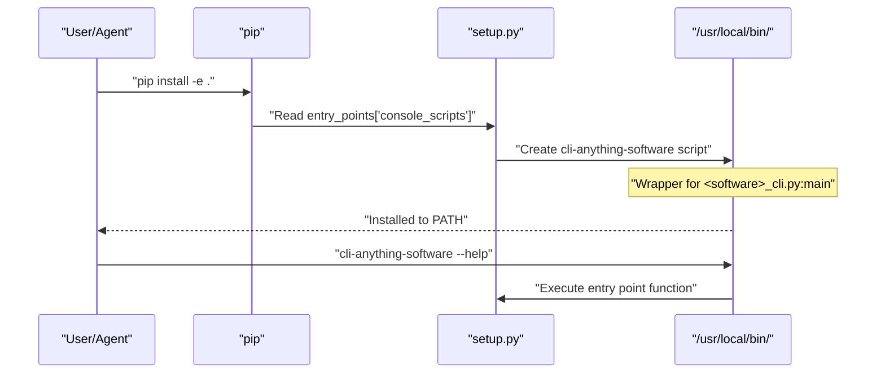

<!-- source: DeepWiki mcp.deepwiki.com · repo HKUDS/CLI-Anything · page 4.7 Phase 7: PyPI Publishing and Installation · fetched 2026-11-09 -->

# Phase 7: PyPI Publishing and Installation

<details>
<summary>Relevant source files</summary>

The following files were used as context for generating this wiki page:

- [adguardhome/agent-harness/cli_anything/adguardhome/skills/SKILL.md](adguardhome/agent-harness/cli_anything/adguardhome/skills/SKILL.md)
- [adguardhome/agent-harness/setup.py](adguardhome/agent-harness/setup.py)
- [audacity/agent-harness/setup.py](audacity/agent-harness/setup.py)
- [blender/agent-harness/setup.py](blender/agent-harness/setup.py)
- [comfyui/agent-harness/cli_anything/comfyui/skills/SKILL.md](comfyui/agent-harness/cli_anything/comfyui/skills/SKILL.md)
- [comfyui/agent-harness/setup.py](comfyui/agent-harness/setup.py)
- [gimp/agent-harness/setup.py](gimp/agent-harness/setup.py)
- [kdenlive/agent-harness/setup.py](kdenlive/agent-harness/setup.py)
- [mermaid/agent-harness/cli_anything/mermaid/skills/SKILL.md](mermaid/agent-harness/cli_anything/mermaid/skills/SKILL.md)
- [mermaid/agent-harness/setup.py](mermaid/agent-harness/setup.py)
- [obs-studio/agent-harness/setup.py](obs-studio/agent-harness/setup.py)
- [shotcut/agent-harness/setup.py](shotcut/agent-harness/setup.py)
- [skill_generation/tests/test_skill_path.py](skill_generation/tests/test_skill_path.py)

</details>


## Purpose and Scope

Phase 7 is the final stage of the 7-phase generation pipeline, responsible for packaging the generated CLI harness into a proper Python distribution that can be installed via `pip` and discovered by AI agents. This phase creates `setup.py` with PEP 420 namespace packaging under `cli_anything.*`, defines `console_scripts` entry points that install commands to PATH, and configures `package_data` to include `SKILL.md` files inside the installed package.

**Sources**: [adguardhome/agent-harness/cli_anything/adguardhome/skills/SKILL.md:12-18](), [mermaid/agent-harness/cli_anything/mermaid/skills/SKILL.md:12-18]()

Phase 7 follows Phase 6.5 (SKILL.md generation), which produces the AI-discoverable skill definition file that Phase 7 packages into the distribution. For information about the preceding phases, see Phase 3: Implementation, Phase 4-5: Test Planning and Implementation, and Phase 6.5: SKILL.md Generation.

**Sources**: [adguardhome/agent-harness/cli_anything/adguardhome/skills/SKILL.md:250-252](), [mermaid/agent-harness/cli_anything/mermaid/skills/SKILL.md:177-179]()

## Package Structure and Namespace Organization

Phase 7 establishes a consistent namespace package structure across all generated CLIs to prevent naming conflicts and enable clean installation alongside other CLI harnesses.

### PEP 420 Namespace Package Pattern

All generated CLIs use PEP 420 namespace packaging under `cli_anything` with the software name as a subpackage. Critically, there is **NO `__init__.py`** at the `cli_anything/` level—this allows multiple harnesses to coexist in the same environment without conflicts.

```
<software>/agent-harness/
├── setup.py                              # Package configuration (find_namespace_packages)
├── cli_anything/                         # Namespace package root (NO __init__.py)
│   └── <software>/                       # Software-specific package
│       ├── __init__.py                   # Package initialization
│       ├── <software>_cli.py             # CLI entry point (Click app)
│       ├── core/                         # Business logic modules
│       ├── utils/                        # Shared utilities
│       │   ├── repl_skin.py             # Unified REPL interface (copied)
│       │   └── <software>_backend.py    # Backend integration
│       ├── skills/                       # AI discovery (Phase 6.5)
│       │   └── SKILL.md                 # Agent-discoverable skill definition
│       └── tests/                        # Test suite
└── README.md                             # CLI documentation
```

**Sources**: [blender/agent-harness/setup.py:41](), [shotcut/agent-harness/setup.py:23](), [adguardhome/agent-harness/setup.py:7]()

### Package Architecture and Code Entities

The diagram below bridges the natural language concept of a "package" to the specific code entities defined in `setup.py` and the file system.

**Package Architecture: setup.py to Installed Command**

```mermaid
graph TB
    subgraph "Source: agent-harness/"
        ["setup.py"] -- "find_namespace_packages(include=['cli_anything.*'])" --> ["cli_anything/"]
        ["cli_anything/"] -- "Sub-package" --> ["cli_anything/blender/"]
    end
    
    subgraph "Package Contents: cli_anything.blender"
        ["blender_cli.py"]
        ["core/"]
        ["utils/"]
        ["skills/SKILL.md"]
        ["tests/"]
        
        ["cli_anything/blender/"] --> ["blender_cli.py"]
        ["cli_anything/blender/"] --> ["core/"]
        ["cli_anything/blender/"] --> ["utils/"]
        ["cli_anything/blender/"] --> ["skills/SKILL.md"]
        ["cli_anything/blender/"] --> ["tests/"]
    end
    
    subgraph "Installation: pip install -e ."
        ["console_scripts"] -- "maps to" --> ["/usr/local/bin/cli-anything-blender"]
        ["/usr/local/bin/cli-anything-blender"] -- "executes" --> ["cli_anything.blender.blender_cli:main"]
    end
```

**Sources**: [blender/agent-harness/setup.py:41](), [blender/agent-harness/setup.py:57-61]()

## Setup.py Configuration

Phase 7 generates `setup.py` with standardized structure following the actual implementations in Shotcut, Blender, and GIMP harnesses.

### Core Setup Configuration

Core setup.py Configuration for Generated CLIs

| Configuration Section | setuptools Function/Argument | Example Value | Purpose |
|----------------------|------------------------------|---------------|---------|
| **name** | `name=` | `"cli-anything-shotcut"` | Package name for pip install |
| **version** | `version=` | `"1.0.0"` | Semantic versioning |
| **packages** | `find_namespace_packages(include=["cli_anything.*"])` | Auto-discovers `cli_anything.shotcut.*` | PEP 420 namespace packaging |
| **install_requires** | `install_requires=` | `["click>=8.0.0", "prompt-toolkit>=3.0.0"]` | Runtime dependencies |
| **entry_points** | `entry_points={"console_scripts": [...]}` | `["cli-anything-shotcut=cli_anything.shotcut.shotcut_cli:cli"]` | Console script on PATH |
| **package_data** | `package_data={"cli_anything.shotcut": ["skills/*.md"]}` | Includes `skills/SKILL.md` | SKILL.md inside package |
| **python_requires** | `python_requires=` | `">=3.10"` | Python version constraint |
| **include_package_data** | `include_package_data=` | `True` | Include non-.py files |

**Sources**: [shotcut/agent-harness/setup.py:14-57](), [blender/agent-harness/setup.py:23-67](), [gimp/agent-harness/setup.py:9-61](), [adguardhome/agent-harness/setup.py:3-23]()

### Entry Point Definition

The `console_scripts` entry point maps the CLI command to the Click application entry function. This allows the agent to call the tool directly from the terminal.

```python
entry_points={
    "console_scripts": [
        "cli-anything-shotcut=cli_anything.shotcut.shotcut_cli:cli",
        "cli-anything-blender=cli_anything.blender.blender_cli:main",
        "cli-anything-gimp=cli_anything.gimp.gimp_cli:main",
        "cli-anything-adguardhome=cli_anything.adguardhome.adguardhome_cli:main",
    ]
}
```

**Sources**: [shotcut/agent-harness/setup.py:47-51](), [blender/agent-harness/setup.py:57-61](), [gimp/agent-harness/setup.py:51-55](), [adguardhome/agent-harness/setup.py:13-17]()

### Dependency Management

Phase 7 follows the "Authentic Backend" principle. The real software backends (like GIMP, Blender, or `melt`) are **NOT** listed as Python dependencies in `install_requires`. Instead, the backend utility module handles availability checks.

| Dependency Type | In install_requires? | Example | Location in setup.py |
|----------------|---------------------|---------|---------------------|
| **CLI Framework** | ✅ Always | `click>=8.0.0`, `prompt-toolkit>=3.0.0` | [shotcut/agent-harness/setup.py:37-38]() |
| **Python Libraries** | ✅ As needed | `defusedxml>=0.7.1`, `numpy>=1.24.0`, `requests>=2.28.0` | [shotcut/agent-harness/setup.py:39](), [audacity/agent-harness/setup.py:39](), [adguardhome/agent-harness/setup.py:11]()
| **Real Software** | ❌ Never | Blender binary, GIMP, melt | Documented in description/README |

**Sources**: [shotcut/agent-harness/setup.py:19](), [gimp/agent-harness/setup.py:19](), [adguardhome/agent-harness/setup.py:6](), [comfyui/agent-harness/setup.py:17-19]()

## Installation Flow

Phase 7 enables simple installation via `pip install -e .` that makes the CLI command immediately available on PATH.

### Installation Process with Code Entities

The diagram below shows the flow from the user's install command to the creation of executable scripts on the system PATH.

**Installation Flow: pip install to Executable Command**



**Sources**: [blender/agent-harness/setup.py:5-6](), [shotcut/agent-harness/setup.py:5-6]()

## Agent Discoverability

A key goal of Phase 7 is ensuring AI agents can discover and use the generated CLI through the `SKILL.md` file packaged within the distribution.

### Discovery Mechanisms

```mermaid
graph TB
    subgraph "Discovery Methods"
        ["which command"] -- "PATH lookup" --> ["Executable"]
        ["--help flag"] -- "Self-describing" --> ["Capability Discovery"]
        ["SKILL.md"] -- "Agent Instructions" --> ["Skill Loading"]
    end
    
    subgraph "System Integration"
        ["cli-anything-software"] -- "executes" --> ["Click App"]
        ["Click App"] -- "imports" --> ["ReplSkin"]
        ["ReplSkin"] -- "detects" --> ["SKILL.md in skills/"]
    end
```

**Sources**: [test_skill_path.py:70-79](), [test_skill_path.py:116-129]()

### SKILL.md Packaging via package_data

Phase 7 packages the `SKILL.md` file generated in Phase 6.5 inside the Python distribution using the `package_data` configuration.

```python
package_data={
    "cli_anything.blender": ["skills/*.md"],
}
```

This configuration ensures:
- The skill definition is installed in the `site-packages` directory.
- `ReplSkin` can auto-detect the file path via `Path(__file__).resolve().parent.parent / "skills" / "SKILL.md"` and display it in the REPL banner.
- Agents can read the file at the displayed absolute path to understand CLI usage.

**Sources**: [blender/agent-harness/setup.py:62-64](), [adguardhome/agent-harness/setup.py:19-20](), [test_skill_path.py:70-79](), [test_skill_path.py:102-105]()

## Verification and Validation

Phase 7 includes verification steps to ensure the package is correctly configured and functional.

### CLI Subprocess Tests with Force-Installed Mode

Phase 5 includes subprocess tests that verify the installed command works correctly. Setting `CLI_ANYTHING_FORCE_INSTALLED=1` forces the test suite to use the version of the CLI installed on the system PATH rather than the local module.

```bash
CLI_ANYTHING_FORCE_INSTALLED=1 python3 -m pytest cli_anything/<software>/tests/ -v
```

**Sources**: [test_skill_path.py:142-190]()

### Distribution and Publishing

While Phase 7 focuses on local installation, it also prepares the package for distribution to PyPI.

```bash
# Build distribution packages
python -m build

# Upload to PyPI
twine upload dist/*
```

**Sources**: [blender/agent-harness/setup.py:8-12](), [gimp/agent-harness/setup.py:6-7](), [shotcut/agent-harness/setup.py:5-6]()

---

