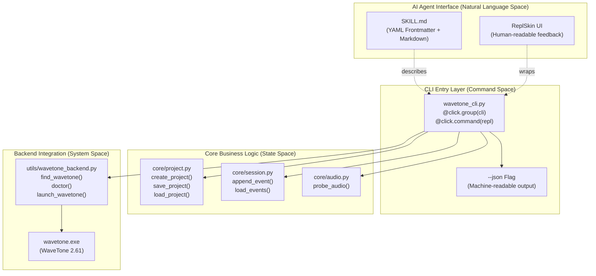
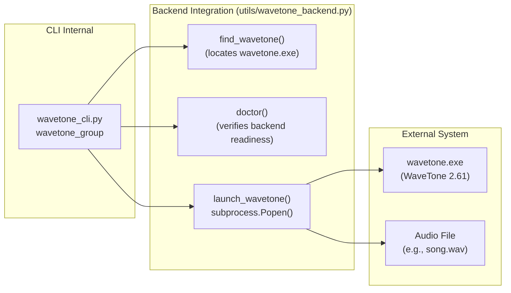

<!-- source: DeepWiki mcp.deepwiki.com · repo HKUDS/CLI-Anything · page 5 Generated CLI Architecture · fetched 2026-11-09 -->

# Generated CLI Architecture

<details>
<summary>Relevant source files</summary>

The following files were used as context for generating this wiki page:

- [.gitignore](.gitignore)
- [README.md](README.md)
- [README_CN.md](README_CN.md)
- [README_JA.md](README_JA.md)
- [skills/cli-anything-wavetone/SKILL.md](skills/cli-anything-wavetone/SKILL.md)
- [wavetone/agent-harness/cli_anything/wavetone/README.md](wavetone/agent-harness/cli_anything/wavetone/README.md)
- [wavetone/agent-harness/cli_anything/wavetone/core/audio.py](wavetone/agent-harness/cli_anything/wavetone/core/audio.py)
- [wavetone/agent-harness/cli_anything/wavetone/core/project.py](wavetone/agent-harness/cli_anything/wavetone/core/project.py)
- [wavetone/agent-harness/cli_anything/wavetone/core/session.py](wavetone/agent-harness/cli_anything/wavetone/core/session.py)
- [wavetone/agent-harness/cli_anything/wavetone/tests/TEST.md](wavetone/agent-harness/cli_anything/wavetone/tests/TEST.md)
- [wavetone/agent-harness/cli_anything/wavetone/tests/test_core.py](wavetone/agent-harness/cli_anything/wavetone/tests/test_core.py)
- [wavetone/agent-harness/cli_anything/wavetone/tests/test_full_e2e.py](wavetone/agent-harness/cli_anything/wavetone/tests/test_full_e2e.py)
- [wavetone/agent-harness/cli_anything/wavetone/utils/repl_skin.py](wavetone/agent-harness/cli_anything/wavetone/utils/repl_skin.py)
- [wavetone/agent-harness/cli_anything/wavetone/utils/wavetone_backend.py](wavetone/agent-harness/cli_anything/wavetone/utils/wavetone_backend.py)
- [wavetone/agent-harness/cli_anything/wavetone/wavetone_cli.py](wavetone/agent-harness/cli_anything/wavetone/wavetone_cli.py)
- [wavetone/agent-harness/setup.py](wavetone/agent-harness/setup.py)

</details>


This document describes the internal structure of CLI harnesses generated by the CLI-Anything system. Each generated CLI (e.g., `cli-anything-gimp`, `cli-anything-blender`, `cli-anything-browser`) follows a standardized architecture that includes package organization, entry points, core business logic, backend integration, and comprehensive testing.

---

## High-Level Component Architecture

The following diagram illustrates how the generated components interact to bridge the gap between Natural Language instructions (via AI agents) and the actual software backends.

**Bridge: Natural Language to Code Entity Space**


Sources: [wavetone/agent-harness/cli_anything/wavetone/wavetone_cli.py:10-28](), [wavetone/agent-harness/cli_anything/wavetone/utils/repl_skin.py:1-19](), [wavetone/agent-harness/cli_anything/wavetone/utils/wavetone_backend.py:1-11](), [wavetone/agent-harness/cli_anything/wavetone/core/project.py:1-10](), [wavetone/agent-harness/cli_anything/wavetone/core/session.py:1-10](), [wavetone/agent-harness/cli_anything/wavetone/core/audio.py:1-13](), [skills/cli-anything-wavetone/SKILL.md:1-4]()

---

## Package Structure and Namespace Design

### PEP 420 Namespace Packages

All generated CLIs use PEP 420 namespace packages under the `cli_anything` namespace. The critical design decision is **NO `__init__.py` at the namespace root** (`cli_anything/`), while the application-specific sub-package (`cli_anything/<software>/`) **MUST** have one.

**Package Layout:**
```
agent-harness/
├── setup.py                   # Uses find_namespace_packages(include=['cli_anything.*'])
└── cli_anything/              # NO __init__.py here (Namespace)
    └── <software>/            # HAS __init__.py (Sub-package)
        ├── __init__.py        
        ├── <software>_cli.py  # Entry point
        ├── core/              # Logic: project.py, session.py
        ├── utils/             # Helpers: software_backend.py, repl_skin.py
        ├── skills/            # AI Metadata: SKILL.md
        └── tests/             # Quality: TEST.md, test_core.py
```

This structure allows multiple CLI harnesses to be installed in the same environment without overwriting the `cli_anything` directory. For details, see [Package Structure and Namespace Design](#5.1).

Sources: [README.md:12](), [README_CN.md:8](), [README_JA.md:8]()

---

## CLI Entry Points and Command Structure

### Entry Point Logic
Generated CLIs use the `click` framework to provide a structured command hierarchy. The `setup.py` defines a `console_scripts` entry point that maps the command `cli-anything-<software>` to the `main` or `cli` function in `<software>_cli.py`. For example, `cli-anything-wavetone` maps to the `cli` function in `wavetone_cli.py` [wavetone/agent-harness/cli_anything/wavetone/wavetone_cli.py:67-85]().

### REPL vs. One-shot Execution
- **One-shot**: Commands like `cli-anything-wavetone --json project new song.wav -o song.wt.json` execute and exit [wavetone/agent-harness/cli_anything/wavetone/README.md:30-30]().
- **REPL**: Running the command without subcommands triggers `invoke_without_command=True`, entering an interactive session managed by `ReplSkin` [wavetone/agent-harness/cli_anything/wavetone/wavetone_cli.py:83-85](). The `repl` command itself provides the interactive loop [wavetone/agent-harness/cli_anything/wavetone/wavetone_cli.py:87-119]().

For details, see [CLI Entry Points and Command Structure](#5.2).

Sources: [wavetone/agent-harness/cli_anything/wavetone/wavetone_cli.py:67-85](), [wavetone/agent-harness/cli_anything/wavetone/wavetone_cli.py:87-119](), [wavetone/agent-harness/cli_anything/wavetone/README.md:30-30]()

---

## Core Business Logic Modules

### Stateful Session Management
The `core/session.py` module handles the recording and loading of session events, allowing for multi-step agent workflows [wavetone/agent-harness/cli_anything/wavetone/core/session.py:12-29](). This module ensures that events are appended and loaded correctly, rejecting invalid JSON schemas [wavetone/agent-harness/cli_anything/wavetone/tests/test_core.py:209-212]().

### Project and Audio
- `core/project.py`: Manages the creation, loading, and saving of WaveTone project manifests. It handles operations like adding labels, setting tempo, and updating analysis settings [wavetone/agent-harness/cli_anything/wavetone/core/project.py:12-28](). It also includes validation for numeric values to prevent non-finite numbers from being serialized [wavetone/agent-harness/cli_anything/wavetone/tests/test_core.py:126-135]().
- `core/audio.py`: Provides utilities for probing audio metadata. It uses the Python `wave` standard library for WAV files and falls back to `ffprobe` for other formats, or `stat` if `ffprobe` is unavailable [wavetone/agent-harness/cli_anything/wavetone/core/audio.py:92-112]().

For details, see [Core Business Logic Modules](#5.3).

Sources: [wavetone/agent-harness/cli_anything/wavetone/core/session.py:12-29](), [wavetone/agent-harness/cli_anything/wavetone/tests/test_core.py:209-212](), [wavetone/agent-harness/cli_anything/wavetone/core/project.py:12-28](), [wavetone/agent-harness/cli_anything/wavetone/tests/test_core.py:126-135](), [wavetone/agent-harness/cli_anything/wavetone/core/audio.py:92-112]()

---

## Backend Integration Layer

This layer serves as the "Authentic Integration" point where the CLI interacts with the actual GUI application's engine.

**Bridge: Backend Invocation Pattern**



The `utils/wavetone_backend.py` module is responsible for locating the `wavetone.exe` executable, performing diagnostic checks (`doctor()`) to ensure all required data files are present, and launching the application (`launch_wavetone()`) with specified audio files [wavetone/agent-harness/cli_anything/wavetone/utils/wavetone_backend.py:50-62](), [wavetone/agent-harness/cli_anything/wavetone/utils/wavetone_backend.py:65-97](), [wavetone/agent-harness/cli_anything/wavetone/utils/wavetone_backend.py:100-145](). It explicitly checks for a Windows host as WaveTone 2.61 is Windows-only [wavetone/agent-harness/cli_anything/wavetone/utils/wavetone_backend.py:106-107]().

For details, see [Backend Integration Layer](#5.4).

Sources: [wavetone/agent-harness/cli_anything/wavetone/utils/wavetone_backend.py:50-62](), [wavetone/agent-harness/cli_anything/wavetone/utils/wavetone_backend.py:65-97](), [wavetone/agent-harness/cli_anything/wavetone/utils/wavetone_backend.py:100-145](), [wavetone/agent-harness/cli_anything/wavetone/utils/wavetone_backend.py:106-107]()

---

## Testing Architecture

Generated CLIs use a standardized `TEST.md` file to track both the test plan and the actual results [wavetone/agent-harness/cli_anything/wavetone/tests/TEST.md:1-10]().

### Four-Layer Testing Pyramid
1.  **Unit Tests (`test_core.py`)**: Tests logic in `core/` using synthetic data, covering project manifest creation, audio probing, and session logs [wavetone/agent-harness/cli_anything/wavetone/tests/TEST.md:12-41]().
2.  **E2E Native Tests**: Verifies CLI project workflows, such as creating projects, setting tempo, and adding labels, ensuring JSON output is parseable and project files exist [wavetone/agent-harness/cli_anything/wavetone/tests/TEST.md:45-65]().
3.  **E2E Backend Tests**: Invokes the real software to verify end-to-end rendering. These tests are typically skipped by default and require explicit opt-in via environment variables like `CLI_ANYTHING_WAVETONE_REAL_BACKEND=1` [wavetone/agent-harness/cli_anything/wavetone/tests/TEST.md:67-84](), [wavetone/agent-harness/cli_anything/wavetone/tests/test_full_e2e.py:36-38]().
4.  **CLI Subprocess Tests**: Uses a `TestCLISubprocess` class and `_resolve_cli()` to test the installed command as a user/agent would, ensuring the CLI behaves correctly when invoked as a subprocess [wavetone/agent-harness/cli_anything/wavetone/tests/test_full_e2e.py:80-117](). The `_resolve_cli` function defaults to running the in-tree module unless `force_installed` is requested [wavetone/agent-harness/cli_anything/wavetone/tests/test_full_e2e.py:18-29]().

For details, see [Testing Architecture](#5.5).

Sources: [wavetone/agent-harness/cli_anything/wavetone/tests/TEST.md:1-10](), [wavetone/agent-harness/cli_anything/wavetone/tests/TEST.md:12-41](), [wavetone/agent-harness/cli_anything/wavetone/tests/TEST.md:45-65](), [wavetone/agent-harness/cli_anything/wavetone/tests/TEST.md:67-84](), [wavetone/agent-harness/cli_anything/wavetone/tests/test_full_e2e.py:36-38](), [wavetone/agent-harness/cli_anything/wavetone/tests/test_full_e2e.py:80-117](), [wavetone/agent-harness/cli_anything/wavetone/tests/test_full_e2e.py:18-29]()

---

## Shared Utilities: ReplSkin and SKILL.md

### ReplSkin
The `utils/repl_skin.py` module is a shared utility that provides a unified UX for the REPL mode. It handles the "branded" startup banner, formatted tables, and status messages [wavetone/agent-harness/cli_anything/wavetone/utils/repl_skin.py:1-19](). It is designed to auto-detect the `SKILL.md` file within the package to assist AI agents in discovery [wavetone/agent-harness/cli_anything/wavetone/tests/test_core.py:230-231]().

### SKILL.md
Generated via `skill_generator.py`, this file contains:
- **YAML Frontmatter**: For agent-platform discovery (name, description) [skills/cli-anything-wavetone/SKILL.md:1-3]().
- **Command Documentation**: Describes core commands and command groups, often extracted directly from Click decorators [skills/cli-anything-wavetone/SKILL.md:22-37]().
- **Agent Guidance**: Provides specific instructions for agents on how to interact with the CLI and the underlying software [skills/cli-anything-wavetone/SKILL.md:40-53]().

For details, see [Shared Utilities: ReplSkin and SKILL.md](#5.6).

Sources: [wavetone/agent-harness/cli_anything/wavetone/utils/repl_skin.py:1-19](), [wavetone/agent-harness/cli_anything/wavetone/tests/test_core.py:230-231](), [skills/cli-anything-wavetone/SKILL.md:1-3](), [skills/cli-anything-wavetone/SKILL.md:22-37](), [skills/cli-anything-wavetone/SKILL.md:40-53]()

---

**For more details, see:**
- [Package Structure and Namespace Design](#5.1)
- [CLI Entry Points and Command Structure](#5.2)
- [Core Business Logic Modules](#5.3)
- [Backend Integration Layer](#5.4)
- [Testing Architecture](#5.5)
- [Shared Utilities: ReplSkin and SKILL.md](#5.6)

---

