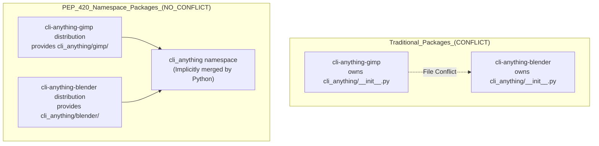
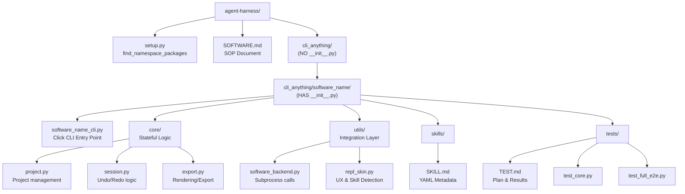
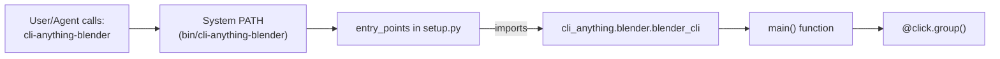

<!-- source: DeepWiki mcp.deepwiki.com · repo HKUDS/CLI-Anything · page 5.1 Package Structure and Namespace Design · fetched 2026-11-09 -->

# Package Structure and Namespace Design

<details>
<summary>Relevant source files</summary>

The following files were used as context for generating this wiki page:

- [adguardhome/agent-harness/cli_anything/adguardhome/skills/SKILL.md](adguardhome/agent-harness/cli_anything/adguardhome/skills/SKILL.md)
- [adguardhome/agent-harness/setup.py](adguardhome/agent-harness/setup.py)
- [audacity/agent-harness/setup.py](audacity/agent-harness/setup.py)
- [blender/agent-harness/setup.py](blender/agent-harness/setup.py)
- [comfyui/agent-harness/cli_anything/comfyui/skills/SKILL.md](comfyui/agent-harness/cli_anything/comfyui/skills/SKILL.md)
- [comfyui/agent-harness/setup.py](comfyui/agent-harness/setup.py)
- [gimp/agent-harness/setup.py](gimp/agent-harness/setup.py)
- [kdenlive/agent-harness/setup.py](kdenlive/agent-harness/setup.py)
- [mermaid/agent-harness/cli_anything/mermaid/skills/SKILL.md](mermaid/agent-harness/cli_anything/mermaid/skills/SKILL.md)
- [mermaid/agent-harness/setup.py](mermaid/agent-harness/setup.py)
- [obs-studio/agent-harness/setup.py](obs-studio/agent-harness/setup.py)
- [shotcut/agent-harness/setup.py](shotcut/agent-harness/setup.py)
- [skill_generation/tests/test_skill_path.py](skill_generation/tests/test_skill_path.py)

</details>


## Purpose and Scope

This document describes the Python package architecture used by all generated CLI harnesses in CLI-Anything. It covers the PEP 420 namespace package strategy, directory layout conventions, entry point configuration, and how multiple harnesses coexist without naming conflicts. This architecture ensures that every generated tool is "agent-native" by being self-describing, easily discoverable via system PATH, and packaged with its own AI-readable skill definitions.

Sources: [cli-anything-plugin/HARNESS.md:5-9](), [cli-anything-plugin/HARNESS.md:102-110]()

---

## PEP 420 Namespace Packages: The Foundation

Every generated CLI harness uses **PEP 420 implicit namespace packages** to organize code under the `cli_anything` namespace. The critical design decision is that **there is NO `__init__.py` file at the top-level `cli_anything/` directory**. This enables multiple independent harnesses to install into the same logical namespace without file collisions.

### Why PEP 420?

Traditional Python packages require an `__init__.py` file at every package level. If CLI-Anything used traditional packages, installing both `cli-anything-gimp` and `cli-anything-blender` would cause conflicts because both would try to own the file `site-packages/cli_anything/__init__.py`. PEP 420 namespace packages solve this by allowing the namespace to be implicitly defined across multiple distributions.

**Namespace Conflict Resolution Diagram**


Sources: [blender/agent-harness/setup.py:41-41](), [shotcut/agent-harness/setup.py:23-23](), [gimp/agent-harness/setup.py:23-23]()

---

## Generated Harness Directory Structure

Each generated harness follows a strict directory layout mandated by the 7-phase generation pipeline. This structure separates core logic, backend utilities, and AI discovery metadata.

**Code Entity Space: File and Folder Mapping**


Sources: [cli-anything-plugin/HARNESS.md:50-101](), [cli-anything-plugin/HARNESS.md:111-141](), [cli-anything-plugin/repl_skin.py:3-18]()

---

## Namespace Configuration in setup.py

The `setup.py` file uses `find_namespace_packages()` from `setuptools` to correctly identify and package the namespace structure. This is critical for agent-native tool discovery.

### Example: Blender Harness setup.py
As seen in [blender/agent-harness/setup.py:16-88](), the configuration explicitly includes the namespace:

```python
from setuptools import setup, find_namespace_packages

setup(
    name="cli-anything-blender",
    version="1.0.0",
    packages=find_namespace_packages(include=("cli_anything.*",)),
    entry_points={
        "console_scripts": [
            "cli-anything-blender=cli_anything.blender.blender_cli:main",
        ],
    },
    package_data={
        "cli_anything.blender": ["skills/*.md"],
    },
    include_package_data=True,
    zip_safe=False,
)
```

### Key Configuration Parameters

| Parameter | Purpose | Implementation Detail |
|-----------|---------|-----------------------|
| `name` | Distribution Name | Follows `cli-anything-<software>` [blender/agent-harness/setup.py:24]() |
| `packages` | Package Discovery | Uses `find_namespace_packages(include=("cli_anything.*",))` [blender/agent-harness/setup.py:41]() |
| `entry_points` | PATH integration | Maps shell command to `cli_anything.<software>.<software>_cli:main` [blender/agent-harness/setup.py:59]() |
| `package_data` | Resource inclusion | Specifically targets `skills/*.md` to ensure AI metadata is installed [blender/agent-harness/setup.py:63]() |

Sources: [blender/agent-harness/setup.py:23-66](), [shotcut/agent-harness/setup.py:14-56](), [gimp/agent-harness/setup.py:14-61]()

---

## Console Script Entry Points

Each harness exposes a `cli-anything-<software>` command to the system PATH. This mapping connects the shell environment to the Python package's entry function, typically managed by the Click framework.

**Natural Language to Code Entity: Execution Flow**


Sources: [blender/agent-harness/setup.py:58-60](), [shotcut/agent-harness/setup.py:47-49](), [gimp/agent-harness/setup.py:52-54]()

---

## Package Data: Including SKILL.md Files

A core requirement of the CLI-Anything architecture is that the `SKILL.md` file (which contains the AI agent instructions and command metadata) must be discoverable after the package is installed via `pip`.

### Discovery Mechanism
The `ReplSkin` utility (found in `cli-anything-plugin/repl_skin.py`) auto-detects the `SKILL.md` file relative to its own location in the installed `site-packages` directory.

1. `setup.py` includes `skills/*.md` in `package_data`. For example, [blender/agent-harness/setup.py:62-64]() shows `package_data={"cli_anything.blender": ["skills/*.md"]}`.
2. `ReplSkin` uses `Path(__file__)` to resolve the path to `../skills/SKILL.md`. This is demonstrated in the test `_load_repl_skin` function where `mod.__file__` is set to simulate the installed path, and `ReplSkin` then correctly finds the `SKILL.md` file [skill_generation/tests/test_skill_path.py:59-61](), [skill_generation/tests/test_skill_path.py:78-79]().
3. If found, the absolute path is displayed in the REPL banner for the agent to know where to read skill info [skill_generation/tests/test_skill_path.py:127-129]().

The `test_skill_md_exists_in_package` test explicitly verifies that `SKILL.md` files exist in the expected `cli_anything/<pkg_name>/skills/SKILL.md` location for all listed harnesses [skill_generation/tests/test_skill_path.py:166-170]().

Sources: [cli-anything-plugin/guides/skill-generation.md:60-76](), [skill_generation/tests/test_skill_path.py:59-61](), [skill_generation/tests/test_skill_path.py:78-79](), [skill_generation/tests/test_skill_path.py:127-129](), [skill_generation/tests/test_skill_path.py:166-170](), [blender/agent-harness/setup.py:62-64]()

---

## Naming Conventions Summary

To maintain the integrity of the `cli_anything` namespace and ensure discovery commands work correctly, all harnesses must adhere to these naming conventions:

| Component | Convention | Example |
|-----------|------------|---------|
| **Repo Subdirectory** | `agent-harness/` | `blender/agent-harness/` |
| **Top-level Namespace** | `cli_anything/` (No `__init__.py`) | `cli_anything/` |
| **Software Sub-package** | `cli_anything/<software>/` | `cli_anything/blender/` |
| **Main CLI File** | `<software>_cli.py` | `blender_cli.py` |
| **Package Name** | `cli-anything-<software>` | `cli-anything-blender` |
| **Entry Point** | `cli-anything-<software>` | `cli-anything-blender` |

Sources: [cli-anything-plugin/HARNESS.md:74-79](), [blender/agent-harness/setup.py:24-59](), [cli-anything-plugin/guides/skill-generation.md:60-76]()

---

