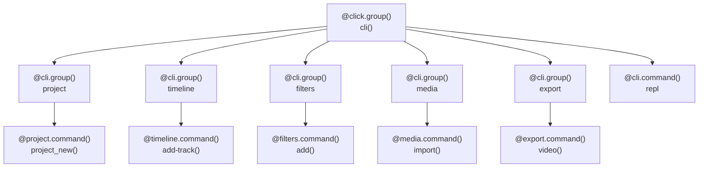
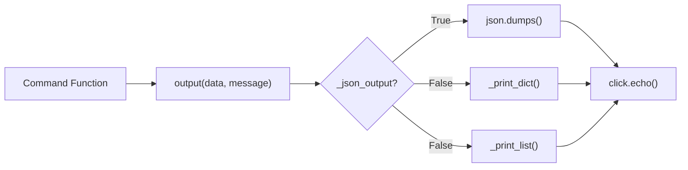
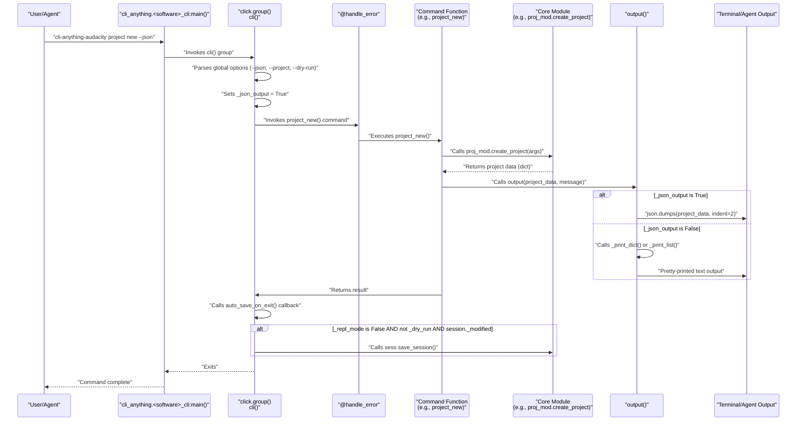

<!-- source: DeepWiki mcp.deepwiki.com · repo HKUDS/CLI-Anything · page 5.2 CLI Entry Points and Command Structure · fetched 2026-11-09 -->

# CLI Entry Points and Command Structure

<details>
<summary>Relevant source files</summary>

The following files were used as context for generating this wiki page:

- [audacity/agent-harness/cli_anything/audacity/audacity_cli.py](audacity/agent-harness/cli_anything/audacity/audacity_cli.py)
- [blender/agent-harness/cli_anything/blender/blender_cli.py](blender/agent-harness/cli_anything/blender/blender_cli.py)
- [cli-anything-plugin/guides/auto-save-dry-run.md](cli-anything-plugin/guides/auto-save-dry-run.md)
- [gimp/agent-harness/cli_anything/gimp/gimp_cli.py](gimp/agent-harness/cli_anything/gimp/gimp_cli.py)
- [kdenlive/agent-harness/cli_anything/kdenlive/kdenlive_cli.py](kdenlive/agent-harness/cli_anything/kdenlive/kdenlive_cli.py)
- [krita/agent-harness/cli_anything/krita/krita_cli.py](krita/agent-harness/cli_anything/krita/krita_cli.py)
- [libreoffice/agent-harness/cli_anything/libreoffice/libreoffice_cli.py](libreoffice/agent-harness/cli_anything/libreoffice/libreoffice_cli.py)
- [n8n/agent-harness/cli_anything/n8n/README.md](n8n/agent-harness/cli_anything/n8n/README.md)
- [n8n/agent-harness/cli_anything/n8n/core/expressions.py](n8n/agent-harness/cli_anything/n8n/core/expressions.py)
- [n8n/agent-harness/cli_anything/n8n/n8n_cli.py](n8n/agent-harness/cli_anything/n8n/n8n_cli.py)
- [n8n/agent-harness/cli_anything/n8n/tests/test_api_payload_fields.py](n8n/agent-harness/cli_anything/n8n/tests/test_api_payload_fields.py)
- [n8n/agent-harness/cli_anything/n8n/tests/test_full_e2e.py](n8n/agent-harness/cli_anything/n8n/tests/test_full_e2e.py)
- [n8n/agent-harness/cli_anything/n8n/tests/test_repl_invocation.py](n8n/agent-harness/cli_anything/n8n/tests/test_repl_invocation.py)
- [n8n/agent-harness/cli_anything/n8n/utils/repl_skin.py](n8n/agent-harness/cli_anything/n8n/utils/repl_skin.py)
- [n8n/agent-harness/pyproject.toml](n8n/agent-harness/pyproject.toml)
- [n8n/agent-harness/setup.py](n8n/agent-harness/setup.py)
- [obs-studio/agent-harness/cli_anything/obs_studio/obs_studio_cli.py](obs-studio/agent-harness/cli_anything/obs_studio/obs_studio_cli.py)
- [shotcut/agent-harness/cli_anything/shotcut/shotcut_cli.py](shotcut/agent-harness/cli_anything/shotcut/shotcut_cli.py)

</details>


This document describes the architecture of generated CLI entry points and command structures within the CLI-Anything ecosystem. It covers the Click-based command hierarchy, global state management, error handling patterns, output formatting, and the dual execution modes (REPL vs one-shot).

## Entry Point Mechanisms

All generated CLIs use a two-layer entry point system: a minimal `__main__.py` module for Python's `-m` flag execution, and a `main()` function in the primary CLI module.

### Module Entry Point

The `__main__.py` file provides the entry point for running the package as a module. This allows execution via `python3 -m cli_anything.<software>`, which is the standard pattern for namespace packages. For example, `python3 -m cli_anything.blender.blender_cli` [blender/agent-harness/cli_anything/blender/blender_cli.py:104-112]().

### Main Function and console_scripts

The primary `cli()` function initializes the Click CLI and serves as the installed command entry point. When the package is installed via `setup.py`, this function is mapped to the `cli-anything-<software>` command in the user's PATH via the `console_scripts` entry point [n8n/agent-harness/setup.py:59-63](). For instance, `cli-anything-n8n` is mapped to `cli_anything.n8n.n8n_cli:main` [n8n/agent-harness/pyproject.toml:48]().

**Sources**: [n8n/agent-harness/setup.py:59-63](), [n8n/agent-harness/pyproject.toml:48](), [blender/agent-harness/cli_anything/blender/blender_cli.py:104-112]()

## Click Framework Architecture

Generated CLIs use the Click framework to provide a hierarchical command structure. The architecture consists of a main CLI group with multiple command groups underneath, each handling a specific domain (e.g., `project`, `document`, `timeline`).

### Main CLI Group

The root `@click.group()` decorator defines the main CLI entry point. It accepts global options like `--json` for machine-readable output and `--project` for state persistence [shotcut/agent-harness/cli_anything/shotcut/shotcut_cli.py:200-204](). The `invoke_without_command=True` argument allows the CLI to enter REPL mode if no subcommand is provided [shotcut/agent-harness/cli_anything/shotcut/shotcut_cli.py:199]().

### Command Group Hierarchy



**Diagram: Click Command Hierarchy (Example: Shotcut)**

This diagram shows how Click decorators organize commands into a tree structure. Each `@click.group()` can have multiple `@command()` children, creating a hierarchical interface. For example, the `shotcut_cli.py` defines `project`, `timeline`, `filters`, `media`, `export`, `transitions`, `compositing`, and `preview` command groups [shotcut/agent-harness/cli_anything/shotcut/shotcut_cli.py:30-37]().

**Sources**: [shotcut/agent-harness/cli_anything/shotcut/shotcut_cli.py:30-37](), [shotcut/agent-harness/cli_anything/shotcut/shotcut_cli.py:199-204]()

## Global State and Context

Generated CLIs maintain internal state to manage execution context, particularly for session-based applications.

### State Variables

Common module-level global variables include:

- `_session`: Holds the active `Session` object for stateful tracking [shotcut/agent-harness/cli_anything/shotcut/shotcut_cli.py:40-41]().
- `_json_output`: Controls the output format (text vs JSON) [shotcut/agent-harness/cli_anything/shotcut/shotcut_cli.py:41]().
- `_repl_mode`: Indicates if the CLI is running interactively [shotcut/agent-harness/cli_anything/shotcut/shotcut_cli.py:191]().
- `_dry_run`: If True, prevents changes from being written to disk [shotcut/agent-harness/cli_anything/shotcut/shotcut_cli.py:192]().

These variables are typically initialized at the module level and modified within the `cli()` function based on command-line options [shotcut/agent-harness/cli_anything/shotcut/shotcut_cli.py:203-204]().

### JSON Output Flag

The `_json_output` flag is set by the `--json` global option [shotcut/agent-harness/cli_anything/shotcut/shotcut_cli.py:200](). This flag is checked by the `output()` function to determine how to display data to the user or agent [shotcut/agent-harness/cli_anything/shotcut/shotcut_cli.py:53]().

**Sources**: [shotcut/agent-harness/cli_anything/shotcut/shotcut_cli.py:40-41](), [shotcut/agent-harness/cli_anything/shotcut/shotcut_cli.py:53](), [shotcut/agent-harness/cli_anything/shotcut/shotcut_cli.py:191-192](), [shotcut/agent-harness/cli_anything/shotcut/shotcut_cli.py:200](), [shotcut/agent-harness/cli_anything/shotcut/shotcut_cli.py:203-204]()

## Error Handling Pattern

All command functions are typically wrapped with a `@handle_error` decorator to ensure consistent failure reporting across one-shot and REPL modes.

```python
def handle_error(func):
    """Decorator to handle errors consistently."""
    def wrapper(*args, **kwargs):
        try:
            return func(*args, **kwargs)
        except FileNotFoundError as e:
            if _json_output:
                click.echo(json.dumps({"error": str(e), "type": "file_not_found"}))
            else:
                click.echo(f"Error: {e}", err=True)
            sys.exit(1) if not _repl_mode else None
        except (ValueError, IndexError, RuntimeError) as e:
            if _json_output:
                click.echo(json.dumps({"error": str(e), "type": type(e).__name__}))
            else:
                click.echo(f"Error: {e}", err=True)
            sys.exit(1) if not _repl_mode else None
        except Exception as e:
            if _json_output:
                click.echo(json.dumps({"error": str(e), "type": "unexpected"}))
            else:
                click.echo(f"Unexpected error: {e}", err=True)
            sys.exit(1) if not _repl_mode else None
    wrapper.__name__ = func.__name__
    wrapper.__doc__ = func.__doc__
    return wrapper
```
[shotcut/agent-harness/cli_anything/shotcut/shotcut_cli.py:163-188]()

### Error Reporting

The decorator catches exceptions (e.g., `FileNotFoundError`, `ValueError`, `RuntimeError`) and, if `_json_output` is enabled, returns a JSON object containing the error message and exception type [shotcut/agent-harness/cli_anything/shotcut/shotcut_cli.py:168-172](). In non-REPL mode, errors trigger `sys.exit(1)` to signal failure to the shell or calling agent [shotcut/agent-harness/cli_anything/shotcut/shotcut_cli.py:173](). If `_repl_mode` is active, `sys.exit(1)` is not called, allowing the REPL session to continue [shotcut/agent-harness/cli_anything/shotcut/shotcut_cli.py:173]().

**Sources**: [shotcut/agent-harness/cli_anything/shotcut/shotcut_cli.py:163-188]()

## Output Formatting System

The `output()` function provides dual-mode formatting, enabling both human readability and machine parsability.

```python
def output(data, message: str = ""):
    """Output result data. JSON mode or human-readable."""
    if _json_output:
        click.echo(json.dumps(data, indent=2, default=str))
    else:
        if message:
            click.echo(message)
        if isinstance(data, dict):
            _print_dict(data)
        elif isinstance(data, list):
            _print_list(data)
        else:
            click.echo(str(data))
```
[shotcut/agent-harness/cli_anything/shotcut/shotcut_cli.py:52-64]()

### JSON Mode

When `--json` is active, the CLI uses `json.dumps()` with indentation. It often includes a `default=str` parameter to handle non-serializable objects like UUIDs or path objects [shotcut/agent-harness/cli_anything/shotcut/shotcut_cli.py:54]().

### Human-Readable Mode

In standard mode, the CLI uses recursive helper functions (`_print_dict`, `_print_list`) to create a clean, indented tree structure in the terminal [shotcut/agent-harness/cli_anything/shotcut/shotcut_cli.py:137-160]().



**Diagram: Output Formatting Flow**

**Sources**: [shotcut/agent-harness/cli_anything/shotcut/shotcut_cli.py:52-64](), [shotcut/agent-harness/cli_anything/shotcut/shotcut_cli.py:137-160]()

## REPL Mode vs One-Shot Execution

The CLI supports two primary interaction patterns, controlled by the `invoke_without_command=True` property of the main group [shotcut/agent-harness/cli_anything/shotcut/shotcut_cli.py:199]().

### One-Shot Mode

In one-shot mode, the user provides the full command path and arguments in a single shell invocation. The CLI parses the arguments, executes the command, and triggers an auto-save callback if the state was modified [audacity/agent-harness/cli_anything/audacity/audacity_cli.py:157-169](). The `_dry_run` flag can prevent changes from being saved [audacity/agent-harness/cli_anything/audacity/audacity_cli.py:161]().

### REPL Mode

The REPL (Read-Eval-Print Loop) provides an interactive shell environment. It is triggered by running the CLI without subcommands [shotcut/agent-harness/cli_anything/shotcut/shotcut_cli.py:213]().

In REPL mode:
1. The CLI initializes a `ReplSkin` for consistent branding and terminal UX [n8n/agent-harness/cli_anything/n8n/utils/repl_skin.py:112-117]().
2. It sets `_repl_mode = True` to prevent `sys.exit()` on errors, allowing the session to continue [shotcut/agent-harness/cli_anything/shotcut/shotcut_cli.py:191]().
3. It provides a prompt session with history and styled output [n8n/agent-harness/cli_anything/n8n/utils/repl_skin.py:165-171](). The `ReplSkin` also handles displaying the `SKILL.md` path for agent discovery [n8n/agent-harness/cli_anything/n8n/utils/repl_skin.py:158-161]().

**Sources**: [shotcut/agent-harness/cli_anything/shotcut/shotcut_cli.py:191](), [shotcut/agent-harness/cli_anything/shotcut/shotcut_cli.py:199](), [shotcut/agent-harness/cli_anything/shotcut/shotcut_cli.py:213](), [audacity/agent-harness/cli_anything/audacity/audacity_cli.py:157-169](), [audacity/agent-harness/cli_anything/audacity/audacity_cli.py:161](), [n8n/agent-harness/cli_anything/n8n/utils/repl_skin.py:112-117](), [n8n/agent-harness/cli_anything/n8n/utils/repl_skin.py:158-161](), [n8n/agent-harness/cli_anything/n8n/utils/repl_skin.py:165-171]()

## Command Execution Flow

The following sequence diagram illustrates the flow from user input to backend execution.



**Diagram: Command Execution Sequence (Example: Audacity)**

**Sources**: [audacity/agent-harness/cli_anything/audacity/audacity_cli.py:130-154](), [audacity/agent-harness/cli_anything/audacity/audacity_cli.py:157-169](), [audacity/agent-harness/cli_anything/audacity/audacity_cli.py:187-197](), [audacity/agent-harness/cli_anything/audacity/audacity_cli.py:52-64]()

---

