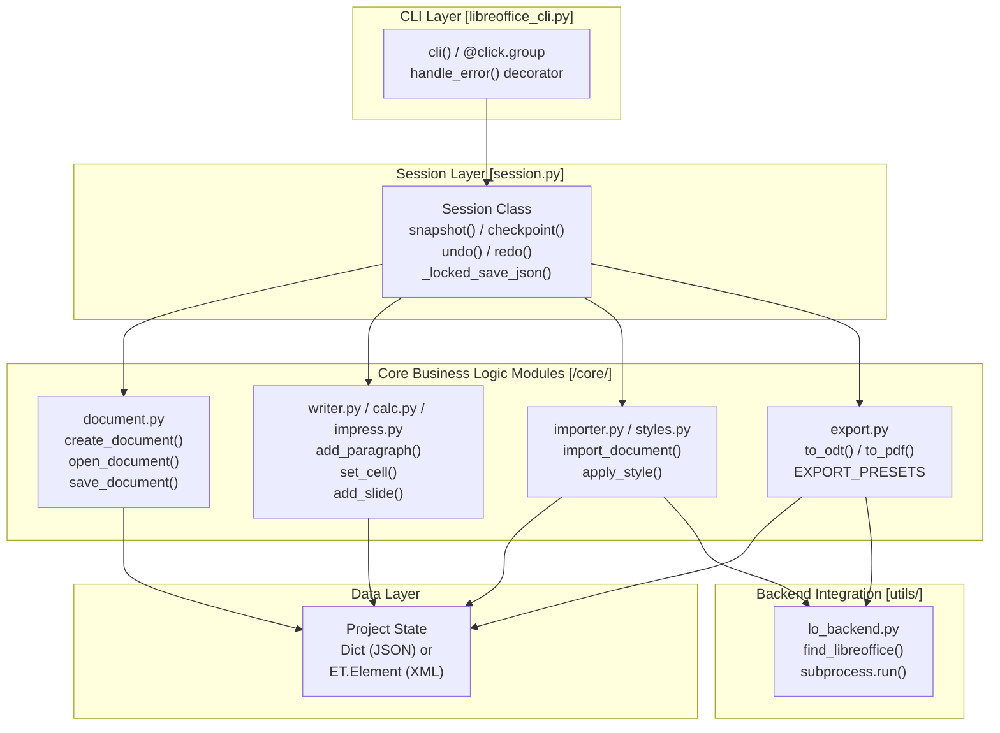
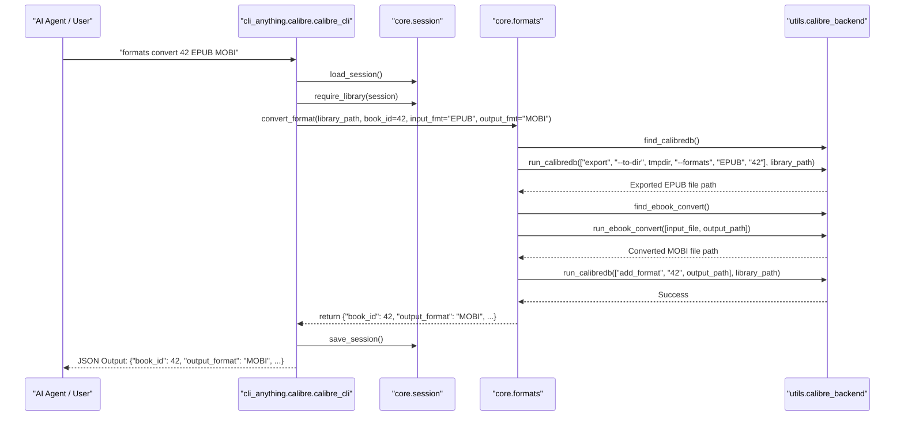

<!-- source: DeepWiki mcp.deepwiki.com · repo HKUDS/CLI-Anything · page 5.3 Core Business Logic Modules · fetched 2026-11-09 -->

# Core Business Logic Modules

Relevant source files

The following files were used as context for generating this wiki page:

- [anygen/agent-harness/cli_anything/anygen/core/session.py](anygen/agent-harness/cli_anything/anygen/core/session.py)
- [audacity/agent-harness/cli_anything/audacity/core/session.py](audacity/agent-harness/cli_anything/audacity/core/session.py)
- [blender/agent-harness/cli_anything/blender/core/session.py](blender/agent-harness/cli_anything/blender/core/session.py)
- [calibre/agent-harness/.gitignore](calibre/agent-harness/.gitignore)
- [calibre/agent-harness/CALIBRE.md](calibre/agent-harness/CALIBRE.md)
- [calibre/agent-harness/FIX_NOTES.md](calibre/agent-harness/FIX_NOTES.md)
- [calibre/agent-harness/cli_anything/calibre/README.md](calibre/agent-harness/cli_anything/calibre/README.md)
- [calibre/agent-harness/cli_anything/calibre/__init__.py](calibre/agent-harness/cli_anything/calibre/__init__.py)
- [calibre/agent-harness/cli_anything/calibre/__main__.py](calibre/agent-harness/cli_anything/calibre/__main__.py)
- [calibre/agent-harness/cli_anything/calibre/calibre_cli.py](calibre/agent-harness/cli_anything/calibre/calibre_cli.py)
- [calibre/agent-harness/cli_anything/calibre/core/__init__.py](calibre/agent-harness/cli_anything/calibre/core/__init__.py)
- [calibre/agent-harness/cli_anything/calibre/core/custom.py](calibre/agent-harness/cli_anything/calibre/core/custom.py)
- [calibre/agent-harness/cli_anything/calibre/core/export.py](calibre/agent-harness/cli_anything/calibre/core/export.py)
- [calibre/agent-harness/cli_anything/calibre/core/formats.py](calibre/agent-harness/cli_anything/calibre/core/formats.py)
- [calibre/agent-harness/cli_anything/calibre/core/library.py](calibre/agent-harness/cli_anything/calibre/core/library.py)
- [calibre/agent-harness/cli_anything/calibre/tests/TEST.md](calibre/agent-harness/cli_anything/calibre/tests/TEST.md)
- [calibre/agent-harness/cli_anything/calibre/tests/test_core.py](calibre/agent-harness/cli_anything/calibre/tests/test_core.py)
- [calibre/agent-harness/cli_anything/calibre/tests/test_full_e2e.py](calibre/agent-harness/cli_anything/calibre/tests/test_full_e2e.py)
- [calibre/agent-harness/cli_anything/calibre/utils/calibre_backend.py](calibre/agent-harness/cli_anything/calibre/utils/calibre_backend.py)
- [calibre/agent-harness/cli_anything/calibre/utils/repl_skin.py](calibre/agent-harness/cli_anything/calibre/utils/repl_skin.py)
- [calibre/agent-harness/setup.py](calibre/agent-harness/setup.py)
- [drawio/agent-harness/cli_anything/drawio/core/session.py](drawio/agent-harness/cli_anything/drawio/core/session.py)
- [gimp/agent-harness/cli_anything/gimp/core/session.py](gimp/agent-harness/cli_anything/gimp/core/session.py)
- [inkscape/agent-harness/cli_anything/inkscape/core/session.py](inkscape/agent-harness/cli_anything/inkscape/core/session.py)
- [kdenlive/agent-harness/cli_anything/kdenlive/core/session.py](kdenlive/agent-harness/cli_anything/kdenlive/core/session.py)
- [libreoffice/agent-harness/cli_anything/libreoffice/core/session.py](libreoffice/agent-harness/cli_anything/libreoffice/core/session.py)
- [obs-studio/agent-harness/cli_anything/obs_studio/core/session.py](obs-studio/agent-harness/cli_anything/obs_studio/core/session.py)
- [shotcut/agent-harness/cli_anything/shotcut/core/session.py](shotcut/agent-harness/cli_anything/shotcut/core/session.py)

This document describes the standard core business logic modules found in generated CLI harnesses. These modules encapsulate domain-specific operations and are independent of CLI interface concerns. While the specific domain logic varies (e.g., image manipulation in GIMP, document editing in LibreOffice, or video editing in Shotcut), the architectural patterns remain consistent.

The core modules follow a "Data-First" pattern: pure Python functions operating on project state (often dictionaries or XML trees), with no external dependencies beyond the application's backend engine or standard libraries.

## Module Architecture Overview

The core layer consists of domain modules that manipulate the project data structure. All modules typically accept and return the current state representing the project.

Title: Core Logic Data Flow

**Sources**: [calibre/agent-harness/cli_anything/calibre/calibre_cli.py:24-28](), [calibre/agent-harness/cli_anything/calibre/core/export.py:30-76](), [calibre/agent-harness/cli_anything/calibre/core/formats.py:15-40]()

## Session and State Management (`session.py`)

The `Session` class is the heart of stateful CLI interaction. It maintains the in-memory state of the currently open project and manages the undo/redo history.

### Key Implementation Details
- **Snapshotting**: Before any destructive operation, the CLI calls `session.snapshot()` (or `checkpoint()`), which performs a `copy.deepcopy()` of the current state and pushes it to an `undo_stack` [shotcut/agent-harness/cli_anything/shotcut/core/session.py:91-105](), [drawio/agent-harness/cli_anything/drawio/core/session.py:75-82]().
- **Undo/Redo**: These methods pop states from one stack and push to the other, effectively moving the system through time. Most harnesses limit this to 50 levels [shotcut/agent-harness/cli_anything/shotcut/core/session.py:46](), [drawio/agent-harness/cli_anything/drawio/core/session.py:46]().
- **Persistence**: Sessions are persisted to disk as JSON files to survive process restarts [anygen/agent-harness/cli_anything/anygen/core/session.py:126-131]().
- **File Locking**: To prevent corruption during concurrent access, a `_locked_save_json` helper uses `fcntl.flock` (Unix) to ensure atomic writes to the session file [anygen/agent-harness/cli_anything/anygen/core/session.py:10-34](), [shotcut/agent-harness/cli_anything/shotcut/core/session.py:18-43]().

### Session Data Structure

| Attribute | Type | Purpose |
|-----------|------|---------|
| `project` | `dict` or `ET.Element` | The in-memory representation of the project state. For Calibre, this is implicitly managed by the backend, but for Shotcut/Draw.io, it's an `ET.Element` [shotcut/agent-harness/cli_anything/shotcut/core/session.py:68](), [drawio/agent-harness/cli_anything/drawio/core/session.py:54]() |
| `project_path` | `str` | Absolute path to the active project file [shotcut/agent-harness/cli_anything/shotcut/core/session.py:67]() |
| `_history` / `_undo_stack` | `list` | Stack of deep-copied project states (serialized XML for Shotcut/Draw.io) or command history entries [anygen/agent-harness/cli_anything/anygen/core/session.py:69](), [shotcut/agent-harness/cli_anything/shotcut/core/session.py:69]() |
| `_redo_stack` | `list` | Stack of project states for redo operations [anygen/agent-harness/cli_anything/anygen/core/session.py:70](), [shotcut/agent-harness/cli_anything/shotcut/core/session.py:70]() |
| `_modified` | `bool` | Dirty flag indicating unsaved changes [shotcut/agent-harness/cli_anything/shotcut/core/session.py:71]() |

**Sources**: [shotcut/agent-harness/cli_anything/shotcut/core/session.py:49-178](), [drawio/agent-harness/cli_anything/drawio/core/session.py:49-194](), [anygen/agent-harness/cli_anything/anygen/core/session.py:65-120]()

## Project Module (`library.py` / `project.py`)

The project module provides foundational project lifecycle operations: creation, loading, and metadata extraction. For Calibre, this is primarily handled by `library.py` which interacts with the `calibredb` backend.

### Core Patterns
- **Open/Load**: Functions like `library_connect(path)` in Calibre set the active library path, which is then used by subsequent commands [calibre/agent-harness/cli_anything/calibre/calibre_cli.py:156-178](). For Shotcut/Draw.io, `open_project(path)` reads the file and converts it into a manipulatable XML tree [shotcut/agent-harness/cli_anything/shotcut/core/session.py:200-207](), [drawio/agent-harness/cli_anything/drawio/core/session.py:120-128]().
- **New Project**: Initializes a blank state with default settings. For Calibre, this isn't directly applicable as libraries are managed by `calibredb`. For Shotcut/Draw.io, `new_project()` creates an empty XML structure [shotcut/agent-harness/cli_anything/shotcut/core/session.py:165-178](), [drawio/agent-harness/cli_anything/drawio/core/session.py:111-119]().
- **Status/Metadata**: The `library_info()` function extracts summary statistics (e.g., book counts, format counts, database size) to provide the agent with a high-level view [calibre/agent-harness/cli_anything/calibre/calibre_cli.py:181-204]().

**Sources**: [calibre/agent-harness/cli_anything/calibre/core/library.py:15-40](), [calibre/agent-harness/cli_anything/calibre/calibre_cli.py:156-204]()

## Domain-Specific Modules

These modules implement the "business logic" unique to the application, typically named after the entities they manage.

### Entity Management (e.g., `library.py`, `metadata.py`, `formats.py`, `custom.py`)
These modules handle CRUD operations for project components. For Calibre, these directly wrap `calibredb` commands.
- **Listing**: `list_books()` and `list_formats()` retrieve information about books and their available formats from the Calibre library [calibre/agent-harness/cli_anything/calibre/core/library.py:15-40](), [calibre/agent-harness/cli_anything/calibre/core/formats.py:15-40]().
- **Creation**: `add_book()` adds new books to the library [calibre/agent-harness/cli_anything/calibre/core/library.py:43-60](). `add_format()` adds a new format to an existing book [calibre/agent-harness/cli_anything/calibre/core/formats.py:44-66]().
- **Modification**: `set_metadata()` updates book metadata fields like title, authors, and tags [calibre/agent-harness/cli_anything/calibre/core/metadata.py:158]().
- **Deletion**: `remove_books()` and `remove_format()` delete books or specific formats [calibre/agent-harness/cli_anything/calibre/core/library.py:63-79](), [calibre/agent-harness/cli_anything/calibre/core/formats.py:69-85]().

### Operation Modules (e.g., `formats.py`)
These modules implement transformations and external data integration.
- **Conversion Pipeline**: `convert_format()` in Calibre handles the complex logic of converting between book formats by first exporting the source format, then invoking `ebook-convert`, and finally optionally adding the converted file back to the library [calibre/agent-harness/cli_anything/calibre/core/formats.py:88-167]().
- **Validation**: Before performing an operation, these modules validate parameters (e.g., checking if a file exists before adding it as a format) [calibre/agent-harness/cli_anything/calibre/core/formats.py:50-53]().

**Sources**: [calibre/agent-harness/cli_anything/calibre/core/library.py:15-79](), [calibre/agent-harness/cli_anything/calibre/core/metadata.py:158](), [calibre/agent-harness/cli_anything/calibre/core/formats.py:15-167](), [calibre/agent-harness/cli_anything/calibre/core/custom.py:15-62]()

## Export Module (`export.py`)

The export module handles the conversion of the internal project state into final deliverables. For Calibre, this involves exporting books or generating catalogs.

### Implementation Patterns
- **Backend Invocation**: High-level export functions often wrap the software's native CLI. For example, `export_books()` uses `calibredb export` [calibre/agent-harness/cli_anything/calibre/core/export.py:30-76](). `generate_catalog()` uses `calibredb catalog` [calibre/agent-harness/cli_anything/calibre/core/export.py:79-116]().
- **Format Presets**: Modules define supported formats (EPUB, MOBI, PDF, CSV, OPDS) and associated parameters [calibre/agent-harness/cli_anything/calibre/core/export.py:26](), [calibre/agent-harness/cli_anything/calibre/core/export.py:82]().
- **Verification**: After export, the module verifies the output file exists and is non-empty [calibre/agent-harness/cli_anything/calibre/core/export.py:102-108]().

**Sources**: [calibre/agent-harness/cli_anything/calibre/core/export.py:30-116]()

## Data Flow: Command to Result

This diagram traces the flow of a single command through the core modules of a Calibre harness.

Title: Calibre Command Execution Sequence

**Sources**: [calibre/agent-harness/cli_anything/calibre/calibre_cli.py:11-12](), [calibre/agent-harness/cli_anything/calibre/core/formats.py:88-167](), [calibre/agent-harness/cli_anything/calibre/utils/calibre_backend.py:79-119](), [calibre/agent-harness/cli_anything/calibre/utils/calibre_backend.py:122-158]()

## Error Handling Pattern

Core modules use a unified error handling strategy via the main CLI entry point.

- **Consistent JSON**: When `--json` is passed, exceptions (e.g., `FileNotFoundError`, `ValueError`, `RuntimeError`) caught in core modules are converted to a JSON object containing the error message and type [calibre/agent-harness/cli_anything/calibre/calibre_cli.py:33-48]().
- **Non-Zero Exit**: In one-shot mode, errors trigger a `sys.exit(1)`. In REPL mode, the error is reported to the user but the session remains active [calibre/agent-harness/cli_anything/calibre/calibre_cli.py:144-146]().

**Sources**: [calibre/agent-harness/cli_anything/calibre/calibre_cli.py:33-48](), [calibre/agent-harness/cli_anything/calibre/calibre_cli.py:144-146]()

---

