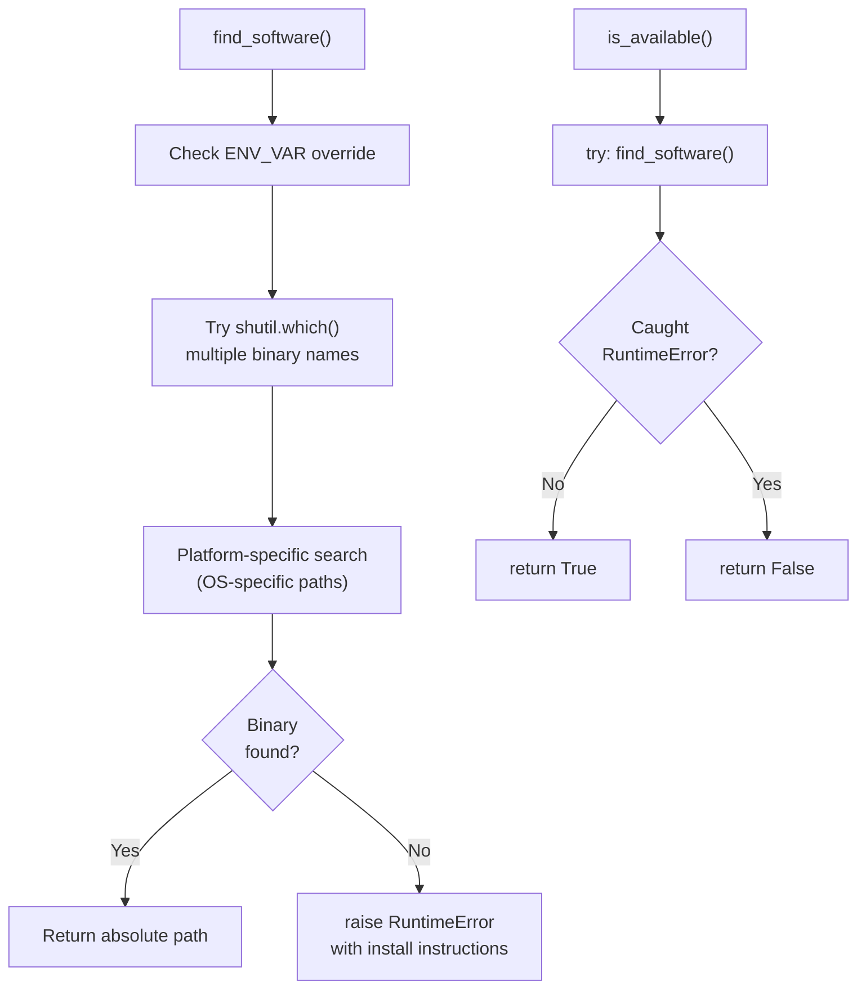
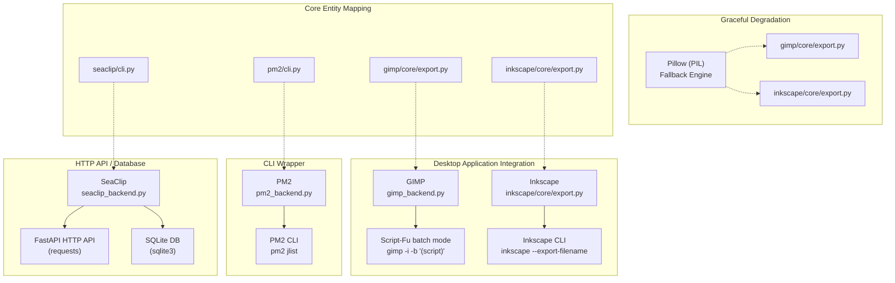

<!-- source: DeepWiki mcp.deepwiki.com · repo HKUDS/CLI-Anything · page 5.4 Backend Integration Layer · fetched 2026-11-09 -->

# Backend Integration Layer

Relevant source files

The following files were used as context for generating this wiki page:

- [browser/agent-harness/cli_anything/browser/utils/security.py](browser/agent-harness/cli_anything/browser/utils/security.py)
- [chromadb/agent-harness/cli_anything/chromadb/tests/TEST.md](chromadb/agent-harness/cli_anything/chromadb/tests/TEST.md)
- [gimp/agent-harness/cli_anything/gimp/core/export.py](gimp/agent-harness/cli_anything/gimp/core/export.py)
- [gimp/agent-harness/cli_anything/gimp/core/layers.py](gimp/agent-harness/cli_anything/gimp/core/layers.py)
- [gimp/agent-harness/cli_anything/gimp/core/media.py](gimp/agent-harness/cli_anything/gimp/core/media.py)
- [gimp/agent-harness/cli_anything/gimp/tests/test_full_e2e.py](gimp/agent-harness/cli_anything/gimp/tests/test_full_e2e.py)
- [gimp/agent-harness/cli_anything/gimp/utils/gimp_backend.py](gimp/agent-harness/cli_anything/gimp/utils/gimp_backend.py)
- [inkscape/agent-harness/cli_anything/inkscape/core/export.py](inkscape/agent-harness/cli_anything/inkscape/core/export.py)
- [inkscape/agent-harness/cli_anything/inkscape/core/text.py](inkscape/agent-harness/cli_anything/inkscape/core/text.py)
- [pm2/agent-harness/cli_anything/pm2/tests/TEST.md](pm2/agent-harness/cli_anything/pm2/tests/TEST.md)
- [pm2/agent-harness/cli_anything/pm2/utils/pm2_backend.py](pm2/agent-harness/cli_anything/pm2/utils/pm2_backend.py)
- [seaclip/agent-harness/SEACLIP.md](seaclip/agent-harness/SEACLIP.md)
- [seaclip/agent-harness/cli_anything/seaclip/tests/TEST.md](seaclip/agent-harness/cli_anything/seaclip/tests/TEST.md)
- [seaclip/agent-harness/cli_anything/seaclip/utils/seaclip_backend.py](seaclip/agent-harness/cli_anything/seaclip/utils/seaclip_backend.py)

The Backend Integration Layer is responsible for invoking real software applications from generated CLIs to perform actual rendering, processing, and export operations. This layer implements the "Authentic Software Integration" principle: CLIs generate valid project files and delegate rendering to the real application rather than reimplementing functionality.

**Scope**: This page covers the `utils/*_backend.py` modules, subprocess invocation patterns, output verification, and security allowlists. For the CLI command structure that calls these backends, see [5.2 CLI Entry Points and Command Structure](). For testing strategies that validate backend integration, see [5.5 Testing Architecture]().

---

## Core Integration Principle

Every generated CLI harness follows a strict separation of concerns:

1.  **CLI layer** - Parses commands via `click`, manages project state.
2.  **Core layer** - Builds project files (JSON, ODF, MLT XML, SVG, etc.) in modules like `project.py` and `export.py`.
3.  **Backend layer** - Invokes the real software (GIMP, Inkscape, melt) to perform operations.
4.  **Verification layer** - Validates the output was created correctly via file checks and magic bytes.

**Critical Rule**: The CLI never reimplements the software's capabilities. GIMP Script-Fu applies filters, `melt` renders video, and `inkscape` (when available) renders SVG to PDF. The CLI constructs valid input and verifies valid output.

Sources: [gimp/agent-harness/cli_anything/gimp/utils/gimp_backend.py:1-7](), [seaclip/agent-harness/SEACLIP.md:1-18](), [inkscape/agent-harness/cli_anything/inkscape/core/export.py:62-67]()

---

## Backend Discovery Pattern

All backend modules implement a standard discovery mechanism to locate the software executable before invocation.

Title: Backend Discovery Mechanism

Sources: [gimp/agent-harness/cli_anything/gimp/utils/gimp_backend.py:25-34](), [pm2/agent-harness/cli_anything/pm2/utils/pm2_backend.py:26-42]()

### GIMP Backend Discovery
GIMP discovery iterates through common versioned binary names (`gimp`, `gimp-2.10`, `gimp-2.99`) using `shutil.which`:

[gimp/agent-harness/cli_anything/gimp/utils/gimp_backend.py:25-34]()

### PM2 Backend Discovery
The PM2 backend uses `_find_pm2()` to locate the `pm2` executable, augmenting the system `PATH` with common installation directories like `/opt/homebrew/bin` and `/usr/local/bin`. It caches the path for subsequent calls in `_PM2_BIN`.
[pm2/agent-harness/cli_anything/pm2/utils/pm2_backend.py:26-42]()
[pm2/agent-harness/cli_anything/pm2/utils/pm2_backend.py:47-55]()

Sources: [gimp/agent-harness/cli_anything/gimp/utils/gimp_backend.py:25-34](), [pm2/agent-harness/cli_anything/pm2/utils/pm2_backend.py:26-42](), [pm2/agent-harness/cli_anything/pm2/utils/pm2_backend.py:47-55]()

---

## Integration Pattern Taxonomy

Different software applications require different integration strategies. The generated CLIs adapt to each backend's capabilities, ranging from headless batch modes to graceful fallbacks.

Title: Backend Integration Pattern Taxonomy

Sources: [gimp/agent-harness/cli_anything/gimp/utils/gimp_backend.py:61-74](), [inkscape/agent-harness/cli_anything/inkscape/core/export.py:150-155](), [gimp/agent-harness/cli_anything/gimp/core/export.py:67-84](), [pm2/agent-harness/cli_anything/pm2/utils/pm2_backend.py:85-95](), [seaclip/agent-harness/cli_anything/seaclip/utils/seaclip_backend.py:33-46](), [seaclip/agent-harness/cli_anything/seaclip/utils/seaclip_backend.py:92-106]()

---

## Subprocess Invocation Pattern

All subprocess-based backends follow a consistent invocation pattern with timeout, output capture, and error handling.

### GIMP Script-Fu Batch Mode
The `gimp_backend.py` module uses `subprocess.run` to invoke GIMP in non-interactive mode. It handles complex Script-Fu strings by escaping Python strings for safe use inside Scheme double quotes:

[gimp/agent-harness/cli_anything/gimp/utils/gimp_backend.py:15-22]()
[gimp/agent-harness/cli_anything/gimp/utils/gimp_backend.py:61-74]()

### PM2 CLI Wrapper
The `pm2_backend.py` module provides a `run_pm2()` function that wraps `subprocess.run()` for all PM2 CLI commands. It handles JSON output parsing, including cases where `stdout` might contain non-JSON preamble.
[pm2/agent-harness/cli_anything/pm2/utils/pm2_backend.py:65-137]()
The `_build_env()` function ensures that the `PATH` environment variable is augmented with common PM2 installation directories before invoking `subprocess.run()` [pm2/agent-harness/cli_anything/pm2/utils/pm2_backend.py:58-62]().

### SeaClip HTTP/SQLite Backend
The `seaclip_backend.py` module uses the `requests` library for HTTP API calls to the SeaClip-Lite FastAPI backend [seaclip/agent-harness/cli_anything/seaclip/utils/seaclip_backend.py:33-46](). For endpoints that return HTMX partials or for specific data, it falls back to direct read-only SQLite queries using `sqlite3` [seaclip/agent-harness/cli_anything/seaclip/utils/seaclip_backend.py:92-106]().

Sources: [gimp/agent-harness/cli_anything/gimp/utils/gimp_backend.py:15-22](), [gimp/agent-harness/cli_anything/gimp/utils/gimp_backend.py:61-74](), [pm2/agent-harness/cli_anything/pm2/utils/pm2_backend.py:65-137](), [pm2/agent-harness/cli_anything/pm2/utils/pm2_backend.py:58-62](), [seaclip/agent-harness/cli_anything/seaclip/utils/seaclip_backend.py:33-46](), [seaclip/agent-harness/cli_anything/seaclip/utils/seaclip_backend.py:92-106]()

---

## Graceful Degradation and Fallbacks

A key feature of CLI-Anything backends is the ability to fall back to pure-Python libraries when the primary software is missing.

### GIMP/Pillow Fallback
In `gimp/core/export.py`, the `render` function attempts to use `gimp_backend` first. If GIMP is not available, it falls back to `_render_via_pillow`:

[gimp/agent-harness/cli_anything/gimp/core/export.py:67-84]()

### Inkscape/Pillow Fallback
Similarly, Inkscape's export module uses Pillow to render basic SVG shapes (rect, circle) if the `inkscape` binary is not found on the system path:

[inkscape/agent-harness/cli_anything/inkscape/core/export.py:82-94]()

### GIMP Media Probe Fallback
The `gimp/core/media.py` module's `probe_image` function attempts to use Pillow for rich metadata extraction. If Pillow is not installed, it gracefully degrades to `_probe_basic` which uses pure-Python header parsing for basic dimensions and format detection.
[gimp/agent-harness/cli_anything/gimp/core/media.py:31-36]()
[gimp/agent-harness/cli_anything/gimp/core/media.py:91-107]()

Sources: [gimp/agent-harness/cli_anything/gimp/core/export.py:67-84](), [inkscape/agent-harness/cli_anything/inkscape/core/export.py:82-94](), [gimp/agent-harness/cli_anything/gimp/core/media.py:31-36](), [gimp/agent-harness/cli_anything/gimp/core/media.py:91-107]()

---

## Security and Injection Prevention

Because AI agents autonomously construct commands, the Backend Integration Layer implements strict validation to prevent argument injection and shell escapes.

### Browser/Safari Security Hardening
The `browser/agent-harness/cli_anything/browser/utils/security.py` module provides critical security utilities for browser automation, specifically for the DOMShell MCP browser harness. It defines a threat model including SSRF, DOM-based prompt injection, and scheme injection. Key features include:
- **URL Validation**: The `validate_url()` function checks for dangerous URI schemes (`file://`, `javascript://`), private network access (if enabled via `CLI_ANYTHING_BROWSER_BLOCK_PRIVATE`), and unsupported schemes. [browser/agent-harness/cli_anything/browser/utils/security.py:92-165]()
- **Blocked Schemes**: A `_BLOCKED_SCHEMES` set explicitly lists URI schemes that should never be allowed, such as `file`, `javascript`, and `data`. [browser/agent-harness/cli_anything/browser/utils/security.py:37-50]()
- **Private Network Blocking**: `_BLOCK_PRIVATE_NETWORKS` and `_PRIVATE_NETWORK_PATTERNS` are used to prevent access to localhost and private IP ranges, configurable via `CLI_ANYTHING_BROWSER_BLOCK_PRIVATE` environment variable. [browser/agent-harness/cli_anything/browser/utils/security.py:19-22](), [browser/agent-harness/cli_anything/browser/utils/security.py:52-72]()
- **DOM Sanitization**: The `sanitize_dom_text()` function provides basic sanitization against prompt injection patterns in DOM text content, truncating long content and flagging suspicious patterns. [browser/agent-harness/cli_anything/browser/utils/security.py:168-180]()

### Script-Fu Escaping
To prevent Script-Fu injection, GIMP backends escape backslashes and double quotes in file paths and user strings before embedding them in the Lisp-like Script-Fu syntax:

[gimp/agent-harness/cli_anything/gimp/utils/gimp_backend.py:15-22]()

### Security Guidelines
- **No `shell=True`**: All `subprocess.run()` calls use list-based arguments. [SECURITY.md:60-61]()

Sources: [browser/agent-harness/cli_anything/browser/utils/security.py:1-10](), [browser/agent-harness/cli_anything/browser/utils/security.py:19-22](), [browser/agent-harness/cli_anything/browser/utils/security.py:37-50](), [browser/agent-harness/cli_anything/browser/utils/security.py:52-72](), [browser/agent-harness/cli_anything/browser/utils/security.py:92-165](), [browser/agent-harness/cli_anything/browser/utils/security.py:168-180](), [gimp/agent-harness/cli_anything/gimp/utils/gimp_backend.py:15-22](), [SECURITY.md:60-61]()

---

## Output Verification and Metadata

The backend layer never trusts that the software produced valid output just because the process exited successfully. Every backend implements post-invocation verification.

### File Verification Chain
1.  **Existence Check**: `os.path.exists(abs_output)` [gimp/agent-harness/cli_anything/gimp/utils/gimp_backend.py:140-146]()
2.  **Metadata Extraction**: Returning file size, format, and backend version. [gimp/agent-harness/cli_anything/gimp/utils/gimp_backend.py:148-154]()

### Error Reporting
If a backend fails, the layer captures the last 500 characters of `stderr` and `stdout` to provide the AI agent with actionable debugging information:

[gimp/agent-harness/cli_anything/gimp/utils/gimp_backend.py:141-146]()

### PM2 Output Verification
The `run_pm2()` function in `pm2_backend.py` checks the `returncode` for success and attempts to parse `stdout` as JSON if `capture_json` is `True`. It includes logic to extract JSON data even if `stdout` contains non-JSON preamble.
[pm2/agent-harness/cli_anything/pm2/utils/pm2_backend.py:113-137]()

### SeaClip Test Verification
The `seaclip/agent-harness/cli_anything/seaclip/tests/TEST.md` and `chromadb/agent-harness/cli_anything/chromadb/tests/TEST.md` files detail extensive unit and E2E tests for output verification. For example, `TestJSONOutput` in SeaClip verifies that various commands return valid JSON with expected fields [seaclip/agent-harness/cli_anything/seaclip/tests/TEST.md:21-28](), and `TestCLISubprocess` in ChromaDB verifies that `--json` output is parseable [chromadb/agent-harness/cli_anything/chromadb/tests/TEST.md:44-47]().

Sources: [gimp/agent-harness/cli_anything/gimp/utils/gimp_backend.py:140-154](), [pm2/agent-harness/cli_anything/pm2/utils/pm2_backend.py:113-137](), [seaclip/agent-harness/cli_anything/seaclip/tests/TEST.md:21-28](), [chromadb/agent-harness/cli_anything/chromadb/tests/TEST.md:44-47]()

---

