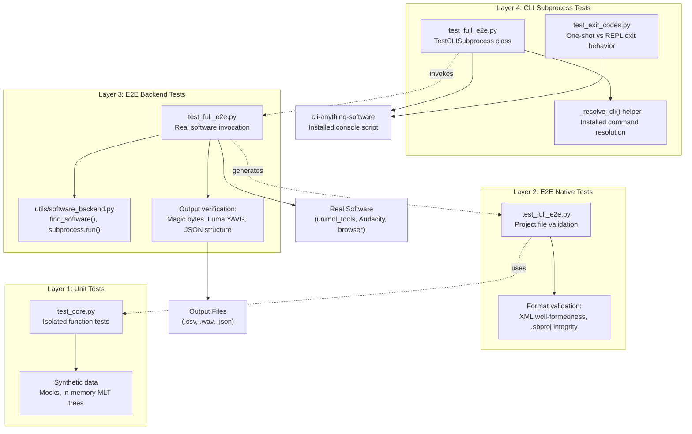
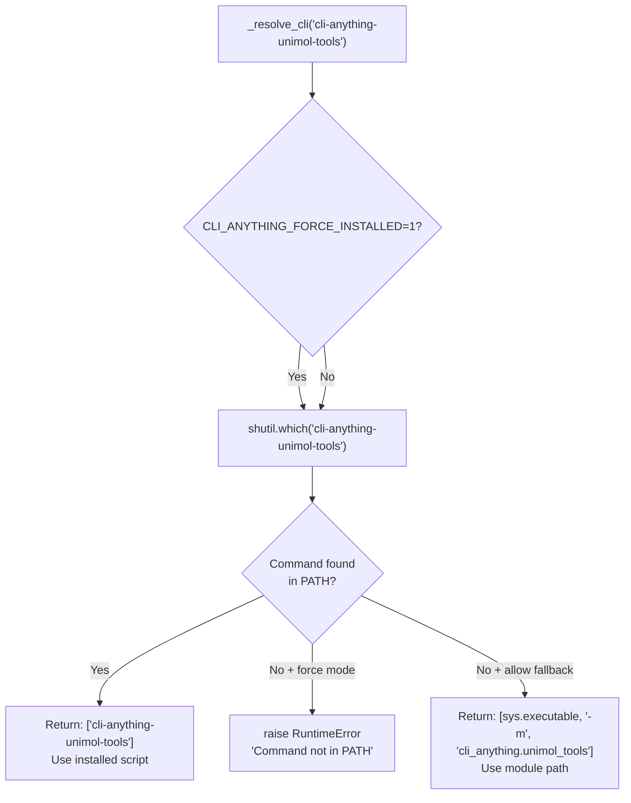

<!-- source: DeepWiki mcp.deepwiki.com · repo HKUDS/CLI-Anything · page 5.5 Testing Architecture · fetched 2026-11-09 -->

# Testing Architecture

Relevant source files

The following files were used as context for generating this wiki page:

- [audacity/agent-harness/cli_anything/audacity/README.md](audacity/agent-harness/cli_anything/audacity/README.md)
- [audacity/agent-harness/cli_anything/audacity/eval/__init__.py](audacity/agent-harness/cli_anything/audacity/eval/__init__.py)
- [audacity/agent-harness/cli_anything/audacity/eval/runner.py](audacity/agent-harness/cli_anything/audacity/eval/runner.py)
- [audacity/agent-harness/cli_anything/audacity/eval/tasks/__init__.py](audacity/agent-harness/cli_anything/audacity/eval/tasks/__init__.py)
- [audacity/agent-harness/cli_anything/audacity/eval/tasks/effects_registry.py](audacity/agent-harness/cli_anything/audacity/eval/tasks/effects_registry.py)
- [audacity/agent-harness/cli_anything/audacity/eval/tasks/export_wav.py](audacity/agent-harness/cli_anything/audacity/eval/tasks/export_wav.py)
- [audacity/agent-harness/cli_anything/audacity/eval/tasks/project_roundtrip.py](audacity/agent-harness/cli_anything/audacity/eval/tasks/project_roundtrip.py)
- [audacity/agent-harness/cli_anything/audacity/eval/tasks/track_clip_flow.py](audacity/agent-harness/cli_anything/audacity/eval/tasks/track_clip_flow.py)
- [audacity/agent-harness/cli_anything/audacity/tests/test_eval.py](audacity/agent-harness/cli_anything/audacity/tests/test_eval.py)
- [audacity/agent-harness/cli_anything/audacity/utils/file_io.py](audacity/agent-harness/cli_anything/audacity/utils/file_io.py)
- [browser/agent-harness/cli_anything/browser/tests/test_security.py](browser/agent-harness/cli_anything/browser/tests/test_security.py)
- [unimol_tools/agent-harness/UNIMOL_TOOLS.md](unimol_tools/agent-harness/UNIMOL_TOOLS.md)
- [unimol_tools/agent-harness/cli_anything/unimol_tools/SKILL.md](unimol_tools/agent-harness/cli_anything/unimol_tools/SKILL.md)
- [unimol_tools/agent-harness/cli_anything/unimol_tools/tests/test_full_e2e.py](unimol_tools/agent-harness/cli_anything/unimol_tools/tests/test_full_e2e.py)

## Purpose and Scope

This document describes the comprehensive testing architecture used by all generated CLI harnesses in the CLI-Anything ecosystem. It covers the four-layer testing pyramid, the `_resolve_cli()` pattern for subprocess testing, `TEST.md` documentation structure, and output verification methodologies that ensure production reliability across diverse backends like Uni-Mol Tools, Audacity, and Browser.

The testing architecture is designed to validate the entire pipeline from high-level CLI entry points down to low-level backend integrations, ensuring that AI agents receive reliable, machine-readable feedback.

---

## The Four-Layer Testing Pyramid

CLI-Anything employs a rigorous four-layer testing strategy that validates every generated CLI from isolated unit logic through complete end-to-end workflows with real software backends.

### Testing Layers Overview

**Sources:** [unimol_tools/agent-harness/UNIMOL_TOOLS.md:163-174](), [unimol_tools/agent-harness/cli_anything/unimol_tools/tests/test_full_e2e.py:1-6]()

### Layer 1: Unit Tests (`test_core.py`)

Unit tests validate individual functions in isolation. These tests focus on complex logic like timecode math, XML tree manipulation, and session state transitions without requiring the full application backend.

**Characteristics:**
- **Test file:** `cli_anything/<software>/tests/test_core.py`
- **Data source:** Synthetic data and `pytest` fixtures like `tmp_path`.
- **Purpose:** Verify core module functions (e.g., `codegen`, `mlt_xml` utilities) work correctly.

**Examples:**
- **Audacity:** Unit tests for `security.py` validate URL schemes and private network blocking without requiring a DOMShell backend [browser/agent-harness/cli_anything/browser/tests/test_security.py:1-5]().
- **Uni-Mol Tools:** Unit tests would cover functions like `create_project` or `add_track` in isolation.

**Sources:** [browser/agent-harness/cli_anything/browser/tests/test_security.py:1-354]()

### Layer 2: E2E Native Format Tests (`test_full_e2e.py`)

E2E native tests validate the internal state transitions and project file generation pipeline. They ensure that intermediate project representations (JSON session files, XML descriptors, or engine-specific formats) are structurally correct.

**Characteristics:**
- **Validates:** File structure and state persistence.
- **Audacity Example:** `TestProjectRoundtrip` in `eval/tasks/project_roundtrip.py` creates, saves, and re-opens a project to validate its integrity [audacity/agent-harness/cli_anything/audacity/eval/tasks/project_roundtrip.py:1-48](). `TestTrackClipFlow` verifies adding and splitting clips within the project's internal representation [audacity/agent-harness/cli_anything/audacity/eval/tasks/track_clip_flow.py:1-54]().
- **Uni-Mol Tools Example:** `TestProjectManagement` tests `project create`, `list`, and `switch` commands, ensuring the internal project state is correctly managed [unimol_tools/agent-harness/cli_anything/unimol_tools/tests/test_full_e2e.py:70-90]().

**Sources:** [audacity/agent-harness/cli_anything/audacity/eval/tasks/project_roundtrip.py:1-48](), [audacity/agent-harness/cli_anything/audacity/eval/tasks/track_clip_flow.py:1-54](), [unimol_tools/agent-harness/cli_anything/unimol_tools/tests/test_full_e2e.py:70-90]()

### Layer 3: E2E True Backend Tests (`test_full_e2e.py`)

E2E backend tests invoke the **real software** to produce final outputs. This layer validates that the CLI's abstractions correctly translate to the backend's native commands.

**Characteristics:**
- **Invokes:** Real software via `utils/software_backend.py`.
- **Verification:** Uses techniques like checking file existence and size for exported audio [audacity/agent-harness/cli_anything/audacity/eval/tasks/export_wav.py:45-46](), or verifying model IDs and performance metrics for Uni-Mol Tools [unimol_tools/agent-harness/cli_anything/unimol_tools/tests/test_full_e2e.py:107-108]().
- **Skip Behavior:** Tests automatically skip if the backend (e.g., Uni-Mol Tools, Audacity) is not installed on the host.

**Sources:** [unimol_tools/agent-harness/cli_anything/unimol_tools/tests/test_full_e2e.py:91-124](), [audacity/agent-harness/cli_anything/audacity/eval/tasks/export_wav.py:1-56]()

### Layer 4: CLI Subprocess Tests (`test_full_e2e.py`)

Subprocess tests invoke the **installed CLI command** via `subprocess.run()`. This validates the `console_scripts` entry points and ensures the CLI behaves correctly when called as a standalone binary.

**Characteristics:**
- **Test class:** `TestCLISubprocess` (or similar patterns).
- **Exit Code Contract:** Failure paths in one-shot mode must exit with code 1, while success paths exit 0.
- **REPL Behavior:** The REPL must absorb `SystemExit` to prevent the interactive loop from crashing on user error.
- **Uni-Mol Tools Example:** The `run_cli_command` helper function directly uses `subprocess.run` to execute `python3 -m cli_anything.unimol_tools` with various arguments, including `--json` output [unimol_tools/agent-harness/cli_anything/unimol_tools/tests/test_full_e2e.py:13-20]().

**Sources:** [unimol_tools/agent-harness/cli_anything/unimol_tools/tests/test_full_e2e.py:13-30]()

---

## The `_resolve_cli()` Pattern

The `_resolve_cli()` helper function is the standard mechanism for resolving the CLI command path in subprocess tests. It allows tests to run against the installed package in CI, while falling back to `python -m` during development.

### Implementation Logic

**Standard implementation pattern:**
Setting `CLI_ANYTHING_FORCE_INSTALLED=1` during test execution forces the suite to use the real installed binary, ensuring that the distribution and PATH configuration are correct. While not explicitly shown in the provided Uni-Mol Tools `test_full_e2e.py`, the `run_cli_command` function directly uses `python3 -m cli_anything.unimol_tools` [unimol_tools/agent-harness/cli_anything/unimol_tools/tests/test_full_e2e.py:15](), which is the fallback behavior of `_resolve_cli()` when the installed script is not found or `CLI_ANYTHING_FORCE_INSTALLED` is not set.

**Sources:** [unimol_tools/agent-harness/cli_anything/unimol_tools/tests/test_full_e2e.py:15]()

---

## TEST.md Structure and Lifecycle

Every generated CLI includes a `tests/TEST.md` file. This file acts as a living document that bridges the gap between the initial test plan and the final execution results.

### Required Sections

| Section | Purpose |
| :--- | :--- |
| **Test Inventory** | Summary table of test files, coverage areas, and test counts. |
| **Running the Tests** | Explicit commands for unit, orchestrator, and e2e suites [unimol_tools/agent-harness/UNIMOL_TOOLS.md:163-174](). |
| **Environment** | Documentation of variables like `SBOX_PATH` or `CLI_ANYTHING_FORCE_INSTALLED`. |
| **Coverage by Class** | Detailed breakdown of classes and modules under test. |

**Sources:** [unimol_tools/agent-harness/UNIMOL_TOOLS.md:163-174]()

---

## Output Verification Methodology

CLI-Anything emphasizes "No Graceful Degradation" and rigorous output verification. Tests must fail if the software cannot perform the requested action.

### Validation Techniques

*   **Magic Byte Verification:** For binary outputs, tests verify the file header bytes (e.g., `PNG_MAGIC = b"\x89PNG\r\n\x1a\n"`).
*   **JSON Schema Validation:** When the `--json` flag is used, output is parsed to ensure machine-readability. Errors are emitted as `{"error": "message"}` on `stdout` with a non-zero exit code [unimol_tools/agent-harness/cli_anything/unimol_tools/tests/test_full_e2e.py:28](). The `TestJSONMode` class specifically validates the presence of `status` and `data` keys in JSON output [unimol_tools/agent-harness/cli_anything/unimol_tools/tests/test_full_e2e.py:193-209]().
*   **Luma/Signal Verification:** Video outputs are verified using `ffmpeg` signalstats to ensure filters (like brightness) were actually applied by the backend.
*   **Atomic Persistence:** Session management tests verify that `Session.save()` writes atomically via temporary files and `os.replace()` to prevent corruption.

### Mocking vs. Real Integration

| Component | Testing Approach | Source |
| :--- | :--- | :--- |
| **Core Logic** | Isolated unit tests with `tmp_path` | [browser/agent-harness/cli_anything/browser/tests/test_security.py:1-5]() |
| **CLI Command** | Real execution via subprocess | [unimol_tools/agent-harness/cli_anything/unimol_tools/tests/test_full_e2e.py:13-20]() |
| **Backend Dependencies** | Verified via `unimol_tools` backend discovery | [unimol_tools/agent-harness/cli_anything/unimol_tools/tests/test_full_e2e.py:91-124]() |

**Sources:** [unimol_tools/agent-harness/cli_anything/unimol_tools/tests/test_full_e2e.py:13-209](), [browser/agent-harness/cli_anything/browser/tests/test_security.py:1-5]()

---

## Eval and Task Runners

Beyond standard `pytest` suites, some harnesses, like Audacity, implement a dedicated evaluation harness. This system is designed for lightweight, scenario-based testing and regression analysis, often used for continuous integration and quality assurance.

### `eval/runner.py`

The `runner.py` module orchestrates the execution of evaluation tasks.
- It discovers tasks by iterating through modules in `cli_anything.<software>.eval.tasks` [audacity/agent-harness/cli_anything/audacity/eval/runner.py:56-85]().
- Each task is defined by a `TaskSpec` dataclass, containing an ID, name, description, and a `run` callable [audacity/agent-harness/cli_anything/audacity/eval/runner.py:18-22]().
- The `_run_task` function executes each task, capturing its status, duration, metrics, and any errors [audacity/agent-harness/cli_anything/audacity/eval/runner.py:87-121]().
- It generates a comprehensive report, including a summary and optional baseline comparison [audacity/agent-harness/cli_anything/audacity/eval/runner.py:124-217]().

### `EvalContext`

The `EvalContext` dataclass provides a standardized environment for tasks to operate within, including paths for output, artifacts, and temporary work directories [audacity/agent-harness/cli_anything/audacity/eval/runner.py:26-34](). This ensures tasks are isolated and their outputs are organized.

### Example Tasks

- **`project_roundtrip.py`**: Verifies that a project can be created, saved, and re-opened without data loss [audacity/agent-harness/cli_anything/audacity/eval/tasks/project_roundtrip.py:1-48]().
- **`track_clip_flow.py`**: Tests the sequence of adding tracks, adding clips, and splitting clips, validating the resulting project state [audacity/agent-harness/cli_anything/audacity/eval/tasks/track_clip_flow.py:1-54]().
- **`effects_registry.py`**: Checks if core effects are registered and can be applied to a track [audacity/agent-harness/cli_anything/audacity/eval/tasks/effects_registry.py:1-45]().
- **`export_wav.py`**: Confirms that a project can be successfully rendered and exported to a WAV file, checking for file existence and size [audacity/agent-harness/cli_anything/audacity/eval/tasks/export_wav.py:1-56]().

### Baseline Comparison

The evaluation harness supports comparing current results against a baseline.
- `load_baseline` reads a previous evaluation report [audacity/agent-harness/cli_anything/audacity/eval/runner.py:194-200]().
- `compare_baseline` identifies regressions (tasks that passed in the baseline but failed in the current run) and calculates success rate deltas [audacity/agent-harness/cli_anything/audacity/eval/runner.py:203-217]().
- This feature is crucial for detecting unintended side effects of code changes.

**Sources:** [audacity/agent-harness/cli_anything/audacity/eval/runner.py:1-299](), [audacity/agent-harness/cli_anything/audacity/eval/tasks/__init__.py:1](), [audacity/agent-harness/cli_anything/audacity/eval/tasks/project_roundtrip.py:1-48](), [audacity/agent-harness/cli_anything/audacity/eval/tasks/track_clip_flow.py:1-54](), [audacity/agent-harness/cli_anything/audacity/eval/tasks/effects_registry.py:1-45](), [audacity/agent-harness/cli_anything/audacity/eval/tasks/export_wav.py:1-56](), [audacity/agent-harness/cli_anything/audacity/README.md:56-70]()

---

