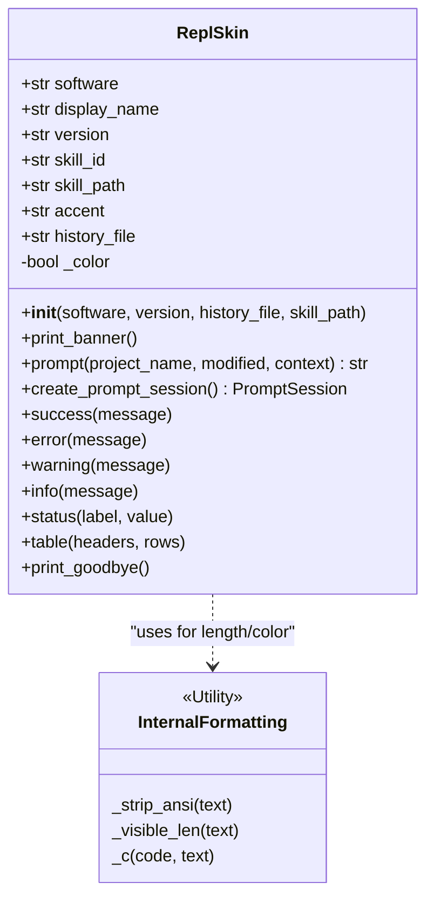

<!-- source: DeepWiki mcp.deepwiki.com · repo HKUDS/CLI-Anything · page 5.6 Shared Utilities: ReplSkin and SKILL.md · fetched 2026-11-09 -->

# Shared Utilities: ReplSkin and SKILL.md

<details>
<summary>Relevant source files</summary>

The following files were used as context for generating this wiki page:

- [cli-anything-plugin/HARNESS.md](cli-anything-plugin/HARNESS.md)
- [cli-anything-plugin/README.md](cli-anything-plugin/README.md)
- [cli-anything-plugin/guides/filter-translation.md](cli-anything-plugin/guides/filter-translation.md)
- [cli-anything-plugin/guides/mcp-backend.md](cli-anything-plugin/guides/mcp-backend.md)
- [cli-anything-plugin/guides/pypi-publishing.md](cli-anything-plugin/guides/pypi-publishing.md)
- [cli-anything-plugin/guides/session-locking.md](cli-anything-plugin/guides/session-locking.md)
- [cli-anything-plugin/guides/skill-generation.md](cli-anything-plugin/guides/skill-generation.md)
- [cli-anything-plugin/guides/timecode-precision.md](cli-anything-plugin/guides/timecode-precision.md)
- [cli-anything-plugin/repl_skin.py](cli-anything-plugin/repl_skin.py)
- [nsight-graphics/agent-harness/cli_anything/nsight_graphics/utils/repl_skin.py](nsight-graphics/agent-harness/cli_anything/nsight_graphics/utils/repl_skin.py)

</details>


This page documents the two shared utilities that provide consistent user experience and agent discoverability across all generated CLI harnesses: `ReplSkin` for unified REPL interface styling and `SKILL.md` for AI agent discovery. These utilities are integrated into each generated harness during the 7-phase pipeline and enable the platform-agnostic agent-native design.

---

## ReplSkin: Unified REPL Interface

`ReplSkin` is a single-file utility class defined in [cli-anything-plugin/repl_skin.py:106-111]() that provides consistent terminal styling, prompts, and message formatting across all CLI harnesses. It is designed to have zero external dependencies for basic functionality, with optional `prompt_toolkit` integration for enhanced features like history and tab-completion.

### Design Philosophy

ReplSkin enforces a professional, standardized terminal output for AI agents and developers:
- **Consistent Brand Identity**: Uses a cyan diamond icon `◆` ([cli-anything-plugin/repl_skin.py:66]()) and specific brand colors.
- **Software-Specific Accents**: Maps software names to unique ANSI colors (e.g., GIMP is orange, Blender is deep orange, LibreOffice is green) ([cli-anything-plugin/repl_skin.py:42-51]()).
- **Structured Output**: Utilizes box-drawing characters (`╭`, `─`, `╰`) for banners and tables ([cli-anything-plugin/repl_skin.py:71-81]()).
- **Environment Awareness**: Detects terminal capabilities and respects `NO_COLOR` or `CLI_ANYTHING_NO_COLOR` environment variables ([cli-anything-plugin/repl_skin.py:170-178]()).
- **Skill Discovery**: The banner explicitly displays the absolute path to the `SKILL.md` file, allowing AI agents to find their own documentation immediately upon startup ([cli-anything-plugin/repl_skin.py:122-125]()).

Sources: [cli-anything-plugin/repl_skin.py:1-81](), [cli-anything-plugin/repl_skin.py:170-178](), [cli-anything-plugin/HARNESS.md:74-94]()

---

## ReplSkin Class Structure

The following diagram maps the `ReplSkin` class to its implementation details in the codebase.

### ReplSkin Architecture Diagram


**Key Methods:**

| Method | Purpose | Code Reference |
|--------|---------|----------------|
| `__init__` | Initializes software name, version, and auto-detects `SKILL.md` location from repo-root or package. | [cli-anything-plugin/repl_skin.py:113-168]() |
| `print_banner` | Prints a branded startup box containing the software name, version, and absolute path to the `SKILL.md` for agents. | [nsight-graphics/agent-harness/cli_anything/nsight_graphics/utils/repl_skin.py:188-255]() |
| `prompt` | Builds a styled prompt string: `◆ software [project*] ❯ `. | [nsight-graphics/agent-harness/cli_anything/nsight_graphics/utils/repl_skin.py:270-303]() |
| `success` | Prints a green message prefixed with a checkmark `✓`. | [nsight-graphics/agent-harness/cli_anything/nsight_graphics/utils/repl_skin.py:382-385]() |
| `error` | Prints a red message prefixed with a cross `✗` to `sys.stderr`. | [nsight-graphics/agent-harness/cli_anything/nsight_graphics/utils/repl_skin.py:387-391]() |
| `table` | Renders data in a formatted box-drawn table. | [nsight-graphics/agent-harness/cli_anything/nsight_graphics/utils/repl_skin.py:461-512]() |
| `print_goodbye` | Prints a branded exit message. | [nsight-graphics/agent-harness/cli_anything/nsight_graphics/utils/repl_skin.py:537-543]() |

Sources: [cli-anything-plugin/repl_skin.py:106-543]()

---

## SKILL.md and Agent Discovery

`SKILL.md` is a specialized documentation file generated for each harness to enable AI agents (like Claude Code or OpenClaw) to discover and understand the CLI's capabilities.

### SKILL.md Generation and Content

The `skill_generator.py` script automates the creation of these files during Phase 6.5 of the generation pipeline. It extracts metadata from the harness `README.md`, `setup.py`, and the CLI implementation itself ([cli-anything-plugin/README.md:218-220]()).

The generated file follows the template in [cli-anything-plugin/guides/skill-generation.md:56-57]():
1.  **YAML Frontmatter**: Contains `name` (e.g., `cli-anything-gimp`) and `description` for platform indexing ([cli-anything-plugin/guides/skill-generation.md:17-23]()).
2.  **Installation Instructions**: Specific `pip install` commands for the harness ([cli-anything-plugin/guides/skill-generation.md:28-32]()).
3.  **Command Groups**: Tables listing available commands and their descriptions extracted from Click decorators ([cli-anything-plugin/guides/skill-generation.md:30-31]()).
4.  **Agent Guidance**: Explicit instructions for AI agents, such as "Always use --json flag" ([cli-anything-plugin/guides/skill-generation.md:93-96]()).

The `skill_generator.py` uses regex patterns to find `@click.group()` and `@click.command()` decorators to build the command documentation automatically.

Sources: [cli-anything-plugin/guides/skill-generation.md:1-32](), [cli-anything-plugin/README.md:218-220]()

---

## Implementation in Harnesses

### Package Data Inclusion

To ensure `SKILL.md` is available after installation, it must be included in the Python package distribution. This is typically configured in Phase 7 via `setup.py` using `package_data` to bundle the `skills/` directory content ([cli-anything-plugin/guides/skill-generation.md:127-135]()).

```python
# In setup.py
package_data={
    "cli_anything.<software>": ["skills/*.md"],
},
```

### REPL Integration

Harnesses use `ReplSkin` within their main CLI entry point. It is copied from the plugin directory into the harness's `utils/` folder during implementation ([cli-anything-plugin/HARNESS.md:74-76]()).

```python
# Typical usage pattern in a harness
from cli_anything.<software>.utils.repl_skin import ReplSkin

skin = ReplSkin("<software>", version="1.0.0")

@click.group(invoke_without_command=True)
@click.pass_context
def cli(ctx):
    if ctx.invoked_subcommand is None:
        skin.print_banner() # Shows absolute path to SKILL.md
        # Start REPL...
```

Sources: [cli-anything-plugin/HARNESS.md:74-108](), [cli-anything-plugin/repl_skin.py:6-18]()

---

## Data Flow: From Generation to Agent Discovery

The following diagram illustrates how metadata flows from the source code into the agent's context via the shared utilities.

### Agent Discovery Data Flow
```mermaid
flowchart LR
    subgraph "Phase 6.5: SKILL.md Generation"
        CLI_PY["software_cli.py"] -->|Extracts @click.command| SKILL_GEN["skill_generator.py"]
        README["README.md"] -->|Extracts Intro Paragraph| SKILL_GEN
        SETUP["setup.py"] -->|Extracts version| SKILL_GEN
        SKILL_GEN -->|Renders Template| SKILL_MD["skills/cli-anything-<software>/SKILL.md"]
    end

    subgraph "Phase 7: Installation"
        SKILL_MD -->|package_data in setup.py| WHEEL["Python Wheel"]
        WHEEL -->|pip install| SITE_PKG["site-packages/cli_anything/<software>/skills/SKILL.md"]
    end

    subgraph "Runtime: ReplSkin Initialization"
        HARNESS_CLI["cli_anything.<software>.<software>_cli:main"] -->|Imports| REPL_SKIN_INIT["ReplSkin.__init__"]
        REPL_SKIN_INIT -->|Path.resolve().parents| REPO_ROOT_CHECK{"Is in CLI-Anything monorepo?"}
        REPO_ROOT_CHECK -- "Yes" --> REPO_SKILL_PATH["skills/cli-anything-<software>/SKILL.md"]
        REPO_ROOT_CHECK -- "No" --> PACKAGE_SKILL_PATH["site-packages/cli_anything/<software>/skills/SKILL.md"]
        REPO_SKILL_PATH --> REPL_SKIN_OBJ["ReplSkin Object (skill_path set)"]
        PACKAGE_SKILL_PATH --> REPL_SKIN_OBJ
    end

    subgraph "Runtime: ReplSkin Banner Display"
        REPL_SKIN_OBJ -->|Calls| PRINT_BANNER["ReplSkin.print_banner()"]
        PRINT_BANNER -->|Displays absolute path to skill_path| USER_AGENT_CONSOLE["User/Agent Console"]
    end

    subgraph "Agent Interaction"
        USER_AGENT_CONSOLE -->|Identifies Skill Path| AI_AGENT["AI Agent"]
        AI_AGENT -->|Reads| DISCOVERED_SKILL_MD["SKILL.md (on disk)"]
    end
```

Sources: [cli-anything-plugin/guides/skill-generation.md:60-75](), [cli-anything-plugin/guides/skill-generation.md:113-125](), [cli-anything-plugin/repl_skin.py:141-156](), [cli-anything-plugin/repl_skin.py:188-255]()

---

