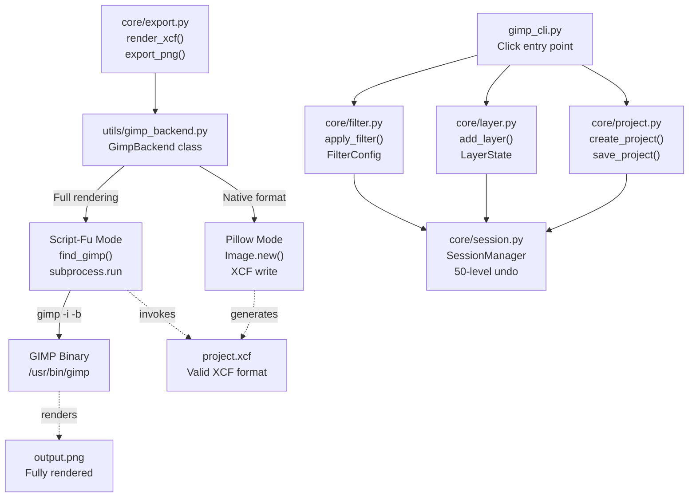
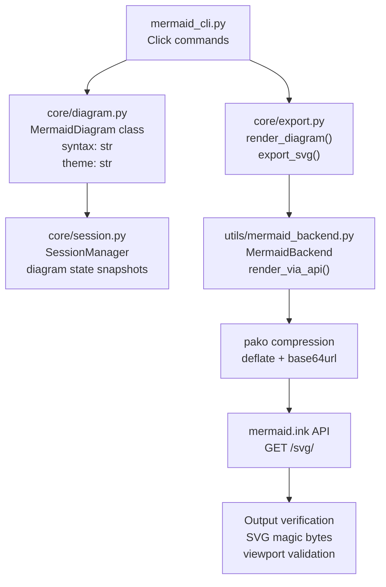
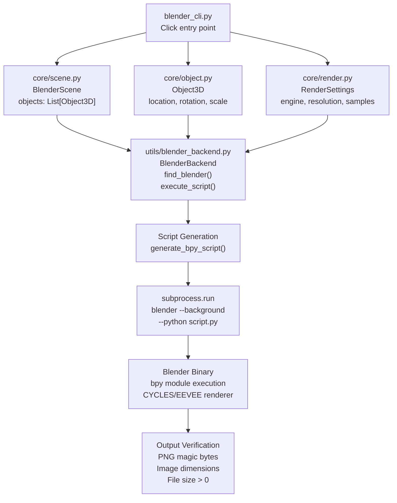
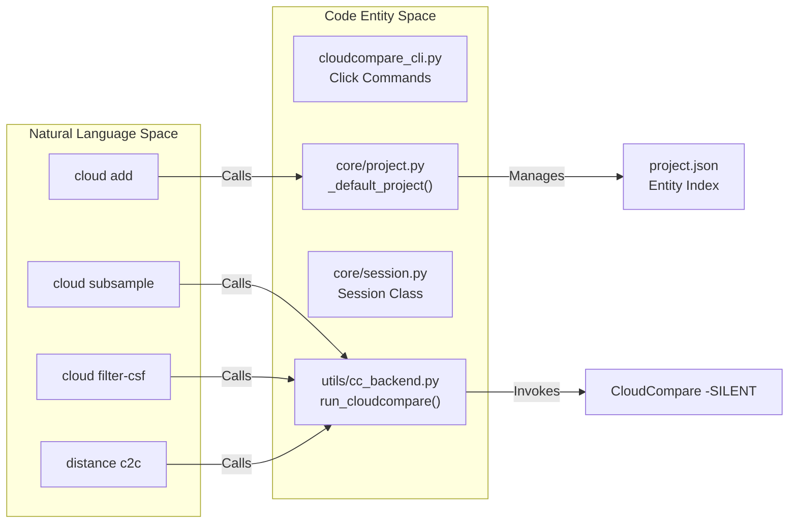
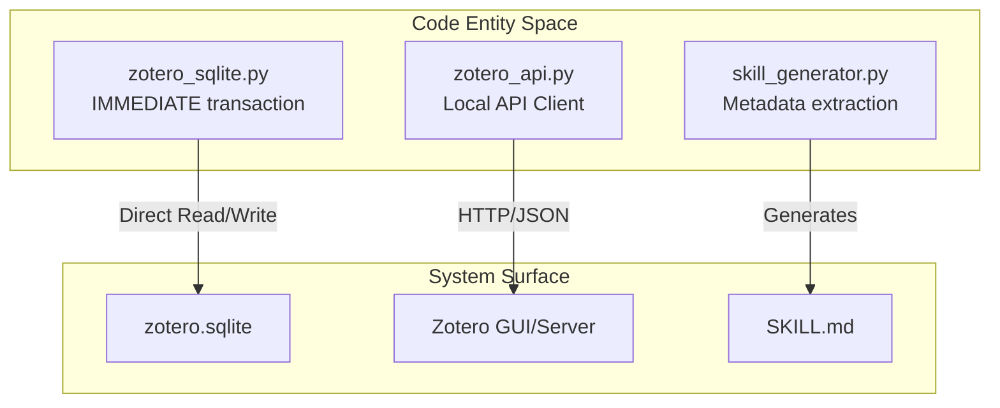
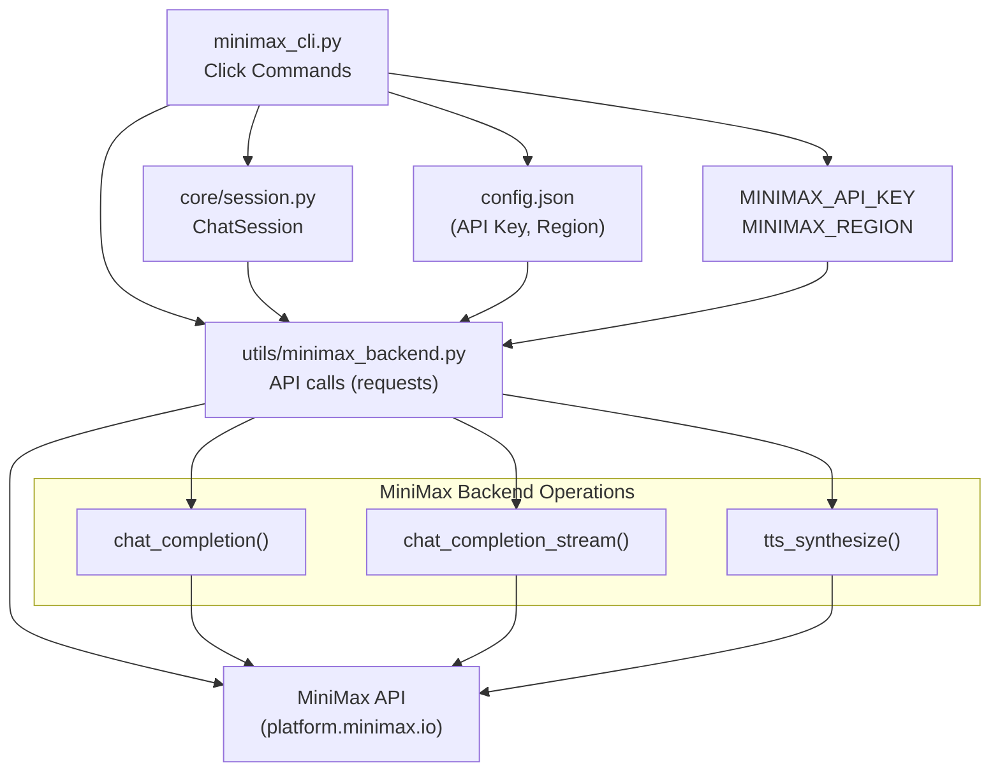

<!-- source: DeepWiki mcp.deepwiki.com · repo HKUDS/CLI-Anything · page 6 Application Harness Examples · fetched 2026-11-09 -->

# Application Harness Examples

Relevant source files

The following files were used as context for generating this wiki page:

- [minimax/agent-harness/FIX_NOTES.md](minimax/agent-harness/FIX_NOTES.md)
- [minimax/agent-harness/cli_anything/minimax/README.md](minimax/agent-harness/cli_anything/minimax/README.md)
- [minimax/agent-harness/cli_anything/minimax/minimax_cli.py](minimax/agent-harness/cli_anything/minimax/minimax_cli.py)
- [minimax/agent-harness/cli_anything/minimax/skills/SKILL.md](minimax/agent-harness/cli_anything/minimax/skills/SKILL.md)
- [minimax/agent-harness/cli_anything/minimax/tests/TEST.md](minimax/agent-harness/cli_anything/minimax/tests/TEST.md)
- [minimax/agent-harness/cli_anything/minimax/tests/test_core.py](minimax/agent-harness/cli_anything/minimax/tests/test_core.py)
- [minimax/agent-harness/cli_anything/minimax/tests/test_full_e2e.py](minimax/agent-harness/cli_anything/minimax/tests/test_full_e2e.py)
- [minimax/agent-harness/cli_anything/minimax/tests/test_tts_extended.py](minimax/agent-harness/cli_anything/minimax/tests/test_tts_extended.py)
- [minimax/agent-harness/cli_anything/minimax/utils/minimax_backend.py](minimax/agent-harness/cli_anything/minimax/utils/minimax_backend.py)
- [minimax/agent-harness/setup.py](minimax/agent-harness/setup.py)
- [registry.json](registry.json)
- [skills/cli-anything-minimax/SKILL.md](skills/cli-anything-minimax/SKILL.md)

This page examines specific generated CLI harnesses in detail to illustrate the different backend integration patterns that emerge from the 7-phase generation pipeline. Each harness demonstrates how the principles from [Core Concepts](#3) are applied to different software architectures: dual backend systems, web service APIs, desktop application subprocess invocation, and native file format manipulation.

For the technical structure common to all harnesses, see [Generated CLI Architecture](#5).

---

## GIMP: Image Editing Harness

The GIMP harness exemplifies the **dual backend pattern** where native format generation is separated from authentic software rendering. This pattern addresses the common scenario where Python libraries can create valid project files but cannot replicate the full feature set of the GUI application. For details, see [GIMP: Image Editing Harness](#6.1).

### Architecture Overview

**Sources**: [registry.json:180-192](), [minimax/agent-harness/cli_anything/minimax/README.md:1-3]()

---

## Mermaid: Diagram Generation Harness

The Mermaid harness demonstrates **web service integration** where the CLI maintains state locally but delegates rendering to a cloud API. This pattern is common for tools that expose web-based functionality. For details, see [Mermaid: Diagram Generation Harness](#6.2).

### Stateless Backend Architecture

**Sources**: [registry.json:185-197](), [minimax/agent-harness/cli_anything/minimax/README.md:1-3]()

---

## Blender: 3D Modeling Harness

The Blender harness demonstrates **desktop application subprocess integration** using headless Python scripting. This pattern applies to applications that provide programmable APIs but require the full application binary for execution. For details, see [Blender: 3D Modeling Harness](#6.3).

### Headless Rendering Architecture

**Sources**: [registry.json:85-101](), [minimax/agent-harness/cli_anything/minimax/README.md:1-3]()

---

## CloudCompare: 3D Point Cloud Harness

CloudCompare serves as the primary example of the **-SILENT mode backend pattern**. It utilizes an Entity Index model to manage 3D assets and wraps the native C++ binary's CLI flags. For details, see [CloudCompare: 3D Point Cloud Harness](#6.4).

### Entity Index and Subprocess Mapping

**Sources**: [registry.json:207-219](), [minimax/agent-harness/cli_anything/minimax/README.md:1-3]()

---

## GPU and Profiling Harnesses: RenderDoc, Nsight Graphics, Unreal Insights

This category of harnesses demonstrates advanced integration patterns for specialized tools.

The RenderDoc harness showcases the **Python API embedding pattern**. Unlike subprocess wrappers, it attempts to import the `renderdoc` module directly into the CLI process, enabling complex object lifecycle management for GPU captures. For details, see [GPU and Profiling Harnesses: RenderDoc, Nsight Graphics, Unreal Insights](#6.5).

Nsight Graphics and Unreal Insights harnesses explore backend discovery and command modules, and trace store/live analysis respectively.

**Sources**: [registry.json:220-232](), [minimax/agent-harness/cli_anything/minimax/README.md:1-3]()

---

## Knowledge and Reference Harnesses: Zotero, SiYuan, Joplin, Obsidian, Calibre, Mubu

This group of harnesses illustrates diverse strategies for integrating with local data management and knowledge base applications.

Zotero demonstrates a **multi-surface integration pattern**, combining direct SQLite database access for performance and write safety with REST API calls for synchronization and GUI context. SiYuan utilizes its kernel HTTP API, while Joplin wraps its terminal binary with exclusive file locking. Obsidian focuses on vault search, Calibre on library and format conversion, and Mubu on probing. For details, see [Knowledge and Reference Harnesses: Zotero, SiYuan, Joplin, Obsidian, Calibre, Mubu](#6.6).

### Multi-Surface Data Access (Zotero Example)

**Sources**: [minimax/agent-harness/cli_anything/minimax/README.md:1-3](), [registry.json:198-206]()

---

## FreeCAD, Slay the Spire II, and Specialized Harnesses

This section covers a variety of specialized harnesses, each demonstrating unique integration challenges and solutions.

FreeCAD uses `freecadcmd` for macro generation and interaction with OpenCASCADE and FCStd files. Slay the Spire II integrates via a .NET bridge mod and a local HTTP API to normalize decision states. Other examples include Intelwatch (Node.js pass-through), VideoCaptioner, sbox, Uni-Mol Tools, Sketch, WaveTone, QuietShrink, Rekordbox, Live2D, EEZ Studio, and web-yu-pri. For details, see [FreeCAD, Slay the Spire II, and Specialized Harnesses](#6.7).

### Specialized Integration Categories

| Category | Harness Examples | Integration Pattern |
|----------|------------------|---------------------|
| **Parametric CAD** | FreeCAD | Macro generation via `freecadcmd` [registry.json:233-245]() |
| **Game Automation** | Slay the Spire II | .NET Bridge Mod + Localhost REST [registry.json:246-258]() |
| **Node.js Wrapper** | Sketch, Intelwatch | Passthrough via `npx` or local Node script [registry.json:107-111](), [minimax/agent-harness/cli_anything/minimax/README.md:1-3]() |
| **Video Processing** | VideoCaptioner, QuietShrink | Subprocess wrapper for specialized tools [registry.json:161-173](), [registry.json:161-173]() |
| **Audio Processing** | WaveTone, Rekordbox | Manifest preparation, audio probing, or proprietary API interaction [registry.json:162-170]() |

**Sources**: [registry.json:1-170](), [minimax/agent-harness/cli_anything/minimax/README.md:1-3]()

---

## Media and Creative Harnesses

This category focuses on applications for media editing and creative work, often involving complex file formats and real-time processing.

Examples include Shotcut and Kdenlive (MLT XML + melt backend), Audacity (sox backend), MuseScore (MSCX/MSCZ + mscore), OBS Studio, LibreOffice, OpenScreen, SeaClip, and Godot. These harnesses often involve generating or manipulating application-specific project files and invoking headless or command-line versions of the software. For details, see [Media and Creative Harnesses](#6.8).

**Sources**: [registry.json:148-160](), [registry.json:152-158]()

---

## Web, API and SaaS Harnesses

This section highlights integrations with web services, APIs, and Software-as-a-Service platforms. These harnesses often involve HTTP requests, JSON parsing, and API key management.

Examples include MiniMax (chat/stream/TTS SSE), Mailchimp (codegen'd command modules), Firefly III (personal finance API), Novita, Ollama, ComfyUI, NotebookLM, Exa, AdGuardHome, Zoom, n8n, WireMock, PM2, ChromaDB, Dify Workflow, Tigris, JumpServer, RMS, OpenRefine, eth2-quickstart, cc-switch, NSLogger, and QGIS. For details, see [Web, API and SaaS Harnesses](#6.9).

### MiniMax: Web Service Integration Example

The `cli-anything-minimax` harness demonstrates integration with a cloud-based AI service. It provides commands for chat completions and text-to-speech synthesis via the MiniMax API. The harness manages API keys, handles streaming responses (SSE), and supports various models and audio settings.

The `minimax_backend.py` module [minimax/agent-harness/cli_anything/minimax/utils/minimax_backend.py:1-481]() handles the actual HTTP requests to the MiniMax API, including regional endpoint selection [minimax/agent-harness/cli_anything/minimax/utils/minimax_backend.py:21-33]() and model configuration [minimax/agent-harness/cli_anything/minimax/utils/minimax_backend.py:38-83](). The `minimax_cli.py` [minimax/agent-harness/cli_anything/minimax/minimax_cli.py:1-558]() defines the Click commands, such as `chat`, `stream`, and `tts`, and integrates with the session management [minimax/agent-harness/cli_anything/minimax/minimax_cli.py:43-48]() for conversational context.

**Sources**: [registry.json:8-19](), [registry.json:28-40](), [registry.json:47-64](), [registry.json:66-82](), [registry.json:85-101](), [registry.json:103-121](), [registry.json:123-139](), [registry.json:141-157](), [registry.json:159-175](), [minimax/agent-harness/cli_anything/minimax/utils/minimax_backend.py:1-481](), [minimax/agent-harness/cli_anything/minimax/minimax_cli.py:1-558](), [minimax/agent-harness/cli_anything/minimax/skills/SKILL.md:1-150]()

---

## Automation and Developer-Tool Harnesses

This category focuses on tools for automation, development, and debugging.

The Browser/DOMShell harness uses an accessibility-tree VFS for web interaction. Other examples include the Safari harness, LLDB debugger (session daemon + DAP), and MacroCLI GUI macro recorder. These harnesses often involve low-level system interaction, process control, or specialized protocols. For details, see [Automation and Developer-Tool Harnesses](#6.10).

**Sources**: [registry.json:47-64](), [registry.json:103-121](), [registry.json:220-232](), [registry.json:272-284]()

---

