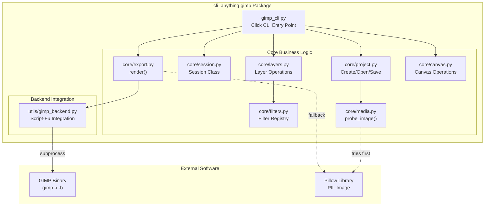
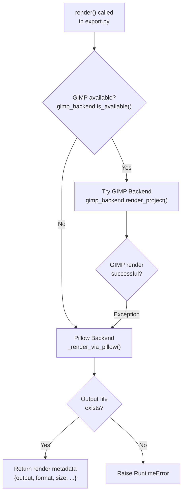
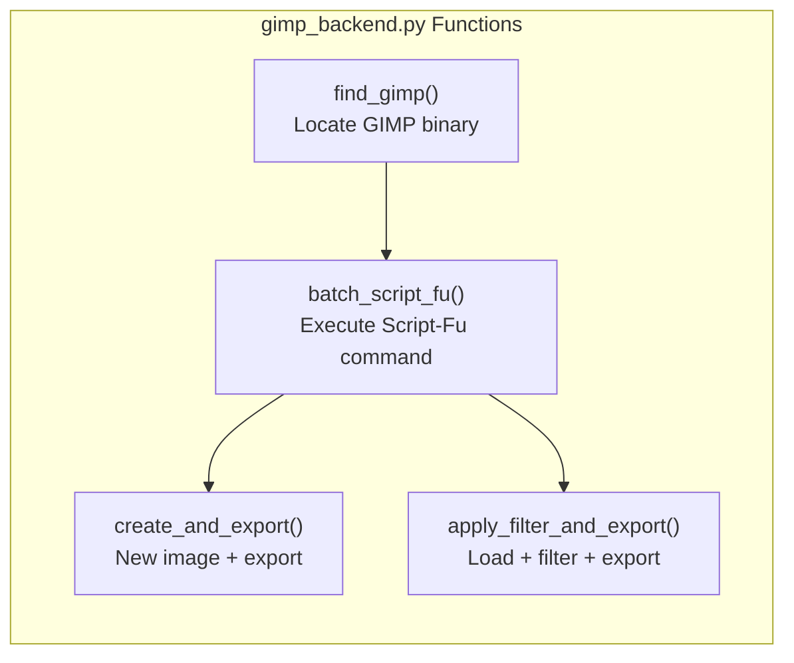
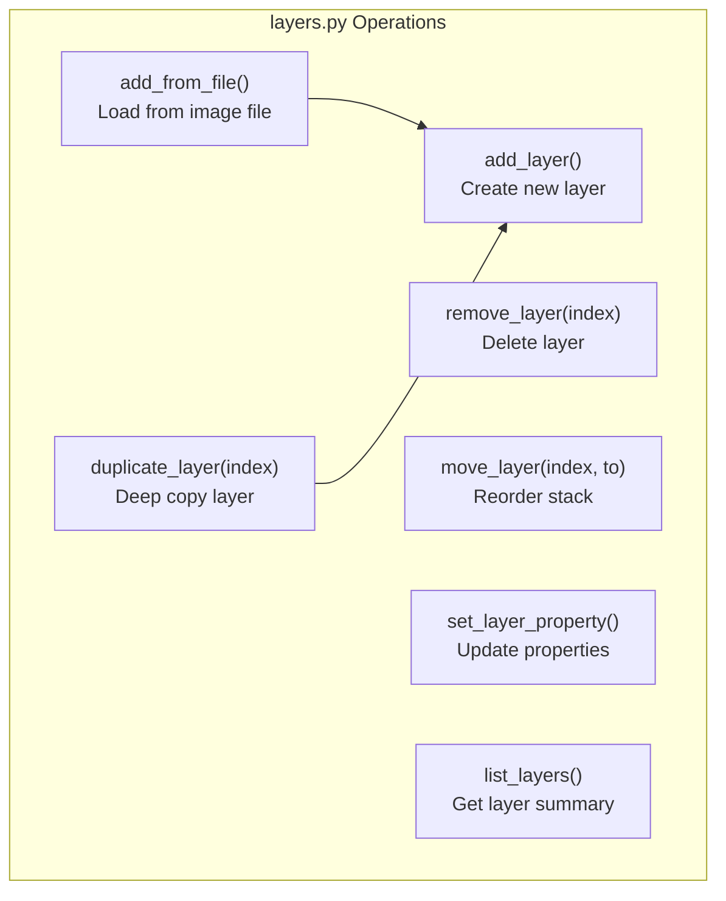
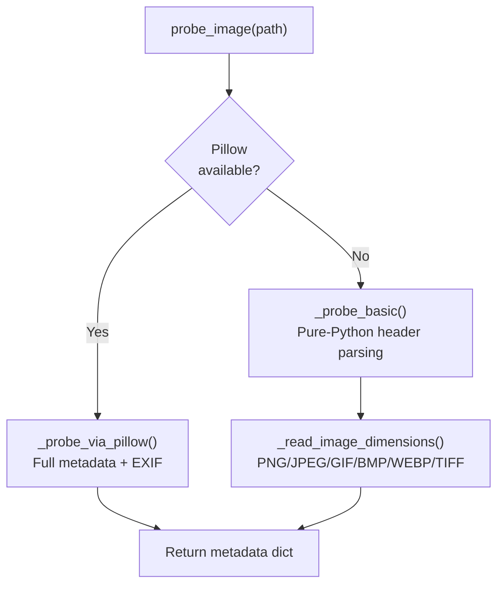

<!-- source: DeepWiki mcp.deepwiki.com · repo HKUDS/CLI-Anything · page 6.1 GIMP: Image Editing Harness · fetched 2026-11-09 -->

# GIMP: Image Editing Harness

<details>
<summary>Relevant source files</summary>

The following files were used as context for generating this wiki page:

- [gimp/agent-harness/cli_anything/gimp/core/export.py](gimp/agent-harness/cli_anything/gimp/core/export.py)
- [gimp/agent-harness/cli_anything/gimp/core/layers.py](gimp/agent-harness/cli_anything/gimp/core/layers.py)
- [gimp/agent-harness/cli_anything/gimp/core/media.py](gimp/agent-harness/cli_anything/gimp/core/media.py)
- [gimp/agent-harness/cli_anything/gimp/tests/test_full_e2e.py](gimp/agent-harness/cli_anything/gimp/tests/test_full_e2e.py)
- [gimp/agent-harness/cli_anything/gimp/utils/gimp_backend.py](gimp/agent-harness/cli_anything/gimp/utils/gimp_backend.py)
- [inkscape/agent-harness/cli_anything/inkscape/core/document.py](inkscape/agent-harness/cli_anything/inkscape/core/document.py)
- [inkscape/agent-harness/cli_anything/inkscape/core/export.py](inkscape/agent-harness/cli_anything/inkscape/core/export.py)
- [inkscape/agent-harness/cli_anything/inkscape/core/text.py](inkscape/agent-harness/cli_anything/inkscape/core/text.py)
- [inkscape/agent-harness/cli_anything/inkscape/inkscape_cli.py](inkscape/agent-harness/cli_anything/inkscape/inkscape_cli.py)
- [inkscape/agent-harness/cli_anything/inkscape/skills/SKILL.md](inkscape/agent-harness/cli_anything/inkscape/skills/SKILL.md)
- [inkscape/agent-harness/cli_anything/inkscape/tests/test_core.py](inkscape/agent-harness/cli_anything/inkscape/tests/test_core.py)
- [inkscape/agent-harness/cli_anything/inkscape/tests/test_full_e2e.py](inkscape/agent-harness/cli_anything/inkscape/tests/test_full_e2e.py)
- [inkscape/agent-harness/setup.py](inkscape/agent-harness/setup.py)
- [krita/agent-harness/cli_anything/krita/core/export.py](krita/agent-harness/cli_anything/krita/core/export.py)
- [krita/agent-harness/cli_anything/krita/core/project.py](krita/agent-harness/cli_anything/krita/core/project.py)
- [krita/agent-harness/cli_anything/krita/core/session.py](krita/agent-harness/cli_anything/krita/core/session.py)
- [krita/agent-harness/cli_anything/krita/utils/io.py](krita/agent-harness/cli_anything/krita/utils/io.py)
- [krita/agent-harness/cli_anything/krita/utils/krita_backend.py](krita/agent-harness/cli_anything/krita/utils/krita_backend.py)
- [krita/agent-harness/cli_anything/krita/utils/repl_skin.py](krita/agent-harness/cli_anything/krita/utils/repl_skin.py)
- [krita/agent-harness/setup.py](krita/agent-harness/setup.py)
- [skills/cli-anything-inkscape/SKILL.md](skills/cli-anything-inkscape/SKILL.md)

</details>


## Purpose and Scope

This document examines the `cli-anything-gimp` harness in detail as the primary example of CLI-Anything's dual-backend architecture. This harness demonstrates the "Authentic Backend Integration" principle ([3.4]()) by integrating with the real GIMP application via Script-Fu batch mode, while maintaining a Pillow fallback for environments where GIMP is unavailable.

For general information about generated CLI architecture, see [Generated CLI Architecture](). For the 7-phase generation pipeline that created this harness, see [The 7-Phase Generation Pipeline]().

---

## Overview

The GIMP harness (`cli-anything-gimp`) is a stateful command-line interface for image editing built on top of both GIMP's Script-Fu batch mode and Python's Pillow library. It provides a complete image editing workflow including:

- Project creation and management [inkscape/agent-harness/cli_anything/inkscape/inkscape_cli.py:141-169]()
- Layer operations (add, remove, duplicate, move, blend modes, opacity) [inkscape/agent-harness/cli_anything/inkscape/skills/SKILL.md:139-150]()
- Canvas operations (resize, scale, crop, color mode, DPI) [inkscape/agent-harness/cli_anything/inkscape/skills/SKILL.md:73-74]()
- Filter application (30+ filters including blur, sharpen, color adjustments)
- Export to multiple formats (PNG, JPEG, BMP, TIFF, GIF, PDF, ICO, WEBP) [inkscape/agent-harness/cli_anything/inkscape/skills/SKILL.md:184-187]()
- Session management with 50-level undo/redo [inkscape/agent-harness/cli_anything/inkscape/skills/SKILL.md:197-199]()

The harness is installed to the system PATH as `cli-anything-gimp` and supports both interactive REPL mode and one-shot command execution with `--json` output for AI agent consumption [inkscape/agent-harness/cli_anything/inkscape/inkscape_cli.py:140-147]().

**Sources:** [inkscape/agent-harness/cli_anything/inkscape/inkscape_cli.py:1-15](), [inkscape/agent-harness/cli_anything/inkscape/skills/SKILL.md:1-5]()

---

## Architecture Overview

The GIMP harness follows the standard CLI-Anything package structure under the `cli_anything.gimp` namespace:

### System to Code Mapping: GIMP Package Structure
Title: "GIMP Harness Internal Architecture"


**Sources:** [inkscape/agent-harness/cli_anything/inkscape/inkscape_cli.py:28-37](), [gimp/agent-harness/cli_anything/gimp/core/export.py:67-84]()

---

## Dual Backend Strategy

The GIMP harness's key architectural innovation is its **dual backend strategy**: it preferentially uses the real GIMP application via Script-Fu batch mode, but degrades gracefully to Pillow when GIMP is unavailable.

### Backend Decision Flow
Title: "Rendering Backend Selection"


**Backend Priority:**

| Backend | Priority | Capabilities | Limitations |
|---------|----------|--------------|-------------|
| **GIMP Script-Fu** | 1st (preferred) | Full GIMP image processing, native filters, blend modes | Requires GIMP installed on system |
| **Pillow** | 2nd (fallback) | Pure-Python, no external dependencies | Limited filter set, simplified blend modes |

**Sources:** [gimp/agent-harness/cli_anything/gimp/core/export.py:54-84](), [gimp/agent-harness/cli_anything/gimp/utils/gimp_backend.py:228-235]()

---

## Backend Integration Layer: gimp_backend.py

The `gimp_backend.py` module is the critical interface to the real GIMP application. It invokes GIMP in batch mode using Script-Fu expressions.

### Key Functions
Title: "GIMP Backend Utility Functions"


### GIMP Invocation Pattern

The harness invokes GIMP in **batch mode** (non-interactive):

```python
cmd = [gimp, "-i", "-b", script, "-b", "(gimp-quit 0)"]
```
[gimp/agent-harness/cli_anything/gimp/utils/gimp_backend.py:61-61]()

Where:
- `-i` = run without user interface
- `-b` = batch mode, execute Script-Fu expression
- `(gimp-quit 0)` = cleanly exit GIMP after execution [gimp/agent-harness/cli_anything/gimp/utils/gimp_backend.py:61-61]()

### Script-Fu String Escaping

Because Script-Fu expressions contain file paths and user input, the harness uses `_script_fu_escape()` to prevent injection:

[gimp/agent-harness/cli_anything/gimp/utils/gimp_backend.py:15-23]()

```python
def _script_fu_escape(value: str) -> str:
    """Escape a Python string for safe use inside Script-Fu double quotes."""
    return (
        value.replace("\\", "\\\\")
        .replace('"', '\\"')
        .replace("\r", "\\r")
        .replace("\n", "\\n")
    )
```

**Sources:** [gimp/agent-harness/cli_anything/gimp/utils/gimp_backend.py:1-75](), [gimp/agent-harness/cli_anything/gimp/utils/gimp_backend.py:123-136]()

---

## Rendering Pipeline

The rendering pipeline in `export.py` is responsible for flattening the layer stack, applying filters, and exporting to the final output format.

### Export Presets

The harness defines 11 export presets in [gimp/agent-harness/cli_anything/gimp/core/export.py:16-30]():

| Preset | Format | Extension | Parameters |
|--------|--------|-----------|------------|
| `png` | PNG | .png | compress_level: 6 |
| `jpeg-high` | JPEG | .jpg | quality: 95 |
| `webp` | WEBP | .webp | quality: 85 |
| `tiff` | TIFF | .tiff | compression: lzw |
| `bmp` | BMP | .bmp | - |

**Sources:** [gimp/agent-harness/cli_anything/gimp/core/export.py:1-84]()

---

## Layer Management

Layer management is implemented in `layers.py` and provides operations for manipulating the layer stack.

### Layer Data Model

Each layer is a dictionary with the following structure [gimp/agent-harness/cli_anything/gimp/core/layers.py:67-79]():

```json
{
  "id": 0,
  "name": "New Layer",
  "type": "image",
  "width": 1920,
  "height": 1080,
  "visible": true,
  "opacity": 1.0,
  "blend_mode": "normal",
  "offset_x": 0,
  "offset_y": 0,
  "filters": []
}
```

### Layer Operations
Title: "Layer Management Functions"


**Sources:** [gimp/agent-harness/cli_anything/gimp/core/layers.py:17-213]()

---

## Media File Analysis

The `media.py` module provides image metadata extraction using a multi-tier fallback strategy.

### Media Probe Strategy
Title: "Media Analysis Flow"


The pure-Python fallback `_read_image_dimensions()` [gimp/agent-harness/cli_anything/gimp/core/layers.py:251-379]() (implied by call in `_probe_basic` [gimp/agent-harness/cli_anything/gimp/core/media.py:93-93]()) parses binary headers for multiple formats without external dependencies.

**Sources:** [gimp/agent-harness/cli_anything/gimp/core/media.py:14-37](), [gimp/agent-harness/cli_anything/gimp/core/media.py:91-108]()

---

## Key Design Patterns

### 1. Subprocess Invocation with Verification

The GIMP backend doesn't trust subprocess exit codes. After invoking `gimp -i -b`, it explicitly verifies the output file exists [gimp/agent-harness/cli_anything/gimp/utils/gimp_backend.py:140-146]():

```python
if not os.path.exists(abs_output):
    raise RuntimeError(
        f"GIMP export produced no output file.\n"
        f"  Expected: {abs_output}\n"
        f"  stderr: {result['stderr'][-500:]}\n"
        f"  stdout: {result['stdout'][-500:]}"
    )
```

### 2. Error Handling Wrapper

The CLI uses a `handle_error` decorator to provide consistent JSON or text error responses [inkscape/agent-harness/cli_anything/inkscape/inkscape_cli.py:108-135]():

```python
def handle_error(func):
    def wrapper(*args, **kwargs):
        try:
            return func(*args, **kwargs)
        except (ValueError, IndexError, RuntimeError) as e:
            if _json_output:
                click.echo(json.dumps({"error": str(e), "type": type(e).__name__}))
            else:
                click.echo(f"Error: {e}", err=True)
```

### 3. Auto-Save and Dry-Run

The harness implements the auto-save pattern for one-shot commands using `cli.result_callback()` [inkscape/agent-harness/cli_anything/inkscape/inkscape_cli.py:165-165]() and `_auto_save_callback()` [inkscape/agent-harness/cli_anything/inkscape/inkscape_cli.py:171-184](). This ensures that mutations to the project state are persisted to disk unless the `--dry-run` flag is provided [inkscape/agent-harness/cli_anything/inkscape/inkscape_cli.py:146-146]().

**Sources:** [gimp/agent-harness/cli_anything/gimp/utils/gimp_backend.py:140-146](), [inkscape/agent-harness/cli_anything/inkscape/inkscape_cli.py:108-135](), [inkscape/agent-harness/cli_anything/inkscape/inkscape_cli.py:165-165](), [inkscape/agent-harness/cli_anything/inkscape/inkscape_cli.py:171-184](), [inkscape/agent-harness/cli_anything/inkscape/inkscape_cli.py:146-146]()

---

