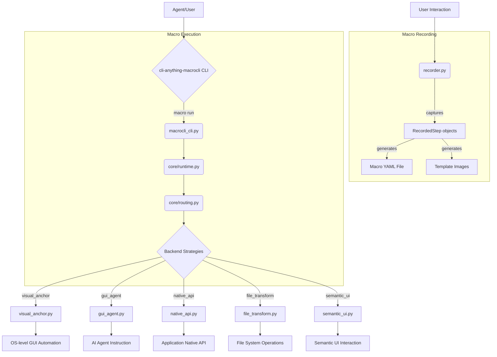

<!-- source: DeepWiki mcp.deepwiki.com · repo HKUDS/CLI-Anything · page 6.10 Automation and Developer-Tool Harnesses · fetched 2026-11-09 -->

# Automation and Developer-Tool Harnesses

<details>
<summary>Relevant source files</summary>

The following files were used as context for generating this wiki page:

- [browser/agent-harness/HARNESS.md](browser/agent-harness/HARNESS.md)
- [browser/agent-harness/cli_anything/browser/README.md](browser/agent-harness/cli_anything/browser/README.md)
- [browser/agent-harness/cli_anything/browser/__init__.py](browser/agent-harness/cli_anything/browser/__init__.py)
- [browser/agent-harness/cli_anything/browser/__main__.py](browser/agent-harness/cli_anything/browser/__main__.py)
- [browser/agent-harness/cli_anything/browser/browser_cli.py](browser/agent-harness/cli_anything/browser/browser_cli.py)
- [browser/agent-harness/cli_anything/browser/core/__init__.py](browser/agent-harness/cli_anything/browser/core/__init__.py)
- [browser/agent-harness/cli_anything/browser/core/fs.py](browser/agent-harness/cli_anything/browser/core/fs.py)
- [browser/agent-harness/cli_anything/browser/core/page.py](browser/agent-harness/cli_anything/browser/core/page.py)
- [browser/agent-harness/cli_anything/browser/core/session.py](browser/agent-harness/cli_anything/browser/core/session.py)
- [browser/agent-harness/cli_anything/browser/skills/SKILL.md](browser/agent-harness/cli_anything/browser/skills/SKILL.md)
- [browser/agent-harness/cli_anything/browser/tests/test_core.py](browser/agent-harness/cli_anything/browser/tests/test_core.py)
- [browser/agent-harness/cli_anything/browser/tests/test_domshell_backend.py](browser/agent-harness/cli_anything/browser/tests/test_domshell_backend.py)
- [browser/agent-harness/cli_anything/browser/tests/test_full_e2e.py](browser/agent-harness/cli_anything/browser/tests/test_full_e2e.py)
- [browser/agent-harness/cli_anything/browser/utils/domshell_backend.py](browser/agent-harness/cli_anything/browser/utils/domshell_backend.py)
- [drawio/agent-harness/setup.py](drawio/agent-harness/setup.py)
- [inkscape/agent-harness/cli_anything/inkscape/utils/svg_utils.py](inkscape/agent-harness/cli_anything/inkscape/utils/svg_utils.py)
- [libreoffice/agent-harness/cli_anything/libreoffice/utils/odf_utils.py](libreoffice/agent-harness/cli_anything/libreoffice/utils/odf_utils.py)
- [lldb/agent-harness/HARNESS.md](lldb/agent-harness/HARNESS.md)
- [lldb/agent-harness/LLDB.md](lldb/agent-harness/LLDB.md)
- [lldb/agent-harness/cli_anything/lldb/README.md](lldb/agent-harness/cli_anything/lldb/README.md)
- [lldb/agent-harness/cli_anything/lldb/__init__.py](lldb/agent-harness/cli_anything/lldb/__init__.py)
- [lldb/agent-harness/cli_anything/lldb/core/breakpoints.py](lldb/agent-harness/cli_anything/lldb/core/breakpoints.py)
- [lldb/agent-harness/cli_anything/lldb/core/session.py](lldb/agent-harness/cli_anything/lldb/core/session.py)
- [lldb/agent-harness/cli_anything/lldb/dap.py](lldb/agent-harness/cli_anything/lldb/dap.py)
- [lldb/agent-harness/cli_anything/lldb/lldb_cli.py](lldb/agent-harness/cli_anything/lldb/lldb_cli.py)
- [lldb/agent-harness/cli_anything/lldb/skills/SKILL.md](lldb/agent-harness/cli_anything/lldb/skills/SKILL.md)
- [lldb/agent-harness/cli_anything/lldb/tests/TEST.md](lldb/agent-harness/cli_anything/lldb/tests/TEST.md)
- [lldb/agent-harness/cli_anything/lldb/tests/test_core.py](lldb/agent-harness/cli_anything/lldb/tests/test_core.py)
- [lldb/agent-harness/cli_anything/lldb/tests/test_full_e2e.py](lldb/agent-harness/cli_anything/lldb/tests/test_full_e2e.py)
- [lldb/agent-harness/cli_anything/lldb/utils/session_client.py](lldb/agent-harness/cli_anything/lldb/utils/session_client.py)
- [lldb/agent-harness/cli_anything/lldb/utils/session_server.py](lldb/agent-harness/cli_anything/lldb/utils/session_server.py)
- [lldb/agent-harness/setup.py](lldb/agent-harness/setup.py)
- [macrocli/SKILL.md](macrocli/SKILL.md)
- [macrocli/agent-harness/DEMO.md](macrocli/agent-harness/DEMO.md)
- [macrocli/agent-harness/MACROCLI.md](macrocli/agent-harness/MACROCLI.md)
- [macrocli/agent-harness/cli_anything/macrocli/README.md](macrocli/agent-harness/cli_anything/macrocli/README.md)
- [macrocli/agent-harness/cli_anything/macrocli/__init__.py](macrocli/agent-harness/cli_anything/macrocli/__init__.py)
- [macrocli/agent-harness/cli_anything/macrocli/__main__.py](macrocli/agent-harness/cli_anything/macrocli/__main__.py)
- [macrocli/agent-harness/cli_anything/macrocli/backends/__init__.py](macrocli/agent-harness/cli_anything/macrocli/backends/__init__.py)
- [macrocli/agent-harness/cli_anything/macrocli/backends/base.py](macrocli/agent-harness/cli_anything/macrocli/backends/base.py)
- [macrocli/agent-harness/cli_anything/macrocli/backends/file_transform.py](macrocli/agent-harness/cli_anything/macrocli/backends/file_transform.py)
- [macrocli/agent-harness/cli_anything/macrocli/backends/gui_agent.py](macrocli/agent-harness/cli_anything/macrocli/backends/gui_agent.py)
- [macrocli/agent-harness/cli_anything/macrocli/backends/gui_macro.py](macrocli/agent-harness/cli_anything/macrocli/backends/gui_macro.py)
- [macrocli/agent-harness/cli_anything/macrocli/backends/native_api.py](macrocli/agent-harness/cli_anything/macrocli/backends/native_api.py)
- [macrocli/agent-harness/cli_anything/macrocli/backends/recovery.py](macrocli/agent-harness/cli_anything/macrocli/backends/recovery.py)
- [macrocli/agent-harness/cli_anything/macrocli/backends/semantic_ui.py](macrocli/agent-harness/cli_anything/macrocli/backends/semantic_ui.py)
- [macrocli/agent-harness/cli_anything/macrocli/backends/visual_anchor.py](macrocli/agent-harness/cli_anything/macrocli/backends/visual_anchor.py)
- [macrocli/agent-harness/cli_anything/macrocli/core/llm_assist.py](macrocli/agent-harness/cli_anything/macrocli/core/llm_assist.py)
- [macrocli/agent-harness/cli_anything/macrocli/core/macro_model.py](macrocli/agent-harness/cli_anything/macrocli/core/macro_model.py)
- [macrocli/agent-harness/cli_anything/macrocli/core/parameterize.py](macrocli/agent-harness/cli_anything/macrocli/core/parameterize.py)
- [macrocli/agent-harness/cli_anything/macrocli/core/recorder.py](macrocli/agent-harness/cli_anything/macrocli/core/recorder.py)
- [macrocli/agent-harness/cli_anything/macrocli/core/routing.py](macrocli/agent-harness/cli_anything/macrocli/core/routing.py)
- [macrocli/agent-harness/cli_anything/macrocli/macro_definitions/demo/gedit_find_and_replace.yaml](macrocli/agent-harness/cli_anything/macrocli/macro_definitions/demo/gedit_find_and_replace.yaml)
- [macrocli/agent-harness/cli_anything/macrocli/macro_definitions/demo/gedit_new_window.yaml](macrocli/agent-harness/cli_anything/macrocli/macro_definitions/demo/gedit_new_window.yaml)
- [macrocli/agent-harness/cli_anything/macrocli/macro_definitions/demo/gedit_save_as.yaml](macrocli/agent-harness/cli_anything/macrocli/macro_definitions/demo/gedit_save_as.yaml)
- [macrocli/agent-harness/cli_anything/macrocli/macro_definitions/demo/gedit_type_and_save.yaml](macrocli/agent-harness/cli_anything/macrocli/macro_definitions/demo/gedit_type_and_save.yaml)
- [macrocli/agent-harness/cli_anything/macrocli/macro_definitions/manifest.yaml](macrocli/agent-harness/cli_anything/macrocli/macro_definitions/manifest.yaml)
- [macrocli/agent-harness/cli_anything/macrocli/macrocli_cli.py](macrocli/agent-harness/cli_anything/macrocli/macrocli_cli.py)
- [macrocli/agent-harness/setup.py](macrocli/agent-harness/setup.py)
- [musescore/agent-harness/cli_anything/musescore/utils/mscx_xml.py](musescore/agent-harness/cli_anything/musescore/utils/mscx_xml.py)
- [musescore/agent-harness/setup.py](musescore/agent-harness/setup.py)
- [safari/agent-harness/HARNESS.md](safari/agent-harness/HARNESS.md)
- [safari/agent-harness/SAFARI.md](safari/agent-harness/SAFARI.md)
- [safari/agent-harness/cli_anything/safari/README.md](safari/agent-harness/cli_anything/safari/README.md)
- [safari/agent-harness/cli_anything/safari/safari_cli.py](safari/agent-harness/cli_anything/safari/safari_cli.py)
- [safari/agent-harness/cli_anything/safari/skills/SKILL.md](safari/agent-harness/cli_anything/safari/skills/SKILL.md)
- [safari/agent-harness/cli_anything/safari/tests/TEST.md](safari/agent-harness/cli_anything/safari/tests/TEST.md)
- [safari/agent-harness/cli_anything/safari/tests/test_security.py](safari/agent-harness/cli_anything/safari/tests/test_security.py)
- [safari/agent-harness/cli_anything/safari/utils/repl_skin.py](safari/agent-harness/cli_anything/safari/utils/repl_skin.py)
- [safari/agent-harness/cli_anything/safari/utils/safari_backend.py](safari/agent-harness/cli_anything/safari/utils/safari_backend.py)
- [safari/agent-harness/cli_anything/safari/utils/security.py](safari/agent-harness/cli_anything/safari/utils/security.py)
- [skills/cli-anything-lldb/SKILL.md](skills/cli-anything-lldb/SKILL.md)
- [zoom/agent-harness/cli_anything/zoom/zoom_cli.py](zoom/agent-harness/cli_anything/zoom/zoom_cli.py)
- [zoom/agent-harness/setup.py](zoom/agent-harness/setup.py)

</details>


This page details CLI-Anything harnesses designed for automation and developer tools. These harnesses demonstrate advanced integration patterns, including virtual filesystem mapping of UI elements, debugger session management, and GUI macro recording with robust backend strategies.

## Browser/DOMShell Accessibility-Tree VFS Harness

The `cli-anything-browser` harness provides agent-native browser automation by mapping Chrome's Accessibility Tree to a virtual filesystem (VFS) using DOMShell. This allows AI agents to interact with web pages using familiar shell commands like `ls`, `cd`, `cat`, `grep`, and `click`.

### Architecture and Data Flow

The browser harness leverages the MCP (Micro-service Communication Protocol) to communicate with the DOMShell Chrome extension.

```mermaid
graph TD
    A[CLI Commands] --> B(browser_cli.py);
    B --> C(domshell_backend.py);
    C --> D{MCP ClientSession};
    D -- stdio --> E[npx domshell-proxy];
    E --> F[DOMShell MCP Server];
    F --> G[Chrome + DOMShell Extension];

    subgraph "State Management (cli_anything.browser.core.session.Session)"
        H[current_url: str]
        I[working_dir: str]
        J[history: list[str]]
        K[daemon_mode: bool]
    end

    B -- updates --> H;
    B -- updates --> I;
    B -- updates --> J;
    B -- updates --> K;
```
**Diagram: Browser Harness Architecture**
Sources: [browser/agent-harness/HARNESS.md:9-32]()

1.  **CLI Commands**: User or agent invokes commands via `cli-anything-browser` (e.g., `page open`, `fs ls`). These are handled by `browser_cli.py` [browser/agent-harness/cli_anything/browser/browser_cli.py:1-16]().
2.  **`browser_cli.py`**: This is the main Click CLI entry point [browser/agent-harness/cli_anything/browser/browser_cli.py:104-113](). It parses arguments, initializes a `Session` object [browser/agent-harness/cli_anything/browser/browser_cli.py:36-40](), and dispatches to core modules like `page.py` [browser/agent-harness/cli_anything/browser/browser_cli.py:25]() and `fs.py` [browser/agent-harness/cli_anything/browser/browser_cli.py:26](). It also handles JSON output [browser/agent-harness/cli_anything/browser/browser_cli.py:43-78]() and error handling [browser/agent-harness/cli_anything/browser/browser_cli.py:80-100]().
3.  **`domshell_backend.py`**: This module acts as the Python interface to DOMShell's MCP server [browser/agent-harness/cli_anything/browser/utils/domshell_backend.py:1-5](). It uses the `mcp` Python SDK to communicate with the `domshell-proxy` via stdio [browser/agent-harness/cli_anything/browser/utils/domshell_backend.py:29-30]().
4.  **`npx domshell-proxy`**: This is a Node.js process spawned by the backend [browser/agent-harness/cli_anything/browser/utils/domshell_backend.py:39-58]() that bridges the Python process to the DOMShell MCP server.
5.  **DOMShell MCP Server**: This server, part of the DOMShell Chrome extension, exposes the browser's Accessibility Tree as a VFS.
6.  **Chrome + DOMShell Extension**: The Chrome browser running the DOMShell extension provides the underlying functionality.

### Key Features and Implementation Details

*   **Filesystem-First Interaction**: DOMShell's core idea is to treat the Accessibility Tree as a filesystem. This means elements can be navigated using paths like `/main/div[0]/button[2]` [browser/agent-harness/cli_anything/browser/skills/SKILL.md:123-127]().
*   **`Session` Management**: The `cli_anything.browser.core.session.Session` class [browser/agent-harness/cli_anything/browser/core/session.py]() maintains the browser's state, including `current_url`, `working_dir` (the current path in the Accessibility Tree), and navigation history [browser/agent-harness/cli_anything/browser/core/session.py:18-21](). This state is in-memory only, as the Accessibility Tree is dynamic [browser/agent-harness/HARNESS.md:139-140]().
*   **Daemon Mode**: For interactive use or multi-command agent workflows, a `--daemon` flag [browser/agent-harness/cli_anything/browser/browser_cli.py:106-107]() can be used to start a persistent MCP connection, avoiding the ~1-3 second cold start latency per command [browser/agent-harness/HARNESS.md:123-130](). The `_daemon_session` and related variables in `domshell_backend.py` manage this persistent connection [browser/agent-harness/cli_anything/browser/utils/domshell_backend.py:61-90]().
*   **Split-and-Check Strategy**: For commands requiring state changes (like `cd`) followed by an operation (`ls`, `cat`), the harness uses separate `_call_execute` calls (anchor → op → restore) with error checks in between. This ensures correctness even if an intermediate step fails [browser/agent-harness/HARNESS.md:77-80](). For example, `fs ls /sub` involves three calls: `cd %here%/sub`, `ls`, and `cd <restore>` [browser/agent-harness/HARNESS.md:83](). This is evident in `test_ls_absolute_path_uses_three_separate_calls` [browser/agent-harness/cli_anything/browser/tests/test_domshell_backend.py:48-63]().
*   **URL Security Validation**: The `page.open_page` function [browser/agent-harness/cli_anything/browser/core/page.py:19-48]() uses `security.validate_url` [browser/agent-harness/cli_anything/browser/core/page.py:16]() to block dangerous schemes (e.g., `file://`, `javascript://`) and can optionally block private network access [browser/agent-harness/cli_anything/browser/skills/SKILL.md:185-190]().
*   **`_q` for Shell Quoting**: The `_q` helper function [browser/agent-harness/cli_anything/browser/utils/domshell_backend.py:151-176]() ensures arguments are properly shell-quoted for `domshell_execute`, preventing command injection, especially by rejecting newlines.
*   **Path Translation**: The `_translate_path` function [browser/agent-harness/cli_anything/browser/tests/test_domshell_backend.py:21-44]() handles converting harness paths (e.g., `/main`) to DOMShell's `%here%` anchored paths.

### Core Modules

*   **`cli_anything.browser.core.session`**: Manages the in-memory state of the browser session.
*   **`cli_anything.browser.core.page`**: Implements page-level commands like `open_page` [browser/agent-harness/cli_anything/browser/core/page.py:19-48](), `reload_page` [browser/agent-harness/cli_anything/browser/core/page.py:51-67](), `go_back` [browser/agent-harness/cli_anything/browser/core/page.py:70-90](), and `go_forward` [browser/agent-harness/cli_anything/browser/core/page.py:93-112]().
*   **`cli_anything.browser.core.fs`**: Implements filesystem-like commands for the Accessibility Tree, such as `list_elements` (ls) [browser/agent-harness/cli_anything/browser/core/fs.py:19-35](), `change_directory` (cd) [browser/agent-harness/cli_anything/browser/core/fs.py:38-77](), `read_element` (cat) [browser/agent-harness/cli_anything/browser/core/fs.py:80-96](), and `grep_elements` (grep) [browser/agent-harness/cli_anything/browser/core/fs.py:99-123]().
*   **`cli_anything.browser.core.act`**: (Not fully shown in provided files, but implied by `SKILL.md`) Handles actions like `click` and `type`.

Sources: [browser/agent-harness/cli_anything/browser/utils/domshell_backend.py](), [browser/agent-harness/cli_anything/browser/tests/test_domshell_backend.py](), [browser/agent-harness/HARNESS.md](), [browser/agent-harness/cli_anything/browser/tests/test_core.py](), [browser/agent-harness/cli_anything/browser/core/page.py](), [browser/agent-harness/cli_anything/browser/browser_cli.py](), [browser/agent-harness/cli_anything/browser/skills/SKILL.md](), [browser/agent-harness/cli_anything/browser/core/fs.py]()

## LLDB Debugger Harness

The `cli-anything-lldb` harness provides a command-line interface and a Debug Adapter Protocol (DAP) server for the LLDB debugger. It enables AI agents to interact with a debugger session, set breakpoints, inspect variables, and control program execution.

### Architecture and Data Flow

The LLDB harness offers two main interfaces: a JSON CLI/REPL and a DAP server. Both interact with an underlying LLDB session.

```mermaid
graph TD
    A[Agent/User] --> B{cli-anything-lldb CLI};
    A --> C{DAP Client (e.g., VS Code)};
    C --> D[cli-anything-lldb-dap Server];

    B -- JSON/REPL --> E[lldb_cli.py];
    D -- stdio (DAP) --> F[dap.py];

    E -- RPC calls --> G(session_client.py);
    F -- direct calls --> H(core/session.py);

    G -- socket/file --> I[session_server.py (Daemon)];
    I -- LLDB API --> J[LLDB Python Bindings];

    H -- LLDB API --> J;

    J --> K[LLDB Debugger];
    K --> L[Debuggee Process];

    subgraph "Persistent Session (Optional)"
        I
        G
    end
```
**Diagram: LLDB Harness Architecture**
Sources: [lldb/agent-harness/README.md:6-9]()

1.  **`cli-anything-lldb` CLI**: This is the primary command-line interface [lldb/agent-harness/cli_anything/lldb/lldb_cli.py](). It supports one-shot commands with `--json` output or an interactive REPL [lldb/agent-harness/README.md:40-73]().
2.  **`cli-anything-lldb-dap` Server**: This is a separate entry point that runs a Debug Adapter Protocol (DAP) server over stdio [lldb/agent-harness/README.md:89-115](). It allows integration with DAP-compatible clients like VS Code or AI debug clients.
3.  **`lldb_cli.py`**: The main CLI logic, parsing commands and dispatching to core functions.
4.  **`dap.py`**: Implements the DAP server, handling DAP requests and translating them into LLDB operations [lldb/agent-harness/cli_anything/lldb/dap.py]().
5.  **`session_client.py`**: Used by the CLI to communicate with a persistent LLDB session daemon [lldb/agent-harness/cli_anything/lldb/utils/session_client.py]().
6.  **`session_server.py`**: Runs as a daemon, hosting a persistent LLDB session and exposing it via a localhost JSON socket protocol [lldb/agent-harness/cli_anything/lldb/utils/session_server.py](). This allows multiple CLI invocations to share the same debugger state [lldb/agent-harness/README.md:75-78]().
7.  **`core/session.py`**: Manages the actual LLDB `SBDebugger` session, `SBTarget`, and `SBProcess` objects. It provides high-level wrappers for LLDB operations [lldb/agent-harness/cli_anything/lldb/core/session.py]().
8.  **LLDB Python Bindings**: The harness directly uses the LLDB Python API to control the debugger.
9.  **LLDB Debugger**: The core LLDB engine.
10. **Debuggee Process**: The program being debugged.

### Key Features and Implementation Details

*   **Persistent Session Daemon**: The CLI can operate in a persistent session mode, where `target create`, `breakpoint set`, `process launch`, and subsequent inspection commands can be run as separate CLI invocations against the same live debugger state [lldb/agent-harness/README.md:75-78](). This is managed by `session_server.py` [lldb/agent-harness/cli_anything/lldb/utils/session_server.py]() and `session_client.py` [lldb/agent-harness/cli_anything/lldb/utils/session_client.py]().
*   **Debug Adapter Protocol (DAP) Support**: The `dap.py` module [lldb/agent-harness/cli_anything/lldb/dap.py]() provides a full DAP server, enabling rich integration with IDEs and AI agents. It supports a wide range of DAP requests, including `initialize`, `launch`, `setBreakpoints`, `threads`, `stackTrace`, `variables`, `evaluate`, `continue`, `pause`, and more [lldb/agent-harness/README.md:108-114]().
*   **Stop-Rule Profiles**: For noisy GUI debuggees, the DAP server supports `stop-rule` profiles (JSON files) that can automatically continue past internal traps or specific breakpoints based on module, function, or regex patterns [lldb/agent-harness/README.md:131-168](). This is crucial for filtering out irrelevant debugger stops.
*   **Asynchronous Debugger Control**: The DAP implementation handles `continue` and `pause` asynchronously. `continue` responds immediately while the LLDB `SBProcess.Continue()` runs in a background thread. `pause` uses `SBProcess.SendAsyncInterrupt()` to keep the adapter responsive [lldb/agent-harness/README.md:122-129]().
*   **Breakpoint Semantics**: `breakpoint set` fails by default if LLDB creates a pending breakpoint with no resolved locations, but `--allow-pending` can override this. Breakpoint payloads include `resolved` and `location_details` for agent awareness [lldb/agent-harness/README.md:83-86]().
*   **JSON Output**: All CLI commands support the `--json` flag for machine-readable output, essential for agent consumption [lldb/agent-harness/README.md:189-193]().
*   **Prerequisites Check**: The harness automatically discovers LLDB Python bindings using `lldb -P` [lldb/agent-harness/README.md:33-36]().

### Core Modules

*   **`cli_anything.lldb.core.session`**: Manages the LLDB debugger session, target, and process. It provides methods for launching, attaching, setting breakpoints, stepping, and inspecting state.
*   **`cli_anything.lldb.core.breakpoints`**: (Not fully shown, but implied) Handles breakpoint-specific logic.
*   **`cli_anything.lldb.dap`**: Implements the Debug Adapter Protocol server.
*   **`cli_anything.lldb.utils.session_server`**: The daemon process for persistent LLDB sessions.
*   **`cli_anything.lldb.utils.session_client`**: Client for communicating with the session daemon.

Sources: [lldb/agent-harness/cli_anything/lldb/tests/TEST.md](), [lldb/agent-harness/cli_anything/lldb/README.md](), [lldb/agent-harness/cli_anything/lldb/lldb_cli.py](), [lldb/agent-harness/cli_anything/lldb/dap.py](), [lldb/agent-harness/cli_anything/lldb/utils/session_server.py](), [lldb/agent-harness/cli_anything/lldb/utils/session_client.py](), [lldb/agent-harness/cli_anything/lldb/core/session.py]()

## MacroCLI GUI Macro Recorder

The `cli-anything-macrocli` harness provides a GUI macro recorder that captures user interactions (mouse clicks, keyboard events) and generates agent-native macro YAML files. These macros can then be executed by AI agents to automate GUI workflows.

### Architecture and Data Flow

The MacroCLI harness consists of a recorder component and a runtime component. The recorder captures interactions and saves them as YAML, while the runtime executes these YAML-defined macros.


**Diagram: MacroCLI Architecture**
Sources: [macrocli/agent-harness/cli_anything/macrocli/core/recorder.py:1-24](), [macrocli/agent-harness/cli_anything/macrocli/macrocli_cli.py:1-16]()

1.  **User Interaction**: The user performs actions (clicks, typing, hotkeys, scrolling) in a GUI application.
2.  **`recorder.py`**: This module [macrocli/agent-harness/cli_anything/macrocli/core/recorder.py]() uses `pynput` to listen for mouse and keyboard events. On each click, it captures a screenshot region around the click point as a template image [macrocli/agent-harness/cli_anything/macrocli/core/recorder.py:8-10]().
3.  **`RecordedStep` Objects**: Each captured interaction is stored as a `RecordedStep` dataclass [macrocli/agent-harness/cli_anything/macrocli/core/recorder.py:43-71](), containing details like coordinates, button, text, and a path to the template image.
4.  **Macro YAML File & Template Images**: When recording stops, `recorder.py` generates a YAML file (e.g., `my_workflow.yaml`) and a directory of associated template PNGs (e.g., `my_workflow_templates/step_001_click.png`) [macrocli/agent-harness/cli_anything/macrocli/core/recorder.py:18-23]().
5.  **`cli-anything-macrocli` CLI**: Agents or users invoke commands like `macro run` [macrocli/agent-harness/cli_anything/macrocli/macrocli_cli.py:175-189]() to execute a recorded macro.
6.  **`macrocli_cli.py`**: The main CLI entry point [macrocli/agent-harness/cli_anything/macrocli/macrocli_cli.py:1-16](), handling command parsing, JSON output, and error handling.
7.  **`core/runtime.py`**: The `MacroRuntime` class [macrocli/agent-harness/cli_anything/macrocli/core/runtime.py]() is responsible for executing the steps defined in a macro YAML file.
8.  **`core/routing.py`**: The `RoutingEngine` [macrocli/agent-harness/cli_anything/macrocli/core/routing.py]() dispatches each macro step to the appropriate backend strategy based on the `backend` and `action` fields in the YAML.
9.  **Backend Strategies**: These modules implement the actual interaction logic.

### Key Features and Implementation Details

*   **Robust GUI Automation**: Macros use `visual_anchor` backend strategies [macrocli/agent-harness/cli_anything/macrocli/core/recorder.py:13-16]() that rely on template images and window-relative coordinates. This makes them resilient to window movement and minor UI layout changes, unlike brittle hardcoded screen coordinates.
*   **`RecordedStep` Data Model**: The `RecordedStep` dataclass [macrocli/agent-harness/cli_anything/macrocli/core/recorder.py:43-71]() captures all necessary information for a GUI interaction. Its `to_step_dict` method [macrocli/agent-harness/cli_anything/macrocli/core/recorder.py:73-177]() converts the recorded data into a macro YAML step dictionary, choosing the most appropriate backend action (e.g., `click_relative`, `click_image`, `type_text`).
*   **Multiple Backend Strategies**:
    *   **`visual_anchor.py`**: The primary backend for GUI interaction, using image recognition (template matching) and window-relative coordinates for clicks, typing, and scrolling [macrocli/agent-harness/cli_anything/macrocli/backends/visual_anchor.py]().
    *   **`gui_agent.py`**: Allows for "agent steps" within a macro, where the macro pauses and instructs an AI agent to perform a task, potentially with an end-state snapshot [macrocli/agent-harness/cli_anything/macrocli/backends/gui_agent.py](). This bridges the gap between low-level GUI automation and high-level agent reasoning.
    *   **`native_api.py`**: For applications with native APIs, this backend can directly invoke those APIs [macrocli/agent-harness/cli_anything/macrocli/backends/native_api.py]().
    *   **`file_transform.py`**: Handles file system operations as part of a macro [macrocli/agent-harness/cli_anything/macrocli/backends/file_transform.py]().
    *   **`semantic_ui.py`**: (Implied) For interacting with UI elements based on their semantic meaning rather than just visual appearance.
*   **Window Detection**: The `_get_active_window_at` function [macrocli/agent-harness/cli_anything/macrocli/core/recorder.py:181-195]() identifies the active window at the click location, allowing for window-relative coordinates.
*   **Parameterization**: Macros can be parameterized using `--param key=value` [macrocli/agent-harness/cli_anything/macrocli/macrocli_cli.py:177-178](), enabling flexible reuse. The `_parse_params` function [macrocli/agent-harness/cli_anything/macrocli/macrocli_cli.py:123-131]() handles this.
*   **Dry Run Mode**: The `--dry-run` flag [macrocli/agent-harness/cli_anything/macrocli/macrocli_cli.py:138-139]() allows simulating macro execution without side effects.

Sources: [macrocli/agent-harness/cli_anything/macrocli/core/recorder.py](), [macrocli/agent-harness/cli_anything/macrocli/macrocli_cli.py](), [macrocli/agent-harness/cli_anything/macrocli/backends/gui_agent.py](), [macrocli/agent-harness/cli_anything/macrocli/core/parameterize.py](), [macrocli/agent-harness/cli_anything/macrocli/backends/visual_anchor.py](), [macrocli/agent-harness/cli_anything/macrocli/core/routing.py](), [macrocli/agent-harness/cli_anything/macrocli/core/macro_model.py](), [macrocli/agent-harness/cli_anything/macrocli/backends/native_api.py](), [macrocli/agent-harness/cli_anything/macrocli/backends/file_transform.py](), [macrocli/agent-harness/cli_anything/macrocli/backends/semantic_ui.py]()

---

