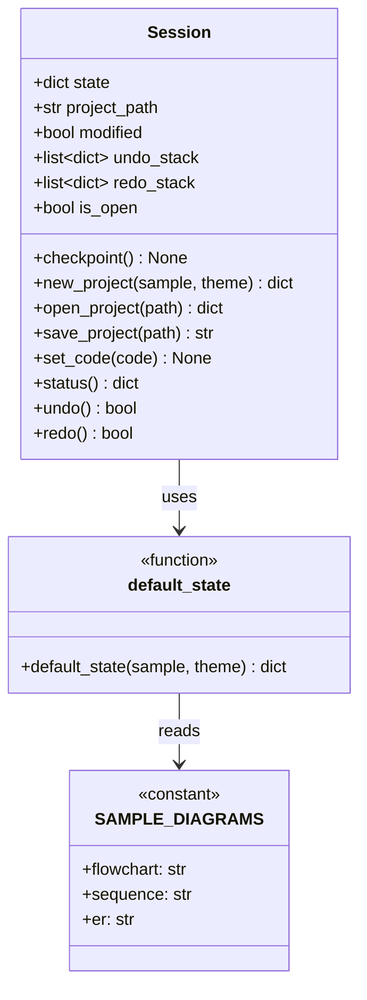
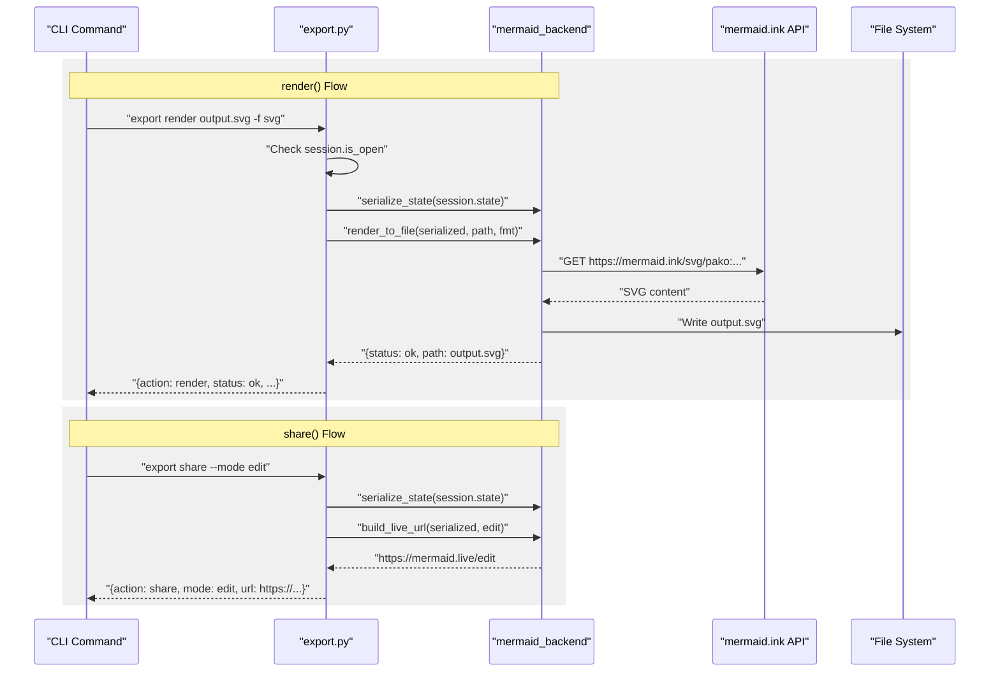
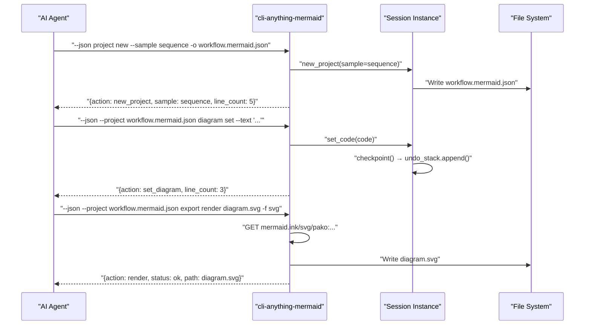
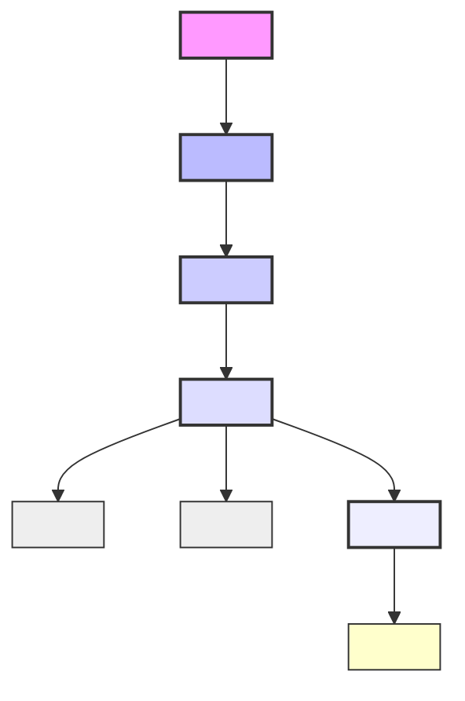

<!-- source: DeepWiki mcp.deepwiki.com · repo HKUDS/CLI-Anything · page 6.2 Mermaid: Diagram Generation Harness · fetched 2026-11-09 -->

# Mermaid: Diagram Generation Harness

<details>
<summary>Relevant source files</summary>

The following files were used as context for generating this wiki page:

- [drawio/agent-harness/DRAWIO.md](drawio/agent-harness/DRAWIO.md)
- [drawio/agent-harness/cli_anything/drawio/README.md](drawio/agent-harness/cli_anything/drawio/README.md)
- [drawio/agent-harness/cli_anything/drawio/__init__.py](drawio/agent-harness/cli_anything/drawio/__init__.py)
- [drawio/agent-harness/cli_anything/drawio/core/__init__.py](drawio/agent-harness/cli_anything/drawio/core/__init__.py)
- [drawio/agent-harness/cli_anything/drawio/core/connectors.py](drawio/agent-harness/cli_anything/drawio/core/connectors.py)
- [drawio/agent-harness/cli_anything/drawio/core/export.py](drawio/agent-harness/cli_anything/drawio/core/export.py)
- [drawio/agent-harness/cli_anything/drawio/core/pages.py](drawio/agent-harness/cli_anything/drawio/core/pages.py)
- [drawio/agent-harness/cli_anything/drawio/core/project.py](drawio/agent-harness/cli_anything/drawio/core/project.py)
- [drawio/agent-harness/cli_anything/drawio/core/shapes.py](drawio/agent-harness/cli_anything/drawio/core/shapes.py)
- [drawio/agent-harness/cli_anything/drawio/drawio_cli.py](drawio/agent-harness/cli_anything/drawio/drawio_cli.py)
- [drawio/agent-harness/cli_anything/drawio/tests/test_core.py](drawio/agent-harness/cli_anything/drawio/tests/test_core.py)
- [drawio/agent-harness/cli_anything/drawio/utils/drawio_xml.py](drawio/agent-harness/cli_anything/drawio/utils/drawio_xml.py)
- [mermaid/agent-harness/MERMAID.md](mermaid/agent-harness/MERMAID.md)
- [mermaid/agent-harness/cli_anything/mermaid/README.md](mermaid/agent-harness/cli_anything/mermaid/README.md)
- [mermaid/agent-harness/cli_anything/mermaid/__init__.py](mermaid/agent-harness/cli_anything/mermaid/__init__.py)
- [mermaid/agent-harness/cli_anything/mermaid/__main__.py](mermaid/agent-harness/cli_anything/mermaid/__main__.py)
- [mermaid/agent-harness/cli_anything/mermaid/core/__init__.py](mermaid/agent-harness/cli_anything/mermaid/core/__init__.py)
- [mermaid/agent-harness/cli_anything/mermaid/core/diagram.py](mermaid/agent-harness/cli_anything/mermaid/core/diagram.py)
- [mermaid/agent-harness/cli_anything/mermaid/core/export.py](mermaid/agent-harness/cli_anything/mermaid/core/export.py)
- [mermaid/agent-harness/cli_anything/mermaid/core/project.py](mermaid/agent-harness/cli_anything/mermaid/core/project.py)
- [mermaid/agent-harness/cli_anything/mermaid/core/session.py](mermaid/agent-harness/cli_anything/mermaid/core/session.py)
- [public_registry.json](public_registry.json)
- [siyuan/agent-harness/setup.py](siyuan/agent-harness/setup.py)
- [skills/cli-anything-siyuan/SKILL.md](skills/cli-anything-siyuan/SKILL.md)

</details>


This page examines the `cli-anything-mermaid` harness as a detailed example of **web service integration** within CLI-Anything. Unlike desktop applications like GIMP or Blender that require subprocess invocation of local binaries, Mermaid demonstrates how the CLI-Anything methodology handles cloud-based services with REST APIs and specialized serialization formats.

For general CLI architecture patterns shared by all harnesses, see [Generated CLI Architecture](#5). For other application examples, see [GIMP: Image Editing Harness](#6.1), [Blender: 3D Modeling Harness](#6.3), and [CloudCompare: 3D Point Cloud Harness](#6.4).

---

## Overview: Mermaid Live Editor Integration

The Mermaid harness wraps the **Mermaid Live Editor** web application, which provides browser-based diagram editing with real-time preview. The integration challenge differs fundamentally from desktop applications: instead of invoking local binaries, the CLI must replicate the editor's state serialization format and interact with the official `mermaid.live` and `mermaid.ink` rendering services.

The harness provides:
- Stateful project files stored as a JSON project file with a `.mermaid.json` suffix [[mermaid/agent-harness/MERMAID.md:20-20]]()
- Serialization using `pako` compression (zlib + base64) matching the upstream format [[mermaid/agent-harness/MERMAID.md:24-30]]()
- Share URL generation compatible with `https://mermaid.live/edit` and `https://mermaid.live/view` [[mermaid/agent-harness/MERMAID.md:33-34]]()
- Diagram rendering via `https://mermaid.ink/svg` and `https://mermaid.ink/img` endpoints [[mermaid/agent-harness/MERMAID.md:35-36]]()

**Sources:** [[mermaid/agent-harness/MERMAID.md:1-42]](), [[mermaid/agent-harness/cli_anything/mermaid/README.md:1-10]]()

---

## State Serialization Architecture

The Mermaid Live Editor uses a specialized state serialization format that the CLI must replicate exactly to maintain compatibility with official rendering services. The state object contains core fields that control diagram content and rendering behavior.

### Mermaid Live Editor State Model

Title: Mermaid State Serialization Flow
```mermaid
graph LR
    subgraph "StateObject" ["State Object (Python dict)"]
        "code"["code<br/>(Mermaid source)"]
        "mermaid"["mermaid<br/>(JSON config string)"]
        "updateDiagram"["updateDiagram<br/>(bool)"]
        "rough"["rough<br/>(bool)"]
        "panZoom"["panZoom<br/>(bool)"]
        "grid"["grid<br/>(bool)"]
    end
    
    subgraph "SerializationPipeline" ["Serialization Pipeline"]
        "json_compact"["JSON.dumps()<br/>compact format"]
        "zlib_compress"["zlib.compress()"]
        "base64_encode"["base64.urlsafe_b64encode()"]
        "pako_prefix"["Add 'pako:' prefix"]
    end
    
    "StateObject" --> "json_compact"
    "json_compact" --> "zlib_compress"
    "zlib_compress" --> "base64_encode"
    "base64_encode" --> "pako_prefix"
    
    "pako_prefix" --> "edit_url"["https://mermaid.live/edit#<serialized>"]
    "pako_prefix" --> "view_url"["https://mermaid.live/view#<serialized>"]
    "pako_prefix" --> "svg_url"["https://mermaid.ink/svg/<serialized>"]
    "pako_prefix" --> "png_url"["https://mermaid.ink/img/<serialized>?type=png"]
```

The `Session` class in `cli_anything/mermaid/core/session.py` maintains this state object in memory, persisting it to `.mermaid.json` files on disk [[mermaid/agent-harness/cli_anything/mermaid/core/session.py:68-79]](). The serialization pipeline is implemented in the `utils/mermaid_backend.py` module, which produces the exact same payload format as the official Mermaid Live Editor [[mermaid/agent-harness/MERMAID.md:24-30]]().

**Sources:** [[mermaid/agent-harness/MERMAID.md:9-36]](), [[mermaid/agent-harness/cli_anything/mermaid/core/session.py:18-28]](), [[mermaid/agent-harness/cli_anything/mermaid/core/session.py:31-41]]()

---

## Backend Integration Pattern

Unlike desktop applications that use subprocess invocation, the Mermaid harness implements a pure web service integration pattern. The backend module handles HTTP requests to the official Mermaid rendering infrastructure.

### mermaid_backend Module Architecture

Title: Mermaid Backend Service Mapping
```mermaid
graph TB
    subgraph "CoreModules" ["Core Modules"]
        "session_state"["Session.state<br/>(dict)"]
        "export_render"["render()<br/>core/export.py:11-19"]
        "export_share"["share()<br/>core/export.py:22-30"]
    end
    
    subgraph "BackendLayer" ["utils/mermaid_backend.py"]
        "serialize"["serialize_state(state)<br/>Compact JSON + zlib + base64"]
        "build_url"["build_live_url(serialized, mode)<br/>Construct mermaid.live URLs"]
        "render_file"["render_to_file(serialized, path, fmt)<br/>HTTP GET to mermaid.ink"]
    end
    
    subgraph "ExternalServices" ["External Services"]
        "live_edit"["https://mermaid.live/edit"]
        "live_view"["https://mermaid.live/view"]
        "ink_svg"["https://mermaid.ink/svg"]
        "ink_img"["https://mermaid.ink/img"]
    end
    
    "session_state" --> "export_render"
    "session_state" --> "export_share"
    
    "export_render" --> "serialize"
    "export_share" --> "serialize"
    
    "serialize" --> "render_file"
    "serialize" --> "build_url"
    
    "render_file" -->|HTTP GET| "ink_svg"
    "render_file" -->|HTTP GET| "ink_img"
    "build_url" --> "live_edit"
    "build_url" --> "live_view"
```

The `mermaid_backend` module abstracts web service interaction, providing key functions:
- `serialize_state()`: Converts Python dict to pako-compressed base64 string [[mermaid/agent-harness/cli_anything/mermaid/core/export.py:16-16]]()
- `build_live_url()`: Generates shareable URLs for edit/view modes [[mermaid/agent-harness/cli_anything/mermaid/core/export.py:29-29]]()
- `render_to_file()`: Fetches rendered diagrams via HTTP [[mermaid/agent-harness/cli_anything/mermaid/core/export.py:17-17]]()

This pattern demonstrates the "Authentic Backend Integration" principle: the CLI uses the **same rendering infrastructure** as the official web application, rather than reimplementing Mermaid's diagram generation engine locally [[mermaid/agent-harness/MERMAID.md:38-42]]().

**Sources:** [[mermaid/agent-harness/MERMAID.md:38-42]](), [[mermaid/agent-harness/cli_anything/mermaid/core/export.py:1-31]]()

---

## Command Structure

The Mermaid CLI follows the standard CLI-Anything command group architecture. All commands are organized into four groups: `project`, `diagram`, `export`, and `session` [[mermaid/agent-harness/cli_anything/mermaid/mermaid_cli.py:65-173]]().

| Command Group | Commands | Purpose | Example |
|--------------|----------|---------|---------|
| `project` | `new`, `open`, `save`, `info`, `samples` | Project lifecycle management | `project new --sample flowchart -o diagram.mermaid.json` |
| `diagram` | `set`, `show` | Mermaid source code manipulation | `diagram set --text "graph TD; A --> B"` |
| `export` | `render`, `share` | Output generation (files and URLs) | `export render output.svg -f svg` |
| `session` | `status`, `undo`, `redo` | State management and history | `session undo` |

### Sample Diagrams Catalog

The harness includes built-in sample diagrams to accelerate agent workflows:

| Sample Key | Diagram Type | Use Case |
|-----------|--------------|----------|
| `flowchart` | Flowchart TD | Decision trees, process flows |
| `sequence` | Sequence Diagram | API interactions, message passing |
| `er` | Entity-Relationship | Database schemas, data models |

These samples are defined in `cli_anything/mermaid/core/session.py` as the `SAMPLE_DIAGRAMS` dictionary [[mermaid/agent-harness/cli_anything/mermaid/core/session.py:11-15]](). Agents can list available samples via `project samples` [[mermaid/agent-harness/cli_anything/mermaid/mermaid_cli.py:100-103]]() and instantiate them with `project new --sample <key>` [[mermaid/agent-harness/cli_anything/mermaid/mermaid_cli.py:70-81]]().

**Sources:** [[mermaid/agent-harness/cli_anything/mermaid/mermaid_cli.py:65-173]](), [[mermaid/agent-harness/cli_anything/mermaid/core/session.py:11-15]](), [[mermaid/agent-harness/cli_anything/mermaid/core/project.py:1-48]]()

---

## Session Management Implementation

The `Session` class in `cli_anything/mermaid/core/session.py` implements stateful project management with undo/redo functionality. This demonstrates the standard session pattern used across all CLI-Anything harnesses.

### Session Class Structure

Title: Session State and History Management


**Key implementation details:**

1. **State persistence**: The `state` field holds the current diagram state dict, persisted to `.mermaid.json` files via `save_project()` [[mermaid/agent-harness/cli_anything/mermaid/core/session.py:68-79]]().
2. **Undo/redo mechanism**: Uses `copy.deepcopy()` to create snapshots before mutations [[mermaid/agent-harness/cli_anything/mermaid/core/session.py:46-46]](). The `checkpoint()` method pushes current state to `undo_stack` and clears `redo_stack` [[mermaid/agent-harness/cli_anything/mermaid/core/session.py:43-47]]().
3. **Modification tracking**: The `modified` flag tracks unsaved changes, set to `True` by `set_code()` [[mermaid/agent-harness/cli_anything/mermaid/core/session.py:87-87]]() and reset to `False` by `save_project()` [[mermaid/agent-harness/cli_anything/mermaid/core/session.py:78-78]]().
4. **Project lifecycle**: Three-method pattern of `new_project()`, `open_project()`, and `save_project()` mirrors desktop application behavior despite operating on JSON files rather than binary formats [[mermaid/agent-harness/cli_anything/mermaid/core/session.py:49-80]]().

**Sources:** [[mermaid/agent-harness/cli_anything/mermaid/core/session.py:31-113]]()

---

## Project Module Operations

The `core/project.py` module provides the command implementations for the `project` command group. Each function accepts a `Session` instance and returns a dict suitable for JSON serialization.

### Project Command Implementations

Title: Project Operation Mapping
```mermaid
graph TB
    subgraph "ProjectCommands" ["project.py Functions"]
        "new_project"["new_project(session, sample, theme)<br/>Returns: action, sample, theme, line_count"]
        "open_project"["open_project(session, path)<br/>Returns: action, path, line_count"]
        "save_project"["save_project(session, path)<br/>Returns: action, path"]
        "project_info"["project_info(session)<br/>Returns: project_path, line_count, theme_json, modified"]
        "list_samples"["list_samples()<br/>Returns: SAMPLE_DIAGRAMS dict"]
    end
    
    subgraph "SessionMethods" ["Session Methods Called"]
        "session_new"["session.new_project(sample, theme)"]
        "session_open"["session.open_project(path)"]
        "session_save"["session.save_project(path)"]
        "session_state"["session.state"]
    end
    
    "new_project" --> "session_new"
    "open_project" --> "session_open"
    "save_project" --> "session_save"
    "project_info" --> "session_state"
```

The pattern demonstrates separation of concerns: `project.py` functions handle CLI response formatting and validation, while the `Session` class manages state mutations and persistence. All functions return dicts containing an `action` key to identify the operation [[mermaid/agent-harness/cli_anything/mermaid/core/project.py:10-15]](), enabling agents to parse structured JSON output via the `--json` flag.

**Sources:** [[mermaid/agent-harness/cli_anything/mermaid/core/project.py:1-48]]()

---

## Export Operations: Render and Share

The `export` command group demonstrates the two output modalities for Mermaid diagrams: rendering to image files via the `mermaid.ink` API and generating shareable URLs for the `mermaid.live` web editor.

### Export Workflow

Title: Export Execution Sequence


**Render implementation** [[mermaid/agent-harness/cli_anything/mermaid/core/export.py:11-19]]():
- Validates session state and output path.
- Delegates serialization to `mermaid_backend.serialize_state()`.
- Calls `mermaid_backend.render_to_file()` which performs HTTP GET request.
- Returns dict with `action` and result metadata.

**Share implementation** [[mermaid/agent-harness/cli_anything/mermaid/core/export.py:22-30]]():
- Serializes state using same `serialize_state()` function.
- Constructs URL using `build_live_url(serialized, mode)`.
- Supports `edit` and `view` modes for different live editor experiences.

The share operation requires **no network I/O**—it only generates the URL. Render operations require network access to `mermaid.ink`, demonstrating the "authentic backend integration" where the CLI depends on the real service rather than reimplementing diagram rendering locally [[mermaid/agent-harness/MERMAID.md:38-42]]().

**Sources:** [[mermaid/agent-harness/cli_anything/mermaid/core/export.py:1-31]](), [[mermaid/agent-harness/MERMAID.md:22-36]]()

---

## Agent Workflow Example

This sequence demonstrates a typical agent interaction pattern, showing how the `--json` flag enables structured communication and how project files provide persistent state across commands.

### Complete Agent Workflow

Title: Agent Interaction Lifecycle


**Key observations:**

1. **Persistent state via --project flag**: All commands after initial creation reference `workflow.mermaid.json`, enabling stateful operations across discrete CLI invocations [[mermaid/agent-harness/cli_anything/mermaid/mermaid_cli.py:51-52]]().
2. **Automatic checkpointing**: The `set_code()` operation [[mermaid/agent-harness/cli_anything/mermaid/core/session.py:84-84]]() calls `checkpoint()` before mutation, enabling undo/redo.
3. **Structured JSON responses**: Every operation returns a dict with an `action` key, making agent parsing deterministic [[mermaid/agent-harness/cli_anything/mermaid/core/diagram.py:12-15]]().

**Sources:** [[mermaid/agent-harness/cli_anything/mermaid/README.md:38-44]](), [[mermaid/agent-harness/MERMAID.md:53-61]](), [[mermaid/agent-harness/cli_anything/mermaid/core/session.py:81-87]]()

---

## Draw.io mxGraph XML Manipulation

The `cli-anything-drawio` harness provides a contrasting example of diagram generation, focusing on direct manipulation of local XML files rather than web service integration. Draw.io files (`.drawio`) are essentially compressed XML files based on the mxGraph format. The harness directly parses and modifies this XML structure.

### Draw.io XML Structure

Title: Draw.io mxGraph XML Structure

The `drawio_xml.py` utility module is central to this harness. It provides functions for:
- Parsing and writing `.drawio` XML files: `parse_drawio()` and `write_drawio()` [[drawio/agent-harness/cli_anything/drawio/utils/drawio_xml.py:39-53]]()
- Creating blank diagrams: `create_blank_diagram()` [[drawio/agent-harness/cli_anything/drawio/utils/drawio_xml.py:65-113]]()
- Navigating the XML tree: `get_diagram()`, `get_model()`, `get_root()` [[drawio/agent-harness/cli_anything/drawio/utils/drawio_xml.py:120-145]]()
- Querying cells (shapes and edges): `get_all_cells()`, `get_vertices()`, `get_edges()`, `find_cell_by_id()` [[drawio/agent-harness/cli_anything/drawio/utils/drawio_xml.py:151-180]]()
- Modifying cells: `add_vertex()`, `add_edge()`, `remove_cell()`, `update_cell_label()`, `move_cell()`, `resize_cell()`, `set_style_property()` [[drawio/agent-harness/cli_anything/drawio/tests/test_core.py:48-145]]()

### Draw.io Core Modules

The `drawio` harness organizes its functionality into core modules that interact with `drawio_xml.py`:
- `project.py`: Manages creating, opening, and saving `.drawio` files [[drawio/agent-harness/cli_anything/drawio/core/project.py:1-10]]().
- `shapes.py`: Provides functions for adding, removing, moving, resizing, and styling shapes (vertices) [[drawio/agent-harness/cli_anything/drawio/core/shapes.py:1-173]]().
- `connectors.py`: Handles operations related to adding, removing, and updating connectors (edges) between shapes [[drawio/agent-harness/cli_anything/drawio/core/connectors.py:1-125]]().
- `pages.py`: Manages diagram pages within a `.drawio` file [[drawio/agent-harness/cli_anything/drawio/core/pages.py:1-10]]().
- `export.py`: Exports diagrams to various formats (PNG, PDF, SVG) by invoking the external `draw.io` CLI tool, or by directly writing XML for the `xml` format [[drawio/agent-harness/cli_anything/drawio/core/export.py:1-131]]().

The `drawio_cli.py` script serves as the main entry point, orchestrating these modules and providing the Click-based command-line interface [[drawio/agent-harness/cli_anything/drawio/drawio_cli.py:129-165]](). It also includes a robust error handling decorator `handle_error()` to provide consistent output for agents [[drawio/agent-harness/cli_anything/drawio/drawio_cli.py:87-122]]().

**Sources:** [[drawio/agent-harness/cli_anything/drawio/utils/drawio_xml.py:1-533]](), [[drawio/agent-harness/cli_anything/drawio/core/shapes.py:1-173]](), [[drawio/agent-harness/cli_anything/drawio/core/connectors.py:1-125]](), [[drawio/agent-harness/cli_anything/drawio/core/export.py:1-131]](), [[drawio/agent-harness/cli_anything/drawio/drawio_cli.py:1-813]]()

---

## Summary

The `cli-anything-mermaid` harness demonstrates how the CLI-Anything methodology adapts to web service integration:

- **State serialization fidelity**: Exact replication of Mermaid Live Editor's pako compression format ensures compatibility with official rendering infrastructure [[mermaid/agent-harness/MERMAID.md:24-30]]().
- **Stateful CLI over stateless API**: The CLI maintains project state in `.mermaid.json` files, compensating for the stateless nature of web APIs [[mermaid/agent-harness/MERMAID.md:20-20]]().
- **Authentic backend integration**: Uses the same `mermaid.ink` rendering endpoints as the live editor, rather than reimplementing diagram generation [[mermaid/agent-harness/MERMAID.md:38-42]]().
- **Dual output modalities**: Supports both file rendering (SVG/PNG) and shareable URL generation (edit/view modes) [[mermaid/agent-harness/cli_anything/mermaid/core/export.py:11-31]]().

In contrast, the `cli-anything-drawio` harness showcases direct manipulation of a complex XML format (`mxGraph XML`) for diagram generation, highlighting the flexibility of CLI-Anything to integrate with diverse application backends, whether they are web services or local file formats.

**Sources:** [[mermaid/agent-harness/MERMAID.md:1-61]](), [[mermaid/agent-harness/cli_anything/mermaid/README.md:1-72]](), [[drawio/agent-harness/DRAWIO.md:1-10]]()

---

