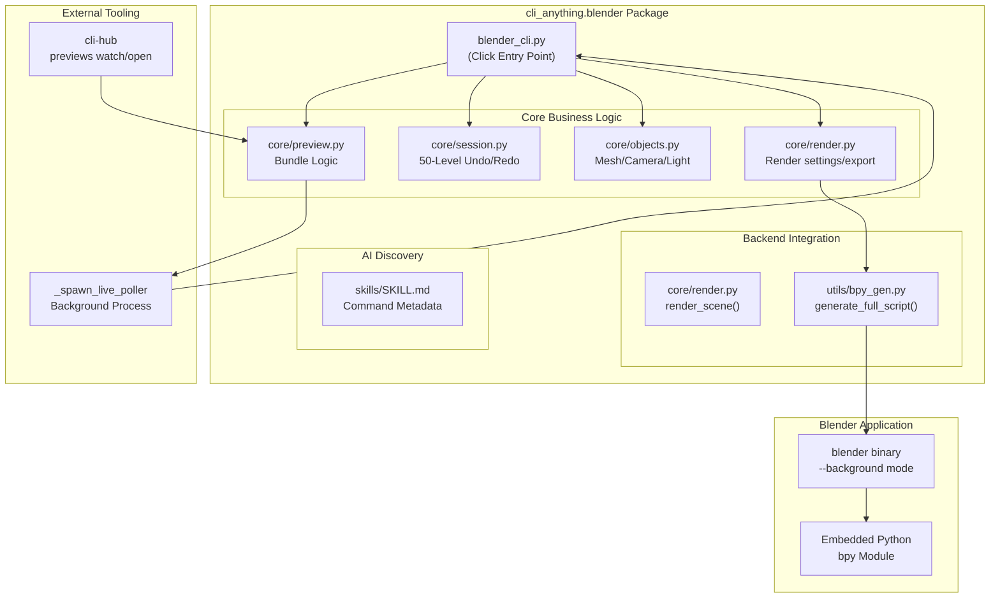
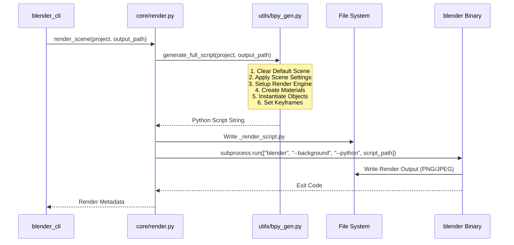

<!-- source: DeepWiki mcp.deepwiki.com · repo HKUDS/CLI-Anything · page 6.3 Blender: 3D Modeling Harness · fetched 2026-11-09 -->

# Blender: 3D Modeling Harness

Relevant source files

The following files were used as context for generating this wiki page:

- [anygen/agent-harness/cli_anything/anygen/skills/SKILL.md](anygen/agent-harness/cli_anything/anygen/skills/SKILL.md)
- [audacity/agent-harness/cli_anything/audacity/skills/SKILL.md](audacity/agent-harness/cli_anything/audacity/skills/SKILL.md)
- [blender/agent-harness/cli_anything/blender/core/preview.py](blender/agent-harness/cli_anything/blender/core/preview.py)
- [blender/agent-harness/cli_anything/blender/core/render.py](blender/agent-harness/cli_anything/blender/core/render.py)
- [blender/agent-harness/cli_anything/blender/skills/SKILL.md](blender/agent-harness/cli_anything/blender/skills/SKILL.md)
- [blender/agent-harness/cli_anything/blender/tests/test_bpy_gen.py](blender/agent-harness/cli_anything/blender/tests/test_bpy_gen.py)
- [blender/agent-harness/cli_anything/blender/tests/test_core.py](blender/agent-harness/cli_anything/blender/tests/test_core.py)
- [blender/agent-harness/cli_anything/blender/tests/test_full_e2e.py](blender/agent-harness/cli_anything/blender/tests/test_full_e2e.py)
- [blender/agent-harness/cli_anything/blender/utils/bpy_gen.py](blender/agent-harness/cli_anything/blender/utils/bpy_gen.py)
- [blender/agent-harness/cli_anything/blender/utils/preview_bundle.py](blender/agent-harness/cli_anything/blender/utils/preview_bundle.py)
- [cli-anything-plugin/preview_bundle.py](cli-anything-plugin/preview_bundle.py)
- [docs/PREVIEW_MECHANISM_PROGRESS.md](docs/PREVIEW_MECHANISM_PROGRESS.md)
- [docs/PREVIEW_PROGRESS.md](docs/PREVIEW_PROGRESS.md)
- [docs/scripts/blender_gyro_observatory_demo.py](docs/scripts/blender_gyro_observatory_demo.py)
- [docs/scripts/blender_orbital_relay_drone_demo.py](docs/scripts/blender_orbital_relay_drone_demo.py)
- [docs/scripts/blender_preview_story_demo.py](docs/scripts/blender_preview_story_demo.py)
- [drawio/agent-harness/cli_anything/drawio/skills/SKILL.md](drawio/agent-harness/cli_anything/drawio/skills/SKILL.md)
- [gimp/agent-harness/cli_anything/gimp/skills/SKILL.md](gimp/agent-harness/cli_anything/gimp/skills/SKILL.md)
- [kdenlive/agent-harness/cli_anything/kdenlive/skills/SKILL.md](kdenlive/agent-harness/cli_anything/kdenlive/skills/SKILL.md)
- [libreoffice/agent-harness/cli_anything/libreoffice/skills/SKILL.md](libreoffice/agent-harness/cli_anything/libreoffice/skills/SKILL.md)
- [obs-studio/agent-harness/cli_anything/obs_studio/skills/SKILL.md](obs-studio/agent-harness/cli_anything/obs_studio/skills/SKILL.md)
- [zoom/agent-harness/cli_anything/zoom/skills/SKILL.md](zoom/agent-harness/cli_anything/zoom/skills/SKILL.md)

This document provides a detailed examination of the `cli-anything-blender` harness, which demonstrates desktop application integration through headless Python scripting and advanced preview synchronization. Blender serves as the primary example for 3D modeling and rendering automation in the CLI-Anything ecosystem. The harness invokes Blender's built-in Python interpreter in background mode (`blender --background --python`) to perform 3D operations without GUI interaction.

---

## Integration Architecture

The Blender harness exemplifies the "desktop application with embedded scripting" integration pattern. Unlike web service integrations or CLI-wrapper integrations, Blender integration leverages the application's native Python API (`bpy`) through headless execution. It also implements the `preview-bundle/v1` protocol for near-real-time visual feedback.

### System to Code Entity Mapping: Architecture

The following diagram bridges the high-level functional components to their specific implementations in the `cli_anything.blender` package.

**Sources:** [blender/agent-harness/cli_anything/blender/skills/SKILL.md:1-5](), [blender/agent-harness/cli_anything/blender/core/render.py:1-5](), [blender/agent-harness/cli_anything/blender/utils/bpy_gen.py:1-5](), [docs/PREVIEW_PROGRESS.md:27-27]()

---

## Backend Integration: Headless bpy Scripting

The Blender integration follows the "Authentic Backend Integration" principle by invoking the actual Blender binary. The integration pattern uses `blender --background --python` for headless execution, driven by a generated Python script that translates the CLI's internal JSON state into `bpy` calls.

### Data Flow: JSON to bpy Translation

The `utils/bpy_gen.py` module is responsible for translating the project state into a valid Blender Python script.

**Sources:** [blender/agent-harness/cli_anything/blender/core/render.py:182-214](), [blender/agent-harness/cli_anything/blender/utils/bpy_gen.py:12-81]()

### Script Generation Details

The `generate_full_script` function assembles the script in a specific order to ensure dependency resolution (e.g., materials must exist before they are assigned to objects).

1.  **Scene Clearing**: Uses `bpy.ops.object.select_all(action='SELECT')` and `bpy.ops.object.delete()` to start from a clean slate [blender/agent-harness/cli_anything/blender/utils/bpy_gen.py:38-39]().
2.  **Settings**: Configures `scene.unit_settings`, `frame_start/end`, and `fps` [blender/agent-harness/cli_anything/blender/utils/bpy_gen.py:84-97]().
3.  **Render Engine**: Supports `CYCLES`, `EEVEE`, and `WORKBENCH`. For Cycles, it explicitly sets `use_denoising` and `samples` [blender/agent-harness/cli_anything/blender/utils/bpy_gen.py:100-120]().
4.  **World/HDRI**: Sets background colors and loads HDRI environment textures if specified [blender/agent-harness/cli_anything/blender/utils/bpy_gen.py:123-152]().
5.  **Materials**: Generates Principled BSDF nodes and sets parameters like `Base Color`, `Metallic`, and `Roughness` [blender/agent-harness/cli_anything/blender/utils/bpy_gen.py:155-192]().

**Sources:** [blender/agent-harness/cli_anything/blender/utils/bpy_gen.py:12-81]()

---

## Preview and Live Session Mechanism

Blender supports the `preview-live/v1` protocol, allowing agents and users to view 3D progress in near-real-time through `cli-hub`.

### Live Preview Lifecycle
The harness manages a background poller that monitors the project state and triggers headless renders when changes are detected.

*   **`preview live start`**: Initializes a long-lived directory containing `session.json` and `trajectory.json` [blender/agent-harness/cli_anything/blender/skills/SKILL.md:169-169]().
*   **Polling Mode**: The `_spawn_live_poller` function launches a background process that fingerprints the scene JSON. If the fingerprint changes, it executes a `preview capture` [cli_anything/blender/core/preview.py]().
*   **`cli-hub` Integration**: The `_spawn_live_viewer` function launches `cli-hub previews watch` to provide a browser-based live view of the Blender scene [cli_anything/blender/core/preview.py]().

### Preview Recipes
Blender defines recipes like `quick`, which generates two still renders:
1.  `hero.png`: A high-quality render using the Eevee engine [blender/agent-harness/cli_anything/blender/core/preview.py:43-43]().
2.  `workbench.png`: A fast viewport-style render using the Workbench engine [blender/agent-harness/cli_anything/blender/core/preview.py:44-44]().

**Sources:** [blender/agent-harness/cli_anything/blender/core/preview.py:40-48](), [docs/PREVIEW_PROGRESS.md:110-118]()

---

## Testing and Validation

The harness includes a comprehensive test suite that ensures 3D logic integrity without requiring a full Blender installation for unit tests.

### Test Layers
| Layer | File | Purpose |
|-------|------|---------|
| **Unit** | `tests/test_core.py` | Validates scene creation, object manipulation, and material properties using synthetic data [blender/agent-harness/cli_anything/blender/tests/test_core.py:1-12]() |
| **E2E** | `tests/test_full_e2e.py` | Verifies full workflows including `bpy` script generation and scene roundtrips [blender/agent-harness/cli_anything/blender/tests/test_full_e2e.py:1-6]() |
| **Preview** | `tests/test_full_e2e.py` | Validates PNG magic bytes and live bundle counts [blender/agent-harness/cli_anything/blender/tests/test_full_e2e.py:36-63]() |
| **Bpy Script Generation** | `tests/test_bpy_gen.py` | Ensures generated Python scripts are syntactically valid, especially with Windows paths and special characters [blender/agent-harness/cli_anything/blender/tests/test_bpy_gen.py:1-5]() |

### Showcase Demos
The `blender_orbital_relay_drone_demo.py` script serves as the primary validation for complex builds. It stages 3D operations into sequential steps, generating:
*   Real staged preview bundles [docs/scripts/blender_orbital_relay_drone_demo.py:6-6]()
*   A final 1600x1600 still render [docs/PREVIEW_PROGRESS.md:163-163]()
*   A turntable motion video [docs/scripts/blender_orbital_relay_drone_demo.py:10-10]()

The `blender_preview_story_demo.py` script further enhances this by creating a polished build-story video from a demo run, including a split-screen view and a turntable ending [docs/scripts/blender_preview_story_demo.py:1-5]().

**Sources:** [blender/agent-harness/cli_anything/blender/tests/test_core.py:1-12](), [blender/agent-harness/cli_anything/blender/tests/test_full_e2e.py:1-6](), [blender/agent-harness/cli_anything/blender/tests/test_bpy_gen.py:1-5](), [docs/scripts/blender_orbital_relay_drone_demo.py:1-11](), [docs/scripts/blender_preview_story_demo.py:1-5]()

---

