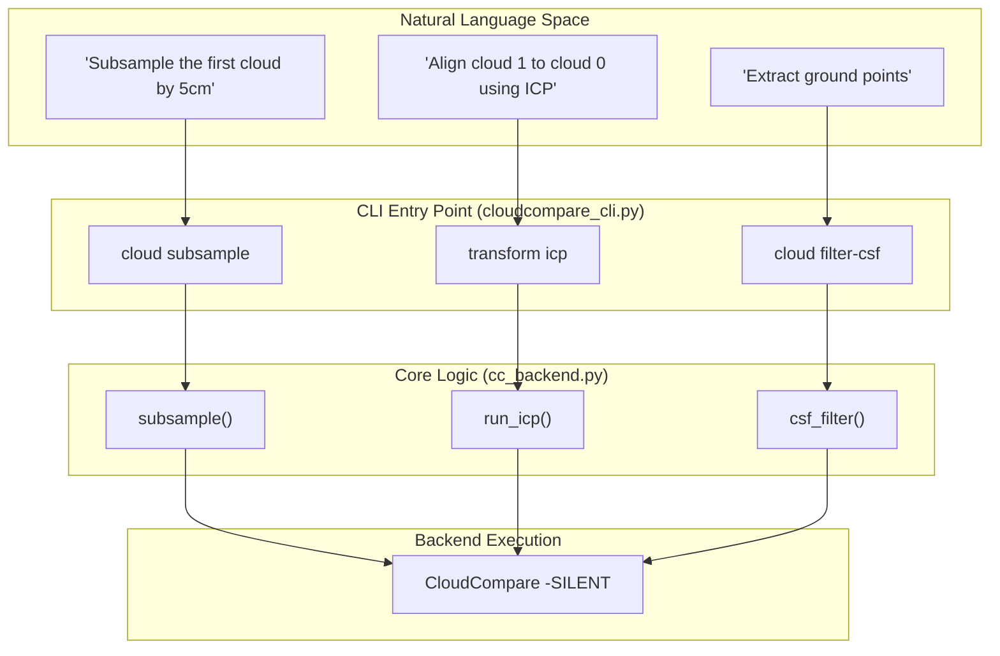
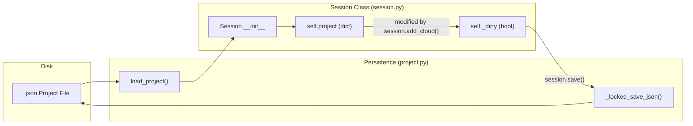

<!-- source: DeepWiki mcp.deepwiki.com · repo HKUDS/CLI-Anything · page 6.4 CloudCompare: 3D Point Cloud Harness · fetched 2026-11-09 -->

# CloudCompare: 3D Point Cloud Harness

<details>
<summary>Relevant source files</summary>

The following files were used as context for generating this wiki page:

- [3MF/agent-harness/3MF.md](3MF/agent-harness/3MF.md)
- [3MF/agent-harness/cli_anything/threemf/README.md](3MF/agent-harness/cli_anything/threemf/README.md)
- [3MF/agent-harness/cli_anything/threemf/__init__.py](3MF/agent-harness/cli_anything/threemf/__init__.py)
- [3MF/agent-harness/cli_anything/threemf/__main__.py](3MF/agent-harness/cli_anything/threemf/__main__.py)
- [3MF/agent-harness/cli_anything/threemf/core/__init__.py](3MF/agent-harness/cli_anything/threemf/core/__init__.py)
- [3MF/agent-harness/cli_anything/threemf/core/inspector.py](3MF/agent-harness/cli_anything/threemf/core/inspector.py)
- [3MF/agent-harness/cli_anything/threemf/core/modifier.py](3MF/agent-harness/cli_anything/threemf/core/modifier.py)
- [3MF/agent-harness/cli_anything/threemf/core/parser.py](3MF/agent-harness/cli_anything/threemf/core/parser.py)
- [3MF/agent-harness/cli_anything/threemf/core/repair.py](3MF/agent-harness/cli_anything/threemf/core/repair.py)
- [3MF/agent-harness/cli_anything/threemf/skills/SKILL.md](3MF/agent-harness/cli_anything/threemf/skills/SKILL.md)
- [3MF/agent-harness/cli_anything/threemf/tests/test_core.py](3MF/agent-harness/cli_anything/threemf/tests/test_core.py)
- [3MF/agent-harness/cli_anything/threemf/threemf_cli.py](3MF/agent-harness/cli_anything/threemf/threemf_cli.py)
- [3MF/agent-harness/cli_anything/threemf/utils/threemf_backend.py](3MF/agent-harness/cli_anything/threemf/utils/threemf_backend.py)
- [cloudanalyzer/agent-harness/CLOUDANALYZER.md](cloudanalyzer/agent-harness/CLOUDANALYZER.md)
- [cloudanalyzer/agent-harness/cli_anything/cloudanalyzer/README.md](cloudanalyzer/agent-harness/cli_anything/cloudanalyzer/README.md)
- [cloudanalyzer/agent-harness/cli_anything/cloudanalyzer/__init__.py](cloudanalyzer/agent-harness/cli_anything/cloudanalyzer/__init__.py)
- [cloudanalyzer/agent-harness/cli_anything/cloudanalyzer/__main__.py](cloudanalyzer/agent-harness/cli_anything/cloudanalyzer/__main__.py)
- [cloudanalyzer/agent-harness/cli_anything/cloudanalyzer/cloudanalyzer_cli.py](cloudanalyzer/agent-harness/cli_anything/cloudanalyzer/cloudanalyzer_cli.py)
- [cloudanalyzer/agent-harness/cli_anything/cloudanalyzer/core/__init__.py](cloudanalyzer/agent-harness/cli_anything/cloudanalyzer/core/__init__.py)
- [cloudanalyzer/agent-harness/cli_anything/cloudanalyzer/core/project.py](cloudanalyzer/agent-harness/cli_anything/cloudanalyzer/core/project.py)
- [cloudanalyzer/agent-harness/cli_anything/cloudanalyzer/core/session.py](cloudanalyzer/agent-harness/cli_anything/cloudanalyzer/core/session.py)
- [cloudanalyzer/agent-harness/cli_anything/cloudanalyzer/skills/SKILL.md](cloudanalyzer/agent-harness/cli_anything/cloudanalyzer/skills/SKILL.md)
- [cloudanalyzer/agent-harness/cli_anything/cloudanalyzer/tests/TEST.md](cloudanalyzer/agent-harness/cli_anything/cloudanalyzer/tests/TEST.md)
- [cloudanalyzer/agent-harness/cli_anything/cloudanalyzer/tests/test_core.py](cloudanalyzer/agent-harness/cli_anything/cloudanalyzer/tests/test_core.py)
- [cloudanalyzer/agent-harness/cli_anything/cloudanalyzer/tests/test_full_e2e.py](cloudanalyzer/agent-harness/cli_anything/cloudanalyzer/tests/test_full_e2e.py)
- [cloudanalyzer/agent-harness/cli_anything/cloudanalyzer/utils/ca_backend.py](cloudanalyzer/agent-harness/cli_anything/cloudanalyzer/utils/ca_backend.py)
- [cloudanalyzer/agent-harness/setup.py](cloudanalyzer/agent-harness/setup.py)
- [cloudcompare/agent-harness/CLOUDCOMPARE.md](cloudcompare/agent-harness/CLOUDCOMPARE.md)
- [cloudcompare/agent-harness/cli_anything/cloudcompare/README.md](cloudcompare/agent-harness/cli_anything/cloudcompare/README.md)
- [cloudcompare/agent-harness/cli_anything/cloudcompare/__init__.py](cloudcompare/agent-harness/cli_anything/cloudcompare/__init__.py)
- [cloudcompare/agent-harness/cli_anything/cloudcompare/__main__.py](cloudcompare/agent-harness/cli_anything/cloudcompare/__main__.py)
- [cloudcompare/agent-harness/cli_anything/cloudcompare/cloudcompare_cli.py](cloudcompare/agent-harness/cli_anything/cloudcompare/cloudcompare_cli.py)
- [cloudcompare/agent-harness/cli_anything/cloudcompare/core/__init__.py](cloudcompare/agent-harness/cli_anything/cloudcompare/core/__init__.py)
- [cloudcompare/agent-harness/cli_anything/cloudcompare/core/export.py](cloudcompare/agent-harness/cli_anything/cloudcompare/core/export.py)
- [cloudcompare/agent-harness/cli_anything/cloudcompare/core/project.py](cloudcompare/agent-harness/cli_anything/cloudcompare/core/project.py)
- [cloudcompare/agent-harness/cli_anything/cloudcompare/core/session.py](cloudcompare/agent-harness/cli_anything/cloudcompare/core/session.py)
- [cloudcompare/agent-harness/cli_anything/cloudcompare/skills/SKILL.md](cloudcompare/agent-harness/cli_anything/cloudcompare/skills/SKILL.md)
- [cloudcompare/agent-harness/cli_anything/cloudcompare/utils/cc_backend.py](cloudcompare/agent-harness/cli_anything/cloudcompare/utils/cc_backend.py)
- [cloudcompare/agent-harness/setup.py](cloudcompare/agent-harness/setup.py)

</details>


The CloudCompare harness is a specialized CLI implementation designed to wrap the [CloudCompare](https://cloudcompare.org) 3D point cloud and mesh processing software. It leverages CloudCompare's native `-SILENT` command-line mode to provide an agent-native interface for complex geospatial and 3D analysis tasks, such as ground extraction (CSF), ICP registration, and distance computation.

## Architecture and Design Patterns

The harness follows the **Authentic Backend Integration** principle, invoking the real `CloudCompare` executable via subprocess rather than reimplementing point cloud algorithms [cloudcompare/agent-harness/cli_anything/cloudcompare/utils/cc_backend.py:1-10]().

### Entity Index Model
To simplify agent interaction, the harness implements an **Entity Index Model**. Instead of requiring agents to manage long absolute file paths for every operation, the harness tracks loaded point clouds and meshes in a project state file, allowing agents to refer to them by a simple integer index (e.g., `cloud subsample 0`) [cloudcompare/agent-harness/cli_anything/cloudcompare/skills/SKILL.md:127-130]().

### The -SILENT Mode Pipeline
The core of the integration is the `run_cloudcompare` function, which automatically handles executable discovery (supporting Native, Flatpak, and Snap installations) and prepends the `-SILENT` flag to suppress GUI popups [cloudcompare/agent-harness/cli_anything/cloudcompare/utils/cc_backend.py:43-108]().

### Natural Language to Code Entity Mapping

The following diagram illustrates how natural language requests from an AI agent are mapped to specific backend implementation entities.

"Natural Language to Code Entity Space"

Sources: [cloudcompare/agent-harness/cli_anything/cloudcompare/cloudcompare_cli.py:43-71](), [cloudcompare/agent-harness/cli_anything/cloudcompare/utils/cc_backend.py:152-166]()

## Project State Model

The harness maintains state using a JSON-based project file. This file acts as a "Virtual Workspace" that persists across CLI invocations.

### JSON State Structure
The project schema tracks metadata, entity paths, and session settings [cloudcompare/agent-harness/cli_anything/cloudcompare/core/project.py:53-71]():
*   `clouds`: List of tracked point cloud entries containing `path`, `label`, and metadata like `has_normals` [cloudcompare/agent-harness/cli_anything/cloudcompare/core/project.py:74-84]().
*   `meshes`: List of tracked 3D mesh entries [cloudcompare/agent-harness/cli_anything/cloudcompare/core/project.py:87-94]().
*   `settings`: Default export formats (e.g., LAS, PLY) and global coordinate shifts [cloudcompare/agent-harness/cli_anything/cloudcompare/core/project.py:62-69]().
*   `history`: An operation history for soft undo capabilities [cloudcompare/agent-harness/cli_anything/cloudcompare/core/project.py:70]().

### Implementation of State Management
State is managed via the `Session` class, which provides a high-level API for adding/removing entities and recording operations [cloudcompare/agent-harness/cli_anything/cloudcompare/core/session.py:29-106](). To prevent data corruption during concurrent access, the harness uses `_locked_save_json` which employs `fcntl.flock` for exclusive file locking during JSON writes [cloudcompare/agent-harness/cli_anything/cloudcompare/core/project.py:25-49]().

"Project State Data Flow"

Sources: [cloudcompare/agent-harness/cli_anything/cloudcompare/core/project.py:1-49](), [cloudcompare/agent-harness/cli_anything/cloudcompare/core/session.py:29-44]()

## Data Normalization and Export

CloudCompare operations often generate files with unpredictable names or suffixes. The harness implements **Export Format Normalization** to ensure agents receive deterministic output paths.

### Output Handling and Format Mapping
The backend utility uses a mapping of file extensions to CloudCompare's internal format strings (e.g., `.las` maps to `LAS`, `.xyz` to `ASC`) [cloudcompare/agent-harness/cli_anything/cloudcompare/utils/cc_backend.py:21-41](). The `open_and_save` function ensures that the `-NO_TIMESTAMP` flag is always passed to prevent CloudCompare from appending date-time strings to output files [cloudcompare/agent-harness/cli_anything/cloudcompare/utils/cc_backend.py:138-142]().

### Export Presets
The harness defines standard presets for common formats in `core/export.py` to simplify agent commands [cloudcompare/agent-harness/cli_anything/cloudcompare/core/export.py:21-38]():

| Preset | Format | Extension | Description |
| :--- | :--- | :--- | :--- |
| `las` | LAS | `.las` | Standard LiDAR format |
| `laz` | LAS | `.laz` | Compressed LAZ |
| `ply` | PLY | `.ply` | Polygon File Format |
| `pcd` | PCD | `.pcd` | Point Cloud Data |
| `obj` | OBJ | `.obj` | Wavefront Mesh |

Sources: [cloudcompare/agent-harness/cli_anything/cloudcompare/core/export.py:21-38](), [cloudcompare/agent-harness/cli_anything/cloudcompare/utils/cc_backend.py:111-149]()

## Key Implementation Modules

| Module | Responsibility | Key Functions/Classes |
| :--- | :--- | :--- |
| `cloudcompare_cli.py` | Click-based entry point and `ReplSkin` integration. | `cli()`, `repl()`, `_require_project()` |
| `core/project.py` | Low-level JSON state manipulation and `fcntl` file locking. | `create_project()`, `_locked_save_json()`, `load_project()` |
| `core/session.py` | Stateful `Session` class wrapping project operations and history. | `Session`, `undo_last()`, `save()` |
| `core/export.py` | High-level export pipeline with `CLOUD_PRESETS` and `MESH_PRESETS`. | `export_cloud()`, `export_mesh()`, `batch_export()` |
| `utils/cc_backend.py` | Subprocess bridge to the CloudCompare executable with `-SILENT` mode. | `run_cloudcompare()`, `find_cloudcompare()`, `open_and_save()` |

Sources: [cloudcompare/agent-harness/cli_anything/cloudcompare/cloudcompare_cli.py:1-72](), [cloudcompare/agent-harness/cli_anything/cloudcompare/core/project.py:1-100](), [cloudcompare/agent-harness/cli_anything/cloudcompare/utils/cc_backend.py:1-110](), [cloudcompare/agent-harness/cli_anything/cloudcompare/core/export.py:1-100]()

## CloudAnalyzer Harness

The `cli-anything-cloudanalyzer` harness provides an agent-friendly interface for the CloudAnalyzer Python package, a QA platform for point cloud outputs [cloudanalyzer/agent-harness/cli_anything/cloudanalyzer/cloudanalyzer_cli.py:1-6](). Unlike CloudCompare, CloudAnalyzer is a Python package, so its harness integrates directly by importing and calling Python functions, rather than shelling out to a binary [cloudanalyzer/agent-harness/cli_anything/cloudanalyzer/utils/ca_backend.py:1-5]().

### Key Features
*   **Direct Python Integration**: The `ca_backend.py` module directly imports and calls functions from the `cloudanalyzer` package, eliminating subprocess overhead [cloudanalyzer/agent-harness/cli_anything/cloudanalyzer/utils/ca_backend.py:42-213]().
*   **Structured JSON Output**: All commands support a `--json` flag for machine-readable output, crucial for agent consumption [cloudanalyzer/agent-harness/cli_anything/cloudanalyzer/cloudanalyzer_cli.py:33-37]().
*   **Comprehensive QA Commands**: The harness exposes a wide range of CloudAnalyzer functionalities, including:
    *   `evaluate`: Point cloud comparison, diffing, and ground segmentation evaluation [cloudanalyzer/agent-harness/cli_anything/cloudanalyzer/cloudanalyzer_cli.py:86-187]().
    *   `trajectory`: Trajectory evaluation and batch processing [cloudanalyzer/agent-harness/cli_anything/cloudanalyzer/cloudanalyzer_cli.py:190-220]().
    *   `check`: Config-driven quality gate execution and scaffold generation [cloudanalyzer/agent-harness/cli_anything/cloudanalyzer/cloudanalyzer_cli.py:223-249]().
    *   `baseline`: Management of QA baselines, including decision-making, saving, and listing [cloudanalyzer/agent-harness/cli_anything/cloudanalyzer/cloudanalyzer_cli.py:252-300]().
    *   `process`: Point cloud manipulation like downsampling, splitting, filtering, and merging [cloudanalyzer/agent-harness/cli_anything/cloudanalyzer/cloudanalyzer_cli.py:303-354]().
    *   `inspect`: Visualization and web export for point clouds [cloudanalyzer/agent-harness/cli_anything/cloudanalyzer/cloudanalyzer_cli.py:357-385]().
    *   `info`: Metadata retrieval and version checking [cloudanalyzer/agent-harness/cli_anything/cloudanalyzer/cloudanalyzer_cli.py:388-407]().
*   **REPL Mode**: An interactive REPL is available for exploratory use [cloudanalyzer/agent-harness/cli_anything/cloudanalyzer/cloudanalyzer_cli.py:80-81]().
*   **SKILL.md**: A detailed `SKILL.md` file describes all commands and options for agent discovery [cloudanalyzer/agent-harness/cli_anything/cloudanalyzer/skills/SKILL.md:1-301]().

### CloudAnalyzer Backend Integration
The `ca_backend.py` module acts as the interface to the underlying `cloudanalyzer` Python library. It includes checks for `cloudanalyzer` availability and handles `ImportError` gracefully [cloudanalyzer/agent-harness/cli_anything/cloudanalyzer/utils/ca_backend.py:18-30]().

"CloudAnalyzer Backend Interaction"
```mermaid
graph TD
    A[Agent Command] --> B{cli-anything-cloudanalyzer};
    B --> C[cloudanalyzer_cli.py];
    C --> D[ca_backend.py];
    D -- "import ca" --> E[CloudAnalyzer Python Package];
    E --> F[Point Cloud Data];
    F --> G[Results (JSON/Human-readable)];
    G --> C;
    C --> B;
```
Sources: [cloudanalyzer/agent-harness/cli_anything/cloudanalyzer/cloudanalyzer_cli.py:1-760](), [cloudanalyzer/agent-harness/cli_anything/cloudanalyzer/utils/ca_backend.py:1-294]()

## 3MF Harness

The `cli-anything-3mf` harness focuses on manipulating 3D Manufacturing Format (3MF) files, particularly for detecting and resizing cylindrical holes, repairing meshes, and comparing 3MF models [3MF/agent-harness/cli_anything/threemf/threemf_cli.py:1-4]().

### Core Functionality
The 3MF harness provides commands for:
*   `info`: Displays mesh statistics like vertex/face counts, bounding box, watertight status, volume, and surface area [3MF/agent-harness/cli_anything/threemf/threemf_cli.py:114-148]().
*   `inspect`: Detects cylindrical holes within a mesh using multi-plane cross-section analysis [3MF/agent-harness/cli_anything/threemf/threemf_cli.py:152-190](). This involves slicing the mesh, identifying circular features in cross-sections, and clustering them to form holes [3MF/agent-harness/cli_anything/threemf/core/inspector.py:58-70]().
*   `resize`: Modifies the diameter of detected holes. This operation involves identifying vertices on the hole's "wall" and radially scaling them to the target diameter [3MF/agent-harness/cli_anything/threemf/core/modifier.py:28-89]().
*   `repair`: Fixes common mesh issues such as duplicate vertices, degenerate faces, and unreferenced vertices, and can also fix normals [3MF/agent-harness/cli_anything/threemf/core/repair.py:28-100]().
*   `compare`: Compares two 3MF files, reporting differences in mesh structure or properties [3MF/agent-harness/cli_anything/threemf/threemf_cli.py:200-229]().

### Implementation Details
*   **Mesh Data Model**: The `MeshData` dataclass stores vertices and triangles as NumPy arrays, providing an efficient representation for geometric operations [3MF/agent-harness/cli_anything/threemf/core/parser.py:20-27]().
*   **Hole Detection**: The `inspector.py` module implements the `inspect_mesh` function, which uses `backend.cross_section_circles` to find circular features and hierarchical clustering to group them into `DetectedHole` objects [3MF/agent-harness/cli_anything/threemf/core/inspector.py:58-177]().
*   **Hole Resizing**: The `modifier.py` module's `resize_holes` and `resize_single_hole` functions perform radial scaling of vertices identified as part of a hole's wall [3MF/agent-harness/cli_anything/threemf/core/modifier.py:28-146](). A key aspect is the `_WALL_RADIUS_TOLERANCE` constant, which defines the proximity for vertices to be considered part of the hole's wall [3MF/agent-harness/cli_anything/threemf/core/modifier.py:20]().
*   **Backend Utilities**: The `threemf_backend.py` module provides low-level geometric utilities, including mesh-to-trimesh conversion and cross-section circle detection [3MF/agent-harness/cli_anything/threemf/utils/threemf_backend.py:1-100]().

"3MF Hole Resizing Data Flow"
```mermaid
graph TD
    A[User/Agent Request: "Resize hole X to Y mm"] --> B[threemf_cli.py: resize command];
    B --> C[parser.parse_3mf(file)];
    C --> D[threemf_data (ThreeMFData)];
    D --> E[modifier.resize_holes(threemf_data, hole_ids, target_diameter)];
    E --> F[inspector.inspect_mesh(mesh, params)];
    F --> G[DetectedHole objects];
    G --> H{Identify wall vertices};
    H --> I[modifier._scale_wall_radially(vertices, mask, ...)];
    I --> J[New MeshData];
    J --> K[New ThreeMFData];
    K --> L[threemf_cli.py: output results];
```
Sources: [3MF/agent-harness/cli_anything/threemf/threemf_cli.py:1-432](), [3MF/agent-harness/cli_anything/threemf/core/parser.py:1-100](), [3MF/agent-harness/cli_anything/threemf/core/inspector.py:1-406](), [3MF/agent-harness/cli_anything/threemf/core/modifier.py:1-235]()

---

