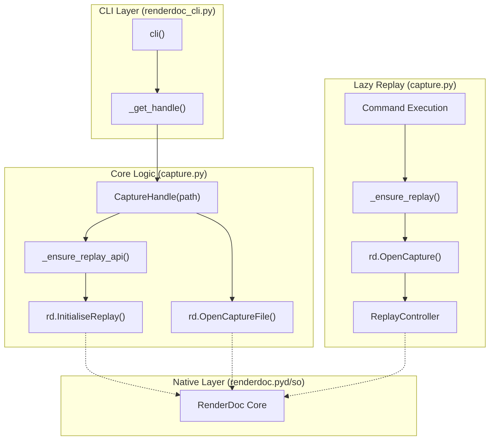
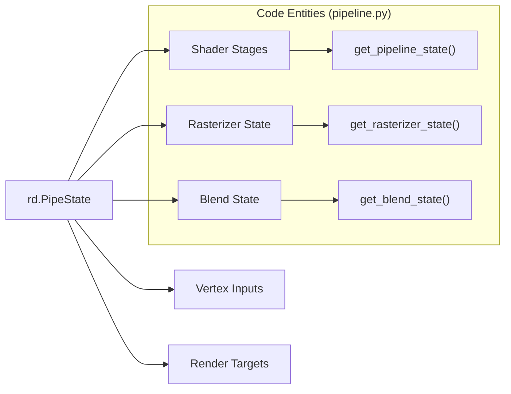
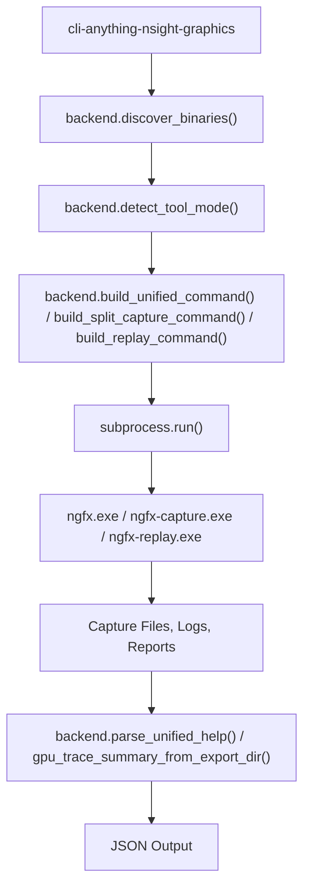

<!-- source: DeepWiki mcp.deepwiki.com · repo HKUDS/CLI-Anything · page 6.5 GPU and Profiling Harnesses: RenderDoc, Nsight Graphics, Unreal Insights · fetched 2026-11-09 -->

# GPU and Profiling Harnesses: RenderDoc, Nsight Graphics, Unreal Insights

Relevant source files

The following files were used as context for generating this wiki page:

- [nsight-graphics/agent-harness/HARNESS.md](nsight-graphics/agent-harness/HARNESS.md)
- [nsight-graphics/agent-harness/NSIGHT_GRAPHICS.md](nsight-graphics/agent-harness/NSIGHT_GRAPHICS.md)
- [nsight-graphics/agent-harness/cli_anything/nsight_graphics/README.md](nsight-graphics/agent-harness/cli_anything/nsight_graphics/README.md)
- [nsight-graphics/agent-harness/cli_anything/nsight_graphics/__init__.py](nsight-graphics/agent-harness/cli_anything/nsight_graphics/__init__.py)
- [nsight-graphics/agent-harness/cli_anything/nsight_graphics/core/cpp_capture.py](nsight-graphics/agent-harness/cli_anything/nsight_graphics/core/cpp_capture.py)
- [nsight-graphics/agent-harness/cli_anything/nsight_graphics/core/frame.py](nsight-graphics/agent-harness/cli_anything/nsight_graphics/core/frame.py)
- [nsight-graphics/agent-harness/cli_anything/nsight_graphics/core/gpu_trace.py](nsight-graphics/agent-harness/cli_anything/nsight_graphics/core/gpu_trace.py)
- [nsight-graphics/agent-harness/cli_anything/nsight_graphics/core/launch.py](nsight-graphics/agent-harness/cli_anything/nsight_graphics/core/launch.py)
- [nsight-graphics/agent-harness/cli_anything/nsight_graphics/nsight_graphics_cli.py](nsight-graphics/agent-harness/cli_anything/nsight_graphics/nsight_graphics_cli.py)
- [nsight-graphics/agent-harness/cli_anything/nsight_graphics/skills/SKILL.md](nsight-graphics/agent-harness/cli_anything/nsight_graphics/skills/SKILL.md)
- [nsight-graphics/agent-harness/cli_anything/nsight_graphics/tests/TEST.md](nsight-graphics/agent-harness/cli_anything/nsight_graphics/tests/TEST.md)
- [nsight-graphics/agent-harness/cli_anything/nsight_graphics/tests/test_core.py](nsight-graphics/agent-harness/cli_anything/nsight_graphics/tests/test_core.py)
- [nsight-graphics/agent-harness/cli_anything/nsight_graphics/tests/test_full_e2e.py](nsight-graphics/agent-harness/cli_anything/nsight_graphics/tests/test_full_e2e.py)
- [nsight-graphics/agent-harness/cli_anything/nsight_graphics/utils/backend/__init__.py](nsight-graphics/agent-harness/cli_anything/nsight_graphics/utils/backend/__init__.py)
- [nsight-graphics/agent-harness/cli_anything/nsight_graphics/utils/backend/commands.py](nsight-graphics/agent-harness/cli_anything/nsight_graphics/utils/backend/commands.py)
- [nsight-graphics/agent-harness/cli_anything/nsight_graphics/utils/backend/discovery.py](nsight-graphics/agent-harness/cli_anything/nsight_graphics/utils/backend/discovery.py)
- [nsight-graphics/agent-harness/cli_anything/nsight_graphics/utils/backend/execution.py](nsight-graphics/agent-harness/cli_anything/nsight_graphics/utils/backend/execution.py)
- [nsight-graphics/agent-harness/cli_anything/nsight_graphics/utils/backend/parsing.py](nsight-graphics/agent-harness/cli_anything/nsight_graphics/utils/backend/parsing.py)
- [nsight-graphics/agent-harness/cli_anything/nsight_graphics/utils/backend/shared.py](nsight-graphics/agent-harness/cli_anything/nsight_graphics/utils/backend/shared.py)
- [nsight-graphics/agent-harness/cli_anything/nsight_graphics/utils/nsight_graphics_backend.py](nsight-graphics/agent-harness/cli_anything/nsight_graphics/utils/nsight_graphics_backend.py)
- [renderdoc/agent-harness/.gitignore](renderdoc/agent-harness/.gitignore)
- [renderdoc/agent-harness/HARNESS.md](renderdoc/agent-harness/HARNESS.md)
- [renderdoc/agent-harness/cli_anything/renderdoc/README.md](renderdoc/agent-harness/cli_anything/renderdoc/README.md)
- [renderdoc/agent-harness/cli_anything/renderdoc/__init__.py](renderdoc/agent-harness/cli_anything/renderdoc/__init__.py)
- [renderdoc/agent-harness/cli_anything/renderdoc/core/capture.py](renderdoc/agent-harness/cli_anything/renderdoc/core/capture.py)
- [renderdoc/agent-harness/cli_anything/renderdoc/core/counters.py](renderdoc/agent-harness/cli_anything/renderdoc/core/counters.py)
- [renderdoc/agent-harness/cli_anything/renderdoc/core/mesh.py](renderdoc/agent-harness/cli_anything/renderdoc/core/mesh.py)
- [renderdoc/agent-harness/cli_anything/renderdoc/core/pipeline.py](renderdoc/agent-harness/cli_anything/renderdoc/core/pipeline.py)
- [renderdoc/agent-harness/cli_anything/renderdoc/renderdoc_cli.py](renderdoc/agent-harness/cli_anything/renderdoc/renderdoc_cli.py)
- [renderdoc/agent-harness/cli_anything/renderdoc/skills/SKILL.md](renderdoc/agent-harness/cli_anything/renderdoc/skills/SKILL.md)
- [renderdoc/agent-harness/cli_anything/renderdoc/tests/TEST.md](renderdoc/agent-harness/cli_anything/renderdoc/tests/TEST.md)
- [renderdoc/agent-harness/cli_anything/renderdoc/tests/test_core.py](renderdoc/agent-harness/cli_anything/renderdoc/tests/test_core.py)
- [renderdoc/agent-harness/cli_anything/renderdoc/tests/test_full_e2e.py](renderdoc/agent-harness/cli_anything/renderdoc/tests/test_full_e2e.py)
- [renderdoc/agent-harness/setup.py](renderdoc/agent-harness/setup.py)
- [skills/cli-anything-unrealinsights/SKILL.md](skills/cli-anything-unrealinsights/SKILL.md)
- [unrealinsights/agent-harness/UNREALINSIGHTS.md](unrealinsights/agent-harness/UNREALINSIGHTS.md)
- [unrealinsights/agent-harness/cli_anything/unrealinsights/README.md](unrealinsights/agent-harness/cli_anything/unrealinsights/README.md)
- [unrealinsights/agent-harness/cli_anything/unrealinsights/core/analyze.py](unrealinsights/agent-harness/cli_anything/unrealinsights/core/analyze.py)
- [unrealinsights/agent-harness/cli_anything/unrealinsights/core/capture.py](unrealinsights/agent-harness/cli_anything/unrealinsights/core/capture.py)
- [unrealinsights/agent-harness/cli_anything/unrealinsights/core/export.py](unrealinsights/agent-harness/cli_anything/unrealinsights/core/export.py)
- [unrealinsights/agent-harness/cli_anything/unrealinsights/core/gui.py](unrealinsights/agent-harness/cli_anything/unrealinsights/core/gui.py)
- [unrealinsights/agent-harness/cli_anything/unrealinsights/core/live.py](unrealinsights/agent-harness/cli_anything/unrealinsights/core/live.py)
- [unrealinsights/agent-harness/cli_anything/unrealinsights/core/session.py](unrealinsights/agent-harness/cli_anything/unrealinsights/core/session.py)
- [unrealinsights/agent-harness/cli_anything/unrealinsights/core/store.py](unrealinsights/agent-harness/cli_anything/unrealinsights/core/store.py)
- [unrealinsights/agent-harness/cli_anything/unrealinsights/skills/SKILL.md](unrealinsights/agent-harness/cli_anything/unrealinsights/skills/SKILL.md)
- [unrealinsights/agent-harness/cli_anything/unrealinsights/tests/TEST.md](unrealinsights/agent-harness/cli_anything/unrealinsights/tests/TEST.md)
- [unrealinsights/agent-harness/cli_anything/unrealinsights/tests/test_core.py](unrealinsights/agent-harness/cli_anything/unrealinsights/tests/test_core.py)
- [unrealinsights/agent-harness/cli_anything/unrealinsights/tests/test_full_e2e.py](unrealinsights/agent-harness/cli_anything/unrealinsights/tests/test_full_e2e.py)
- [unrealinsights/agent-harness/cli_anything/unrealinsights/unrealinsights_cli.py](unrealinsights/agent-harness/cli_anything/unrealinsights/unrealinsights_cli.py)
- [unrealinsights/agent-harness/cli_anything/unrealinsights/utils/unrealinsights_backend.py](unrealinsights/agent-harness/cli_anything/unrealinsights/utils/unrealinsights_backend.py)

This page details the integration patterns for GPU profiling and debugging tools: RenderDoc, Nsight Graphics, and Unreal Insights. These harnesses demonstrate different approaches to integrating with complex, often GUI-driven, native applications, ranging from Python API embedding to backend discovery and command module orchestration.

## RenderDoc: GPU Frame Analysis Harness

The RenderDoc harness provides a headless, agent-native interface to the **RenderDoc** graphics debugger. It allows AI agents and scripts to perform deep inspection of GPU frame captures (`.rdc` files) without a GUI. This harness is a primary example of the **Python API Embedding Pattern**, where the CLI directly imports and manages the lifecycle of a complex C++-backed Python extension.

### Overview and Purpose

The `cli-anything-renderdoc` tool wraps the RenderDoc Python API to enable programmatic analysis of rendering pipelines. It supports navigating draw call hierarchies, exporting shaders, decoding mesh data, and comparing pipeline states across different events or captures.

Sources: [renderdoc/agent-harness/HARNESS.md:3-8](), [renderdoc/agent-harness/cli_anything/renderdoc/renderdoc_cli.py:3-18]()

### System Architecture: API Embedding

The harness operates by directly embedding the `renderdoc` Python module. It implements a sophisticated lifecycle manager to handle the global initialization and shutdown requirements of the RenderDoc replay engine.

#### CaptureHandle and Replay Lifecycle

The `CaptureHandle` class manages the `CaptureFile` and `ReplayController` objects. It uses a reference-counting mechanism to ensure that the global RenderDoc replay API is initialized once and shut down only when the last active handle is closed.

| Entity | Role |
| :--- | :--- |
| `_ensure_replay_api` | Calls `rd.InitialiseReplay` and increments global `_replay_refcount`. |
| `CaptureHandle` | Context manager that opens `.rdc` files and lazily initializes a `ReplayController`. |
| `_ensure_replay` | Lazily triggers `self._cap.OpenCapture` only when a command requires replay data. |
| `_release_replay_api` | Decrements refcount and calls `rd.ShutdownReplay` at zero. |

Sources: [renderdoc/agent-harness/cli_anything/renderdoc/core/capture.py:56-117](), [renderdoc/agent-harness/cli_anything/renderdoc/core/capture.py:174-191]()

#### RenderDoc Integration Flow

Title: RenderDoc API Interaction Flow

Sources: [renderdoc/agent-harness/cli_anything/renderdoc/renderdoc_cli.py:66-98](), [renderdoc/agent-harness/cli_anything/renderdoc/core/capture.py:81-117]()

### Key Implementation Details

#### Graceful Degradation (Mock Mode)
The harness is designed to be "agent-discoverable" even on systems where RenderDoc is not installed. It uses a `HAS_RD` flag and lazy imports to allow `--help` and unit tests to function without the native dependency.

Sources: [renderdoc/agent-harness/cli_anything/renderdoc/core/capture.py:20-34](), [renderdoc/agent-harness/cli_anything/renderdoc/renderdoc_cli.py:30-31]()

#### Action Tree Navigation
The `actions` command group flattens the hierarchical RenderDoc action tree (draw calls, dispatches, markers) into a searchable list. It decodes bitwise `ActionFlags` into human-readable strings like `Drawcall`, `Indexed`, or `PushMarker`.

Sources: [renderdoc/agent-harness/cli_anything/renderdoc/core/actions.py:133-148](), [renderdoc/agent-harness/cli_anything/renderdoc/renderdoc_cli.py:211-213]()

#### Mesh and Shader Decoding
The harness performs low-level data manipulation to provide agent-friendly outputs:
- **Mesh Decoding**: Unpacks raw vertex buffers into JSON-serializable lists.
- **Shader Export**: Automatically handles different API formats (D3D11/DXBC, Vulkan/SPIR-V, OpenGL/GLSL). It attempts to extract embedded source code or falls back to disassembly.
- **Shader Formats**: D3D11 exports as `.hlsl` or `.dxbc.asm`; Vulkan exports as `.glsl` or `.spv.asm`.

Sources: [renderdoc/agent-harness/cli_anything/renderdoc/skills/SKILL.md:159-163](), [renderdoc/agent-harness/cli_anything/renderdoc/renderdoc_cli.py:488-510]()

#### Pipeline State Mapping
The `pipeline` module maps internal `PipeState` objects to a unified dictionary structure.

Title: Pipeline State Extraction Map

Sources: [renderdoc/agent-harness/cli_anything/renderdoc/core/pipeline.py:39-142](), [renderdoc/agent-harness/cli_anything/renderdoc/core/pipeline.py:185-207]()

### Preview Bundles and Trajectory
RenderDoc preview support is designed for truthful capture inspection. Unlike creative tools with live preview sessions, RenderDoc uses static bundles that append to a stable `trajectory.json` for historical reconstruction.

- **`preview capture`**: Renders a low-res bundle containing thumbnails, output-target images, and `pipeline_state.json`.
- **`preview diff`**: Captures a comparison bundle for two events or captures, including `pipeline_diff.json`.

Sources: [renderdoc/agent-harness/cli_anything/renderdoc/skills/SKILL.md:99-134](), [renderdoc/agent-harness/cli_anything/renderdoc/skills/SKILL.md:168-171]()

### Command Reference

| Group | Functionality | Key Code Entry Point |
| :--- | :--- | :--- |
| `capture` | Metadata, thumbnails, and `.rdc` conversion. | `capture_info` [renderdoc/agent-harness/cli_anything/renderdoc/renderdoc_cli.py:159]() |
| `actions` | List and search the draw call tree. | `actions_list` [renderdoc/agent-harness/cli_anything/renderdoc/renderdoc_cli.py:211]() |
| `textures` | Export textures and pick pixel values. | `textures_save` [renderdoc/agent-harness/cli_anything/renderdoc/renderdoc_cli.py:315]() |
| `pipeline` | Inspect PSO, export shaders, and diff events. | `pipeline_state` [renderdoc/agent-harness/cli_anything/renderdoc/renderdoc_cli.py:438]() |
| `mesh` | Decode Vertex Input/Post-VS data. | `mesh_inputs` [renderdoc/agent-harness/cli_anything/renderdoc/renderdoc_cli.py:642]() |
| `counters` | Fetch GPU hardware performance metrics. | `fetch_counters` [renderdoc/agent-harness/cli_anything/renderdoc/renderdoc_cli.py:612]() |

Sources: [renderdoc/agent-harness/HARNESS.md:38-48](), [renderdoc/agent-harness/cli_anything/renderdoc/renderdoc_cli.py:153-660]()

### Testing Strategy

The harness employs a two-tier testing strategy documented in `TEST.md`:

1.  **Unit Tests (`test_core.py`)**: Uses `unittest.mock` to simulate the `renderdoc` module and `MockActionFlags`. This allows verifying CLI logic, JSON formatting, and error handling in CI environments without GPU drivers.
2.  **E2E Tests (`test_full_e2e.py`)**: Requires a real RenderDoc installation and a sample `.rdc` file (via `RENDERDOC_TEST_CAPTURE`). It validates the full stack by invoking the CLI via `subprocess.run` and checking JSON outputs.

Sources: [renderdoc/agent-harness/cli_anything/renderdoc/tests/test_core.py:1-6](), [renderdoc/agent-harness/cli_anything/renderdoc/tests/test_core.py:88-130](), [renderdoc/agent-harness/cli_anything/renderdoc/tests/test_full_e2e.py:46-61]()

## Nsight Graphics: GPU Profiling Harness

The Nsight Graphics harness (`cli-anything-nsight-graphics`) provides a command-line interface for NVIDIA Nsight Graphics tools, focusing on orchestrating GPU profiling activities. It is designed for Windows environments and supports various capture and analysis workflows.

### Overview and Purpose

This harness enables programmatic control over Nsight Graphics functionalities such as:
- Installation and capability probing.
- Detached application launch and PID attachment for profiling.
- Graphics Capture and OpenGL Frame Debugger captures.
- GPU Trace capture, auto-export, and summary generation.
- Replay analysis for `.ngfx-capture` files.
- Generation of C++ captures.

The harness prioritizes `ngfx-replay` metadata, logs, screenshots, and performance reports for analysis, providing structured summaries for agent consumption.

Sources: [nsight-graphics/agent-harness/cli_anything/nsight_graphics/README.md:1-23]()

### Backend Discovery and Command Modules

The Nsight Graphics harness relies on robust backend discovery and modular command construction.

#### Backend Discovery

The `nsight_graphics_backend` module handles the discovery of Nsight Graphics executables (`ngfx.exe`, `ngfx-capture.exe`, `ngfx-replay.exe`). It supports:
- Environment variable overrides (`NSIGHT_GRAPHICS_PATH`).
- Automatic discovery in common Windows installation directories.
- Preference for higher versions when multiple installations are found.
- Detection of tool modes (`unified`, `split`, `unified+split`, `missing`).

The `discover_binaries` function is central to this process, taking into account environment variables, explicit paths, and system-wide searches.

Sources: [nsight-graphics/agent-harness/cli_anything/nsight_graphics/utils/nsight_graphics_backend.py:17-34](), [nsight-graphics/agent-harness/cli_anything/nsight_graphics/utils/nsight_graphics_backend.py:86]()

#### Command Construction

Commands are built dynamically based on the discovered Nsight Graphics tools and the requested activity. Functions like `build_unified_command`, `build_split_capture_command`, and `build_replay_command` ensure correct argument formatting and environment variable setup for `subprocess` execution.

Title: Nsight Graphics Backend Interaction

Sources: [nsight-graphics/agent-harness/cli_anything/nsight_graphics/utils/nsight_graphics_backend.py:5-16](), [nsight-graphics/agent-harness/cli_anything/nsight_graphics/utils/nsight_graphics_backend.py:81-83]()

### Key Features

- **`doctor info`**: Probes installed binaries, versions, activities, and compatibility mode.
- **`launch detached` / `launch attach`**: Manages launching target applications under Nsight Graphics or attaching to running processes.
- **`frame capture`**: Triggers Graphics Capture or OpenGL Frame Debugger captures.
- **`gpu-trace capture`**: Initiates GPU Trace captures with optional auto-export and summarization.
- **`gpu-trace summarize`**: Analyzes existing GPU Trace export directories, identifying the newest complete export.
- **`replay analyze`**: Processes `.ngfx-capture` files, extracting metadata, logs, and performance reports. It also provides diagnostics for `.ngfx-gputrace` files.
- **`cpp capture`**: Triggers C++ capture generation.

Sources: [nsight-graphics/agent-harness/cli_anything/nsight_graphics/README.md:54-140](), [nsight-graphics/agent-harness/cli_anything/nsight_graphics/nsight_graphics_cli.py:158-200]()

### JSON Output

All commands support the `--json` flag, providing machine-readable output with normalized fields such as `ok`, `returncode`, `command`, `stdout`, `stderr`, and `tool_mode`. Capture-producing commands include `activity`, `output_dir`, and `artifacts`. Detailed summaries are provided for `gpu-trace capture --summarize` and `replay analyze`, including structured fields for metrics, tables, and analysis highlights.

Sources: [nsight-graphics/agent-harness/cli_anything/nsight_graphics/README.md:171-207]()

### Testing Strategy

The `TEST.md` for Nsight Graphics outlines a comprehensive testing approach:
- **Unit Tests (`test_core.py`)**: Covers executable discovery, compatibility mode detection, CLI override precedence, help parsing, command construction, output directory preparation, artifact diffing, and GPU Trace summary parsing.
- **E2E Tests (`test_full_e2e.py`)**: Requires a discoverable Nsight Graphics installation and optional environment variables (`NSIGHT_GRAPHICS_TEST_EXE`, `NSIGHT_GRAPHICS_TEST_CAPTURE_FILE`). Scenarios include `doctor info`, `frame capture` followed by `replay analyze`, `gpu-trace capture --auto-export --summarize`, `cpp capture`, and `replay analyze` on an existing capture.

Sources: [nsight-graphics/agent-harness/cli_anything/nsight_graphics/tests/TEST.md:1-67](), [nsight-graphics/agent-harness/cli_anything/nsight_graphics/tests/test_core.py:1-143]()

## Unreal Insights: Trace Store and Live Analysis Harness

The Unreal Insights harness (`cli-anything-unrealinsights`) provides a command-line interface for Unreal Insights, focusing on trace capture, export, and live analysis workflows. It integrates with the native Unreal Engine tools, primarily `UnrealInsights.exe` and traced UE/Game executables.

### Overview and Purpose

This harness enables agents to:
- Manage and inspect Unreal Insights backend binaries.
- Interact with the local Unreal Trace Store.
- Start, stop, and snapshot trace capture sessions.
- Perform live analysis commands on running Unreal processes.
- Open the Unreal Insights GUI.
- Export various data types (threads, timers, counters) from `.utrace` files.
- Analyze trace summaries.

Sources: [unrealinsights/agent-harness/cli_anything/unrealinsights/README.md:1-9]()

### Backend Discovery and Session Management

The harness manages the discovery of `UnrealInsights.exe` and `UnrealTraceServer.exe`, and maintains persistent session state.

#### Backend Discovery

The `unrealinsights_backend` module handles locating the necessary executables. It supports:
- Explicit paths via environment variables (`UNREALINSIGHTS_EXE`, `UNREAL_TRACE_SERVER_EXE`).
- Auto-discovery in common Unreal Engine installation paths (e.g., `<drive>:\Program Files\Epic Games\UE_*`).
- A mechanism (`ensure_engine_unrealinsights`) to build `UnrealInsights.exe` from a custom engine root if it's missing. This involves invoking `Build.bat`.

Sources: [unrealinsights/agent-harness/cli_anything/unrealinsights/README.md:26-32](), [unrealinsights/agent-harness/cli_anything/unrealinsights/utils/unrealinsights_backend.py:41-44]()

#### Session State

The `UnrealInsightsSession` class manages persistent state across CLI invocations. This includes:
- The currently selected trace file (`trace_path`).
- Paths to `UnrealInsights.exe` and `UnrealTraceServer.exe`.
- Details of an active capture session (PID, target executable, project path, trace path, channels, start time).

This state is loaded from and saved to a `session.json` file in a dedicated state directory, typically `~/.cli-anything-unrealinsights/`.

Sources: [unrealinsights/agent-harness/cli_anything/unrealinsights/core/session.py:31-43](), [unrealinsights/agent-harness/cli_anything/unrealinsights/core/session.py:45-74]()

### Key Features

- **`backend info` / `backend ensure-insights`**: Inspects and ensures the availability of Unreal Insights binaries, potentially building them from source.
- **`store info` / `store list` / `store latest`**: Interacts with the Unreal Trace Store, listing available traces and setting the current trace.
- **`capture run` / `capture start` / `capture stop` / `capture snapshot`**: Manages trace capture sessions, allowing for background execution, status checks, and on-demand snapshots.
- **`live processes` / `live exec` / `live trace-status`**: Enables interaction with live Unreal processes to list them, execute trace commands (e.g., `Trace.Status`), and query trace status.
- **`gui open` / `gui open-latest`**: Launches the Unreal Insights GUI, optionally opening the latest trace.
- **`export <exporter>`**: Exports various performance data (threads, timers, counters) from a `.utrace` file to CSV. It handles legacy Unreal Insights versions (e.g., 5.3) that require specific path formatting (e.g., short paths on Windows).
- **`analyze summary`**: Exports and summarizes timing/counter hotspots from a trace.

Sources: [unrealinsights/agent-harness/cli_anything/unrealinsights/README.md:38-148](), [unrealinsights/agent-harness/cli_anything/unrealinsights/unrealinsights_cli.py:15-44]()

#### Export Command Details

The `export` commands are particularly complex due to variations in Unreal Insights versions. The `_filename_arg` function in `core/export.py` handles the differences between modern and legacy (UE 5.3) Unreal Insights builds, especially concerning spaces in file paths and the use of Windows short paths.

Sources: [unrealinsights/agent-harness/cli_anything/unrealinsights/core/export.py:84-88](), [unrealinsights/agent-harness/cli_anything/unrealinsights/core/export.py:45-82]()

### JSON Output

The `--json` flag provides structured output for all commands, including details about backend availability, trace information, capture status, and export results.

Sources: [unrealinsights/agent-harness/cli_anything/unrealinsights/unrealinsights_cli.py:59-65]()

### Testing Strategy

The `TEST.md` for Unreal Insights outlines the testing strategy:
- **Unit Tests (`test_core.py`)**: Covers output utilities, error handling, backend discovery logic (explicit paths, environment variables, auto-discovery, version precedence), and command building.
- **E2E Tests (`test_full_e2e.py`)**: Requires a local Unreal Insights installation and an optional sample trace file (`UNREALINSIGHTS_TEST_TRACE`). It uses `subprocess.run` to invoke the CLI and verifies the output and side effects, such as the creation of exported files.

Sources: [unrealinsights/agent-harness/cli_anything/unrealinsights/tests/TEST.md:1-10](), [unrealinsights/agent-harness/cli_anything/unrealinsights/tests/test_core.py:1-163](), [unrealinsights/agent-harness/cli_anything/unrealinsights/tests/test_full_e2e.py:1-181]()

---

