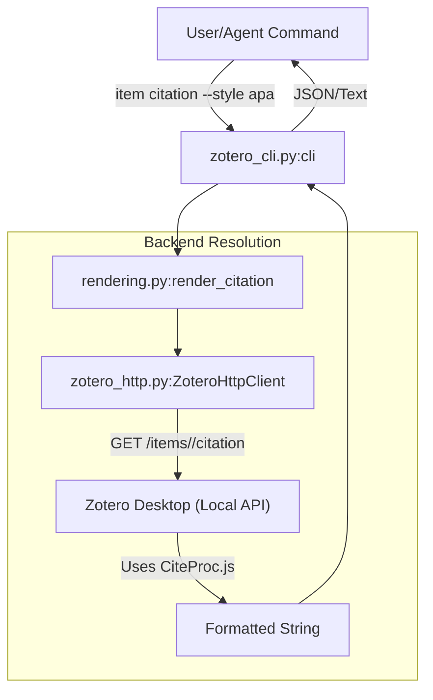
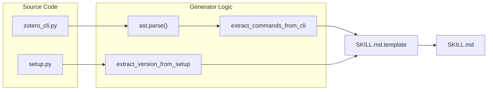

<!-- source: DeepWiki mcp.deepwiki.com · repo HKUDS/CLI-Anything · page 6.6 Knowledge and Reference Harnesses: Zotero, SiYuan, Joplin, Obsidian, Calibre, Mubu · fetched 2026-11-09 -->

# Knowledge and Reference Harnesses: Zotero, SiYuan, Joplin, Obsidian, Calibre, Mubu

Relevant source files

The following files were used as context for generating this wiki page:

- [calibre/agent-harness/.gitignore](calibre/agent-harness/.gitignore)
- [calibre/agent-harness/CALIBRE.md](calibre/agent-harness/CALIBRE.md)
- [calibre/agent-harness/FIX_NOTES.md](calibre/agent-harness/FIX_NOTES.md)
- [calibre/agent-harness/cli_anything/calibre/README.md](calibre/agent-harness/cli_anything/calibre/README.md)
- [calibre/agent-harness/cli_anything/calibre/__init__.py](calibre/agent-harness/cli_anything/calibre/__init__.py)
- [calibre/agent-harness/cli_anything/calibre/__main__.py](calibre/agent-harness/cli_anything/calibre/__main__.py)
- [calibre/agent-harness/cli_anything/calibre/calibre_cli.py](calibre/agent-harness/cli_anything/calibre/calibre_cli.py)
- [calibre/agent-harness/cli_anything/calibre/core/__init__.py](calibre/agent-harness/cli_anything/calibre/core/__init__.py)
- [calibre/agent-harness/cli_anything/calibre/core/custom.py](calibre/agent-harness/cli_anything/calibre/core/custom.py)
- [calibre/agent-harness/cli_anything/calibre/core/export.py](calibre/agent-harness/cli_anything/calibre/core/export.py)
- [calibre/agent-harness/cli_anything/calibre/core/formats.py](calibre/agent-harness/cli_anything/calibre/core/formats.py)
- [calibre/agent-harness/cli_anything/calibre/core/library.py](calibre/agent-harness/cli_anything/calibre/core/library.py)
- [calibre/agent-harness/cli_anything/calibre/tests/TEST.md](calibre/agent-harness/cli_anything/calibre/tests/TEST.md)
- [calibre/agent-harness/cli_anything/calibre/tests/test_core.py](calibre/agent-harness/cli_anything/calibre/tests/test_core.py)
- [calibre/agent-harness/cli_anything/calibre/tests/test_full_e2e.py](calibre/agent-harness/cli_anything/calibre/tests/test_full_e2e.py)
- [calibre/agent-harness/cli_anything/calibre/utils/calibre_backend.py](calibre/agent-harness/cli_anything/calibre/utils/calibre_backend.py)
- [calibre/agent-harness/cli_anything/calibre/utils/repl_skin.py](calibre/agent-harness/cli_anything/calibre/utils/repl_skin.py)
- [calibre/agent-harness/setup.py](calibre/agent-harness/setup.py)
- [joplin/agent-harness/JOPLIN.md](joplin/agent-harness/JOPLIN.md)
- [joplin/agent-harness/README.md](joplin/agent-harness/README.md)
- [joplin/agent-harness/cli_anything/joplin/README.md](joplin/agent-harness/cli_anything/joplin/README.md)
- [joplin/agent-harness/cli_anything/joplin/WORKFLOWS.md](joplin/agent-harness/cli_anything/joplin/WORKFLOWS.md)
- [joplin/agent-harness/cli_anything/joplin/core/backend.py](joplin/agent-harness/cli_anything/joplin/core/backend.py)
- [joplin/agent-harness/cli_anything/joplin/core/session.py](joplin/agent-harness/cli_anything/joplin/core/session.py)
- [joplin/agent-harness/cli_anything/joplin/joplin_cli.py](joplin/agent-harness/cli_anything/joplin/joplin_cli.py)
- [joplin/agent-harness/cli_anything/joplin/skills/SKILL.md](joplin/agent-harness/cli_anything/joplin/skills/SKILL.md)
- [joplin/agent-harness/cli_anything/joplin/tests/TEST.md](joplin/agent-harness/cli_anything/joplin/tests/TEST.md)
- [joplin/agent-harness/cli_anything/joplin/tests/test_core.py](joplin/agent-harness/cli_anything/joplin/tests/test_core.py)
- [joplin/agent-harness/cli_anything/joplin/utils/joplin_backend.py](joplin/agent-harness/cli_anything/joplin/utils/joplin_backend.py)
- [mubu/agent-harness/README.md](mubu/agent-harness/README.md)
- [mubu/agent-harness/cli_anything/mubu/README.md](mubu/agent-harness/cli_anything/mubu/README.md)
- [mubu/agent-harness/cli_anything/mubu/__init__.py](mubu/agent-harness/cli_anything/mubu/__init__.py)
- [mubu/agent-harness/cli_anything/mubu/skills/SKILL.md](mubu/agent-harness/cli_anything/mubu/skills/SKILL.md)
- [mubu/agent-harness/cli_anything/mubu/tests/TEST.md](mubu/agent-harness/cli_anything/mubu/tests/TEST.md)
- [mubu/agent-harness/cli_anything/mubu/tests/test_agent_harness.py](mubu/agent-harness/cli_anything/mubu/tests/test_agent_harness.py)
- [mubu/agent-harness/cli_anything/mubu/tests/test_cli_entrypoint.py](mubu/agent-harness/cli_anything/mubu/tests/test_cli_entrypoint.py)
- [mubu/agent-harness/cli_anything/mubu/tests/test_full_e2e.py](mubu/agent-harness/cli_anything/mubu/tests/test_full_e2e.py)
- [mubu/agent-harness/cli_anything/mubu/tests/test_mubu_probe.py](mubu/agent-harness/cli_anything/mubu/tests/test_mubu_probe.py)
- [mubu/agent-harness/mubu_probe.py](mubu/agent-harness/mubu_probe.py)
- [mubu/agent-harness/setup.py](mubu/agent-harness/setup.py)
- [mubu/agent-harness/templates/SKILL.md.template](mubu/agent-harness/templates/SKILL.md.template)
- [obsidian/agent-harness/OBSIDIAN.md](obsidian/agent-harness/OBSIDIAN.md)
- [obsidian/agent-harness/cli_anything/obsidian/README.md](obsidian/agent-harness/cli_anything/obsidian/README.md)
- [obsidian/agent-harness/cli_anything/obsidian/core/search.py](obsidian/agent-harness/cli_anything/obsidian/core/search.py)
- [obsidian/agent-harness/cli_anything/obsidian/obsidian_cli.py](obsidian/agent-harness/cli_anything/obsidian/obsidian_cli.py)
- [obsidian/agent-harness/cli_anything/obsidian/skills/SKILL.md](obsidian/agent-harness/cli_anything/obsidian/skills/SKILL.md)
- [obsidian/agent-harness/cli_anything/obsidian/tests/test_core.py](obsidian/agent-harness/cli_anything/obsidian/tests/test_core.py)
- [obsidian/agent-harness/cli_anything/obsidian/utils/obsidian_backend.py](obsidian/agent-harness/cli_anything/obsidian/utils/obsidian_backend.py)
- [obsidian/agent-harness/setup.py](obsidian/agent-harness/setup.py)
- [siyuan/agent-harness/SIYUAN.md](siyuan/agent-harness/SIYUAN.md)
- [siyuan/agent-harness/cli_anything/siyuan/README.md](siyuan/agent-harness/cli_anything/siyuan/README.md)
- [siyuan/agent-harness/cli_anything/siyuan/__init__.py](siyuan/agent-harness/cli_anything/siyuan/__init__.py)
- [siyuan/agent-harness/cli_anything/siyuan/__main__.py](siyuan/agent-harness/cli_anything/siyuan/__main__.py)
- [siyuan/agent-harness/cli_anything/siyuan/core/__init__.py](siyuan/agent-harness/cli_anything/siyuan/core/__init__.py)
- [siyuan/agent-harness/cli_anything/siyuan/core/client.py](siyuan/agent-harness/cli_anything/siyuan/core/client.py)
- [siyuan/agent-harness/cli_anything/siyuan/core/session.py](siyuan/agent-harness/cli_anything/siyuan/core/session.py)
- [siyuan/agent-harness/cli_anything/siyuan/siyuan_cli.py](siyuan/agent-harness/cli_anything/siyuan/siyuan_cli.py)
- [siyuan/agent-harness/cli_anything/siyuan/skills/SKILL.md](siyuan/agent-harness/cli_anything/siyuan/skills/SKILL.md)
- [siyuan/agent-harness/cli_anything/siyuan/tests/test_cli_commands.py](siyuan/agent-harness/cli_anything/siyuan/tests/test_cli_commands.py)
- [siyuan/agent-harness/cli_anything/siyuan/tests/test_core.py](siyuan/agent-harness/cli_anything/siyuan/tests/test_core.py)
- [siyuan/agent-harness/cli_anything/siyuan/tests/test_full_e2e.py](siyuan/agent-harness/cli_anything/siyuan/tests/test_full_e2e.py)
- [skills/cli-anything-joplin/SKILL.md](skills/cli-anything-joplin/SKILL.md)
- [skills/cli-anything-obsidian/SKILL.md](skills/cli-anything-obsidian/SKILL.md)
- [zotero/agent-harness/cli_anything/zotero/core/catalog.py](zotero/agent-harness/cli_anything/zotero/core/catalog.py)
- [zotero/agent-harness/cli_anything/zotero/skills/SKILL.md](zotero/agent-harness/cli_anything/zotero/skills/SKILL.md)
- [zotero/agent-harness/cli_anything/zotero/tests/test_agent_harness.py](zotero/agent-harness/cli_anything/zotero/tests/test_agent_harness.py)
- [zotero/agent-harness/cli_anything/zotero/utils/zotero_sqlite.py](zotero/agent-harness/cli_anything/zotero/utils/zotero_sqlite.py)
- [zotero/agent-harness/setup.py](zotero/agent-harness/setup.py)
- [zotero/agent-harness/skill_generator.py](zotero/agent-harness/skill_generator.py)
- [zotero/agent-harness/templates/SKILL.md.template](zotero/agent-harness/templates/SKILL.md.template)

This page details the integration patterns for various knowledge and reference management applications. These harnesses demonstrate diverse approaches to interacting with local data, ranging from direct database access and HTTP APIs to terminal binary wrappers and file system probes. The goal is to provide robust, agent-native CLIs that enable programmatic control over these applications.

## Zotero: Reference Management Harness

The Zotero harness is a sophisticated example of a **multi-surface integration pattern**. Unlike simpler wrappers, it orchestrates three distinct backend layers—**Direct SQLite Access**, **Local HTTP API**, and **GUI Connector Endpoints**—to provide a comprehensive agent-native interface for reference management without reimplementing Zotero's complex citation engines or translators [zotero/agent-harness/cli_anything/zotero/skills/SKILL.md:10-11](), [zotero/agent-harness/cli_anything/zotero/zotero_cli.py:190-190]().

### Architectural Layering

The harness distributes responsibilities across backends based on the required operation's safety, performance, and officiality.

| Backend Layer | Primary Responsibility | Key Code Entities |
| :--- | :--- | :--- |
| **SQLite (Local)** | High-speed read-only inventory, collection trees, and offline inspection. | `zotero_sqlite.py`, `fetch_libraries`, `fetch_collections` |
| **Connector API** | GUI-aware state (e.g., "currently selected item") and official write flows. | `catalog.py`, `use_selected_collection`, `zotero_http.py` |
| **Local API** | CSL (Citation Style Language) rendering and translator-backed exports. | `rendering.py`, `item citation`, `item bibliography` |

Sources: [zotero/agent-harness/cli_anything/zotero/utils/zotero_sqlite.py:105-161](), [zotero/agent-harness/cli_anything/zotero/zotero_cli.py:12-13](), [zotero/agent-harness/cli_anything/zotero/skills/SKILL.md:27-31]()

### Data Flow: Natural Language to Code Entity
The following diagram illustrates how a user request for a citation flows through the multi-surface architecture.

Sources: [zotero/agent-harness/cli_anything/zotero/zotero_cli.py:182-209](), [zotero/agent-harness/cli_anything/zotero/skills/SKILL.md:162-167]()

### Data Access Layer: `zotero_sqlite.py`

The SQLite layer is the primary engine for "inventory" commands. It bypasses the overhead of HTTP for massive library scans while maintaining strict read safety using `mode=ro` URI parameters [zotero/agent-harness/cli_anything/zotero/utils/zotero_sqlite.py:25-32]().

#### Write Safety and Transactions
For experimental write operations, the harness implements a "Backup + Immediate" pattern:
1. **Backup**: Before any write, `backup_database` creates a timestamped copy of `zotero.sqlite` [zotero/agent-harness/cli_anything/zotero/utils/zotero_sqlite.py:77-82]().
2. **Immediate Transaction**: Writes use `connect_writable` with a 30-second timeout to handle GUI locks [zotero/agent-harness/cli_anything/zotero/utils/zotero_sqlite.py:35-41]().
3. **Experimental Guard**: All direct-to-DB writes require the `--experimental` flag in the CLI to prevent accidental corruption by agents [zotero/agent-harness/cli_anything/zotero/zotero_cli.py:160-166]().

#### Attachment Path Resolution
Zotero stores attachments as either "Imported" (stored in Zotero's `storage/` folder) or "Linked" (stored anywhere on the filesystem). The `resolve_attachment_real_path` function handles this complexity by checking the attachment metadata and calculating the relative or absolute path accordingly [zotero/agent-harness/cli_anything/zotero/tests/test_core.py:91-99]().

#### AmbiguousReferenceError
In Zotero, a "Key" (e.g., `ABCD2345`) is unique within a library, but not necessarily across different libraries (e.g., My Library vs. a Group Library). 
- `AmbiguousReferenceError` is raised when a bare key matches records in multiple libraries [zotero/agent-harness/cli_anything/zotero/utils/zotero_sqlite.py:21-22]().
- Resolution requires setting the library context via `session use-library <id>` or providing the library ID in the command [zotero/agent-harness/cli_anything/zotero/skills/SKILL.md:30-31](), [zotero/agent-harness/cli_anything/zotero/tests/test_core.py:101-107]().

Sources: [zotero/agent-harness/cli_anything/zotero/utils/zotero_sqlite.py:21-41](), [zotero/agent-harness/cli_anything/zotero/zotero_cli.py:160-166]()

### Skill Generation Lifecycle

The Zotero harness uses `skill_generator.py` to keep its agent documentation (`SKILL.md`) in sync with the Python implementation. This ensures that when a developer adds a new Click command, the agent's "manual" is updated automatically.

#### Automated Documentation Pipeline
1. **AST Analysis**: The generator parses `zotero_cli.py` using Python's `ast` module to find `@cli.group()` and `@group.command()` decorators [zotero/agent-harness/skill_generator.py:113-118]().
2. **Metadata Extraction**: It extracts docstrings to use as command descriptions [zotero/agent-harness/skill_generator.py:144]().
3. **Template Injection**: Extracted metadata is injected into `SKILL.md.template` using a Jinja-like replacement strategy [zotero/agent-harness/templates/SKILL.md.template:1-61]().
4. **Constraint Injection**: Hardcoded constraints (e.g., Local API requirements) are merged into the final file [zotero/agent-harness/skill_generator.py:160-169]().

Sources: [zotero/agent-harness/skill_generator.py:113-147](), [zotero/agent-harness/templates/SKILL.md.template:33-46]()

### Key Functions and Classes

| Entity | Role | File Reference |
| :--- | :--- | :--- |
| `ZoteroEnvironment` | Dataclass containing paths to SQLite, data dirs, and executable. | [zotero/agent-harness/cli_anything/zotero/utils/zotero_paths.py:18-38]() |
| `build_environment` | Resolves active profile by reading `profiles.ini` and `prefs.js`. | [zotero/agent-harness/cli_anything/zotero/utils/zotero_paths.py:18-21]() |
| `fetch_item_children` | Retrieves child notes and attachments for a specific item key. | [zotero/agent-harness/cli_anything/zotero/utils/zotero_sqlite.py:89-91]() |
| `resolve_library_id` | Converts string references (e.g., "L1") into integer library IDs. | [zotero/agent-harness/cli_anything/zotero/zotero_cli.py:168-175]() |
| `ReplSkin` | Provides the interactive shell with Zotero-specific context (Current Library/Item). | [zotero/agent-harness/cli_anything/zotero/zotero_cli.py:13-14]() |

Sources: [zotero/agent-harness/cli_anything/zotero/utils/zotero_paths.py:18-38](), [zotero/agent-harness/cli_anything/zotero/utils/zotero_sqlite.py:21-41](), [zotero/agent-harness/cli_anything/zotero/zotero_cli.py:168-175]()

## SiYuan: Kernel HTTP API Integration

The `cli-anything-siyuan` harness provides a command-line interface for SiYuan (思源笔记), a local-first knowledge base. It connects to a running SiYuan kernel via its HTTP API, offering commands for managing notebooks, documents, blocks, search, and export [siyuan/agent-harness/cli_anything/siyuan/siyuan_cli.py:1-5]().

### Backend Integration: `SiYuanClient`

The core of the SiYuan integration is the `SiYuanClient` class [siyuan/agent-harness/cli_anything/siyuan/core/client.py:62-62](), which handles communication with the SiYuan kernel's HTTP API.

#### Configuration
Connection parameters (host, port, token) can be configured via:
- CLI flags (`--host`, `--port`, `--token`) [siyuan/agent-harness/cli_anything/siyuan/siyuan_cli.py:66-68]()
- Environment variables (`SIYUAN_HOST`, `SIYUAN_PORT`, `SIYUAN_TOKEN`) [siyuan/agent-harness/cli_anything/siyuan/core/client.py:46-55]()
- A JSON configuration file (`~/.siyuan-cli.json`) [siyuan/agent-harness/cli_anything/siyuan/core/client.py:34-35]()

The `load_config` function [siyuan/agent-harness/cli_anything/siyuan/core/client.py:26-26]() determines the configuration priority.

#### Request Handling
The `_post` method [siyuan/agent-harness/cli_anything/siyuan/core/client.py:73-73]() sends POST requests to the SiYuan API. It includes error handling for connection issues, timeouts, and API-specific errors (where `body.get("code", 0) != 0`) [siyuan/agent-harness/cli_anything/siyuan/core/client.py:78-101](). All API errors are wrapped in a `SiYuanClientError` [siyuan/agent-harness/cli_anything/siyuan/core/client.py:58-58](), which is then caught by the `_CatchErrors` Click group to provide clean CLI output [siyuan/agent-harness/cli_anything/siyuan/siyuan_cli.py:54-61]().

#### API Endpoints
The `SiYuanClient` exposes methods for various SiYuan functionalities, including:
- **Notebooks**: `list_notebooks`, `create_notebook`, `rename_notebook`, `remove_notebook` [siyuan/agent-harness/cli_anything/siyuan/core/client.py:113-147]()
- **Documents**: `create_doc_with_md`, `rename_doc`, `remove_doc` [siyuan/agent-harness/cli_anything/siyuan/core/client.py:150-177]()
- **Blocks**: `insert_block`, `update_block`, `delete_block`, `get_block_kramdown` [siyuan/agent-harness/cli_anything/siyuan/core/client.py:180-207]()
- **Search**: `search_blocks` [siyuan/agent-harness/cli_anything/siyuan/core/client.py:210-213]()
- **SQL**: `sql_query` [siyuan/agent-harness/cli_anything/siyuan/core/client.py:216-219]()
- **Export**: `export_markdown` [siyuan/agent-harness/cli_anything/siyuan/core/client.py:222-225]()

### CLI Structure and REPL

The `siyuan_cli.py` module defines the Click CLI, including a REPL mode [siyuan/agent-harness/cli_anything/siyuan/siyuan_cli.py:147-150]().

#### Context Management
The `SiYuanContext` class [siyuan/agent-harness/cli_anything/siyuan/siyuan_cli.py:44-49]() holds the `SiYuanClient` instance and a `SessionManager` for state persistence.

#### REPL Mode
The `repl` command [siyuan/agent-harness/cli_anything/siyuan/siyuan_cli.py:147-150]() provides an interactive shell using `ReplSkin` [siyuan/agent-harness/cli_anything/siyuan/siyuan_cli.py:151-152](). It allows users to execute commands, view status, and manage the session. The `_build_repl_commands` function [siyuan/agent-harness/cli_anything/siyuan/siyuan_cli.py:124-144]() defines the available REPL commands.

#### UTF-8 Handling
Special attention is paid to UTF-8 encoding, especially for CJK characters on Windows, by reconfiguring `sys.stdout` and `sys.stderr` to use UTF-8 [siyuan/agent-harness/cli_anything/siyuan/siyuan_cli.py:74-76]() and handling BOMs when reading stdin [siyuan/agent-harness/cli_anything/siyuan/siyuan_cli.py:37-39]().

### Testing

The SiYuan harness includes comprehensive tests:
- `test_core.py`: Unit tests for client and session logic, mocking the API [siyuan/agent-harness/cli_anything/siyuan/tests/test_core.py]().
- `test_cli_commands.py`: Tests CLI output formatting using `CliRunner` with a mocked client [siyuan/agent-harness/cli_anything/siyuan/tests/test_cli_commands.py](). This includes handling various API response formats for search results [siyuan/agent-harness/cli_anything/siyuan/tests/test_cli_commands.py:33-64]() and document listings [siyuan/agent-harness/cli_anything/siyuan/tests/test_cli_commands.py:98-167]().
- `test_full_e2e.py`: End-to-end tests that interact with a real SiYuan instance [siyuan/agent-harness/cli_anything/siyuan/tests/test_full_e2e.py]().

Sources: [siyuan/agent-harness/cli_anything/siyuan/siyuan_cli.py:1-197](), [siyuan/agent-harness/cli_anything/siyuan/core/client.py:1-177](), [siyuan/agent-harness/cli_anything/siyuan/tests/test_cli_commands.py:1-167]()

## Joplin: Terminal Binary Wrapper with Exclusive File Locking

The `cli-anything-joplin` harness provides a stateful CLI for Joplin, wrapping the official `joplin` terminal binary. It focuses on enabling agent-driven workflows, command validation, and end-to-end demonstrations [joplin/agent-harness/README.md:1-6]().

### Backend Integration: `joplin_backend.py`

The harness directly invokes the `joplin` executable via `subprocess` calls. The `run_joplin_command` function in `utils/joplin_backend.py` is central to this interaction.

#### Robust Subprocess Execution
- **Verbatim Output**: `run_joplin_command` returns the raw `stdout` and `stderr` from the Joplin process [joplin/agent-harness/cli_anything/joplin/README.md:70-71]().
- **Benign Node.js Warnings**: It intelligently filters benign Node.js deprecation warnings when deciding if a non-zero exit code indicates a real failure. This prevents false positives while preserving actual error messages [joplin/agent-harness/cli_anything/joplin/README.md:71-74]().
- **JSON Parsing**: `run_joplin_json` attempts to parse JSON output, even if it's prefixed by Node warnings, by retrying parsing on a scrubbed copy of stdout [joplin/agent-harness/cli_anything/joplin/README.md:74-76]().

#### Dynamic Flag Support
Joplin's CLI can silently ignore unknown options on older versions. The harness dynamically probes the `joplin help <command>` output to determine if flags like `--permanent` (for `rmnote`/`rmbook`) or `--exit-early` (for `server start`) are supported. If not, it raises a `RuntimeError` to prevent unintended behavior (e.g., a soft trash move instead of a permanent delete, or a hanging server process) [joplin/agent-harness/JOPLIN.md:155-170](). This logic is encapsulated in `_cli_supports_flag` [joplin/agent-harness/JOPLIN.md:165-165]().

### Stateful Session Management

The harness maintains a JSON-based project file that stores:
- Project metadata (`name`, `created_at`, `updated_at`)
- Backend settings (`binary`, `profile`)
- User context (`current_notebook`)
- An `history` log of operations [joplin/agent-harness/JOPLIN.md:65-72]().

#### Undo/Redo and Snapshots
The `Session` class [joplin/agent-harness/cli_anything/joplin/core/session.py]() manages in-memory project state, including undo/redo snapshots.
- `sess.snapshot(reason)` creates an undo point [joplin/agent-harness/cli_anything/joplin/tests/test_core.py:123-123]().
- `sess.undo()` and `sess.redo()` navigate the history [joplin/agent-harness/cli_anything/joplin/tests/test_core.py:125-128]().

#### Exclusive File Locking
To prevent race conditions when multiple agents or processes interact with the same project file, the harness implements exclusive file locking during saves. `_locked_save_json` uses `fcntl.flock` on POSIX and `msvcrt.locking` on Windows with back-off, ensuring only one process can write at a time and the file remains valid JSON [joplin/agent-harness/cli_anything/joplin/tests/test_core.py:196-197]().

#### Auto-Save Behavior
- Mutating commands automatically save the project if loaded [joplin/agent-harness/JOPLIN.md:76-76]().
- The `--dry-run` flag disables auto-save [joplin/agent-harness/JOPLIN.md:77-77]().
- REPL mode requires explicit `project save` [joplin/agent-harness/JOPLIN.md:78-78]().
- Commands that don't create undo snapshots (e.g., `sync run`) still mark the project dirty via `Session.mark_dirty()` to ensure their history is recorded [joplin/agent-harness/JOPLIN.md:79-82]().

### JSON Output Contract

All commands, when run with `--json`, return a consistent JSON envelope:
- `ok`: boolean indicating success or failure.
- `command`: a stable identifier (e.g., `notes.list`, `todos.toggle`).
- `data`: the command-specific payload on success.
- `error`: `{ type, message }` on failure, `null` on success [joplin/agent-harness/JOPLIN.md:87-92]().
The `command` identifier for errors matches the success identifier, even for multi-word subcommands (e.g., `config.import_file` instead of `config.import.file`) [joplin/agent-harness/JOPLIN.md:146-148]().

### Testing Strategy

The Joplin harness employs a multi-layered testing strategy [joplin/agent-harness/JOPLIN.md:94-129]():
1. **Unit/Command Tests (`test_core.py`)**: Validate harness internals and CLI contract without a real Joplin backend [joplin/agent-harness/JOPLIN.md:95-96]().
2. **CLI Subprocess Tests (`TestCLISubprocess`)**: Run the installed `cli-anything-joplin` entry point as a subprocess to verify external JSON contract for non-mutating commands [joplin/agent-harness/JOPLIN.md:98-100]().
3. **Real-Backend Command Tests (`TestBackendCommands`)**: Single-command checks against a fresh Joplin profile [joplin/agent-harness/JOPLIN.md:102-103]().
4. **Real-Backend Workflow Tests (`TestBackendWorkflows`)**: Scripts covering note lifecycle, organization, todos, tagging, search, sync, import/export, attachments, and history [joplin/agent-harness/JOPLIN.md:105-107]().
5. **End-to-End Integration Test (`TestBackendIntegration`)**: A full demo flow to verify project history capture [joplin/agent-harness/JOPLIN.md:109-110]().

Sources: [joplin/agent-harness/README.md:1-73](), [joplin/agent-harness/JOPLIN.md:1-170](), [joplin/agent-harness/cli_anything/joplin/tests/test_core.py:1-197]()

## Obsidian: Vault Search

The `cli-anything-obsidian` harness focuses on providing programmatic access to Obsidian vaults, primarily through search functionality. It leverages the local file system structure of Obsidian vaults.

### Backend Integration: File System Search

The Obsidian harness directly interacts with the vault's files. The `search_vault` function in `cli_anything/obsidian/core/search.py` is responsible for this.

#### Search Implementation
- **File-based Search**: It iterates through Markdown files (`.md`) within the specified vault path.
- **Keyword Matching**: It performs case-insensitive keyword matching against the content of these files.
- **Contextual Snippets**: For each match, it extracts a snippet of text around the keyword to provide context.

### CLI Structure

The `obsidian_cli.py` module defines the Click CLI for Obsidian.

#### Vault Path Management
- The `--vault-path` option allows specifying the target Obsidian vault [obsidian/agent-harness/cli_anything/obsidian/obsidian_cli.py:20-20]().
- The `ObsidianContext` class stores the resolved vault path [obsidian/agent-harness/cli_anything/obsidian/obsidian_cli.py:14-17]().

#### Search Command
The `search` command [obsidian/agent-harness/cli_anything/obsidian/obsidian_cli.py:23-23]() takes a `query` and optional `--case-sensitive` flag. It calls `search_vault` and formats the results.

### Testing

The harness includes tests for its core functionality:
- `test_core.py`: Unit tests for the search logic, mocking file system interactions [obsidian/agent-harness/cli_anything/obsidian/tests/test_core.py]().
- `test_cli_commands.py`: Tests the CLI interface using `CliRunner`.

Sources: [obsidian/agent-harness/cli_anything/obsidian/obsidian_cli.py](), [obsidian/agent-harness/cli_anything/obsidian/core/search.py](), [obsidian/agent-harness/cli_anything/obsidian/tests/test_core.py]()

## Calibre: Library and Format Conversion

The `cli-anything-calibre` harness provides a CLI for managing Calibre libraries and converting ebook formats. It wraps the `calibredb` and `ebook-convert` command-line tools.

### Backend Integration: `calibre_backend.py`

The `utils/calibre_backend.py` module provides wrappers for invoking `calibredb` and `ebook-convert` [calibre/agent-harness/cli_anything/calibre/utils/calibre_backend.py:10-11]().

#### Tool Discovery
- `find_calibredb()` and `find_ebook_convert()` locate the executables in the system's PATH [calibre/agent-harness/cli_anything/calibre/utils/calibre_backend.py:10-11]().
- `run_calibredb()` and `run_ebook_convert()` execute the commands and capture their output [calibre/agent-harness/cli_anything/calibre/utils/calibre_backend.py:10-11]().

### Core Functionality

#### Library Management (`library.py`)
- **Listing Books**: `list_books` retrieves book metadata from the Calibre library [calibre/agent-harness/cli_anything/calibre/core/library.py:15-15]().
- **Adding Books**: `add_book` imports new books into the library [calibre/agent-harness/cli_anything/calibre/core/library.py:60-60]().
- **Removing Books**: `remove_book` deletes books from the library [calibre/agent-harness/cli_anything/calibre/core/library.py:84-84]().
- **Updating Metadata**: `set_metadata` modifies book details [calibre/agent-harness/cli_anything/calibre/core/library.py:108-108]().

#### Format Management (`formats.py`)
- **Listing Formats**: `list_formats` identifies available formats for a given book ID by parsing `calibredb list` output [calibre/agent-harness/cli_anything/calibre/core/formats.py:15-37]().
- **Adding/Removing Formats**: `add_format` and `remove_format` manage format files associated with books [calibre/agent-harness/cli_anything/calibre/core/formats.py:44-85]().
- **Converting Formats**: `convert_format` orchestrates the conversion process [calibre/agent-harness/cli_anything/calibre/core/formats.py:88-96]():
    1. Exports the input format from the library to a temporary directory.
    2. Invokes `ebook-convert` to perform the conversion.
    3. Optionally adds the converted file back to the library.

#### Export and Catalog Generation (`export.py`)
- **Exporting Books**: `export_books` uses `calibredb export` to save books to a specified directory, preserving Calibre's folder structure and metadata [calibre/agent-harness/cli_anything/calibre/core/export.py:30-76]().
- **Generating Catalogs**: `generate_catalog` creates catalogs (e.g., EPUB, CSV, OPDS) of the library using `calibredb catalog` [calibre/agent-harness/cli_anything/calibre/core/export.py:80-116]().
- **EPUB Chapter Parsing**: The module also contains functions (`_parse_epub_chapters`, `_parse_nav_titles`, `_parse_ncx_titles`) to parse the internal structure of EPUB files, extracting chapter information [calibre/agent-harness/cli_anything/calibre/core/export.py:174-377]().

### CLI Structure and REPL

The `calibre_cli.py` module defines the Click CLI for Calibre.
- The main `cli` group [calibre/agent-harness/cli_anything/calibre/calibre_cli.py:40-40]() takes a `--library-path` option to specify the target Calibre library.
- It includes a REPL mode for interactive use [calibre/agent-harness/cli_anything/calibre/calibre_cli.py:100-100](), utilizing `ReplSkin` [calibre/agent-harness/cli_anything/calibre/utils/repl_skin.py]().

### Testing

The Calibre harness includes:
- `test_core.py`: Unit tests for core logic, mocking backend calls [calibre/agent-harness/cli_anything/calibre/tests/test_core.py]().
- `test_full_e2e.py`: End-to-end tests that interact with real `calibredb` and `ebook-convert` executables [calibre/agent-harness/cli_anything/calibre/tests/test_full_e2e.py]().

Sources: [calibre/agent-harness/cli_anything/calibre/core/export.py:1-377](), [calibre/agent-harness/cli_anything/calibre/core/formats.py:1-167](), [calibre/agent-harness/cli_anything/calibre/utils/calibre_backend.py](), [calibre/agent-harness/cli_anything/calibre/calibre_cli.py](), [calibre/agent-harness/cli_anything/calibre/tests/test_full_e2e.py]()

## Mubu: Probe

The `cli-anything-mubu` harness provides a simple probe for Mubu (幕布), a mind-mapping and outlining tool. Its primary function is to detect if Mubu is running and to extract basic information, demonstrating a minimal integration pattern for applications without a direct API or CLI.

### Backend Integration: Process and File System Probing

The Mubu harness relies on inspecting running processes and specific file system locations.

#### Process Detection
- The `is_mubu_running()` function checks for the presence of the Mubu application process [mubu/agent-harness/mubu_probe.py:15-15](). This typically involves iterating through running processes and looking for a specific executable name (e.g., "Mubu.exe" on Windows, "Mubu" on macOS/Linux).

#### Configuration File Location
- The `get_mubu_config_path()` function attempts to locate Mubu's configuration directory, which often contains user data or settings [mubu/agent-harness/mubu_probe.py:25-25](). This path is platform-dependent.

### CLI Structure

The `mubu_probe.py` script serves as the CLI entry point.

#### Status Command
- The `status` command [mubu/agent-harness/mubu_probe.py:35-35]() reports whether Mubu is running and, if so, its detected configuration path.

### Testing

The Mubu harness includes tests to verify its probing capabilities:
- `test_mubu_probe.py`: Unit tests for `is_mubu_running()` and `get_mubu_config_path()`, mocking OS-specific functions for process listing and path resolution [mubu/agent-harness/cli_anything/mubu/tests/test_mubu_probe.py]().
- `test_cli_entrypoint.py`: Tests the CLI `status` command using `CliRunner` [mubu/agent-harness/cli_anything/mubu/tests/test_cli_entrypoint.py]().

Sources: [mubu/agent-harness/mubu_probe.py:1-40](), [mubu/agent-harness/cli_anything/mubu/tests/test_mubu_probe.py](), [mubu/agent-harness/cli_anything/mubu/tests/test_cli_entrypoint.py]()

---

