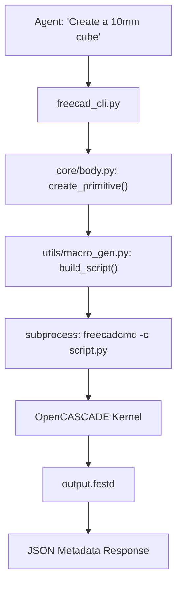
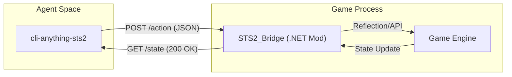
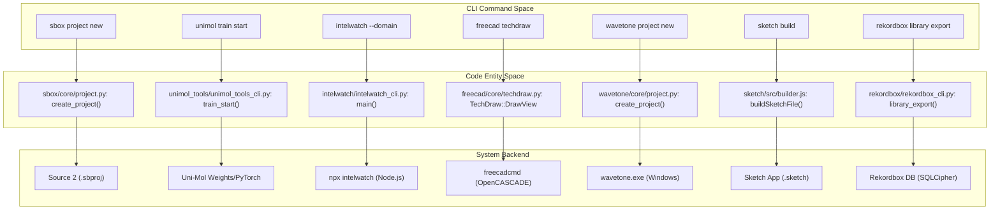

<!-- source: DeepWiki mcp.deepwiki.com · repo HKUDS/CLI-Anything · page 6.7 FreeCAD, Slay the Spire II, and Specialized Harnesses · fetched 2026-11-09 -->

# FreeCAD, Slay the Spire II, and Specialized Harnesses

<details>
<summary>Relevant source files</summary>

The following files were used as context for generating this wiki page:

- [.gitignore](.gitignore)
- [README.md](README.md)
- [README_CN.md](README_CN.md)
- [README_JA.md](README_JA.md)
- [freecad/agent-harness/FREECAD.md](freecad/agent-harness/FREECAD.md)
- [freecad/agent-harness/cli_anything/freecad/core/assembly.py](freecad/agent-harness/cli_anything/freecad/core/assembly.py)
- [freecad/agent-harness/cli_anything/freecad/core/body.py](freecad/agent-harness/cli_anything/freecad/core/body.py)
- [freecad/agent-harness/cli_anything/freecad/core/cam.py](freecad/agent-harness/cli_anything/freecad/core/cam.py)
- [freecad/agent-harness/cli_anything/freecad/core/draft.py](freecad/agent-harness/cli_anything/freecad/core/draft.py)
- [freecad/agent-harness/cli_anything/freecad/core/fem.py](freecad/agent-harness/cli_anything/freecad/core/fem.py)
- [freecad/agent-harness/cli_anything/freecad/core/measure.py](freecad/agent-harness/cli_anything/freecad/core/measure.py)
- [freecad/agent-harness/cli_anything/freecad/core/sketch.py](freecad/agent-harness/cli_anything/freecad/core/sketch.py)
- [freecad/agent-harness/cli_anything/freecad/core/techdraw.py](freecad/agent-harness/cli_anything/freecad/core/techdraw.py)
- [freecad/agent-harness/cli_anything/freecad/freecad_cli.py](freecad/agent-harness/cli_anything/freecad/freecad_cli.py)
- [freecad/agent-harness/cli_anything/freecad/tests/test_core.py](freecad/agent-harness/cli_anything/freecad/tests/test_core.py)
- [intelwatch/agent-harness/INTELWATCH.md](intelwatch/agent-harness/INTELWATCH.md)
- [intelwatch/agent-harness/cli_anything/__init__.py](intelwatch/agent-harness/cli_anything/__init__.py)
- [intelwatch/agent-harness/cli_anything/intelwatch/__init__.py](intelwatch/agent-harness/cli_anything/intelwatch/__init__.py)
- [intelwatch/agent-harness/cli_anything/intelwatch/intelwatch_cli.py](intelwatch/agent-harness/cli_anything/intelwatch/intelwatch_cli.py)
- [intelwatch/agent-harness/cli_anything/intelwatch/skills/SKILL.md](intelwatch/agent-harness/cli_anything/intelwatch/skills/SKILL.md)
- [intelwatch/agent-harness/cli_anything/intelwatch/tests/__init__.py](intelwatch/agent-harness/cli_anything/intelwatch/tests/__init__.py)
- [intelwatch/agent-harness/cli_anything/intelwatch/tests/test_core.py](intelwatch/agent-harness/cli_anything/intelwatch/tests/test_core.py)
- [intelwatch/agent-harness/cli_anything/intelwatch/tests/test_full_e2e.py](intelwatch/agent-harness/cli_anything/intelwatch/tests/test_full_e2e.py)
- [intelwatch/agent-harness/cli_anything/intelwatch/utils/__init__.py](intelwatch/agent-harness/cli_anything/intelwatch/utils/__init__.py)
- [intelwatch/agent-harness/cli_anything/intelwatch/utils/repl_skin.py](intelwatch/agent-harness/cli_anything/intelwatch/utils/repl_skin.py)
- [live2d/agent-harness/cli_anything/live2d/tests/test_core.py](live2d/agent-harness/cli_anything/live2d/tests/test_core.py)
- [quietshrink/agent-harness/QUIETSHRINK.md](quietshrink/agent-harness/QUIETSHRINK.md)
- [quietshrink/agent-harness/TEST.md](quietshrink/agent-harness/TEST.md)
- [quietshrink/agent-harness/cli_anything/quietshrink/README.md](quietshrink/agent-harness/cli_anything/quietshrink/README.md)
- [quietshrink/agent-harness/cli_anything/quietshrink/__init__.py](quietshrink/agent-harness/cli_anything/quietshrink/__init__.py)
- [quietshrink/agent-harness/cli_anything/quietshrink/quietshrink_cli.py](quietshrink/agent-harness/cli_anything/quietshrink/quietshrink_cli.py)
- [quietshrink/agent-harness/cli_anything/quietshrink/skills/SKILL.md](quietshrink/agent-harness/cli_anything/quietshrink/skills/SKILL.md)
- [quietshrink/agent-harness/cli_anything/quietshrink/tests/__init__.py](quietshrink/agent-harness/cli_anything/quietshrink/tests/__init__.py)
- [quietshrink/agent-harness/cli_anything/quietshrink/tests/test_cli.py](quietshrink/agent-harness/cli_anything/quietshrink/tests/test_cli.py)
- [quietshrink/agent-harness/setup.py](quietshrink/agent-harness/setup.py)
- [rekordbox/agent-harness/REKORDBOX.md](rekordbox/agent-harness/REKORDBOX.md)
- [rekordbox/agent-harness/cli_anything/rekordbox/README.md](rekordbox/agent-harness/cli_anything/rekordbox/README.md)
- [rekordbox/agent-harness/cli_anything/rekordbox/__init__.py](rekordbox/agent-harness/cli_anything/rekordbox/__init__.py)
- [rekordbox/agent-harness/cli_anything/rekordbox/__main__.py](rekordbox/agent-harness/cli_anything/rekordbox/__main__.py)
- [rekordbox/agent-harness/cli_anything/rekordbox/core/__init__.py](rekordbox/agent-harness/cli_anything/rekordbox/core/__init__.py)
- [rekordbox/agent-harness/cli_anything/rekordbox/data/Bunker.midi.csv](rekordbox/agent-harness/cli_anything/rekordbox/data/Bunker.midi.csv)
- [rekordbox/agent-harness/cli_anything/rekordbox/eval/__init__.py](rekordbox/agent-harness/cli_anything/rekordbox/eval/__init__.py)
- [rekordbox/agent-harness/cli_anything/rekordbox/eval/eval_pipeline.md](rekordbox/agent-harness/cli_anything/rekordbox/eval/eval_pipeline.md)
- [rekordbox/agent-harness/cli_anything/rekordbox/rekordbox_cli.py](rekordbox/agent-harness/cli_anything/rekordbox/rekordbox_cli.py)
- [rekordbox/agent-harness/cli_anything/rekordbox/skills/SKILL.md](rekordbox/agent-harness/cli_anything/rekordbox/skills/SKILL.md)
- [rekordbox/agent-harness/cli_anything/rekordbox/tests/test_smoke.py](rekordbox/agent-harness/cli_anything/rekordbox/tests/test_smoke.py)
- [sbox/agent-harness/cli_anything/sbox/core/codegen.py](sbox/agent-harness/cli_anything/sbox/core/codegen.py)
- [sbox/agent-harness/cli_anything/sbox/core/session.py](sbox/agent-harness/cli_anything/sbox/core/session.py)
- [sbox/agent-harness/cli_anything/sbox/core/test_orchestrator.py](sbox/agent-harness/cli_anything/sbox/core/test_orchestrator.py)
- [sbox/agent-harness/cli_anything/sbox/sbox_cli.py](sbox/agent-harness/cli_anything/sbox/sbox_cli.py)
- [sbox/agent-harness/cli_anything/sbox/tests/TEST.md](sbox/agent-harness/cli_anything/sbox/tests/TEST.md)
- [sbox/agent-harness/cli_anything/sbox/tests/test_core.py](sbox/agent-harness/cli_anything/sbox/tests/test_core.py)
- [sbox/agent-harness/cli_anything/sbox/tests/test_exit_codes.py](sbox/agent-harness/cli_anything/sbox/tests/test_exit_codes.py)
- [sbox/agent-harness/cli_anything/sbox/tests/test_full_e2e.py](sbox/agent-harness/cli_anything/sbox/tests/test_full_e2e.py)
- [sketch/agent-harness/src/builder.js](sketch/agent-harness/src/builder.js)
- [sketch/agent-harness/tests/security.test.js](sketch/agent-harness/tests/security.test.js)
- [skills/cli-anything-quietshrink/SKILL.md](skills/cli-anything-quietshrink/SKILL.md)
- [skills/cli-anything-rekordbox/SKILL.md](skills/cli-anything-rekordbox/SKILL.md)
- [skills/cli-anything-wavetone/SKILL.md](skills/cli-anything-wavetone/SKILL.md)
- [slay_the_spire_ii/README.md](slay_the_spire_ii/README.md)
- [slay_the_spire_ii/agent-harness/STS2.md](slay_the_spire_ii/agent-harness/STS2.md)
- [slay_the_spire_ii/agent-harness/cli_anything/slay_the_spire_ii/README.md](slay_the_spire_ii/agent-harness/cli_anything/slay_the_spire_ii/README.md)
- [slay_the_spire_ii/agent-harness/cli_anything/slay_the_spire_ii/__init__.py](slay_the_spire_ii/agent-harness/cli_anything/slay_the_spire_ii/__init__.py)
- [slay_the_spire_ii/agent-harness/cli_anything/slay_the_spire_ii/__main__.py](slay_the_spire_ii/agent-harness/cli_anything/slay_the_spire_ii/__main__.py)
- [slay_the_spire_ii/agent-harness/cli_anything/slay_the_spire_ii/core/__init__.py](slay_the_spire_ii/agent-harness/cli_anything/slay_the_spire_ii/core/__init__.py)
- [slay_the_spire_ii/agent-harness/cli_anything/slay_the_spire_ii/core/action_adapter.py](slay_the_spire_ii/agent-harness/cli_anything/slay_the_spire_ii/core/action_adapter.py)
- [slay_the_spire_ii/agent-harness/cli_anything/slay_the_spire_ii/core/state_adapter.py](slay_the_spire_ii/agent-harness/cli_anything/slay_the_spire_ii/core/state_adapter.py)
- [slay_the_spire_ii/agent-harness/cli_anything/slay_the_spire_ii/core/types.py](slay_the_spire_ii/agent-harness/cli_anything/slay_the_spire_ii/core/types.py)
- [slay_the_spire_ii/agent-harness/cli_anything/slay_the_spire_ii/skills/SKILL.md](slay_the_spire_ii/agent-harness/cli_anything/slay_the_spire_ii/skills/SKILL.md)
- [slay_the_spire_ii/agent-harness/cli_anything/slay_the_spire_ii/slay_the_spire_ii_cli.py](slay_the_spire_ii/agent-harness/cli_anything/slay_the_spire_ii/slay_the_spire_ii_cli.py)
- [slay_the_spire_ii/agent-harness/cli_anything/slay_the_spire_ii/utils/sts2_backend.py](slay_the_spire_ii/agent-harness/cli_anything/slay_the_spire_ii/utils/sts2_backend.py)
- [slay_the_spire_ii/agent-harness/setup.py](slay_the_spire_ii/agent-harness/setup.py)
- [unimol_tools/agent-harness/cli_anything/unimol_tools/core/session.py](unimol_tools/agent-harness/cli_anything/unimol_tools/core/session.py)
- [unimol_tools/agent-harness/cli_anything/unimol_tools/unimol_tools_cli.py](unimol_tools/agent-harness/cli_anything/unimol_tools/unimol_tools_cli.py)
- [unimol_tools/agent-harness/demo_real_examples.sh](unimol_tools/agent-harness/demo_real_examples.sh)
- [unimol_tools/agent-harness/pyproject.toml](unimol_tools/agent-harness/pyproject.toml)
- [videocaptioner/agent-harness/cli_anything/videocaptioner/README.md](videocaptioner/agent-harness/cli_anything/videocaptioner/README.md)
- [videocaptioner/agent-harness/cli_anything/videocaptioner/core/pipeline.py](videocaptioner/agent-harness/cli_anything/videocaptioner/core/pipeline.py)
- [videocaptioner/agent-harness/cli_anything/videocaptioner/core/synthesize.py](videocaptioner/agent-harness/cli_anything/videocaptioner/core/synthesize.py)
- [videocaptioner/agent-harness/cli_anything/videocaptioner/skills/SKILL.md](videocaptioner/agent-harness/cli_anything/videocaptioner/skills/SKILL.md)
- [videocaptioner/agent-harness/cli_anything/videocaptioner/tests/test_core.py](videocaptioner/agent-harness/cli_anything/videocaptioner/tests/test_core.py)
- [videocaptioner/agent-harness/cli_anything/videocaptioner/tests/test_full_e2e.py](videocaptioner/agent-harness/cli_anything/videocaptioner/tests/test_full_e2e.py)
- [videocaptioner/agent-harness/cli_anything/videocaptioner/utils/vc_backend.py](videocaptioner/agent-harness/cli_anything/videocaptioner/utils/vc_backend.py)
- [videocaptioner/agent-harness/cli_anything/videocaptioner/videocaptioner_cli.py](videocaptioner/agent-harness/cli_anything/videocaptioner/videocaptioner_cli.py)
- [videocaptioner/agent-harness/setup.py](videocaptioner/agent-harness/setup.py)
- [wavetone/agent-harness/cli_anything/wavetone/README.md](wavetone/agent-harness/cli_anything/wavetone/README.md)
- [wavetone/agent-harness/cli_anything/wavetone/core/audio.py](wavetone/agent-harness/cli_anything/wavetone/core/audio.py)
- [wavetone/agent-harness/cli_anything/wavetone/core/project.py](wavetone/agent-harness/cli_anything/wavetone/core/project.py)
- [wavetone/agent-harness/cli_anything/wavetone/core/session.py](wavetone/agent-harness/cli_anything/wavetone/core/session.py)
- [wavetone/agent-harness/cli_anything/wavetone/tests/TEST.md](wavetone/agent-harness/cli_anything/wavetone/tests/TEST.md)
- [wavetone/agent-harness/cli_anything/wavetone/tests/test_core.py](wavetone/agent-harness/cli_anything/wavetone/tests/test_core.py)
- [wavetone/agent-harness/cli_anything/wavetone/tests/test_full_e2e.py](wavetone/agent-harness/cli_anything/wavetone/tests/test_full_e2e.py)
- [wavetone/agent-harness/cli_anything/wavetone/utils/repl_skin.py](wavetone/agent-harness/cli_anything/wavetone/utils/repl_skin.py)
- [wavetone/agent-harness/cli_anything/wavetone/utils/wavetone_backend.py](wavetone/agent-harness/cli_anything/wavetone/utils/wavetone_backend.py)
- [wavetone/agent-harness/cli_anything/wavetone/wavetone_cli.py](wavetone/agent-harness/cli_anything/wavetone/wavetone_cli.py)
- [wavetone/agent-harness/setup.py](wavetone/agent-harness/setup.py)
- [web-yu-pri/agent-harness/cli_anything/web_yu_pri/tests/TEST.md](web-yu-pri/agent-harness/cli_anything/web_yu_pri/tests/TEST.md)
- [web-yu-pri/agent-harness/cli_anything/web_yu_pri/tests/test_core.py](web-yu-pri/agent-harness/cli_anything/web_yu_pri/tests/test_core.py)
- [web-yu-pri/agent-harness/cli_anything/web_yu_pri/web_yu_pri_cli.py](web-yu-pri/agent-harness/cli_anything/web_yu_pri/web_yu_pri_cli.py)

</details>


This page details the integration patterns for applications requiring specialized execution environments, live game state bridges, or pass-through wrapper architectures. These harnesses demonstrate how CLI-Anything adapts to parametric 3D modeling, real-time gaming, Source 2 engine workflows, and molecular machine learning.

## FreeCAD: Parametric CAD via Macro Generation

The FreeCAD harness enables AI agents to perform parametric 3D modeling by generating and executing Python macros through the `freecadcmd` backend [freecad/agent-harness/cli_anything/freecad/freecad_cli.py:117-130](). It abstracts the OpenCASCADE kernel and `FCStd` file format into high-level command groups.

### Implementation Pattern
The harness constructs Python scripts that are passed to the FreeCAD executable in headless mode. It manages complex CAD workbenches including FEM, CAM, and TechDraw [freecad/agent-harness/cli_anything/freecad/freecad_cli.py:20-39]().

| Component | Responsibility |
| :--- | :--- |
| `freecad_cli.py` | Click-based entry point and command routing [freecad/agent-harness/cli_anything/freecad/freecad_cli.py:173-182](). |
| `core/sketch.py` | Constraints and 2D geometry primitives. |
| `core/body.py` | PartDesign operations (Pad, Pocket, Revolution) [freecad/agent-harness/cli_anything/freecad/core/body.py](). |
| `core/techdraw.py` | 2D technical drawing generation from 3D models. |
| `core/fem.py` | Finite Element Method analysis setup and execution. |

### Data Flow: Natural Language to Geometry
The following diagram illustrates how a natural language request for a 3D part is transformed into a physical file.

**FreeCAD Macro Execution Flow**


Sources: `freecad/agent-harness/FREECAD.md`(), `freecad/agent-harness/cli_anything/freecad/freecad_cli.py`(), `freecad/agent-harness/cli_anything/freecad/core/body.py`().

---

## Slay the Spire II: Live Game Automation

The Slay the Spire II (STS2) harness implements a "Bridge Mod" pattern. It communicates with a running game instance via a .NET bridge that exposes an HTTP API at `localhost:15526` [slay_the_spire_ii/agent-harness/STS2.md]() (mentioned in `README.md` news [README.md:50-51]()).

### Decision State Normalization
The harness uses a `state_adapter.py` to normalize raw JSON from the game into a `Decision State`. This informs the agent of available `PlannedAction` objects [slay_the_spire_ii/agent-harness/cli_anything/slay_the_spire_ii/core/action_adapter.py]().

**STS2 Bridge Architecture**


Sources: `slay_the_spire_ii/agent-harness/STS2.md`(), `slay_the_spire_ii/agent-harness/cli_anything/slay_the_spire_ii/utils/sts2_backend.py`(), `slay_the_spire_ii/agent-harness/cli_anything/slay_the_spire_ii/core/state_adapter.py`().

---

## s&box: Source 2 Engine Integration

The s&box harness provides a comprehensive interface for the Source 2 engine, supporting project management, scene manipulation, and C# code generation [sbox/agent-harness/cli_anything/sbox/sbox_cli.py:1-6]().

### Session and State Management
The harness maintains a stateful session with a 50-level undo/redo stack [sbox/agent-harness/cli_anything/sbox/core/session.py:41-51](). It uses atomic writes to `session.json` and preserves corrupted files as `.corrupt` backups [sbox/agent-harness/cli_anything/sbox/core/session.py:70-117]().

### Automated Map Testing Pipeline
A specialized `test_orchestrator.py` manages a full lifecycle for automated map generation:
1.  **Combo Matrix**: Builds a matrix of strategies (Serpentine, Gilbert, etc.) and seeds [sbox/agent-harness/cli_anything/sbox/core/test_orchestrator.py:36-53]().
2.  **Sentinel Polling**: Watches for `test_complete.json` in the engine's `FileSystem.Data` directory [sbox/agent-harness/cli_anything/sbox/core/test_orchestrator.py:76-93]().
3.  **Image Conversion**: Converts raw RGBA bytes from the engine into PNGs via Pillow [sbox/agent-harness/cli_anything/sbox/core/test_orchestrator.py:96-109]().

Sources: `sbox/agent-harness/cli_anything/sbox/core/session.py`(), `sbox/agent-harness/cli_anything/sbox/core/test_orchestrator.py`(), `sbox/agent-harness/cli_anything/sbox/sbox_cli.py`().

---

## Uni-Mol Tools: Molecular Machine Learning

The Uni-Mol Tools harness wraps molecular property prediction models. It manages "Projects" that track task types (classification, regression) and dataset paths [unimol_tools/agent-harness/cli_anything/unimol_tools/unimol_tools_cli.py:133-160]().

### Training and Prediction Lifecycle
-   **Training**: Initiates model training with configurable epochs and batch sizes [unimol_tools/agent-harness/cli_anything/unimol_tools/unimol_tools_cli.py:206-210]().
-   **Prediction**: Runs inference on SMILES strings or CSV files [unimol_tools/agent-harness/cli_anything/unimol_tools/unimol_tools_cli.py:13-14]().
-   **Weight Management**: Handles model weights via `UNIMOL_WEIGHT_DIR` environment variables [unimol_tools/agent-harness/cli_anything/unimol_tools/unimol_tools_cli.py:84-110]().

Sources: `unimol_tools/agent-harness/cli_anything/unimol_tools/unimol_tools_cli.py`(), `unimol_tools/agent-harness/demo_real_examples.sh`().

---

## Specialized Wrapper Patterns

### Intelwatch: Node.js Pass-Through
The Intelwatch harness uses a "Pass-Through Wrapper" pattern. It forwards all arguments to `subprocess.call(['npx', 'intelwatch', ...])` [intelwatch/agent-harness/cli_anything/intelwatch/tests/test_core.py:9-22](). It specifically handles the absence of the Node.js runtime [intelwatch/agent-harness/cli_anything/intelwatch/tests/test_core.py:37-49]().

### VideoCaptioner: Production CLI Wrapper
VideoCaptioner leverages a subprocess wrapper around the `videocaptioner` package, providing a structured 3-phase pipeline:
1.  **Transcribe**: Speech-to-subtitles via ASR [videocaptioner/agent-harness/cli_anything/videocaptioner/core/transcribe.py:6-44]().
2.  **Subtitle**: NLP-based optimization and translation [videocaptioner/agent-harness/cli_anything/videocaptioner/core/subtitle.py:6-68]().
3.  **Synthesize**: Burning subtitles into video using FFmpeg [videocaptioner/agent-harness/cli_anything/videocaptioner/core/synthesize.py:6-49]().

Sources: `intelwatch/agent-harness/cli_anything/intelwatch/intelwatch_cli.py`(), `videocaptioner/agent-harness/cli_anything/videocaptioner/videocaptioner_cli.py`().

---

## Sketch: Design Spec to Sketch File

The Sketch harness converts a JSON design specification into a `.sketch` file. It handles design tokens, layout computation, and layer generation using `sketch-constructor` [sketch/agent-harness/src/builder.js:15]().

### Token Resolution and Security
The `builder.js` module is responsible for loading and merging design tokens, resolving `$`-references in styles, and computing layout [sketch/agent-harness/src/builder.js:11-12](). It includes robust path validation (`isSafePath`) to prevent path traversal and symlink attacks when loading token files [sketch/agent-harness/src/builder.js:68-87](). This hardening was a recent update [README.md:59-60]().

### Custom Sketch File Generation
A custom `buildSketchFile` function is used to serialize the Sketch object to a `.sketch` ZIP file, ensuring correct UTF-8 encoding for CJK characters, bypassing `sketch-constructor`'s default `JsonStreamStringify` which can corrupt multi-byte characters [sketch/agent-harness/src/builder.js:29-56]().

Sources: `sketch/agent-harness/src/builder.js`(), `sketch/agent-harness/tests/security.test.js`().

---

## WaveTone: Audio Transcription Project Management

The WaveTone harness provides an agent-native CLI for managing audio transcription projects in WaveTone 2.61 on Windows [wavetone/agent-harness/cli_anything/wavetone/README.md:3](). It allows agents to prepare, inspect, and launch WaveTone workflows.

### Project Manifest and Audio Probing
The harness creates a structured JSON project manifest (`.wt.json`) that acts as an agent-facing control and planning layer [wavetone/agent-harness/cli_anything/wavetone/README.md:44-45](). It supports:
-   Creating new projects from audio files [wavetone/agent-harness/cli_anything/wavetone/wavetone_cli.py:131-139]().
-   Adding navigation labels with timestamps [wavetone/agent-harness/cli_anything/wavetone/wavetone_cli.py:153-167]().
-   Setting tempo and time signature [wavetone/agent-harness/cli_anything/wavetone/wavetone_cli.py:170-175]().
-   Probing audio metadata using Python's `wave` module for WAV files or `ffprobe` for other formats [wavetone/agent-harness/cli_anything/wavetone/core/audio.py:92-112](). It includes fallback to `stat` metadata for malformed WAVs [wavetone/agent-harness/cli_anything/wavetone/core/audio.py:97-98]().

### Backend Integration and Testing
The harness interacts with the actual `wavetone.exe` for launching the GUI [wavetone/agent-harness/cli_anything/wavetone/README.md:39-40](). Real backend tests are opt-in, requiring `CLI_ANYTHING_WAVETONE_REAL_BACKEND=1` and `WAVETONE_EXE` or `WAVETONE_HOME` environment variables [wavetone/agent-harness/cli_anything/wavetone/README.md:55-58](). The `doctor` command verifies the backend setup [wavetone/agent-harness/cli_anything/wavetone/utils/wavetone_backend.py]().

**WaveTone CLI Architecture**
```mermaid
graph TD
    A[cli-anything-wavetone] --> B{Click CLI}
    B --> C[REPL Mode]
    B --> D[Project Group]
    B --> E[Audio Group]
    B --> F[WaveTone Group]
    D --> D1[project new]
    D --> D2[project add-label]
    D --> D3[project set-tempo]
    E --> E1[audio probe]
    F --> F1[wavetone doctor]
    F --> F2[wavetone launch]
    F1 --> G[wavetone_backend.py: doctor()]
    F2 --> H[subprocess: wavetone.exe]
    E1 --> I[core/audio.py: probe_audio()]
    D1 --> J[core/project.py: create_project()]
    D2 --> K[core/project.py: add_label()]
    D3 --> L[core/project.py: set_tempo()]
    C --> M[repl_skin.py: ReplSkin]
```

Sources: `wavetone/agent-harness/cli_anything/wavetone/README.md`(), `wavetone/agent-harness/cli_anything/wavetone/wavetone_cli.py`(), `wavetone/agent-harness/cli_anything/wavetone/core/audio.py`(), `wavetone/agent-harness/cli_anything/wavetone/core/project.py`(), `wavetone/agent-harness/cli_anything/wavetone/utils/wavetone_backend.py`(), `wavetone/agent-harness/cli_anything/wavetone/utils/repl_skin.py`(), `wavetone/agent-harness/cli_anything/wavetone/tests/TEST.md`(), `wavetone/agent-harness/cli_anything/wavetone/tests/test_core.py`(), `wavetone/agent-harness/cli_anything/wavetone/tests/test_full_e2e.py`(), `skills/cli-anything-wavetone/SKILL.md`().

---

## QuietShrink: Image Optimization

The QuietShrink harness provides a CLI for optimizing images using the QuietShrink backend. It focuses on reducing file size while maintaining visual quality.

### Core Functionality
The `quietshrink_cli.py` provides commands for image optimization. The `QUIETSHRINK.md` and `TEST.md` document its usage and testing strategy.

Sources: `quietshrink/agent-harness/QUIETSHRINK.md`(), `quietshrink/agent-harness/TEST.md`(), `quietshrink/agent-harness/cli_anything/quietshrink/quietshrink_cli.py`().

---

## Rekordbox: DJ Library Management

The Rekordbox harness provides agent-native control over Pioneer DJ's Rekordbox library. It includes guarded SQLCipher write paths and requires backups for forced writes [README.md:63-64]().

### Key Features
-   **Library Management**: Commands for interacting with the Rekordbox database.
-   **Safety Mechanisms**: Implements checks to prevent data corruption, especially with SQLCipher encrypted databases.
-   **Smoke Coverage**: Basic tests to ensure the CLI can interact with the Rekordbox backend.

Sources: `rekordbox/agent-harness/REKORDBOX.md`(), `rekordbox/agent-harness/cli_anything/rekordbox/README.md`(), `rekordbox/agent-harness/cli_anything/rekordbox/rekordbox_cli.py`(), `rekordbox/agent-harness/cli_anything/rekordbox/tests/test_smoke.py`(), `skills/cli-anything-rekordbox/SKILL.md`().

---

## Live2D: Animation and Character Design

The Live2D harness provides CLI access to Live2D functionalities, likely focusing on model manipulation, animation, or export.

### Testing
The `test_core.py` for Live2D would contain unit tests for its core functionalities, ensuring reliable interaction with the Live2D SDK or application.

Sources: `live2d/agent-harness/cli_anything/live2d/tests/test_core.py`().

---

## EEZ Studio: Electronic Design Automation

The EEZ Studio harness integrates with the EEZ Studio environment for electronic design automation. This would involve commands for project management, circuit design, simulation, or firmware programming.

Sources: `eez-studio/agent-harness/EEZSTUDIO.md`().

---

## web-yu-pri: Web UI Automation

The `web-yu-pri` harness likely focuses on automating web user interfaces, potentially for testing, data extraction, or interaction with web applications.

### Core Functionality and Testing
The `web_yu_pri_cli.py` defines the CLI commands. `test_core.py` and `TEST.md` outline the testing strategy, covering web interaction, element manipulation, and data handling.

Sources: `web-yu-pri/agent-harness/cli_anything/web_yu_pri/web_yu_pri_cli.py`(), `web-yu-pri/agent-harness/cli_anything/web_yu_pri/tests/test_core.py`(), `web-yu-pri/agent-harness/cli_anything/web_yu_pri/tests/TEST.md`().

---

## Code-to-Entity Mapping

This diagram bridges the CLI commands to the internal code entities and their respective backends.

**Specialized Entity Mapping**


Sources: `sbox/agent-harness/cli_anything/sbox/sbox_cli.py`(), `unimol_tools/agent-harness/cli_anything/unimol_tools/unimol_tools_cli.py`(), `intelwatch/agent-harness/cli_anything/intelwatch/intelwatch_cli.py`(), `freecad/agent-harness/cli_anything/freecad/freecad_cli.py`(), `wavetone/agent-harness/cli_anything/wavetone/wavetone_cli.py`(), `sketch/agent-harness/src/builder.js`(), `rekordbox/agent-harness/cli_anything/rekordbox/rekordbox_cli.py`().

---

