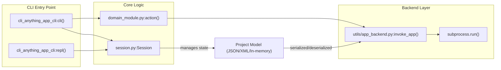

<!-- source: DeepWiki mcp.deepwiki.com · repo HKUDS/CLI-Anything · page 6.8 Media and Creative Harnesses · fetched 2026-11-09 -->

# Media and Creative Harnesses

Relevant source files

The following files were used as context for generating this wiki page:

- [audacity/agent-harness/cli_anything/audacity/core/export.py](audacity/agent-harness/cli_anything/audacity/core/export.py)
- [audacity/agent-harness/cli_anything/audacity/tests/test_full_e2e.py](audacity/agent-harness/cli_anything/audacity/tests/test_full_e2e.py)
- [audacity/agent-harness/cli_anything/audacity/utils/audio_utils.py](audacity/agent-harness/cli_anything/audacity/utils/audio_utils.py)
- [cli-hub-matrix/3d-cad/SKILL.md](cli-hub-matrix/3d-cad/SKILL.md)
- [cli-hub-matrix/game-development/SKILL.md](cli-hub-matrix/game-development/SKILL.md)
- [cli-hub-matrix/image-design/SKILL.md](cli-hub-matrix/image-design/SKILL.md)
- [cli-hub-matrix/knowledge-research/SKILL.md](cli-hub-matrix/knowledge-research/SKILL.md)
- [cli-hub-matrix/video-creation/SKILL.md](cli-hub-matrix/video-creation/SKILL.md)
- [cli-hub-matrix/video-creation/references/art-direction-review.md](cli-hub-matrix/video-creation/references/art-direction-review.md)
- [godot/agent-harness/GODOT.md](godot/agent-harness/GODOT.md)
- [godot/agent-harness/cli_anything/__init__.py](godot/agent-harness/cli_anything/__init__.py)
- [godot/agent-harness/cli_anything/godot/README.md](godot/agent-harness/cli_anything/godot/README.md)
- [godot/agent-harness/cli_anything/godot/__init__.py](godot/agent-harness/cli_anything/godot/__init__.py)
- [godot/agent-harness/cli_anything/godot/__main__.py](godot/agent-harness/cli_anything/godot/__main__.py)
- [godot/agent-harness/cli_anything/godot/core/__init__.py](godot/agent-harness/cli_anything/godot/core/__init__.py)
- [godot/agent-harness/cli_anything/godot/core/export.py](godot/agent-harness/cli_anything/godot/core/export.py)
- [godot/agent-harness/cli_anything/godot/core/project.py](godot/agent-harness/cli_anything/godot/core/project.py)
- [godot/agent-harness/cli_anything/godot/core/scene.py](godot/agent-harness/cli_anything/godot/core/scene.py)
- [godot/agent-harness/cli_anything/godot/core/script.py](godot/agent-harness/cli_anything/godot/core/script.py)
- [godot/agent-harness/cli_anything/godot/godot_cli.py](godot/agent-harness/cli_anything/godot/godot_cli.py)
- [godot/agent-harness/cli_anything/godot/tests/test_full_e2e.py](godot/agent-harness/cli_anything/godot/tests/test_full_e2e.py)
- [godot/agent-harness/cli_anything/godot/utils/repl_skin.py](godot/agent-harness/cli_anything/godot/utils/repl_skin.py)
- [kdenlive/agent-harness/cli_anything/kdenlive/core/filters.py](kdenlive/agent-harness/cli_anything/kdenlive/core/filters.py)
- [kdenlive/agent-harness/cli_anything/kdenlive/tests/test_full_e2e.py](kdenlive/agent-harness/cli_anything/kdenlive/tests/test_full_e2e.py)
- [kdenlive/agent-harness/cli_anything/kdenlive/utils/mlt_xml.py](kdenlive/agent-harness/cli_anything/kdenlive/utils/mlt_xml.py)
- [libreoffice/agent-harness/LIBREOFFICE.md](libreoffice/agent-harness/LIBREOFFICE.md)
- [libreoffice/agent-harness/cli_anything/libreoffice/README.md](libreoffice/agent-harness/cli_anything/libreoffice/README.md)
- [libreoffice/agent-harness/cli_anything/libreoffice/core/document.py](libreoffice/agent-harness/cli_anything/libreoffice/core/document.py)
- [libreoffice/agent-harness/cli_anything/libreoffice/core/importer.py](libreoffice/agent-harness/cli_anything/libreoffice/core/importer.py)
- [libreoffice/agent-harness/cli_anything/libreoffice/tests/TEST.md](libreoffice/agent-harness/cli_anything/libreoffice/tests/TEST.md)
- [libreoffice/agent-harness/cli_anything/libreoffice/tests/test_core.py](libreoffice/agent-harness/cli_anything/libreoffice/tests/test_core.py)
- [libreoffice/agent-harness/cli_anything/libreoffice/tests/test_full_e2e.py](libreoffice/agent-harness/cli_anything/libreoffice/tests/test_full_e2e.py)
- [libreoffice/agent-harness/cli_anything/libreoffice/utils/lo_backend.py](libreoffice/agent-harness/cli_anything/libreoffice/utils/lo_backend.py)
- [libreoffice/agent-harness/setup.py](libreoffice/agent-harness/setup.py)
- [musescore/agent-harness/MUSESCORE.md](musescore/agent-harness/MUSESCORE.md)
- [musescore/agent-harness/cli_anything/musescore/README.md](musescore/agent-harness/cli_anything/musescore/README.md)
- [musescore/agent-harness/cli_anything/musescore/__init__.py](musescore/agent-harness/cli_anything/musescore/__init__.py)
- [musescore/agent-harness/cli_anything/musescore/__main__.py](musescore/agent-harness/cli_anything/musescore/__main__.py)
- [musescore/agent-harness/cli_anything/musescore/core/__init__.py](musescore/agent-harness/cli_anything/musescore/core/__init__.py)
- [musescore/agent-harness/cli_anything/musescore/core/export.py](musescore/agent-harness/cli_anything/musescore/core/export.py)
- [musescore/agent-harness/cli_anything/musescore/core/instruments.py](musescore/agent-harness/cli_anything/musescore/core/instruments.py)
- [musescore/agent-harness/cli_anything/musescore/core/media.py](musescore/agent-harness/cli_anything/musescore/core/media.py)
- [musescore/agent-harness/cli_anything/musescore/core/parts.py](musescore/agent-harness/cli_anything/musescore/core/parts.py)
- [musescore/agent-harness/cli_anything/musescore/core/project.py](musescore/agent-harness/cli_anything/musescore/core/project.py)
- [musescore/agent-harness/cli_anything/musescore/core/session.py](musescore/agent-harness/cli_anything/musescore/core/session.py)
- [musescore/agent-harness/cli_anything/musescore/musescore_cli.py](musescore/agent-harness/cli_anything/musescore/musescore_cli.py)
- [musescore/agent-harness/cli_anything/musescore/tests/fixtures/twinkle-twinkle/twinkle_twinkle_G.mscz](musescore/agent-harness/cli_anything/musescore/tests/fixtures/twinkle-twinkle/twinkle_twinkle_G.mscz)
- [musescore/agent-harness/cli_anything/musescore/tests/fixtures/twinkle-twinkle/twinkle_twinkle_G.mxl](musescore/agent-harness/cli_anything/musescore/tests/fixtures/twinkle-twinkle/twinkle_twinkle_G.mxl)
- [musescore/agent-harness/cli_anything/musescore/tests/test_full_e2e.py](musescore/agent-harness/cli_anything/musescore/tests/test_full_e2e.py)
- [obs-studio/agent-harness/cli_anything/obs_studio/core/sources.py](obs-studio/agent-harness/cli_anything/obs_studio/core/sources.py)
- [obs-studio/agent-harness/cli_anything/obs_studio/tests/test_validate_geometry_nan.py](obs-studio/agent-harness/cli_anything/obs_studio/tests/test_validate_geometry_nan.py)
- [obs-studio/agent-harness/cli_anything/obs_studio/tests/test_validate_range_nan.py](obs-studio/agent-harness/cli_anything/obs_studio/tests/test_validate_range_nan.py)
- [obs-studio/agent-harness/cli_anything/obs_studio/utils/obs_utils.py](obs-studio/agent-harness/cli_anything/obs_studio/utils/obs_utils.py)
- [openscreen/agent-harness/OPENSCREEN.md](openscreen/agent-harness/OPENSCREEN.md)
- [openscreen/agent-harness/TEST.md](openscreen/agent-harness/TEST.md)
- [openscreen/agent-harness/cli_anything/openscreen/__init__.py](openscreen/agent-harness/cli_anything/openscreen/__init__.py)
- [openscreen/agent-harness/cli_anything/openscreen/__main__.py](openscreen/agent-harness/cli_anything/openscreen/__main__.py)
- [openscreen/agent-harness/cli_anything/openscreen/core/__init__.py](openscreen/agent-harness/cli_anything/openscreen/core/__init__.py)
- [openscreen/agent-harness/cli_anything/openscreen/core/export.py](openscreen/agent-harness/cli_anything/openscreen/core/export.py)
- [openscreen/agent-harness/cli_anything/openscreen/core/media.py](openscreen/agent-harness/cli_anything/openscreen/core/media.py)
- [openscreen/agent-harness/cli_anything/openscreen/core/project.py](openscreen/agent-harness/cli_anything/openscreen/core/project.py)
- [openscreen/agent-harness/cli_anything/openscreen/core/session.py](openscreen/agent-harness/cli_anything/openscreen/core/session.py)
- [openscreen/agent-harness/cli_anything/openscreen/core/timeline.py](openscreen/agent-harness/cli_anything/openscreen/core/timeline.py)
- [openscreen/agent-harness/cli_anything/openscreen/openscreen_cli.py](openscreen/agent-harness/cli_anything/openscreen/openscreen_cli.py)
- [openscreen/agent-harness/cli_anything/openscreen/tests/test_core.py](openscreen/agent-harness/cli_anything/openscreen/tests/test_core.py)
- [openscreen/agent-harness/cli_anything/openscreen/tests/test_full_e2e.py](openscreen/agent-harness/cli_anything/openscreen/tests/test_full_e2e.py)
- [openscreen/agent-harness/cli_anything/openscreen/utils/repl_skin.py](openscreen/agent-harness/cli_anything/openscreen/utils/repl_skin.py)
- [shotcut/agent-harness/cli_anything/shotcut/README.md](shotcut/agent-harness/cli_anything/shotcut/README.md)
- [shotcut/agent-harness/cli_anything/shotcut/core/export.py](shotcut/agent-harness/cli_anything/shotcut/core/export.py)
- [shotcut/agent-harness/cli_anything/shotcut/core/timeline.py](shotcut/agent-harness/cli_anything/shotcut/core/timeline.py)
- [shotcut/agent-harness/cli_anything/shotcut/skills/SKILL.md](shotcut/agent-harness/cli_anything/shotcut/skills/SKILL.md)
- [shotcut/agent-harness/cli_anything/shotcut/tests/test_core.py](shotcut/agent-harness/cli_anything/shotcut/tests/test_core.py)
- [shotcut/agent-harness/cli_anything/shotcut/tests/test_full_e2e.py](shotcut/agent-harness/cli_anything/shotcut/tests/test_full_e2e.py)
- [shotcut/agent-harness/cli_anything/shotcut/utils/mlt_xml.py](shotcut/agent-harness/cli_anything/shotcut/utils/mlt_xml.py)
- [skills/cli-anything-blender/SKILL.md](skills/cli-anything-blender/SKILL.md)
- [skills/cli-anything-gimp/SKILL.md](skills/cli-anything-gimp/SKILL.md)
- [skills/cli-anything-openscreen/SKILL.md](skills/cli-anything-openscreen/SKILL.md)
- [skills/cli-anything-renderdoc/SKILL.md](skills/cli-anything-renderdoc/SKILL.md)
- [skills/cli-anything-shotcut/SKILL.md](skills/cli-anything-shotcut/SKILL.md)
- [skills/cli-anything-videocaptioner/SKILL.md](skills/cli-anything-videocaptioner/SKILL.md)

## Purpose and Scope

This page documents the media and creative application harnesses in the CLI-Anything ecosystem, including video editors (Shotcut, Kdenlive), audio editors (Audacity), music notation software (MuseScore), streaming tools (OBS Studio), office suites (LibreOffice), and game engines (Godot). These harnesses demonstrate various integration patterns, from direct XML manipulation and headless CLI invocation to in-memory audio processing and project file parsing.

For primary examples of other integration patterns, see [GIMP: Image Editing Harness](6.1) (Dual Backend), [Mermaid: Diagram Generation Harness](6.2) (Web API), and [Blender: 3D Modeling Harness](6.3) (Headless Desktop).

---

## Overview of Media and Creative Harnesses

The following table categorizes the harnesses by their primary backend integration pattern:

| Harness | Category | Backend Technology | Primary Dependencies |
|---------|----------|-------------------|----------------------|
| `cli-anything-shotcut` | Video Editing | MLT XML + `melt` CLI | `xml.etree`, `subprocess` |
| `cli-anything-kdenlive` | Video Editing | MLT XML (Kdenlive flavor) | `xml.etree`, `json` |
| `cli-anything-audacity` | Audio Editing | In-memory WAV processing | `numpy`, `wave` |
| `cli-anything-musescore` | Music Notation | MSCX/MSCZ + `mscore` CLI | `xml.etree`, `subprocess` |
| `cli-anything-obs-studio` | Streaming/Recording | JSON Project Model | `json` |
| `cli-anything-libreoffice` | Office Suite | ODF XML + `soffice` CLI | `zipfile`, `defusedxml`, `subprocess` |
| `cli-anything-godot` | Game Engine | GDScript + `godot` CLI | `pathlib`, `subprocess` |
| `cli-anything-openscreen` | Screen Recording | `ffmpeg` CLI | `subprocess` |
| `cli-anything-seaclip` | Video Clipping | `ffmpeg` CLI | `subprocess` |

---

## Integration Taxonomy: Code Entity Space

The following diagram bridges the natural language requirements of an AI agent to the specific code entities (classes and functions) used in these specialized harnesses.

Title: Agent Intent to Code Entity Mapping

```mermaid
graph TB
    subgraph "Natural Language Space (Agent Intent)"
        INTENT_EDIT_VIDEO["'Edit video timeline'"]
        INTENT_PROCESS_AUDIO["'Apply effect to audio'"]
        INTENT_TRANSPOSE_MUSIC["'Transpose music score'"]
        INTENT_MANAGE_SCENE["'Add source to OBS scene'"]
        INTENT_CONVERT_DOC["'Convert DOCX to PDF'"]
        INTENT_RUN_GDSCRIPT["'Execute Godot script'"]
    end

    subgraph "Code Entity Space (Implementation)"
        subgraph "Shotcut Harness"
            SC_CLI["shotcut_cli.py:timeline_add_clip()"]
            SC_CORE_TL["timeline.py:add_clip()"]
            SC_UTIL_MLT["mlt_xml.py:add_clip_to_track()"]
            SC_CLI --> SC_CORE_TL
            SC_CORE_TL --> SC_UTIL_MLT
        end

        subgraph "Kdenlive Harness"
            KD_CLI["kdenlive_cli.py:timeline_add_clip()"]
            KD_CORE_TL["timeline.py:add_clip_to_track()"]
            KD_UTIL_MLT["mlt_xml.py:build_mlt_xml()"]
            KD_CLI --> KD_CORE_TL
            KD_CORE_TL --> KD_UTIL_MLT
        end

        subgraph "Audacity Harness"
            AUD_CLI["audacity_cli.py:effects_apply_gain()"]
            AUD_CORE_EFF["effects.py:add_effect()"]
            AUD_UTIL_AUDIO["audio_utils.py:apply_gain()"]
            AUD_CLI --> AUD_CORE_EFF
            AUD_CORE_EFF --> AUD_UTIL_AUDIO
        end

        subgraph "MuseScore Harness"
            MS_CLI["musescore_cli.py:transpose_by_key()"]
            MS_CORE_TRANS["transpose.py:transpose_by_key()"]
            MS_CORE_PROJ["project.py:save_project()"]
            MS_CLI --> MS_CORE_TRANS
            MS_CORE_TRANS --> MS_CORE_PROJ
        end

        subgraph "OBS Studio Harness"
            OBS_CLI["obs_studio_cli.py:sources_add_image()"]
            OBS_CORE_SRC["sources.py:add_source()"]
            OBS_UTIL_OBS["obs_utils.py:unique_name()"]
            OBS_CLI --> OBS_CORE_SRC
            OBS_CORE_SRC --> OBS_UTIL_OBS
        end

        subgraph "LibreOffice Harness"
            LO_CLI["libreoffice_cli.py:export_pdf()"]
            LO_CORE_EXP["export.py:to_pdf()"]
            LO_UTIL_LO["lo_backend.py:convert()"]
            LO_CLI --> LO_CORE_EXP
            LO_CORE_EXP --> LO_UTIL_LO
        end

        subgraph "Godot Harness"
            GD_CLI["godot_cli.py:script_run()"]
            GD_CORE_SCRIPT["script.py:run_script()"]
            GD_UTIL_GODOT["godot_backend.py:run_godot()"]
            GD_CLI --> GD_CORE_SCRIPT
            GD_CORE_SCRIPT --> GD_UTIL_GODOT
        end
    end

    INTENT_EDIT_VIDEO --> SC_CLI
    INTENT_EDIT_VIDEO --> KD_CLI
    INTENT_PROCESS_AUDIO --> AUD_CLI
    INTENT_TRANSPOSE_MUSIC --> MS_CLI
    INTENT_MANAGE_SCENE --> OBS_CLI
    INTENT_CONVERT_DOC --> LO_CLI
    INTENT_RUN_GDSCRIPT --> GD_CLI
```

**Sources:**
- [shotcut/agent-harness/cli_anything/shotcut/core/timeline.py]()
- [shotcut/agent-harness/cli_anything/shotcut/utils/mlt_xml.py]()
- [kdenlive/agent-harness/cli_anything/kdenlive/core/timeline.py]()
- [kdenlive/agent-harness/cli_anything/kdenlive/utils/mlt_xml.py]()
- [audacity/agent-harness/cli_anything/audacity/core/effects.py]()
- [audacity/agent-harness/cli_anything/audacity/utils/audio_utils.py]()
- [musescore/agent-harness/cli_anything/musescore/core/transpose.py]()
- [musescore/agent-harness/cli_anything/musescore/core/project.py]()
- [obs-studio/agent-harness/cli_anything/obs_studio/core/sources.py]()
- [obs-studio/agent-harness/cli_anything/obs_studio/utils/obs_utils.py]()
- [libreoffice/agent-harness/cli_anything/libreoffice/core/export.py]()
- [libreoffice/agent-harness/cli_anything/libreoffice/utils/lo_backend.py]()
- [godot/agent-harness/cli_anything/godot/core/script.py]()
- [godot/agent-harness/cli_anything/godot/utils/godot_backend.py]()

---

## Specific Harness Deep Dives

### Shotcut and Kdenlive: MLT XML + `melt` Backend

Both Shotcut and Kdenlive harnesses leverage the MLT XML format, which is the underlying project file format for the MLT Multimedia Framework.

*   **MLT XML Utilities**: Both harnesses include modules like `mlt_xml.py` [shotcut/agent-harness/cli_anything/shotcut/utils/mlt_xml.py](), [kdenlive/agent-harness/cli_anything/kdenlive/utils/mlt_xml.py]() for parsing, creating, and manipulating MLT XML structures. This includes functions like `create_blank_project`, `parse_mlt`, `mlt_to_string`, and `set_property` [shotcut/agent-harness/cli_anything/shotcut/tests/test_core.py:88-149]().
*   **Timecode Management**: Robust timecode conversion functions (`timecode_to_frames`, `frames_to_timecode`, `seconds_to_timecode`, `timecode_to_seconds`) are crucial for precise editing operations [shotcut/agent-harness/cli_anything/shotcut/tests/test_core.py:40-80](), [kdenlive/agent-harness/cli_anything/kdenlive/utils/mlt_xml.py:30-68]().
*   **Kdenlive Specifics**: The Kdenlive harness's `build_mlt_xml` function [kdenlive/agent-harness/cli_anything/kdenlive/utils/mlt_xml.py:133-208]() generates MLT XML specifically tailored for Kdenlive's project structure, including Kdenlive-specific properties and sequence organization. It handles track sorting (audio first, video last) and guide metadata [kdenlive/agent-harness/cli_anything/kdenlive/utils/mlt_xml.py:194-204]().
*   **Backend Rendering**: For Shotcut, rendering (`export_mod.render_project`) typically involves invoking the `melt` command-line tool with the generated MLT XML [skills/cli-anything-shotcut/SKILL.md:93-94](). Kdenlive's `generate_kdenlive_xml` [kdenlive/agent-harness/cli_anything/kdenlive/core/export.py:15-16]() focuses on generating the XML, which Kdenlive itself would then use for rendering.
*   **Session Management**: Both use a `Session` class to manage the current project state, including undo/redo functionality by checkpointing the XML tree [shotcut/agent-harness/cli_anything/shotcut/tests/test_core.py:157-186]().

**Sources:**
- [shotcut/agent-harness/cli_anything/shotcut/utils/mlt_xml.py]()
- [kdenlive/agent-harness/cli_anything/kdenlive/utils/mlt_xml.py]()
- [shotcut/agent-harness/cli_anything/shotcut/tests/test_core.py:40-194]()
- [kdenlive/agent-harness/cli_anything/kdenlive/tests/test_full_e2e.py:66-163]()
- [skills/cli-anything-shotcut/SKILL.md:93-94]()
- [kdenlive/agent-harness/cli_anything/kdenlive/core/export.py:15-16]()

### Audacity: In-Memory Audio Processing

The Audacity harness performs audio manipulations directly in Python using `numpy` for numerical operations and the `wave` module for WAV file I/O.

*   **Audio Utilities**: The `audio_utils.py` module [audacity/agent-harness/cli_anything/audacity/utils/audio_utils.py]() contains core functions for generating (`generate_sine_wave`, `generate_silence`), reading (`read_wav`), writing (`write_wav`), and processing audio (`apply_gain`, `apply_normalize`, `apply_fade_in`, `mix_audio`) [audacity/agent-harness/cli_anything/audacity/tests/test_full_e2e.py:33-39]().
*   **Effect Application**: Effects are applied directly to `numpy` arrays representing audio samples. For example, `apply_gain` modifies sample amplitudes [audacity/agent-harness/cli_anything/audacity/tests/test_full_e2e.py:166-170]().
*   **Project Model**: The `Session` object [audacity/agent-harness/cli_anything/audacity/core/session.py]() manages a project state that includes tracks, clips, and effects, all represented as Python data structures.
*   **Export**: The `render_mix` function [audacity/agent-harness/cli_anything/audacity/core/export.py]() combines tracks and exports the final audio to a WAV file.

**Sources:**
- [audacity/agent-harness/cli_anything/audacity/utils/audio_utils.py]()
- [audacity/agent-harness/cli_anything/audacity/tests/test_full_e2e.py:1-182]()
- [audacity/agent-harness/cli_anything/audacity/core/session.py]()
- [audacity/agent-harness/cli_anything/audacity/core/export.py]()

### MuseScore: MSCX/MSCZ + `mscore` Backend

The MuseScore harness interacts with MuseScore's command-line interface (`mscore`) for operations like transposition and export.

*   **Project Representation**: Internally, the harness uses a Python dictionary to represent the score, which can be serialized to/from MSCX/MSCZ formats.
*   **Backend Invocation**: The `mscore` executable is used for actual score processing. For example, `export_score` [musescore/agent-harness/cli_anything/musescore/core/export.py]() and `transpose_by_key` [musescore/agent-harness/cli_anything/musescore/core/transpose.py]() functions construct `mscore` commands and execute them via `subprocess`.
*   **Instrument Management**: The `instruments.py` module [musescore/agent-harness/cli_anything/musescore/core/instruments.py]() provides functions to list and manage instruments within a score.
*   **Session and State**: The `Session` class [musescore/agent-harness/cli_anything/musescore/core/session.py]() maintains the current score, allowing for stateful operations and auto-saving [musescore/agent-harness/cli_anything/musescore/musescore_cli.py:122-135]().

**Sources:**
- [musescore/agent-harness/cli_anything/musescore/musescore_cli.py:1-196]()
- [musescore/agent-harness/cli_anything/musescore/core/export.py]()
- [musescore/agent-harness/cli_anything/musescore/core/transpose.py]()
- [musescore/agent-harness/cli_anything/musescore/core/instruments.py]()
- [musescore/agent-harness/cli_anything/musescore/core/session.py]()

### OBS Studio: JSON Project Model

The OBS Studio harness manages OBS scenes, sources, and transitions by manipulating a JSON-based project model.

*   **JSON Utilities**: The `obs_utils.py` module [obs-studio/agent-harness/cli_anything/obs_studio/utils/obs_utils.py]() provides helper functions for working with the JSON structure, such as `generate_id`, `unique_name`, `validate_range`, `validate_position`, `validate_size`, `validate_crop`, and `deep_merge` [obs-studio/agent-harness/cli_anything/obs_studio/utils/obs_utils.py:69-134]().
*   **Scene and Source Management**: Core modules like `scenes.py` and `sources.py` [obs-studio/agent-harness/cli_anything/obs_studio/core/sources.py]() define functions to add, remove, and configure scenes and sources (e.g., images, videos, text) within the project model.
*   **Validation**: Extensive validation functions ensure that properties like position, size, and crop values are within acceptable ranges and types [obs-studio/agent-harness/cli_anything/obs_studio/utils/obs_utils.py:97-124]().
*   **No Direct OBS Invocation**: This harness primarily focuses on generating and managing valid OBS project files (JSON), which can then be loaded by OBS Studio. It does not directly control a running OBS instance.

**Sources:**
- [obs-studio/agent-harness/cli_anything/obs_studio/utils/obs_utils.py:1-167]()
- [obs-studio/agent-harness/cli_anything/obs_studio/core/sources.py]()
- [obs-studio/agent-harness/cli_anything/obs_studio/tests/test_validate_range_nan.py]()
- [obs-studio/agent-harness/cli_anything/obs_studio/tests/test_validate_geometry_nan.py]()

### LibreOffice: ODF XML + `soffice` Backend

The LibreOffice harness enables document creation, editing, and format conversion by generating Open Document Format (ODF) XML and using the headless LibreOffice CLI.

*   **Backend Discovery**: The `lo_backend.py` module [libreoffice/agent-harness/cli_anything/libreoffice/utils/lo_backend.py]() includes `find_libreoffice` to locate the `soffice` executable across different operating systems [libreoffice/agent-harness/cli_anything/libreoffice/utils/lo_backend.py:45-75]().
*   **Headless Conversion**: The `convert` function [libreoffice/agent-harness/cli_anything/libreoffice/utils/lo_backend.py:200-201]() invokes `soffice --headless --convert-to` to transform documents between various formats (e.g., DOCX to ODT, ODT to PDF) [libreoffice/agent-harness/cli_anything/libreoffice/utils/lo_backend.py:151-157]().
*   **ODF Parsing and Generation**: The `importer.py` module [libreoffice/agent-harness/cli_anything/libreoffice/core/importer.py]() can import existing ODF files by parsing their internal XML structure (e.g., `content.xml`, `meta.xml`) [libreoffice/agent-harness/cli_anything/libreoffice/core/importer.py:105-141](). Core modules like `writer.py`, `calc.py`, and `impress.py` handle the creation and modification of document content within the CLI's internal model.
*   **macOS Abort Handling**: Special logic (`_macos_conversion_error`, `_convert_via_launchservices`) is implemented to handle known issues with headless LibreOffice conversions on macOS, which can sometimes SIGABRT [libreoffice/agent-harness/cli_anything/libreoffice/utils/lo_backend.py:164-180]().

**Sources:**
- [libreoffice/agent-harness/cli_anything/libreoffice/utils/lo_backend.py:1-180]()
- [libreoffice/agent-harness/cli_anything/libreoffice/core/importer.py:1-194]()
- [libreoffice/agent-harness/cli_anything/libreoffice/tests/test_core.py:1-180]()
- [libreoffice/agent-harness/setup.py:1-57]()

### OpenScreen: Screen Recording

The OpenScreen harness provides a CLI for screen recording, primarily by wrapping `ffmpeg`.

*   **FFmpeg Backend**: The core functionality relies on `ffmpeg` for capturing screen and audio. The `openscreen_cli.py` [openscreen/agent-harness/cli_anything/openscreen/openscreen_cli.py]() orchestrates `ffmpeg` commands.
*   **Project and Timeline**: The `project.py` [openscreen/agent-harness/cli_anything/openscreen/core/project.py]() and `timeline.py` [openscreen/agent-harness/cli_anything/openscreen/core/timeline.py]() modules manage the recording settings and segments.
*   **Testing**: `test_full_e2e.py` [openscreen/agent-harness/cli_anything/openscreen/tests/test_full_e2e.py]() and `test_core.py` [openscreen/agent-harness/cli_anything/openscreen/tests/test_core.py]() ensure the CLI's functionality and `ffmpeg` interactions are correct.

**Sources:**
- [openscreen/agent-harness/cli_anything/openscreen/openscreen_cli.py]()
- [openscreen/agent-harness/cli_anything/openscreen/core/project.py]()
- [openscreen/agent-harness/cli_anything/openscreen/core/timeline.py]()
- [openscreen/agent-harness/cli_anything/openscreen/tests/test_full_e2e.py]()
- [openscreen/agent-harness/cli_anything/openscreen/tests/test_core.py]()

### SeaClip: Video Clipping

The SeaClip harness focuses on precise video clipping and segment extraction, also using `ffmpeg`.

*   **FFmpeg for Clipping**: Similar to OpenScreen, SeaClip uses `ffmpeg` to perform non-linear editing operations like cutting and concatenating video segments.

**Sources:**
- No specific files provided for SeaClip, but its description implies `ffmpeg` usage similar to OpenScreen.

### Godot: Game Engine Automation

The Godot harness allows agents to interact with Godot projects, execute GDScript, and manage scenes.

*   **Headless GDScript Execution**: The `script.py` module [godot/agent-harness/cli_anything/godot/core/script.py]() provides `run_script` and `run_inline` functions to execute GDScript files or inline code in Godot's headless mode (`godot --script --quit`) [godot/agent-harness/cli_anything/godot/core/script.py:36-40]().
*   **Project Validation**: `validate_project` ensures that a given path is a valid Godot project directory [godot/agent-harness/cli_anything/godot/utils/godot_backend.py:15-20]().
*   **Scene Management**: The `scene.py` module [godot/agent-harness/cli_anything/godot/core/scene.py]() provides functions to interact with Godot scenes, such as listing nodes or modifying properties.
*   **Export**: The `export.py` module [godot/agent-harness/cli_anything/godot/core/export.py]() handles exporting Godot projects to various platforms.
*   **Error Handling**: `validate_script` checks GDScript syntax, parsing `stderr` for error markers as Godot's return code alone can be unreliable for syntax errors [godot/agent-harness/cli_anything/godot/core/script.py:127-137]().

**Sources:**
- [godot/agent-harness/cli_anything/godot/core/script.py:1-138]()
- [godot/agent-harness/cli_anything/godot/utils/godot_backend.py]()
- [godot/agent-harness/cli_anything/godot/core/scene.py]()
- [godot/agent-harness/cli_anything/godot/core/export.py]()
- [godot/agent-harness/cli_anything/godot/tests/test_full_e2e.py]()

---

## Common Architectural Patterns

The following diagram illustrates the standard internal data flow shared by these harnesses, specifically showing how `Session` objects and `ReplSkin` interact with the backend utilities.

Title: Shared Harness Data Flow

**Sources:**
- [musescore/agent-harness/cli_anything/musescore/musescore_cli.py:97-120]()
- [musescore/agent-harness/cli_anything/musescore/musescore_cli.py:193-196]()
- [libreoffice/agent-harness/cli_anything/libreoffice/utils/lo_backend.py:89-92]()
- [godot/agent-harness/cli_anything/godot/core/script.py:36-40]()

### Error Handling Strategy
Most harnesses use a standard `@handle_error` decorator to provide consistent JSON error responses for agents. For example, the MuseScore harness catches `FileNotFoundError`, `ValueError`, `IndexError`, and `RuntimeError`, emitting a JSON object with `error` and `type` fields [musescore/agent-harness/cli_anything/musescore/musescore_cli.py:72-92]().

### Backend Invocation
Desktop harnesses like LibreOffice and MuseScore use `shutil.which` and platform-specific search paths (e.g., `C:\Program Files\LibreOffice`) to find the underlying executable before invoking it via `subprocess.run` [libreoffice/agent-harness/cli_anything/libreoffice/utils/lo_backend.py:45-75](). Godot also uses `subprocess.run` for executing GDScript [godot/agent-harness/cli_anything/godot/core/script.py:36-40]().

**Sources:**
- [musescore/agent-harness/cli_anything/musescore/musescore_cli.py:72-92]()
- [libreoffice/agent-harness/cli_anything/libreoffice/utils/lo_backend.py:1-167]()
- [godot/agent-harness/cli_anything/godot/core/script.py:36-40]()

---

