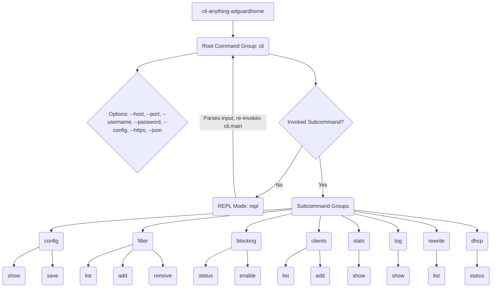

<!-- source: DeepWiki mcp.deepwiki.com · repo HKUDS/CLI-Anything · page 6.9 Web, API and SaaS Harnesses · fetched 2026-11-09 -->

# Web, API and SaaS Harnesses

<details>
<summary>Relevant source files</summary>

The following files were used as context for generating this wiki page:

- [QGIS/agent-harness/QGIS.md](QGIS/agent-harness/QGIS.md)
- [QGIS/agent-harness/cli_anything/qgis/README.md](QGIS/agent-harness/cli_anything/qgis/README.md)
- [QGIS/agent-harness/cli_anything/qgis/__init__.py](QGIS/agent-harness/cli_anything/qgis/__init__.py)
- [QGIS/agent-harness/cli_anything/qgis/__main__.py](QGIS/agent-harness/cli_anything/qgis/__main__.py)
- [QGIS/agent-harness/cli_anything/qgis/core/__init__.py](QGIS/agent-harness/cli_anything/qgis/core/__init__.py)
- [QGIS/agent-harness/cli_anything/qgis/core/export.py](QGIS/agent-harness/cli_anything/qgis/core/export.py)
- [QGIS/agent-harness/cli_anything/qgis/core/features.py](QGIS/agent-harness/cli_anything/qgis/core/features.py)
- [QGIS/agent-harness/cli_anything/qgis/core/layers.py](QGIS/agent-harness/cli_anything/qgis/core/layers.py)
- [QGIS/agent-harness/cli_anything/qgis/core/layouts.py](QGIS/agent-harness/cli_anything/qgis/core/layouts.py)
- [QGIS/agent-harness/cli_anything/qgis/core/processing.py](QGIS/agent-harness/cli_anything/qgis/core/processing.py)
- [QGIS/agent-harness/cli_anything/qgis/qgis_cli.py](QGIS/agent-harness/cli_anything/qgis/qgis_cli.py)
- [QGIS/agent-harness/cli_anything/qgis/utils/repl_skin.py](QGIS/agent-harness/cli_anything/qgis/utils/repl_skin.py)
- [adguardhome/agent-harness/cli_anything/adguardhome/adguardhome_cli.py](adguardhome/agent-harness/cli_anything/adguardhome/adguardhome_cli.py)
- [adguardhome/agent-harness/cli_anything/adguardhome/core/filtering.py](adguardhome/agent-harness/cli_anything/adguardhome/core/filtering.py)
- [adguardhome/agent-harness/cli_anything/adguardhome/core/project.py](adguardhome/agent-harness/cli_anything/adguardhome/core/project.py)
- [adguardhome/agent-harness/cli_anything/adguardhome/tests/test_core.py](adguardhome/agent-harness/cli_anything/adguardhome/tests/test_core.py)
- [adguardhome/agent-harness/cli_anything/adguardhome/tests/test_full_e2e.py](adguardhome/agent-harness/cli_anything/adguardhome/tests/test_full_e2e.py)
- [adguardhome/agent-harness/cli_anything/adguardhome/utils/adguardhome_backend.py](adguardhome/agent-harness/cli_anything/adguardhome/utils/adguardhome_backend.py)
- [cc-switch/agent-harness/CCSWITCH.md](cc-switch/agent-harness/CCSWITCH.md)
- [cc-switch/agent-harness/cli_anything/ccswitch/README.md](cc-switch/agent-harness/cli_anything/ccswitch/README.md)
- [cc-switch/agent-harness/cli_anything/ccswitch/__init__.py](cc-switch/agent-harness/cli_anything/ccswitch/__init__.py)
- [cc-switch/agent-harness/cli_anything/ccswitch/__main__.py](cc-switch/agent-harness/cli_anything/ccswitch/__main__.py)
- [cc-switch/agent-harness/cli_anything/ccswitch/ccswitch_cli.py](cc-switch/agent-harness/cli_anything/ccswitch/ccswitch_cli.py)
- [cc-switch/agent-harness/cli_anything/ccswitch/core/__init__.py](cc-switch/agent-harness/cli_anything/ccswitch/core/__init__.py)
- [cc-switch/agent-harness/cli_anything/ccswitch/skills/SKILL.md](cc-switch/agent-harness/cli_anything/ccswitch/skills/SKILL.md)
- [cc-switch/agent-harness/cli_anything/ccswitch/tests/TEST.md](cc-switch/agent-harness/cli_anything/ccswitch/tests/TEST.md)
- [cc-switch/agent-harness/cli_anything/ccswitch/tests/test_core.py](cc-switch/agent-harness/cli_anything/ccswitch/tests/test_core.py)
- [cc-switch/agent-harness/cli_anything/ccswitch/tests/test_full_e2e.py](cc-switch/agent-harness/cli_anything/ccswitch/tests/test_full_e2e.py)
- [comfyui/agent-harness/cli_anything/comfyui/comfyui_cli.py](comfyui/agent-harness/cli_anything/comfyui/comfyui_cli.py)
- [comfyui/agent-harness/cli_anything/comfyui/tests/TEST.md](comfyui/agent-harness/cli_anything/comfyui/tests/TEST.md)
- [comfyui/agent-harness/cli_anything/comfyui/tests/test_core.py](comfyui/agent-harness/cli_anything/comfyui/tests/test_core.py)
- [dify-workflow/agent-harness/DIFY_WORKFLOW.md](dify-workflow/agent-harness/DIFY_WORKFLOW.md)
- [dify-workflow/agent-harness/MANIFEST.in](dify-workflow/agent-harness/MANIFEST.in)
- [dify-workflow/agent-harness/cli_anything/dify_workflow/README.md](dify-workflow/agent-harness/cli_anything/dify_workflow/README.md)
- [dify-workflow/agent-harness/cli_anything/dify_workflow/__init__.py](dify-workflow/agent-harness/cli_anything/dify_workflow/__init__.py)
- [dify-workflow/agent-harness/cli_anything/dify_workflow/__main__.py](dify-workflow/agent-harness/cli_anything/dify_workflow/__main__.py)
- [dify-workflow/agent-harness/cli_anything/dify_workflow/dify_workflow_cli.py](dify-workflow/agent-harness/cli_anything/dify_workflow/dify_workflow_cli.py)
- [dify-workflow/agent-harness/cli_anything/dify_workflow/skills/SKILL.md](dify-workflow/agent-harness/cli_anything/dify_workflow/skills/SKILL.md)
- [dify-workflow/agent-harness/cli_anything/dify_workflow/tests/TEST.md](dify-workflow/agent-harness/cli_anything/dify_workflow/tests/TEST.md)
- [dify-workflow/agent-harness/cli_anything/dify_workflow/tests/__init__.py](dify-workflow/agent-harness/cli_anything/dify_workflow/tests/__init__.py)
- [eth2-quickstart/agent-harness/ETH2-QUICKSTART.md](eth2-quickstart/agent-harness/ETH2-QUICKSTART.md)
- [eth2-quickstart/agent-harness/cli_anything/eth2_quickstart/README.md](eth2-quickstart/agent-harness/cli_anything/eth2_quickstart/README.md)
- [eth2-quickstart/agent-harness/cli_anything/eth2_quickstart/__init__.py](eth2-quickstart/agent-harness/cli_anything/eth2_quickstart/__init__.py)
- [eth2-quickstart/agent-harness/cli_anything/eth2_quickstart/__main__.py](eth2-quickstart/agent-harness/cli_anything/eth2_quickstart/__main__.py)
- [eth2-quickstart/agent-harness/cli_anything/eth2_quickstart/core/__init__.py](eth2-quickstart/agent-harness/cli_anything/eth2_quickstart/core/__init__.py)
- [eth2-quickstart/agent-harness/cli_anything/eth2_quickstart/core/commands.py](eth2-quickstart/agent-harness/cli_anything/eth2_quickstart/core/commands.py)
- [eth2-quickstart/agent-harness/cli_anything/eth2_quickstart/core/install.py](eth2-quickstart/agent-harness/cli_anything/eth2_quickstart/core/install.py)
- [eth2-quickstart/agent-harness/cli_anything/eth2_quickstart/core/project.py](eth2-quickstart/agent-harness/cli_anything/eth2_quickstart/core/project.py)
- [eth2-quickstart/agent-harness/cli_anything/eth2_quickstart/core/rpc.py](eth2-quickstart/agent-harness/cli_anything/eth2_quickstart/core/rpc.py)
- [eth2-quickstart/agent-harness/cli_anything/eth2_quickstart/core/status.py](eth2-quickstart/agent-harness/cli_anything/eth2_quickstart/core/status.py)
- [exa/agent-harness/EXA.md](exa/agent-harness/EXA.md)
- [exa/agent-harness/cli_anything/exa/README.md](exa/agent-harness/cli_anything/exa/README.md)
- [exa/agent-harness/cli_anything/exa/core/search.py](exa/agent-harness/cli_anything/exa/core/search.py)
- [exa/agent-harness/cli_anything/exa/exa_cli.py](exa/agent-harness/cli_anything/exa/exa_cli.py)
- [exa/agent-harness/cli_anything/exa/skills/SKILL.md](exa/agent-harness/cli_anything/exa/skills/SKILL.md)
- [exa/agent-harness/cli_anything/exa/tests/TEST.md](exa/agent-harness/cli_anything/exa/tests/TEST.md)
- [exa/agent-harness/cli_anything/exa/tests/test_core.py](exa/agent-harness/cli_anything/exa/tests/test_core.py)
- [exa/agent-harness/cli_anything/exa/tests/test_full_e2e.py](exa/agent-harness/cli_anything/exa/tests/test_full_e2e.py)
- [exa/agent-harness/cli_anything/exa/utils/exa_backend.py](exa/agent-harness/cli_anything/exa/utils/exa_backend.py)
- [exa/agent-harness/setup.py](exa/agent-harness/setup.py)
- [firefly-iii/agent-harness/README.md](firefly-iii/agent-harness/README.md)
- [firefly-iii/agent-harness/cli_anything/firefly_iii/README.md](firefly-iii/agent-harness/cli_anything/firefly_iii/README.md)
- [firefly-iii/agent-harness/cli_anything/firefly_iii/__init__.py](firefly-iii/agent-harness/cli_anything/firefly_iii/__init__.py)
- [firefly-iii/agent-harness/cli_anything/firefly_iii/__main__.py](firefly-iii/agent-harness/cli_anything/firefly_iii/__main__.py)
- [firefly-iii/agent-harness/cli_anything/firefly_iii/core/__init__.py](firefly-iii/agent-harness/cli_anything/firefly_iii/core/__init__.py)
- [firefly-iii/agent-harness/cli_anything/firefly_iii/core/accounts.py](firefly-iii/agent-harness/cli_anything/firefly_iii/core/accounts.py)
- [firefly-iii/agent-harness/cli_anything/firefly_iii/core/autocomplete.py](firefly-iii/agent-harness/cli_anything/firefly_iii/core/autocomplete.py)
- [firefly-iii/agent-harness/cli_anything/firefly_iii/core/bills.py](firefly-iii/agent-harness/cli_anything/firefly_iii/core/bills.py)
- [firefly-iii/agent-harness/cli_anything/firefly_iii/core/budgets.py](firefly-iii/agent-harness/cli_anything/firefly_iii/core/budgets.py)
- [firefly-iii/agent-harness/cli_anything/firefly_iii/core/categories.py](firefly-iii/agent-harness/cli_anything/firefly_iii/core/categories.py)
- [firefly-iii/agent-harness/cli_anything/firefly_iii/core/currencies.py](firefly-iii/agent-harness/cli_anything/firefly_iii/core/currencies.py)
- [firefly-iii/agent-harness/cli_anything/firefly_iii/core/export.py](firefly-iii/agent-harness/cli_anything/firefly_iii/core/export.py)
- [firefly-iii/agent-harness/cli_anything/firefly_iii/core/piggy_banks.py](firefly-iii/agent-harness/cli_anything/firefly_iii/core/piggy_banks.py)
- [firefly-iii/agent-harness/cli_anything/firefly_iii/core/recurrences.py](firefly-iii/agent-harness/cli_anything/firefly_iii/core/recurrences.py)
- [firefly-iii/agent-harness/cli_anything/firefly_iii/core/rule_groups.py](firefly-iii/agent-harness/cli_anything/firefly_iii/core/rule_groups.py)
- [firefly-iii/agent-harness/cli_anything/firefly_iii/core/rules.py](firefly-iii/agent-harness/cli_anything/firefly_iii/core/rules.py)
- [firefly-iii/agent-harness/cli_anything/firefly_iii/core/summary.py](firefly-iii/agent-harness/cli_anything/firefly_iii/core/summary.py)
- [firefly-iii/agent-harness/cli_anything/firefly_iii/core/tags.py](firefly-iii/agent-harness/cli_anything/firefly_iii/core/tags.py)
- [firefly-iii/agent-harness/cli_anything/firefly_iii/core/webhooks.py](firefly-iii/agent-harness/cli_anything/firefly_iii/core/webhooks.py)
- [firefly-iii/agent-harness/cli_anything/firefly_iii/firefly_iii_cli.py](firefly-iii/agent-harness/cli_anything/firefly_iii/firefly_iii_cli.py)
- [firefly-iii/agent-harness/cli_anything/firefly_iii/skills/SKILL.md](firefly-iii/agent-harness/cli_anything/firefly_iii/skills/SKILL.md)
- [firefly-iii/agent-harness/cli_anything/firefly_iii/tests/test_core.py](firefly-iii/agent-harness/cli_anything/firefly_iii/tests/test_core.py)
- [firefly-iii/agent-harness/cli_anything/firefly_iii/tests/test_full_e2e.py](firefly-iii/agent-harness/cli_anything/firefly_iii/tests/test_full_e2e.py)
- [mailchimp/agent-harness/MAILCHIMP.md](mailchimp/agent-harness/MAILCHIMP.md)
- [mailchimp/agent-harness/cli_anything/mailchimp/README.md](mailchimp/agent-harness/cli_anything/mailchimp/README.md)
- [mailchimp/agent-harness/cli_anything/mailchimp/_codegen/generate.py](mailchimp/agent-harness/cli_anything/mailchimp/_codegen/generate.py)
- [mailchimp/agent-harness/cli_anything/mailchimp/commands/account_export.py](mailchimp/agent-harness/cli_anything/mailchimp/commands/account_export.py)
- [mailchimp/agent-harness/cli_anything/mailchimp/commands/account_exports.py](mailchimp/agent-harness/cli_anything/mailchimp/commands/account_exports.py)
- [mailchimp/agent-harness/cli_anything/mailchimp/commands/activity_feed.py](mailchimp/agent-harness/cli_anything/mailchimp/commands/activity_feed.py)
- [mailchimp/agent-harness/cli_anything/mailchimp/commands/audiences.py](mailchimp/agent-harness/cli_anything/mailchimp/commands/audiences.py)
- [mailchimp/agent-harness/cli_anything/mailchimp/commands/authorized_apps.py](mailchimp/agent-harness/cli_anything/mailchimp/commands/authorized_apps.py)
- [mailchimp/agent-harness/cli_anything/mailchimp/commands/automations.py](mailchimp/agent-harness/cli_anything/mailchimp/commands/automations.py)
- [mailchimp/agent-harness/cli_anything/mailchimp/commands/batch_webhooks.py](mailchimp/agent-harness/cli_anything/mailchimp/commands/batch_webhooks.py)
- [mailchimp/agent-harness/cli_anything/mailchimp/commands/batches.py](mailchimp/agent-harness/cli_anything/mailchimp/commands/batches.py)
- [mailchimp/agent-harness/cli_anything/mailchimp/commands/campaign_folders.py](mailchimp/agent-harness/cli_anything/mailchimp/commands/campaign_folders.py)
- [mailchimp/agent-harness/cli_anything/mailchimp/commands/campaigns.py](mailchimp/agent-harness/cli_anything/mailchimp/commands/campaigns.py)
- [mailchimp/agent-harness/cli_anything/mailchimp/commands/lists.py](mailchimp/agent-harness/cli_anything/mailchimp/commands/lists.py)
- [mailchimp/agent-harness/cli_anything/mailchimp/commands/reports.py](mailchimp/agent-harness/cli_anything/mailchimp/commands/reports.py)
- [mailchimp/agent-harness/cli_anything/mailchimp/core/client.py](mailchimp/agent-harness/cli_anything/mailchimp/core/client.py)
- [mailchimp/agent-harness/cli_anything/mailchimp/skills/SKILL.md](mailchimp/agent-harness/cli_anything/mailchimp/skills/SKILL.md)
- [mailchimp/agent-harness/cli_anything/mailchimp/tests/test_core.py](mailchimp/agent-harness/cli_anything/mailchimp/tests/test_core.py)
- [minimax/agent-harness/FIX_NOTES.md](minimax/agent-harness/FIX_NOTES.md)
- [minimax/agent-harness/cli_anything/minimax/README.md](minimax/agent-harness/cli_anything/minimax/README.md)
- [minimax/agent-harness/cli_anything/minimax/minimax_cli.py](minimax/agent-harness/cli_anything/minimax/minimax_cli.py)
- [minimax/agent-harness/cli_anything/minimax/skills/SKILL.md](minimax/agent-harness/cli_anything/minimax/skills/SKILL.md)
- [minimax/agent-harness/cli_anything/minimax/tests/TEST.md](minimax/agent-harness/cli_anything/minimax/tests/TEST.md)
- [minimax/agent-harness/cli_anything/minimax/tests/test_core.py](minimax/agent-harness/cli_anything/minimax/tests/test_core.py)
- [minimax/agent-harness/cli_anything/minimax/tests/test_full_e2e.py](minimax/agent-harness/cli_anything/minimax/tests/test_full_e2e.py)
- [minimax/agent-harness/cli_anything/minimax/tests/test_tts_extended.py](minimax/agent-harness/cli_anything/minimax/tests/test_tts_extended.py)
- [minimax/agent-harness/cli_anything/minimax/utils/minimax_backend.py](minimax/agent-harness/cli_anything/minimax/utils/minimax_backend.py)
- [minimax/agent-harness/setup.py](minimax/agent-harness/setup.py)
- [n8n/agent-harness/cli_anything/n8n/README.md](n8n/agent-harness/cli_anything/n8n/README.md)
- [n8n/agent-harness/cli_anything/n8n/core/expressions.py](n8n/agent-harness/cli_anything/n8n/core/expressions.py)
- [n8n/agent-harness/cli_anything/n8n/n8n_cli.py](n8n/agent-harness/cli_anything/n8n/n8n_cli.py)
- [n8n/agent-harness/cli_anything/n8n/tests/test_api_payload_fields.py](n8n/agent-harness/cli_anything/n8n/tests/test_api_payload_fields.py)
- [n8n/agent-harness/cli_anything/n8n/tests/test_full_e2e.py](n8n/agent-harness/cli_anything/n8n/tests/test_full_e2e.py)
- [n8n/agent-harness/cli_anything/n8n/tests/test_repl_invocation.py](n8n/agent-harness/cli_anything/n8n/tests/test_repl_invocation.py)
- [n8n/agent-harness/cli_anything/n8n/utils/repl_skin.py](n8n/agent-harness/cli_anything/n8n/utils/repl_skin.py)
- [n8n/agent-harness/pyproject.toml](n8n/agent-harness/pyproject.toml)
- [n8n/agent-harness/setup.py](n8n/agent-harness/setup.py)
- [notebooklm/agent-harness/cli_anything/notebooklm/README.md](notebooklm/agent-harness/cli_anything/notebooklm/README.md)
- [notebooklm/agent-harness/cli_anything/notebooklm/notebooklm_cli.py](notebooklm/agent-harness/cli_anything/notebooklm/notebooklm_cli.py)
- [notebooklm/agent-harness/cli_anything/notebooklm/skills/SKILL.md](notebooklm/agent-harness/cli_anything/notebooklm/skills/SKILL.md)
- [notebooklm/agent-harness/cli_anything/notebooklm/tests/TEST.md](notebooklm/agent-harness/cli_anything/notebooklm/tests/TEST.md)
- [notebooklm/agent-harness/cli_anything/notebooklm/tests/test_cli_smoke.py](notebooklm/agent-harness/cli_anything/notebooklm/tests/test_cli_smoke.py)
- [notebooklm/agent-harness/cli_anything/notebooklm/tests/test_core.py](notebooklm/agent-harness/cli_anything/notebooklm/tests/test_core.py)
- [notebooklm/agent-harness/cli_anything/notebooklm/utils/notebooklm_backend.py](notebooklm/agent-harness/cli_anything/notebooklm/utils/notebooklm_backend.py)
- [novita/agent-harness/cli_anything/novita/README.md](novita/agent-harness/cli_anything/novita/README.md)
- [novita/agent-harness/cli_anything/novita/__init__.py](novita/agent-harness/cli_anything/novita/__init__.py)
- [novita/agent-harness/cli_anything/novita/__main__.py](novita/agent-harness/cli_anything/novita/__main__.py)
- [novita/agent-harness/cli_anything/novita/core/__init__.py](novita/agent-harness/cli_anything/novita/core/__init__.py)
- [novita/agent-harness/cli_anything/novita/core/session.py](novita/agent-harness/cli_anything/novita/core/session.py)
- [novita/agent-harness/cli_anything/novita/novita_cli.py](novita/agent-harness/cli_anything/novita/novita_cli.py)
- [novita/agent-harness/cli_anything/novita/skills/SKILL.md](novita/agent-harness/cli_anything/novita/skills/SKILL.md)
- [novita/agent-harness/cli_anything/novita/tests/__init__.py](novita/agent-harness/cli_anything/novita/tests/__init__.py)
- [novita/agent-harness/cli_anything/novita/tests/test_core.py](novita/agent-harness/cli_anything/novita/tests/test_core.py)
- [novita/agent-harness/cli_anything/novita/tests/test_full_e2e.py](novita/agent-harness/cli_anything/novita/tests/test_full_e2e.py)
- [novita/agent-harness/cli_anything/novita/utils/__init__.py](novita/agent-harness/cli_anything/novita/utils/__init__.py)
- [novita/agent-harness/cli_anything/novita/utils/novita_backend.py](novita/agent-harness/cli_anything/novita/utils/novita_backend.py)
- [nslogger/agent-harness/cli_anything/nslogger/README.md](nslogger/agent-harness/cli_anything/nslogger/README.md)
- [nslogger/agent-harness/cli_anything/nslogger/nslogger_cli.py](nslogger/agent-harness/cli_anything/nslogger/nslogger_cli.py)
- [nslogger/agent-harness/cli_anything/nslogger/skills/SKILL.md](nslogger/agent-harness/cli_anything/nslogger/skills/SKILL.md)
- [nslogger/agent-harness/cli_anything/nslogger/tests/test_core.py](nslogger/agent-harness/cli_anything/nslogger/tests/test_core.py)
- [nslogger/agent-harness/setup.py](nslogger/agent-harness/setup.py)
- [ollama/agent-harness/OLLAMA.md](ollama/agent-harness/OLLAMA.md)
- [ollama/agent-harness/cli_anything/ollama/README.md](ollama/agent-harness/cli_anything/ollama/README.md)
- [ollama/agent-harness/cli_anything/ollama/__init__.py](ollama/agent-harness/cli_anything/ollama/__init__.py)
- [ollama/agent-harness/cli_anything/ollama/__main__.py](ollama/agent-harness/cli_anything/ollama/__main__.py)
- [ollama/agent-harness/cli_anything/ollama/core/__init__.py](ollama/agent-harness/cli_anything/ollama/core/__init__.py)
- [ollama/agent-harness/cli_anything/ollama/core/embeddings.py](ollama/agent-harness/cli_anything/ollama/core/embeddings.py)
- [ollama/agent-harness/cli_anything/ollama/core/generate.py](ollama/agent-harness/cli_anything/ollama/core/generate.py)
- [ollama/agent-harness/cli_anything/ollama/ollama_cli.py](ollama/agent-harness/cli_anything/ollama/ollama_cli.py)
- [ollama/agent-harness/cli_anything/ollama/skills/SKILL.md](ollama/agent-harness/cli_anything/ollama/skills/SKILL.md)
- [ollama/agent-harness/cli_anything/ollama/tests/test_core.py](ollama/agent-harness/cli_anything/ollama/tests/test_core.py)
- [openrefine/agent-harness/README.md](openrefine/agent-harness/README.md)
- [openrefine/agent-harness/cli_anything/openrefine/README.md](openrefine/agent-harness/cli_anything/openrefine/README.md)
- [openrefine/agent-harness/cli_anything/openrefine/__init__.py](openrefine/agent-harness/cli_anything/openrefine/__init__.py)
- [openrefine/agent-harness/cli_anything/openrefine/openrefine_cli.py](openrefine/agent-harness/cli_anything/openrefine/openrefine_cli.py)
- [openrefine/agent-harness/cli_anything/openrefine/skills/SKILL.md](openrefine/agent-harness/cli_anything/openrefine/skills/SKILL.md)
- [openrefine/agent-harness/cli_anything/openrefine/tests/TEST.md](openrefine/agent-harness/cli_anything/openrefine/tests/TEST.md)
- [openrefine/agent-harness/cli_anything/openrefine/tests/test_core.py](openrefine/agent-harness/cli_anything/openrefine/tests/test_core.py)
- [openrefine/agent-harness/cli_anything/openrefine/tests/test_full_e2e.py](openrefine/agent-harness/cli_anything/openrefine/tests/test_full_e2e.py)
- [openrefine/agent-harness/setup.py](openrefine/agent-harness/setup.py)
- [registry.json](registry.json)
- [skills/cli-anything-firefly-iii/SKILL.md](skills/cli-anything-firefly-iii/SKILL.md)
- [skills/cli-anything-mailchimp/SKILL.md](skills/cli-anything-mailchimp/SKILL.md)
- [skills/cli-anything-minimax/SKILL.md](skills/cli-anything-minimax/SKILL.md)
- [skills/cli-anything-nslogger/SKILL.md](skills/cli-anything-nslogger/SKILL.md)
- [skills/cli-anything-openrefine/SKILL.md](skills/cli-anything-openrefine/SKILL.md)
- [wiremock/agent-harness/MANIFEST.in](wiremock/agent-harness/MANIFEST.in)
- [wiremock/agent-harness/WIREMOCK.md](wiremock/agent-harness/WIREMOCK.md)
- [wiremock/agent-harness/cli_anything/wiremock/README.md](wiremock/agent-harness/cli_anything/wiremock/README.md)
- [wiremock/agent-harness/cli_anything/wiremock/__init__.py](wiremock/agent-harness/cli_anything/wiremock/__init__.py)
- [wiremock/agent-harness/cli_anything/wiremock/core/__init__.py](wiremock/agent-harness/cli_anything/wiremock/core/__init__.py)
- [wiremock/agent-harness/cli_anything/wiremock/core/recording.py](wiremock/agent-harness/cli_anything/wiremock/core/recording.py)
- [wiremock/agent-harness/cli_anything/wiremock/core/requests_log.py](wiremock/agent-harness/cli_anything/wiremock/core/requests_log.py)
- [wiremock/agent-harness/cli_anything/wiremock/core/scenarios.py](wiremock/agent-harness/cli_anything/wiremock/core/scenarios.py)
- [wiremock/agent-harness/cli_anything/wiremock/core/session.py](wiremock/agent-harness/cli_anything/wiremock/core/session.py)
- [wiremock/agent-harness/cli_anything/wiremock/core/stubs.py](wiremock/agent-harness/cli_anything/wiremock/core/stubs.py)
- [wiremock/agent-harness/cli_anything/wiremock/skills/SKILL.md](wiremock/agent-harness/cli_anything/wiremock/skills/SKILL.md)
- [wiremock/agent-harness/cli_anything/wiremock/tests/test_full_e2e.py](wiremock/agent-harness/cli_anything/wiremock/tests/test_full_e2e.py)
- [wiremock/agent-harness/cli_anything/wiremock/utils/client.py](wiremock/agent-harness/cli_anything/wiremock/utils/client.py)
- [wiremock/agent-harness/cli_anything/wiremock/utils/repl_skin.py](wiremock/agent-harness/cli_anything/wiremock/utils/repl_skin.py)
- [wiremock/agent-harness/cli_anything/wiremock/wiremock_cli.py](wiremock/agent-harness/cli_anything/wiremock/wiremock_cli.py)
- [wiremock/agent-harness/setup.py](wiremock/agent-harness/setup.py)
- [zoom/agent-harness/cli_anything/zoom/README.md](zoom/agent-harness/cli_anything/zoom/README.md)
- [zoom/agent-harness/cli_anything/zoom/__init__.py](zoom/agent-harness/cli_anything/zoom/__init__.py)
- [zoom/agent-harness/cli_anything/zoom/core/__init__.py](zoom/agent-harness/cli_anything/zoom/core/__init__.py)
- [zoom/agent-harness/cli_anything/zoom/core/auth.py](zoom/agent-harness/cli_anything/zoom/core/auth.py)
- [zoom/agent-harness/cli_anything/zoom/core/meetings.py](zoom/agent-harness/cli_anything/zoom/core/meetings.py)
- [zoom/agent-harness/cli_anything/zoom/core/participants.py](zoom/agent-harness/cli_anything/zoom/core/participants.py)
- [zoom/agent-harness/cli_anything/zoom/core/recordings.py](zoom/agent-harness/cli_anything/zoom/core/recordings.py)
- [zoom/agent-harness/cli_anything/zoom/tests/TEST.md](zoom/agent-harness/cli_anything/zoom/tests/TEST.md)
- [zoom/agent-harness/cli_anything/zoom/tests/test_core.py](zoom/agent-harness/cli_anything/zoom/tests/test_core.py)

</details>


This page details CLI-Anything harnesses designed for integration with web services, APIs, and Software-as-a-Service (SaaS) platforms. These harnesses demonstrate various patterns for interacting with remote systems, including REST APIs, streaming protocols (SSE), and codegen-driven command module generation. The goal is to provide agent-native interfaces that allow AI agents to programmatically control and interact with these services.

## MiniMax: Chat, Stream, and TTS via SSE

The MiniMax harness (`cli-anything-minimax`) provides a command-line interface for the MiniMax AI platform, enabling chat completions and text-to-speech (TTS) synthesis. It supports both synchronous chat and streaming responses, as well as TTS with fine-grained control over voice parameters.

### Implementation Details

The core logic for interacting with the MiniMax API resides in `minimax/agent-harness/cli_anything/minimax/utils/minimax_backend.py` [minimax/agent-harness/cli_anything/minimax/utils/minimax_backend.py:1-481](). This module handles API key management, regional endpoint selection, and the actual HTTP requests to the MiniMax API.

- **API Key Management**: The `get_api_key` function retrieves the API key from environment variables (`MINIMAX_API_KEY`) or a configuration file [minimax/agent-harness/cli_anything/minimax/utils/minimax_backend.py:21-21]().
- **Regional Endpoints**: The harness supports different regional endpoints (`global_en`, `cn_zh`) which are defined in `REGIONAL_ENDPOINTS` [minimax/agent-harness/cli_anything/minimax/utils/minimax_backend.py:21-33]() and selected via the `MINIMAX_REGION` environment variable [minimax/agent-harness/cli_anything/minimax/utils/minimax_backend.py:19-19]().
- **Chat Completion**: The `chat_completion` function [minimax/agent-harness/cli_anything/minimax/utils/minimax_backend.py:290-320]() sends messages to the `/chat/completions` endpoint.
- **Streaming Chat**: The `chat_completion_stream` function [minimax/agent-harness/cli_anything/minimax/utils/minimax_backend.py:323-367]() handles Server-Sent Events (SSE) for streaming chat responses, invoking a callback function (`on_chunk`) for each received chunk.
- **TTS Synthesis**: The `tts_synthesize` function [minimax/agent-harness/cli_anything/minimax/utils/minimax_backend.py:370-440]() interacts with the `/v1/t2a_v2` endpoint for text-to-speech, also using SSE to receive audio data. The audio data is hex-decoded and written to an output file.

The CLI entry point is `minimax/agent-harness/cli_anything/minimax/minimax_cli.py` [minimax/agent-harness/cli_anything/minimax/minimax_cli.py:1-558](), which uses Click to define commands like `chat`, `stream`, and `tts`. It also includes a `ChatSession` [minimax/agent-harness/cli_anything/minimax/minimax_cli.py:46-47]() for managing conversation history.

### MiniMax Data Flow

The following diagram illustrates the data flow for the MiniMax harness, focusing on chat and TTS operations.

```mermaid
graph TD
    A[AI Agent / User] -->|`cli-anything-minimax chat --prompt "..."`| B(CLI Entry Point: minimax_cli.py)
    B --> C{ChatSession: get_session()}
    C -->|Add user message| D[Message History]
    B --> E(minimax_backend.py: chat_completion / chat_completion_stream)
    E -->|HTTP POST /v1/chat/completions| F(MiniMax API)
    F -->|JSON Response / SSE Stream| E
    E -->|Process response/chunks| B
    B -->|Add assistant message| D
    B -->|Output to console/JSON| A

    A -->|`cli-anything-minimax tts --text "..."`| B
    B --> G(minimax_backend.py: tts_synthesize)
    G -->|HTTP POST /v1/t2a_v2| F
    F -->|SSE Stream (hex-decoded audio)| G
    G -->|Decode & Write to file| H[Output Audio File]
    G -->|Output status/JSON| A

    subgraph Configuration
        I[Environment Variable: MINIMAX_API_KEY] --> E
        J[Config File: ~/.config/cli-anything-minimax/config.json] --> E
    end
```
Sources:
- [minimax/agent-harness/cli_anything/minimax/utils/minimax_backend.py:1-481]()
- [minimax/agent-harness/cli_anything/minimax/utils/minimax_backend.py:21-21]()
- [minimax/agent-harness/cli_anything/minimax/utils/minimax_backend.py:21-33]()
- [minimax/agent-harness/cli_anything/minimax/utils/minimax_backend.py:19-19]()
- [minimax/agent-harness/cli_anything/minimax/utils/minimax_backend.py:290-320]()
- [minimax/agent-harness/cli_anything/minimax/utils/minimax_backend.py:323-367]()
- [minimax/agent-harness/cli_anything/minimax/utils/minimax_backend.py:370-440]()
- [minimax/agent-harness/cli_anything/minimax/minimax_cli.py:1-558]()
- [minimax/agent-harness/cli_anything/minimax/minimax_cli.py:46-47]()

## Mailchimp: Codegen'd Command Modules

The Mailchimp harness (not fully shown in provided files, but referenced in `registry.json` and `skills/cli-anything-mailchimp/SKILL.md`) exemplifies a codegen-driven approach. For complex APIs like Mailchimp, which have extensive endpoints and data models, generating command modules directly from API specifications (e.g., OpenAPI/Swagger) can significantly reduce development effort and ensure API compliance.

This approach typically involves:
1.  **API Specification Ingestion**: Reading the Mailchimp OpenAPI specification.
2.  **Code Generation**: Using a tool (or custom script) to generate Python modules, classes, and functions that map directly to API endpoints and their parameters. This includes:
    *   Click command groups for API resources (e.g., `campaigns`, `lists`).
    *   Click commands for API operations (e.g., `campaigns create`, `lists members add`).
    *   Data models for request and response bodies.
3.  **Integration with CLI-Anything**: Wrapping the generated code with `ReplSkin` for interactive mode and ensuring `--json` output compatibility.

The `SKILL.md` for Mailchimp [skills/cli-anything-mailchimp/SKILL.md]() would describe the generated commands and their usage, similar to how it's done for MiniMax.

## Firefly III: Personal Finance API

The Firefly III harness (`cli-anything-firefly-iii`) integrates with the Firefly III personal finance manager's API. This harness allows agents to manage financial data, such as transactions, accounts, and budgets.

### Implementation Details

The `firefly-iii/agent-harness/cli_anything/firefly_iii/firefly_iii_cli.py` [firefly-iii/agent-harness/cli_anything/firefly_iii/firefly_iii_cli.py]() would contain the Click commands for interacting with the Firefly III API. It would likely use a Python client library for Firefly III or directly make HTTP requests to the API endpoints.

Key functionalities would include:
-   **Authentication**: Handling API token authentication.
-   **Resource Management**: Commands for creating, reading, updating, and deleting resources like accounts, transactions, categories, and budgets.
-   **Querying**: Commands to fetch financial data based on various filters (e.g., transactions within a date range).
-   **Error Handling**: Graceful handling of API errors and network issues.

The `test_full_e2e.py` [firefly-iii/agent-harness/cli_anything/firefly_iii/tests/test_full_e2e.py]() would contain end-to-end tests, potentially using a mocked Firefly III instance or a test instance to verify API interactions.

## Exa: AI-Powered Web Search

The Exa harness (`cli-anything-exa`) provides a CLI for the Exa AI web search and answer engine. It enables agents to perform web searches and fetch full page contents.

### Implementation Details

The main CLI logic is in `exa/agent-harness/cli_anything/exa/exa_cli.py` [exa/agent-harness/cli_anything/exa/exa_cli.py:1-317]().
-   **API Client**: It uses the `exa-py` SDK, initialized by `get_client()` in `exa/agent-harness/cli_anything/exa/utils/exa_backend.py` [exa/agent-harness/cli_anything/exa/utils/exa_backend.py:21-38](). The API key (`EXA_API_KEY`) is required for authentication.
-   **Search Command**: The `search` command [exa/agent-harness/cli_anything/exa/exa_cli.py:173-194]() allows specifying a query, search type (`auto`, `fast`, `instant`, `deep`, `deep-reasoning`), number of results, content mode (`highlights`, `text`, `summary`, `none`), freshness policy, and domain filters.
-   **Content Fetching**: The `contents` command (not fully shown in `exa_cli.py` but implied by `search_core` and `exa_backend.py`) would fetch the content of a specific URL.
-   **Output Formatting**: The `_out` function [exa/agent-harness/cli_anything/exa/exa_cli.py:39-43]() handles outputting data in either JSON or human-readable format, with `_pretty` [exa/agent-harness/cli_anything/exa/exa_cli.py:46-64]() and `_print_results` [exa/agent-harness/cli_anything/exa/exa_cli.py:67-102]() providing structured human-readable output for search results.
-   **Error Handling**: The `_handle_errors` decorator [exa/agent-harness/cli_anything/exa/exa_cli.py:112-128]() ensures consistent error reporting, especially for `--json` output.
-   **Connectivity Check**: `check_connectivity()` [exa/agent-harness/cli_anything/exa/utils/exa_backend.py:41-57]() verifies the API key by performing a minimal search.

### Exa Search Command Flow

```mermaid
graph TD
    A[AI Agent / User] -->|`cli-anything-exa search "query" --json`| B(CLI Entry Point: exa_cli.py)
    B --> C{Global State: _json_output = True}
    B --> D(search_core.py: search_command)
    D --> E(exa_backend.py: get_client())
    E --> F{Environment: EXA_API_KEY}
    F -- API Key --> E
    E --> G(Exa SDK Client)
    G -->|client.search(query, ...)| H(Exa API)
    H -->|Search Results| G
    G --> D
    D -->|Raw Results| B
    B -->|Format with _out / _pretty| I[Formatted Output]
    I --> A
```
Sources:
- [exa/agent-harness/cli_anything/exa/exa_cli.py:1-317]()
- [exa/agent-harness/cli_anything/exa/utils/exa_backend.py:21-38]()
- [exa/agent-harness/cli_anything/exa/exa_cli.py:173-194]()
- [exa/agent-harness/cli_anything/exa/exa_cli.py:39-43]()
- [exa/agent-harness/cli_anything/exa/exa_cli.py:46-64]()
- [exa/agent-harness/cli_anything/exa/exa_cli.py:67-102]()
- [exa/agent-harness/cli_anything/exa/exa_cli.py:112-128]()
- [exa/agent-harness/cli_anything/exa/utils/exa_backend.py:41-57]()

## AdGuardHome: DNS and Network Management

The AdGuardHome harness (`cli-anything-adguardhome`) provides a CLI for managing AdGuardHome instances, covering DNS ad-blocking, network infrastructure, and client management via its REST API.

### Implementation Details

The main CLI is defined in `adguardhome/agent-harness/cli_anything/adguardhome/adguardhome_cli.py` [adguardhome/agent-harness/cli_anything/adguardhome/adguardhome_cli.py:1-188]().
-   **API Client**: The `AdGuardHomeClient` [adguardhome/agent-harness/cli_anything/adguardhome/utils/adguardhome_backend.py]() (not fully shown, but imported) handles authentication and requests to the AdGuardHome API. The `make_client` function [adguardhome/agent-harness/cli_anything/adguardhome/adguardhome_cli.py:26-34]() creates an instance of this client.
-   **Configuration**: Connection details (host, port, username, password, HTTPS) can be provided via command-line options or loaded from a configuration file using `project.load_config` [adguardhome/agent-harness/cli_anything/adguardhome/adguardhome_cli.py:74-74]().
-   **Command Groups**: The CLI is structured into command groups for different AdGuardHome functionalities, such as `config`, `filter`, `blocking`, `clients`, `stats`, `log`, `rewrite`, and `dhcp` [adguardhome/agent-harness/cli_anything/adguardhome/adguardhome_cli.py:131-142]().
-   **REPL Mode**: If no subcommand is provided, the CLI enters an interactive REPL mode using `ReplSkin` [adguardhome/agent-harness/cli_anything/adguardhome/adguardhome_cli.py:109-110]().
-   **Output**: The `output` function [adguardhome/agent-harness/cli_anything/adguardhome/adguardhome_cli.py:37-51]() formats responses as JSON or human-readable text.
-   **Error Handling**: A `main` function [adguardhome/agent-harness/cli_anything/adguardhome/adguardhome_cli.py:87-98]() catches `RuntimeError` and `requests.exceptions.RequestException` to provide consistent error output, especially for `--json` requests.

### AdGuardHome CLI Structure


Sources:
- [adguardhome/agent-harness/cli_anything/adguardhome/adguardhome_cli.py:1-188]()
- [adguardhome/agent-harness/cli_anything/adguardhome/utils/adguardhome_backend.py]()
- [adguardhome/agent-harness/cli_anything/adguardhome/adguardhome_cli.py:26-34]()
- [adguardhome/agent-harness/cli_anything/adguardhome/adguardhome_cli.py:74-74]()
- [adguardhome/agent-harness/cli_anything/adguardhome/adguardhome_cli.py:131-142]()
- [adguardhome/agent-harness/cli_anything/adguardhome/adguardhome_cli.py:109-110]()
- [adguardhome/agent-harness/cli_anything/adguardhome/adguardhome_cli.py:37-51]()
- [adguardhome/agent-harness/cli_anything/adguardhome/adguardhome_cli.py:87-98]()

## n8n: Workflow Automation

The n8n harness (`cli-anything-n8n`) provides a CLI for managing n8n workflow automation instances, leveraging the n8n Public API. It supports operations on workflows, credentials, executions, and more.

### Implementation Details

The `n8n/agent-harness/cli_anything/n8n/n8n_cli.py` [n8n/agent-harness/cli_anything/n8n/n8n_cli.py:1-159]() defines the CLI.
-   **API Interaction**: The harness interacts with the n8n Public API (v1.1.1, verified against n8n 2.43.0). It uses the `requests` library for HTTP communication.
-   **Workflow Management**: Commands for creating, updating, activating, deactivating, and deleting workflows. It includes logic to clean workflow data (`_clean_for_api` [n8n/agent-harness/cli_anything/n8n/n8n_cli.py:124-146]()) and strip server-owned fields (`_strip_server_fields` [n8n/agent-harness/cli_anything/n8n/n8n_cli.py:149-156]()) to ensure compatibility across different n8n versions and prevent API rejection due to unknown properties.
-   **Sub-modules**: The `n8n_cli.py` imports various core modules for specific functionalities: `credentials`, `executions`, `expressions`, `nodes`, `project`, `scaffolds`, `tags`, `templates`, `variables`, `versions`, and `workflows` [n8n/agent-harness/cli_anything/n8n/n8n_cli.py:22-32]().
-   **Error Handling**: The `_diag` function [n8n/agent-harness/cli_anything/n8n/n8n_cli.py:159-159]() is used for diagnostic output. The `repl_skin` utility [n8n/agent-harness/cli_anything/n8n/utils/repl_skin.py]() provides consistent output and error messages.

## WireMock: HTTP Mock Server

The WireMock harness (`cli-anything-wiremock`) allows agents to manage a WireMock HTTP mock server via its REST API. This is crucial for testing and development, enabling dynamic creation and manipulation of API stubs.

### Implementation Details

The `wiremock/agent-harness/cli_anything/wiremock/wiremock_cli.py` [wiremock/agent-harness/cli_anything/wiremock/wiremock_cli.py]() (not fully shown) would define commands for:
-   **Stub Management**: Creating, listing, updating, and deleting request matching stubs. The `stubs` core module [wiremock/agent-harness/cli_anything/wiremock/core/stubs.py]() would encapsulate this logic.
-   **Request Inspection**: Viewing received requests and their details.
-   **Recording**: Starting and stopping recording of HTTP traffic to generate stubs.
-   **Scenario Management**: Controlling WireMock scenarios.
-   **Reset**: Resetting WireMock to its initial state.

The `repl_skin` utility [wiremock/agent-harness/cli_anything/wiremock/utils/repl_skin.py]() would provide the interactive experience and consistent output.

## OpenRefine: Data Wrangling

The OpenRefine harness (`cli-anything-openrefine`) provides an agent-native CLI for OpenRefine, enabling import, data cleaning, row inspection, export, and session management through its local HTTP API.

### Implementation Details

The `openrefine/agent-harness/cli_anything/openrefine/openrefine_cli.py` [openrefine/agent-harness/cli_anything/openrefine/openrefine_cli.py]() (not fully shown) would implement commands for:
-   **Project Management**: Creating, opening, and deleting OpenRefine projects.
-   **Data Import**: Importing data from various sources into a project.
-   **Operations**: Applying cleaning operations, transformations, and GREL expressions.
-   **History Management**: Accessing and undoing/redoing operations, leveraging OpenRefine's operation history.
-   **Export**: Exporting cleaned data in different formats.
-   **Row Inspection**: Inspecting data rows and facets.

The harness relies on OpenRefine running as a local web server [registry.json:30-30](). The `SKILL.md` [skills/cli-anything-openrefine/SKILL.md]() describes its capabilities.

## Other Web, API, and SaaS Harnesses

The `registry.json` [registry.json:1-170]() lists several other harnesses in this category, each integrating with its respective web service or API:

-   **JumpServer**: Bastion host management via REST API [registry.json:9-26]().
-   **CC Switch**: Manage AI coding tool configurations, providers, skills, and proxy settings [registry.json:47-64]().
-   **NSLogger**: Capture, parse, filter, export, and mirror NSLogger iOS/macOS logs [registry.json:85-102]().
-   **AnyGen**: Generate documents, slides, and websites via the AnyGen cloud API [registry.json:104-121]().
-   **Novita**: (Implied by `novita/agent-harness/cli_anything/novita/novita_cli.py`) Likely for AI generation services.
-   **Ollama**: (Not explicitly in `registry.json` snippet, but a common local LLM API) Would involve interacting with the Ollama REST API for running and managing local language models.
-   **ComfyUI**: (Implied by `comfyui/agent-harness/cli_anything/comfyui/comfyui_cli.py`) Likely for managing ComfyUI workflows and nodes via its API.
-   **NotebookLM**: (Not explicitly in `registry.json` snippet) Would involve interacting with a NotebookLM API for knowledge management.
-   **Zoom**: (Implied by `zoom/agent-harness/cli_anything/zoom/tests/test_core.py`) Likely for managing Zoom meetings, recordings, and users via the Zoom API.
-   **PM2**: (Not explicitly in `registry.json` snippet) Process manager for Node.js applications, likely interacting with its CLI or API for process control.
-   **ChromaDB**: (Not explicitly in `registry.json` snippet) Vector database, likely for managing collections, embeddings, and queries.
-   **Dify Workflow**: (Not explicitly in `registry.json` snippet) AI application development platform, likely for managing workflows and datasets.
-   **Tigris**: (Not explicitly in `registry.json` snippet) Serverless database, likely for data management operations.
-   **RMS**: (Not explicitly in `registry.json` snippet) Remote Monitoring and Management, likely for device and system control.
-   **eth2-quickstart**: (Not explicitly in `registry.json` snippet) Ethereum 2.0 quickstart, likely for interacting with Ethereum nodes or smart contracts.
-   **QGIS**: (Not explicitly in `registry.json` snippet) Geographic Information System, likely for geospatial data processing via its Python API or processing framework.

These harnesses collectively demonstrate the versatility of CLI-Anything in providing agent-native interfaces for a wide array of web-based and API-driven software.

Sources:
- [registry.json:1-170]()
- [registry.json:9-26]()
- [registry.json:47-64]()
- [registry.json:85-102]()
- [registry.json:104-121]()
- [novita/agent-harness/cli_anything/novita/novita_cli.py]()
- [comfyui/agent-harness/cli_anything/comfyui/comfyui_cli.py]()
- [zoom/agent-harness/cli_anything/zoom/tests/test_core.py]()

---

