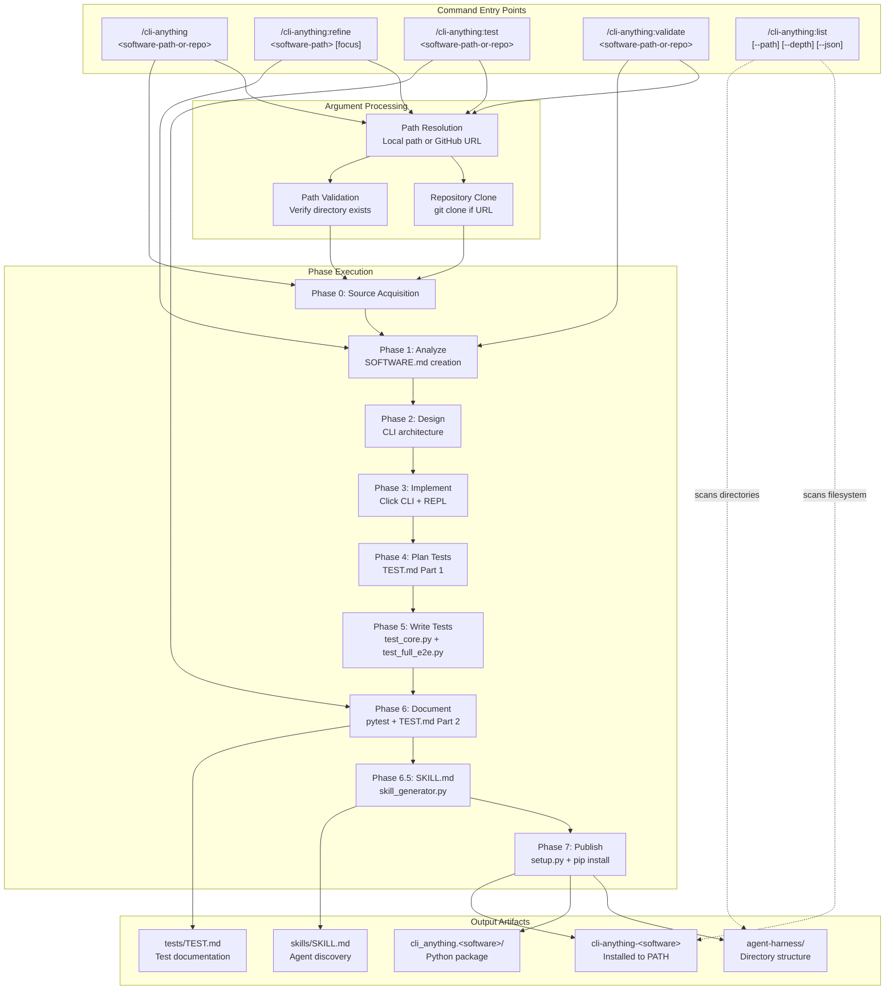

<!-- source: DeepWiki mcp.deepwiki.com · repo HKUDS/CLI-Anything · page 7 Plugin Commands Reference · fetched 2026-11-09 -->

# Plugin Commands Reference

<details>
<summary>Relevant source files</summary>

The following files were used as context for generating this wiki page:

- [cli-anything-plugin/commands/cli-anything.md](cli-anything-plugin/commands/cli-anything.md)
- [cli-anything-plugin/commands/list.md](cli-anything-plugin/commands/list.md)
- [cli-anything-plugin/commands/refine.md](cli-anything-plugin/commands/refine.md)
- [cli-anything-plugin/commands/test.md](cli-anything-plugin/commands/test.md)
- [cli-anything-plugin/commands/validate.md](cli-anything-plugin/commands/validate.md)
- [krita/agent-harness/KRITA.md](krita/agent-harness/KRITA.md)
- [krita/agent-harness/cli_anything/krita/README.md](krita/agent-harness/cli_anything/krita/README.md)
- [krita/agent-harness/cli_anything/krita/__init__.py](krita/agent-harness/cli_anything/krita/__init__.py)
- [krita/agent-harness/cli_anything/krita/__main__.py](krita/agent-harness/cli_anything/krita/__main__.py)

</details>


This page provides a complete technical reference for all CLI-Anything plugin commands. These commands are used to generate, test, validate, and manage CLI harnesses for GUI applications. Each command is available across five AI agent platforms (Claude Code, OpenCode, Qodercli, OpenClaw, Codex) with platform-specific invocation syntax but identical functionality.

For information about the underlying generation pipeline, see [The 7-Phase Generation Pipeline](#4). For details on generated CLI structure and internal architecture, see [Generated CLI Architecture](#5). For platform-specific installation instructions, see [Platform Installation](#2.1).

**Sources:** [cli-anything-plugin/README.md:1-215]()

## Command Overview

CLI-Anything provides five primary commands for managing CLI harness generation and maintenance:

| Command | Purpose | Primary Use Case |
|---------|---------|------------------|
| `/cli-anything` | Generate complete CLI harness | Initial CLI creation for any software |
| `/cli-anything:refine` | Iteratively expand CLI coverage | Add commands for uncovered functionality |
| `/cli-anything:test` | Run test suite and update TEST.md | Verify CLI correctness after changes |
| `/cli-anything:validate` | Check compliance with HARNESS.md | Ensure standards adherence |
| `/cli-anything:list` | Discover installed/generated CLIs | Find available CLI-Anything tools |

All commands accept either local filesystem paths or GitHub repository URLs as input (except `:list` which scans directories). Platform-specific invocation syntax varies (e.g., `/cli-anything` in Claude Code, `@cli-anything` in OpenClaw), but command behavior is identical across platforms.

**Sources:** [cli-anything-plugin/README.md:57-144]()

## Command Execution Architecture



**Command Execution Flow Diagram**

This diagram shows how commands map to the 7-phase pipeline. The main `/cli-anything` command executes all phases sequentially (0-7), while auxiliary commands target specific phases: `refine` re-enters Phase 1 with existing context, `test` executes Phase 6, and `validate` performs Phase 1 analysis against `HARNESS.md` standards. The `list` command operates independently by scanning the filesystem for existing installations and generated directories.

**Sources:** [cli-anything-plugin/README.md:59-80](), [cli-anything-plugin/commands/cli-anything.md:29-86]()

## Command Argument Patterns

```mermaid
graph LR
    subgraph "Input Types"
        LOCAL["Local Path<br/>/home/user/gimp<br/>./software"]
        GITHUB["GitHub URL<br/>https://github.com/blender/blender"]
    end
    
    subgraph "Resolution Logic"
        IS_URL{"Contains<br/>github.com?"}
        CLONE["git clone to<br/>/root/cli-anything/&lt;repo&gt;"]
        VERIFY["Verify directory<br/>exists"]
    end
    
    subgraph "Software Detection"
        EXTRACT_NAME["Extract software name<br/>from path basename"]
        HARNESS_DIR["Locate agent-harness/<br/>if exists"]
        NEW_BUILD["Create new<br/>agent-harness/"]
    end
    
    subgraph "Output Paths"
        HARNESS_PATH["&lt;software&gt;/agent-harness/<br/>Standard location"]
        NAMESPACE_PKG["cli_anything/&lt;software&gt;/<br/>PEP 420 package"]
        CONSOLE_SCRIPT["cli-anything-&lt;software&gt;<br/>Entry point name"]
    end
    
    LOCAL --> IS_URL
    GITHUB --> IS_URL
    
    IS_URL -->|Yes| CLONE
    IS_URL -->|No| VERIFY
    
    CLONE --> EXTRACT_NAME
    VERIFY --> EXTRACT_NAME
    
    EXTRACT_NAME --> HARNESS_DIR
    HARNESS_DIR -->|Exists| HARNESS_PATH
    HARNESS_DIR -->|Missing| NEW_BUILD
    NEW_BUILD --> HARNESS_PATH
    
    HARNESS_PATH --> NAMESPACE_PKG
    NAMESPACE_PKG --> CONSOLE_SCRIPT
```



**Argument Processing and Path Resolution Diagram**

This diagram shows the standardized argument processing pattern used by all commands. Commands accept either local paths or GitHub URLs. URL detection triggers `git clone`, while local paths are verified for existence. Software name extraction uses the path basename. Output always follows the standard structure: `<software>/agent-harness/cli_anything/<software>/` as a PEP 420 namespace package with console script entry point `cli-anything-<software>`.

**Sources:** [cli-anything-plugin/commands/cli-anything.md:15-33](), [cli-anything-plugin/commands/validate.md:17-23]()

---

## 7.1. /cli-anything Command

### Syntax
```bash
/cli-anything <software-path-or-repo>
```

### Parameters
| Parameter | Type | Required | Description |
|-----------|------|----------|-------------|
| `<software-path-or-repo>` | String | Yes | Local filesystem path to software source code OR GitHub repository URL |

### Description
The primary command for generating a complete CLI harness from scratch. It executes the full 7-phase pipeline defined in the plugin logic.

1.  **Phase 0: Source Acquisition**: If a GitHub URL is provided, the repository is cloned locally. The software name is derived from the directory name. [cli-anything-plugin/commands/cli-anything.md:29-33]()
2.  **Phase 1: Codebase Analysis**: Analyzes the local source code to understand the backend engine, data model, and GUI-to-API mappings. [cli-anything-plugin/commands/cli-anything.md:34-40]()
3.  **Phase 2: CLI Architecture Design**: Designs command groups, state models, and output formats, creating a software-specific SOP document (e.g., `GIMP.md`). [cli-anything-plugin/commands/cli-anything.md:41-45]()
4.  **Phase 3: Implementation**: Creates the `agent-harness/cli_anything/<software>/` directory structure, implements core modules (e.g., `project.py`, `session.py`, `export.py`), and builds the Click-based CLI with REPL support and `--json` output. [cli-anything-plugin/commands/cli-anything.md:46-52]()
5.  **Phase 4: Test Planning**: Creates `TEST.md` with a comprehensive test plan, including unit, E2E, and workflow tests. [cli-anything-plugin/commands/cli-anything.md:53-58]()
6.  **Phase 5: Test Implementation**: Writes unit tests (`test_core.py`), E2E tests (`test_full_e2e.py`), and workflow tests, including output verification and `TestCLISubprocess` with `_resolve_cli`. [cli-anything-plugin/commands/cli-anything.md:59-66]()
7.  **Phase 6: Test Documentation**: Runs all tests with `pytest` and appends the full results to `TEST.md`, documenting coverage and gaps. [cli-anything-plugin/commands/cli-anything.md:67-71]()
8.  **Phase 6.5: SKILL.md Generation**: Extracts CLI metadata using `skill_generator.py` to generate `SKILL.md` with YAML frontmatter, making the CLI discoverable by AI agents. [cli-anything-plugin/commands/cli-anything.md:72-78]()
9.  **Phase 7: PyPI Publishing and Installation**: Creates `setup.py` with `find_namespace_packages` for `cli_anything.*` and configures console_scripts for `cli-anything-<software>` entry point, then tests local installation. [cli-anything-plugin/commands/cli-anything.md:79-86]()

For details, see [/cli-anything Command](#7.1).

### Success Criteria
The command succeeds when the CLI is available in `PATH` as `cli-anything-<software>`, all tests pass (100% rate), `TEST.md` contains both plan and results, `SKILL.md` is correctly generated with YAML frontmatter, and session-based CLIs implement auto-save with a `--dry-run` flag. [cli-anything-plugin/commands/cli-anything.md:134-147]()

**Sources:** [cli-anything-plugin/commands/cli-anything.md:1-147](), [cli-anything-plugin/README.md:152-235]()

---

## 7.2. /cli-anything:refine Command

### Syntax
```bash
/cli-anything:refine <software-path> [focus]
```

### Parameters
| Parameter | Type | Required | Description |
|-----------|------|----------|-------------|
| `<software-path>` | String | Yes | Local path to the software source code. |
| `[focus]` | String | No | Optional natural-language description of the functionality area to focus on (e.g., "batch processing", "filters"). [cli-anything-plugin/commands/refine.md:19-33]() |

### Description
This command is used **after** a CLI harness has already been built with `/cli-anything`. It analyzes gaps between the software's full capabilities and what the current CLI covers, then iteratively expands coverage. If a `[focus]` is given, the agent narrows its analysis and implementation to that specific functionality area. [cli-anything-plugin/commands/refine.md:34-36]()

-   **Inventory Current Coverage**: Reads the existing CLI and test suite to build a coverage map. [cli-anything-plugin/commands/refine.md:38-43]()
-   **Analyze Software Capabilities**: Re-scans the software source to identify public APIs, CLI tools, and scripting interfaces, focusing on observable output. [cli-anything-plugin/commands/refine.md:44-49]()
-   **Gap Analysis**: Compares current CLI coverage against the software's full capability set, prioritizing high-impact, easy-win, and composable functions. [cli-anything-plugin/commands/refine.md:50-57]()
-   **Implement New Commands**: Adds new commands/subcommands to the CLI, following `HARNESS.md` patterns for Click command groups, `--json` output, session state, and error handling. [cli-anything-plugin/commands/refine.md:58-65]()
-   **Expand Tests**: Adds unit and E2E tests for new functions and workflow tests, running all tests to ensure no regressions. [cli-anything-plugin/commands/refine.md:66-71]()
-   **Update Documentation**: Updates `README.md`, `TEST.md`, and the software SOP document (`<SOFTWARE>.md`) to reflect new coverage. [cli-anything-plugin/commands/refine.md:72-77]()

For details, see [/cli-anything:refine Command](#7.2).

**Sources:** [cli-anything-plugin/commands/refine.md:1-104]()

---

## 7.3. /cli-anything:test Command

### Syntax
```bash
/cli-anything:test <software-path-or-repo>
```

### Parameters
| Parameter | Type | Required | Description |
|-----------|------|----------|-------------|
| `<software-path-or-repo>` | String | Yes | Local filesystem path to software source code OR GitHub repository URL |

### Description
Locates the CLI harness based on the provided software path or repository, then executes `pytest -v -s --tb=short` within the harness's `agent-harness/` directory. [cli-anything-plugin/commands/test.md:25-28]() It specifically verifies that the subprocess backend is correctly resolved using the `[_resolve_cli] Using installed command:` pattern, ensuring tests run against the installed CLI. [cli-anything-plugin/commands/test.md:30]()

Results are appended to the `## Test Results` section of `TEST.md` within the harness. [cli-anything-plugin/commands/test.md:34-49]()

For details, see [/cli-anything:test Command](#7.3).

**Sources:** [cli-anything-plugin/commands/test.md:1-73]()

---

## 7.4. /cli-anything:validate Command

### Syntax
```bash
/cli-anything:validate <software-path-or-repo>
```

### Parameters
| Parameter | Type | Required | Description |
|-----------|------|----------|-------------|
| `<software-path-or-repo>` | String | Yes | Local filesystem path to software source code OR GitHub repository URL |

### Description
Checks the CLI harness against the standards and best practices defined in `HARNESS.md`. It generates a detailed report indicating compliance across various categories. [cli-anything-plugin/commands/validate.md:1-114]() Key validation points include:

-   **Directory Structure**: Ensures the correct `agent-harness/cli_anything/<software>/` structure, including the absence of `__init__.py` in `cli_anything/` (PEP 420 namespace package) and its presence in `<software>/`. [cli-anything-plugin/commands/validate.md:27-33]()
-   **Required Files**: Verifies the existence of essential files like `README.md`, `<software>_cli.py`, `core/project.py`, `core/session.py`, `core/export.py`, `tests/TEST.md`, `tests/test_core.py`, `tests/test_full_e2e.py`, and the software-specific SOP (`<SOFTWARE>.md`). [cli-anything-plugin/commands/validate.md:34-44]()
-   **CLI Implementation Standards**: Checks for the use of the Click framework, command groups, `--json` flag, `--project` flag, `handle_error` decorator, REPL mode, and global session state. [cli-anything-plugin/commands/validate.md:45-52]()
-   **Core Module Standards**: Validates the presence of key functions in `project.py`, `session.py`, and `export.py`, along with proper docstrings and type hints. [cli-anything-plugin/commands/validate.md:53-60]()
-   **Test Standards**: Ensures `TEST.md` has both plan and results, unit tests use synthetic data, E2E tests use real files, and `TestCLISubprocess` correctly uses `_resolve_cli` without hardcoded paths or `cwd` changes. [cli-anything-plugin/commands/validate.md:61-71]()
-   **Documentation Standards**: Confirms `README.md` and `<SOFTWARE>.md` are comprehensive and that all commands are documented. [cli-anything-plugin/commands/validate.md:72-77]()
-   **PyPI Packaging Standards**: Verifies `setup.py` uses `find_namespace_packages`, follows the `cli-anything-<software>` naming convention, and correctly defines the entry point. [cli-anything-plugin/commands/validate.md:78-86]()
-   **Code Quality**: Checks for syntax errors, import errors, PEP 8 style, absence of hardcoded paths, and proper error handling. [cli-anything-plugin/commands/validate.md:87-93]()

For details, see [/cli-anything:validate Command](#7.4).

**Sources:** [cli-anything-plugin/commands/validate.md:1-123]()

---

## 7.5. /cli-anything:list Command

### Syntax
```bash
/cli-anything:list [--path <directory>] [--depth <n>] [--json]
```

### Parameters
| Parameter | Type | Required | Description |
|-----------|------|----------|-------------|
| `--path <directory>` | String | No | Directory to search for generated CLIs (default: current directory). [cli-anything-plugin/commands/list.md:13]() |
| `--depth <n>` | Integer | No | Maximum recursion depth for scanning (default: unlimited). `0` for current directory only, `1` for one level deep, etc. [cli-anything-plugin/commands/list.md:14]() |
| `--json` | Flag | No | Output in JSON format for machine parsing. [cli-anything-plugin/commands/list.md:15]() |

### Description
Discovers and lists all available CLI-Anything tools, including both installed Python packages and locally generated CLI harnesses.

-   **Installed CLIs**: Uses `importlib.metadata.distributions()` to find installed packages whose names start with `cli-anything-`. It extracts the software name, version, and attempts to find the executable path. [cli-anything-plugin/commands/list.md:21-43]()
-   **Generated CLIs**: Uses `glob` to find local CLI directories matching the pattern `**/agent-harness/cli_anything/*/__init__.py`. The search path and recursion depth can be controlled by `--path` and `--depth` options. It extracts the software name, version (from `setup.py`), and the source path. [cli-anything-plugin/commands/list.md:45-115]()
-   **Merge Results**: Deduplicates entries by software name, preferring `installed` status if both installed and generated versions are found. [cli-anything-plugin/commands/list.md:117-122]()

The command supports a human-readable table format by default and a machine-parsable JSON format when the `--json` flag is provided. [cli-anything-plugin/commands/list.md:123-162]()

For details, see [/cli-anything:list Command](#7.5).

**Sources:** [cli-anything-plugin/commands/list.md:1-228]()

---

## Command Comparison Matrix

| Feature | /cli-anything | /refine | /test | /validate | /list |
|---------|--------------|---------|-------|-----------|-------|
| Accepts GitHub URL | ✓ | ✗ | ✓ | ✓ | ✗ |
| Modifies Code | ✓ | ✓ | ✗ | ✗ | ✗ |
| Runs Pytest | ✓ | ✓ | ✓ | ✗ | ✗ |
| Updates TEST.md | ✓ | ✓ | ✓ | ✗ | ✗ |
| Generates SKILL.md | ✓ | ✓ | ✗ | ✗ | ✗ |
| JSON Output | ✗ | ✗ | ✗ | ✗ | ✓ |

**Sources:** [cli-anything-plugin/README.md:57-151](), [cli-anything-plugin/commands/list.md:15]()

---

