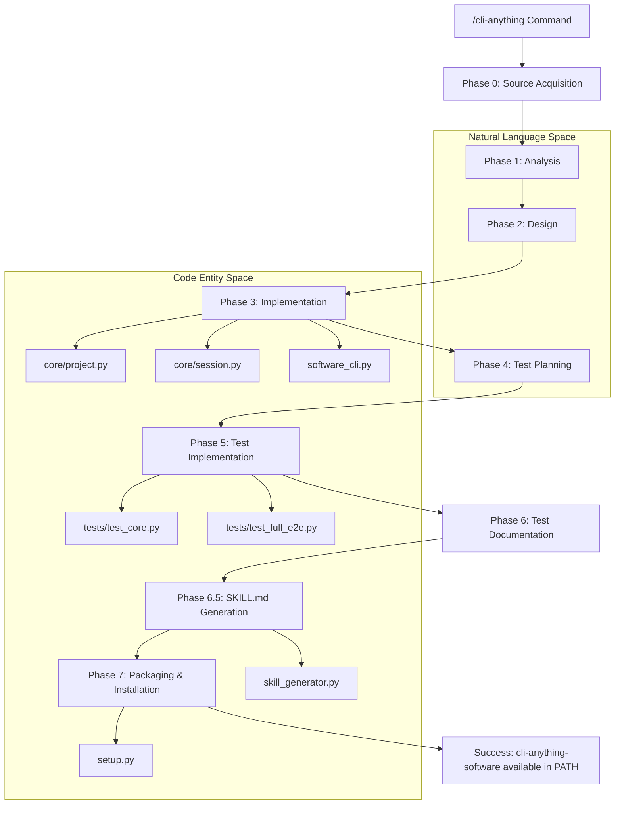
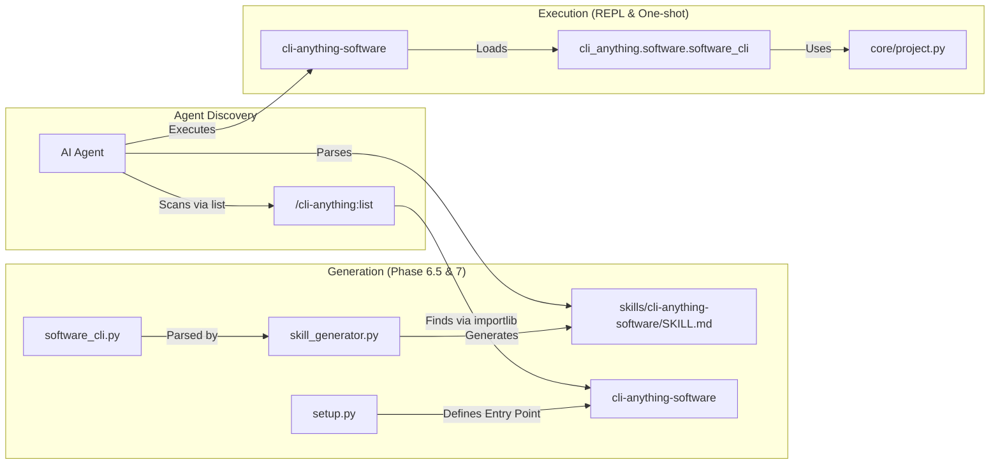

<!-- source: DeepWiki mcp.deepwiki.com · repo HKUDS/CLI-Anything · page 7.1 /cli-anything Command · fetched 2026-11-09 -->

# /cli-anything Command

<details>
<summary>Relevant source files</summary>

The following files were used as context for generating this wiki page:

- [cli-anything-plugin/commands/cli-anything.md](cli-anything-plugin/commands/cli-anything.md)
- [cli-anything-plugin/commands/list.md](cli-anything-plugin/commands/list.md)
- [cli-anything-plugin/commands/refine.md](cli-anything-plugin/commands/refine.md)
- [cli-anything-plugin/commands/test.md](cli-anything-plugin/commands/test.md)
- [cli-anything-plugin/commands/validate.md](cli-anything-plugin/commands/validate.md)
- [krita/agent-harness/KRITA.md](krita/agent-harness/KRITA.md)
- [krita/agent-harness/cli_anything/krita/README.md](krita/agent-harness/cli_anything/krita/README.md)
- [krita/agent-harness/cli_anything/krita/__init__.py](krita/agent-harness/cli_anything/krita/__init__.py)
- [krita/agent-harness/cli_anything/krita/__main__.py](krita/agent-harness/cli_anything/krita/__main__.py)

</details>


The `/cli-anything` command is the primary entry point for the CLI-Anything plugin. It automates the transformation of a GUI application into an agent-native, stateful CLI by executing a comprehensive 7-phase generation pipeline [cli-anything-plugin/commands/cli-anything.md:25-27]().

## Purpose and Syntax

The command builds a complete, production-ready CLI harness following the standards defined in `HARNESS.md` [cli-anything-plugin/commands/cli-anything.md:1-8](). It ensures that the resulting tool is self-describing, supports JSON output, and integrates authentically with the software's backend engine [cli-anything-plugin/commands/cli-anything.md:46-52]().

### Syntax
```bash
/cli-anything <software-path-or-repo>
```

### Arguments
| Argument | Description |
| :--- | :--- |
| `<software-path-or-repo>` | **Required.** A local filesystem path (e.g., `/home/user/gimp`) or a GitHub repository URL (e.g., `https://github.com/blender/blender`). If a URL is provided, the plugin clones the repository before beginning analysis [cli-anything-plugin/commands/cli-anything.md:15-21](). |

**Sources:** [cli-anything-plugin/commands/cli-anything.md:9-24]()

## The 7-Phase Generation Pipeline

The command executes the following phases in sequence to ensure the generated CLI meets the "agent-native" criteria [cli-anything-plugin/commands/cli-anything.md:29-86]():

### Phase Execution Flow


### Phase Details
1.  **Phase 0: Source Acquisition**: Clones GitHub repos or verifies local paths. It derives the software name from the directory [cli-anything-plugin/commands/cli-anything.md:29-33]().
2.  **Phase 1: Codebase Analysis**: Identifies backend engines (e.g., `DOMShell` for Browser, `bpy` for Blender) and maps GUI actions to API calls [cli-anything-plugin/commands/cli-anything.md:34-40](), [krita/agent-harness/KRITA.md:11-33]().
3.  **Phase 2: CLI Architecture Design**: Creates a software-specific SOP (e.g., `KRITA.md`) and plans command groups like `project`, `session`, and `export` [cli-anything-plugin/commands/cli-anything.md:41-45](), [cli-anything-plugin/commands/cli-anything.md:98-102](), [krita/agent-harness/KRITA.md:44-60]().
4.  **Phase 3: Implementation**: Generates the `agent-harness/` structure. Implements `Click`-based CLI with REPL support and `--json` output [cli-anything-plugin/commands/cli-anything.md:46-52](). It specifically copies `repl_skin.py` to `utils/` to provide a unified UX [cli-anything-plugin/README.md:179-179]().
5.  **Phase 4: Test Planning**: Creates `TEST.md` (Part 1) detailing unit and E2E scenarios [cli-anything-plugin/commands/cli-anything.md:53-58]().
6.  **Phase 5: Test Implementation**: Writes `test_core.py` (unit) and `test_full_e2e.py` (E2E). Uses `_resolve_cli()` for subprocess testing to avoid hardcoded paths [cli-anything-plugin/commands/cli-anything.md:59-66]().
7.  **Phase 6: Test Documentation**: Executes `pytest` and appends results to `TEST.md` (Part 2) [cli-anything-plugin/commands/cli-anything.md:67-71]().
8.  **Phase 6.5: SKILL.md Generation**: Uses `skill_generator.py` to create AI-discoverable metadata in `skills/cli-anything-<software>/SKILL.md` [cli-anything-plugin/commands/cli-anything.md:72-78]().
9.  **Phase 7: Packaging**: Creates `setup.py` as a PEP 420 namespace package (no `__init__.py` in the top `cli_anything/` directory) and installs the CLI to the system PATH [cli-anything-plugin/commands/cli-anything.md:79-86]().

**Sources:** [cli-anything-plugin/commands/cli-anything.md:29-86](), [cli-anything-plugin/README.md:154-235](), [krita/agent-harness/KRITA.md:11-60]()

## Success Criteria

A generation run is considered successful only if it meets these criteria [cli-anything-plugin/commands/cli-anything.md:134-147]():
*   **Functional Parity**: Core modules (`project.py`, `session.py`, `export.py`) are implemented and functional.
*   **Dual-Mode CLI**: Supports both one-shot subcommands and a stateful REPL mode (defaulting to REPL when no subcommand is provided via `invoke_without_command=True`) [cli-anything-plugin/README.md:182-182]().
*   **Agent Compatibility**: The `--json` flag works for all commands to provide machine-readable output [cli-anything-plugin/commands/cli-anything.md:139-139]().
*   **Test Integrity**: 100% pass rate in `pytest`, including subprocess tests using `_resolve_cli()` with `CLI_ANYTHING_FORCE_INSTALLED=1` [cli-anything-plugin/commands/cli-anything.md:140-141]().
*   **Discovery**: `SKILL.md` is generated with valid YAML frontmatter and command documentation [cli-anything-plugin/commands/cli-anything.md:144-144]().
*   **Availability**: The command `cli-anything-<software>` is found in the system `PATH` via `which` [cli-anything-plugin/commands/cli-anything.md:146-146]().
*   **Session Integrity**: Session-based CLIs must implement auto-save and a `--dry-run` flag to prevent data loss in one-shot mode [cli-anything-plugin/commands/cli-anything.md:147-147]().

**Sources:** [cli-anything-plugin/commands/cli-anything.md:134-147](), [cli-anything-plugin/commands/validate.md:25-93]()

## Data Flow: Generation to Execution

This diagram illustrates how the `skill_generator.py` and the `setup.py` packaging bridge the gap between the generated code and the AI agent's discovery space.



**Sources:** [cli-anything-plugin/commands/cli-anything.md:72-86](), [cli-anything-plugin/commands/list.md:21-43](), [cli-anything-plugin/README.md:216-226]()

---

