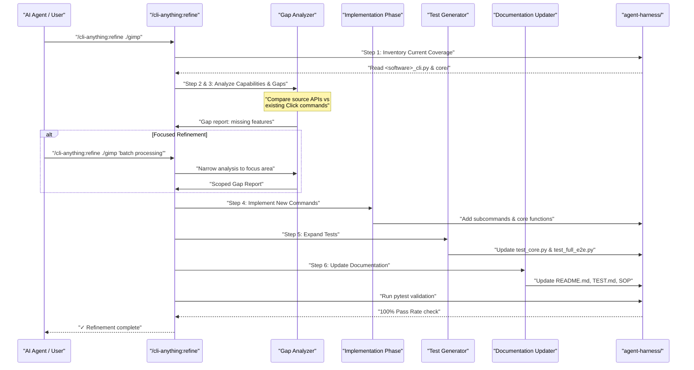
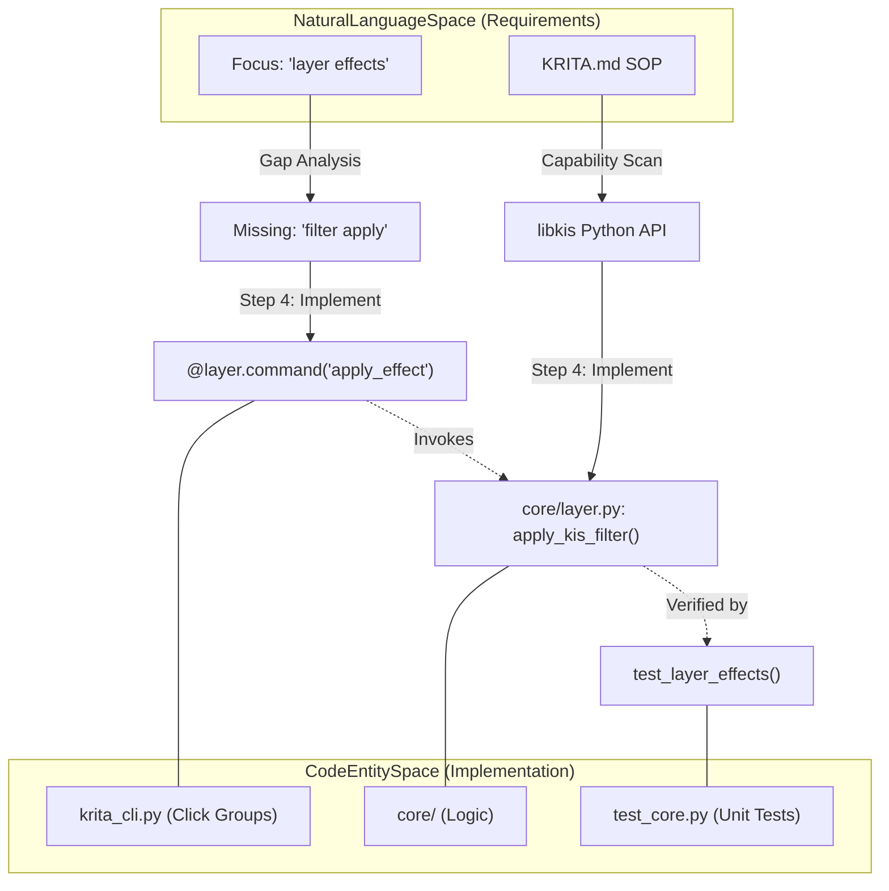
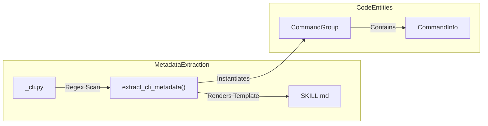

<!-- source: DeepWiki mcp.deepwiki.com · repo HKUDS/CLI-Anything · page 7.2 /cli-anything:refine Command · fetched 2026-11-09 -->

# /cli-anything:refine Command

<details>
<summary>Relevant source files</summary>

The following files were used as context for generating this wiki page:

- [cli-anything-plugin/commands/cli-anything.md](cli-anything-plugin/commands/cli-anything.md)
- [cli-anything-plugin/commands/list.md](cli-anything-plugin/commands/list.md)
- [cli-anything-plugin/commands/refine.md](cli-anything-plugin/commands/refine.md)
- [cli-anything-plugin/commands/test.md](cli-anything-plugin/commands/test.md)
- [cli-anything-plugin/commands/validate.md](cli-anything-plugin/commands/validate.md)
- [krita/agent-harness/KRITA.md](krita/agent-harness/KRITA.md)
- [krita/agent-harness/cli_anything/krita/README.md](krita/agent-harness/cli_anything/krita/README.md)
- [krita/agent-harness/cli_anything/krita/__init__.py](krita/agent-harness/cli_anything/krita/__init__.py)
- [krita/agent-harness/cli_anything/krita/__main__.py](krita/agent-harness/cli_anything/krita/__main__.py)

</details>


The `/cli-anything:refine` command performs iterative improvement of an existing CLI harness by identifying gaps in coverage and implementing new commands, tests, and documentation. It enables incremental expansion of CLI capabilities without disrupting existing functionality.

---

## Purpose and Scope

The refine command addresses the reality that a single `/cli-anything` run may not fully cover all software capabilities. It provides a systematic approach to:

- **Gap Analysis**: Compare the software's complete feature set against current CLI coverage [cli-anything-plugin/commands/refine.md:50-56]().
- **Targeted Enhancement**: Add new command groups and subcommands for uncovered functionality [cli-anything-plugin/commands/refine.md:58-65]().
- **Test Expansion**: Generate comprehensive tests for new features [cli-anything-plugin/commands/refine.md:67-72]().
- **Documentation Updates**: Maintain up-to-date `TEST.md`, `README.md`, and `SOFTWARE.md` files [cli-anything-plugin/commands/refine.md:73-77]().
- **Non-Destructive Updates**: Preserve all existing commands, tests, and configuration [cli-anything-plugin/commands/refine.md:104-104]().

Unlike a full rebuild, refinement is incremental and preserves user customizations while expanding the CLI's scope.

Sources: [cli-anything-plugin/commands/refine.md:1-104]()

---

## Command Syntax

### Usage

```bash
/cli-anything:refine <software-path> [focus]
```

### Parameters

| Parameter | Type | Required | Description |
|-----------|------|----------|-------------|
| `<software-path>` | String | Yes | Local path to the software source code (e.g., `/home/user/gimp`) [cli-anything-plugin/commands/refine.md:17-17](). |
| `[focus]` | String | No | Optional natural-language description of functionality to target [cli-anything-plugin/commands/refine.md:21-21](). |

The `software-path` must point to a directory that already contains a generated CLI harness at `agent-harness/`. The command requires the same source tree used during the original build [cli-anything-plugin/commands/refine.md:17-17]().

Sources: [cli-anything-plugin/commands/refine.md:9-32]()

---

## Refinement Workflow

### Refine Command Execution Sequence

The command follows a 6-step sequence to ensure that new functionality is integrated correctly into the existing architecture.



Sources: [cli-anything-plugin/commands/refine.md:34-77](), [cli-anything-plugin/commands/refine.md:91-98]()

---

## Gap Analysis Process

The refinement process bridges the gap between the **Natural Language Space** (user focus and software documentation) and the **Code Entity Space** (Click commands and Python modules).

### Capability Mapping (Krita Example)

This diagram shows how the refinement process identifies gaps by mapping software capabilities to specific code entities.



Sources: [cli-anything-plugin/commands/refine.md:38-56](), [krita/agent-harness/KRITA.md:25-33](), [krita/agent-harness/cli_anything/krita/README.md:54-64]()

### Metadata Lifecycle and SKILL.md Refresh

During refinement, the `skill_generator.py` utility is used to keep agent-discoverable documentation in sync with the expanded CLI surface.



Sources: [cli-anything-plugin/commands/cli-anything.md:72-78]()

---

## Refinement vs Initial Generation

### Comparison Matrix

| Aspect | `/cli-anything` (Initial) | `/cli-anything:refine` (Refinement) |
|--------|---------------------------|-------------------------------------|
| **Prerequisite** | Source code path or Repo URL | Existing `agent-harness/` |
| **Scope** | 7-Phase complete pipeline | Incremental 6-Step update |
| **Output** | New CLI package structure | Enhanced existing modules |
| **Destructive** | N/A (creates new) | Non-destructive (adds/enhances only) |
| **Coverage Goal** | Functional baseline | Deep domain coverage |
| **Test Strategy** | Full suite generation | Appends to existing suites |
| **Focus Support** | No (analyzes everything) | Yes (NL targeting) |

Sources: [cli-anything-plugin/commands/cli-anything.md:25-86](), [cli-anything-plugin/commands/refine.md:34-104]()

---

## Usage Examples

### Broad Refinement (No Focus)

```bash
/cli-anything:refine /home/user/gimp
```

**Behavior**: The agent performs comprehensive gap analysis across all software capabilities. It identifies missing command groups, unexposed APIs, and uncovered workflows, then implements the highest-value additions [cli-anything-plugin/commands/refine.md:81-82]().

### Focused Refinement (Specific Area)

```bash
/cli-anything:refine /home/user/shotcut "vid-in-vid and picture-in-picture compositing"
/cli-anything:refine /home/user/blender "particle systems and physics simulation"
```

**Behavior**: The agent narrows Step 2 (Analyze Software Capabilities) and Step 3 (Gap Analysis) to the specified area [cli-anything-plugin/commands/refine.md:29-32]().

Sources: [cli-anything-plugin/commands/refine.md:80-89]()

---

## Implementation Details

### File Modifications

During refinement, the following files are typically modified:

| File Path | Modification Type | Purpose |
|-----------|------------------|---------|
| `<software>_cli.py` | Append | Add new Click commands and groups [cli-anything-plugin/commands/refine.md:59-64](). |
| `core/*.py` | Append/Modify | Add new core functions for features [cli-anything-plugin/commands/refine.md:65-65](). |
| `tests/test_core.py` | Append | Add unit tests for new functions [cli-anything-plugin/commands/refine.md:68-68](). |
| `tests/test_full_e2e.py` | Append | Add E2E tests for workflows [cli-anything-plugin/commands/refine.md:69-69](). |
| `tests/TEST.md` | Update | Append new test results [cli-anything-plugin/commands/refine.md:75-75](). |
| `README.md` | Update | Add new command examples [cli-anything-plugin/commands/refine.md:74-74](). |
| `SKILL.md` | Regenerate | Update agent discovery metadata using `skill_generator.py` [cli-anything-plugin/commands/cli-anything.md:72-78](). |

### Success Criteria

The command succeeds when:
1. All existing tests still pass (no regressions) [cli-anything-plugin/commands/refine.md:93-93]().
2. New commands follow Click group patterns and include `--json` support [cli-anything-plugin/commands/refine.md:94-94]().
3. New tests achieve 100% pass rate [cli-anything-plugin/commands/refine.md:95-95]().
4. Documentation (README, TEST.md, SOP, SKILL.md) is updated [cli-anything-plugin/commands/refine.md:97-97]().

Sources: [cli-anything-plugin/commands/refine.md:91-98]()

---

## Integration with Other Commands

The `/cli-anything:refine` command is part of an iterative lifecycle:

1. **Generate**: `/cli-anything` creates the initial harness [cli-anything-plugin/commands/cli-anything.md:1-3]().
2. **Test**: `/cli-anything:test` verifies current status [cli-anything-plugin/commands/test.md:1-4]().
3. **Refine**: `/cli-anything:refine` expands capabilities [cli-anything-plugin/commands/refine.md:1-3]().
4. **Validate**: `/cli-anything:validate` ensures standards are maintained [cli-anything-plugin/commands/validate.md:1-3]().
5. **List**: `/cli-anything:list` tracks all generated and installed tools [cli-anything-plugin/commands/list.md:1-3]().

Sources: [cli-anything-plugin/commands/refine.md:34-37](), [cli-anything-plugin/commands/test.md:11-13](), [cli-anything-plugin/commands/validate.md:11-13](), [cli-anything-plugin/commands/list.md:8-8]()

---

