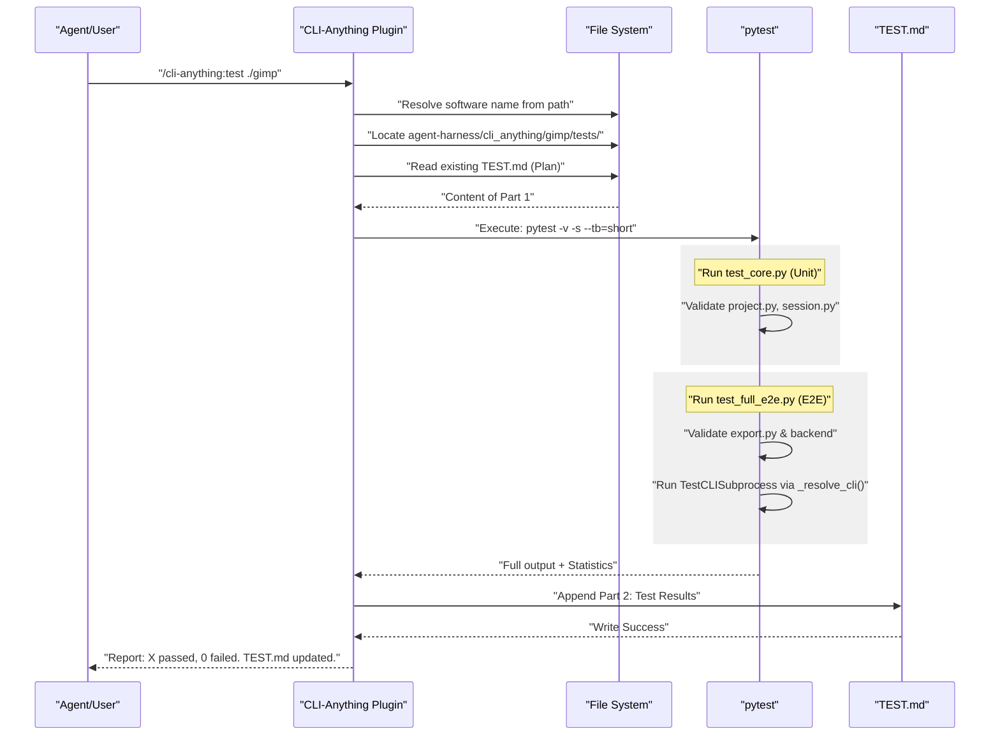
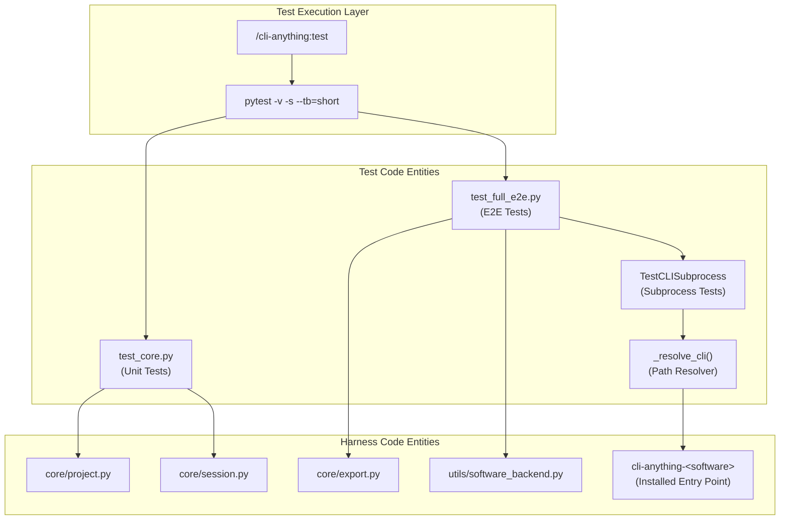
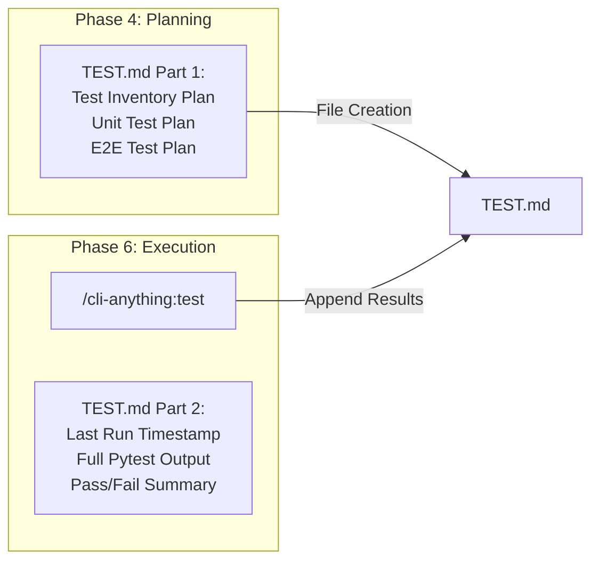

<!-- source: DeepWiki mcp.deepwiki.com · repo HKUDS/CLI-Anything · page 7.3 /cli-anything:test Command · fetched 2026-11-09 -->

# /cli-anything:test Command

<details>
<summary>Relevant source files</summary>

The following files were used as context for generating this wiki page:

- [cli-anything-plugin/commands/cli-anything.md](cli-anything-plugin/commands/cli-anything.md)
- [cli-anything-plugin/commands/list.md](cli-anything-plugin/commands/list.md)
- [cli-anything-plugin/commands/refine.md](cli-anything-plugin/commands/refine.md)
- [cli-anything-plugin/commands/test.md](cli-anything-plugin/commands/test.md)
- [cli-anything-plugin/commands/validate.md](cli-anything-plugin/commands/validate.md)
- [krita/agent-harness/KRITA.md](krita/agent-harness/KRITA.md)
- [krita/agent-harness/cli_anything/krita/README.md](krita/agent-harness/cli_anything/krita/README.md)
- [krita/agent-harness/cli_anything/krita/__init__.py](krita/agent-harness/cli_anything/krita/__init__.py)
- [krita/agent-harness/cli_anything/krita/__main__.py](krita/agent-harness/cli_anything/krita/__main__.py)

</details>


This document specifies the `/cli-anything:test` command, which executes the test suite for a generated CLI harness and updates the `TEST.md` documentation with results. This command is a core component of the CLI-Anything 7-phase generation pipeline, specifically serving Phase 6 (Test Documentation). [cli-anything-plugin/commands/cli-anything.md:67-71]()

---

## Command Overview

The `/cli-anything:test` command is a plugin command that automates the execution of the complete test suite for a generated CLI harness. It appends execution results to the `TEST.md` documentation file, transforming it from a "Test Plan" into a "Test Report." [cli-anything-plugin/commands/test.md:1-4]()

**Syntax:**
```bash
/cli-anything:test <software-path-or-repo>
```

**Arguments:**
- `<software-path-or-repo>` - **Required.** Either:
  - A **local path** to the software source code (e.g., `/home/user/gimp`, `./blender`)
  - A **GitHub repository URL** (e.g., `https://github.com/GNOME/gimp`, `github.com/blender/blender`)

  If a GitHub URL is provided, the agent clones the repo locally first, then works on the local copy. [cli-anything-plugin/commands/test.md:17-22]()

**Primary Functions:**
- **Locates the CLI**: Finds the CLI harness based on the software path. The software name is derived from the directory name, and the agent locates the CLI harness at `/root/cli-anything/<software-name>/agent-harness/`. [cli-anything-plugin/commands/test.md:25-27]()
- **Runs pytest**: Executes tests with `-v -s --tb=short`. [cli-anything-plugin/commands/test.md:28]()
- **Captures output**: Saves full test results. [cli-anything-plugin/commands/test.md:29]()
- **Verifies subprocess backend**: Confirms `[_resolve_cli] Using installed command:` appears in output. [cli-anything-plugin/commands/test.md:30]()
- **Updates TEST.md**: Appends results to the Test Results section. [cli-anything-plugin/commands/test.md:31]()
- **Reports status**: Shows pass/fail summary. [cli-anything-plugin/commands/test.md:32]()

**Sources:** [cli-anything-plugin/commands/test.md:1-33](), [cli-anything-plugin/commands/cli-anything.md:67-71]()

---

## Test Execution Flow

The command follows a strict sequence to ensure that test results are accurately captured and documented without losing the original test plan.

### Sequence Diagram: Test Execution and Documentation



**Sources:** [cli-anything-plugin/commands/test.md:25-33](), [cli-anything-plugin/commands/cli-anything.md:59-66]()

---

## Four-Layer Test Architecture

Generated CLI harnesses implement a four-layer testing strategy. The `/cli-anything:test` command executes all layers simultaneously via `pytest`. [cli-anything-plugin/commands/validate.md:61-69]()

### Test Entity Mapping

This diagram associates the testing concepts with the specific code entities defined in the harness structure.



**Sources:** [cli-anything-plugin/commands/validate.md:61-69](), [cli-anything-plugin/commands/cli-anything.md:59-66]()

### Layer Details

| Layer | File | Target | Validation Method |
| :--- | :--- | :--- | :--- |
| **Unit Tests** | `test_core.py` | Core modules (`project.py`, `session.py`) | Synthetic data; no external dependencies. [cli-anything-plugin/commands/cli-anything.md:60]() |
| **E2E Native** | `test_full_e2e.py` | Native project formats (XML/JSON) | File structure and well-formedness checks. [cli-anything-plugin/commands/cli-anything.md:61]() |
| **E2E Backend** | `test_full_e2e.py` | Real software output (PDF, PNG, etc.) | Backend invocation and magic byte validation. [cli-anything-plugin/commands/cli-anything.md:63]() |
| **CLI Subprocess**| `TestCLISubprocess` | Installed CLI entry point | Subprocess calls via `_resolve_cli()`. [cli-anything-plugin/commands/cli-anything.md:64-65]() |

---

## TEST.md Structure

The `TEST.md` file is the primary artifact updated by this command. It serves as the single source of truth for the health of the harness. [cli-anything-plugin/commands/test.md:31-32]()

### TEST.md Data Flow



**Content Requirements for Part 2:**
- **Timestamp**: The date and time of the last test run. [cli-anything-plugin/commands/test.md:41]()
- **Full Output**: The complete output from `pytest -v --tb=no`. [cli-anything-plugin/commands/test.md:44]()
- **Summary**: A final line indicating the total number of tests passed and execution time. [cli-anything-plugin/commands/test.md:47-48]()

**Sources:** [cli-anything-plugin/commands/test.md:34-49](), [cli-anything-plugin/commands/validate.md:62]()

---

## Success and Failure Criteria

### Success Criteria
The command is considered successful only if:
1. **100% Pass Rate**: Every test in the suite passes. [cli-anything-plugin/commands/test.md:62]()
2. **Path Verification**: The output includes `[_resolve_cli] Using installed command:`, confirming the CLI is correctly installed in the system PATH. [cli-anything-plugin/commands/test.md:65]()
3. **Doc Update**: `TEST.md` is updated with the latest results. [cli-anything-plugin/commands/test.md:63]()

### Failure Handling
If any test fails:
1. The command displays the specific test failures. [cli-anything-plugin/commands/test.md:70]()
2. **Non-Destructive**: It does **NOT** update `TEST.md`, preserving the last known good state. [cli-anything-plugin/commands/test.md:71]()
3. **Remediation**: The agent suggests fixes based on the error messages and offers to re-run the tests. [cli-anything-plugin/commands/test.md:72-73]()

**Sources:** [cli-anything-plugin/commands/test.md:60-73]()

---

## Usage Examples

### Testing a Local Harness
```bash
/cli-anything:test /home/user/gimp
```

### Testing from a Remote Repository
If a GitHub URL is provided, the plugin clones the repository locally before executing the tests. [cli-anything-plugin/commands/test.md:21-22]()
```bash
/cli-anything:test https://github.com/blender/blender
```

### Manual Verification (Force-Installed Mode)
Developers can manually trigger the subprocess tests to ignore local source files and force the use of the installed CLI by setting an environment variable:
```bash
CLI_ANYTHING_FORCE_INSTALLED=1 pytest cli_anything/gimp/tests/test_full_e2e.py
```
This behavior is supported by the `_resolve_cli()` helper required in `test_full_e2e.py`. [cli-anything-plugin/commands/validate.md:68](), [cli-anything-plugin/commands/cli-anything.md:141]()

**Sources:** [cli-anything-plugin/commands/test.md:50-58](), [cli-anything-plugin/commands/validate.md:68]()

---

