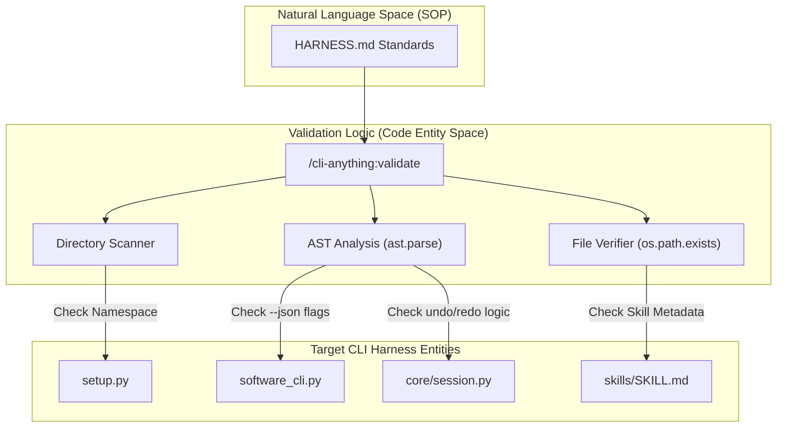
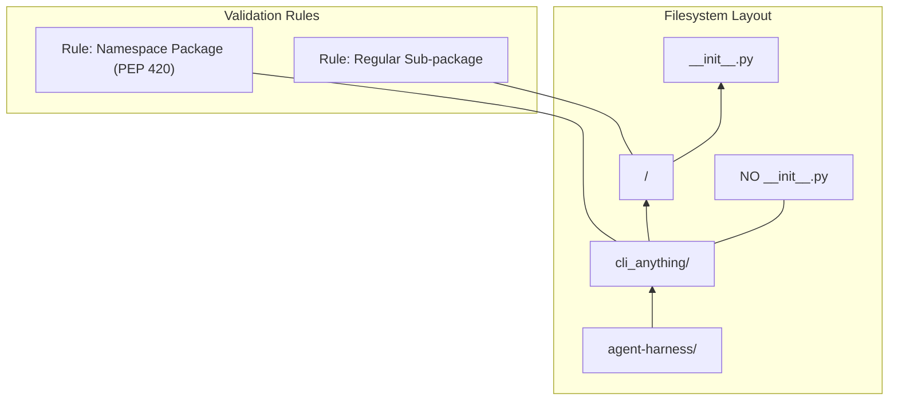

<!-- source: DeepWiki mcp.deepwiki.com · repo HKUDS/CLI-Anything · page 7.4 /cli-anything:validate Command · fetched 2026-11-09 -->

# /cli-anything:validate Command

<details>
<summary>Relevant source files</summary>

The following files were used as context for generating this wiki page:

- [cli-anything-plugin/commands/cli-anything.md](cli-anything-plugin/commands/cli-anything.md)
- [cli-anything-plugin/commands/list.md](cli-anything-plugin/commands/list.md)
- [cli-anything-plugin/commands/refine.md](cli-anything-plugin/commands/refine.md)
- [cli-anything-plugin/commands/test.md](cli-anything-plugin/commands/test.md)
- [cli-anything-plugin/commands/validate.md](cli-anything-plugin/commands/validate.md)
- [krita/agent-harness/KRITA.md](krita/agent-harness/KRITA.md)
- [krita/agent-harness/cli_anything/krita/README.md](krita/agent-harness/cli_anything/krita/README.md)
- [krita/agent-harness/cli_anything/krita/__init__.py](krita/agent-harness/cli_anything/krita/__init__.py)
- [krita/agent-harness/cli_anything/krita/__main__.py](krita/agent-harness/cli_anything/krita/__main__.py)

</details>


The `/cli-anything:validate` command performs comprehensive static analysis and runtime checks to verify that a generated CLI harness conforms to the standards and patterns encoded in `HARNESS.md`. This command serves as the primary quality gate for ensuring that a CLI is "agent-native," stateful, and follows the project's architectural requirements. [cli-anything-plugin/commands/validate.md:3-7]()

## Command Overview

Validation is a non-destructive process that checks a CLI harness against eight specific categories of standards. It is typically used after initial generation with `/cli-anything` or after iterative improvements with `/cli-anything:refine`. [cli-anything-plugin/commands/validate.md:25-86]()

| Aspect | Details |
|--------|---------|
| **Primary Purpose** | Verify `HARNESS.md` compliance and code quality |
| **Execution Mode** | Read-only static analysis + file verification |
| **Target Artifacts** | `agent-harness/` directory and sub-packages |
| **Typical Use** | Pre-publishing quality check, post-modification verification |
| **Output** | Detailed Validation Report with pass/fail counts |

**Sources**: [cli-anything-plugin/commands/validate.md:25-113](), [cli-anything-plugin/commands/cli-anything.md:27-28]()

---

## Command Syntax and Parameters

### Invocation
```bash
/cli-anything:validate <software-path-or-repo>
```
[cli-anything-plugin/commands/validate.md:11-13]()

### Parameters
| Parameter | Type | Required | Description |
|-----------|------|----------|-------------|
| `software-path-or-repo` | string | Yes | Local path to software source or a GitHub repository URL. [cli-anything-plugin/commands/validate.md:17-19]() |

### Input Path Resolution
The agent derives the software name from the directory name and locates the CLI harness at `/root/cli-anything/<software-name>/agent-harness/`. If a GitHub URL is provided, the repository is cloned locally first. [cli-anything-plugin/commands/validate.md:21-23]()

---

## Validation Categories

The command executes a multi-point checklist derived directly from the `HARNESS.md` Standard Operating Procedure.

### 1. Directory and Package Structure
Verifies the use of PEP 420 namespace packages and correct directory nesting.
- **Namespace Rule**: `cli_anything/` must have **NO** `__init__.py`. [cli-anything-plugin/commands/validate.md:29-30]()
- **Sub-package Rule**: The `<software>/` directory **MUST** have an `__init__.py`. [cli-anything-plugin/commands/validate.md:30]()
- **Structure**: Presence of `core/`, `utils/`, and `tests/` subdirectories. [cli-anything-plugin/commands/validate.md:31]()
- **Packaging**: `setup.py` must use `find_namespace_packages(include=["cli_anything.*"])`. [cli-anything-plugin/commands/validate.md:79-82]()

### 2. Required Core Files
Checks for the presence of mandatory architectural components:
- `README.md`: Installation and usage guide. [cli-anything-plugin/commands/validate.md:35]()
- `<software>_cli.py`: Main Click-based entry point. [cli-anything-plugin/commands/validate.md:36]()
- `core/project.py`: Project management logic (create, open, save). [cli-anything-plugin/commands/validate.md:37, 55]()
- `core/session.py`: Undo/redo and snapshot management. [cli-anything-plugin/commands/validate.md:38, 56]()
- `core/export.py`: Rendering and backend delegation. [cli-anything-plugin/commands/validate.md:39, 57]()
- `tests/TEST.md`: Test plan and results. [cli-anything-plugin/commands/validate.md:41, 62]()
- `tests/test_core.py`: Unit tests. [cli-anything-plugin/commands/validate.md:41]()
- `tests/test_full_e2e.py`: E2E tests. [cli-anything-plugin/commands/validate.md:42]()
- `../<SOFTWARE>.md`: The software-specific SOP document (e.g., `KRITA.md`). [cli-anything-plugin/commands/validate.md:43, 74](), [krita/agent-harness/KRITA.md:1-5]()

### 3. CLI Implementation Standards
Ensures the interface is optimized for AI agents:
- **Click Framework**: Uses Click command groups (not flat commands). [cli-anything-plugin/commands/validate.md:46-47]()
- **JSON Output**: Implements the `--json` flag for machine-readable output on all commands. [cli-anything-plugin/commands/validate.md:48]()
- **REPL Mode**: Provides an interactive REPL as the default behavior. [cli-anything-plugin/commands/validate.md:51]()
- **Error Handling**: Uses a `handle_error` decorator for consistent reporting. [cli-anything-plugin/commands/validate.md:50]()

### 4. Testing Standards
Validates the quality and depth of the test suite:
- **Test Pyramid**: Presence of `test_core.py` (unit) and `test_full_e2e.py` (E2E). [cli-anything-plugin/commands/validate.md:41-42]()
- **Subprocess Testing**: `test_full_e2e.py` must contain a `TestCLISubprocess` class using the `_resolve_cli()` helper. [cli-anything-plugin/commands/validate.md:66-67](), [cli-anything-plugin/commands/cli-anything.md:64-65]()
- **Environment Support**: Tests must support `CLI_ANYTHING_FORCE_INSTALLED` for verifying PATH-installed commands. [cli-anything-plugin/commands/validate.md:68]()
- **Results**: `TEST.md` must contain both the plan (Part 1) and the latest execution results (Part 2). [cli-anything-plugin/commands/validate.md:62](), [cli-anything-plugin/commands/test.md:31-32]()

**Sources**: [cli-anything-plugin/commands/validate.md:25-92](), [cli-anything-plugin/commands/cli-anything.md:53-70]()

---

## Technical Data Flow

The validation process bridges natural language requirements into concrete code entity checks.

### Validation Logic Flow
Title: "CLI-Anything Validation Data Flow"

**Sources**: [cli-anything-plugin/commands/validate.md:25-92](), [cli-anything-plugin/commands/cli-anything.md:72-78]()

---

## Implementation of Key Checks

The validator enforces specific patterns to ensure the CLI is discoverable and safe.

### Namespace Enforcement
The command verifies that the package structure follows PEP 420. This is critical for the `cli_anything.*` ecosystem to function correctly across different installations.

Title: "Namespace Validation Pattern"

**Sources**: [cli-anything-plugin/commands/validate.md:28-30](), [cli-anything-plugin/commands/cli-anything.md:80-83]()

### Core Module Requirements
The validator checks for specific method signatures in core modules to ensure interoperability with AI agents.

| Module | Required Entities | Check Detail |
|--------|-------------------|--------------|
| `project.py` | `create()`, `open()`, `save()`, `info()`, `list_profiles()` | Ensures project state can be managed. [cli-anything-plugin/commands/validate.md:55]() |
| `session.py` | `Session` class, `undo()`, `redo()`, `snapshot()` | Validates state history management. [cli-anything-plugin/commands/validate.md:56]() |
| `export.py` | `render()`, `EXPORT_PRESETS` | Checks for backend delegation logic. [cli-anything-plugin/commands/validate.md:57]()
| `software_cli.py` | `@click.group()`, `handle_error` | Verifies REPL and error handling patterns. [cli-anything-plugin/commands/validate.md:46-51]() |

**Sources**: [cli-anything-plugin/commands/validate.md:54-60](), [cli-anything-plugin/commands/cli-anything.md:98-102]()

---

## Validation Report Example

When the command completes, it generates a summary report indicating the health of the harness.

```text
CLI Harness Validation Report
Software: gimp
Path: /root/cli-anything/gimp/agent-harness/cli_anything/gimp

Directory Structure (5/5 checks passed)
Required Files (9/9 files present)
CLI Implementation (7/7 standards met)
Core Modules (5/5 standards met)
Test Standards (10/10 standards met)
Documentation (4/4 standards met)
PyPI Packaging (7/7 standards met)
Code Quality (5/5 checks passed)

Overall: PASS (52/52 checks)
```
**Sources**: [cli-anything-plugin/commands/validate.md:98-113]()

## Error Handling
If validation fails, the command identifies the specific missing file or non-compliant code pattern. Common failure scenarios include:
- **Missing Error Decorator**: Missing `handle_error` on CLI commands. [cli-anything-plugin/commands/validate.md:50]()
- **Subprocess Path Issues**: Hardcoded paths in `TestCLISubprocess` (should use `_resolve_cli`). [cli-anything-plugin/commands/validate.md:67]()
- **Missing JSON Output**: Missing `--json` support in new commands added during refinement. [cli-anything-plugin/commands/refine.md:62-63]()
- **Namespace Violations**: Presence of `__init__.py` in the `cli_anything/` root. [cli-anything-plugin/commands/validate.md:29]()

**Sources**: [cli-anything-plugin/commands/validate.md:25-92](), [cli-anything-plugin/commands/refine.md:58-64]()

---

