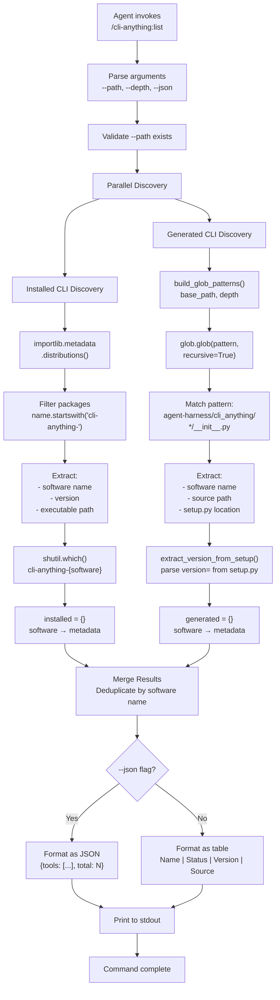
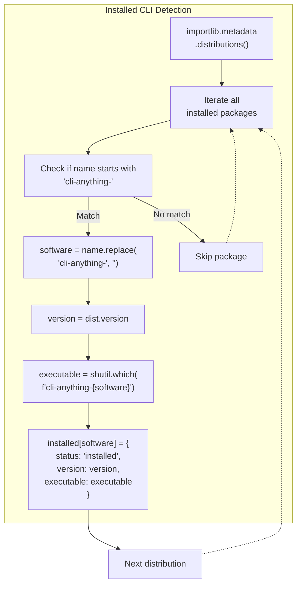
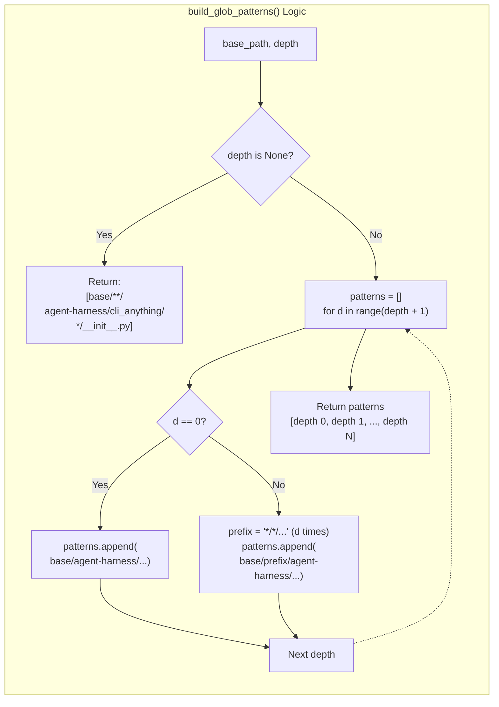
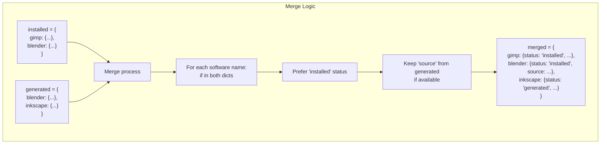
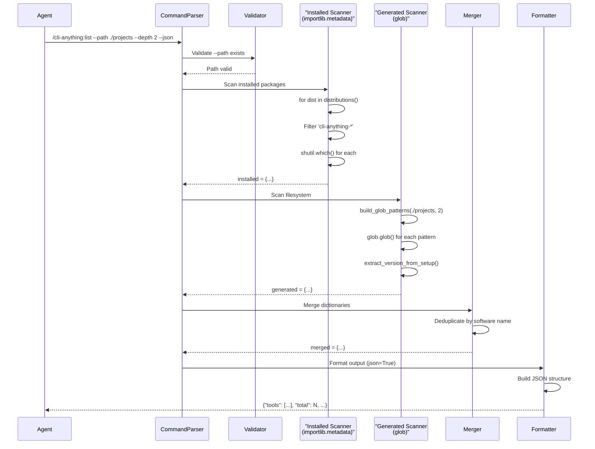

<!-- source: DeepWiki mcp.deepwiki.com · repo HKUDS/CLI-Anything · page 7.5 /cli-anything:list Command · fetched 2026-11-09 -->

# /cli-anything:list Command

<details>
<summary>Relevant source files</summary>

The following files were used as context for generating this wiki page:

- [cli-anything-plugin/commands/cli-anything.md](cli-anything-plugin/commands/cli-anything.md)
- [cli-anything-plugin/commands/list.md](cli-anything-plugin/commands/list.md)
- [cli-anything-plugin/commands/refine.md](cli-anything-plugin/commands/refine.md)
- [cli-anything-plugin/commands/test.md](cli-anything-plugin/commands/test.md)
- [cli-anything-plugin/commands/validate.md](cli-anything-plugin/commands/validate.md)
- [krita/agent-harness/KRITA.md](krita/agent-harness/KRITA.md)
- [krita/agent-harness/cli_anything/krita/README.md](krita/agent-harness/cli_anything/krita/README.md)
- [krita/agent-harness/cli_anything/krita/__init__.py](krita/agent-harness/cli_anything/krita/__init__.py)
- [krita/agent-harness/cli_anything/krita/__main__.py](krita/agent-harness/cli_anything/krita/__main__.py)

</details>


The `/cli-anything:list` command discovers and displays all CLI-Anything tools available in the system, including both installed packages (via `pip install`) and locally generated harnesses. This command provides a unified view of the CLI-Anything ecosystem on the current machine, supporting both human-readable table output and machine-parsable JSON format.

This page covers the discovery mechanisms, depth-limited scanning, and output formats for the list command. For generating new CLI harnesses, see [/cli-anything Command](7.1). For validating existing harnesses, see [/cli-anything:validate Command](7.4).

## Command Syntax and Options

The `/cli-anything:list` command accepts three optional parameters:

| Option | Type | Default | Description |
|--------|------|---------|-------------|
| `--path <directory>` | string | `.` (current directory) | Base directory to search for generated CLIs |
| `--depth <n>` | integer | unlimited | Maximum recursion depth (scans depths 0 through N inclusive) |
| `--json` | flag | false | Output in JSON format instead of table |

**Usage examples:**
```bash
/cli-anything:list                                    # All tools, unlimited depth
/cli-anything:list --depth 2                          # Limit to 2 levels deep
/cli-anything:list --path /projects/my-tools          # Search specific directory
/cli-anything:list --json                             # Machine-readable output
/cli-anything:list --path ./output --depth 2 --json   # Combined options
```

Sources: [cli-anything-plugin/commands/list.md:5-15]()

## Dual Discovery Architecture

The command employs two parallel discovery mechanisms to detect CLI-Anything tools:

### Natural Language to Code Entity Mapping: Discovery Logic

| Natural Language Concept | Code Entity / Pattern | File Reference |
|--------------------------|-----------------------|----------------|
| **Installed Package Scan** | `importlib.metadata.distributions()` | [cli-anything-plugin/commands/list.md:28-31]() |
| **Executable Lookup** | `shutil.which(f"cli-anything-{software}")` | [cli-anything-plugin/commands/list.md:37-37]() |
| **Generated Harness Scan** | `glob.glob(pattern, recursive=True)` | [cli-anything-plugin/commands/list.md:96-96]() |
| **Version Extraction** | `extract_version_from_setup(setup_path)` | [cli-anything-plugin/commands/list.md:61-61]() |
| **Namespace Marker** | `agent-harness/cli_anything/*/__init__.py` | [cli-anything-plugin/commands/list.md:48-48]() |

**Discovery Workflow Diagram**


Sources: [cli-anything-plugin/commands/list.md:18-115](), [cli-anything-plugin/commands/list.md:174-208]()

### Installed CLI Discovery

The command uses Python's `importlib.metadata` API to discover installed packages:

**Installed Package Detection Diagram**


The detection logic filters distributions by the `cli-anything-*` naming convention. For each matching package, it:
1. Extracts the software name by removing the `cli-anything-` prefix [cli-anything-plugin/commands/list.md:33-34]().
2. Retrieves the version from `dist.version` [cli-anything-plugin/commands/list.md:35-35]().
3. Locates the executable path using `shutil.which()` to verify PATH installation [cli-anything-plugin/commands/list.md:37-37]().

Sources: [cli-anything-plugin/commands/list.md:21-43](), [cli-anything-plugin/commands/list.md:186-188]()

### Generated CLI Discovery

The command scans the filesystem for generated CLI directories that haven't been installed yet:

**Generated Harness Detection Diagram**

```mermaid
graph TB
    subgraph "Generated CLI Detection"
        START_PATH["Base path<br/>(--path argument)"] --> BUILD["build_glob_patterns(<br/>base_path, depth)"]
        BUILD --> PATTERNS["Generate patterns for<br/>depths 0 through max_depth"]
        PATTERNS --> GLOB_LOOP["For each pattern:<br/>glob.glob(pattern, recursive=True)"]
        GLOB_LOOP --> FIND["Find matching paths:<br/>**/agent-harness/cli_anything/<br/>*/__init__.py"]
        FIND --> PARSE["Parse Path(init_file).parts"]
        PARSE --> LOCATE["Locate 'cli_anything'<br/>in path components"]
        LOCATE --> SOFTWARE["software = parts[i + 1]<br/>(next component)"]
        SOFTWARE --> SOURCE["source = path up to<br/>agent-harness/"]
        SOURCE --> SETUP["setup_path = source/<br/>setup.py"]
        SETUP --> EXTRACT_VER["extract_version_from_setup()<br/>regex: version='...'"]
        EXTRACT_VER --> STORE["generated[software] = {<br/>status: 'generated',<br/>version: version,<br/>executable: None,<br/>source: source<br/>}"]
    end
```


The filesystem scanning targets the standard CLI-Anything directory structure. The key pattern is `agent-harness/cli_anything/*/__init__.py`, where the `*` wildcard captures the software name [cli-anything-plugin/commands/list.md:48-48](). The `extract_version_from_setup()` function parses `setup.py` using regex to find the `version=` declaration [cli-anything-plugin/commands/list.md:61-68]().

Sources: [cli-anything-plugin/commands/list.md:45-115](), [cli-anything-plugin/commands/list.md:189-194]()

## Depth-Limited Scanning Mechanism

The `--depth` parameter controls filesystem recursion depth, enabling performance optimization for large directory trees:

**Recursion Depth Logic Diagram**


**Depth behavior:**
- `--depth 0`: Searches only the base path (no subdirectories) [cli-anything-plugin/commands/list.md:85-87]().
- `--depth 1`: Searches base path + one level of subdirectories [cli-anything-plugin/commands/list.md:88-91]().
- `--depth N`: Searches all depths from 0 through N (inclusive) [cli-anything-plugin/commands/list.md:84-84]().
- Unlimited (default): Uses `**` glob pattern for full recursion [cli-anything-plugin/commands/list.md:78-80]().

The `build_glob_patterns` function generates multiple glob patterns to ensure tools at all depths from 0 to N are discovered [cli-anything-plugin/commands/list.md:70-92]().

Sources: [cli-anything-plugin/commands/list.md:70-95](), [cli-anything-plugin/commands/list.md:191-194]()

## Version Extraction from setup.py

The `extract_version_from_setup()` function parses version metadata from Python package configuration:

**Regex Version Extraction Diagram**
```mermaid
flowchart TB
    FUNC["extract_version_from_setup(setup_path)"] --> READ["Path(setup_path).read_text()"]
    READ --> REGEX["re.search(<br/>r'version\\s*=\\s*[\"']([^\"']+)[\"']',<br/>content)"]
    REGEX --> MATCH{"Match found?"}
    MATCH -->|Yes| EXTRACT["return match.group(1)"]
    MATCH -->|No| NONE["return None"]
    
    READ -.->|Exception| CATCH["except: return None"]
```

The regex pattern `version\s*=\s*["\']([^"\']+)["\']` matches common `setup.py` version declarations [cli-anything-plugin/commands/list.md:65-65](). This function handles missing files and parsing errors gracefully by returning `None` [cli-anything-plugin/commands/list.md:67-68]().

Sources: [cli-anything-plugin/commands/list.md:61-68]()

## Result Merging and Deduplication

The command merges installed and generated CLI data, preferring installed status when duplicates exist:

**Deduplication and Merge Logic Diagram**


When a CLI appears in both `installed` and `generated` dictionaries:
1. Status field shows `"installed"` (takes precedence) [cli-anything-plugin/commands/list.md:119-120]().
2. Executable path comes from installed metadata [cli-anything-plugin/commands/list.md:120-120]().
3. Source path comes from generated metadata (shows where code lives) [cli-anything-plugin/commands/list.md:121-121]().

Sources: [cli-anything-plugin/commands/list.md:117-122](), [cli-anything-plugin/commands/list.md:196-199]()

## Output Formats

### Table Format (Default)

The default output uses a columnar table with aligned fields:

```
CLI-Anything Tools (found 5)

Name            Status      Version   Source
──────────────────────────────────────────────────────────────
gimp            installed   1.0.0     ./gimp/agent-harness
blender         installed   1.0.0     ./blender/agent-harness
inkscape        generated   1.0.0     ./inkscape/agent-harness
audacity        generated   1.0.0     ./audacity/agent-harness
libreoffice     generated   1.0.0     ./libreoffice/agent-harness
```

Sources: [cli-anything-plugin/commands/list.md:125-137]()

### JSON Format (--json)

The `--json` flag produces structured output for programmatic parsing [cli-anything-plugin/commands/list.md:139-163]().

```json
{
  "tools": [
    {
      "name": "gimp",
      "status": "installed",
      "version": "1.0.0",
      "executable": "/usr/local/bin/cli-anything-gimp",
      "source": "./gimp/agent-harness"
    },
    {
      "name": "inkscape",
      "status": "generated",
      "version": "1.0.0",
      "executable": null,
      "source": "./inkscape/agent-harness"
    }
  ],
  "total": 2,
  "installed": 1,
  "generated_only": 1
}
```

Sources: [cli-anything-plugin/commands/list.md:139-163](), [cli-anything-plugin/commands/list.md:201-207]()

## Error Handling

The command includes basic error handling for common scenarios:

| Scenario | Action |
|----------|--------|
| No CLIs found | Show "No CLI-Anything tools found" message |
| Invalid `--path` | Show error: "Path not found: <path>" |
| Permission denied | Skip directory, continue scanning, show warning |

Sources: [cli-anything-plugin/commands/list.md:165-172]()

## Implementation Execution Flow

The complete execution sequence when an agent invokes the command:

### Code Entity Space Mapping: Sequence Flow

| Phase | Responsible Code Entity | File Reference |
|-------|-------------------------|----------------|
| **Argument Parsing** | CLI Plugin Handler | [cli-anything-plugin/commands/list.md:177-180]() |
| **Path Validation** | (Implicit in `build_glob_patterns` and `glob.glob`) | [cli-anything-plugin/commands/list.md:182-184]() |
| **Installed Scan** | `importlib.metadata.distributions()` | [cli-anything-plugin/commands/list.md:31-31]() |
| **Path Generation** | `build_glob_patterns()` | [cli-anything-plugin/commands/list.md:70-70]() |
| **Local File Scan** | `glob.glob()` | [cli-anything-plugin/commands/list.md:96-96]() |
| **Metadata Extraction** | `extract_version_from_setup()` | [cli-anything-plugin/commands/list.md:61-61]() |
| **Result Merging** | (Internal logic) | [cli-anything-plugin/commands/list.md:196-199]() |
| **Output Formatting** | (Internal logic) | [cli-anything-plugin/commands/list.md:201-203]() |
| **Printing Results** | (Internal logic) | [cli-anything-plugin/commands/list.md:205-207]() |

**Command Execution Sequence Diagram**


Sources: [cli-anything-plugin/commands/list.md:174-208]()

## Directory Structure Pattern Matching

The command expects the standard CLI-Anything directory layout:

```
<software>/
└── agent-harness/              ← Source path boundary
    ├── setup.py                ← Version extraction target
    └── cli_anything/           ← Namespace package (no __init__.py)
        └── <software>/         ← Software-specific package
            ├── __init__.py     ← Detection marker
            ├── <software>_cli.py
            ├── core/
            ├── utils/
            └── tests/
```

The glob pattern `**/agent-harness/cli_anything/*/__init__.py` matches the `__init__.py` file inside the software-specific package [cli-anything-plugin/commands/list.md:48-48](). The command extracts the software name from the path component following `cli_anything/` [cli-anything-plugin/commands/list.md:100-101]() and identifies the `agent-harness` directory as the source root [cli-anything-plugin/commands/list.md:103-104]().

Sources: [cli-anything-plugin/commands/list.md:96-114](), [cli-anything-plugin/commands/cli-anything.md:89-110]()

---

