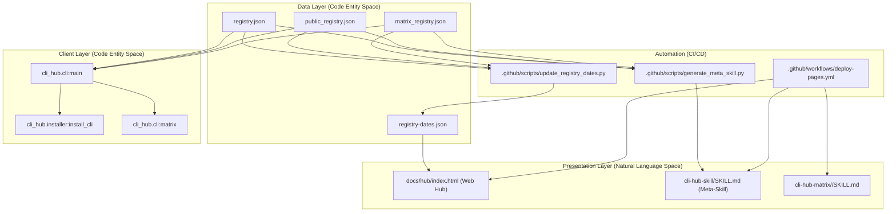

<!-- source: DeepWiki mcp.deepwiki.com · repo HKUDS/CLI-Anything · page 8 CLI-Anything Hub · fetched 2026-11-09 -->

# CLI-Anything Hub

<details>
<summary>Relevant source files</summary>

The following files were used as context for generating this wiki page:

- [.github/scripts/generate_meta_skill.py](.github/scripts/generate_meta_skill.py)
- [.github/scripts/tests/test_update_registry_dates.py](.github/scripts/tests/test_update_registry_dates.py)
- [.github/scripts/update_registry_dates.py](.github/scripts/update_registry_dates.py)
- [.github/workflows/deploy-pages.yml](.github/workflows/deploy-pages.yml)
- [cli-hub-meta-skill/SKILL.md](cli-hub-meta-skill/SKILL.md)
- [cli-hub/README.md](cli-hub/README.md)
- [cli-hub/cli_hub/__init__.py](cli-hub/cli_hub/__init__.py)
- [cli-hub/cli_hub/analytics.py](cli-hub/cli_hub/analytics.py)
- [cli-hub/cli_hub/cli.py](cli-hub/cli_hub/cli.py)
- [cli-hub/cli_hub/installer.py](cli-hub/cli_hub/installer.py)
- [cli-hub/cli_hub/preview.py](cli-hub/cli_hub/preview.py)
- [cli-hub/cli_hub/registry.py](cli-hub/cli_hub/registry.py)
- [cli-hub/setup.py](cli-hub/setup.py)
- [cli-hub/tests/test_cli_hub.py](cli-hub/tests/test_cli_hub.py)
- [docs/hub/index-modern.html](docs/hub/index-modern.html)
- [docs/hub/index.html](docs/hub/index.html)

</details>


The **CLI-Anything Hub** is the centralized infrastructure for registering, discovering, and deploying agent-native CLIs. It transforms the repository from a collection of scripts into a searchable marketplace where AI agents can autonomously find and install the tools they need to control professional GUI software.

The Hub consists of three primary layers:
1.  **The Registry**: Machine-readable files (`registry.json` and `public_registry.json`) that act as the single source of truth for all supported harnesses and public tools.
2.  **The CLI Manager**: The `cli-hub` Python package which provides a local command-line interface for browsing and installing tools from the registry.
3.  **The Web Portal and Meta-Skill**: A GitHub Pages-hosted frontend (`docs/hub/index.html`) for human discovery and an agent-discoverable catalog (`SKILL.md`) for LLM browsing.

### Hub Ecosystem Overview

The following diagram illustrates how the Hub connects the underlying code entities to the discovery interfaces used by humans and agents.

**Hub Architecture and Discovery Flow**

Sources: [.github/workflows/deploy-pages.yml:1-17](), [.github/scripts/update_registry_dates.py:1-214](), [.github/scripts/generate_meta_skill.py:1-208](), [cli-hub/cli_hub/cli.py:1-58](), [cli-hub/cli_hub/installer.py](), [cli-hub/cli_hub/registry.py](), [cli-hub/cli_hub/matrix.py]()

---

## 8.1 Registry and Catalog
The Hub is anchored by `registry.json`, `public_registry.json`, and `matrix_registry.json`. These files serve as the source of truth for CLI metadata, including categories, install commands, and entry points. `registry.json` lists CLI-Anything harness CLIs, `public_registry.json` covers third-party CLIs, and `matrix_registry.json` defines curated capability matrices. The `cli-hub` Python package (`cli-hub/cli_hub/`) provides the core logic for interacting with these registries, including fetching, searching, and installing CLIs. Key modules include `registry.py` for data access, `installer.py` for managing installations, `preview.py` for rendering CLI information, and `analytics.py` for usage tracking. Agent discovery is facilitated by `SKILL.txt` (or `SKILL.md`) files, which are generated or referenced from these registries.

For details, see [Registry and Catalog](#8.1).

**Registry Data Mapping**
```mermaid
graph LR
    subgraph "Registry JSON Schema"
        CN["cli.display_name"]
        CD["cli.description"]
        CI["cli.install_cmd"]
        CC["cli.category"]
        CE["cli.entry_point"]
        CS["cli.skill_md"]
    end

    subgraph "cli-hub list Output"
        CAT["Category Header"]
        ROW["● name  description"]
    end

    subgraph "cli-hub-skill/SKILL.md"
        SKILL_NAME["YAML Frontmatter: name"]
        SKILL_DESC["YAML Frontmatter: description"]
        SKILL_TABLE["Markdown Table: Name, Description, Install, Skill"]
    end

    CN --> ROW
    CD --> ROW
    CC --> CAT
    CE --> ROW
    CN --> SKILL_TABLE
    CD --> SKILL_TABLE
    CI --> SKILL_TABLE
    CS --> SKILL_TABLE
    SKILL_NAME --> "cli-hub-meta-skill"
    SKILL_DESC --> "Browse and install CLIs..."
```
Sources: [cli-hub/cli_hub/registry.py](), [cli-hub/cli_hub/installer.py](), [cli-hub/cli_hub/preview.py](), [cli-hub/cli_hub/analytics.py](), [cli-hub/cli_hub/cli.py:114-216](), [.github/scripts/generate_meta_skill.py:42-137]()

---

## 8.2 Hub Web Portal and CI/CD
The human-facing side of the Hub is hosted at `docs/hub/index.html`, providing a web portal for browsing CLIs. This portal, along with `demos.html` and `docs.html`, is deployed to GitHub Pages. The `.well-known` directory contains agent cards, `llms.txt` for LLM context, and `openapi.json` for API descriptions. The deployment is automated by the `.github/workflows/deploy-pages.yml` workflow, triggered by pushes to relevant files. This workflow executes scripts like `update_registry_dates.py` to fetch last-modified dates for CLIs from Git, PyPI, or npm, and `generate_meta_skill.py` to create the `cli-hub-skill/SKILL.md` (Meta-Skill) file. It also handles PR labeler and skill sync workflows to maintain consistency.

For details, see [Hub Web Portal and CI/CD](#8.2).

**CI/CD Pipeline Logic**
| Script / Workflow | Role | Code Reference |
| :--- | :--- | :--- |
| `deploy-pages.yml` | Orchestrates Python scripts, Jekyll build, and Pages deployment. | [.github/workflows/deploy-pages.yml:1-101]() |
| `update_registry_dates.py` | Resolves harness paths and fetches update timestamps from Git, PyPI, or NPM. | [.github/scripts/update_registry_dates.py:1-214]() |
| `generate_meta_skill.py` | Aggregates all CLI metadata into the `cli-hub-skill/SKILL.md` file. | [.github/scripts/generate_meta_skill.py:1-208]() |
| `index.html` | Provides the CSS/JS frontend for the web-based discovery portal. | [docs/hub/index.html:1-131]() |
| `cli-hub/setup.py` | Defines the `cli-anything-hub` package, including `_matrix_data` vendoring. | [cli-hub/setup.py:1-104]() |

Sources: [.github/workflows/deploy-pages.yml:1-101](), [.github/scripts/update_registry_dates.py:1-214](), [.github/scripts/generate_meta_skill.py:1-208](), [docs/hub/index.html:1-131](), [cli-hub/setup.py:1-104]()

---

## 8.3 Capability Matrices and Meta-Skill
The Hub extends beyond individual CLIs to support "Capability Matrices," defined in `cli-hub-matrix/`. These matrices, such as `3d-cad`, `game-development`, `image-design`, `knowledge-research`, and `video-creation`, represent curated workflows that combine multiple CLIs and other tools to achieve complex goals. The `cli-hub` tool provides subcommands like `matrix` and `can` to interact with these matrices, allowing users to list, inspect, preflight, and install them. The `preflight` and `doctor` flows help identify missing dependencies, while `resume` allows continuation of interrupted installations. The `cli-hub-meta-skill` (`cli-hub-meta-skill/SKILL.md`) is a high-level skill that agents can use to discover these matrices and their capabilities, bridging the gap between natural language requests and executable workflows.

For details, see [Capability Matrices and Meta-Skill](#8.3).
Sources: [cli-hub/cli_hub/cli.py:13-23](), [cli-hub/cli_hub/matrix.py:1-31](), [cli-hub/cli_hub/matrix_skill.py:1-38](), [cli-hub-meta-skill/SKILL.md:1-115]()

---

