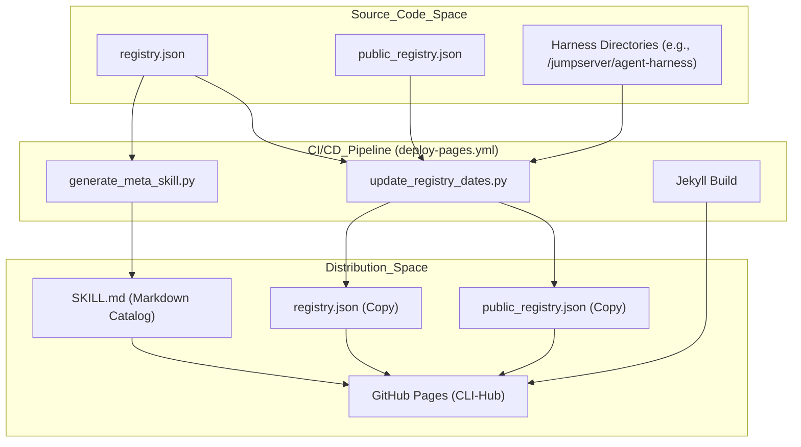
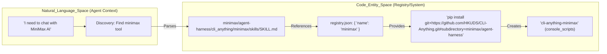

<!-- source: DeepWiki mcp.deepwiki.com · repo HKUDS/CLI-Anything · page 8.1 Registry and Catalog · fetched 2026-11-09 -->

# Registry and Catalog

Relevant source files

The following files were used as context for generating this wiki page:

- [.github/scripts/generate_meta_skill.py](.github/scripts/generate_meta_skill.py)
- [.github/scripts/tests/test_update_registry_dates.py](.github/scripts/tests/test_update_registry_dates.py)
- [.github/scripts/update_registry_dates.py](.github/scripts/update_registry_dates.py)
- [.github/workflows/deploy-pages.yml](.github/workflows/deploy-pages.yml)
- [cli-hub-meta-skill/SKILL.md](cli-hub-meta-skill/SKILL.md)
- [cli-hub/README.md](cli-hub/README.md)
- [cli-hub/cli_hub/__init__.py](cli-hub/cli_hub/__init__.py)
- [cli-hub/cli_hub/analytics.py](cli-hub/cli_hub/analytics.py)
- [cli-hub/cli_hub/cli.py](cli-hub/cli_hub/cli.py)
- [cli-hub/cli_hub/installer.py](cli-hub/cli_hub/installer.py)
- [cli-hub/cli_hub/preview.py](cli-hub/cli_hub/preview.py)
- [cli-hub/cli_hub/registry.py](cli-hub/cli_hub/registry.py)
- [cli-hub/setup.py](cli-hub/setup.py)
- [cli-hub/tests/test_cli_hub.py](cli-hub/tests/test_cli_hub.py)
- [docs/hub/index-modern.html](docs/hub/index-modern.html)
- [docs/hub/index.html](docs/hub/index.html)
- [drawio/agent-harness/DRAWIO.md](drawio/agent-harness/DRAWIO.md)
- [drawio/agent-harness/cli_anything/drawio/README.md](drawio/agent-harness/cli_anything/drawio/README.md)
- [drawio/agent-harness/cli_anything/drawio/__init__.py](drawio/agent-harness/cli_anything/drawio/__init__.py)
- [drawio/agent-harness/cli_anything/drawio/core/__init__.py](drawio/agent-harness/cli_anything/drawio/core/__init__.py)
- [drawio/agent-harness/cli_anything/drawio/core/connectors.py](drawio/agent-harness/cli_anything/drawio/core/connectors.py)
- [drawio/agent-harness/cli_anything/drawio/core/export.py](drawio/agent-harness/cli_anything/drawio/core/export.py)
- [drawio/agent-harness/cli_anything/drawio/core/pages.py](drawio/agent-harness/cli_anything/drawio/core/pages.py)
- [drawio/agent-harness/cli_anything/drawio/core/project.py](drawio/agent-harness/cli_anything/drawio/core/project.py)
- [drawio/agent-harness/cli_anything/drawio/core/shapes.py](drawio/agent-harness/cli_anything/drawio/core/shapes.py)
- [drawio/agent-harness/cli_anything/drawio/drawio_cli.py](drawio/agent-harness/cli_anything/drawio/drawio_cli.py)
- [drawio/agent-harness/cli_anything/drawio/tests/test_core.py](drawio/agent-harness/cli_anything/drawio/tests/test_core.py)
- [drawio/agent-harness/cli_anything/drawio/utils/drawio_xml.py](drawio/agent-harness/cli_anything/drawio/utils/drawio_xml.py)
- [minimax/agent-harness/FIX_NOTES.md](minimax/agent-harness/FIX_NOTES.md)
- [minimax/agent-harness/cli_anything/minimax/README.md](minimax/agent-harness/cli_anything/minimax/README.md)
- [minimax/agent-harness/cli_anything/minimax/minimax_cli.py](minimax/agent-harness/cli_anything/minimax/minimax_cli.py)
- [minimax/agent-harness/cli_anything/minimax/skills/SKILL.md](minimax/agent-harness/cli_anything/minimax/skills/SKILL.md)
- [minimax/agent-harness/cli_anything/minimax/tests/TEST.md](minimax/agent-harness/cli_anything/minimax/tests/TEST.md)
- [minimax/agent-harness/cli_anything/minimax/tests/test_core.py](minimax/agent-harness/cli_anything/minimax/tests/test_core.py)
- [minimax/agent-harness/cli_anything/minimax/tests/test_full_e2e.py](minimax/agent-harness/cli_anything/minimax/tests/test_full_e2e.py)
- [minimax/agent-harness/cli_anything/minimax/tests/test_tts_extended.py](minimax/agent-harness/cli_anything/minimax/tests/test_tts_extended.py)
- [minimax/agent-harness/cli_anything/minimax/utils/minimax_backend.py](minimax/agent-harness/cli_anything/minimax/utils/minimax_backend.py)
- [minimax/agent-harness/setup.py](minimax/agent-harness/setup.py)
- [public_registry.json](public_registry.json)
- [registry.json](registry.json)
- [siyuan/agent-harness/setup.py](siyuan/agent-harness/setup.py)
- [skills/cli-anything-minimax/SKILL.md](skills/cli-anything-minimax/SKILL.md)
- [skills/cli-anything-siyuan/SKILL.md](skills/cli-anything-siyuan/SKILL.md)

The **Registry and Catalog** system serves as the centralized "Source of Truth" for the CLI-Anything ecosystem. It manages the metadata, installation procedures, and discovery mechanisms for all agent-native CLI harnesses. This system enables AI agents to autonomously find, install, and utilize tools for professional software like GIMP, Blender, CloudCompare, and Zotero.

## 1. The Registry (registry.json)

At the heart of the hub is `registry.json`, a machine-readable manifest that defines every available CLI harness. This file is used by the Hub Web Portal to render the UI and by automation scripts to generate discovery skills. A secondary `public_registry.json` tracks third-party CLIs managed via `npm`, `brew`, or other package managers [public_registry.json:4-17]().

### Key Metadata Fields
Each entry in the `clis` array contains:
*   **`name`**: The unique identifier for the software (e.g., `wiremock`, `anygen`) [registry.json:9-9]().
*   **`install_cmd`**: The exact shell command required to install the harness, typically pointing to a specific git subdirectory [registry.json:16-16]().
*   **`entry_point`**: The console script name registered in PATH (e.g., `cli-anything-wiremock`) [registry.json:17-17]().
*   **`skill_md`**: The relative path to the `SKILL.md` file within the repository for deep agent integration [registry.json:18-18]().
*   **`category`**: Functional grouping (e.g., `testing`, `generation`, `3d`) used for catalog organization [registry.json:19-19]().
*   **`requires`**: Hard dependencies or API keys needed for the tool to function (e.g., `ANYGEN_API_KEY`) [registry.json:108-108]().

### Registry Structure and Data Flow
The following diagram illustrates how `registry.json` interacts with the CI/CD pipeline and the external agent environment.

**Registry Data Flow Architecture**

Sources: [.github/workflows/deploy-pages.yml:7-15](), [.github/scripts/update_registry_dates.py:17-21](), [registry.json:1-7]()

---

## 2. Agent Discovery via SKILL.md

To make the catalog "agent-native," the system generates a master `SKILL.md` file. This file is specifically designed for LLMs to read and parse to understand what tools are available and how to install them.

### Catalog Generation
The `SKILL.md` is generated by `generate_meta_skill.py` and served via GitHub Pages or uploaded to cloud storage [cli-hub/setup.py:64-65](). It aggregates metadata from both official harnesses and public CLIs.

### Discovery Logic
Agents use the "Meta-Skill" to navigate the hub:
1.  **Fetch**: The agent reads the catalog (e.g., from `clianything.cc`).
2.  **Identify**: It searches for a tool matching the user's request (e.g., "I need to mock an API" -> `wiremock`).
3.  **Install**: It executes the `install_cmd` found in the catalog [registry.json:16-16]().
4.  **Verify**: It uses the standard entry point naming convention `cli-anything-<name>` [registry.json:17-17]().

**Natural Language to Code Entity Mapping**

Sources: [minimax/agent-harness/cli_anything/minimax/skills/SKILL.md:1-6](), [registry.json:16-17](), [cli-hub/cli_hub/registry.py:12-14]()

---

## 3. Local Catalog Management (cli-hub)

While the JSON files manage the global catalog, the `cli-hub` package provides a local management interface for users and agents to interact with these registries.

### Implementation Detail: The cli-hub CLI
The `cli-hub` utility implements commands to browse and manage the catalog:
*   **`list`**: Fetches all CLIs from the registry and groups them by category for display [cli-hub/cli_hub/cli.py:177-216]().
*   **`search`**: Filters the registry by name, description, or category [cli-hub/cli_hub/cli.py:220-225]().
*   **`install` / `uninstall`**: Executes the logic defined in `installer.py` to manage local tool availability [cli-hub/cli_hub/cli.py:129-158]().

### Analytics and Context Detection
The hub includes an analytics layer to track tool adoption. It uses `detect_invocation_context()` to determine if a command was run by a human or an agent by inspecting environment variables like `CLAUDE_CODE` or parent process names [cli-hub/cli_hub/analytics.py:138-160]().

| Command | Function | Source |
| :--- | :--- | :--- |
| `cli-hub list` | Display available tools from registry | [cli-hub/cli_hub/cli.py:177-182]() |
| `cli-hub install <name>` | Install a tool using registry metadata | [cli-hub/cli_hub/cli.py:129-131]() |
| `cli-hub info <name>` | Show detailed metadata for a tool | [cli-hub/cli_hub/cli.py:220-225]() |

Sources: [cli-hub/cli_hub/cli.py:9-33](), [cli-hub/cli_hub/installer.py:24-33]()

---

## 4. Maintenance Automation

The catalog is kept up-to-date through GitHub Actions defined in `deploy-pages.yml`.

### Date Synchronization
The script `update_registry_dates.py` performs the following:
1.  Resolves the local harness path for each CLI in `registry.json` [update_registry_dates.py:188-205]().
2.  Retrieves the most recent git commit date for the specific directory [update_registry_dates.py:68-87]().
3.  For public CLIs, it fetches release dates from PyPI or npm registries [update_registry_dates.py:131-169]().

### Meta-Skill Generation
`generate_meta_skill.py` aggregates individual `SKILL.md` files into the master catalog. This ensures that when a developer adds a new command to a harness (like adding `probe` to `quietshrink`), the global agent catalog reflects these changes automatically [.github/workflows/deploy-pages.yml:44-45]().

Sources: [.github/scripts/update_registry_dates.py:51-65](), [.github/workflows/deploy-pages.yml:1-16]()

---

