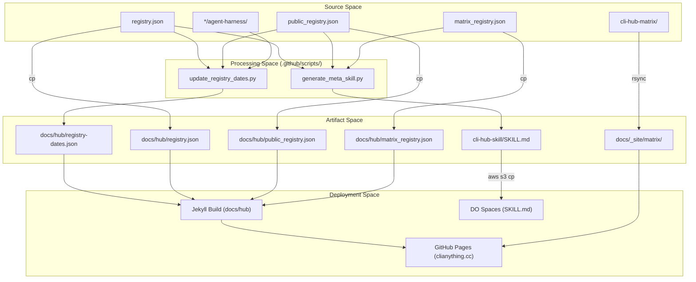

<!-- source: DeepWiki mcp.deepwiki.com · repo HKUDS/CLI-Anything · page 8.2 Hub Web Portal and CI/CD · fetched 2026-11-09 -->

# Hub Web Portal and CI/CD

<details>
<summary>Relevant source files</summary>

The following files were used as context for generating this wiki page:

- [.github/labeler.yml](.github/labeler.yml)
- [.github/scripts/generate_meta_skill.py](.github/scripts/generate_meta_skill.py)
- [.github/scripts/pr-labeler.js](.github/scripts/pr-labeler.js)
- [.github/scripts/sync_root_skills.py](.github/scripts/sync_root_skills.py)
- [.github/scripts/tests/pr-labeler-fixtures.json](.github/scripts/tests/pr-labeler-fixtures.json)
- [.github/scripts/tests/pr-labeler.test.js](.github/scripts/tests/pr-labeler.test.js)
- [.github/scripts/tests/test_update_registry_dates.py](.github/scripts/tests/test_update_registry_dates.py)
- [.github/scripts/update_registry_dates.py](.github/scripts/update_registry_dates.py)
- [.github/scripts/validate_root_skills.py](.github/scripts/validate_root_skills.py)
- [.github/workflows/deploy-pages.yml](.github/workflows/deploy-pages.yml)
- [.github/workflows/pr-labeler-tests.yml](.github/workflows/pr-labeler-tests.yml)
- [.github/workflows/pr-labeler.yml](.github/workflows/pr-labeler.yml)
- [cli-hub-meta-skill/SKILL.md](cli-hub-meta-skill/SKILL.md)
- [cli-hub/README.md](cli-hub/README.md)
- [cli-hub/cli_hub/__init__.py](cli-hub/cli_hub/__init__.py)
- [cli-hub/cli_hub/analytics.py](cli-hub/cli_hub/analytics.py)
- [cli-hub/cli_hub/cli.py](cli-hub/cli_hub/cli.py)
- [cli-hub/cli_hub/installer.py](cli-hub/cli_hub/installer.py)
- [cli-hub/cli_hub/preview.py](cli-hub/cli_hub/preview.py)
- [cli-hub/cli_hub/registry.py](cli-hub/cli_hub/registry.py)
- [cli-hub/setup.py](cli-hub/setup.py)
- [cli-hub/tests/test_cli_hub.py](cli-hub/tests/test_cli_hub.py)
- [docs/hub/.well-known/agent-card.json](docs/hub/.well-known/agent-card.json)
- [docs/hub/.well-known/agent-skills/index.json](docs/hub/.well-known/agent-skills/index.json)
- [docs/hub/.well-known/agent.json](docs/hub/.well-known/agent.json)
- [docs/hub/.well-known/ai-plugin.json](docs/hub/.well-known/ai-plugin.json)
- [docs/hub/_config.yml](docs/hub/_config.yml)
- [docs/hub/assets/demos/arcgis-pro-live-bridge-demo-poster.jpg](docs/hub/assets/demos/arcgis-pro-live-bridge-demo-poster.jpg)
- [docs/hub/assets/demos/arcgis-pro-live-bridge-demo.mp4](docs/hub/assets/demos/arcgis-pro-live-bridge-demo.mp4)
- [docs/hub/assets/demos/blender-orbital-relay-drone-preview-trajectory-poster.jpg](docs/hub/assets/demos/blender-orbital-relay-drone-preview-trajectory-poster.jpg)
- [docs/hub/assets/demos/blender-orbital-relay-drone-preview-trajectory.mp4](docs/hub/assets/demos/blender-orbital-relay-drone-preview-trajectory.mp4)
- [docs/hub/assets/demos/drawio-demo-poster.jpg](docs/hub/assets/demos/drawio-demo-poster.jpg)
- [docs/hub/assets/demos/drawio-demo.mp4](docs/hub/assets/demos/drawio-demo.mp4)
- [docs/hub/assets/demos/freecad-curiosity-preview-trajectory-poster.jpg](docs/hub/assets/demos/freecad-curiosity-preview-trajectory-poster.jpg)
- [docs/hub/assets/demos/freecad-curiosity-preview-trajectory.mp4](docs/hub/assets/demos/freecad-curiosity-preview-trajectory.mp4)
- [docs/hub/assets/demos/slay-the-spire-ii-gameplay-poster.jpg](docs/hub/assets/demos/slay-the-spire-ii-gameplay-poster.jpg)
- [docs/hub/assets/demos/slay-the-spire-ii-gameplay.mp4](docs/hub/assets/demos/slay-the-spire-ii-gameplay.mp4)
- [docs/hub/demos.html](docs/hub/demos.html)
- [docs/hub/docs.html](docs/hub/docs.html)
- [docs/hub/index-modern.html](docs/hub/index-modern.html)
- [docs/hub/index.html](docs/hub/index.html)
- [docs/hub/index.md](docs/hub/index.md)
- [docs/hub/llms-full.txt](docs/hub/llms-full.txt)
- [docs/hub/llms.txt](docs/hub/llms.txt)
- [docs/hub/openapi.json](docs/hub/openapi.json)
- [docs/hub/sitemap.xml](docs/hub/sitemap.xml)
- [skills/cli-anything-iterm2-ctl/SKILL.md](skills/cli-anything-iterm2-ctl/SKILL.md)
- [skills/cli-anything-qgis/SKILL.md](skills/cli-anything-qgis/SKILL.md)

</details>


The CLI-Anything Hub is a centralized discovery and distribution system for agent-native CLIs. It consists of a web-based portal for human users and a specialized "Meta-Skill" for AI agents, both maintained through an automated CI/CD pipeline. This infrastructure ensures that as new application harnesses or third-party CLIs are added to the ecosystem, the registry and its public-facing interfaces remain synchronized.

## CI/CD Pipeline Architecture

The lifecycle of the Hub is managed by a GitHub Actions workflow that triggers on changes to any `agent-harness` directory, the primary `registry.json`, the `public_registry.json`, or the hub source files [[.github/workflows/deploy-pages.yml:4-15]](). The pipeline performs data aggregation, metadata generation, and deployment to GitHub Pages.

### Data Flow and Automation

The following diagram illustrates how raw repository data is transformed into the live Hub portal and agent-readable catalog.

**Hub Data Transformation Pipeline**

**Sources:** [[.github/workflows/deploy-pages.yml:41-69]](), [[.github/scripts/update_registry_dates.py:17-21]](), [[.github/scripts/generate_meta_skill.py:8-11]]()

### Key Automation Scripts

1.  **`update_registry_dates.py`**: This script iterates through all entries in the registry and uses `git log` to determine the last modification date of each specific harness directory [[.github/scripts/update_registry_dates.py:104-123]](). For third-party CLIs, it attempts to fetch last-modified dates from the GitHub API, PyPI, or npm registry [[.github/scripts/update_registry_dates.py:125-214]](). It outputs `registry-dates.json` for the frontend.
2.  **`generate_meta_skill.py`**: This script transforms `registry.json`, `public_registry.json`, and `matrix_registry.json` into a unified Markdown file [[.github/scripts/generate_meta_skill.py:7-22]](). It groups CLIs by category and formats them into tables containing display names, descriptions, and `cli-hub install` commands [[.github/scripts/generate_meta_skill.py:74-111]](). It also includes sections for capability matrices.

**Sources:** [[.github/scripts/update_registry_dates.py:1-214]](), [[.github/scripts/generate_meta_skill.py:1-159]]()

---

## Hub Web Portal

The Hub Web Portal, hosted at `clianything.cc`, provides a high-performance interface for exploring the CLI ecosystem.

### Frontend Implementation
The portal (located at `docs/hub/index.html`) is a modern Single Page Application (SPA) with a custom CSS variable system for dark and light modes [[docs/hub/index.html:34-99]](). It features:
*   **Hero Animation**: A motion-ready header that introduces the Hub to users [[docs/hub/index.html:220-241]]().
*   **Dynamic Registry Loading**: Fetches the central `registry.json` at runtime to populate the CLI list.
*   **Platform Integration**: Provides setup instructions for Claude Code, OpenCode, and other agent platforms.

### Modern Atelier Interface
A secondary modern interface (`docs/hub/index-modern.html`) provides a more refined "Atelier" aesthetic using the Fraunces and IBM Plex font families [[docs/hub/index-modern.html:9-10]](). It uses advanced CSS radial gradients and glassmorphism to present the CLI catalog [[docs/hub/index-modern.html:143-160]]().

**Sources:** [[docs/hub/index.html:1-131]](), [[docs/hub/index-modern.html:1-216]]()

---

## CLI-Hub Package Manager

The `cli-hub` Python package serves as the bridge between the Hub's web registry and the user's local environment.

### Core Functionality
`cli-hub` is a specialized package manager that handles the lifecycle of both official harnesses and third-party CLIs [[cli-hub/setup.py:5-31]]().
*   **Discovery**: `cli-hub list` and `cli-hub search` query the live registry to find tools [[cli-hub/cli_hub/cli.py:176-216]]().
*   **Installation**: `cli-hub install <name>` detects the appropriate strategy (pip, npm, brew, etc.) and executes the install command defined in the registry [[cli-hub/cli_hub/cli.py:130-146]]().
*   **Analytics**: Includes opt-out-able telemetry (PostHog/Umami) to track tool adoption and detect if the caller is a human or an AI agent [[cli-hub/cli_hub/analytics.py:138-191]]().

### Preview Consumer
The hub includes a generic preview consumer for harnesses that support visual output. It can inspect bundles, render HTML summaries, and watch live sessions over localhost [[cli-hub/cli_hub/preview.py:47-57]]().

**Sources:** [[cli-hub/cli_hub/cli.py:1-216]](), [[cli-hub/cli_hub/analytics.py:1-188]](), [[cli-hub/cli_hub/preview.py:47-57]]()

---

## Meta-Skill for AI Agents

The "Meta-Skill" is a specialized `SKILL.md` file generated by the CI pipeline to allow AI agents to discover and install tools within the CLI-Anything ecosystem.

### Structure of the Meta-Skill
The generated skill (located in `cli-hub-skill/SKILL.md`) contains:
*   **YAML Frontmatter**: Identifies the tool as `cli-anything-hub` and provides a high-level description for LLM context windows [[.github/scripts/generate_meta_skill.py:34-40]]().
*   **Unified Install Pattern**: Instructs agents to use `pip install cli-anything-hub` followed by `cli-hub install <name>` [[.github/scripts/generate_meta_skill.py:46-66]]().
*   **Categorized Registry**: Tables mapping every supported application (GIMP, Blender, Feishu, etc.) to its description and entry point [[.github/scripts/generate_meta_skill.py:74-111]]().

**Sources:** [[.github/scripts/generate_meta_skill.py:34-154]](), [[cli-hub/setup.py:18-18]]()

---

## Technical Mapping: Registry to Hub

The following diagram bridges the static configuration in `registry.json` and `public_registry.json` to the generated entities in the Hub and CLI-Hub tool.

**Code Entity Mapping: Registry to Hub Artifacts**
```mermaid
classDiagram
    class Registry_JSON {
        +registry.json
        +public_registry.json
        +matrix_registry.json
    }
    
    class UpdateRegistryDates_py {
        +get_last_modified()
        +get_github_repo_date()
        +get_pypi_date()
        +get_npm_date()
        +resolve_harness_path()
        +extract_external_source_url()
        +main()
    }
    
    class GenerateMetaSkill_py {
        +main()
        +generate_meta_skill_content()
    }

    class CLI_Hub_Tool {
        +cli_hub.cli.main()
        +cli_hub.installer.install_cli()
        +cli_hub.analytics.track_event()
        +cli_hub.registry.fetch_all_clis()
        +cli_hub.matrix.fetch_all_matrices()
    }

    class GitHubPages_WebPortal {
        +docs/hub/index.html
        +docs/hub/demos.html
        +docs/hub/docs.html
        +docs/hub/.well-known/agent-card.json
        +docs/hub/.well-known/ai-plugin.json
        +docs/hub/.well-known/agent-skills/index.json
        +docs/hub/llms.txt
        +docs/hub/openapi.json
        +docs/hub/.well-known/agent.json
        +docs/hub/registry.json (copied)
        +docs/hub/public_registry.json (copied)
        +docs/hub/matrix_registry.json (copied)
        +docs/_site/matrix/ (rsync'd)
    }

    class DigitalOceanSpaces {
        +SKILL.md (uploaded)
    }

    Registry_JSON --> UpdateRegistryDates_py : "reads from"
    Registry_JSON --> GenerateMetaSkill_py : "reads from"
    UpdateRegistryDates_py --> GitHubPages_WebPortal : "generates registry-dates.json for"
    GenerateMetaSkill_py --> DigitalOceanSpaces : "generates cli-hub-skill/SKILL.md and uploads to"
    Registry_JSON --> GitHubPages_WebPortal : "copied directly to"
    CLI_Hub_Tool --> Registry_JSON : "fetches live data from"
    CLI_Hub_Tool --> GitHubPages_WebPortal : "can launch preview in browser"
    CLI_Hub_Tool --> DigitalOceanSpaces : "can fetch meta-skill from"
    GitHubPages_WebPortal -- "serves" --> CLI_Hub_Tool : "registry data"
    CLI_Hub_Tool -- "uses" --> GitHubPages_WebPortal : "for preview"
```
**Sources:** [[.github/scripts/update_registry_dates.py:68-214]](), [[.github/scripts/generate_meta_skill.py:7-13]](), [[cli-hub/cli_hub/cli.py:12-21]](), [[docs/hub/index.html:1-131]](), [[docs/hub/demos.html:1-96]](), [[docs/hub/docs.html:1-96]](), [[docs/hub/.well-known/agent-card.json:1-1]](), [[docs/hub/.well-known/ai-plugin.json:1-1]](), [[docs/hub/.well-known/agent-skills/index.json:1-1]](), [[docs/hub/llms.txt:1-1]](), [[docs/hub/openapi.json:1-1]](), [[docs/hub/.well-known/agent.json:1-1]](), [[.github/workflows/deploy-pages.yml:65-66]](), [[.github/workflows/deploy-pages.yml:50-59]]()

### Deployment Workflow Summary

| Step | Component | Action | File Reference |
| :--- | :--- | :--- | :--- |
| 1 | Git Trigger | Detects change in harnesses or registry | [[.github/workflows/deploy-pages.yml:4-15]]() |
| 2 | Date Sync | `update_registry_dates.py` runs | [[.github/workflows/deploy-pages.yml:41-42]]() |
| 3 | Skill Generation | `generate_meta_skill.py` runs | [[.github/workflows/deploy-pages.yml:44-45]]() |
| 4 | S3 Upload | `SKILL.md` uploaded to DigitalOcean Spaces | [[.github/workflows/deploy-pages.yml:50-59]]() |
| 5 | Copy Registries | `registry.json`, `public_registry.json`, `matrix_registry.json` copied to `docs/hub` | [[.github/workflows/deploy-pages.yml:64-69]]() |
| 6 | Site Build | Jekyll processes `docs/hub` | [[.github/workflows/deploy-pages.yml:71-76]]() |
| 7 | Copy Matrix Content | `cli-hub-matrix/` content rsync'd into `docs/_site/matrix/` | [[.github/workflows/deploy-pages.yml:79-84]]() |
| 8 | Deployment | Deployment to GitHub Pages | [[.github/workflows/deploy-pages.yml:92-101]]() |

**Sources:** [[.github/workflows/deploy-pages.yml:1-101]]()

---

