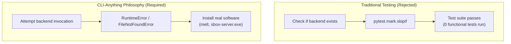
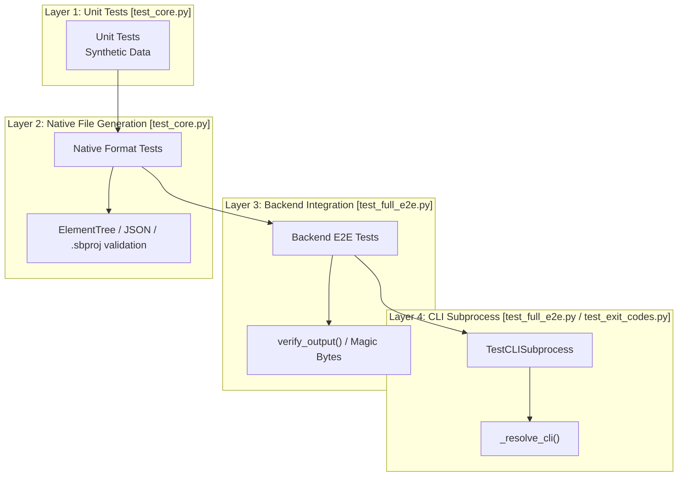

<!-- source: DeepWiki mcp.deepwiki.com · repo HKUDS/CLI-Anything · page 9.2 Testing Strategy and Best Practices · fetched 2026-11-09 -->

# Testing Strategy and Best Practices

<details>
<summary>Relevant source files</summary>

The following files were used as context for generating this wiki page:

- [SECURITY.md](SECURITY.md)
- [browser/agent-harness/cli_anything/browser/tests/test_security.py](browser/agent-harness/cli_anything/browser/tests/test_security.py)
- [godot/agent-harness/cli_anything/godot/tests/test_core.py](godot/agent-harness/cli_anything/godot/tests/test_core.py)
- [kdenlive/agent-harness/cli_anything/kdenlive/utils/melt_backend.py](kdenlive/agent-harness/cli_anything/kdenlive/utils/melt_backend.py)
- [shotcut/agent-harness/cli_anything/shotcut/utils/melt_backend.py](shotcut/agent-harness/cli_anything/shotcut/utils/melt_backend.py)

</details>


This document explains the comprehensive testing strategy used across all CLI-Anything harnesses. It covers the 4-layer testing pyramid, verification methods, the "no graceful degradation" philosophy, and technical patterns like `_resolve_cli` and `CLI_ANYTHING_FORCE_INSTALLED`.

---

## Testing Philosophy: No Graceful Degradation

CLI-Anything follows a strict testing philosophy: **tests must fail (not skip) when real software backends are unavailable**. This ensures that an AI agent or developer has an honest assessment of the tool's capabilities.

### Zero Compromise Dependencies
If a CLI is designed to wrap a specific application (e.g., s&box, Shotcut, or GIMP), the tests for that CLI **require** the application to be installed and accessible. If the backend is missing, the tests must report a failure rather than silently skipping. This prevents "false positives" where a test suite passes but the tool cannot actually perform its primary function.

For example, the s&box harness validates that failure paths in one-shot mode return exit code 1, ensuring agents do not perceive a crash as a success [sbox/agent-harness/cli_anything/sbox/tests/test_exit_codes.py:1-8]().

#### Logic Flow: Failure over Skipping
The system uses `shutil.which()` or specialized probes to find the backend. In the Shotcut harness, `find_melt()` and `find_ffmpeg()` raise `RuntimeError` if the executables are missing [shotcut/agent-harness/cli_anything/shotcut/utils/melt_backend.py:61-78]().

Title: Backend Availability Logic


**Sources**: [shotcut/agent-harness/cli_anything/shotcut/utils/melt_backend.py:61-78](), [sbox/agent-harness/cli_anything/sbox/tests/test_exit_codes.py:1-8]()

---

## The 4-Layer Testing Pyramid

CLI-Anything employs a multi-layered testing strategy that ensures both correctness of business logic and authentic integration with real software backends.

Title: 4-Layer Testing Pyramid Mapping


### Layer 1: Unit Tests (`test_core.py`)
These tests validate core business logic using synthetic data. For instance, the Godot harness tests project management, scene I/O, and export preset parsing using temporary directories and mock files [godot/agent-harness/cli_anything/godot/tests/test_core.py:1-5](). The Shotcut harness tests timecode utility functions like `timecode_to_frames` for rounding and invalid inputs [shotcut/agent-harness/cli_anything/shotcut/tests/test_core.py:40-81]().
**Sources**: [shotcut/agent-harness/cli_anything/shotcut/tests/test_core.py:40-81](), [godot/agent-harness/cli_anything/godot/tests/test_core.py:1-5]()

### Layer 2: Native File Generation
Validates that the CLI generates valid project files. The s&box harness verifies that `create_project` produces valid `.sbproj` and `.editorconfig` files [sbox/agent-harness/cli_anything/sbox/tests/test_core.py:131-169](). Shotcut tests ensure MLT XML structures are normalized and ordered correctly [shotcut/agent-harness/cli_anything/shotcut/tests/test_core.py:114-137](). The Godot harness tests the creation of new projects and scenes, asserting the existence of `project.godot` and `.tscn` files [godot/agent-harness/cli_anything/godot/tests/test_core.py:72-81]().
**Sources**: [sbox/agent-harness/cli_anything/sbox/tests/test_core.py:131-169](), [shotcut/agent-harness/cli_anything/shotcut/tests/test_core.py:114-137](), [godot/agent-harness/cli_anything/godot/tests/test_core.py:72-81]()

### Layer 3: Backend Integration
Invokes the real software backend. The Shotcut E2E suite uses `ffmpeg` to create test videos and `melt` to render projects, verifying results via luminance checks [shotcut/agent-harness/cli_anything/shotcut/tests/test_full_e2e.py:63-136]().
**Sources**: [shotcut/agent-harness/cli_anything/shotcut/tests/test_full_e2e.py:63-136]()

### Layer 4: CLI Subprocess Tests
Tests the final command as a black box. `TestCLISubprocess` in s&box spawns the CLI and asserts `--json` output for every command group [sbox/agent-harness/cli_anything/sbox/tests/TEST.md:93]().
**Sources**: [sbox/agent-harness/cli_anything/sbox/tests/TEST.md:93]()

---

## Technical Implementation Patterns

### The `_resolve_cli` Pattern
To support both development and production, harnesses implement a `_resolve_cli` pattern. This is critical for verifying `console_scripts` entry points. Subprocess tests often default to `python -m` to remain portable across environments like Windows [sbox/agent-harness/cli_anything/sbox/tests/test_exit_codes.py:10-14]().

### Magic Byte Validation
Tests verify actual bytes on disk. Shotcut tests define `PNG_MAGIC = b"\x89PNG\r\n\x1a\n"` and use `_assert_png` to check file headers [shotcut/agent-harness/cli_anything/shotcut/tests/test_full_e2e.py:38-111]().

| Format | Magic Bytes / Signature | Validation Method |
| :--- | :--- | :--- |
| **PNG** | `\x89PNG` | `fh.read(8) == PNG_MAGIC` |
| **MLT XML** | `<?xml` / `<mlt` | `xml.etree.ElementTree.parse()` |
| **JSON** | `{` or `[` | `json.loads()` |

**Sources**: [shotcut/agent-harness/cli_anything/shotcut/tests/test_full_e2e.py:38-111](), [shotcut/agent-harness/cli_anything/shotcut/tests/test_core.py:146-151]()

---

## State Management and Atomic Saves

Testing covers the robustness of the session system, including `undo`/`redo` and atomic persistence.

### Atomic Writes and Corruption Handling
The s&box `Session` class implements atomic saves by writing to a `.tmp` file and renaming [sbox/agent-harness/cli_anything/sbox/core/session.py:119-150](). If a session file is malformed, it is preserved as `.corrupt` with a timestamp to prevent silent data loss [sbox/agent-harness/cli_anything/sbox/core/session.py:70-117]().

### Undo/Redo Checkpoints
Harnesses like Shotcut test that `undo()` correctly restores the MLT XML tree to its state prior to adding tracks or clips [shotcut/agent-harness/cli_anything/shotcut/tests/test_core.py:181-194]().
**Sources**: [sbox/agent-harness/cli_anything/sbox/core/session.py:70-150](), [shotcut/agent-harness/cli_anything/shotcut/tests/test_core.py:181-194]()

---

## The `TEST.md` Lifecycle

The `TEST.md` file serves as the living record of the testing phase, categorizing coverage by class and module [sbox/agent-harness/cli_anything/sbox/tests/TEST.md:48-87]().

### Structure of `TEST.md`
| Section | Content |
| :--- | :--- |
| **Test Inventory** | Table of files, coverage, and total test counts [sbox/agent-harness/cli_anything/sbox/tests/TEST.md:6-14](). |
| **Running the Tests** | Commands for unit, orchestrator, and E2E suites [sbox/agent-harness/cli_anything/sbox/tests/TEST.md:16-32](). |
| **Environment** | Variables like `SBOX_PATH` and `CLI_ANYTHING_FORCE_INSTALLED` [sbox/agent-harness/cli_anything/sbox/tests/TEST.md:34-40](). |
| **Coverage by Class** | Detailed mapping of test classes to modules under test [sbox/agent-harness/cli_anything/sbox/tests/TEST.md:48-87]().

**Sources**: [sbox/agent-harness/cli_anything/sbox/tests/TEST.md:6-87]()

---

## Best Practices for Agent-Native Testing

*   **Exit Code Integrity**: Commands must exit with code 1 on failure so agents can detect errors [sbox/agent-harness/cli_anything/sbox/tests/test_exit_codes.py:4-8]().
*   **Security Validation**: Validate all subprocess arguments against allowlists (e.g., `ALLOWED_VCODECS`) to prevent prompt-injection attacks [shotcut/agent-harness/cli_anything/shotcut/utils/melt_backend.py:17-58](). The `_validate_codec` function [kdenlive/agent-harness/cli_anything/kdenlive/utils/melt_backend.py:39-48]() and `_validate_extra_args` function [kdenlive/agent-harness/cli_anything/kdenlive/utils/melt_backend.py:55-64]() in `melt_backend.py` are examples of this, ensuring that only explicitly allowed codecs and arguments are passed to the `melt` subprocess. The `browser` harness also includes extensive URL validation to block malicious schemes and private network access [browser/agent-harness/cli_anything/browser/tests/test_security.py:32-184]().
*   **Timecode Tolerance**: Use a `±1` frame tolerance in roundtrip tests to account for floating-point FPS (e.g., 29.97) [shotcut/agent-harness/cli_anything/shotcut/tests/test_core.py:60-65]().
*   **Absolute Path Normalization**: Use `os.path.abspath()` for project and scene paths within sessions to ensure consistency across different working directories [sbox/agent-harness/cli_anything/sbox/core/session.py:156-175]().

**Sources**: [sbox/agent-harness/cli_anything/sbox/tests/test_exit_codes.py:4-8](), [shotcut/agent-harness/cli_anything/shotcut/utils/melt_backend.py:17-58](), [shotcut/agent-harness/cli_anything/shotcut/tests/test_core.py:60-65](), [sbox/agent-harness/cli_anything/sbox/core/session.py:156-175](), [kdenlive/agent-harness/cli_anything/kdenlive/utils/melt_backend.py:39-64](), [browser/agent-harness/cli_anything/browser/tests/test_security.py:32-184]()

---

## Security Tests

Given that AI agents may autonomously construct and execute commands based on untrusted input, security testing is paramount. The `SECURITY.md` document outlines the threat model and mitigation strategies [SECURITY.md:1-25]().

### URL Validation
The `browser` harness includes specific tests for URL validation to prevent common web-based attacks. This involves:
*   Blocking dangerous schemes like `file://`, `javascript:`, `data:`, `vbscript:`, `about:`, `chrome://`, and `chrome-extension://` [browser/agent-harness/cli_anything/browser/tests/test_security.py:53-94]().
*   Rejecting unsupported schemes like `ftp:` [browser/agent-harness/cli_anything/browser/tests/test_security.py:96-99]().
*   Handling malformed, empty, or non-string URLs gracefully [browser/agent-harness/cli_anything/browser/tests/test_security.py:102-150]().
*   Ensuring that environment variables for allowed schemes are correctly processed, even with uppercase values [browser/agent-harness/cli_anything/browser/tests/test_security.py:152-159]().
*   Rejecting URLs without a hostname [browser/agent-harness/cli_anything/browser/tests/test_security.py:161-165]().

### Codec Allowlisting
For multimedia harnesses like Shotcut and Kdenlive, all `vcodec` and `acodec` parameters passed to the `melt` backend are validated against `ALLOWED_VCODECS` and `ALLOWED_ACODECS` frozensets [kdenlive/agent-harness/cli_anything/kdenlive/utils/melt_backend.py:17-36](). This prevents prompt-injected agents from passing malicious or unsupported codec strings to the underlying `melt` or `ffmpeg` subprocesses. The `_validate_codec` function enforces this check [kdenlive/agent-harness/cli_anything/kdenlive/utils/melt_backend.py:39-48]().

Additionally, `extra_args` passed to `melt` are checked to ensure they do not bypass codec or consumer validation by containing prefixes like `vcodec=`, `acodec=`, or `-consumer` [kdenlive/agent-harness/cli_anything/kdenlive/utils/melt_backend.py:51-64]().

### General Security Guidelines
Harness developers are instructed to:
1.  **Never use `shell=True`** in `subprocess.run()` [SECURITY.md:60-61]().
2.  **Validate all subprocess arguments** against allowlists [SECURITY.md:62-63]().
3.  **Escape user content** before embedding it in scripts or structured formats [SECURITY.md:64-66]().
4.  **Use `os.path.abspath()`** and `os.path.realpath()` for sensitive file operations [SECURITY.md:67-68]().
5.  **Never log or echo API keys** [SECURITY.md:68]().

Title: Security Validation Flow
```mermaid
graph TD
    A[Agent Input] --> B{Validate Input?};
    B -- Yes --> C[Sanitized Input];
    B -- No --> D[Malicious Input];

    C --> E[Backend Call (e.g., melt, browser)];
    D --> F[Error / Blocked];

    subgraph "Validation Mechanisms"
        V1["URL Scheme Blocking<br/>(e.g., file://, javascript:)"]
        V2["Codec Allowlisting<br/>(e.g., ALLOWED_VCODECS)"]
        V3["Subprocess Argument Filtering<br/>(e.g., _BLOCKED_ARG_PREFIXES)"]
        V4["Path Normalization<br/>(os.path.abspath)"]
        V5["Content Escaping<br/>(e.g., XML, Script-Fu)"]
    end

    B -- "URL" --> V1;
    B -- "Codec" --> V2;
    B -- "Subprocess Args" --> V3;
    B -- "File Paths" --> V4;
    B -- "Embedded Content" --> V5;

    V1 --> C;
    V2 --> C;
    V3 --> C;
    V4 --> C;
    V5 --> C;

    style F fill:#f9f,stroke:#333,stroke-width:2px
```

**Sources**: [SECURITY.md:1-68](), [kdenlive/agent-harness/cli_anything/kdenlive/utils/melt_backend.py:17-64](), [browser/agent-harness/cli_anything/browser/tests/test_security.py:32-184]()

---

