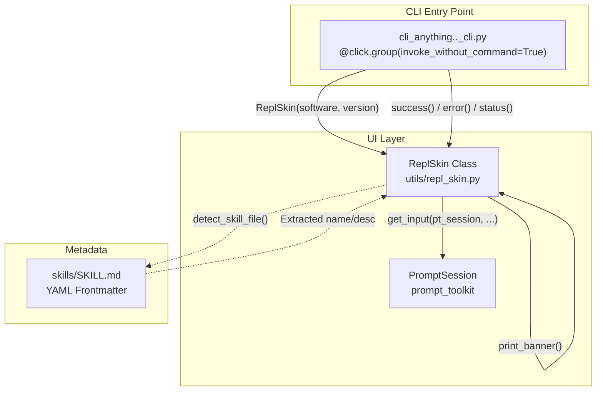
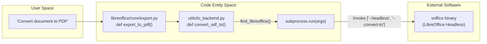

<!-- source: DeepWiki mcp.deepwiki.com · repo HKUDS/CLI-Anything · page 9.3 Common Patterns and Conventions · fetched 2026-11-09 -->

# Common Patterns and Conventions

<details>
<summary>Relevant source files</summary>

The following files were used as context for generating this wiki page:

- [cli-anything-plugin/HARNESS.md](cli-anything-plugin/HARNESS.md)
- [cli-anything-plugin/README.md](cli-anything-plugin/README.md)
- [cli-anything-plugin/guides/filter-translation.md](cli-anything-plugin/guides/filter-translation.md)
- [cli-anything-plugin/guides/mcp-backend.md](cli-anything-plugin/guides/mcp-backend.md)
- [cli-anything-plugin/guides/pypi-publishing.md](cli-anything-plugin/guides/pypi-publishing.md)
- [cli-anything-plugin/guides/session-locking.md](cli-anything-plugin/guides/session-locking.md)
- [cli-anything-plugin/guides/skill-generation.md](cli-anything-plugin/guides/skill-generation.md)
- [cli-anything-plugin/guides/timecode-precision.md](cli-anything-plugin/guides/timecode-precision.md)
- [cli-anything-plugin/repl_skin.py](cli-anything-plugin/repl_skin.py)
- [nsight-graphics/agent-harness/cli_anything/nsight_graphics/utils/repl_skin.py](nsight-graphics/agent-harness/cli_anything/nsight_graphics/utils/repl_skin.py)

</details>


This page documents the recurring coding patterns, architectural conventions, and implementation standards used throughout CLI-Anything development. These patterns ensure consistency across all generated CLI harnesses and simplify the contribution of new application integrations.

---

## ReplSkin Usage Pattern

The `ReplSkin` class provides a unified terminal interface for all generated CLIs. Every harness copies `repl_skin.py` into its `utils/` directory and follows a standardized initialization and usage pattern to provide a branded, agent-aware interface.

### Standard ReplSkin Initialization

The following diagram illustrates how the `ReplSkin` class integrates into the CLI entry point.

**ReplSkin Data Flow**


Sources: [nsight-graphics/agent-harness/cli_anything/nsight_graphics/utils/repl_skin.py:106-184](), [cli-anything-plugin/HARNESS.md:74-94]()

### SKILL.md Auto-Detection
`ReplSkin` automatically detects the `SKILL.md` file by traversing the package structure relative to its own location. It prefers the repo-root canonical `skills/cli-anything-<software>/SKILL.md` during development and falls back to the packaged `cli_anything/<software>/skills/SKILL.md` when installed. This allows AI agents to discover the absolute path to the tool's skill definition immediately upon starting the REPL.

Sources: [nsight-graphics/agent-harness/cli_anything/nsight_graphics/utils/repl_skin.py:141-156](), [cli-anything-plugin/HARNESS.md:95-98]()

---

## Backend Abstraction Pattern

CLI-Anything follows the principle of **Authentic Backend Integration**: "Use the Real Software—Don't Reimplement It." The backend layer handles the discovery and invocation of actual application binaries or APIs.

### Backend Integration Architecture

This diagram bridges the Natural Language request for an operation to the specific code entities that execute it via the real software backend.

**From Command to Backend Execution**


Sources: [cli-anything-plugin/HARNESS.md:54-66]()

### Discovery Pattern
Backends must use `shutil.which()` or specialized logic to find the executable and raise a `RuntimeError` with clear installation instructions if the software is missing.

Sources: [cli-anything-plugin/HARNESS.md:54-58](), [cli-anything-plugin/HARNESS.md:61-63]()

### MCP Backend Pattern
For software that exposes a Model Context Protocol (MCP) server instead of a traditional CLI, a specialized backend pattern is used. This involves wrapping MCP tool calls within `asyncio` and `mcp` client sessions.

**MCP Backend Interaction**
```mermaid
graph TD
    A[CLI Command] --> B{utils/<service>_backend.py};
    B --> C[async def _call_tool(tool_name, arguments)];
    C --> D[stdio_client(StdioServerParameters)];
    D --> E[ClientSession.initialize()];
    E --> F[ClientSession.call_tool(tool_name, arguments)];
    F --> G[MCP Server Process];
    G --> H[Software Logic];
    H --> F;
    F --> C;
    C --> B;
    B --> A;
```
The `_call_tool` function in `utils/<service>_backend.py` handles the asynchronous communication with the MCP server. The `stdio_client` is used to establish a connection, typically by spawning a process like `npx @apireno/domshell` [cli-anything-plugin/guides/mcp-backend.md:25-27](). While the MCP server might be stateless per command, the CLI maintains its own state (e.g., URL, working directory) [cli-anything-plugin/guides/mcp-backend.md:46-48]().

Sources: [cli-anything-plugin/guides/mcp-backend.md:16-43]()

---

## Stateful Session Management Pattern

CLI-Anything implements a standardized "Locked Save" pattern to handle stateful operations across multiple CLI invocations or within a REPL session.

### Locked JSON Save Pattern
To prevent concurrent write corruption, session data is saved using an exclusive file lock (`fcntl.LOCK_EX`). The pattern involves opening the file in `r+` mode, locking it, and then truncating before writing.

```python
def _locked_save_json(path, data, **dump_kwargs) -> None:
    """Atomically write JSON with exclusive file locking."""
    try:
        f = open(path, "r+")            # no truncation on open
    except FileNotFoundError:
        os.makedirs(os.path.dirname(os.path.abspath(path)), exist_ok=True)
        f = open(path, "w")             # first save — file doesn't exist yet
    with f:
        _locked = False
        try:
            import fcntl
            fcntl.flock(f.fileno(), fcntl.LOCK_EX)
            _locked = True
        except (ImportError, OSError):
            pass                        # Windows / unsupported FS — proceed unlocked
        try:
            f.seek(0)
            f.truncate()                # truncate INSIDE the lock
            json.dump(data, f, **dump_kwargs)
            f.flush()
        finally:
            if _locked:
                fcntl.flock(f.fileno(), fcntl.LOCK_UN)
```

Sources: [cli-anything-plugin/guides/session-locking.md:14-37](), [cli-anything-plugin/HARNESS.md:71-73]()

### Undo/Redo Implementation
Most harnesses maintain a `Session` class with `_undo_stack` and `_redo_stack`. State is captured using deep copies or serialized snapshots (XML/JSON) before mutations.

| Feature | Implementation Pattern |
| :--- | :--- |
| **Snapshot** | `copy.deepcopy(self.project)` or `ET.tostring()` |
| **Checkpoint** | `self._push_undo()` before mutation |
| **Undo Limit** | `MAX_UNDO = 50` |

Sources: [cli-anything-plugin/HARNESS.md:69]()

---

## SKILL.md Generation Pattern

Phase 6.5 of the generation pipeline uses `skill_generator.py` to extract metadata and produce an agent-discoverable skill definition.

### Metadata Extraction
The generator parses the generated CLI's `README.md`, `setup.py`, and the Click-based `_cli.py` file to populate a `SkillMetadata` object.

| Extraction Source | Target Data |
| :--- | :--- |
| `README.md` | Intro text & System packages |
| `setup.py` | Version string |
| `*_cli.py` | Click `@group` and `@command` |

The `SKILL.md` file is generated with YAML frontmatter containing `name` and `description`, followed by Markdown body with usage instructions, command groups, examples, and agent-specific guidance [cli-anything-plugin/guides/skill-generation.md:17-32]().

Sources: [cli-anything-plugin/guides/skill-generation.md:39-53]()

### Output Location and Package Data
`SKILL.md` is generated canonically at the repo root (`skills/cli-anything-<software>/SKILL.md`) and a packaged compatibility copy is placed within the harness (`<software>/agent-harness/cli_anything/<software>/skills/SKILL.md`) [cli-anything-plugin/guides/skill-generation.md:65-76](). It is crucial to include this file as package data in `setup.py` to ensure it's installed with `pip` [cli-anything-plugin/guides/skill-generation.md:131-134]().

Sources: [cli-anything-plugin/guides/skill-generation.md:61-76](), [cli-anything-plugin/guides/skill-generation.md:131-134]()

---

## Namespace Packaging Convention

CLI-Anything uses PEP 420 namespace packages to allow multiple independent harnesses to reside under the `cli_anything.*` namespace.

### Package Structure Requirements
*   **Top-level**: The `cli_anything/` directory MUST NOT contain an `__init__.py` file (or it must be empty for certain build tools) [cli-anything-plugin/guides/pypi-publishing.md:13]().
*   **Software-level**: Subdirectories like `cli_anything/shotcut/` MUST contain an `__init__.py` [cli-anything-plugin/guides/pypi-publishing.md:15]().
*   **Setup**: `setup.py` must use `find_namespace_packages(include=["cli_anything.*"])` [cli-anything-plugin/guides/pypi-publishing.md:36]().

**Namespace Package Structure**
```mermaid
graph TD
    A[agent-harness/] --> B[setup.py];
    A --> C[cli_anything/];
    C --> D[<software>/];
    D --> E[__init__.py];
    D --> F[<software>_cli.py];
    D --> G[core/];
    D --> H[utils/];
    D --> I[tests/];

    style C fill:#fff,stroke:#333,stroke-width:2px,stroke-dasharray: 5 5;
    linkStyle 2 stroke-dasharray: 5 5;
    linkStyle 3 stroke-dasharray: 5 5;
    linkStyle 4 stroke-dasharray: 5 5;
    linkStyle 5 stroke-dasharray: 5 5;
    linkStyle 6 stroke-dasharray: 5 5;
    linkStyle 7 stroke-dasharray: 5 5;
    linkStyle 8 stroke-dasharray: 5 5;
```
The dashed lines indicate that `cli_anything/` itself does not have an `__init__.py`, making it a namespace package.

Sources: [cli-anything-plugin/guides/pypi-publishing.md:10-21]()

### Entry Point Naming
Every harness must register a console script following the pattern `cli-anything-<software>`. This is defined in `setup.py` under `entry_points` and allows the `_resolve_cli()` helper in tests to locate the binary.

Sources: [cli-anything-plugin/guides/pypi-publishing.md:43-45]()

---

## FIX_NOTES Conventions

While not explicitly detailed in the provided files, a common convention in development is the use of `FIX_NOTES` or similar comments to mark areas requiring future attention, refactoring, or known issues. These are typically used for:
*   **Temporary workarounds**: Code that solves an immediate problem but needs a more robust solution.
*   **Performance bottlenecks**: Areas identified as slow that need optimization.
*   **Incomplete features**: Stubs or partial implementations.
*   **Known bugs**: Issues that are understood but not yet fixed.
*   **Future enhancements**: Ideas for improvements or new features.

This convention helps developers track technical debt and plan future work.

---

## Other Guides and Patterns

The `cli-anything-plugin/guides/` directory contains additional specific patterns and best practices:

*   **Timecode Precision**: Guidelines for handling non-integer frame rates to avoid cumulative rounding errors, emphasizing `round()` over `int()` and integer arithmetic for timecode display [cli-anything-plugin/guides/timecode-precision.md:1-22]().
*   **Filter Translation Pitfalls**: Addresses common issues when translating effects between different formats or tools, such as duplicate filter types, ordering constraints, parameter space differences, and unmappable effects [cli-anything-plugin/guides/filter-translation.md:1-26]().
*   **PyPI Publishing and Installation**: Detailed steps for packaging CLIs as PEP 420 namespace packages, including `setup.py` configuration and verification steps for local installation and testing against the installed command [cli-anything-plugin/guides/pypi-publishing.md:1-117]().

Sources: [cli-anything-plugin/guides/timecode-precision.md](), [cli-anything-plugin/guides/filter-translation.md](), [cli-anything-plugin/guides/pypi-publishing.md]()

---

