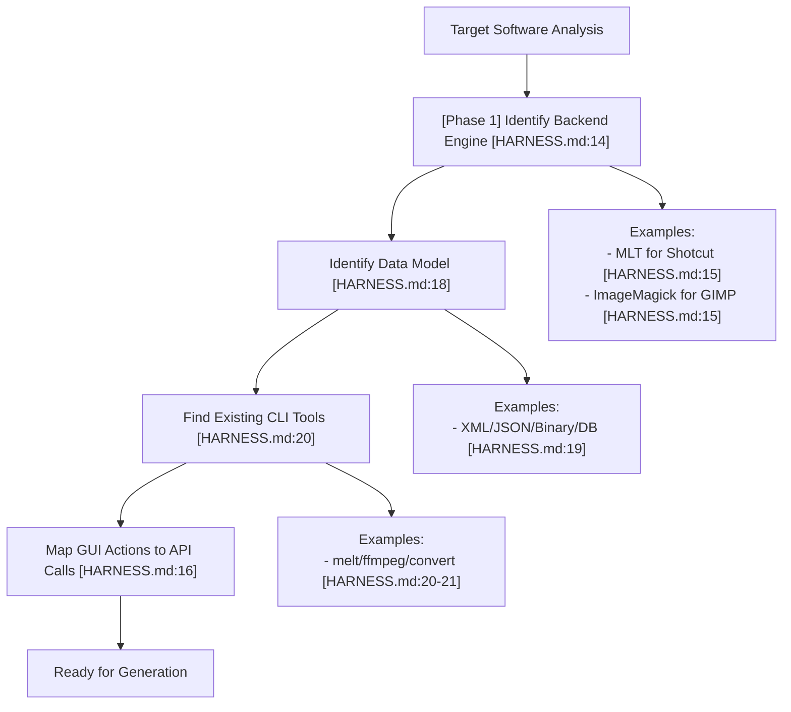

<!-- source: DeepWiki mcp.deepwiki.com · repo HKUDS/CLI-Anything · page 9.4 Contributing New Application Harnesses · fetched 2026-11-09 -->

# Contributing New Application Harnesses

<details>
<summary>Relevant source files</summary>

The following files were used as context for generating this wiki page:

- [.github/ISSUE_TEMPLATE/bug_report.yml](.github/ISSUE_TEMPLATE/bug_report.yml)
- [.github/ISSUE_TEMPLATE/cli-wishlist.yml](.github/ISSUE_TEMPLATE/cli-wishlist.yml)
- [.github/ISSUE_TEMPLATE/config.yml](.github/ISSUE_TEMPLATE/config.yml)
- [.github/ISSUE_TEMPLATE/contributor-signup.yml](.github/ISSUE_TEMPLATE/contributor-signup.yml)
- [.github/ISSUE_TEMPLATE/feature_request.yml](.github/ISSUE_TEMPLATE/feature_request.yml)
- [.github/PULL_REQUEST_TEMPLATE.md](.github/PULL_REQUEST_TEMPLATE.md)
- [.github/labeler.yml](.github/labeler.yml)
- [.github/scripts/pr-labeler.js](.github/scripts/pr-labeler.js)
- [.github/scripts/tests/pr-labeler-fixtures.json](.github/scripts/tests/pr-labeler-fixtures.json)
- [.github/scripts/tests/pr-labeler.test.js](.github/scripts/tests/pr-labeler.test.js)
- [.github/workflows/pr-labeler-tests.yml](.github/workflows/pr-labeler-tests.yml)
- [.github/workflows/pr-labeler.yml](.github/workflows/pr-labeler.yml)
- [CONTRIBUTING.md](CONTRIBUTING.md)

</details>


This document provides a step-by-step guide for contributors who want to add support for a new application to CLI-Anything. It covers the complete workflow from choosing a target application through generating, testing, and publishing a production-ready CLI harness.

For information about the internal architecture of generated CLIs, see [5. Generated CLI Architecture](). For the testing methodology and patterns, see [9.2. Testing Strategy and Best Practices](). For general coding conventions, see [9.3. Common Patterns and Conventions]().

---

## Prerequisites and Preparation

Before generating a CLI harness for a new application, you need to prepare several components and understand the target software's architecture.

### Required Tools and Dependencies

| Component | Purpose | Requirement |
|-----------|---------|--------------|
| Python 3.10+ | Runtime for CLI generation and execution | [CONTRIBUTING.md:144-144]() |
| Click ≥8.0 | CLI framework | [CONTRIBUTING.md:145-145]() |
| pytest ≥7.0 | Testing framework | [CONTRIBUTING.md:146-146]() |
| Target Software | The actual application being wrapped | Must be installed (Hard Dependency) |
| AI Agent Platform | Claude Code, Codex, etc. | Required for agent-native testing |

Sources: [CONTRIBUTING.md:142-146]()

### Understanding the Target Software

Before invoking the generation pipeline, analyze the target software's architecture as defined in the Phase 1 SOP:



Sources: [cli-anything-plugin/HARNESS.md:12-24]()

### Backend Integration Strategy

The most critical decision is how the CLI will invoke the real software. The "Use the Real Software" principle is mandatory.

| Backend Type | Implementation Pattern | File Reference |
|--------------|----------------------|----------------|
| **Headless CLI** | Invoke software with `--headless` or `--background` | [cli-anything-plugin/HARNESS.md:60-66]() |
| **Subprocess Wrapper** | `subprocess.run()` with proper argument handling | [cli-anything-plugin/HARNESS.md:57-57]() |
| **REST API** | Sync wrappers for HTTP/JSON services | [cli-anything-plugin/HARNESS.md:54-58]() |
| **Python API** | Direct module imports (e.g. Blender `bpy`) | [cli-anything-plugin/HARNESS.md:14-17]() |

Sources: [cli-anything-plugin/HARNESS.md:50-66]()

---

## Running the Generation Pipeline

The 7-phase pipeline is invoked through the `/cli-anything` command. It automates the transformation of a GUI application into an agent-usable CLI.

### Pipeline Invocation

The generation process follows a strict sequence to ensure the resulting CLI is "Agent-Native": self-describing, stateful, and machine-readable.

Sources: [cli-anything-plugin/HARNESS.md:10-12]()

### Phase-by-Phase Execution

The pipeline executes sequential phases, each with specific deliverables as defined in `HARNESS.md`:

```mermaid
flowchart TD
    PHASE1["Phase 1: Analysis<br/>───────────────<br/>• Backend identification<br/>• GUI-to-API mapping<br/>• Data model analysis<br/>───────────────<br/>Output: SOFTWARE.md"]

    PHASE2["Phase 2: Architecture<br/>───────────────<br/>• Command groups<br/>• State model<br/>• Output formats (JSON)<br/>───────────────<br/>Output: Design Plan"]

    PHASE3["Phase 3: Implementation<br/>───────────────<br/>• Click CLI + ReplSkin [HARNESS.md:81]<br/>• Core modules (project.py)<br/>• Session/Undo management<br/>───────────────<br/>Output: Working CLI code"]

    PHASE4["Phase 4: Test Planning<br/>───────────────<br/>• Unit test inventory<br/>• E2E scenario design<br/>• Edge case mapping<br/>───────────────<br/>Output: TEST.md (Part 1) [HARNESS.md:111]"]

    PHASE5["Phase 5: Test Implementation<br/>───────────────<br/>• test_core.py [HARNESS.md:144]<br/>• test_full_e2e.py [HARNESS.md:148]<br/>• Real software invocation<br/>───────────────<br/>Output: Test suite"]

    PHASE6["Phase 6: Documentation<br/>───────────────<br/>• Run pytest -v<br/>• Update TEST.md results<br/>• Coverage gap analysis<br/>───────────────<br/>Output: TEST.md (Part 2)"]

    PHASE65["Phase 6.5: Skill Generation<br/>───────────────<br/>• skill_generator.py [skill-generation.md:39]<br/>• YAML frontmatter<br/>• Agent-native metadata<br/>───────────────<br/>Output: SKILL.md"]

    PHASE7["Phase 7: Packaging<br/>───────────────<br/>• setup.py (Namespace)<br/>• console_scripts<br/>• pip install -e .<br/>───────────────<br/>Output: Installed Tool"]

    PHASE1 --> PHASE2 --> PHASE3 --> PHASE4 --> PHASE5 --> PHASE6 --> PHASE65 --> PHASE7
```



Sources: [cli-anything-plugin/HARNESS.md:10-150](), [cli-anything-plugin/guides/skill-generation.md:1-85]()

---

## Implementation Standards

### Namespace Package Structure

All harnesses must use **PEP 420 namespace packages** under `cli_anything`. The root `cli_anything/` directory in the monorepo must **NOT** contain an `__init__.py` file to allow multiple packages to share the namespace.

```
<software>/agent-harness/
├── setup.py                          # Defines console_scripts entry point
└── cli_anything/                     # NO __init__.py here
    └── <software>/                   # HAS __init__.py
        ├── <software>_cli.py         # Main entry point with @click.group
        ├── core/                     # project.py, session.py
        ├── utils/                    # software_backend.py, repl_skin.py
        ├── skills/                   # SKILL.md (packaged copy)
        └── tests/                    # test_core.py, test_full_e2e.py
```

Sources: [CONTRIBUTING.md:127-140](), [cli-anything-plugin/guides/skill-generation.md:65-76]()

### REPL and Unified Skin

Interactive mode must use the `ReplSkin` class to provide a consistent UX for agents.

1.  **Copy `repl_skin.py`**: An unmodified copy of `cli-anything-plugin/repl_skin.py` must exist in your harness `utils/` directory. [CONTRIBUTING.md:22]()
2.  **Banner and Skills**: `skin.print_banner()` automatically detects the repo-root `skills/cli-anything-<software>/SKILL.md` or falls back to the packaged copy. [cli-anything-plugin/repl_skin.py:141-156]()
3.  **Branding**: Software-specific accent colors are defined in `_ACCENT_COLORS`. [cli-anything-plugin/repl_skin.py:42-51]()

Sources: [cli-anything-plugin/HARNESS.md:74-94](), [cli-anything-plugin/repl_skin.py:1-186]()

### Session Locking

To prevent data corruption during concurrent writes in stateful sessions, use the `_locked_save_json` pattern.

*   Open the session file with `"r+"` mode to avoid immediate truncation. [cli-anything-plugin/HARNESS.md:73]()
*   Acquire an exclusive file lock (`fcntl.LOCK_EX`) before performing the write. [cli-anything-plugin/HARNESS.md:71-73]()
*   Truncate the file inside the lock context before writing the new JSON state. [cli-anything-plugin/HARNESS.md:73]()

Sources: [cli-anything-plugin/HARNESS.md:71-73]()

---

## Testing and Validation

### Layered Testing Strategy

| Layer | File | Requirement |
|-------|------|-------------|
| **Unit Tests** | `test_core.py` | Must pass using synthetic data without the backend software installed. [CONTRIBUTING.md:19]() |
| **E2E Tests** | `test_full_e2e.py` | Verifies real-world workflows and real backend invocation. [cli-anything-plugin/HARNESS.md:148-150]() |
| **CLI Tests** | `test_full_e2e.py` | Tests the `console_scripts` entry point via subprocess. [cli-anything-plugin/HARNESS.md:152-155]() |

Sources: [CONTRIBUTING.md:17-19](), [cli-anything-plugin/HARNESS.md:142-155]()

### Pull Request Checklist

When submitting a new harness, the following items are mandatory as per the `PULL_REQUEST_TEMPLATE.md`:

*   [ ] `<SOFTWARE>.md` SOP document exists at `<software>/agent-harness/<SOFTWARE>.md`. [.github/PULL_REQUEST_TEMPLATE.md:24]()
*   [ ] Canonical `SKILL.md` exists at `skills/cli-anything-<software>/SKILL.md`. [.github/PULL_REQUEST_TEMPLATE.md:25]()
*   [ ] Packaged compatibility `SKILL.md` exists at `cli_anything/<software>/skills/SKILL.md`. [.github/PULL_REQUEST_TEMPLATE.md:26]()
*   [ ] All commands support the `--json` flag for machine readability. [.github/PULL_REQUEST_TEMPLATE.md:57]()
*   [ ] `registry.json` is updated with the new software metadata and entry point. [.github/PULL_REQUEST_TEMPLATE.md:30]()

Sources: [.github/PULL_REQUEST_TEMPLATE.md:20-31](), [CONTRIBUTING.md:13-22]()

---

## Registration and Publishing

### Registering with CLI-Hub

Add an entry to `registry.json` at the repo root. This enables discovery on the CLI-Hub web portal and allows agents to install the tool.

```json
{
  "name": "my-software",
  "display_name": "My Software",
  "version": "1.0.0",
  "description": "Short description of what the CLI does",
  "requires": "backend software or null",
  "homepage": "https://my-software.org",
  "source_url": null,
  "install_cmd": "pip install git+https://github.com/HKUDS/CLI-Anything.git#subdirectory=my-software/agent-harness",
  "entry_point": "cli-anything-my-software",
  "skill_md": "skills/cli-anything-my-software/SKILL.md",
  "category": "category-name",
  "contributors": [
    {"name": "your-github-username", "url": "https://github.com/your-github-username"}
  ]
}
```

Sources: [CONTRIBUTING.md:59-93]()

### Contribution Workflow

The overall contribution process for a new application harness involves several steps, from initial sign-up to final merge and CI checks.

```mermaid
graph TD
    A[Contributor Sign-Up] --> B{Choose Contribution Type};
    B -- "In-repo Harness" --> C[Develop Harness Locally];
    B -- "Standalone Repo" --> D[Develop External Harness];

    C --> C1[Create <SOFTWARE>.md SOP];
    C --> C2[Implement CLI & Backend Integration];
    C --> C3[Write Unit & E2E Tests];
    C --> C4[Generate SKILL.md];
    C --> C5[Update README.md];
    C --> C6[Add registry.json Entry];

    D --> D1[Publish Package to PyPI/Git];
    D --> D2[Ensure SKILL.md in Repo];
    D --> D3[Ensure Tests in Repo];
    D --> D4[Add registry.json Entry (External)];

    C6 --> E[Submit Pull Request];
    D4 --> E;

    E --> F{PR Labeler Workflow};
    F -- "Detects new harness" --> F1["Apply 'new-cli' Label"];
    F -- "Detects registry change" --> F2["Apply 'cli-anything-hub' Label"];
    F -- "Detects SKILL.md change" --> F3["Apply 'cli-anything-skill' Label"];

    E --> G[Review & CI Checks];
    G -- "Passes" --> H[Merge to main];
    H --> I[CLI-Hub Updates Automatically];
    H --> J[Skill Sync Workflow];
```
Title: "New Harness Contribution Workflow"
Sources: [CONTRIBUTING.md:9-23](), [CONTRIBUTING.md:24-34](), [CONTRIBUTING.md:51-55](), [CONTRIBUTING.md:59-73](), [.github/PULL_REQUEST_TEMPLATE.md:20-43](), [.github/scripts/pr-labeler.js:78-80](), [.github/scripts/pr-labeler.js:75-76](), [.github/labeler.yml:10-19]()

### GitHub Issue and PR Templates

The repository provides specific templates to streamline contributions:

*   **Contributor Sign-Up**: For new contributors to declare their intent and target software. This automatically applies `contributor-signup` and `new-cli` labels. [.github/ISSUE_TEMPLATE/contributor-signup.yml:1-63]()
*   **CLI Wishlist**: For suggesting new software to be supported. [.github/ISSUE_TEMPLATE/cli-wishlist.yml:1-54]()
*   **Feature Request**: For proposing new features or enhancements. [.github/ISSUE_TEMPLATE/feature_request.yml:1-52]()
*   **Bug Report**: For reporting issues. [.github/ISSUE_TEMPLATE/bug_report.yml]()
*   **Pull Request Template**: Guides contributors through the checklist for new CLIs, modifications, and general requirements. [.github/PULL_REQUEST_TEMPLATE.md:1-66]()

Sources: [.github/ISSUE_TEMPLATE/config.yml:1-11](), [.github/ISSUE_TEMPLATE/contributor-signup.yml:1-63](), [.github/ISSUE_TEMPLATE/cli-wishlist.yml:1-54](), [.github/ISSUE_TEMPLATE/feature_request.yml:1-52](), [.github/PULL_REQUEST_TEMPLATE.md:1-66]()

### Automated PR Labeling

The `.github/scripts/pr-labeler.js` script automatically applies labels to Pull Requests based on changed files and PR title. This helps categorize contributions and trigger relevant CI workflows.

```mermaid
flowchart TD
    PR_OPEN[Pull Request Opened/Synchronized] --> GET_FILES[Get Changed Files & PR Title];

    subgraph Script-Managed Labels
        IS_HARNESS_IMPL{Is Harness Implementation File?}
        IS_NEW_HARNESS{Is New Harness Manifest (setup.py/pyproject.toml added)?}
        IS_REGISTRY_ONLY{Are ALL files registry.json/public_registry.json?}
        TITLE_REGISTRY_CLI{Does Title suggest new CLI/harness/registry?}
        IS_DOC_ONLY{Are ALL files documentation?}

        GET_FILES --> IS_NEW_HARNESS;
        GET_FILES --> IS_REGISTRY_ONLY;
        GET_FILES --> TITLE_REGISTRY_CLI;
        GET_FILES --> IS_HARNESS_IMPL;
        GET_FILES --> IS_DOC_ONLY;

        IS_NEW_HARNESS -- Yes --> NEW_CLI_LABEL["Add 'new-cli'"];
        IS_REGISTRY_ONLY -- Yes --> REGISTRY_NEW_CLI_CHECK{Registry-only AND Title suggests new CLI?};
        REGISTRY_NEW_CLI_CHECK -- Yes --> NEW_CLI_LABEL;

        IS_HARNESS_IMPL -- Yes --> EXISTING_CLI_FIX_LABEL["Add 'existing-cli-fix'"];
        IS_DOC_ONLY -- Yes --> DOC_LABEL["Add 'documentation'"];
    end

    subgraph Path-Based Labels (.github/labeler.yml)
        CHANGED_CLI_HUB{Files in cli-hub/**, docs/hub/**, registry.json?}
        CHANGED_CLI_SKILL{Files in cli-anything-plugin/**, skills/**, **/SKILL.md?}
        CHANGED_GH_ACTIONS{Files in .github/workflows/**, .github/labeler.yml, .github/scripts/pr-labeler.js?}

        GET_FILES --> CHANGED_CLI_HUB;
        GET_FILES --> CHANGED_CLI_SKILL;
        GET_FILES --> CHANGED_GH_ACTIONS;

        CHANGED_CLI_HUB -- Yes --> CLI_HUB_LABEL["Add 'cli-anything-hub'"];
        CHANGED_CLI_SKILL -- Yes --> CLI_SKILL_LABEL["Add 'cli-anything-skill'"];
        CHANGED_GH_ACTIONS -- Yes --> GH_ACTIONS_LABEL["Add 'github-actions'"];
    end

    NEW_CLI_LABEL --> APPLY_LABELS[Apply/Sync Labels to PR];
    EXISTING_CLI_FIX_LABEL --> APPLY_LABELS;
    DOC_LABEL --> APPLY_LABELS;
    CLI_HUB_LABEL --> APPLY_LABELS;
    CLI_SKILL_LABEL --> APPLY_LABELS;
    GH_ACTIONS_LABEL --> APPLY_LABELS;
```
Title: "PR Labeling Logic"
The script identifies:
*   **`new-cli`**: If a new harness manifest (`setup.py` or `pyproject.toml`) is added under a software directory, or if a `registry.json` change looks like a new CLI addition. [.github/scripts/pr-labeler.js:78-80]()
*   **`existing-cli-fix`**: If changes are made to existing harness implementation files (not documentation). [.github/scripts/pr-labeler.js:81]()
*   **`documentation`**: If all changed files are documentation-related (e.g., `README.md`, `HARNESS.md`). [.github/scripts/pr-labeler.js:77]()
*   **`cli-anything-hub`**: For changes to the CLI-Hub, registries, or hub documentation. [.github/labeler.yml:1-8]()
*   **`cli-anything-skill`**: For changes to the CLI-Anything plugin, skill files, or any `SKILL.md`. [.github/labeler.yml:10-18]()
*   **`github-actions`**: For changes to GitHub Actions workflows or labeler configuration. [.github/labeler.yml:20-25]()

The `pr-labeler-tests.yml` workflow ensures the labeler script itself is working correctly by running tests against a set of fixtures. [.github/workflows/pr-labeler-tests.yml:1-43](), [.github/scripts/tests/pr-labeler.test.js:1-208]()

Sources: [.github/scripts/pr-labeler.js:1-178](), [.github/labeler.yml:1-25](), [.github/workflows/pr-labeler.yml:1-33](), [.github/workflows/pr-labeler-tests.yml:1-43](), [.github/scripts/tests/pr-labeler.test.js:1-208]()

---

