# Page: Overview

# Overview

<details>
<summary>Relevant source files</summary>

The following files were used as context for generating this wiki page:

- [.gitignore](.gitignore)
- [README.md](README.md)
- [README_CN.md](README_CN.md)
- [README_DE.md](README_DE.md)
- [README_JA.md](README_JA.md)
- [minimax/agent-harness/FIX_NOTES.md](minimax/agent-harness/FIX_NOTES.md)
- [minimax/agent-harness/cli_anything/minimax/README.md](minimax/agent-harness/cli_anything/minimax/README.md)
- [minimax/agent-harness/cli_anything/minimax/minimax_cli.py](minimax/agent-harness/cli_anything/minimax/minimax_cli.py)
- [minimax/agent-harness/cli_anything/minimax/skills/SKILL.md](minimax/agent-harness/cli_anything/minimax/skills/SKILL.md)
- [minimax/agent-harness/cli_anything/minimax/tests/TEST.md](minimax/agent-harness/cli_anything/minimax/tests/TEST.md)
- [minimax/agent-harness/cli_anything/minimax/tests/test_core.py](minimax/agent-harness/cli_anything/minimax/tests/test_core.py)
- [minimax/agent-harness/cli_anything/minimax/tests/test_full_e2e.py](minimax/agent-harness/cli_anything/minimax/tests/test_full_e2e.py)
- [minimax/agent-harness/cli_anything/minimax/tests/test_tts_extended.py](minimax/agent-harness/cli_anything/minimax/tests/test_tts_extended.py)
- [minimax/agent-harness/cli_anything/minimax/utils/minimax_backend.py](minimax/agent-harness/cli_anything/minimax/utils/minimax_backend.py)
- [minimax/agent-harness/setup.py](minimax/agent-harness/setup.py)
- [registry.json](registry.json)
- [skills/cli-anything-minimax/SKILL.md](skills/cli-anything-minimax/SKILL.md)
- [skills/cli-anything-wavetone/SKILL.md](skills/cli-anything-wavetone/SKILL.md)
- [wavetone/agent-harness/cli_anything/wavetone/README.md](wavetone/agent-harness/cli_anything/wavetone/README.md)
- [wavetone/agent-harness/cli_anything/wavetone/core/audio.py](wavetone/agent-harness/cli_anything/wavetone/core/audio.py)
- [wavetone/agent-harness/cli_anything/wavetone/core/project.py](wavetone/agent-harness/cli_anything/wavetone/core/project.py)
- [wavetone/agent-harness/cli_anything/wavetone/core/session.py](wavetone/agent-harness/cli_anything/wavetone/core/session.py)
- [wavetone/agent-harness/cli_anything/wavetone/tests/TEST.md](wavetone/agent-harness/cli_anything/wavetone/tests/TEST.md)
- [wavetone/agent-harness/cli_anything/wavetone/tests/test_core.py](wavetone/agent-harness/cli_anything/wavetone/tests/test_core.py)
- [wavetone/agent-harness/cli_anything/wavetone/tests/test_full_e2e.py](wavetone/agent-harness/cli_anything/wavetone/tests/test_full_e2e.py)
- [wavetone/agent-harness/cli_anything/wavetone/utils/repl_skin.py](wavetone/agent-harness/cli_anything/wavetone/utils/repl_skin.py)
- [wavetone/agent-harness/cli_anything/wavetone/utils/wavetone_backend.py](wavetone/agent-harness/cli_anything/wavetone/utils/wavetone_backend.py)
- [wavetone/agent-harness/cli_anything/wavetone/wavetone_cli.py](wavetone/agent-harness/cli_anything/wavetone/wavetone_cli.py)
- [wavetone/agent-harness/setup.py](wavetone/agent-harness/setup.py)

</details>


This document provides a high-level introduction to CLI-Anything, explaining its purpose, architecture, and core mission of making software agent-native. It describes the system's role in transforming arbitrary software applications into command-line interfaces (CLIs) through an automated generation pipeline.

For detailed information about specific subsystems, see:
- [What is CLI-Anything](#1.1) — Fundamental concepts and the agent-native mission.
- [Supported Applications](#1.2) — List of currently supported software and integration patterns.
- [Key Features](#1.3) — Core capabilities including the 7-phase pipeline and REPL mode.

Sources: [README.md:1-40](), [cli-anything-plugin/README.md:5-19]()

---

## The Agent-Software Gap

Modern AI agents excel at reasoning but struggle to control professional software applications. CLI-Anything bridges this gap by generating production-grade CLIs that provide structured, agent-friendly access while preserving full application capabilities.

| Approach | Limitation | Example |
|----------|-----------|---------|
| **UI Automation** | Fragile, screenshot-dependent, breaks with UI changes | Selenium, Playwright for desktop apps |
| **Limited APIs** | Coverage gaps, missing 90% of functionality | Partial REST APIs for video editors |
| **Reimplementations** | Functionality compromises, maintenance burden | Python wrappers that only support basic operations |

Sources: [README_CN.md:39-54](), [cli-anything-plugin/README.md:11-19]()

---

## System Purpose and Architecture

CLI-Anything is an automated generation system that transforms software with accessible source code into an agent-native tool. The system operates through a fully automated 7-phase pipeline that analyzes codebases, designs command architecture, implements the CLI with comprehensive testing, and publishes the result as a `pip`-installable Python package.

### Workflow: Natural Language Space to Code Entity Space

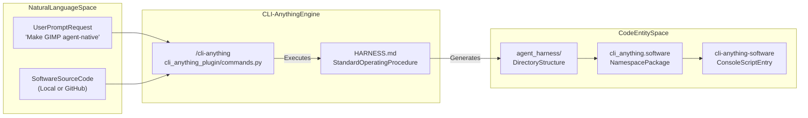

Sources: [README.md:1-28](), [cli-anything-plugin/README.md:59-81](), [README_CN.md:115-122]()

---

## Platform Ecosystem

CLI-Anything integrates with multiple AI agent platforms through specific adapters, all following the unified methodology defined in `HARNESS.md`.

### Integration Topology: Natural Language to Runtime Entity Space

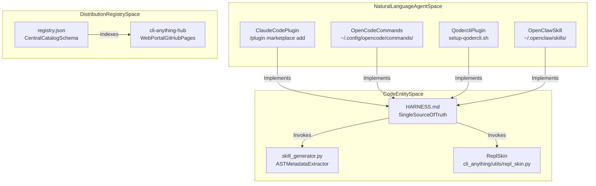

**Key Integration Files**:
- Claude Code: [cli-anything-plugin/README.md:21-55]()
- OpenCode: [README_CN.md:159-182]()
- Qodercli: [README_CN.md:210-228]()
- OpenClaw: [README_CN.md:232-245]()
- Pi Coding Agent: [.pi-extension/cli-anything/README.md:1-40]()

Sources: [README.md:32-34](), [README_CN.md:65-250](), [cli-anything-plugin/README.md:174-182]()

---

## The 7-Phase Generation Pipeline

The generation process is a deterministic sequence that moves from source analysis to a published, test-verified package.

| Phase | Title | Key Output |
|-------|-------|------------|
| **1** | Analysis | `SOFTWARE.md` (Mapping GUI to API) |
| **2** | Design | Command group architecture |
| **3** | Implementation | Click-based CLI with REPL and `--json` |
| **4-5**| Testing | `test_core.py` and `test_full_e2e.py` |
| **6** | Documentation | `TEST.md` with full `pytest` results |
| **6.5**| Skill Gen | `SKILL.md` (Agent-discoverable metadata) |
| **7** | Publishing | `setup.py` (Namespace package installation) |

Sources: [cli-anything-plugin/README.md:153-233](), [README_CN.md:115-122]()

---

## CLI-Anything Hub & Registry

The **CLI-Hub** serves as a centralized registry for all community-built agent-native CLIs. It allows users and agents to browse, install, and manage CLIs via the `cli-anything-hub` package.

### Hub Architecture

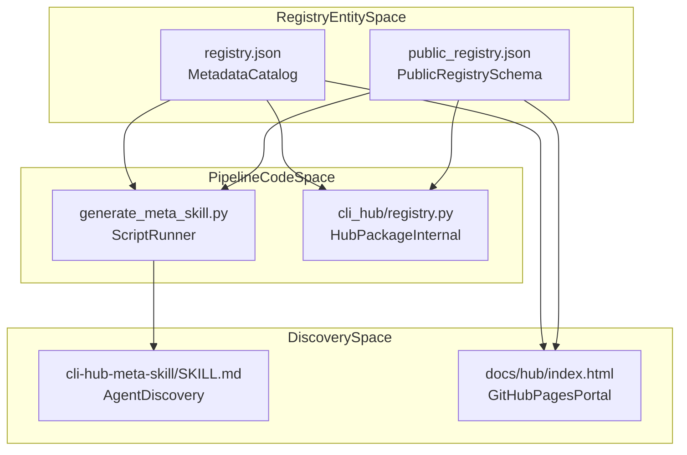

**Key Hub Entities**:
- **Registry**: `registry.json` defines the catalog of available harnesses [registry.json:1-187]().
- **Meta-Skill**: Provides the interface for agents to browse and install CLIs.
- **Web Portal**: The live [CLI-Hub](https://hkuds.github.io/CLI-Anything/) for browsing.

Sources: [README.md:8-16](), [README.md:48-65](), [registry.json:1-187]()

---

## Design Philosophy: Authentic Integration

CLI-Anything follows the principle of **"Use the Real Software—Don't Reimplement It"**. Generated CLIs act as sophisticated wrappers that:
1.  Manage state via project persistence and undo/redo functionality.
2.  Maintain session consistency using unified UX components like `ReplSkin` [wavetone/agent-harness/cli_anything/wavetone/utils/repl_skin.py:1-40]().
3.  Invoke the actual software backend via subprocess or native APIs.
4.  Provide machine-readable outputs for agents using the `--json` flag.

Sources: [cli-anything-plugin/README.md:174-182](), [quietshrink/agent-harness/QUIETSHRINK.md:5-14](), [browser/agent-harness/cli_anything/browser/README.md:248-254]()

---

## Navigation

- [What is CLI-Anything](#1.1)
- [Supported Applications](#1.2)
- [Key Features](#1.3)

---

# Page: What is CLI-Anything

# What is CLI-Anything

<details>
<summary>Relevant source files</summary>

The following files were used as context for generating this wiki page:

- [.gitignore](.gitignore)
- [README.md](README.md)
- [README_CN.md](README_CN.md)
- [README_JA.md](README_JA.md)
- [cli-anything-plugin/HARNESS.md](cli-anything-plugin/HARNESS.md)
- [cli-anything-plugin/README.md](cli-anything-plugin/README.md)
- [cli-anything-plugin/guides/filter-translation.md](cli-anything-plugin/guides/filter-translation.md)
- [cli-anything-plugin/guides/mcp-backend.md](cli-anything-plugin/guides/mcp-backend.md)
- [cli-anything-plugin/guides/pypi-publishing.md](cli-anything-plugin/guides/pypi-publishing.md)
- [cli-anything-plugin/guides/session-locking.md](cli-anything-plugin/guides/session-locking.md)
- [cli-anything-plugin/guides/skill-generation.md](cli-anything-plugin/guides/skill-generation.md)
- [cli-anything-plugin/guides/timecode-precision.md](cli-anything-plugin/guides/timecode-precision.md)
- [cli-anything-plugin/repl_skin.py](cli-anything-plugin/repl_skin.py)
- [skills/cli-anything-wavetone/SKILL.md](skills/cli-anything-wavetone/SKILL.md)
- [wavetone/agent-harness/cli_anything/wavetone/README.md](wavetone/agent-harness/cli_anything/wavetone/README.md)
- [wavetone/agent-harness/cli_anything/wavetone/core/audio.py](wavetone/agent-harness/cli_anything/wavetone/core/audio.py)
- [wavetone/agent-harness/cli_anything/wavetone/core/project.py](wavetone/agent-harness/cli_anything/wavetone/core/project.py)
- [wavetone/agent-harness/cli_anything/wavetone/core/session.py](wavetone/agent-harness/cli_anything/wavetone/core/session.py)
- [wavetone/agent-harness/cli_anything/wavetone/tests/TEST.md](wavetone/agent-harness/cli_anything/wavetone/tests/TEST.md)
- [wavetone/agent-harness/cli_anything/wavetone/tests/test_core.py](wavetone/agent-harness/cli_anything/wavetone/tests/test_core.py)
- [wavetone/agent-harness/cli_anything/wavetone/tests/test_full_e2e.py](wavetone/agent-harness/cli_anything/wavetone/tests/test_full_e2e.py)
- [wavetone/agent-harness/cli_anything/wavetone/utils/repl_skin.py](wavetone/agent-harness/cli_anything/wavetone/utils/repl_skin.py)
- [wavetone/agent-harness/cli_anything/wavetone/utils/wavetone_backend.py](wavetone/agent-harness/cli_anything/wavetone/utils/wavetone_backend.py)
- [wavetone/agent-harness/cli_anything/wavetone/wavetone_cli.py](wavetone/agent-harness/cli_anything/wavetone/wavetone_cli.py)
- [wavetone/agent-harness/setup.py](wavetone/agent-harness/setup.py)

</details>


## Purpose and Scope

This page explains the fundamental concept of CLI-Anything: an automated system that transforms GUI applications and software repositories into command-line interfaces (CLIs) that AI agents can control programmatically. CLI-Anything bridges the gap between software designed for human GUI interaction and AI agents that require structured, programmatic interfaces.

The core mission is to make all software "agent-native" by providing a universal, self-describing, and deterministic interface that LLMs can manipulate without the overhead of computer vision or complex UI automation.

Sources: [README.md:1-28](), [README_CN.md:40-55]()

## The Fundamental Concept

CLI-Anything is a code generation system that accepts a software codebase (local path or GitHub URL) as input and produces a production-grade CLI harness as output. 

The core transformation is:
`Source Code Repository → 7-Phase Automated Analysis & Generation → cli-anything-<software> CLI`

When an AI agent invokes CLI-Anything, the system performs automated codebase analysis, designs a CLI architecture, implements the interface using the `Click` framework, generates comprehensive tests, and produces an installable Python package. The resulting CLI provides agents with structured JSON output, stateful session management, and direct integration with the real software backend—not a reimplementation.

Sources: [README.md:12-38](), [cli-anything-plugin/HARNESS.md:1-24](), [cli-anything-plugin/README.md:9-19]()

## The Transformation Flow

The following diagram illustrates how CLI-Anything transforms a software repository into an agent-controllable CLI across different platforms, following the standardized 7-phase methodology.

**Diagram: CLI-Anything Generation Pipeline**
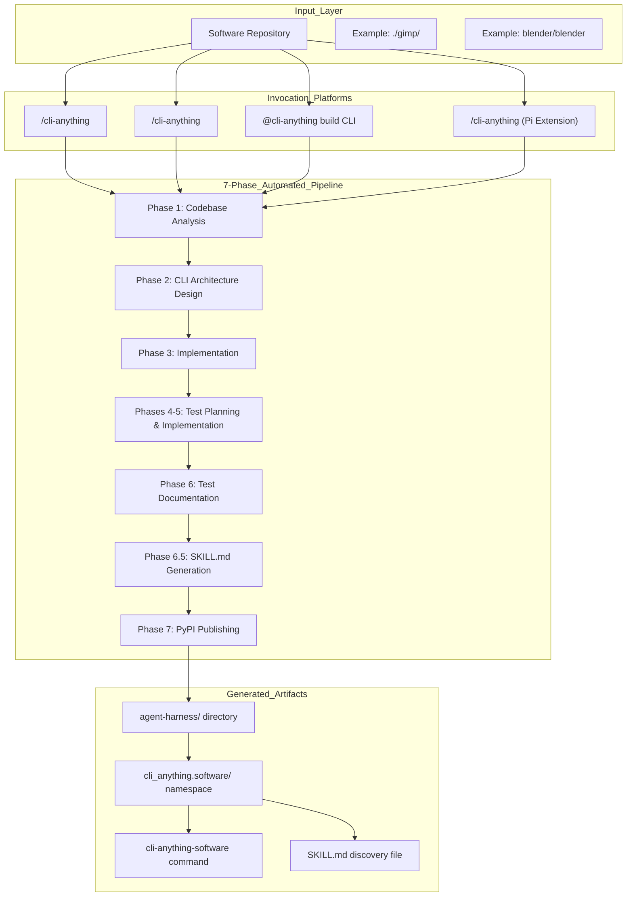

Sources: [README.md:37-47](), [README_CN.md:90-125](), [cli-anything-plugin/HARNESS.md:10-108](), [cli-anything-plugin/README.md:60-81]()

## Generated Code Architecture

CLI-Anything produces a standard directory structure within an `agent-harness/` folder. The following diagram maps conceptual components to specific code entities and patterns defined in the `HARNESS.md` methodology.

**Diagram: Generated CLI Architecture Mapping**
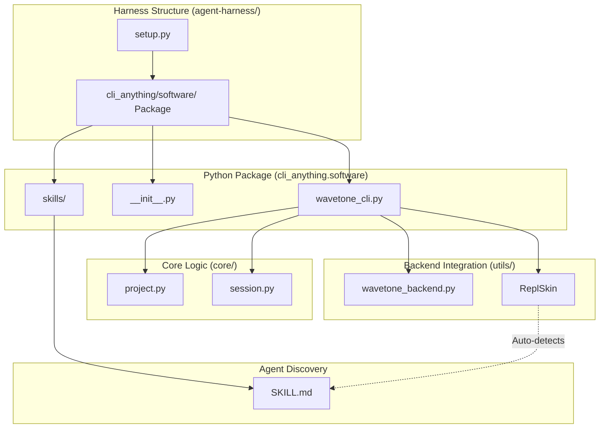

**Key Code Entities:**

| Entity | Primary Functionality | Code Reference |
|--------|-----------------------|----------------|
| `setup.py` | Configures PEP 420 namespace and `console_scripts`. | [wavetone/agent-harness/setup.py:1-25]() |
| `wavetone_cli.py` | Click-based entry point; handles REPL and subcommands. | [wavetone/agent-harness/cli_anything/wavetone/wavetone_cli.py:67-85]() |
| `ReplSkin` | Unified UX for REPL, status reporting, and banner display. | [wavetone/agent-harness/cli_anything/wavetone/utils/repl_skin.py:1-40]() |
| `_locked_save_json` | Pattern for atomic, thread-safe session persistence. | [cli-anything-plugin/guides/session-locking.md:9-37]() |
| `wavetone_backend.py` | Subprocess wrapper for the authentic software binary. | [wavetone/agent-harness/cli_anything/wavetone/utils/wavetone_backend.py:1-50]() |
| `SKILL.md` | YAML-based metadata for AI agent discovery and instruction. | [skills/cli-anything-wavetone/SKILL.md:1-20]() |

Sources: [cli-anything-plugin/HARNESS.md:49-108](), [cli-anything-plugin/guides/session-locking.md:14-37](), [wavetone/agent-harness/cli_anything/wavetone/wavetone_cli.py:1-120]()

## Platform Integration Methods

CLI-Anything is distributed across multiple AI agent platforms. Each platform utilizes a specific configuration to trigger the 7-phase methodology.

| Platform | Integration Method | Setup File / Command |
|----------|-------------------|----------------------|
| **Claude Code** | Marketplace Plugin | `/plugin marketplace add HKUDS/CLI-Anything` [README.md:72-74]() |
| **OpenCode** | Command Scripts | `~/.config/opencode/commands/` [README_CN.md:172-173]() |
| **OpenClaw** | Native Skill | `~/.openclaw/skills/cli-anything/SKILL.md` [README_CN.md:243-244]() |
| **Qodercli** | Local Plugin | `setup-qodercli.sh` [README_CN.md:215-217]() |
| **Pi Coding Agent**| Extension | `.pi-extension/cli-anything/install.sh` [.pi-extension/cli-anything/README.md:15-18]() |

Sources: [README.md:118-121](), [README_CN.md:156-255](), [.pi-extension/cli-anything/README.md:7-12]()

## Agent-Native Interface Characteristics

The generated CLIs are designed specifically for AI consumption:

1. **Structured Output (`--json`)**: Every command supports machine-readable JSON output to eliminate parsing errors. [cli-anything-plugin/HARNESS.md:44-48]()
2. **Self-Describing**: Built-in `--help` flags and `SKILL.md` files allow agents to discover capabilities dynamically. [cli-anything-plugin/guides/skill-generation.md:9-14]()
3. **Stateful Session Management**: Includes undo/redo and project persistence using locked JSON saves. [cli-anything-plugin/HARNESS.md:69-73](), [cli-anything-plugin/guides/session-locking.md:1-8]()
4. **REPL Mode**: A default interactive mode that provides persistent context for multi-step agent workflows. [cli-anything-plugin/HARNESS.md:27-30]()
5. **Authentic Backend Integration**: CLIs wrap the actual software (e.g., `libreoffice --headless`, GIMP Script-Fu) rather than reimplementing logic. [cli-anything-plugin/HARNESS.md:54-66]()
6. **Unified Branding**: The `ReplSkin` class ensures consistent banners, status icons, and progress bars across all harnesses. [wavetone/agent-harness/cli_anything/wavetone/utils/repl_skin.py:1-60]()

Sources: [README.md:96-111](), [cli-anything-plugin/HARNESS.md:25-48](), [cli-anything-plugin/guides/skill-generation.md:1-7]()

---

# Page: Supported Applications

# Supported Applications

<details>
<summary>Relevant source files</summary>

The following files were used as context for generating this wiki page:

- [.github/scripts/sync_root_skills.py](.github/scripts/sync_root_skills.py)
- [.github/scripts/validate_root_skills.py](.github/scripts/validate_root_skills.py)
- [drawio/agent-harness/DRAWIO.md](drawio/agent-harness/DRAWIO.md)
- [drawio/agent-harness/cli_anything/drawio/README.md](drawio/agent-harness/cli_anything/drawio/README.md)
- [drawio/agent-harness/cli_anything/drawio/__init__.py](drawio/agent-harness/cli_anything/drawio/__init__.py)
- [drawio/agent-harness/cli_anything/drawio/core/__init__.py](drawio/agent-harness/cli_anything/drawio/core/__init__.py)
- [drawio/agent-harness/cli_anything/drawio/core/connectors.py](drawio/agent-harness/cli_anything/drawio/core/connectors.py)
- [drawio/agent-harness/cli_anything/drawio/core/export.py](drawio/agent-harness/cli_anything/drawio/core/export.py)
- [drawio/agent-harness/cli_anything/drawio/core/pages.py](drawio/agent-harness/cli_anything/drawio/core/pages.py)
- [drawio/agent-harness/cli_anything/drawio/core/project.py](drawio/agent-harness/cli_anything/drawio/core/project.py)
- [drawio/agent-harness/cli_anything/drawio/core/shapes.py](drawio/agent-harness/cli_anything/drawio/core/shapes.py)
- [drawio/agent-harness/cli_anything/drawio/drawio_cli.py](drawio/agent-harness/cli_anything/drawio/drawio_cli.py)
- [drawio/agent-harness/cli_anything/drawio/tests/test_core.py](drawio/agent-harness/cli_anything/drawio/tests/test_core.py)
- [drawio/agent-harness/cli_anything/drawio/utils/drawio_xml.py](drawio/agent-harness/cli_anything/drawio/utils/drawio_xml.py)
- [minimax/agent-harness/FIX_NOTES.md](minimax/agent-harness/FIX_NOTES.md)
- [minimax/agent-harness/cli_anything/minimax/README.md](minimax/agent-harness/cli_anything/minimax/README.md)
- [minimax/agent-harness/cli_anything/minimax/minimax_cli.py](minimax/agent-harness/cli_anything/minimax/minimax_cli.py)
- [minimax/agent-harness/cli_anything/minimax/skills/SKILL.md](minimax/agent-harness/cli_anything/minimax/skills/SKILL.md)
- [minimax/agent-harness/cli_anything/minimax/tests/TEST.md](minimax/agent-harness/cli_anything/minimax/tests/TEST.md)
- [minimax/agent-harness/cli_anything/minimax/tests/test_core.py](minimax/agent-harness/cli_anything/minimax/tests/test_core.py)
- [minimax/agent-harness/cli_anything/minimax/tests/test_full_e2e.py](minimax/agent-harness/cli_anything/minimax/tests/test_full_e2e.py)
- [minimax/agent-harness/cli_anything/minimax/tests/test_tts_extended.py](minimax/agent-harness/cli_anything/minimax/tests/test_tts_extended.py)
- [minimax/agent-harness/cli_anything/minimax/utils/minimax_backend.py](minimax/agent-harness/cli_anything/minimax/utils/minimax_backend.py)
- [minimax/agent-harness/setup.py](minimax/agent-harness/setup.py)
- [public_registry.json](public_registry.json)
- [registry.json](registry.json)
- [siyuan/agent-harness/setup.py](siyuan/agent-harness/setup.py)
- [skills/cli-anything-iterm2-ctl/SKILL.md](skills/cli-anything-iterm2-ctl/SKILL.md)
- [skills/cli-anything-minimax/SKILL.md](skills/cli-anything-minimax/SKILL.md)
- [skills/cli-anything-qgis/SKILL.md](skills/cli-anything-qgis/SKILL.md)
- [skills/cli-anything-siyuan/SKILL.md](skills/cli-anything-siyuan/SKILL.md)

</details>


This page documents all software applications currently supported by CLI-Anything, including their domain categories, backend integration methods, package locations, and technical implementation details. CLI-Anything has generated production-ready CLI harnesses for over 40 diverse applications spanning creative tools, engineering software, scientific analysis, gaming, web services, and AI APIs.

For information about how these applications are generated through the 7-phase pipeline, see [The 7-Phase Generation Pipeline](). For details on the internal structure of each generated CLI, see [Generated CLI Architecture]().

---

## Complete Application Inventory

CLI-Anything currently supports a vast ecosystem of applications. Each application receives a dedicated namespace package under `cli_anything.<software>` and a console script entry point following the pattern `cli-anything-<software>`.

### Application Ecosystem Mapping

The following diagram bridges the Natural Language names of supported software to their specific code entities and entry points within the repository.

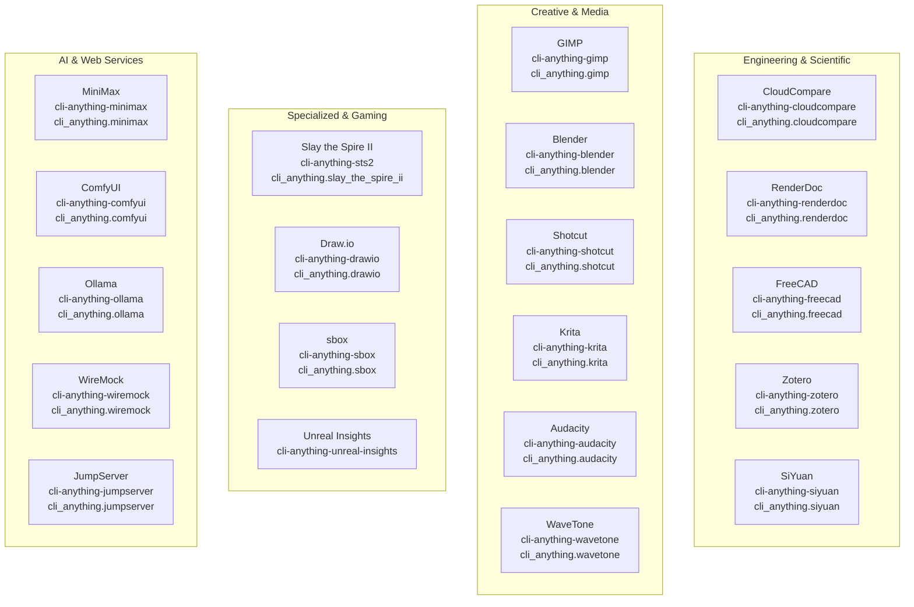

Sources: `[registry.json:9-186]()`, `[public_registry.json:1-50]()`, `[skills/cli-anything-siyuan/SKILL.md:1-20]()`

---

## Application Catalog

The `registry.json` and `public_registry.json` files serve as the source of truth for all supported applications, defining their categories, install commands, and entry points.

| Software | Category | CLI Command | Backend Integration Method | Source / Registry |
|----------|----------|-------------|----------------------------|-------------------|
| **CloudCompare** | 3D/Science | `cli-anything-cloudcompare` | `-SILENT` mode subprocess + Glob renaming | `[registry.json:1-170]()` |
| **RenderDoc** | GPU/Dev | `cli-anything-renderdoc` | Python API (`import renderdoc`) embedding | `[registry.json:1-170]()` |
| **Zotero** | Research | `cli-anything-zotero` | Local API + SQLite (`zotero_sqlite.py`) | `[registry.json:1-170]()` |
| **SiYuan** | Knowledge | `cli-anything-siyuan` | Kernel HTTP API (`http://127.0.0.1:6806`) | `[skills/cli-anything-siyuan/SKILL.md:11-13]()` |
| **Shotcut** | Video | `cli-anything-shotcut` | MLT XML Manipulation + `melt` CLI | `[skills/cli-anything-shotcut/SKILL.md:9-21]()` |
| **Draw.io** | Diagram | `cli-anything-drawio` | mxGraph XML DOM Manipulation | `[drawio/agent-harness/cli_anything/drawio/drawio_cli.py:1-15]()` |
| **MiniMax** | AI/API | `cli-anything-minimax` | OpenAI-compatible REST API & SSE TTS | `[minimax/agent-harness/cli_anything/minimax/utils/minimax_backend.py:1-35]()` |
| **Slay the Spire II** | Gaming | `cli-anything-sts2` | .NET Bridge Mod + Localhost HTTP API | `[registry.json:1-170]()` |
| **WireMock** | Testing | `cli-anything-wiremock` | WireMock REST API | `[registry.json:66-83]()` |
| **JumpServer** | DevOps | `cli-anything-jumpserver` | JumpServer REST API | `[registry.json:9-26]()` |
| **OpenRefine** | Database | `cli-anything-openrefine` | Local HTTP API + Session Undo/Redo | `[registry.json:28-45]()` |
| **CC Switch** | DevOps | `cli-anything-ccswitch` | AI Coding Tool Config DB Inspection | `[registry.json:47-64]()` |
| **NSLogger** | DevOps | `cli-anything-nslogger` | Bonjour Live Capture & Log Parsing | `[registry.json:85-102]()` |
| **AnyGen** | Generation | `cli-anything-anygen` | AnyGen Cloud API | `[registry.json:104-121]()` |
| **AdGuardHome** | Network | `cli-anything-adguardhome` | REST API | `[registry.json:123-140]()` |
| **Audacity** | Audio | `cli-anything-audacity` | sox Wrapper | `[registry.json:142-159]()` |
| **WaveTone** | Audio | `cli-anything-wavetone` | Transcription Manifests & Windows EXE | `[registry.json:161-170]()` |

Sources: `[registry.json:9-170]()`, `[public_registry.json:1-100]`, `[skills/cli-anything-siyuan/SKILL.md:11-15]()`, `[drawio/agent-harness/cli_anything/drawio/drawio_cli.py:1-20]()`, `[minimax/agent-harness/cli_anything/minimax/utils/minimax_backend.py:1-30]()`

---

## Specialized Integration Patterns

Newer harnesses utilize advanced patterns to handle complex software lifecycles, local HTTP daemons, SQLite stores, and SSE streaming.

### Advanced Backend Architectures

This diagram illustrates how specialized harnesses bridge the gap between Natural Language requests and technical backend entities across different domains.

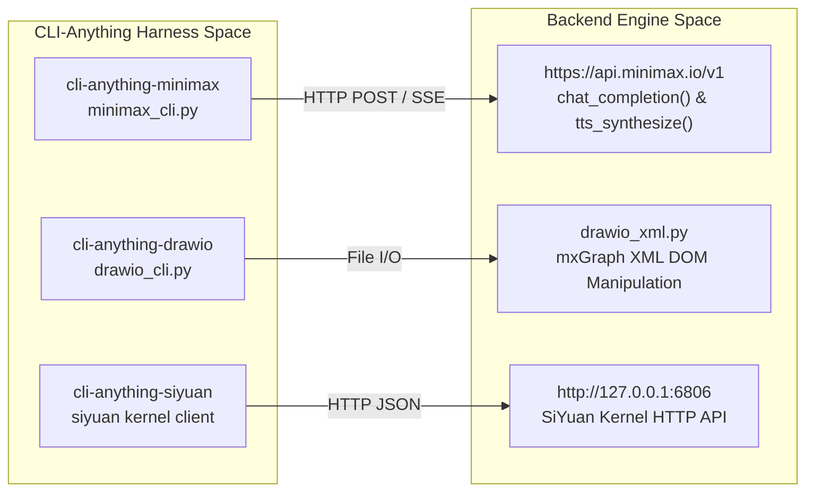

Sources: `[minimax/agent-harness/cli_anything/minimax/minimax_cli.py:103-125]()`, `[minimax/agent-harness/cli_anything/minimax/utils/minimax_backend.py:21-35]()`, `[drawio/agent-harness/cli_anything/drawio/drawio_cli.py:129-165]()`, `[skills/cli-anything-siyuan/SKILL.md:11-14]()`

### Key Integration Examples

#### 1. MiniMax (OpenAI-Compatible & SSE TTS Pattern)
The MiniMax harness communicates with the MiniMax REST API supporting global (`api.minimax.io`) and regional endpoints (`api.minimaxi.com`) `[minimax/agent-harness/cli_anything/minimax/utils/minimax_backend.py:21-34]()`. It provides `chat`, `stream` (streaming responses via callbacks) `[minimax/agent-harness/cli_anything/minimax/minimax_cli.py:195-231]()`, and `tts` (synthesizing speech via Server-Sent Events and hex-decoded audio streams) `[minimax/agent-harness/cli_anything/minimax/tests/test_full_e2e.py:100-114]()`.

#### 2. SiYuan (Kernel HTTP API Pattern)
The SiYuan harness connects to a running local SiYuan kernel via `http://127.0.0.1:6806` using an API token `[skills/cli-anything-siyuan/SKILL.md:11-17]()`. It exposes structured commands for `notebook`, `doc`, `block`, `sql` queries over block databases, and Markdown export `[skills/cli-anything-siyuan/SKILL.md:21-61]()`.

#### 3. Draw.io (mxGraph XML DOM Manipulation)
The Draw.io harness parses and manipulates Draw.io XML files directly (`drawio_cli.py`) `[drawio/agent-harness/cli_anything/drawio/drawio_cli.py:1-6]()`. It provides project presets, shape management, connectors, pages, and export capabilities through programmatic DOM manipulation `[drawio/agent-harness/cli_anything/drawio/drawio_cli.py:170-198]()`.

#### 4. WireMock (REST API Pattern)
The WireMock harness manages HTTP mock servers via their REST API `[registry.json:66-74]()`. It allows AI agents to create stubs, inspect requests, record traffic, and manage complex test scenarios against a running standalone Java instance `[registry.json:66-74]()`.

#### 5. Shotcut (MLT XML Pattern)
The Shotcut harness operates directly on MLT XML project structures and offloads actual rendering tasks to the `melt` CLI tool `[skills/cli-anything-shotcut/SKILL.md:9-21]()`. It maintains a two-step media model where assets are imported to a bin before placement on timeline tracks `[skills/cli-anything-shotcut/SKILL.md:56-69]()`.

---

## State and Session Management

CLI-Anything harnesses maintain execution state through localized project files, config files (`~/.config/cli-anything-*`), and session snapshots.

*   **REPL Mode:** Invoking any generated CLI without arguments launches an interactive `prompt-toolkit` REPL session maintaining command context and in-memory variables `[minimax/agent-harness/cli_anything/minimax/minimax_cli.py:114-124]()`, `[drawio/agent-harness/cli_anything/drawio/drawio_cli.py:136-165]()`.
*   **Error Handling Decorators:** Standardized `@handle_error` wrappers catch runtime, validation, and API exceptions, emitting formatted JSON payloads when `--json` is specified or printing user-friendly stderr output `[minimax/agent-harness/cli_anything/minimax/minimax_cli.py:86-100]()`, `[drawio/agent-harness/cli_anything/drawio/drawio_cli.py:87-122]()`.
*   **Agent Discovery:** Each harness packages a `SKILL.md` file describing its complete command surface, options, and agent usage guidelines, which are automatically indexed by the CLI-Hub registry `[registry.json:18-18]`, `[minimax/agent-harness/cli_anything/minimax/skills/SKILL.md:1-50]()`.

Sources: `[minimax/agent-harness/cli_anything/minimax/minimax_cli.py:43-124]`, `[minimax/agent-harness/cli_anything/minimax/skills/SKILL.md:1-150]`, `[drawio/agent-harness/cli_anything/drawio/drawio_cli.py:39-165]()`

---

# Page: Key Features

# Key Features

<details>
<summary>Relevant source files</summary>

The following files were used as context for generating this wiki page:

- [.gitignore](.gitignore)
- [README.md](README.md)
- [README_CN.md](README_CN.md)
- [README_JA.md](README_JA.md)
- [anygen/agent-harness/cli_anything/anygen/core/session.py](anygen/agent-harness/cli_anything/anygen/core/session.py)
- [audacity/agent-harness/cli_anything/audacity/core/session.py](audacity/agent-harness/cli_anything/audacity/core/session.py)
- [blender/agent-harness/cli_anything/blender/core/session.py](blender/agent-harness/cli_anything/blender/core/session.py)
- [drawio/agent-harness/cli_anything/drawio/core/session.py](drawio/agent-harness/cli_anything/drawio/core/session.py)
- [gimp/agent-harness/cli_anything/gimp/core/session.py](gimp/agent-harness/cli_anything/gimp/core/session.py)
- [inkscape/agent-harness/cli_anything/inkscape/core/session.py](inkscape/agent-harness/cli_anything/inkscape/core/session.py)
- [kdenlive/agent-harness/cli_anything/kdenlive/core/session.py](kdenlive/agent-harness/cli_anything/kdenlive/core/session.py)
- [libreoffice/agent-harness/cli_anything/libreoffice/core/session.py](libreoffice/agent-harness/cli_anything/libreoffice/core/session.py)
- [obs-studio/agent-harness/cli_anything/obs_studio/core/session.py](obs-studio/agent-harness/cli_anything/obs_studio/core/session.py)
- [shotcut/agent-harness/cli_anything/shotcut/core/session.py](shotcut/agent-harness/cli_anything/shotcut/core/session.py)
- [skills/cli-anything-wavetone/SKILL.md](skills/cli-anything-wavetone/SKILL.md)
- [wavetone/agent-harness/cli_anything/wavetone/README.md](wavetone/agent-harness/cli_anything/wavetone/README.md)
- [wavetone/agent-harness/cli_anything/wavetone/core/audio.py](wavetone/agent-harness/cli_anything/wavetone/core/audio.py)
- [wavetone/agent-harness/cli_anything/wavetone/core/project.py](wavetone/agent-harness/cli_anything/wavetone/core/project.py)
- [wavetone/agent-harness/cli_anything/wavetone/core/session.py](wavetone/agent-harness/cli_anything/wavetone/core/session.py)
- [wavetone/agent-harness/cli_anything/wavetone/tests/TEST.md](wavetone/agent-harness/cli_anything/wavetone/tests/TEST.md)
- [wavetone/agent-harness/cli_anything/wavetone/tests/test_core.py](wavetone/agent-harness/cli_anything/wavetone/tests/test_core.py)
- [wavetone/agent-harness/cli_anything/wavetone/tests/test_full_e2e.py](wavetone/agent-harness/cli_anything/wavetone/tests/test_full_e2e.py)
- [wavetone/agent-harness/cli_anything/wavetone/utils/repl_skin.py](wavetone/agent-harness/cli_anything/wavetone/utils/repl_skin.py)
- [wavetone/agent-harness/cli_anything/wavetone/utils/wavetone_backend.py](wavetone/agent-harness/cli_anything/wavetone/utils/wavetone_backend.py)
- [wavetone/agent-harness/cli_anything/wavetone/wavetone_cli.py](wavetone/agent-harness/cli_anything/wavetone/wavetone_cli.py)
- [wavetone/agent-harness/setup.py](wavetone/agent-harness/setup.py)

</details>


This document describes the core features that make CLI-Anything effective at transforming GUI applications into agent-native tools. These features apply universally across all generated CLIs and are enforced by the automated generation pipeline.

---

## Features Overview

CLI-Anything provides seven fundamental capabilities that distinguish it from traditional CLI tools and enable authentic agent-software integration:

| Feature | Technical Implementation | Agent Benefit |
|---------|-------------------------|---------------|
| **Automated 7-Phase Generation** | Pipeline from analysis to PyPI publishing, guided by `HARNESS.md` | Any software becomes agent-ready in minutes |
| **Authentic Backend Integration** | Native project file generation + real backend invocation via subprocess | Full professional capabilities, zero compromises |
| **Stateful Session Management** | `core/session.py` with 50-level undo/redo, deep-copy snapshots | Multi-step workflows with error recovery |
| **Dual Interaction Modes** | Click command groups + `utils/repl_skin.py` REPL wrapper | Interactive exploration + scriptable automation |
| **JSON Output** | `--json` flag on all commands with structured error messages | Zero parsing complexity for agent consumption |
| **SKILL.md Generation** | Phase 6.5: `skill_generator.py` creates YAML frontmatter + examples | Agent discovery via `package_data` inclusion |
| **Production Testing** | Comprehensive test suite: unit + E2E native + E2E backend + CLI subprocess | 100% pass rate, zero compromise dependencies |

Sources: [README.md:115-123](), [cli-anything-plugin/README.md:152-243](), [cli-anything-plugin/HARNESS.md:12-132](), [cli-anything-plugin/guides/skill-generation.md:1-12]()

---

## Stateful CLI Design

### Session and Project Model

Every generated CLI implements a stateful design where project state persists across commands. This contrasts with traditional CLIs that are purely stateless and require complete information in each invocation.

Diagram: Stateful CLI Architecture
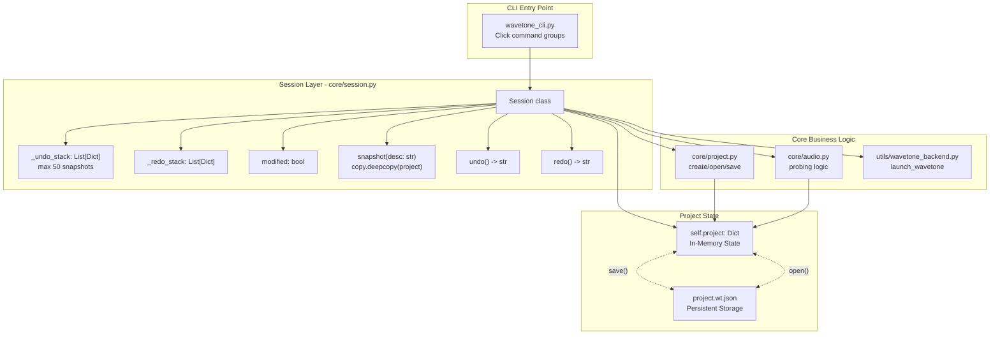
Sources: [cli-anything-plugin/HARNESS.md:39-48](), [cli-anything-plugin/HARNESS.md:71-99](), [cli-anything-plugin/guides/session-locking.md:1-39](), [wavetone/agent-harness/cli_anything/wavetone/wavetone_cli.py:67-85]()

The `Session` class in each generated CLI provides:

- **Snapshot Creation**: Before each state-changing operation, `session.snapshot(description)` uses `copy.deepcopy(self.project)` to capture the current project state [cli-anything-plugin/HARNESS.md:40-42]().
- **Undo/Redo Stacks**: Two independent stacks (`_undo_stack` and `_redo_stack`) storing serialized project states with operation descriptions, limited to 50 entries [cli-anything-plugin/HARNESS.md:22-23](), [cli-anything-plugin/README.md:181]().
- **Modification Tracking**: The `modified` flag tracks unsaved changes and appears in REPL prompt [cli-anything-plugin/repl_skin.py:11-12](), [cli-anything-plugin/HARNESS.md:84-90]().
- **Project Lifecycle**: Methods `open(path)`, `save(path)`, and automatic persistence using locked JSON writes to prevent concurrent write corruption [cli-anything-plugin/guides/session-locking.md:1-37]().

Sources: [cli-anything-plugin/HARNESS.md:39-48](), [cli-anything-plugin/HARNESS.md:71-99](), [cli-anything-plugin/guides/session-locking.md:1-39]()

### Undo/Redo Implementation

Diagram: Undo/Redo Execution Sequence
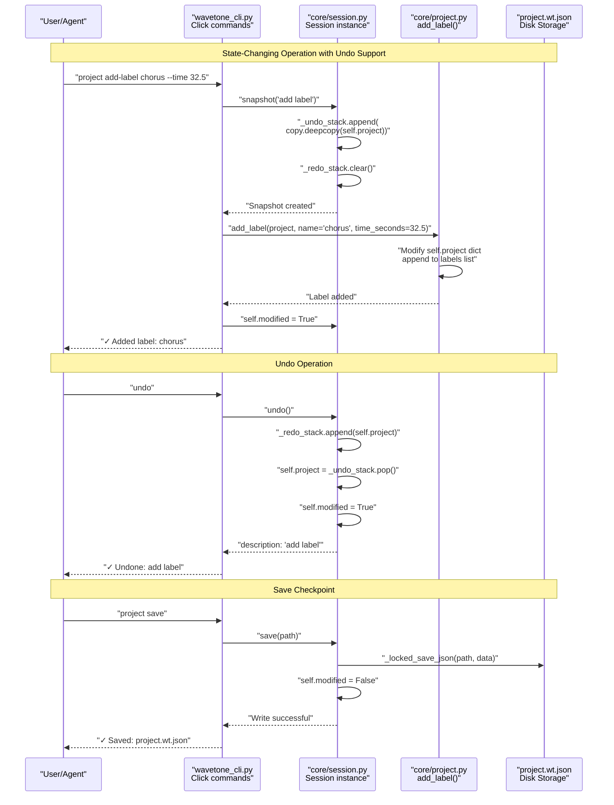
Sources: [cli-anything-plugin/HARNESS.md:22-23](), [cli-anything-plugin/HARNESS.md:71-99](), [cli-anything-plugin/guides/session-locking.md:1-39](), [wavetone/agent-harness/cli_anything/wavetone/core/project.py:1-40]()

---

## Dual Interaction Modes

Generated CLIs support two distinct usage patterns, both built on the same command structure using the Click framework [cli-anything-plugin/HARNESS.md:27-30]().

### REPL Mode

Entering REPL mode requires simply invoking the CLI without subcommands. This is achieved by setting `invoke_without_command=True` on the main Click group [cli-anything-plugin/README.md:182-183](), [wavetone/agent-harness/cli_anything/wavetone/wavetone_cli.py:67-85]().

```bash
cli-anything-wavetone           # Enters interactive REPL
```

The REPL interface is provided by `ReplSkin` in `utils/repl_skin.py` (or harness-local replicas), which delivers:

| Component | Implementation | Description |
|-----------|----------------|-------------|
| **Branded Banner** | `skin.print_banner()` | ASCII art box with app name, version, and SKILL.md path for agent discovery [cli-anything-plugin/repl_skin.py:188-210](), [wavetone/agent-harness/cli_anything/wavetone/wavetone_cli.py:91-92]() |
| **Styled Prompt** | `skin.get_input()` | Displays project name and modification indicator [cli-anything-plugin/repl_skin.py:84](), [wavetone/agent-harness/cli_anything/wavetone/wavetone_cli.py:97]() |
| **Command History** | `skin.create_prompt_session()` | Persistent arrow key navigation via `prompt_toolkit` [cli-anything-plugin/HARNESS.md:83](), [wavetone/agent-harness/cli_anything/wavetone/wavetone_cli.py:94]() |
| **Formatted Output** | `skin.table()`, `skin.success()` | Consistent success (✓), error (✗), warning (⚠), and info (●) styling [cli-anything-plugin/repl_skin.py:86-92](), [wavetone/agent-harness/cli_anything/wavetone/wavetone_cli.py:111-118]() |

Sources: [cli-anything-plugin/HARNESS.md:74-108](), [wavetone/agent-harness/cli_anything/wavetone/wavetone_cli.py:87-119]()

### One-Shot/Scriptable Mode

For automation and scripting, commands can be invoked directly with subcommands and parameters [cli-anything-plugin/HARNESS.md:29]().

```bash
cli-anything-wavetone --json project new input.wav -o project.wt.json
cli-anything-wavetone --project project.wt.json --json audio probe
```

Sources: [cli-anything-plugin/HARNESS.md:29](), [wavetone/agent-harness/cli_anything/wavetone/wavetone_cli.py:126-151]()

### JSON Output for Agents

Every command supports the `--json` global flag, which transforms output into structured data for agent consumption [cli-anything-plugin/README.md:180](), [cli-anything-plugin/HARNESS.md:44-48]().

```bash
cli-anything-wavetone --json wavetone doctor
```

The `--json` flag is implemented via `emit()` and `ctx_json()` in `wavetone_cli.py`, ensuring agents parse results programmatically without regex scraping [wavetone/agent-harness/cli_anything/wavetone/wavetone_cli.py:30-43]().

Sources: [cli-anything-plugin/HARNESS.md:44-48](), [wavetone/agent-harness/cli_anything/wavetone/wavetone_cli.py:30-43]()

---

## Authentic Software Integration

### Real Backend Invocation

CLI-Anything generates valid project files and delegates heavy lifting to the actual software via backend wrappers [cli-anything-plugin/HARNESS.md:54-68]().

Diagram: Authentic Backend Integration Architecture
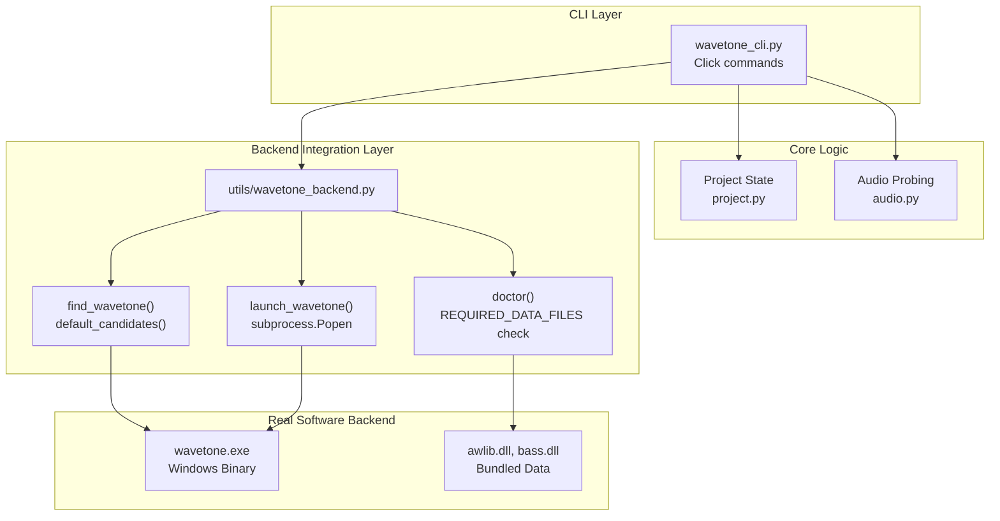
Sources: [cli-anything-plugin/HARNESS.md:54-68](), [wavetone/agent-harness/cli_anything/wavetone/utils/wavetone_backend.py:1-145]()

---

## Automated 7-Phase Generation Pipeline

The generation pipeline transforms any software codebase into a production-ready CLI through seven automated phases plus Phase 6.5 for SKILL.md generation [README.md:115-123](), [cli-anything-plugin/README.md:72-81]().

Diagram: Automated Generation Pipeline
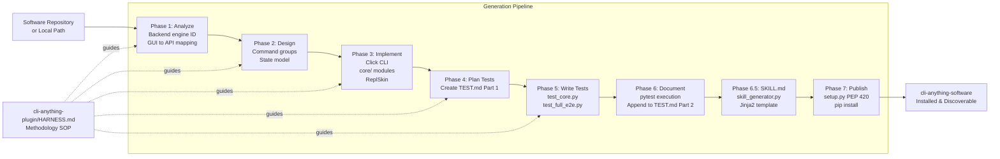
Sources: [README.md:115-123](), [cli-anything-plugin/README.md:152-243](), [cli-anything-plugin/HARNESS.md:12-230](), [cli-anything-plugin/guides/skill-generation.md:34-84]()

---

## SKILL.md and Agent Discovery

Phase 6.5 enables AI agent discovery of generated CLIs. Each CLI includes a `SKILL.md` file that can be loaded by AI assistants like Claude Code or OpenClaw [cli-anything-plugin/guides/skill-generation.md:1-14](), [README_CN.md:232-246]().

Diagram: SKILL.md Generation and Discovery Architecture
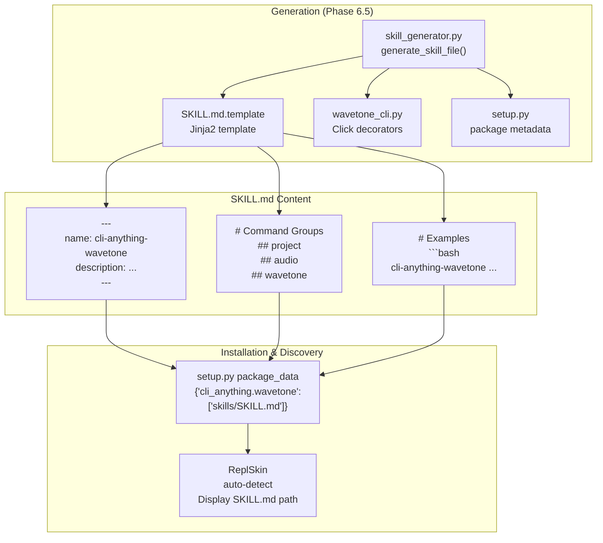
Sources: [cli-anything-plugin/guides/skill-generation.md:1-135](), [skills/cli-anything-wavetone/SKILL.md:1-53]()

---

## Production Testing & Quality

### Comprehensive Testing Strategy

Every generated CLI undergoes validation through unit and E2E testing to ensure a 100% pass rate [README.md:18](), [wavetone/agent-harness/cli_anything/wavetone/tests/TEST.md:1-157]().

| Test Type | Implementation | What It Validates |
|-----------|----------------|-------------------|
| **Unit Tests** | `tests/test_core.py` | Core logic with synthetic data, project creation, session snapshots [wavetone/agent-harness/cli_anything/wavetone/tests/test_core.py:30-100]() |
| **E2E Native** | `tests/test_full_e2e.py` | Intermediate project file structure validation and workflow state [wavetone/agent-harness/cli_anything/wavetone/tests/test_full_e2e.py:80-118]() |
| **E2E Backend** | `tests/test_full_e2e.py` | Real software rendering/launch smoke tests (`TestRealWaveToneBackend`) [wavetone/agent-harness/cli_anything/wavetone/tests/test_full_e2e.py:119-153]() |
| **CLI Subprocess** | `tests/test_full_e2e.py` | Subprocess execution using `_resolve_cli()` pattern [wavetone/agent-harness/cli_anything/wavetone/tests/test_full_e2e.py:18-30]() |

Sources: [README.md:18-27](), [wavetone/agent-harness/cli_anything/wavetone/tests/TEST.md:1-157](), [wavetone/agent-harness/cli_anything/wavetone/tests/test_core.py:1-125](), [wavetone/agent-harness/cli_anything/wavetone/tests/test_full_e2e.py:1-153]()

---

# Page: Getting Started

# Getting Started

<details>
<summary>Relevant source files</summary>

The following files were used as context for generating this wiki page:

- [.github/workflows/check-codex-skill.yml](.github/workflows/check-codex-skill.yml)
- [.gitignore](.gitignore)
- [README.md](README.md)
- [README_CN.md](README_CN.md)
- [README_JA.md](README_JA.md)
- [codex-skill/SKILL.md](codex-skill/SKILL.md)
- [codex-skill/agents/openai.yaml](codex-skill/agents/openai.yaml)
- [codex-skill/scripts/install.ps1](codex-skill/scripts/install.ps1)
- [codex-skill/scripts/install.sh](codex-skill/scripts/install.sh)
- [codex-skill/tests/test_install.sh](codex-skill/tests/test_install.sh)
- [skills/cli-anything-wavetone/SKILL.md](skills/cli-anything-wavetone/SKILL.md)
- [wavetone/agent-harness/cli_anything/wavetone/README.md](wavetone/agent-harness/cli_anything/wavetone/README.md)
- [wavetone/agent-harness/cli_anything/wavetone/core/audio.py](wavetone/agent-harness/cli_anything/wavetone/core/audio.py)
- [wavetone/agent-harness/cli_anything/wavetone/core/project.py](wavetone/agent-harness/cli_anything/wavetone/core/project.py)
- [wavetone/agent-harness/cli_anything/wavetone/core/session.py](wavetone/agent-harness/cli_anything/wavetone/core/session.py)
- [wavetone/agent-harness/cli_anything/wavetone/tests/TEST.md](wavetone/agent-harness/cli_anything/wavetone/tests/TEST.md)
- [wavetone/agent-harness/cli_anything/wavetone/tests/test_core.py](wavetone/agent-harness/cli_anything/wavetone/tests/test_core.py)
- [wavetone/agent-harness/cli_anything/wavetone/tests/test_full_e2e.py](wavetone/agent-harness/cli_anything/wavetone/tests/test_full_e2e.py)
- [wavetone/agent-harness/cli_anything/wavetone/utils/repl_skin.py](wavetone/agent-harness/cli_anything/wavetone/utils/repl_skin.py)
- [wavetone/agent-harness/cli_anything/wavetone/utils/wavetone_backend.py](wavetone/agent-harness/cli_anything/wavetone/utils/wavetone_backend.py)
- [wavetone/agent-harness/cli_anything/wavetone/wavetone_cli.py](wavetone/agent-harness/cli_anything/wavetone/wavetone_cli.py)
- [wavetone/agent-harness/setup.py](wavetone/agent-harness/setup.py)

</details>


This page guides users through the initial setup and first usage of CLI-Anything, providing a high-level overview of platform-specific installations, the automated CLI generation walkthrough, and basic execution patterns. For comprehensive details, see the child pages: **[Platform Installation](#2.1)**, **[Generating Your First CLI](#2.2)**, and **[Using a Generated CLI](#2.3)**.

Sources: `[README.md:1-12]()`, `[README_CN.md:56-64]()`

---

## 2.1. Platform Installation

CLI-Anything integrates with multiple AI agent platforms. Each platform adapter makes `/cli-anything` and related slash commands available within the agent workspace.

- **Claude Code Plugin**: Installed via marketplace commands such as `/plugin marketplace add` and `/plugin install cli-anything` `[README_CN.md:73-83]()`.
- **OpenCode Commands**: Utilizes global or project-level copies of command files and `HARNESS.md` placed in `~/.config/opencode/commands/` `[README_CN.md:173-178]()`.
- **Qodercli Plugin**: Registered via `setup-qodercli.sh` which updates `~/.qoder.json` `[README_CN.md:216-218]()`.
- **OpenClaw Skill**: Native skill integration via `SKILL.md` placed in `~/.openclaw/skills/`.
- **Codex Skill**: Installed via `codex-skill/scripts/install.sh` or `install.ps1` scripts (`[codex-skill/scripts/install.sh:10-11]()`, `[codex-skill/scripts/install.ps1:17-18]()`), utilizing metadata in `codex-skill/agents/openai.yaml` and validated by CI workflows.
- **Reasonix, Hermes, Cursor and Pi Adapters**: Additional platform adapters include `reasonix-skill/`, `hermes-skill/`, `cursor-plugin/`, and `.pi-extension/cli-anything` (`[.pi-extension/cli-anything]()`, `[README.md:53]()`).

For platform-specific setup guides, see **[Platform Installation](#2.1)**.

Sources: `[README.md:37]()`, `[README_CN.md:73-218]()`, `[codex-skill/scripts/install.sh:10-58]()`

---

## 2.2. Generating Your First CLI

Once installed, running `/cli-anything <software-path>` triggers a strict 7-phase automated generation process guided by `HARNESS.md`. This pipeline converts application source code or repository URLs into fully tested, agent-native CLI harnesses.

### Bridging Natural Language to Code Entities

The diagram below illustrates how user prompts and agent planning space map to concrete Python modules and harness implementation artifacts during generation.

**Generation Pipeline Architecture**
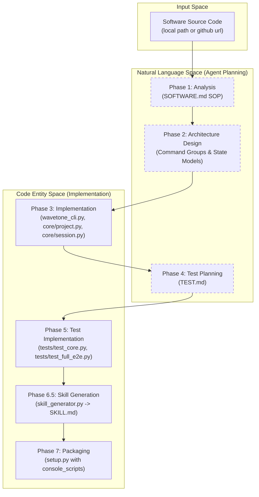
Sources: `[cli-anything-plugin/skill_generator.py:7-142]()`, `[wavetone/agent-harness/setup.py]()`, `[wavetone/agent-harness/cli_anything/wavetone/wavetone_cli.py:67-85]()`

For a detailed phase-by-phase breakdown, see **[Generating Your First CLI](#2.2)**.

---

## 2.3. Using a Generated CLI

Generated CLIs are exposed via console scripts (e.g., `cli-anything-<software>`) defined in `setup.py` (`[wavetone/agent-harness/setup.py]()`). They support two execution patterns:

1. **REPL Mode**: Invoked with no arguments, starting an interactive shell (`[wavetone/agent-harness/cli_anything/wavetone/wavetone_cli.py:83-85]()`) managed by `ReplSkin` (`[wavetone/agent-harness/cli_anything/wavetone/utils/repl_skin.py]()`) with history and prompts (`[wavetone/agent-harness/cli_anything/wavetone/wavetone_cli.py:89-97]()`).
2. **One-Shot & JSON Mode**: Invoked with subcommands and flags such as `--json` (`[wavetone/agent-harness/cli_anything/wavetone/wavetone_cli.py:69]()`), emitting structured machine-readable objects for agent parsing (`[wavetone/agent-harness/cli_anything/wavetone/wavetone_cli.py:30-38]()`).

### CLI Execution Architecture
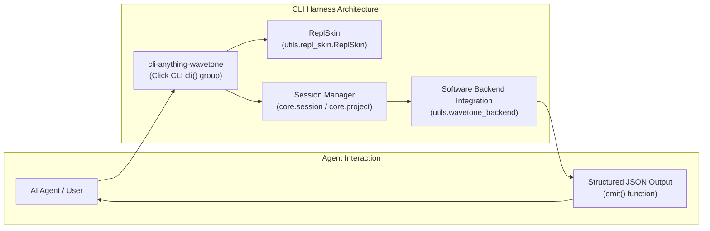
Sources: `[wavetone/agent-harness/cli_anything/wavetone/wavetone_cli.py:30-118]()`, `[wavetone/agent-harness/cli_anything/wavetone/utils/repl_skin.py]()`

For detailed usage instructions, flag references, and REPL commands, see **[Using a Generated CLI](#2.3)**.

---

# Page: Platform Installation

# Platform Installation

<details>
<summary>Relevant source files</summary>

The following files were used as context for generating this wiki page:

- [.github/workflows/check-codex-skill.yml](.github/workflows/check-codex-skill.yml)
- [codex-skill/SKILL.md](codex-skill/SKILL.md)
- [codex-skill/agents/openai.yaml](codex-skill/agents/openai.yaml)
- [codex-skill/scripts/install.ps1](codex-skill/scripts/install.ps1)
- [codex-skill/scripts/install.sh](codex-skill/scripts/install.sh)
- [codex-skill/tests/test_install.sh](codex-skill/tests/test_install.sh)
- [qoder-plugin/setup-qodercli.sh](qoder-plugin/setup-qodercli.sh)

</details>


This document provides an overview of CLI-Anything's multi-platform integration architecture and the supported AI agent platforms. Each platform features a specialized installation mechanism, but all converge on the same core methodology defined in `cli-anything-plugin/HARNESS.md` as the single source of truth.

For detailed installation procedures specific to each platform, see the child pages:
- [Claude Code Plugin](#2.1.1) — Installing via Claude Code marketplace (`/plugin marketplace add`, `/plugin install`).
- [OpenCode Commands](#2.1.2) — Copying command files and `HARNESS.md` to `~/.config/opencode/commands/`.
- [Qodercli Plugin](#2.1.3) — Running `setup-qodercli.sh` to register in `~/.qoder.json` [qoder-plugin/setup-qodercli.sh:41]().
- [OpenClaw Skill](#2.1.4) — Copying `SKILL.md` to `~/.openclaw/skills/` for native skill integration.
- [Codex Skill](#2.1.5) — Running `install.sh`/`install.ps1` scripts [codex-skill/scripts/install.sh:1](), [codex-skill/scripts/install.ps1:1](), leveraging `agents/openai.yaml` metadata [codex-skill/agents/openai.yaml:1](), and the `check-codex-skill` CI workflow [.github/workflows/check-codex-skill.yml:1]().
- [Reasonix, Hermes, Cursor and Pi Adapters](#2.1.6) — Cover additional platform adapters including `reasonix-skill/`, `hermes-skill/`, `cursor-plugin/`, and `.pi-extension/cli-anything`.

---

## Platform-Agnostic Architecture & Installation Overview

CLI-Anything utilizes a platform abstraction pattern where natural language requests across disparate agent interfaces route into a unified 7-phase generation pipeline.

**Diagram: Natural Language Space to Code Entity Space (Installation Flow)**

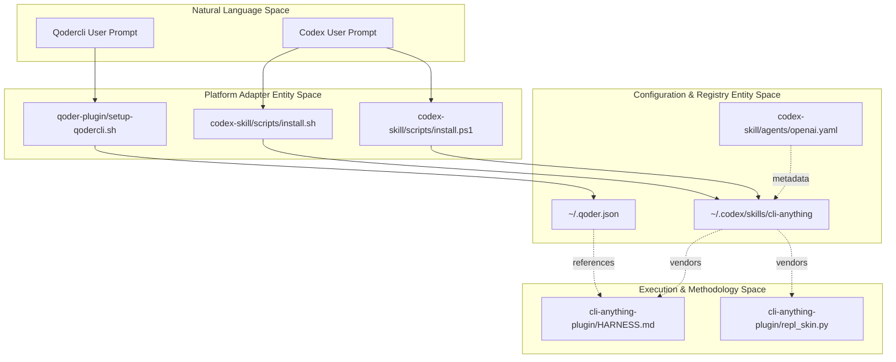

**Sources:** [qoder-plugin/setup-qodercli.sh:1-42](), [codex-skill/scripts/install.sh:1-15](), [codex-skill/scripts/install.ps1:1-18](), [codex-skill/agents/openai.yaml:1-4]()

---

## Summary of Platform Installation Approaches

Each supported environment bridges user instructions to the generation pipeline through specific scripts or marketplace mechanisms:

| Platform | Primary Installation Script / Command | Target Configuration Path | Key Artifacts |
|----------|-------------------------------------|---------------------------|---------------|
| **Claude Code** | `/plugin marketplace add` / `/plugin install` | `~/.claude/plugins/cli-anything/` | `plugin.json`, commands [cli-anything-plugin/README.md:1]() |
| **OpenCode** | Manual copy or sync script | `~/.config/opencode/commands/` | `cli-anything*.md`, `HARNESS.md` [README_CN.md:172-180]() |
| **Qodercli** | `bash qoder-plugin/setup-qodercli.sh` [qoder-plugin/setup-qodercli.sh:1]() | `~/.qoder.json` [qoder-plugin/setup-qodercli.sh:41]() | Plugin registry source entry |
| **OpenClaw** | Manual directory placement | `~/.openclaw/skills/cli-anything/` | `SKILL.md` [README_CN.md:244]() |
| **Codex** | `bash codex-skill/scripts/install.sh` [codex-skill/scripts/install.sh:1]() | `~/.codex/skills/cli-anything` [codex-skill/scripts/install.sh:10]() | Vendored `HARNESS.md`, scripts, `openai.yaml` [codex-skill/agents/openai.yaml:1]() |
| **Other Adapters** | Platform-specific install scripts | Various local paths | `.pi-extension/`, `cursor-plugin/`, `hermes-skill/`, `reasonix-skill/` |

**Sources:** [qoder-plugin/setup-qodercli.sh:1-57](), [codex-skill/scripts/install.sh:1-62](), [codex-skill/agents/openai.yaml:1-4]()

---

## Installation Validation and CI

To guarantee that installation scripts function reliably across operating systems and upgrades, automated checks run within GitHub Actions. For instance, the Codex skill installer is rigorously tested via `codex-skill/tests/test_install.sh` [codex-skill/tests/test_install.sh:1]() and governed by the `.github/workflows/check-codex-skill.yml` workflow [.github/workflows/check-codex-skill.yml:1]().

**Diagram: Installation Verification Pipeline**

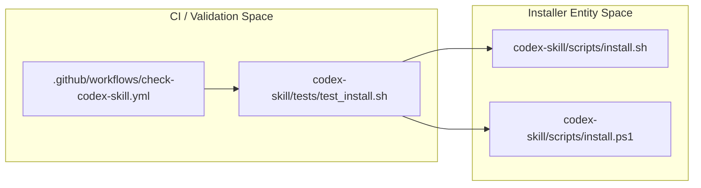

**Sources:** [.github/workflows/check-codex-skill.yml:1-31](), [codex-skill/tests/test_install.sh:1-40]()

---

# Page: Claude Code Plugin

# Claude Code Plugin

<details>
<summary>Relevant source files</summary>

The following files were used as context for generating this wiki page:

- [cli-anything-plugin/commands/cli-anything.md](cli-anything-plugin/commands/cli-anything.md)
- [cli-anything-plugin/commands/list.md](cli-anything-plugin/commands/list.md)
- [cli-anything-plugin/commands/refine.md](cli-anything-plugin/commands/refine.md)
- [cli-anything-plugin/commands/test.md](cli-anything-plugin/commands/test.md)
- [cli-anything-plugin/commands/validate.md](cli-anything-plugin/commands/validate.md)
- [krita/agent-harness/KRITA.md](krita/agent-harness/KRITA.md)
- [krita/agent-harness/cli_anything/krita/README.md](krita/agent-harness/cli_anything/krita/README.md)
- [krita/agent-harness/cli_anything/krita/__init__.py](krita/agent-harness/cli_anything/krita/__init__.py)
- [krita/agent-harness/cli_anything/krita/__main__.py](krita/agent-harness/cli_anything/krita/__main__.py)

</details>


This document covers the Claude Code plugin for CLI-Anything, which provides AI agents running in Claude Code with the ability to install via the marketplace (`/plugin marketplace add`, `/plugin install`) and execute the 7-phase CLI generation pipeline.

For information about other platform integrations (OpenCode, Qodercli, OpenClaw, Codex), see [Platform Installation](). For details on the 7-phase generation process that the plugin executes, see [The 7-Phase Generation Pipeline]().

---

## Overview

The Claude Code Plugin is the primary integration mechanism for CLI-Anything. It provides a set of slash commands that Claude Code agents can invoke to:

- **Generate** complete CLI harnesses from software codebases (`/cli-anything`) `[cli-anything-plugin/commands/cli-anything.md:1-13]()`
- **Refine** and expand existing harnesses with iterative gap analysis (`/cli-anything:refine`) `[cli-anything-plugin/commands/refine.md:1-12]()`
- **Test** suites and update `TEST.md` documentation (`/cli-anything:test`) `[cli-anything-plugin/commands/test.md:1-13]()`
- **Validate** harnesses against `HARNESS.md` methodology standards (`/cli-anything:validate`) `[cli-anything-plugin/commands/validate.md:1-13]()`
- **List** and discover installed or generated CLI tools (`/cli-anything:list`) `[cli-anything-plugin/commands/list.md:1-9]()`

Sources: `[cli-anything-plugin/commands/cli-anything.md:1-13]()`, `[cli-anything-plugin/commands/list.md:1-9]`, `[cli-anything-plugin/commands/refine.md:1-12]()`

---

## Installation Methods

### Marketplace Installation

The preferred installation method uses Claude Code's plugin marketplace system to add the repository and install the plugin command suite:

```bash
# Add the marketplace registry
/plugin marketplace add HKUDS/CLI-Anything

# Install the plugin
/plugin install cli-anything
```

### Manual Installation

Users can manually clone the repository into the Claude Code plugins directory and reload:

```bash
cd ~/.claude/plugins
git clone https://github.com/HKUDS/CLI-Anything.git cli-anything
```
After cloning, run `/reload-plugins` within the Claude Code session.

Sources: `[cli-anything-plugin/commands/cli-anything.md:29-86]()`

---

## Plugin Architecture and Code Entity Mapping

The following diagram bridges the Natural Language space (slash commands invoked by users or agents) to the Code Entity space (plugin markdown command definitions and python metadata scanners).

Title: "Natural Language to Code Entity Mapping for Claude Code Plugin"

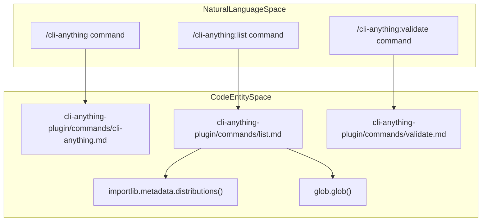

### Directory Structure

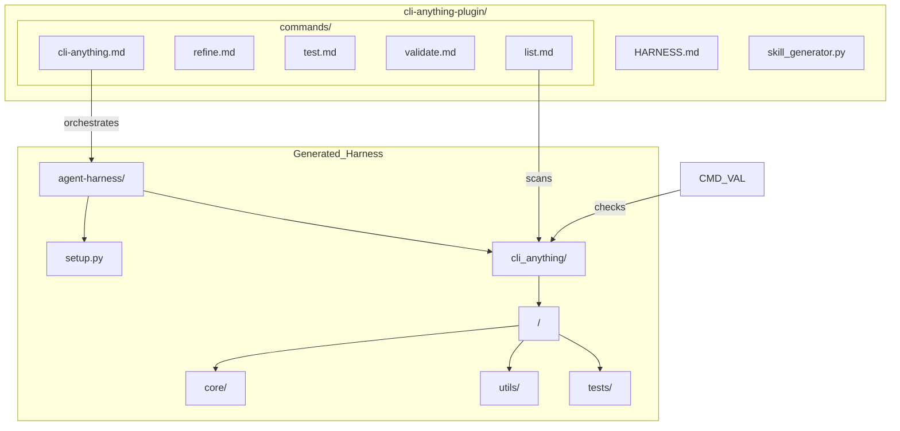

Sources: `[cli-anything-plugin/commands/cli-anything.md:87-108]`, `[cli-anything-plugin/commands/list.md:21-115]()`

---

## Command Execution Flow

Title: "Command Execution Flow and Backend Inspection"

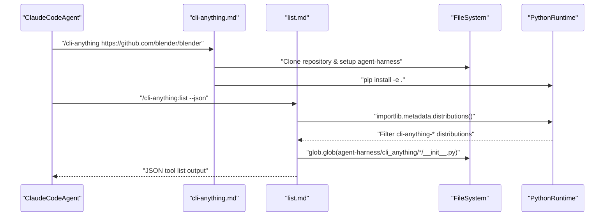

Sources: `[cli-anything-plugin/commands/cli-anything.md:29-86]`, `[cli-anything-plugin/commands/list.md:21-115]()`

---

## Plugin Commands Reference

### `/cli-anything:list`
Scans the system for both installed PyPI packages (`cli-anything-*`) via `importlib.metadata` and local generated harnesses via `glob` pattern matching `[cli-anything-plugin/commands/list.md:21-115]()`.

- **Deduplication:** Merges installed and generated records, preferring `installed` status while retaining the local `source` path `[cli-anything-plugin/commands/list.md:117-122]()`.
- **Depth Control:** Supports `--depth <n>` for recursive filesystem scanning `[cli-anything-plugin/commands/list.md:13-14]()`.

### `/cli-anything:validate`
Enforces standards from `HARNESS.md`, verifying PEP 420 namespace compliance, Click command groups, `--json` flag support, and `_resolve_cli` subprocess test harnesses `[cli-anything-plugin/commands/validate.md:27-86]()`.

Sources: `[cli-anything-plugin/commands/list.md:13-122]`, `[cli-anything-plugin/commands/validate.md:27-86]()`

---

## Summary

The Claude Code plugin provides robust marketplace integration (`/plugin marketplace add`, `/plugin install`) and command dispatching (`/cli-anything`, `/cli-anything:list`, `/cli-anything:validate`) to automate the creation of agent-native CLI tools `[cli-anything-plugin/commands/cli-anything.md:1-13]`, `[cli-anything-plugin/commands/list.md:1-9]()`.

Sources: `[cli-anything-plugin/commands/cli-anything.md:1-13]`, `[cli-anything-plugin/commands/list.md:1-9]()`

---

# Page: OpenCode Commands

# OpenCode Commands

<details>
<summary>Relevant source files</summary>

The following files were used as context for generating this wiki page:

- [cli-anything-plugin/HARNESS.md](cli-anything-plugin/HARNESS.md)
- [cli-anything-plugin/README.md](cli-anything-plugin/README.md)
- [cli-anything-plugin/guides/filter-translation.md](cli-anything-plugin/guides/filter-translation.md)
- [cli-anything-plugin/guides/mcp-backend.md](cli-anything-plugin/guides/mcp-backend.md)
- [cli-anything-plugin/guides/pypi-publishing.md](cli-anything-plugin/guides/pypi-publishing.md)
- [cli-anything-plugin/guides/session-locking.md](cli-anything-plugin/guides/session-locking.md)
- [cli-anything-plugin/guides/skill-generation.md](cli-anything-plugin/guides/skill-generation.md)
- [cli-anything-plugin/guides/timecode-precision.md](cli-anything-plugin/guides/timecode-precision.md)
- [cli-anything-plugin/repl_skin.py](cli-anything-plugin/repl_skin.py)

</details>


This page documents the OpenCode platform integration for CLI-Anything. It covers the installation process, command files, and how OpenCode discovers and executes CLI-Anything functionality through markdown-based command definitions.

For information about other platform integrations, see [Platform Installation](). For details about the generation pipeline that these commands invoke, see [The 7-Phase Generation Pipeline]().

---

## Overview

OpenCode integration uses a **file-based command discovery mechanism** where markdown files in `~/.config/opencode/commands/` define available slash commands. Unlike Claude Code's plugin marketplace system, OpenCode requires manual file copying but provides the same 7-phase generation capabilities once installed.

**Key characteristics:**
- Commands defined as `.md` files in a standard directory.
- Requires `HARNESS.md` co-located with command files as the methodology SOP `[opencode-commands/cli-anything.md:11-13]()`.
- Supports both global (`~/.config/opencode/commands/`) and project-level (`.opencode/commands/`) installation.
- Five slash commands: `/cli-anything`, `/cli-anything-refine`, `/cli-anything-test`, `/cli-anything-validate`, and `/cli-anything-list`.

Sources: [opencode-commands/cli-anything.md:1-13](), [opencode-commands/cli-anything-list.md:1-6]()

---

## Installation Architecture

The following diagram shows how OpenCode discovers and loads CLI-Anything commands from the Natural Language Space (Markdown files) into the Code Entity Space (Agent Execution).

**OpenCode Command Discovery Map**
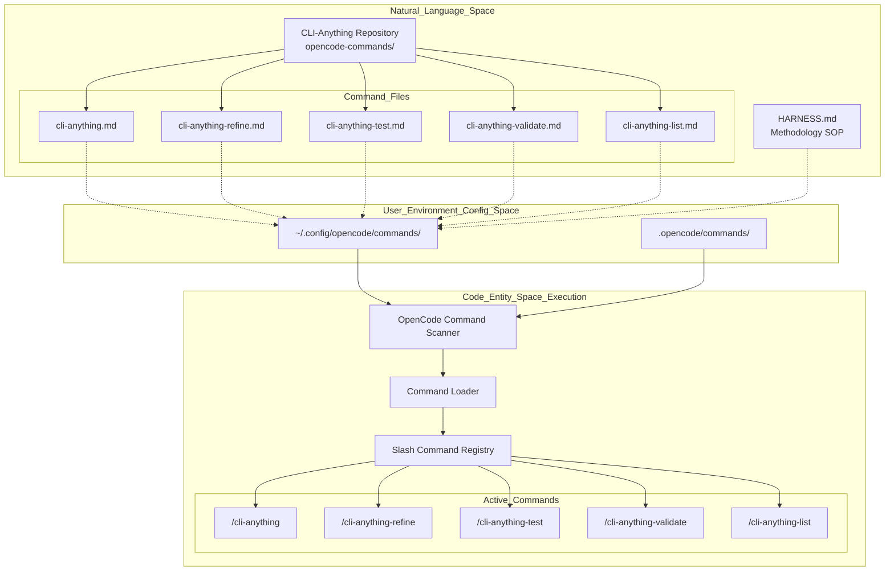

**Installation Steps:**
1. **Clone Repository**: `git clone https://github.com/HKUDS/CLI-Anything.git`
2. **Copy Command Files**: 
   - Global: `cp CLI-Anything/opencode-commands/*.md ~/.config/opencode/commands/`
3. **Copy HARNESS.md**: 
   - Global: `cp CLI-Anything/cli-anything-plugin/HARNESS.md ~/.config/opencode/commands/`

Sources: [opencode-commands/cli-anything.md:1-13](), [opencode-commands/cli-anything-list.md:1-6]()

---

## Available Commands

| Command | Markdown File | Description |
|---------|---------------|-------------|
| `/cli-anything` | `cli-anything.md` | Build complete CLI harness (7 phases) `[opencode-commands/cli-anything.md:5-7]()` |
| `/cli-anything-refine` | `cli-anything-refine.md` | Refine existing harness with gap analysis `[opencode-commands/cli-anything-refine.md:5-7]()` |
| `/cli-anything-test` | `cli-anything-test.md` | Run test suite and update `TEST.md` `[opencode-commands/cli-anything-test.md:4-6]()` |
| `/cli-anything-validate` | `cli-anything-validate.md` | Validate harness against `HARNESS.md` standards `[opencode-commands/cli-anything-validate.md:4-6]()` |
| `/cli-anything-list` | `cli-anything-list.md` | List installed and generated CLIs `[opencode-commands/cli-anything-list.md:4-6]()` |

Sources: [opencode-commands/cli-anything.md:5-7](), [opencode-commands/cli-anything-refine.md:5-7](), [opencode-commands/cli-anything-test.md:4-6](), [opencode-commands/cli-anything-validate.md:4-6](), [opencode-commands/cli-anything-list.md:4-6]()

---

## Command Implementation Logic

The `/cli-anything-list` command demonstrates the technical logic used by the agent to bridge local file systems and installed Python packages.

**Command Execution Logic: List Discovery**
```mermaid
sequenceDiagram
    participant Agent as OpenCode Agent
    participant Meta as importlib.metadata
    participant FS as File System glob
    
    Agent->>Meta: distributions()
    Note over Meta: Scan for 'cli-anything-*'
    Meta-->>Agent: Installed Packages Name, Version
    
    Agent->>FS: glob("**/agent-harness/cli_anything/*/__init__.py")
    Note over FS: Search local directories
    FS-->>Agent: Local Init Files
    
    Agent->>Agent: extract_version_from_setup()
    Note over Agent: Regex match version in setup.py
    
    Agent->>Agent: Merge & Deduplicate
    Agent-->>User: Display Table/JSON
```

### Key Functions and Patterns
- **Version Extraction**: Uses `re.search(r'version\s*=\s*["\']([^"\']+)["\']', content)` to parse `setup.py` `[opencode-commands/cli-anything-list.md:60-67]()`.
- **Glob Depth Control**: `build_glob_patterns` generates depth-specific patterns (e.g., `*/*/agent-harness/...`) to limit recursion `[opencode-commands/cli-anything-list.md:69-84]()`.
- **CLI Resolution**: The `/cli-anything-test` and `/cli-anything-validate` commands rely on `_resolve_cli("cli-anything-<software>")` to find the executable without hardcoded paths `[opencode-commands/cli-anything-validate.md:66-67]()`.
- **Installed Discovery**: Uses `importlib.metadata.distributions()` to find packages starting with `cli-anything-` and `shutil.which` to find executables `[opencode-commands/cli-anything-list.md:27-42]()`.

Sources: [opencode-commands/cli-anything-list.md:26-104](), [opencode-commands/cli-anything-validate.md:65-67]()

---

## Validation Standards

The `/cli-anything-validate` command enforces strict adherence to the methodology defined in `HARNESS.md`. It performs checks across several domains:

1. **Directory Structure**: Verifies PEP 420 namespace compliance (no `__init__.py` in `cli_anything/`) `[opencode-commands/cli-anything-validate.md:27-28]()`.
2. **Required Modules**: Ensures presence of `project.py` (state management), `session.py` (undo/redo), and `export.py` `[opencode-commands/cli-anything-validate.md:36-38]()`.
3. **CLI Standards**: Checks for Click framework usage, `--json` support, and `handle_error` decorators `[opencode-commands/cli-anything-validate.md:45-51]()`.
4. **Test Standards**: Verifies `TestCLISubprocess` exists and uses `CLI_ANYTHING_FORCE_INSTALLED` for environment-agnostic testing `[opencode-commands/cli-anything-validate.md:65-68]()`.
5. **Packaging**: Validates `setup.py` uses `find_namespace_packages(include=["cli_anything.*"])` and entry points are correctly mapped `[opencode-commands/cli-anything-validate.md:77-85]()`.

Sources: [opencode-commands/cli-anything-validate.md:26-91]()

---

## Refinement and Iteration

The `/cli-anything-refine` command allows for incremental capability expansion.

### Refinement Workflow
- **Step 1: Inventory**: Reads `<software>_cli.py` and core modules to map existing commands and coverage `[opencode-commands/cli-anything-refine.md:39-44]()`.
- **Step 2: Gap Analysis**: Compares current coverage against the software's public APIs or scripting interfaces, prioritizing high-impact and easy-win functions `[opencode-commands/cli-anything-refine.md:51-58]()`.
- **Step 3: Focused Implementation**: If a `$2` focus area (e.g., "batch processing") is provided, the agent skips broad analysis to target that specific domain `[opencode-commands/cli-anything-refine.md:22-34]()`.
- **Step 4: Regression Testing**: Runs all tests (old + new) to ensure stability after expansion `[opencode-commands/cli-anything-refine.md:72-73]()`.

Sources: [opencode-commands/cli-anything-refine.md:35-78]()

---

## HARNESS.md Dependency

**Critical Requirement**: `HARNESS.md` must be co-located with the command files. All OpenCode commands contain a critical instruction to read `./HARNESS.md` before execution `[opencode-commands/cli-anything.md:11-13]()`.

This file serves as the **Single Source of Truth** for:
- The 7-Phase pipeline execution `[opencode-commands/cli-anything.md:27-79]`.
- Packaging standards (namespace packages) `[opencode-commands/cli-anything-validate.md:77-85]()`.
- Testing requirements (unit vs. E2E) `[opencode-commands/cli-anything-validate.md:61-70]()`.
- Architecture and implementation patterns `[opencode-commands/cli-anything-refine.md:12-14]()`.

Sources: [opencode-commands/cli-anything.md:11-13](), [opencode-commands/cli-anything-validate.md:10-12](), [opencode-commands/cli-anything-refine.md:12-14]()

---

# Page: Qodercli Plugin

# Qodercli Plugin

<details>
<summary>Relevant source files</summary>

The following files were used as context for generating this wiki page:

- [qoder-plugin/setup-qodercli.sh](qoder-plugin/setup-qodercli.sh)

</details>


This page documents the Qodercli plugin integration for CLI-Anything, which enables use of CLI-Anything's 7-phase generation pipeline from within Qodercli sessions. This is a community-contributed platform adapter that registers CLI-Anything commands in Qodercli's plugin configuration system.

For information about other platform integrations, see [Platform Installation](). For details on the actual CLI generation commands, see [Plugin Commands Reference]().

---

## Overview

The Qodercli plugin allows users to invoke CLI-Anything's full suite of commands from within Qodercli sessions using the `/cli-anything:` command prefix. Unlike Claude Code (which uses a marketplace) or OpenCode (which uses command files), Qodercli integration works through a JSON configuration file at `~/.qoder.json` that defines local plugin sources.

The integration is implemented as a single shell script `setup-qodercli.sh` that performs one-time registration of the CLI-Anything plugin directory in the Qodercli configuration [qoder-plugin/setup-qodercli.sh:1-7]().

**Key Characteristics:**
- **Community contribution**: Officially merged as a community contribution with dedicated setup scripts [qoder-plugin/setup-qodercli.sh:1-3]().
- **JSON-based registration**: Plugin path is added to `~/.qoder.json` under `plugins.sources.local` [qoder-plugin/setup-qodercli.sh:103-107]().
- **Command prefix format**: All commands use `/cli-anything:<subcommand>` syntax [qoder-plugin/setup-qodercli.sh:150-154]().

**Supported Commands:**
- `/cli-anything:cli-anything` — Full 7-phase CLI generation [qoder-plugin/setup-qodercli.sh:150-150]().
- `/cli-anything:refine` — Iterative harness improvement [qoder-plugin/setup-qodercli.sh:151-151]().
- `/cli-anything:validate` — Standards validation [qoder-plugin/setup-qodercli.sh:153-153]().
- `/cli-anything:test` — Test execution [qoder-plugin/setup-qodercli.sh:152-152]().
- `/cli-anything:list` — CLI discovery [qoder-plugin/setup-qodercli.sh:154-154]().

Sources: [qoder-plugin/setup-qodercli.sh:1-155]()

---

## Configuration Architecture

The Qodercli plugin system uses a JSON configuration file to locate and load plugins from local filesystem paths.

### System Components to Code Entities Mapping

```mermaid
graph TB
    subgraph "User Filesystem"
        PLUGIN_DIR["cli-anything-plugin/<br/>.claude-plugin/plugin.json<br/>commands/*.md<br/>HARNESS.md"]
        QODER_HOME["$QODER_HOME/<br/>or $HOME"]
    end
    
    subgraph "Configuration File [~/.qoder.json]"
        QODER_JSON["QODER_CONFIG"]
        PLUGINS_OBJ["plugins object"]
        SOURCES_OBJ["sources object"]
        LOCAL_ARRAY["local array"]
        PATH_ENTRY["{\"path\": \"PLUGIN_DIR\"}"]
    end
    
    subgraph "Setup Logic [setup-qodercli.sh]"
        SETUP_SCRIPT["setup-qodercli.sh"]
        VALIDATE["Validate plugin.json exists"]
        JQ_CHECK["Check jq availability"]
        UPDATE_CONFIG["Update or create config"]
    end
    
    subgraph "Qodercli Runtime"
        QODER_SESSION["Qodercli Session"]
        LOAD_PLUGINS["Load plugins from<br/>plugins.sources.local"]
        CMD_RESOLVER["Resolve /cli-anything:*<br/>commands"]
    end
    
    SETUP_SCRIPT --> VALIDATE
    VALIDATE --> PLUGIN_DIR
    VALIDATE --> JQ_CHECK
    JQ_CHECK --> UPDATE_CONFIG
    UPDATE_CONFIG --> QODER_JSON
    
    QODER_JSON --> PLUGINS_OBJ
    PLUGINS_OBJ --> SOURCES_OBJ
    SOURCES_OBJ --> LOCAL_ARRAY
    LOCAL_ARRAY --> PATH_ENTRY
    PATH_ENTRY -.references.-> PLUGIN_DIR
    
    QODER_SESSION --> LOAD_PLUGINS
    LOAD_PLUGINS --> QODER_JSON
    LOAD_PLUGINS --> PLUGIN_DIR
    PLUGIN_DIR --> CMD_RESOLVER
```
Sources: [qoder-plugin/setup-qodercli.sh:34-139]()

**Configuration File Structure:**

The `~/.qoder.json` file follows this schema, where `PLUGIN_DIR` is the absolute path to the `cli-anything-plugin` directory [qoder-plugin/setup-qodercli.sh:116-124]():

```json
{
  "plugins": {
    "sources": {
      "local": [
        {"path": "/absolute/path/to/cli-anything-plugin"}
      ]
    }
  }
}
```

The `plugins.sources.local` array can contain multiple plugin entries, allowing Qodercli to discover and load plugins from various directories on the filesystem [qoder-plugin/setup-qodercli.sh:103-107]().

Sources: [qoder-plugin/setup-qodercli.sh:103-139]()

---

## Setup Script Implementation

The `setup-qodercli.sh` script is the sole installation mechanism for Qodercli integration. It performs validation, configuration detection, and atomic updates.

### Script Execution Flow

```mermaid
flowchart TD
    START["bash setup-qodercli.sh [path]"] --> DETECT_PATH["Detect PLUGIN_DIR<br/>(arg or ../cli-anything-plugin)"]
    
    DETECT_PATH --> VALIDATE_DIR["Validate PLUGIN_DIR<br/>Check .claude-plugin/plugin.json exists"]
    
    VALIDATE_DIR -->|"Missing plugin.json"| ERROR_INVALID["Exit 1: Invalid plugin directory"]
    VALIDATE_DIR -->|"Valid"| SETUP_CONFIG_DIR["Ensure CONFIG_DIR exists<br/>mkdir -p $(dirname ~/.qoder.json)"]
    
    SETUP_CONFIG_DIR --> CONFIG_EXISTS{"QODER_CONFIG<br/>exists?"}
    
    CONFIG_EXISTS -->|"No"| CHECK_JQ_CREATE{"jq available?"}
    CHECK_JQ_CREATE -->|"Yes"| JQ_CREATE["jq -n to create JSON"]
    CHECK_JQ_CREATE -->|"No"| BASH_CREATE["Use bash with json_escape_path"]
    JQ_CREATE --> SUCCESS_NEW["Config created with plugin registered"]
    BASH_CREATE --> SUCCESS_NEW
    
    CONFIG_EXISTS -->|"Yes"| VALIDATE_JSON["Validate existing JSON<br/>jq empty QODER_CONFIG"]
    
    VALIDATE_JSON -->|"Invalid"| ERROR_JSON["Exit 1: Fix JSON syntax"]
    VALIDATE_JSON -->|"Valid"| CHECK_REGISTERED["jq check if path<br/>already in local array"]
    
    CHECK_REGISTERED -->|"Already registered"| SUCCESS_EXISTS["Report: Already registered"]
    CHECK_REGISTERED -->|"Not registered"| CHECK_JQ_UPDATE{"jq available?"}
    
    CHECK_JQ_UPDATE -->|"No"| ERROR_NEED_JQ["Exit 1: Install jq or<br/>manually add entry"]
    CHECK_JQ_UPDATE -->|"Yes"| BACKUP["cp QODER_CONFIG<br/>QODER_CONFIG.bak"]
    
    BACKUP --> ATOMIC_UPDATE["jq update to TMP_CONFIG<br/>mv TMP_CONFIG to QODER_CONFIG"]
    ATOMIC_UPDATE --> SUCCESS_UPDATED["Plugin added to config"]
    
    SUCCESS_NEW --> DISPLAY_CMDS["Display available commands"]
    SUCCESS_EXISTS --> DISPLAY_CMDS
    SUCCESS_UPDATED --> DISPLAY_CMDS
    DISPLAY_CMDS --> END["Exit: Restart Qodercli"]
```
Sources: [qoder-plugin/setup-qodercli.sh:1-139]()

### Key Implementation Details

**Path Resolution:**
- Accepts optional custom path as first argument [qoder-plugin/setup-qodercli.sh:19-23]().
- Defaults to `../cli-anything-plugin` relative to script location [qoder-plugin/setup-qodercli.sh:25-31]().
- Normalizes to absolute path using `cd "$path" && pwd` [qoder-plugin/setup-qodercli.sh:20-20]().

**Plugin Validation:**
- Checks for existence of `.claude-plugin/plugin.json` [qoder-plugin/setup-qodercli.sh:35-38]().
- Exits with error if plugin structure is invalid.

**Safe JSON Escaping:**
- Provides `json_escape_path()` function for bash fallback [qoder-plugin/setup-qodercli.sh:60-62]().
- Escapes backslashes and double quotes in filesystem paths.
- Only used when `jq` is unavailable [qoder-plugin/setup-qodercli.sh:127-136]().

**Atomic Configuration Updates:**
- Creates backup before modification: `~/.qoder.json.bak` [qoder-plugin/setup-qodercli.sh:99-100]().
- Uses `mktemp` in same directory for atomic `mv` on same filesystem [qoder-plugin/setup-qodercli.sh:102-102]().
- Cleanup handled by `trap cleanup_temp EXIT` [qoder-plugin/setup-qodercli.sh:65-70]().

**JQ-Based Update Logic:**
The script uses `jq` to safely update the configuration without corrupting existing data [qoder-plugin/setup-qodercli.sh:103-108]():

```bash
jq --arg path "${PLUGIN_DIR}" '
    .plugins //= {} |
    .plugins.sources //= {} |
    .plugins.sources.local //= [] |
    .plugins.sources.local += [{"path": $path}]
' "${QODER_CONFIG}" > "${TMP_CONFIG}"
```

This pipeline ensures objects exist before appending the new plugin entry. The `--arg` flag safely passes the path as a jq variable to prevent injection [qoder-plugin/setup-qodercli.sh:103-103]().

Sources: [qoder-plugin/setup-qodercli.sh:1-139]()

---

## Command Registration and Invocation

### Plugin Discovery Mechanism

```mermaid
sequenceDiagram
    participant User
    participant SetupScript as "setup-qodercli.sh"
    participant QoderJSON as "~/.qoder.json"
    participant QoderSession as "Qodercli Session"
    participant PluginDir as "cli-anything-plugin/"
    participant Command as "commands/cli-anything.md"
    
    rect rgb(240, 240, 240)
        Note over User,QoderJSON: One-time Setup Phase
        User->>SetupScript: bash setup-qodercli.sh
        SetupScript->>PluginDir: Validate .claude-plugin/plugin.json
        PluginDir-->>SetupScript: Valid structure
        SetupScript->>QoderJSON: Add {"path": "PLUGIN_DIR"} to local array
        QoderJSON-->>SetupScript: Config updated
        SetupScript-->>User: Registration complete
    end
    
    rect rgb(240, 240, 240)
        Note over User,Command: Runtime Phase (New Session)
        User->>QoderSession: Start new session
        QoderSession->>QoderJSON: Read plugins.sources.local
        QoderJSON-->>QoderSession: [{"path": "/abs/path/..."}]
        QoderSession->>PluginDir: Load plugin from path
        PluginDir->>QoderSession: Register /cli-anything:* commands
    end
    
    rect rgb(240, 240, 240)
        Note over User,Command: Command Execution
        User->>QoderSession: /cli-anything:cli-anything ./gimp
        QoderSession->>Command: Execute command template
        Command->>Command: Read HARNESS.md
        Command->>Command: Run 7-phase pipeline
        Command-->>QoderSession: Generate CLI harness
        QoderSession-->>User: CLI ready at ./gimp/agent-harness
    end
```
Sources: [qoder-plugin/setup-qodercli.sh:34-155]()

### Available Commands

| Command | Format | Description |
|---------|--------|-------------|
| **cli-anything** | `/cli-anything:cli-anything <path>` | Execute full 7-phase pipeline on software codebase [qoder-plugin/setup-qodercli.sh:150-150]() |
| **refine** | `/cli-anything:refine <path> [focus]` | Perform gap analysis and expand CLI coverage [qoder-plugin/setup-qodercli.sh:151-151]() |
| **validate** | `/cli-anything:validate <path>` | Validate generated harness against HARNESS.md standards [qoder-plugin/setup-qodercli.sh:153-153]() |
| **test** | `/cli-anything:test <path>` | Run test suite and update TEST.md [qoder-plugin/setup-qodercli.sh:152-152]() |
| **list** | `/cli-anything:list` | Enumerate installed and generated CLIs [qoder-plugin/setup-qodercli.sh:154-154]() |

All commands follow the `plugin_name:command_name` convention used by Qodercli. The plugin name is derived from the configuration directory structure.

Sources: [qoder-plugin/setup-qodercli.sh:148-154]()

---

## Environment and Path Handling

### Configuration Location

The script respects the `QODER_HOME` environment variable for configuration directory location [qoder-plugin/setup-qodercli.sh:41-42]():

```bash
QODER_CONFIG="${QODER_HOME:-$HOME}/.qoder.json"
```

**Fallback Logic:**
1. Use `$QODER_HOME/.qoder.json` if `QODER_HOME` is set.
2. Otherwise use `$HOME/.qoder.json`.

This allows users with custom Qodercli installations to override the default location.

### Path Normalization

The script converts all plugin paths to absolute paths before storing them in the configuration [qoder-plugin/setup-qodercli.sh:19-23]():

```bash
if ! PLUGIN_DIR="$(cd "$1" && pwd)"; then
    echo -e "${YELLOW}Error: Invalid plugin directory: $1${NC}" >&2
    exit 1
fi
```

**Why Absolute Paths:**
- Qodercli sessions may start from different working directories.
- Absolute paths ensure consistent plugin loading regardless of CWD.
- The `cd && pwd` approach resolves symlinks to their target directories [qoder-plugin/setup-qodercli.sh:17-17]().

Sources: [qoder-plugin/setup-qodercli.sh:16-50]()

---

## Error Handling and Validation

### Pre-Flight Checks

The script performs several validation steps before attempting to modify the configuration:

| Check | Code Location | Error Message |
|-------|----------|---------------|
| Plugin directory accessibility | [qoder-plugin/setup-qodercli.sh:19-23]() | "Error: Invalid plugin directory: $1" |
| `plugin.json` exists | [qoder-plugin/setup-qodercli.sh:35-38]() | "Error: plugin.json not found at ..." |
| Config directory writable | [qoder-plugin/setup-qodercli.sh:45-50]() | "Error: Failed to create config directory ..." |
| Existing config is valid JSON | [qoder-plugin/setup-qodercli.sh:87-91]() | "Error: QODER_CONFIG contains invalid JSON." |
| `jq` available for update | [qoder-plugin/setup-qodercli.sh:75-84]() | "jq not found. Please install jq or manually add..." |

### Duplicate Detection

The script checks if the plugin is already registered before adding it [qoder-plugin/setup-qodercli.sh:94-96]():

```bash
if jq -e --arg path "${PLUGIN_DIR}" '.plugins.sources.local[]? | select(.path == $path)' "${QODER_CONFIG}" > /dev/null 2>&1; then
    echo -e "${GREEN}✓ Plugin already registered in ${QODER_CONFIG}${NC}"
```

This prevents the `local` array from being populated with duplicate paths during repeated script runs.

Sources: [qoder-plugin/setup-qodercli.sh:34-111]()

---

## Fallback Modes and Degradation

### JQ Availability Handling

The script provides different behavior based on `jq` availability:

| Operation | With `jq` | Without `jq` |
|-----------|---------|------------|
| **Create new config** | Use `jq -n` for safe generation [qoder-plugin/setup-qodercli.sh:114-124]() | Bash with `json_escape_path()` [qoder-plugin/setup-qodercli.sh:126-137]() |
| **Update existing config** | `jq` pipeline with `--arg` [qoder-plugin/setup-qodercli.sh:103-108]() | Exit with manual instructions [qoder-plugin/setup-qodercli.sh:75-84]() |
| **Validate existing JSON** | `jq empty` [qoder-plugin/setup-qodercli.sh:87-87]() | N/A (file assumed valid) |

### Manual Fallback Instructions

When `jq` is unavailable for update operations, the script provides copy-pasteable JSON to the user [qoder-plugin/setup-qodercli.sh:76-83](). This ensures users can always complete the installation even without `jq`, albeit with manual intervention.

### Temp File Cleanup

The script uses a `trap` to ensure temporary files created during the atomic update process are cleaned up even on failure [qoder-plugin/setup-qodercli.sh:65-70]().

Sources: [qoder-plugin/setup-qodercli.sh:59-139]()

---

## Usage Workflow

### Setup and Generation

```mermaid
flowchart LR
    subgraph "Setup (One-time)"
        CLONE["Clone CLI-Anything repo"] --> RUN_SETUP["bash setup-qodercli.sh"]
        RUN_SETUP --> REGISTERED["Plugin registered in<br/>~/.qoder.json"]
    end
    
    subgraph "Session Start"
        NEW_SESSION["Start new Qodercli session"] --> LOAD["Qodercli loads plugins<br/>from config"]
        LOAD --> AVAILABLE["Commands available:<br/>/cli-anything:*"]
    end
    
    subgraph "CLI Generation"
        CMD_GEN["/cli-anything:cli-anything ./software"] --> PIPELINE["7-phase pipeline runs"]
        PIPELINE --> HARNESS["agent-harness/ created"]
    end
    
    subgraph "CLI Usage"
        INSTALL["pip install -e ./software/agent-harness"] --> USE["cli-anything-software available"]
    end
    
    REGISTERED --> NEW_SESSION
    AVAILABLE --> CMD_GEN
    HARNESS --> INSTALL
```
Sources: [qoder-plugin/setup-qodercli.sh:141-155]()

---

# Page: OpenClaw Skill

# OpenClaw Skill

<details>
<summary>Relevant source files</summary>

The following files were used as context for generating this wiki page:

- [.pi-extension/cli-anything/README.md](.pi-extension/cli-anything/README.md)
- [.pi-extension/cli-anything/index.ts](.pi-extension/cli-anything/index.ts)
- [.pi-extension/cli-anything/install.sh](.pi-extension/cli-anything/install.sh)
- [.pi-extension/cli-anything/tests/test_extension.test.ts](.pi-extension/cli-anything/tests/test_extension.test.ts)
- [cli-anything-plugin/skill_generator.py](cli-anything-plugin/skill_generator.py)
- [cli-anything-plugin/templates/SKILL.md.template](cli-anything-plugin/templates/SKILL.md.template)
- [cli-anything-plugin/tests/test_skill_generator.py](cli-anything-plugin/tests/test_skill_generator.py)
- [mubu/agent-harness/skill_generator.py](mubu/agent-harness/skill_generator.py)

</details>


This document describes the OpenClaw platform integration for CLI-Anything, focusing on native skill integration through `SKILL.md` file placement in `~/.openclaw/skills/`. It covers the metadata extraction mechanics, skill file structure, manual/automated installation, and agent invocation workflows.

---

## Overview

The OpenClaw platform integration provides a declarative, agent-discoverable interface for CLI-Anything via OpenClaw's native skill mechanism. By placing a structured `SKILL.md` file (derived from templates like `cli-anything-plugin/templates/SKILL.md.template` [cli-anything-plugin/templates/SKILL.md.template:1-123]()) into `~/.openclaw/skills/`, agents gain immediate access to the 7-phase CLI generation pipeline, command groups, and execution parameters.

**Key Characteristics:**
- **File-based Discovery**: Relies on `SKILL.md` files containing YAML frontmatter (`name`, `description`) parsed by OpenClaw at startup.
- **Template Generation**: Generated automatically or referenced from `cli-anything-plugin/templates/SKILL.md.template` [cli-anything-plugin/templates/SKILL.md.template:1-123]() via `skill_generator.py` [cli-anything-plugin/skill_generator.py:1-189]().
- **Natural Language Triggering**: Invoked via conversational prompts matching the skill identifier (`cli-anything`).

Sources:
- [cli-anything-plugin/templates/SKILL.md.template:1-123]()
- [cli-anything-plugin/skill_generator.py:1-189]()

---

## Skill File Structure and Generation

The underlying skill metadata is structured using YAML frontmatter and Markdown instruction bodies. The file format is governed by `cli-anything-plugin/templates/SKILL.md.template` [cli-anything-plugin/templates/SKILL.md.template:1-6](), where variables such as `{{ skill_name }}` and `{{ skill_description }}` are populated by metadata extractors.

```mermaid
graph TB
    subgraph "Code Entity Space"
        SGE["cli-anything-plugin/skill_generator.py<br/>extract_cli_metadata()"]
        TMP["cli-anything-plugin/templates/SKILL.md.template"]
    end
    
    subgraph "Natural Language Space"
        YML["YAML Frontmatter<br/>name: cli-anything-<software><br/>description: ..."]
        DOC["Markdown Body<br/>Installation, Usage, REPL Mode, Command Groups"]
        SKL["~/.openclaw/skills/cli-anything/SKILL.md"]
    end
    
    SGE -->|"Populates variables"| TMP
    TMP -->|"Generates"| YML
    TMP -->|"Generates"| DOC
    YML --> SKL
    DOC --> SKL
```

**Metadata Extraction Architecture:**
The helper functions defined in `cli-anything-plugin/skill_generator.py` extract AST nodes and docstrings to build the skill definition [cli-anything-plugin/skill_generator.py:34-114](). Specifically:
- `_canonical_skill_name()` determines the skill identifier [cli-anything-plugin/skill_generator.py:26-32]().
- `extract_commands_from_cli()` parses Click group and command decorators [mubu/agent-harness/skill_generator.py:108-175]().
- `extract_version_from_setup()` parses package versions from `setup.py` [mubu/agent-harness/skill_generator.py:95-105]().

Sources:
- [cli-anything-plugin/templates/SKILL.md.template:1-123]()
- [cli-anything-plugin/skill_generator.py:26-114]()
- [mubu/agent-harness/skill_generator.py:95-175]()

---

## Installation Process

Installing the OpenClaw skill involves copying the validated `SKILL.md` file into the target directory structure expected by OpenClaw: `~/.openclaw/skills/cli-anything/`.

```mermaid
sequenceDiagram
    participant User as "User / Operator"
    participant Repo as "CLI-Anything Repository"
    participant Target as "~/.openclaw/skills/cli-anything/"
    participant Agent as "OpenClaw Agent Runtime"

    User->>Repo: "Locate openclaw-skill/SKILL.md"
    User->>Target: "mkdir -p ~/.openclaw/skills/cli-anything"
    Repo->>Target: "Copy SKILL.md to destination"
    Agent->>Target: "Scan skills directory on session init"
    Target-->>Agent: "Load YAML frontmatter & prompt instructions"
    Agent-->>User: "Skill ready for natural language invocation"
```

**Installation Steps:**
1. Create the destination directory:
   ```bash
   mkdir -p ~/.openclaw/skills/cli-anything
   ```
2. Copy the skill definition:
   ```bash
   cp openclaw-skill/SKILL.md ~/.openclaw/skills/cli-anything/SKILL.md
   ```

Sources:
- [cli-anything-plugin/templates/SKILL.md.template:1-123]()

---

## Invocation Mechanism and Mapping

OpenClaw resolves skills by matching conversational requests against the `name` and `description` fields declared in the YAML frontmatter [cli-anything-plugin/templates/SKILL.md.template:1-6](). 

```mermaid
graph LR
    subgraph "Natural Language Space"
        REQ["User Prompt:<br/>'Build a CLI harness for GIMP'"]
    end

    subgraph "Code Entity Space"
        OC["OpenClaw Runtime Engine"]
        SKILL["~/.openclaw/skills/cli-anything/SKILL.md"]
        PIPE["7-Phase Pipeline Execution<br/>extract_cli_metadata() / generate_skill_md()"]
    end

    REQ --> OC
    OC -->|"Matches frontmatter"| SKILL
    SKILL -->|"Triggers instructions"| PIPE
```

When invoked, the agent loads the body of `SKILL.md`, which prescribes operation modes (Build, Refine, Test, Validate), PEP 420 namespace packaging guidelines, and backend integration rules [cli-anything-plugin/templates/SKILL.md.template:12-123]().

Sources:
- [cli-anything-plugin/templates/SKILL.md.template:1-123]()
- [cli-anything-plugin/skill_generator.py:116-189]()

---

## Operation Modes and Execution Guidelines

The skill instructions dictate four core operational modes mapped directly to the CLI-Anything architecture:

1. **Build Mode**: Sets up the harness directory layout under `cli_anything/<software>/`, implementing Click-based command groups, REPL fallback, and `--json` output serialization [cli-anything-plugin/templates/SKILL.md.template:27-53]().
2. **Refine Mode**: Analyzes existing harnesses to expand command coverage and bridge feature parity with target GUI software.
3. **Test Mode**: Generates unit (`test_core.py`) and end-to-end (`test_full_e2e.py`) suites, recording results in `TEST.md`.
4. **Validate Mode**: Ensures adherence to namespace structure and backend invocation correctness.

Sources:
- [cli-anything-plugin/templates/SKILL.md.template:27-81]()

---

## Backend Integration and Packaging Rules

The skill configuration enforces strict architectural standards for generated harnesses:
- **Authentic Backend Integration**: Wraps actual application binaries or APIs (e.g., via `utils/<software>_backend.py`) rather than stubbing behaviors.
- **Namespace Packaging**: Enforces PEP 420 compliance, omitting top-level `__init__.py` in `cli_anything/` and utilizing `find_namespace_packages(include=["cli_anything.*"])` in `setup.py`.

Sources:
- [cli-anything-plugin/templates/SKILL.md.template:82-104]()

---

# Page: Codex Skill

# Codex Skill

<details>
<summary>Relevant source files</summary>

The following files were used as context for generating this wiki page:

- [.github/workflows/check-codex-skill.yml](.github/workflows/check-codex-skill.yml)
- [codex-skill/SKILL.md](codex-skill/SKILL.md)
- [codex-skill/agents/openai.yaml](codex-skill/agents/openai.yaml)
- [codex-skill/scripts/install.ps1](codex-skill/scripts/install.ps1)
- [codex-skill/scripts/install.sh](codex-skill/scripts/install.sh)
- [codex-skill/tests/test_install.sh](codex-skill/tests/test_install.sh)

</details>


The Codex skill integration enables users of the Codex AI platform to invoke CLI-Anything functionality through natural language commands. Unlike slash-command interfaces used by platforms like Claude Code or OpenCode, the Codex integration uses a skill-based discovery mechanism where the platform indexes a `SKILL.md` file and `agents/openai.yaml` metadata to understand tool capabilities.

**Scope**: This page covers the Codex-specific installation mechanisms via `install.sh` and `install.ps1` scripts, agent metadata configuration in `agents/openai.yaml`, the structure of the vendored skill resources, and the `check-codex-skill` CI validation workflow.

---

## Installation Architecture and Scripts

The Codex skill installation copies the skill source directory to Codex's local discovery path. Cross-platform support is provided via Bash (`install.sh`) and PowerShell (`install.ps1`) scripts, which handle environment detection, staging directories, and path resolution.

### Installation and Staging Flow

```mermaid
flowchart TD
    subgraph "Source: codex-skill/"
        BASH["scripts/install.sh"]
        PS["scripts/install.ps1"]
        SKILL["SKILL.md"]
        CFG["agents/openai.yaml"]
    end
    
    subgraph "Environment & Staging"
        ENV_CHECK{"Check $CODEX_HOME or $USERPROFILE"}
        STAGING["Create Staging Dir .cli-anything.tmp.*"]
        VENDORS["Copy HARNESS.md, commands/, guides/, scripts/"]
    end
    
    subgraph "Destination & Indexing"
        DEST["$DEST_ROOT/cli-anything/"]
        INDEX["Codex Agent Indexer"]
    end

    BASH & PS --> ENV_CHECK
    ENV_CHECK --> STAGING
    SKILL & CFG --> STAGING
    VENDORS --> STAGING
    STAGING --> DEST
    DEST --> INDEX
```

**Sources**: [codex-skill/scripts/install.sh:1-62](), [codex-skill/scripts/install.ps1:1-67]()

### Path Resolution and Safety Mechanisms
Both installer scripts prioritize the `CODEX_HOME` environment variable, falling back to a hidden `.codex` directory inside the user's home profile [codex-skill/scripts/install.sh:10](), [codex-skill/scripts/install.ps1:9-15]().

- **Destination Path**: `$CODEX_HOME/skills/cli-anything` (or `$HOME/.codex/skills/cli-anything`) [codex-skill/scripts/install.sh:10-11](), [codex-skill/scripts/install.ps1:17-18]().
- **Safety Check**: Both scripts check whether the destination directory already exists (`-e` in Bash, `Test-Path` in PowerShell). If present, they refuse to overwrite to prevent data loss, exiting with an error message [codex-skill/scripts/install.sh:28-32](), [codex-skill/scripts/install.ps1:31-33]().
- **Atomic Staging**: Installers create a randomized temporary staging directory (`.cli-anything.tmp.XXXXXX`) within the destination root before atomically moving it into place, ensuring partial writes do not corrupt existing states [codex-skill/scripts/install.sh:34-58](), [codex-skill/scripts/install.ps1:35-63]().

**Sources**: [codex-skill/scripts/install.sh:1-62](), [codex-skill/scripts/install.ps1:1-67]()

---

## Agent Metadata Configuration (`agents/openai.yaml`)

The Codex agent platform uses metadata defined in `agents/openai.yaml` to register the display name, description, and default prompt behavior for the skill interface [codex-skill/agents/openai.yaml:1-4]().

```yaml
interface:
  display_name: "CLI-Anything"
  short_description: "Build, refine, test, validate, or list harnesses."
  default_prompt: "Use $cli-anything to build, refine, test, validate, or list harnesses for the user's target software or source repository."
```

This configuration exposes the skill directly to the Codex runtime environment under the `$cli-anything` command trigger.

**Sources**: [codex-skill/agents/openai.yaml:1-4]()

---

## Skill Definition and Natural Language Mapping

The core of the Codex integration is `SKILL.md`, which maps natural language intents to the CLI-Anything technical methodology and operational modes [codex-skill/SKILL.md:1-154]().

### Mapping Natural Language to Code Entities

```mermaid
graph TD
    subgraph "Natural Language Space"
        PROMPT1["'Build a harness for GIMP'"]
        PROMPT2["'Refine the CLI commands'"]
        PROMPT3["'Validate test suites'"]
    end

    subgraph "Codex Skill Space"
        SKILL_MD["SKILL.md"]
        MODES["Modes: Build, Refine, Test, Validate, List"]
    end

    subgraph "Code Entity Space"
        HARNESS["references/HARNESS.md"]
        SETUP["setup.py / Namespace Packages"]
        BACKEND["utils/software_backend.py"]
        TESTS["tests/test_full_e2e.py"]
    end

    PROMPT1 & PROMPT2 & PROMPT3 --> SKILL_MD
    SKILL_MD --> MODES
    MODES --> HARNESS
    MODES --> SETUP
    MODES --> BACKEND
    MODES --> TESTS
```

**Sources**: [codex-skill/SKILL.md:1-154]()

### Vendored Methodology Resources
The installer scripts copy canonical CLI-Anything methodology files into the installed skill's `references/` and `scripts/` directories, allowing self-contained offline execution:
- `references/HARNESS.md`: Complete methodology and quality rules [codex-skill/SKILL.md:31]()
- `references/commands/`: Build, refine, test, validate, and list command specifications [codex-skill/SKILL.md:32-36]()
- `references/guides/`: On-demand implementation guidance (session-locking, preview methodology, auto-save dry-run) [codex-skill/SKILL.md:37]()
- `scripts/repl_skin.py`, `scripts/preview_bundle.py`, `scripts/skill_generator.py`: Utility scripts copied into generated harnesses [codex-skill/SKILL.md:38-40]()

**Sources**: [codex-skill/scripts/install.sh:43-56](), [codex-skill/scripts/install.ps1:40-56](), [codex-skill/SKILL.md:27-55]()

---

## CI/CD Workflow and Testing (`check-codex-skill.yml`)

The repository includes a dedicated GitHub Actions workflow to validate the Codex skill installer scripts and directory structures on pull requests and pushes [-.github/workflows/check-codex-skill.yml:1-32]().

### Workflow Execution (`check-codex-skill.yml`)
The workflow triggers on changes to `codex-skill/**`, `cli-anything-plugin/**`, `docs/PREVIEW_PROTOCOL.md`, or the workflow file itself [-.github/workflows/check-codex-skill.yml:3-17](). It executes the test script `codex-skill/tests/test_install.sh` on an `ubuntu-latest` runner [-.github/workflows/check-codex-skill.yml:23-31]().

**Sources**: [-.github/workflows/check-codex-skill.yml:1-32]()

### Installer Test Suite (`test_install.sh`)
The test script `codex-skill/tests/test_install.sh` performs rigorous integration checks on the installer [codex-skill/tests/test_install.sh:1-92]():
1. **Staging Isolation**: Creates a mock stale staging directory (`.cli-anything.tmp.stale`) and verifies that the installer does not improperly clean or reuse unrelated staging paths [codex-skill/tests/test_install.sh:36-43]().
2. **File Integrity Verification**: Asserts the existence of all mandatory reference documents, command definitions, guide files, and utility scripts in the installed skill directory [codex-skill/tests/test_install.sh:41-59]().
3. **Content Matching**: Uses `cmp` and `diff -qr` to ensure vendored files match canonical sources in `cli-anything-plugin/` [codex-skill/tests/test_install.sh:61-68]().
4. **Python Syntax Compilation**: Runs `python3 -m py_compile` across all copied Python utility scripts (`repl_skin.py`, `preview_bundle.py`, `skill_generator.py`) to catch syntax errors [codex-skill/tests/test_install.sh:70-73]().
5. **Overwrite Prevention**: Tests that running the installer a second time fails when the destination directory already exists [codex-skill/tests/test_install.sh:75-77]().
6. **Detached Install Safeguards**: Simulates a detached skill directory lacking canonical plugin resources and asserts that the installer fails gracefully with an informative error message [codex-skill/tests/test_install.sh:82-90]().

**Sources**: [codex-skill/tests/test_install.sh:1-92]()

---

# Page: Reasonix, Hermes, Cursor and Pi Adapters

# Reasonix, Hermes, Cursor and Pi Adapters

<details>
<summary>Relevant source files</summary>

The following files were used as context for generating this wiki page:

- [.cursor-plugin/marketplace.json](.cursor-plugin/marketplace.json)
- [.github/workflows/check-cursor-plugin.yml](.github/workflows/check-cursor-plugin.yml)
- [.pi-extension/cli-anything/README.md](.pi-extension/cli-anything/README.md)
- [.pi-extension/cli-anything/index.ts](.pi-extension/cli-anything/index.ts)
- [.pi-extension/cli-anything/install.sh](.pi-extension/cli-anything/install.sh)
- [.pi-extension/cli-anything/tests/test_extension.test.ts](.pi-extension/cli-anything/tests/test_extension.test.ts)
- [cli-anything-plugin/skill_generator.py](cli-anything-plugin/skill_generator.py)
- [cli-anything-plugin/templates/SKILL.md.template](cli-anything-plugin/templates/SKILL.md.template)
- [cli-anything-plugin/tests/test_skill_generator.py](cli-anything-plugin/tests/test_skill_generator.py)
- [cursor-plugin/.cursor-plugin/plugin.json](cursor-plugin/.cursor-plugin/plugin.json)
- [cursor-plugin/README.md](cursor-plugin/README.md)
- [cursor-plugin/commands/cli-anything-list.md](cursor-plugin/commands/cli-anything-list.md)
- [cursor-plugin/commands/cli-anything-refine.md](cursor-plugin/commands/cli-anything-refine.md)
- [cursor-plugin/commands/cli-anything-test.md](cursor-plugin/commands/cli-anything-test.md)
- [cursor-plugin/commands/cli-anything-validate.md](cursor-plugin/commands/cli-anything-validate.md)
- [hermes-skill/SKILL.md](hermes-skill/SKILL.md)
- [hermes-skill/agents/hermes.yaml](hermes-skill/agents/hermes.yaml)
- [hermes-skill/scripts/install.ps1](hermes-skill/scripts/install.ps1)
- [hermes-skill/scripts/install.sh](hermes-skill/scripts/install.sh)
- [mubu/agent-harness/skill_generator.py](mubu/agent-harness/skill_generator.py)
- [reasonix-skill/README.md](reasonix-skill/README.md)
- [reasonix-skill/SKILL.md](reasonix-skill/SKILL.md)
- [reasonix-skill/agents/reasonix.yaml](reasonix-skill/agents/reasonix.yaml)
- [reasonix-skill/scripts/install.ps1](reasonix-skill/scripts/install.ps1)
- [reasonix-skill/scripts/install.sh](reasonix-skill/scripts/install.sh)

</details>


This page details the implementation, architecture, and installation mechanisms for the non-Claude/OpenCode platform adapters provided by CLI-Anything: the Reasonix skill, Hermes skill, Cursor plugin, and Pi Coding Agent extension. These adapters bridge diverse agent execution environments to the core `CLI-Anything` methodology and 7-phase generation pipeline without altering the generated Python harness structure.

Sources: [reasonix-skill/README.md:1-116](), [hermes-skill/SKILL.md:1-132](), [.pi-extension/cli-anything/README.md:1-125]()

---

## 1. Reasonix Adapter (`reasonix-skill/`)

The Reasonix adapter adapts the CLI-Anything harness methodology for the DeepSeek-Reasonix coding agent ecosystem [reasonix-skill/README.md:1-3](). It packages the methodology into a global skill configuration supported by automated installation scripts and agent metadata definitions.

### Component Structure
* **`SKILL.md`**: Defines the prompt frontmatter (`runAs: subagent`), tool bindings, step budget guidelines, and 4 operational modes (`Build`, `Refine`, `Test`, `Validate`) [reasonix-skill/SKILL.md:1-154]().
* **`agents/reasonix.yaml`**: Provides agent interface metadata including `display_name`, `short_description`, and `default_prompt` [reasonix-skill/agents/reasonix.yaml:1-4]().
* **`scripts/install.sh` & `install.ps1`**: Cross-platform shell and PowerShell deployment scripts that copy the skill directory into Reasonix's global skill root [reasonix-skill/README.md:7-26]().

### Tool Mappings and Step Budgets
Reasonix maps CLI-Anything workflow tasks to native Reasonix execution primitives [reasonix-skill/README.md:75-86]():
* **Shell Execution**: Bound to `bash` for running `pip install -e .`, `pytest`, and build steps [reasonix-skill/SKILL.md:33]().
* **File Operations**: Bound to `write_file`, `edit_file`, and `multi_edit` for generating Python modules and tests [reasonix-skill/SKILL.md:34-36]().
* **Codebase Analysis**: Utilizes `ls`, `glob`, `grep`, `read_file`, and optional `mcp__codegraph__search` / `mcp__codegraph__context` for symbol architecture graphing [reasonix-skill/SKILL.md:37-41]().

Because a complete CLI-Anything build requires 25–40 tool-call rounds, the skill checks `agent.max_steps` in `reasonix.toml`. The default `max_steps = 0` (unlimited) is strongly recommended; finite values truncate subagent execution prematurely if configured below 64 [reasonix-skill/README.md:27-35]().

Sources: [reasonix-skill/README.md:1-116](), [reasonix-skill/SKILL.md:1-164](), [reasonix-skill/scripts/install.sh:1-22](), [reasonix-skill/scripts/install.ps1:1-24](), [reasonix-skill/agents/reasonix.yaml:1-4]()

---

## 2. Hermes Adapter (`hermes-skill/`)

The Hermes adapter integrates CLI-Anything into the NousResearch Hermes Agent architecture [hermes-skill/SKILL.md:1-37](). 

### Component Structure
* **`SKILL.md`**: YAML frontmatter (`name: cli-anything-hermes`) paired with operational instructions for Hermes [hermes-skill/SKILL.md:1-4]().
* **`agents/hermes.yaml`**: Agent configuration metadata.
* **`scripts/install.sh`**: Copies the skill bundle to `$HERMES_HOME/skills/cli-anything-hermes` (defaulting to `$HOME/.hermes/skills/`) [hermes-skill/scripts/install.sh:1-21]().

### Hermes Tool Bindings
Hermes relies on a distinct set of agent tools during harness generation [hermes-skill/SKILL.md:25-37]():
* **`terminal`**: Executes shell commands and test suites.
* **`execute_code`**: Synthesizes and writes Python modules.
* **`delegate_task`**: Parallelizes codebase analysis and generation subtasks.
* **`patch`**: Applies precise inline edits to generated Click CLI and backend wrapper files.

Sources: [hermes-skill/SKILL.md:1-132](), [hermes-skill/scripts/install.sh:1-21]()

---

## 3. Cursor Plugin Adapter (`cursor-plugin/`)

The Cursor adapter provides native command integrations for the Cursor IDE agent environment via markdown command specifications, rules, a marketplace registry, and continuous integration validation workflows.

### Components and File Layout
* **`commands/`**: Contains specialized markdown prompt files (`cli-anything-test.md`, `cli-anything-validate.md`, `cli-anything-refine.md`, `cli-anything-list.md`) that structure agent behaviors when slash commands are triggered.
* **`.cursor-plugin/plugin.json`**: Metadata defining the plugin identity and version.
* **`.cursor-plugin/marketplace.json`**: Marketplace publication registry entry.
* **`.github/workflows/check-cursor-plugin.yml`**: CI validation workflow ensuring plugin syntax and schema correctness.

Sources: [cursor-plugin/README.md](), [.cursor-plugin/marketplace.json]()

---

## 4. Pi Coding Agent Extension (`.pi-extension/cli-anything`)

The Pi Coding Agent extension embeds CLI-Anything into Pi via TypeScript extension APIs [^1] [.pi-extension/cli-anything/README.md:1-3]().

### Implementation Details
* **`index.ts`**: Registers 5 core slash commands (`/cli-anything`, `/cli-anything:refine`, `/cli-anything:test`, `/cli-anything:validate`, `/cli-anything:list`) using Pi's Extension API [^1] [.pi-extension/cli-anything/README.md:7](). When invoked, it reads the canonical `HARNESS.md` methodology, constructs a prompt message, and injects it into the agent session via `pi.sendUserMessage()` [.pi-extension/cli-anything/README.md:85-92]().
* **`install.sh`**: Handles global installation into `~/.pi/agent/extensions/cli-anything/`, copying the extension script alongside shared plugin utilities [^1] [.pi-extension/cli-anything/README.md:11-24, 79-84]().
* **Path Remapping**: Automatically remaps container paths (`/root/cli-anything/<software>/`) to the local working directory and resolves `cli-anything-plugin/` single-source-of-trade files [^1] [.pi-extension/cli-anything/README.md:93-102]().

Sources: [.pi-extension/cli-anything/README.md:1-125]()

---

## 5. Adapter Architecture and Data Flow

The following diagrams illustrate how user commands in natural language space are translated through platform adapters into code entity executions across the codebase.

### Diagram 1: Natural Language Space to Code Entity Space (Reasonix & Pi Ingestion)

```mermaid
graph TD
    subgraph NaturalLanguageSpace ["Natural Language Space"]
        NL1["User types /cli-anything ./gimp"]
        NL2["User types run_skill cli-anything"]
    end

    subgraph PlatformAdapterLayer ["Platform Adapter Layer"]
        R1["reasonix-skill/SKILL.md"]
        R2["reasonix-skill/scripts/install.sh"]
        P1[".pi-extension/cli-anything/index.ts"]
        P2[".pi-extension/cli-anything/install.sh"]
    end

    subgraph CodeEntitySpace ["Code Entity Space"]
        CE1["cli_anything_plugin.skill_generator:extract_cli_metadata"]
        CE2["cli_anything_plugin.skill_generator:generate_skill_file"]
        CE3["subprocess:pip_install_editable"]
    end

    NL1 --> P1
    NL2 --> R1
    R1 --> R2
    P1 --> P2
    R2 --> CE3
    P2 --> CE1
    CE1 --> CE2
    CE2 --> CE3

    style NL1 fill:#f9f,stroke:#333,stroke-width:2px
    style NL2 fill:#f9f,stroke:#333,stroke-width:2px
    style CE1 fill:#bbf,stroke:#333,stroke-width:2px
    style CE2 fill:#bbf,stroke:#333,stroke-width:2px
    style CE3 fill:#bbf,stroke:#333,stroke-width:2px
```
*Sources: [reasonix-skill/SKILL.md:1-164](), [reasonix-skill/scripts/install.sh:1-22](), [.pi-extension/cli-anything/README.md:1-125](), [cli-anything-plugin/skill_generator.py:1-208]()

### Diagram 2: Execution Flow Across Agent Adapters

```mermaid
sequenceDiagram
    participant User as "User"
    participant Platform as "Agent Platform (Reasonix/Pi/Hermes)"
    participant Skill as "SKILL.md / index.ts"
    participant Harness as "HARNESS.md Methodology"
    participant Gen as "skill_generator.py"
    participant CLI as "Click CLI Harness"

    User->>Platform: Invoke slash command or skill
    Platform->>Skill: Load frontmatter and tool bindings
    Skill->>Harness: Read phase guidelines & SOP
    Harness->>Gen: Trigger metadata extraction (AST parse)
    Gen->>CLI: Generate Python package & entry point
    CLI->>User: Output executable cli-anything-<software>
```
*Sources: [reasonix-skill/SKILL.md:1-164](), [hermes-skill/SKILL.md:1-132](), [.pi-extension/cli-anything/README.md:1-125](), [cli-anything-plugin/skill_generator.py:1-208]()

---

# Page: Generating Your First CLI

# Generating Your First CLI

<details>
<summary>Relevant source files</summary>

The following files were used as context for generating this wiki page:

- [cli-anything-plugin/HARNESS.md](cli-anything-plugin/HARNESS.md)
- [cli-anything-plugin/README.md](cli-anything-plugin/README.md)
- [cli-anything-plugin/commands/cli-anything.md](cli-anything-plugin/commands/cli-anything.md)
- [cli-anything-plugin/commands/list.md](cli-anything-plugin/commands/list.md)
- [cli-anything-plugin/commands/refine.md](cli-anything-plugin/commands/refine.md)
- [cli-anything-plugin/commands/test.md](cli-anything-plugin/commands/test.md)
- [cli-anything-plugin/commands/validate.md](cli-anything-plugin/commands/validate.md)
- [cli-anything-plugin/guides/filter-translation.md](cli-anything-plugin/guides/filter-translation.md)
- [cli-anything-plugin/guides/mcp-backend.md](cli-anything-plugin/guides/mcp-backend.md)
- [cli-anything-plugin/guides/pypi-publishing.md](cli-anything-plugin/guides/pypi-publishing.md)
- [cli-anything-plugin/guides/session-locking.md](cli-anything-plugin/guides/session-locking.md)
- [cli-anything-plugin/guides/skill-generation.md](cli-anything-plugin/guides/skill-generation.md)
- [cli-anything-plugin/guides/timecode-precision.md](cli-anything-plugin/guides/timecode-precision.md)
- [cli-anything-plugin/repl_skin.py](cli-anything-plugin/repl_skin.py)
- [krita/agent-harness/KRITA.md](krita/agent-harness/KRITA.md)
- [krita/agent-harness/cli_anything/krita/README.md](krita/agent-harness/cli_anything/krita/README.md)
- [krita/agent-harness/cli_anything/krita/__init__.py](krita/agent-harness/cli_anything/krita/__init__.py)
- [krita/agent-harness/cli_anything/krita/__main__.py](krita/agent-harness/cli_anything/krita/__main__.py)

</details>


This guide walks through the process of running the CLI generation command for the first time and understanding the 7-phase automated pipeline that transforms a software codebase into an agent-native CLI harness.

**Scope:** This page assumes you have already installed CLI-Anything on your chosen platform (see [2.1. Platform Installation]()). It focuses on executing the generation command and understanding the output. For information about using the generated CLI after installation, see [2.3. Using a Generated CLI](). For detailed methodology behind each phase, see [4. The 7-Phase Generation Pipeline]().

---

## Prerequisites

Before generating your first CLI, ensure:

1.  **Platform installed** — You have completed one of the platform installation procedures. [cli-anything-plugin/README.md:21-40]()
2.  **Target software available** — You have either:
    *   A **local path** to the software source code (e.g., `/home/user/gimp`, `./blender`). [cli-anything-plugin/commands/cli-anything.md:18-18]()
    *   A **GitHub repository URL** (e.g., `https://github.com/GNOME/gimp`). [cli-anything-plugin/commands/cli-anything.md:19-19]()
3.  **Python 3.10+** — Required for the generated CLI package execution. [cli-anything-plugin/README.md:44-44]()

Sources: [cli-anything-plugin/README.md:42-55](), [cli-anything-plugin/commands/cli-anything.md:15-24]()

---

## Command Syntax and Invocation

The generation command follows a consistent pattern across all agent platforms, translating high-level natural language intent or slash commands into automated harness creation procedures handled by the plugin code:

| Platform | Command Format | Code Handler / Entry Point |
| :--- | :--- | :--- |
| **Claude Code** | `/cli-anything <software-path-or-repo>` | `cli-anything-plugin/commands/cli-anything.md` |
| **OpenCode** | `/cli-anything <software-path-or-repo>` | `cli-anything-plugin/commands/cli-anything.md` |
| **Qodercli** | `/cli-anything:cli-anything <software-path-or-repo>` | `cli-anything-plugin/commands/cli-anything.md` |
| **OpenClaw** | `@cli-anything build a CLI for <path-or-repo>` | `cli-anything-plugin/commands/cli-anything.md` |

**Important:** The argument must be an actual path or URL to source code, not just a software name. `./gimp` or `https://github.com/GNOME/gimp` are valid; `"gimp"` alone is not. [cli-anything-plugin/commands/cli-anything.md:23-23]()

Sources: [cli-anything-plugin/README.md:59-70](), [cli-anything-plugin/commands/cli-anything.md:11-24]()

---

## Phase 0: Source Acquisition

Before the 7-phase pipeline begins, CLI-Anything normalizes the input arguments via the source acquisition logic.

Diagram: Natural Language to Code Entity Space - Source Acquisition
```mermaid
flowchart TD
    NL["NaturalLanguageInput: '/cli-anything https://github.com/GNOME/gimp'"] --> Parser["cli_anything_command:commands/cli-anything.md"]
    Parser --> IsRepo{{"Is GitHub URL?"}}
    IsRepo -->|Yes| GitClone["Subprocess: git clone URL to local dir"]
    IsRepo -->|No| VerifyPath["PathValidator: verify local directory"]
    GitClone --> DeriveName["NameDeriver: extract software name 'gimp'"]
    VerifyPath --> DeriveName
    DeriveName --> CodeOutput["TargetDir: agent-harness/cli_anything/gimp/"]
```
Sources: [cli-anything-plugin/commands/cli-anything.md:29-33]()

---

## The 7-Phase Pipeline Execution

Once the source is acquired, the automated pipeline executes sequential phases defined in `HARNESS.md`. [cli-anything-plugin/commands/cli-anything.md:27-27]()

### Pipeline State Machine

Diagram: Natural Language to Code Entity Space - Pipeline Architecture
```mermaid
stateDiagram-v2
    [*] --> Phase1_Analyze
    Phase1_Analyze --> Phase2_Design
    Phase2_Design --> Phase3_Implement
    Phase3_Implement --> Phase4_PlanTests
    Phase4_PlanTests --> Phase5_WriteTests
    Phase5_WriteTests --> Phase6_Document
    Phase6_Document --> Phase6_5_SKILL
    Phase6_5_SKILL --> Phase7_Publish
    Phase7_Publish --> [*]
    
    Phase1_Analyze: Phase 1: Codebase Analysis<br/>SOFTWARE.md SOP
    Phase2_Design: Phase 2: CLI Architecture Design<br/>Click Groups & State
    Phase3_Implement: Phase 3: Implementation<br/>core/project.py & utils/repl_skin.py
    Phase4_PlanTests: Phase 4: Test Planning<br/>tests/TEST.md Part 1
    Phase5_WriteTests: Phase 5: Test Implementation<br/>test_core.py & test_full_e2e.py
    Phase6_Document: Phase 6: Test Documentation<br/>pytest execution
    Phase6_5_SKILL: Phase 6.5: SKILL.md Generation<br/>skill_generator.py AST extraction
    Phase7_Publish: Phase 7: PyPI Publishing<br/>setup.py console_scripts
```
Sources: [cli-anything-plugin/README.md:153-238](), [cli-anything-plugin/commands/cli-anything.md:34-86]()

---

## Phase-by-Phase Breakdown

### Phase 1: Codebase Analysis
The agent analyzes the source code structure to identify the backend engine, map GUI actions to internal API calls, and determine project file serialization formats. [cli-anything-plugin/README.md:154-162]()
Sources: [cli-anything-plugin/README.md:154-162](), [cli-anything-plugin/commands/cli-anything.md:34-40]()

### Phase 2: CLI Architecture Design
Using Phase 1 analysis, the agent designs the Click command hierarchy, data model persistence, and output formats (human vs `--json`). [cli-anything-plugin/README.md:164-172]()
Sources: [cli-anything-plugin/README.md:164-173](), [cli-anything-plugin/commands/cli-anything.md:41-45]()

### Phase 3: Implementation
The core implementation phase builds the Python package structure under `agent-harness/cli_anything/<software>/`.
Sources: [cli-anything-plugin/README.md:174-184](), [cli-anything-plugin/commands/cli-anything.md:46-52]()

### Phase 4: Test Planning
Before writing test code, the agent generates `tests/TEST.md` containing the unit test plan, E2E test plan, and workflow scenarios. [cli-anything-plugin/README.md:186-193]()
Sources: [cli-anything-plugin/README.md:186-193](), [cli-anything-plugin/commands/cli-anything.md:53-58]()

### Phase 5: Test Implementation
Writes unit tests (`tests/test_core.py`), end-to-end tests (`tests/test_full_e2e.py`), and subprocess harness tests using `_resolve_cli()`. [cli-anything-plugin/README.md:195-205]()
Sources: [cli-anything-plugin/commands/cli-anything.md:59-66](), [cli-anything-plugin/README.md:195-205]()

### Phase 6: Test Documentation
Executes `pytest -v --tb=no`, appends execution output to `tests/TEST.md`, and documents coverage. [cli-anything-plugin/README.md:207-214]()
Sources: [cli-anything-plugin/commands/cli-anything.md:67-71](), [cli-anything-plugin/README.md:207-214]()

### Phase 6.5: SKILL.md Generation
Invokes `skill_generator.py` to extract CLI metadata via AST inspection of Click decorators, generating YAML frontmatter and Markdown bodies for agent discovery. [cli-anything-plugin/guides/skill-generation.md:36-53]()
Sources: [cli-anything-plugin/guides/skill-generation.md:1-135](), [cli-anything-plugin/commands/cli-anything.md:72-78]()

### Phase 7: PyPI Publishing and Installation
Creates `setup.py` using `find_namespace_packages(include=["cli_anything.*"])`, configures `console_scripts` entry points, and installs via `pip install -e .`. [cli-anything-plugin/README.md:226-238]()
Sources: [cli-anything-plugin/commands/cli-anything.md:79-86](), [cli-anything-plugin/README.md:226-238]()

---

## Output Structure

The resulting directory layout inside `agent-harness/` conforms strictly to the namespace package standard:

```text
agent-harness/
├── <SOFTWARE>.md          # Software-specific SOP
├── setup.py               # PyPI package config (find_namespace_packages)
└── cli_anything/          # Namespace package (NO __init__.py)
    └── <software>/        # Sub-package (HAS __init__.py)
        ├── README.md          # Installation and usage guide
        ├── <software>_cli.py  # Main CLI entry point (Click)
        ├── core/              # Core modules (project, session, export)
        │   ├── project.py
        │   ├── session.py
        │   └── export.py
        ├── skills/
        │   └── SKILL.md       # AI-discoverable skill definition
        ├── utils/             # Utilities (repl_skin, backend)
        └── tests/
            ├── TEST.md        # Test plan and results
            ├── test_core.py   # Unit tests
            └── test_full_e2e.py # E2E tests
```
Sources: [cli-anything-plugin/commands/cli-anything.md:87-110]()

---

## Verifying Success

A generation is verified successful when:
1. All core modules are functional and support session state tracking. [cli-anything-plugin/commands/cli-anything.md:125-125]()
2. `--json` output mode operates correctly for programmatic consumption. [cli-anything-plugin/commands/cli-anything.md:127-127]()
3. All tests pass (100% pass rate) including subprocess validations via `_resolve_cli()`. [cli-anything-plugin/commands/cli-anything.md:128-129]()
4. The executable is registered in system PATH as `cli-anything-<software>`. [cli-anything-plugin/commands/cli-anything.md:134-134]()

Sources: [cli-anything-plugin/commands/cli-anything.md:122-135]()

---

# Page: Using a Generated CLI

# Using A Generated CLI

<details>
<summary>Relevant source files</summary>

The following files were used as context for generating this wiki page:

- [.gitignore](.gitignore)
- [README.md](README.md)
- [README_CN.md](README_CN.md)
- [README_JA.md](README_JA.md)
- [siyuan/agent-harness/SIYUAN.md](siyuan/agent-harness/SIYUAN.md)
- [siyuan/agent-harness/cli_anything/siyuan/README.md](siyuan/agent-harness/cli_anything/siyuan/README.md)
- [siyuan/agent-harness/cli_anything/siyuan/__init__.py](siyuan/agent-harness/cli_anything/siyuan/__init__.py)
- [siyuan/agent-harness/cli_anything/siyuan/__main__.py](siyuan/agent-harness/cli_anything/siyuan/__main__.py)
- [siyuan/agent-harness/cli_anything/siyuan/core/__init__.py](siyuan/agent-harness/cli_anything/siyuan/core/__init__.py)
- [siyuan/agent-harness/cli_anything/siyuan/core/client.py](siyuan/agent-harness/cli_anything/siyuan/core/client.py)
- [siyuan/agent-harness/cli_anything/siyuan/core/session.py](siyuan/agent-harness/cli_anything/siyuan/core/session.py)
- [siyuan/agent-harness/cli_anything/siyuan/siyuan_cli.py](siyuan/agent-harness/cli_anything/siyuan/siyuan_cli.py)
- [siyuan/agent-harness/cli_anything/siyuan/skills/SKILL.md](siyuan/agent-harness/cli_anything/siyuan/skills/SKILL.md)
- [siyuan/agent-harness/cli_anything/siyuan/tests/test_cli_commands.py](siyuan/agent-harness/cli_anything/siyuan/tests/test_cli_commands.py)
- [siyuan/agent-harness/cli_anything/siyuan/tests/test_core.py](siyuan/agent-harness/cli_anything/siyuan/tests/test_core.py)
- [siyuan/agent-harness/cli_anything/siyuan/tests/test_full_e2e.py](siyuan/agent-harness/cli_anything/siyuan/tests/test_full_e2e.py)
- [skills/cli-anything-wavetone/SKILL.md](skills/cli-anything-wavetone/SKILL.md)
- [wavetone/agent-harness/cli_anything/wavetone/README.md](wavetone/agent-harness/cli_anything/wavetone/README.md)
- [wavetone/agent-harness/cli_anything/wavetone/core/audio.py](wavetone/agent-harness/cli_anything/wavetone/core/audio.py)
- [wavetone/agent-harness/cli_anything/wavetone/core/project.py](wavetone/agent-harness/cli_anything/wavetone/core/project.py)
- [wavetone/agent-harness/cli_anything/wavetone/core/session.py](wavetone/agent-harness/cli_anything/wavetone/core/session.py)
- [wavetone/agent-harness/cli_anything/wavetone/tests/TEST.md](wavetone/agent-harness/cli_anything/wavetone/tests/TEST.md)
- [wavetone/agent-harness/cli_anything/wavetone/tests/test_core.py](wavetone/agent-harness/cli_anything/wavetone/tests/test_core.py)
- [wavetone/agent-harness/cli_anything/wavetone/tests/test_full_e2e.py](wavetone/agent-harness/cli_anything/wavetone/tests/test_full_e2e.py)
- [wavetone/agent-harness/cli_anything/wavetone/utils/repl_skin.py](wavetone/agent-harness/cli_anything/wavetone/utils/repl_skin.py)
- [wavetone/agent-harness/cli_anything/wavetone/utils/wavetone_backend.py](wavetone/agent-harness/cli_anything/wavetone/utils/wavetone_backend.py)
- [wavetone/agent-harness/cli_anything/wavetone/wavetone_cli.py](wavetone/agent-harness/cli_anything/wavetone/wavetone_cli.py)
- [wavetone/agent-harness/setup.py](wavetone/agent-harness/setup.py)

</details>


## Purpose and Scope
This page covers how to use a generated `cli-anything-<software>` CLI harness after the 7-phase generation pipeline completes. It details installation verification, execution modes (one-shot and REPL), command-line option structures (`--json`, `--help`, global config flags), error translation, and subprocess testing patterns.

Sources: [wavetone/agent-harness/cli_anything/wavetone/README.md:1-46](), [siyuan/agent-harness/cli_anything/siyuan/siyuan_cli.py:1-106]()

---

## Installation and Verification

After building or generating a harness, install it into your active Python environment in editable mode to register its console entry points.

```bash
cd <software>/agent-harness
pip install -e .
which cli-anything-<software>
```

The package layout relies on PEP 420 namespace packages where the top-level `cli_anything/` directory contains **no** `__init__.py` file, allowing multiple independent software harnesses to share the namespace cleanly. The sub-package (`cli_anything/<software>/`) hosts the core logic, while `setup.py` maps console scripts to the primary CLI entry point module.

Sources: [README.md:12-12](), [.gitignore:1-10]()

---

## CLI Invocation Modes

Generated CLIs support two primary modes of execution: **One-Shot Execution** for programmatic shell scripting or AI agent subprocess calls, and **REPL Mode** for interactive sessions with rich terminal styling via `ReplSkin`.

### Invocation Mode Decision Flow

```mermaid
flowchart TD
    Start["UserNaturalLanguageInput"] --> CLIEntry["cli_anything.software.software_cli:cli()"]
    CLIEntry --> CheckSub{"ctx.invoked_subcommand<br/>is None?"}
    CheckSub -->|"No (Subcommand Provided)"| OneShot["OneShotExecutionMode<br/>cli_anything.software.software_cli:invoke()"]
    CheckSub -->|"Yes (No Subcommand)"| ReplMode["InteractiveREPLMode<br/>cli_anything.software.software_cli:repl()"]
    OneShot --> ExitProc["Return Exit Status Code"]
    ReplMode --> Banner["ReplSkin:print_banner()"]
    Banner --> PromptLoop["ReplSkin:get_input()"]
    PromptLoop --> ParseArgs["_split_repl_args()"]
    ParseArgs --> InvokeCLI["cli.main(standalone_mode=False)"]
    InvokeCLI --> PromptLoop
```
Sources: [siyuan/agent-harness/cli_anything/siyuan/siyuan_cli.py:64-105](), [wavetone/agent-harness/cli_anything/wavetone/wavetone_cli.py:67-119]()

---

## Command-Line Interface Structure

Click-based command groups organize features hierarchically. Global parameters such as `--json`, `--help`, and backend connection parameters (`--host`, `--port`, `--token`, `--project`) apply across all subcommands.

### Command Structure and Error Translation

```mermaid
flowchart TB
    subgraph NaturalLanguageSpace
        NLCommand["User Command: 'sy search \"model\"'"]
        NLJSON["Agent Query: 'cli-anything-wavetone --json project new'"]
    end

    subgraph CodeEntitySpace
        ClickMain["click.group(cls=_CatchErrors, invoke_without_command=True)<br/>cli_anything.siyuan.siyuan_cli:cli()"]
        CatchGroup["class _CatchErrors(click.Group)<br/>Converts SiYuanClientError to exit code 1"]
        CommandGroups["Subcommand Groups:<br/>- project (cli_anything.wavetone.wavetone_cli:project_group)<br/>- audio (probe_audio)<br/>- search (search_blocks)"]
        EmitFunc["emit(data, json_mode)<br/>cli_anything.wavetone.wavetone_cli:emit()"]
    end

    NLCommand --> ClickMain
    NLJSON --> ClickMain
    ClickMain --> CatchGroup
    CatchGroup --> CommandGroups
    CommandGroups --> EmitFunc
```
Sources: [siyuan/agent-harness/cli_anything/siyuan/siyuan_cli.py:44-63](), [wavetone/agent-harness/cli_anything/wavetone/wavetone_cli.py:30-40]()

---

## REPL Mode and ReplSkin Integration

When invoked without subcommands, the CLI enters an interactive read-eval-print loop powered by `prompt_toolkit` and `ReplSkin`.

- **Banner Display**: Shows the software name, version, branding, and local skill path for AI agent discovery [wavetone/agent-harness/cli_anything/wavetone/tests/test_core.py:38-38]().
- **Context Preservation**: Maintains workspace state (such as active project paths or connected host parameters) across sequential commands [wavetone/agent-harness/cli_anything/wavetone/tests/test_core.py:31-32]().
- **Robust Argument Splitting**: Uses `_split_repl_args()` with `shlex.split(posix=False)` and quote stripping to handle Windows path backslashes and quoted arguments safely [wavetone/agent-harness/cli_anything/wavetone/tests/test_core.py:37-37](), [wavetone/agent-harness/cli_anything/wavetone/wavetone_cli.py:57-65]().

Sources: [wavetone/agent-harness/cli_anything/wavetone/wavetone_cli.py:87-119](), [wavetone/agent-harness/cli_anything/wavetone/tests/test_core.py:124-125]()

---

## JSON Output and Agent Integration

To support LLM and AI agent integration, all generated CLIs accept a `--json` flag. When enabled, responses are serialized to machine-readable JSON via `emit()` or `ctx_json(ctx)` checks, avoiding human-formatted console tables or chat strings.

- **Deterministic Payload**: Structured keys (`ok`, `project_path`, `project`, `errors`) ensure agents can parse execution status without brittle regex.
- **UTF-8 Stream Enforcement**: Harnesses explicitly reconfigure `sys.stdout` and `sys.stderr` to UTF-8 to prevent encoding crashes on Windows CJK environments [siyuan/agent-harness/cli_anything/siyuan/siyuan_cli.py:73-76]().

Sources: [wavetone/agent-harness/cli_anything/wavetone/wavetone_cli.py:30-43](), [siyuan/agent-harness/cli_anything/siyuan/tests/test_cli_commands.py:65-76]()

---

## Common Subprocess Operations and Testing

AI agents and automated testing frameworks invoke generated CLIs as subprocesses. The test architecture implements a `_resolve_cli()` pattern to guarantee correct module resolution during development versus installed execution.

```python
# Typical E2E subprocess resolution pattern
def _resolve_cli(name: str, force_installed: bool = False) -> list[str]:
    module = "cli_anything.wavetone.wavetone_cli"
    if not force_installed:
        return [sys.executable, "-m", module]
    path = shutil.which(name)
    if not path:
        raise RuntimeError(f"{name} not found in PATH.")
    return [path]
```

Sources: [wavetone/agent-harness/cli_anything/wavetone/tests/test_full_e2e.py:18-30](), [wavetone/agent-harness/cli_anything/wavetone/tests/TEST.md:5-9]()

---

# Page: Core Concepts

# Core Concepts

<details>
<summary>Relevant source files</summary>

The following files were used as context for generating this wiki page:

- [cli-anything-plugin/HARNESS.md](cli-anything-plugin/HARNESS.md)
- [cli-anything-plugin/README.md](cli-anything-plugin/README.md)
- [cli-anything-plugin/guides/filter-translation.md](cli-anything-plugin/guides/filter-translation.md)
- [cli-anything-plugin/guides/mcp-backend.md](cli-anything-plugin/guides/mcp-backend.md)
- [cli-anything-plugin/guides/pypi-publishing.md](cli-anything-plugin/guides/pypi-publishing.md)
- [cli-anything-plugin/guides/session-locking.md](cli-anything-plugin/guides/session-locking.md)
- [cli-anything-plugin/guides/skill-generation.md](cli-anything-plugin/guides/skill-generation.md)
- [cli-anything-plugin/guides/timecode-precision.md](cli-anything-plugin/guides/timecode-precision.md)
- [cli-anything-plugin/repl_skin.py](cli-anything-plugin/repl_skin.py)

</details>


## Purpose and Scope

This page explains the fundamental architectural concepts and design principles behind CLI-Anything. It covers the **HARNESS.md** methodology, stateful session management, agent-native interface design, and authentic software integration strategies. 

For implementation details of the 7-phase generation pipeline, see [The 7-Phase Generation Pipeline](#4). For detailed architecture of generated CLIs, see [Generated CLI Architecture](#5).

---

## Conceptual Foundation

CLI-Anything transforms GUI-only applications into agent-accessible tools through a methodology called "harness generation." A harness is not a replacement for the underlying software—it is a structured command-line interface that generates valid project files and delegates to the real application for rendering [cli-anything-plugin/HARNESS.md:5-10]().

### From Human-Centric to Agent-Native
Traditional software is designed for human interaction via mouse and display. CLI-Anything provides a "skin" that translates high-level agent commands into software-specific API calls or file manipulations [README.md:4-6]().

**Title: Bridging the Gap**
```mermaid
graph TB
    subgraph "Traditional Approach"
        GUIApp["GUIApplication"]
        AIAgent1["AIAgent"]
        
        AIAgent1 -.x.-> GUIApp
        
        Note1["❌ No programmatic access<br/>❌ UI automation fragile<br/>❌ Limited APIs"]
    end
    
    subgraph "CLI-Anything Approach"
        GUIReal["GUIApplication (Real Software)"]
        Harness["click.Group (CLI Harness)"]
        Agent2["AIAgent"]
        ProjectFile["Project File (.json/.xml)"]
        
        Agent2 --> Harness
        Harness --> ProjectFile
        ProjectFile --> GUIReal
        GUIReal --> Output["Rendered Output"]
        
        Note2["✓ Structured commands<br/>✓ JSON output<br/>✓ Authentic rendering"]
    end
```
**Sources:** [README.md:1-6](), [cli-anything-plugin/HARNESS.md:5-10]()

---

## 3.1 The HARNESS.md Methodology
The `HARNESS.md` file is the **Single Source of Truth** and Standard Operating Procedure (SOP) for the entire project. It defines the 7-phase pipeline that agents follow to build a CLI [cli-anything-plugin/HARNESS.md:1-10]().

*   **Phase 1-2**: Discovery of the "Backend Engine" (e.g., `bpy` for Blender, `Script-Fu` for GIMP) and mapping GUI actions to API calls [cli-anything-plugin/HARNESS.md:12-48]().
*   **Phase 3**: Implementation of the `Click` CLI (`click.group`, `click.command`), `ReplSkin`, and core business logic [cli-anything-plugin/HARNESS.md:49-108]().
*   **Phase 4-6**: Strict testing requirements, including `TEST.md` documentation [cli-anything-plugin/HARNESS.md:109-158]().
*   **Phase 6.5**: Automatic generation of agent-discoverable skill manifests using `skill_generator.py` [cli-anything-plugin/guides/skill-generation.md:1-5]().
*   **Phase 7**: Packaging as a PEP 420 namespace package with `setup.py` [cli-anything-plugin/README.md:227-231]().

For details, see [The HARNESS.md Methodology](#3.1).

**Sources:** [cli-anything-plugin/HARNESS.md:12-132](), [README.md:99-107](), [cli-anything-plugin/guides/skill-generation.md:36-43]()

---

## 3.2 Agent-Native Design
A CLI is "agent-native" if it removes the friction of natural language parsing and state tracking for the AI. Key features include:

*   **Self-Describing**: Uses `click` decorators (`@click.command`, `@click.option`) to provide `--help` documentation that agents can query [cli-anything-plugin/HARNESS.md:44-48]().
*   **Structured Output**: Every command supports a `--json` flag for machine-readable results [cli-anything-plugin/HARNESS.md:46-47]().
*   **Unified UX**: Uses `ReplSkin` to provide a consistent visual interface and status reporting [cli-anything-plugin/HARNESS.md:74-94]().
*   **Discovery**: Ships with a `SKILL.md` file containing YAML metadata for platforms like OpenClaw or Claude Code [cli-anything-plugin/guides/skill-generation.md:17-24]().

For details, see [Agent-Native Design](#3.2).

**Sources:** [cli-anything-plugin/HARNESS.md:44-48](), [cli-anything-plugin/guides/skill-generation.md:1-24](), [cli-anything-plugin/repl_skin.py:106-111]()

---

## 3.3 Stateful Session Management
Unlike standard "one-shot" CLIs, CLI-Anything harnesses maintain persistent state.

*   **Deep-Copy Snapshots**: Before every mutation, the `Session` object performs a `deepcopy` of the project state to allow for reliable undos [cli-anything-plugin/HARNESS.md:69-70]().
*   **Undo/Redo Stack**: Managed via stacks in the `Session` class, typically supporting 50 levels [cli-anything-plugin/HARNESS.md:37]().
*   **Locked JSON Saves**: To prevent corruption during concurrent agent access, harnesses use the `_locked_save_json` pattern, opening with `r+` and truncating inside an `fcntl.flock` [cli-anything-plugin/guides/session-locking.md:9-12]().

For details, see [Stateful Session Management](#3.3).

**Title: Session Logic and Persistence**
```mermaid
graph LR
    subgraph "cli_anything.software.core.session"
        SessionClass["Session"]
        Undo["undo_stack: list"]
        Redo["redo_stack: list"]
        Data["project_data: dict"]
    end
    
    subgraph "Persistence Layer"
        File["SessionFileJson"]
        Lock["fcntl.flock(LOCK_EX)"]
    end
    
    SessionClass -->|DeepCopy| Undo
    SessionClass -->|Write| File
    File -->|Protect| Lock
    SessionClass -->|Load| Data
```
**Sources:** [cli-anything-plugin/HARNESS.md:69-73](), [cli-anything-plugin/guides/session-locking.md:13-37]()

---

## 3.4 Authentic Backend Integration
The core principle is **"Use the Real Software—Don't Reimplement It."** Harnesses act as orchestrators for the actual application binaries [cli-anything-plugin/HARNESS.md:7-8]().

*   **Subprocess Invocation**: Uses `subprocess.run()` to call headless versions of software (e.g., `libreoffice --headless` or `blender --background`) [cli-anything-plugin/HARNESS.md:54-66]().
*   **Verification**: After an export, the harness validates the output using "Magic Bytes" rather than trusting exit codes alone [cli-anything-plugin/HARNESS.md:150-151]().
*   **Backend Discovery**: Uses `shutil.which()` or custom `find_software()` utilities in `utils/software_backend.py` to locate binaries [cli-anything-plugin/HARNESS.md:54-58]().

For details, see [Authentic Backend Integration](#3.4).

**Sources:** [cli-anything-plugin/HARNESS.md:54-68](), [cli-anything-plugin/README.md:173-184]()

---

## 3.5 SKILL.md and Agent Discovery
To bridge the "Natural Language Space" and the "Code Entity Space," CLI-Anything uses `SKILL.md` files. These files act as a manifest for AI agents [cli-anything-plugin/guides/skill-generation.md:3-5]().

*   **Auto-Generation**: The `skill_generator.py` script parses the CLI source code and docstrings to create the skill [cli-anything-plugin/guides/skill-generation.md:36-45]().
*   **Metadata**: Contains YAML frontmatter with the skill name and description [cli-anything-plugin/guides/skill-generation.md:19-23]().
*   **Integration**: `ReplSkin` auto-detects these files and prints their absolute path in the REPL banner so agents know exactly where to find the tool's documentation [cli-anything-plugin/guides/skill-generation.md:94-98]().

For details, see [SKILL.md and Agent Discovery](#3.5).

**Title: Skill Discovery Flow**
```mermaid
graph TD
    subgraph "Code Entity Space"
        CLIFile["software_cli.py"]
        Gen["skill_generator.py"]
        SkillFile["SKILL.md"]
    end
    
    subgraph "Natural Language Space"
        Agent["AIAgent"]
        Registry["registry.json"]
    end
    
    CLIFile -->|Parsed by| Gen
    Gen -->|Produces| SkillFile
    SkillFile -->|Registered in| Registry
    Registry -->|Discovered by| Agent
    Agent -->|Reads Instructions| SkillFile
```
**Sources:** [cli-anything-plugin/guides/skill-generation.md:36-53](), [cli-anything-plugin/guides/skill-generation.md:94-105](), [README.md:73-81]()

---

# Page: The HARNESS.md Methodology

# The HARNESS.md Methodology

<details>
<summary>Relevant source files</summary>

The following files were used as context for generating this wiki page:

- [cli-anything-plugin/HARNESS.md](cli-anything-plugin/HARNESS.md)
- [cli-anything-plugin/README.md](cli-anything-plugin/README.md)
- [cli-anything-plugin/guides/filter-translation.md](cli-anything-plugin/guides/filter-translation.md)
- [cli-anything-plugin/guides/mcp-backend.md](cli-anything-plugin/guides/mcp-backend.md)
- [cli-anything-plugin/guides/pypi-publishing.md](cli-anything-plugin/guides/pypi-publishing.md)
- [cli-anything-plugin/guides/session-locking.md](cli-anything-plugin/guides/session-locking.md)
- [cli-anything-plugin/guides/skill-generation.md](cli-anything-plugin/guides/skill-generation.md)
- [cli-anything-plugin/guides/timecode-precision.md](cli-anything-plugin/guides/timecode-precision.md)
- [cli-anything-plugin/repl_skin.py](cli-anything-plugin/repl_skin.py)

</details>


## Purpose and Scope

This document details `HARNESS.md`, which serves as the single source of truth and Standard Operating Procedure (SOP) for all CLI generation in CLI-Anything [cli-anything-plugin/HARNESS.md:1-10](). Located at `cli-anything-plugin/HARNESS.md`, this specification encodes proven patterns for transforming human-centric GUI applications into agent-native, stateful command-line tools without requiring display or mouse input [cli-anything-plugin/HARNESS.md:3-8](). 

Scope includes the end-to-end 7-phase generation methodology, critical implementation invariants, and specialized architectural guides housed in the `guides/` directory (`session-locking.md`, `pypi-publishing.md`, `filter-translation.md`, `mcp-backend.md`, and `timecode-precision.md`) [cli-anything-plugin/HARNESS.md:10-212](), [cli-anything-plugin/guides/session-locking.md:1-39](), [cli-anything-plugin/guides/pypi-publishing.md:1-117](), [cli-anything-plugin/guides/filter-translation.md:1-26](), [cli-anything-plugin/guides/mcp-backend.md:1-64](), [cli-anything-plugin/guides/timecode-precision.md:1-22]().

Sources: [cli-anything-plugin/HARNESS.md:1-10](), [cli-anything-plugin/guides/session-locking.md:1-39](), [cli-anything-plugin/guides/pypi-publishing.md:1-117]()

---

## HARNESS.md as Single Source of Truth

`HARNESS.md` acts as the foundational constitution governing how AI coding agents (such as Claude Code or Codex) analyze source trees, design command hierarchies, write unit and end-to-end test suites, and package generated modules [cli-anything-plugin/HARNESS.md:1-10](). 

The following diagram bridges the high-level natural language intent space to the precise code entity space within the codebase:

Title: Natural Language Methodology to Code Entity Mapping
```mermaid
graph TB
    subgraph "Natural Language Space"
        NL_SOP[""Methodology SOP & Architecture Rules""]
        NL_LOCK[""Atomic State Persistence""]
        NL_UI[""Unified Terminal Experience""]
        NL_DISC[""Agent Discoverability""]
    end

    subgraph "Code Entity Space"
        CE_HARNESS[""cli-anything-plugin/HARNESS.md""[cli-anything-plugin/HARNESS.md:1-212]]
        CE_SESSION[""core/session.py:_locked_save_json()""[cli-anything-plugin/guides/session-locking.md:14-37]]
        CE_SKIN[""utils/repl_skin.py:ReplSkin""[cli-anything-plugin/repl_skin.py:106-158]]
        CE_GEN[""skill_generator.py:generate_skill_file()""[cli-anything-plugin/guides/skill-generation.md:39-45]]
    end

    NL_SOP -->|"Defines standards in"| CE_HARNESS
    NL_LOCK -->|"Implemented via"| CE_SESSION
    NL_UI -->|"Rendered by"| CE_SKIN
    NL_DISC -->|"Generated by"| CE_GEN
```

Every command handler in the plugin subsystem reads `HARNESS.md` dynamically before taking action, ensuring rigid architectural compliance across all generated harnesses [cli-anything-plugin/README.md:32-120]().

Sources: [cli-anything-plugin/HARNESS.md:1-212](), [cli-anything-plugin/README.md:32-120](), [cli-anything-plugin/guides/session-locking.md:1-39](), [cli-anything-plugin/repl_skin.py:106-158]()

---

## The 7-Phase CLI Generation Pipeline

`HARNESS.md` mandates a strict 7-phase automated pipeline executed by the `/cli-anything` command family [cli-anything-plugin/README.md:59-81](). 

### Pipeline Execution Flow

Title: 7-Phase Pipeline Execution Flow
```mermaid
graph LR
    SRC[""Software Source Code""] --> P1[""Phase 1: Analysis<br/>(Backend/API Mapping)""[cli-anything-plugin/HARNESS.md:12-24]]
    P1 --> P2[""Phase 2: Architecture<br/>(Click CLI & State Model)""[cli-anything-plugin/HARNESS.md:25-48]]
    P2 --> P3[""Phase 3: Implementation<br/>(Backends & REPL)""[cli-anything-plugin/HARNESS.md:49-110]]
    P3 --> P4[""Phase 4: Test Planning<br/>(TEST.md Creation)""[cli-anything-plugin/HARNESS.md:111-140]]
    P4 --> P5[""Phase 5: Implementation<br/>(Unit & E2E Tests)""[cli-anything-plugin/HARNESS.md:141-200]]
    P5 --> P6[""Phase 6: Documentation<br/>(pytest Execution)""[cli-anything-plugin/README.md:207-214]]
    P6 --> P65[""Phase 6.5: SKILL.md<br/>(AST Extraction)""[cli-anything-plugin/guides/skill-generation.md:36-45]]
    P65 --> P7[""Phase 7: Publishing<br/>(PEP 420 Namespace)""[cli-anything-plugin/guides/pypi-publishing.md:1-50]]
```

### Phase Details

1. **Phase 1: Codebase Analysis** — Discovers backend engines (e.g., `MLT` for Shotcut, `bpy` for Blender), maps GUI events to function calls, and catalogs project data models [cli-anything-plugin/HARNESS.md:12-24]().
2. **Phase 2: CLI Architecture Design** — Establishes command groups (project management, core operations, import/export, config, session) and defines JSON state schemas [cli-anything-plugin/HARNESS.md:25-48]().
3. **Phase 3: Implementation** — Builds the Click-based command tree, embeds `ReplSkin` for interactive terminal sessions via `invoke_without_command=True`, and writes software-specific backend wrappers (`utils/<software>_backend.py`) [cli-anything-plugin/HARNESS.md:49-110]().
4. **Phase 4: Test Planning (TEST.md Part 1)** — Inventories planned unit and end-to-end test files, defining strict workflow scenarios before writing any test code [cli-anything-plugin/HARNESS.md:111-140]().
5. **Phase 5: Test Implementation** — Implements synthetic unit tests (`test_core.py`) and real-file end-to-end tests (`test_full_e2e.py`), leveraging `_resolve_cli()` to execute subprocess checks against installed binaries [cli-anything-plugin/README.md:195-204]().
6. **Phase 6: Test Documentation** — Executes `pytest -v --tb=no` and appends full results and coverage logs to `TEST.md` [cli-anything-plugin/README.md:207-214]().
7. **Phase 6.5: SKILL.md Generation** — Executes `skill_generator.py` to extract CLI metadata using AST parsing, populating YAML frontmatter and discoverable skill documentation [cli-anything-plugin/guides/skill-generation.md:36-45]().
8. **Phase 7: PyPI Publishing & Installation** — Structures packages using PEP 420 namespace conventions (`find_namespace_packages(include=["cli_anything.*"])`), configures `console_scripts` entry points, and installs packages into `PATH` [cli-anything-plugin/guides/pypi-publishing.md:1-50]().

Sources: [cli-anything-plugin/HARNESS.md:12-210](), [cli-anything-plugin/README.md:152-220](), [cli-anything-plugin/guides/skill-generation.md:36-45](), [cli-anything-plugin/guides/pypi-publishing.md:1-50]()

---

## The Guides Directory & Advanced Technical Patterns

`HARNESS.md` is accompanied by specialized technical guides in the `guides/` subdirectory [cli-anything-plugin/HARNESS.md:71-73](), [cli-anything-plugin/guides/session-locking.md:1-39](), [cli-anything-plugin/guides/pypi-publishing.md:1-117](), [cli-anything-plugin/guides/filter-translation.md:1-26](), [cli-anything-plugin/guides/mcp-backend.md:1-64](), [cli-anything-plugin/guides/timecode-precision.md:1-22](). These guides solve complex edge cases encountered when wrapping asynchronous, binary, or multi-format software backends.

### 1. Session File Locking (`guides/session-locking.md`)
To prevent data corruption from concurrent agent write operations, all session JSON saves must use the `_locked_save_json` pattern. Opening with `"r+"` avoids truncation upon opening; exclusive file locking via `fcntl.flock(f.fileno(), fcntl.LOCK_EX)` secures the file descriptor before truncation and serialization occur inside the lock [cli-anything-plugin/guides/session-locking.md:9-37]().

Title: Atomic Session Locking Flow
```mermaid
graph TD
    CALL[""core/session.py:_locked_save_json(path, data)""] --> OPEN[""Open with mode 'r+' (no truncation)""[cli-anything-plugin/guides/session-locking.md:17]]
    OPEN --> LOCK[""fcntl.flock(f.fileno(), fcntl.LOCK_EX)""[cli-anything-plugin/guides/session-locking.md:25]]
    LOCK --> TRUNC[""f.truncate() inside lock""[cli-anything-plugin/guides/session-locking.md:31]]
    TRUNC --> DUMP[""json.dump(data, f)""[cli-anything-plugin/guides/session-locking.md:32]]
    DUMP --> UNLOCK[""fcntl.flock(f.fileno(), fcntl.LOCK_UN)""[cli-anything-plugin/guides/session-locking.md:36]]
```

### 2. PyPI Publishing & Namespace Packages (`guides/pypi-publishing.md`)
CLI-Anything harnesses enforce **PEP 420 namespace packages** under the root namespace `cli_anything` [cli-anything-plugin/guides/pypi-publishing.md:5-7](). 
* The top-level `cli_anything/` directory contains **no** `__init__.py` file [cli-anything-plugin/guides/pypi-publishing.md:14]().
* Each sub-package (`cli_anything/<software>/`) **does** contain an `__init__.py` file [cli-anything-plugin/guides/pypi-publishing.md:16]().
* `setup.py` must use `find_namespace_packages(include=["cli_anything.*"])` [cli-anything-plugin/guides/pypi-publishing.md:37]().
* Testing against installed binaries is verified using `CLI_ANYTHING_FORCE_INSTALLED=1` to ensure subprocess tests invoke the globally registered command rather than python module fallbacks [cli-anything-plugin/guides/pypi-publishing.md:97-102]().

### 3. Filter Translation Pitfalls (`guides/filter-translation.md`)
When translating multimedia effects across backends (e.g., MLT XML to `ffmpeg`), developers must account for:
* **Duplicate Filter Types**: Toolchains like `ffmpeg` reject duplicate filter names in a single chain; separate effects like brightness and saturation mapping to `eq=` must be merged into a unified filter argument (`eq=brightness=X:saturation=Y`) [cli-anything-plugin/guides/filter-translation.md:5-7]().
* **Ordering Constraints**: Filters such as `ffmpeg`'s `concat` demand strictly interleaved stream ordering (`[v0][a0][v1][a1]`), failing with cryptic stream mismatch errors if grouped by media type [cli-anything-plugin/guides/filter-translation.md:11-14]().
* **Parameter Space Scales**: Native effect ranges differ across engines (e.g., MLT brightness `1.15` vs ffmpeg `eq=brightness=0.06`) and must be explicitly documented [cli-anything-plugin/guides/filter-translation.md:18-22]().

### 4. MCP Backend Pattern (`guides/mcp-backend.md`)
For applications exposing a Model Context Protocol (MCP) server instead of a CLI binary, harnesses implement an asynchronous backend wrapper in `utils/<service>_backend.py` [cli-anything-plugin/guides/mcp-backend.md:14-16]().
* Uses `StdioServerParameters` and `ClientSession` to spawn and interface with the MCP server over standard I/O [cli-anything-plugin/guides/mcp-backend.md:24-29]().
* Synchronous wrappers (`ls()`, `call_tool()`) execute asynchronous operations via `asyncio.run()` to conform to Click's synchronous execution model [cli-anything-plugin/guides/mcp-backend.md:40-42]().
* Dependencies require `mcp>=0.1.0` added to `install_requires` [cli-anything-plugin/guides/mcp-backend.md:57-59]().

### 5. Timecode Precision (`guides/timecode-precision.md`)
To prevent cumulative rounding drift at non-integer frame rates (e.g., `29.97 fps = 30000/1001`):
* Always use `round(frames * fps)` instead of truncation via `int()` during float-to-frame conversions [cli-anything-plugin/guides/timecode-precision.md:5-9]().
* Calculate milliseconds via integer arithmetic: `total_ms = round(frames * fps_den * 1000 / fps_num)` before decomposing into timecodes [cli-anything-plugin/guides/timecode-precision.md:13-18]().
* Accept a tolerance of `±1 frame` in round-trip assertion tests [cli-anything-plugin/guides/timecode-precision.md:20-22]().

Sources: [cli-anything-plugin/guides/session-locking.md:1-39](), [cli-anything-plugin/guides/pypi-publishing.md:1-117](), [cli-anything-plugin/guides/filter-translation.md:1-26](), [cli-anything-plugin/guides/mcp-backend.md:1-64](), [cli-anything-plugin/guides/timecode-precision.md:1-22]()

---

# Page: Agent-Native Design

# Agent-Native Design

<details>
<summary>Relevant source files</summary>

The following files were used as context for generating this wiki page:

- [.gitignore](.gitignore)
- [README.md](README.md)
- [README_CN.md](README_CN.md)
- [README_JA.md](README_JA.md)
- [minimax/agent-harness/FIX_NOTES.md](minimax/agent-harness/FIX_NOTES.md)
- [minimax/agent-harness/cli_anything/minimax/README.md](minimax/agent-harness/cli_anything/minimax/README.md)
- [minimax/agent-harness/cli_anything/minimax/minimax_cli.py](minimax/agent-harness/cli_anything/minimax/minimax_cli.py)
- [minimax/agent-harness/cli_anything/minimax/skills/SKILL.md](minimax/agent-harness/cli_anything/minimax/skills/SKILL.md)
- [minimax/agent-harness/cli_anything/minimax/tests/TEST.md](minimax/agent-harness/cli_anything/minimax/tests/TEST.md)
- [minimax/agent-harness/cli_anything/minimax/tests/test_core.py](minimax/agent-harness/cli_anything/minimax/tests/test_core.py)
- [minimax/agent-harness/cli_anything/minimax/tests/test_full_e2e.py](minimax/agent-harness/cli_anything/minimax/tests/test_full_e2e.py)
- [minimax/agent-harness/cli_anything/minimax/tests/test_tts_extended.py](minimax/agent-harness/cli_anything/minimax/tests/test_tts_extended.py)
- [minimax/agent-harness/cli_anything/minimax/utils/minimax_backend.py](minimax/agent-harness/cli_anything/minimax/utils/minimax_backend.py)
- [minimax/agent-harness/setup.py](minimax/agent-harness/setup.py)
- [registry.json](registry.json)
- [skills/cli-anything-minimax/SKILL.md](skills/cli-anything-minimax/SKILL.md)
- [skills/cli-anything-wavetone/SKILL.md](skills/cli-anything-wavetone/SKILL.md)
- [wavetone/agent-harness/cli_anything/wavetone/README.md](wavetone/agent-harness/cli_anything/wavetone/README.md)
- [wavetone/agent-harness/cli_anything/wavetone/core/audio.py](wavetone/agent-harness/cli_anything/wavetone/core/audio.py)
- [wavetone/agent-harness/cli_anything/wavetone/core/project.py](wavetone/agent-harness/cli_anything/wavetone/core/project.py)
- [wavetone/agent-harness/cli_anything/wavetone/core/session.py](wavetone/agent-harness/cli_anything/wavetone/core/session.py)
- [wavetone/agent-harness/cli_anything/wavetone/tests/TEST.md](wavetone/agent-harness/cli_anything/wavetone/tests/TEST.md)
- [wavetone/agent-harness/cli_anything/wavetone/tests/test_core.py](wavetone/agent-harness/cli_anything/wavetone/tests/test_core.py)
- [wavetone/agent-harness/cli_anything/wavetone/tests/test_full_e2e.py](wavetone/agent-harness/cli_anything/wavetone/tests/test_full_e2e.py)
- [wavetone/agent-harness/cli_anything/wavetone/utils/repl_skin.py](wavetone/agent-harness/cli_anything/wavetone/utils/repl_skin.py)
- [wavetone/agent-harness/cli_anything/wavetone/utils/wavetone_backend.py](wavetone/agent-harness/cli_anything/wavetone/utils/wavetone_backend.py)
- [wavetone/agent-harness/cli_anything/wavetone/wavetone_cli.py](wavetone/agent-harness/cli_anything/wavetone/wavetone_cli.py)
- [wavetone/agent-harness/setup.py](wavetone/agent-harness/setup.py)

</details>


## Purpose and Scope
This page defines the architectural and design principles that render a CLI "agent-native" within the CLI-Anything ecosystem. It details how generated tools bridge the gap between human-centric software and autonomous AI agent execution through self-describing interfaces, structured JSON serialization, stateful session management, and robust decoupling from specific agent frameworks.

---

## 1. What Makes a CLI Agent-Native?
"Agent-native" means software designed from the ground up to be operated by AI agents, not merely accessible to them. Traditional software serves human users through GUIs, documentation, and interactive workflows. Agent-native software treats AI agents as first-class users with distinct needs: structured output, self-describing interfaces, deterministic behavior, and no assumptions about how the agent will use the tool [README.md:8-10]().

CLI-Anything generates command-line interfaces that follow core principles separating agent-native design from traditional CLI wrappers or GUI automation tools.

Sources: [README.md:8-10]()

---

## 2. Core Design Principles

### 2.1 Self-Describing Interfaces
Agent-native CLIs expose their capabilities through standard discovery mechanisms. Agents discover commands dynamically using `--help` flags or by reading the `SKILL.md` file automatically generated during the pipeline [wavetone/agent-harness/cli_anything/wavetone/wavetone_cli.py:72-73](), [minimax/agent-harness/cli_anything/minimax/skills/SKILL.md:1-6]().

| Approach | Discovery Method | Agent Experience |
|----------|------------------|------------------|
| **Traditional CLI** | Man pages, unstructured text | Agent must parse arbitrary text or rely on hardcoded prompts |
| **REST API** | OpenAPI specs | Agent must parse complex schemas and manage HTTP states |
| **GUI Automation** | Accessibility Trees, OCR | Brittle, latency-heavy, prone to visual shifts |
| **Agent-Native CLI** | `SKILL.md` + `--help` flags | Agent reads structured YAML frontmatter and precise Click command trees |

Sources: [wavetone/agent-harent/cli_anything/wavetone/wavetone_cli.py:72-73](), [minimax/agent-harness/cli_anything/minimax/skills/SKILL.md:1-6]()

### 2.2 Structured Machine-Readable Output
Every command supports dual modes: human-readable output by default (using `ReplSkin` for formatted tables and logs), and machine-readable JSON via the `--json` flag [wavetone/agent-harness/cli_anything/wavetone/wavetone_cli.py:30-43]().

Diagram Title: "JSON Emission Data Flow from CLI Command to Output"

```mermaid
graph TB
    Agent["AI_Agent"]
    CLI["cli_cli (wavetone_cli.py:67-85)"]
    JSONFlag["ctx_json (wavetone_cli.py:41-43)"]
    EmitFunc["emit (wavetone_cli.py:30-38)"]
    JSONData["json.dumps()_stdout"]
    HumanText["Pretty-printed_key-value"]
    
    Agent -->|"cli-anything-wavetone --json project info"| CLI
    CLI --> JSONFlag
    JSONFlag --> EmitFunc
    EmitFunc -->|"if json_mode=True"| JSONData
    EmitFunc -->|"else"| HumanText
    
    Agent -->|"Parse JSON payload"| JSONData
```

Sources: [wavetone/agent-harness/cli_anything/wavetone/wavetone_cli.py:30-43](), [wavetone/agent-harness/cli_anything/wavetone/wavetone_cli.py:67-85]()

### 2.3 Stateful Session Support
Agent-native CLIs maintain context across commands. While one-shot executions operate statelessly, interactive REPL sessions persist working directories, project files, and session event logs [wavetone/agent-harness/cli_anything/wavetone/wavetone_cli.py:87-119](), [wavetone/agent-harness/cli_anything/wavetone/core/session.py:1-25]().

Diagram Title: "Stateful REPL and Command Invocation Flow"

```mermaid
sequenceDiagram
    participant Agent as "AI_Agent"
    participant REPL as "repl (wavetone_cli.py:87-119)"
    participant Splitter as "_split_repl_args (wavetone_cli.py:63-65)"
    participant Main as "cli.main (wavetone_cli.py:110)"
    participant Context as "ctx.obj (wavetone_cli.py:74-82)"
    
    Agent->>REPL: project add-label chorus --time 12.5
    REPL->>Splitter: _split_repl_args(line)
    Splitter-->>REPL: ["project", "add-label", "chorus", "--time", "12.5"]
    REPL->>Main: cli.main(args=args, obj=ctx.obj)
    Main->>Context: Load persistent project state & path
    Context-->>Main: Return updated state
    Main-->>REPL: Execution result
    REpl-->>Agent: JSON or human output
```

Sources: [wavetone/agent-harness/cli_anything/wavetone/wavetone_cli.py:63-119](), [wavetone/agent-harness/cli_anything/wavetone/core/session.py:1-25]()

### 2.4 No Assumptions About Agents
Agent-native tools make zero assumptions about the orchestration framework calling them. They enforce deterministic exit codes (`0` for success, non-zero for errors), write diagnostics exclusively to `stderr`, and package metadata so any agent framework (Claude Code, OpenCode, OpenClaw, Codex, Qodercli) can discover them via standardized skills [README_CN.md:28-54](), [minimax/agent-harness/cli_anything/minimax/skills/SKILL.md:1-6]().

Sources: [README_CN.md:28-54](), [minimax/agent-harness/cli_anything/minimax/skills/SKILL.md:1-6]()

---

## 3. Implementation Patterns in Code

### 3.1 Click Integration and REPL Fallback
Generated harnesses leverage the Python `click` library. The root command group uses `invoke_without_command=True` to seamlessly transition into an interactive REPL when invoked without arguments [wavetone/agent-harness/cli_anything/wavetone/wavetone_cli.py:67-85]().

Sources: [wavetone/agent-harness/cli_anything/wavetone/wavetone_cli.py:67-85]()

### 3.2 ReplSkin UI Abstraction
The `ReplSkin` class manages prompts, banners, and status feedback, separating human-friendly console decoration from structured data emission [wavetone/agent-harness/cli_anything/wavetone/wavetone_cli.py:91-94](), [wavetone/agent-harness/cli_anything/wavetone/utils/repl_skin.py:1-30]().

Sources: [wavetone/agent-harness/cli_anything/wavetone/wavetone_cli.py:91-94](), [wavetone/agent-harness/cli_anything/wavetone/utils/repl_skin.py:1-30]()

---

# Page: Stateful Session Management

# Stateful Session Management

<details>
<summary>Relevant source files</summary>

The following files were used as context for generating this wiki page:

- [anygen/agent-harness/cli_anything/anygen/core/session.py](anygen/agent-harness/cli_anything/anygen/core/session.py)
- [audacity/agent-harness/cli_anything/audacity/core/session.py](audacity/agent-harness/cli_anything/audacity/core/session.py)
- [blender/agent-harness/cli_anything/blender/core/session.py](blender/agent-harness/cli_anything/blender/core/session.py)
- [drawio/agent-harness/cli_anything/drawio/core/session.py](drawio/agent-harness/cli_anything/drawio/core/session.py)
- [gimp/agent-harness/cli_anything/gimp/core/session.py](gimp/agent-harness/cli_anything/gimp/core/session.py)
- [inkscape/agent-harness/cli_anything/inkscape/core/session.py](inkscape/agent-harness/cli_anything/inkscape/core/session.py)
- [joplin/agent-harness/JOPLIN.md](joplin/agent-harness/JOPLIN.md)
- [joplin/agent-harness/README.md](joplin/agent-harness/README.md)
- [joplin/agent-harness/cli_anything/joplin/README.md](joplin/agent-harness/cli_anything/joplin/README.md)
- [joplin/agent-harness/cli_anything/joplin/WORKFLOWS.md](joplin/agent-harness/cli_anything/joplin/WORKFLOWS.md)
- [joplin/agent-harness/cli_anything/joplin/core/backend.py](joplin/agent-harness/cli_anything/joplin/core/backend.py)
- [joplin/agent-harness/cli_anything/joplin/core/session.py](joplin/agent-harness/cli_anything/joplin/core/session.py)
- [joplin/agent-harness/cli_anything/joplin/joplin_cli.py](joplin/agent-harness/cli_anything/joplin/joplin_cli.py)
- [joplin/agent-harness/cli_anything/joplin/skills/SKILL.md](joplin/agent-harness/cli_anything/joplin/skills/SKILL.md)
- [joplin/agent-harness/cli_anything/joplin/tests/TEST.md](joplin/agent-harness/cli_anything/joplin/tests/TEST.md)
- [joplin/agent-harness/cli_anything/joplin/tests/test_core.py](joplin/agent-harness/cli_anything/joplin/tests/test_core.py)
- [joplin/agent-harness/cli_anything/joplin/utils/joplin_backend.py](joplin/agent-harness/cli_anything/joplin/utils/joplin_backend.py)
- [kdenlive/agent-harness/cli_anything/kdenlive/core/session.py](kdenlive/agent-harness/cli_anything/kdenlive/core/session.py)
- [libreoffice/agent-harness/cli_anything/libreoffice/core/session.py](libreoffice/agent-harness/cli_anything/libreoffice/core/session.py)
- [obs-studio/agent-harness/cli_anything/obs_studio/core/session.py](obs-studio/agent-harness/cli_anything/obs_studio/core/session.py)
- [shotcut/agent-harness/cli_anything/shotcut/core/session.py](shotcut/agent-harness/cli_anything/shotcut/core/session.py)
- [skills/cli-anything-joplin/SKILL.md](skills/cli-anything-joplin/SKILL.md)

</details>


This document describes the session management system used by generated CLI-Anything harnesses to maintain stateful, interactive workflows with full undo/redo capabilities and cross-platform file locking. Session management is a core component of every generated CLI, enabling AI agents and users to build up complex projects through incremental commands while preserving the ability to revert changes.

## Overview

CLI-Anything implements a robust session model designed for agent-native interaction. Key features include:
*   **Deep-Copy Snapshots**: State is preserved using `copy.deepcopy` to prevent reference contamination [joplin/agent-harness/cli_anything/joplin/core/session.py:95-95]().
*   **Cross-Platform Locked JSON Saves**: Atomic writes with exclusive file locking (`fcntl.flock` on POSIX, `msvcrt.locking` on Windows) prevent data corruption during concurrent access [joplin/agent-harness/cli_anything/joplin/core/session.py:25-67]().
*   **Project Persistence**: Session metadata (history, modification flags) is persisted alongside project data [joplin/agent-harness/cli_anything/joplin/core/session.py:80-86]().
*   **Auto-Save & Dry-Run Support**: One-shot commands automatically commit modifications on exit unless overridden by `--dry-run` [joplin/agent-harness/cli_anything/joplin/joplin_cli.py:146-158]().

---

## Session Architecture

Every generated CLI harness includes a `Session` class (typically in `core/session.py`) that serves as the central state container. The session maintains the current project state, modification tracking, file persistence, and dual undo/redo stacks.

### Class Structure and Data Flow

The following diagram bridges the natural language concepts of session management to the precise code entities in `cli_anything.joplin`.

```mermaid
classDiagram
    class Session {
        +dict project
        +str project_path
        +_modified bool
        +_undo_stack list
        +_redo_stack list
        +has_project() bool
        +set_project(project, path)
        +get_project() dict
        +snapshot(reason)
        +mark_dirty()
        +undo() dict
        +redo() dict
        +status() dict
        +_locked_save_json(path, data)
        +save_session(path) str
    }

    class joplin_cli {
        <<File: joplin_cli.py>>
        +get_session() Session
        +cli()
        +auto_save_on_exit()
    }

    class project_mod {
        <<File: core/project.py>>
        +create_project()
        +open_project()
        +save_project()
    }

    joplin_cli --> Session : "manages via get_session()"
    joplin_cli --> project_mod : "invokes schema builders"
    Session --> _exclusive_lock : "acquires cross-process lock"
```
**Figure 1: Session Class Association with Code Entities**

**Sources**: [joplin/agent-harness/cli_anything/joplin/core/session.py:70-76](), [joplin/agent-harness/cli_anything/joplin/joplin_cli.py:32-36]()

---

## State Representation and Modification

State modifications follow a strict checkpoint-before-modify pattern. Before any mutation occurs, the session records the current state into the undo stack or marks the project as dirty.

### The Snapshot Mechanism
The snapshot mechanism captures a deep copy of the project dictionary, pushing it to `_undo_stack` and clearing `_redo_stack` [joplin/agent-harness/cli_anything/joplin/core/session.py:92-99]().

[joplin/agent-harness/cli_anything/joplin/core/session.py:92-99]()
```python
    def snapshot(self, reason: str) -> None:
        if not self.project:
            raise RuntimeError("No project loaded")
        self._undo_stack.append(copy.deepcopy(self.project))
        self._redo_stack.clear()
        self._modified = True
        project_mod.add_history(self.project, "snapshot", {"reason": reason})
```

**Sources**: [joplin/agent-harness/cli_anything/joplin/core/session.py:92-99]()

---

## Undo/Redo State Machine

The session maintains two explicit stacks (`_undo_stack` and `_redo_stack`) enabling agents to step backward and forward through operation history.

```mermaid
sequenceDiagram
    participant Agent as "AI Agent / User"
    participant CLI as "joplin_cli.py"
    participant Sess as "Session (session.py)"

    Agent->>CLI: "notes create 'Meeting note'"
    CLI->>Sess: "snapshot('note-create')"
    Sess->>Sess: "_undo_stack.append(deepcopy(project))"
    Sess->>Sess: "_redo_stack.clear()"
    CLI->>Sess: "Modify project dictionary"
    
    Agent->>CLI: "session undo"
    CLI->>Sess: "undo()"
    Sess->>Sess: "_redo_stack.append(deepcopy(project))"
    Sess->>Sess: "project = _undo_stack.pop()"
    Sess-->>CLI: "Returns reverted project"
    CLI-->>Agent: "✓ Undone operation"
```
**Figure 2: Undo/Redo Execution Flow**

**Sources**: [joplin/agent-harness/cli_anything/joplin/core/session.py:110-126]()

---

## Locked JSON Saves and Atomic Writes

To prevent race conditions when multiple agent workers or processes access the same project file, CLI-Anything implements cross-platform exclusive file locking combined with atomic file replacement (`os.replace`).

### Implementation Detail: `_locked_save_json`
The `_locked_save_json` method creates parent directories if needed, opens a `.lock` file descriptor, acquires an exclusive lock (`fcntl.flock` on POSIX or `msvcrt.locking` with exponential backoff on Windows), writes to a temporary `.tmp` file, and atomically replaces the target file [joplin/agent-harness/cli_anything/joplin/core/session.py:137-162]().

[joplin/agent-harness/cli_anything/joplin/core/session.py:137-162]()
```python
    def _locked_save_json(self, path: str, data: dict) -> None:
        parent = os.path.dirname(os.path.abspath(path))
        if parent:
            os.makedirs(parent, exist_ok=True)

        lock_path = f"{path}.lock"
        lock_fd = os.open(lock_path, os.O_CREAT | os.O_RDWR)
        try:
            with _exclusive_lock(lock_fd):
                tmp = f"{path}.tmp"
                with open(tmp, "w", encoding="utf-8") as f:
                    json.dump(data, f, indent=2, ensure_ascii=False)
                os.replace(tmp, path)
        finally:
            os.close(lock_fd)
```

**Sources**: [joplin/agent-harness/cli_anything/joplin/core/session.py:137-162]()

---

## Project and Session Persistence

Sessions distinguish between the loaded project container and session metadata flags.

| Persistence Feature | Implementation | Purpose |
| :--- | :--- | :--- |
| **Project Path** | `self.project_path` | Tracks the target JSON file path for saves [joplin/agent-harness/cli_anything/joplin/core/session.py:72]() |
| **Modification Flag** | `self._modified` | Tracks if unsaved changes exist for auto-save triggers [joplin/agent-harness/cli_anything/joplin/core/session.py:73]() |
| **Undo Stack** | `self._undo_stack` | Stores previous deep-copy snapshots [joplin/agent-harness/cli_anything/joplin/core/session.py:74]() |
| **Redo Stack** | `self._redo_stack` | Stores reverted snapshots for redo operations [joplin/agent-harness/cli_anything/joplin/core/session.py:75]() |
| **Session Status** | `Session.status()` | Exposes a summary dictionary for agents (`undo_depth`, `redo_depth`, `modified`) [joplin/agent-harness/cli_anything/joplin/core/session.py:128-135]() |

**Sources**: [joplin/agent-harness/cli_anything/joplin/core/session.py:70-135]()

---

## Session Lifecycle and Auto-Save

In one-shot CLI execution, a result callback (`auto_save_on_exit`) monitors command completion. If the project was modified and a project path is set, changes are committed automatically unless `--dry-run` is specified [joplin/agent-harness/cli_anything/joplin/joplin_cli.py:146-158]().

[joplin/agent-harness/cli_anything/joplin/joplin_cli.py:146-158]()
```python
@cli.result_callback()
def auto_save_on_exit(result, use_json, project_path, binary, profile, dry_run, **kwargs):
    if _repl_mode:
        return
    if dry_run:
        return
    sess = get_session()
    if sess.has_project() and sess._modified and sess.project_path:
        try:
            sess.save_session()
        except Exception as e:
            click.echo(f"Warning: Auto-save failed: {e}", err=True)
```

**Sources**: [joplin/agent-harness/cli_anything/joplin/joplin_cli.py:146-158]()

---

# Page: Authentic Backend Integration

# Authentic Backend Integration

<details>
<summary>Relevant source files</summary>

The following files were used as context for generating this wiki page:

- [SECURITY.md](SECURITY.md)
- [gimp/agent-harness/cli_anything/gimp/core/export.py](gimp/agent-harness/cli_anything/gimp/core/export.py)
- [gimp/agent-harness/cli_anything/gimp/core/layers.py](gimp/agent-harness/cli_anything/gimp/core/layers.py)
- [gimp/agent-harness/cli_anything/gimp/core/media.py](gimp/agent-harness/cli_anything/gimp/core/media.py)
- [gimp/agent-harness/cli_anything/gimp/tests/test_full_e2e.py](gimp/agent-harness/cli_anything/gimp/tests/test_full_e2e.py)
- [gimp/agent-harness/cli_anything/gimp/utils/gimp_backend.py](gimp/agent-harness/cli_anything/gimp/utils/gimp_backend.py)
- [inkscape/agent-harness/cli_anything/inkscape/core/export.py](inkscape/agent-harness/cli_anything/inkscape/core/export.py)
- [inkscape/agent-harness/cli_anything/inkscape/core/text.py](inkscape/agent-harness/cli_anything/inkscape/core/text.py)
- [kdenlive/agent-harness/cli_anything/kdenlive/utils/melt_backend.py](kdenlive/agent-harness/cli_anything/kdenlive/utils/melt_backend.py)
- [libreoffice/agent-harness/LIBREOFFICE.md](libreoffice/agent-harness/LIBREOFFICE.md)
- [libreoffice/agent-harness/cli_anything/libreoffice/README.md](libreoffice/agent-harness/cli_anything/libreoffice/README.md)
- [libreoffice/agent-harness/cli_anything/libreoffice/core/document.py](libreoffice/agent-harness/cli_anything/libreoffice/core/document.py)
- [libreoffice/agent-harness/cli_anything/libreoffice/core/importer.py](libreoffice/agent-harness/cli_anything/libreoffice/core/importer.py)
- [libreoffice/agent-harness/cli_anything/libreoffice/tests/TEST.md](libreoffice/agent-harness/cli_anything/libreoffice/tests/TEST.md)
- [libreoffice/agent-harness/cli_anything/libreoffice/tests/test_core.py](libreoffice/agent-harness/cli_anything/libreoffice/tests/test_core.py)
- [libreoffice/agent-harness/cli_anything/libreoffice/tests/test_full_e2e.py](libreoffice/agent-harness/cli_anything/libreoffice/tests/test_full_e2e.py)
- [libreoffice/agent-harness/cli_anything/libreoffice/utils/lo_backend.py](libreoffice/agent-harness/cli_anything/libreoffice/utils/lo_backend.py)
- [libreoffice/agent-harness/setup.py](libreoffice/agent-harness/setup.py)
- [shotcut/agent-harness/cli_anything/shotcut/utils/melt_backend.py](shotcut/agent-harness/cli_anything/shotcut/utils/melt_backend.py)

</details>


## Purpose and Scope

This page explains CLI-Anything's core architectural principle: **Use the Real Software—Don't Reimplement It**. Generated CLIs invoke actual applications (such as LibreOffice, GIMP, Shotcut/Kdenlive, Blender, and CloudCompare) via their native command-line interfaces, scripting APIs, or headless engines, rather than attempting to reimplement their rendering, layout, or document processing engines in Python. This guarantees complete feature parity, professional output fidelity, and zero behavioural drift from the target applications.

For details on the generation pipeline that produces these integrations, see **4. The 7-Phase Generation Pipeline**. For testing strategies, see **5.5. Testing Architecture**.

Sources: `[libreoffice/agent-harness/cli_anything/libreoffice/utils/lo_backend.py:1-11]`, `[SECURITY.md:7-15]()`

---

## The Anti-Pattern: Reimplementation

A recurring failure mode when building CLI wrappers for complex software is trying to emulate the backend in Python (e.g., using Pillow filters for GIMP operations or writing custom XML parsers that bypass ODF specifications). Reimplementation yields brittle, toy implementations that fail on complex real-world files, miss advanced features (such as color profiles or complex layer blend modes), and require endless maintenance to keep pace with the upstream software.

```python
# BAD: Reimplementing raster processing in pure Python / Pillow
def apply_gaussian_blur(image_path, radius):
    img = Image.open(image_path)
    # Lacks GEGL engine support, color spaces, and high-bit depth fidelity
    return img.filter(ImageFilter.GaussianBlur(radius))
```

Instead of reimplementation, CLI-Anything acts as an intelligent orchestration wrapper that delegates the heavy lifting directly to the native software binary.

Sources: `[gimp/agent-harness/cli_anything/gimp/core/export.py:54-85]`, `[SECURITY.md:7-15]()`

---

## The Correct Approach: Backend Delegation

Backend delegation separates the command-line and state management layers from the execution engine. The architecture spans three distinct tiers:
1. **CLI & State Layer**: Built with `click` and `prompt_toolkit`, managing user inputs, project metadata, and undo/redo snapshots.
2. **Backend Integration Layer**: Dedicated wrapper modules (`utils/<software>_backend.py`) that handle binary discovery, argument security, and subprocess execution.
3. **Native Application Binary**: The actual software engine executing headless conversions, batch scripts, or timeline rendering.

### Natural Language Space to Code Entity Space

The following diagram maps high-level user/agent goals to the underlying code entities responsible for executing them.

Title: "Natural Language Space to Code Entity Space Mapping"
```mermaid
graph TD
    UserIntent["User/Agent Natural Language Intent"] -->|Executes CLI Command| CliEntry["cli_anything.<software>.<software>_cli.py"]
    CliEntry -->|Invokes Core Logic| CoreExport["cli_anything.<software>.core.export.py"]
    CoreExport -->|Delegates to Backend| BackendUtil["cli_anything.<software>.utils.<software>_backend.py"]
    BackendUtil -->|Spawns Subprocess| NativeBinary["Native Application Binary (e.g., soffice, gimp, melt)"]
    NativeBinary -->|Produces File| OutputAsset["Rendered Output Asset (PDF, ODT, PNG, MP4)"]
```

Sources: `[libreoffice/agent-harness/cli_anything/libreoffice/utils/lo_backend.py:45-83]`, `[gimp/agent-harness/cli_anything/gimp/utils/gimp_backend.py:25-34]()`

---

## Backend Integration Patterns and Implementation

Different software architectures require tailored invocation strategies. CLI-Anything implements several core patterns:

### Supported Integration Patterns

| Pattern | Mechanism | Example Backend Module | Target Software |
| :--- | :--- | :--- | :--- |
| **Headless Mode** | `--headless`, `--background` flags | `utils/lo_backend.py` | LibreOffice, Blender |
| **Batch Scripting** | Embedded scripting (`-b`, Script-Fu) | `utils/gimp_backend.py` | GIMP, Audacity |
| **Silent CLI** | Native CLI arguments (`-SILENT`) | `utils/cc_backend.py` | CloudCompare |
| **Embedded API** | Direct Python module import | `utils/rd_backend.py` | RenderDoc (`renderdoc` module) |
| **Timeline Rendering** | Project file + renderer invocation | `utils/melt_backend.py` | Shotcut, Kdenlive (`melt`) |

### Headless and Fallback Invocation (`lo_backend.py`)
For applications like LibreOffice, the backend manages conservative headless flags (`_HEADLESS_FLAGS`) to suppress UI elements, splash screens, and recovery wizards, and implements platform-specific fallbacks (such as macOS `open -W -n -a` LaunchServices retry paths to avoid `SIGABRT` issues) [libreoffice/agent-harness/cli_anything/libreoffice/utils/lo_backend.py:22-161]().

Sources: `[libreoffice/agent-harness/cli_anything/libreoffice/utils/lo_backend.py:22-161]`, `[gimp/agent-harness/cli_anything/gimp/utils/gimp_backend.py:47-74]`, `[shotcut/agent-harness/cli_anything/shotcut/utils/melt_backend.py:92-143]()`

---

## Security Hardening and Input Validation

Because AI agents autonomously construct commands and process untrusted files, backend integration modules enforce strict security controls to prevent command injection, script injection, and path traversal.

### Key Security Controls

| Surface | Risk | Mitigation Strategy |
| :--- | :--- | :--- |
| **Subprocess Arguments** | Malicious codec names or parameters | Allowlist validation via frozensets (e.g., `ALLOWED_VCODECS`, `ALLOWED_ACODECS`) [SECURITY.md:37-55]() |
| **Batch Scripts** | Script-Fu / macro injection via user strings | Custom escaping functions like `_script_fu_escape()` [SECURITY.md:21]() |
| **Extra Arguments** | Overriding validated codecs or consumer settings | Blocking prefix checks on `extra_args` (`vcodec=`, `acodec=`, `-consumer`) [shotcut/agent-harness/cli_anything/shotcut/utils/melt_backend.py:46-58]() |
| **File Paths** | Arbitrary file write / path traversal | Absolute path normalization (`os.path.abspath()`) [SECURITY.md:23]() |

Title: "Security Validation and Subprocess Execution Flow"
```mermaid
graph TD
    AgentInput["Agent/User Input Parameters"] --> ValidateCodec["_validate_codec() / _validate_extra_args()"]
    ValidateCodec -->|Valid| EscapeStr["_script_fu_escape() / os.path.abspath()"]
    ValidateCodec -->|Invalid| RaiseError["Raise ValueError / RuntimeError"]
    EscapeStr --> SubprocessRun["subprocess.run(cmd, capture_output=True, text=True)"]
    SubprocessRun --> VerifyOutput["Verify Output File Existence & Size"]
```

Sources: `[SECURITY.md:7-69]`, `[shotcut/agent-harness/cli_anything/shotcut/utils/melt_backend.py:34-58]()`

---

## Error Handling and Output Verification

CLI-Anything enforces a **"Fail Loudly"** philosophy. If a required application binary is missing or a backend invocation fails, the system immediately raises an exception with actionable instructions rather than failing silently or degrading gracefully.

### Verification Steps
1. **Binary Discovery**: `find_libreoffice()`, `find_gimp()`, or `find_melt()` search `shutil.which()` and common OS paths, raising `RuntimeError` with installation commands if absent [libreoffice/agent-harness/cli_anything/libreoffice/utils/lo_backend.py:45-82]().
2. **Execution Check**: Subprocess return codes are verified; non-zero exits raise `RuntimeError` capturing standard error.
3. **Output File Validation**: Backends confirm that expected output files exist on disk and are non-empty before returning control to the agent.

Sources: `[libreoffice/agent-harness/cli_anything/libreoffice/utils/lo_backend.py:45-82]`, `[gimp/agent-harness/cli_anything/gimp/utils/gimp_backend.py:25-34]`, `[shotcut/agent-harness/cli_anything/shotcut/utils/melt_backend.py:61-75]()`

---

# Page: SKILL.md and Agent Discovery

# SKILL.md and Agent Discovery

<details>
<summary>Relevant source files</summary>

The following files were used as context for generating this wiki page:

- [.github/scripts/sync_root_skills.py](.github/scripts/sync_root_skills.py)
- [.github/scripts/validate_root_skills.py](.github/scripts/validate_root_skills.py)
- [.pi-extension/cli-anything/README.md](.pi-extension/cli-anything/README.md)
- [.pi-extension/cli-anything/index.ts](.pi-extension/cli-anything/index.ts)
- [.pi-extension/cli-anything/install.sh](.pi-extension/cli-anything/install.sh)
- [.pi-extension/cli-anything/tests/test_extension.test.ts](.pi-extension/cli-anything/tests/test_extension.test.ts)
- [anygen/agent-harness/cli_anything/anygen/skills/SKILL.md](anygen/agent-harness/cli_anything/anygen/skills/SKILL.md)
- [audacity/agent-harness/cli_anything/audacity/skills/SKILL.md](audacity/agent-harness/cli_anything/audacity/skills/SKILL.md)
- [blender/agent-harness/cli_anything/blender/skills/SKILL.md](blender/agent-harness/cli_anything/blender/skills/SKILL.md)
- [cli-anything-plugin/skill_generator.py](cli-anything-plugin/skill_generator.py)
- [cli-anything-plugin/templates/SKILL.md.template](cli-anything-plugin/templates/SKILL.md.template)
- [cli-anything-plugin/tests/test_skill_generator.py](cli-anything-plugin/tests/test_skill_generator.py)
- [drawio/agent-harness/cli_anything/drawio/skills/SKILL.md](drawio/agent-harness/cli_anything/drawio/skills/SKILL.md)
- [gimp/agent-harness/cli_anything/gimp/skills/SKILL.md](gimp/agent-harness/cli_anything/gimp/skills/SKILL.md)
- [kdenlive/agent-harness/cli_anything/kdenlive/skills/SKILL.md](kdenlive/agent-harness/cli_anything/kdenlive/skills/SKILL.md)
- [libreoffice/agent-harness/cli_anything/libreoffice/skills/SKILL.md](libreoffice/agent-harness/cli_anything/libreoffice/skills/SKILL.md)
- [mubu/agent-harness/skill_generator.py](mubu/agent-harness/skill_generator.py)
- [obs-studio/agent-harness/cli_anything/obs_studio/skills/SKILL.md](obs-studio/agent-harness/cli_anything/obs_studio/skills/SKILL.md)
- [skills/cli-anything-iterm2-ctl/SKILL.md](skills/cli-anything-iterm2-ctl/SKILL.md)
- [skills/cli-anything-qgis/SKILL.md](skills/cli-anything-qgis/SKILL.md)
- [zoom/agent-harness/cli_anything/zoom/skills/SKILL.md](zoom/agent-harness/cli_anything/zoom/skills/SKILL.md)

</details>


## Purpose and Scope

This document describes the `SKILL.md` file format and the agent discovery mechanism in CLI-Anything. `SKILL.md` files make generated CLIs discoverable and usable by AI agents through standardized metadata, YAML frontmatter, and documentation. This page covers the file format specification, the automated generation process via `skill_generator.py`, repo-root skills synchronization and validation scripts (`sync_root_skills.py` and `validate_root_skills.py`), `ReplSkin` auto-detection, and the agent discovery workflow.

For information about the overall 7-phase generation pipeline, see [The 7-Phase Generation Pipeline](). For details on `ReplSkin` usage beyond `SKILL.md` discovery, see [Shared Utilities: ReplSkin and SKILL.md](). For the complete methodology document, see [The HARNESS.md Methodology]().

---

## SKILL.md File Structure

`SKILL.md` is a markdown file with YAML frontmatter that follows the skill-creator methodology. It serves as a self-contained skill definition enabling AI agents to discover CLI capabilities, understand command structure, and generate correct invocations.

### File Format Specification

Title: "SKILL.md Logical Structure"
```mermaid
graph TB
    SKILL["SKILL.md"]
    
    SKILL --> FRONTMATTER["YAML Frontmatter"]
    SKILL --> BODY["Markdown Body"]
    
    FRONTMATTER --> NAME["name: 'cli-anything-software'"]
    FRONTMATTER --> DESC["description: 'Brief description'"]
    
    BODY --> INSTALL["## Installation"]
    BODY --> USAGE["## Usage"]
    BODY --> GROUPS["## Command Groups"]
    BODY --> EXAMPLES["## Examples"]
    BODY --> AGENT["## For AI Agents"]
    
    INSTALL --> PREREQ["Prerequisites:<br/>Python 3.10+<br/>System package"]
    USAGE --> BASIC["Basic Commands:<br/>--help, REPL, --json"]
    GROUPS --> TABLES["Command tables<br/>by group"]
    EXAMPLES --> WORKFLOWS["Example workflows"]
    AGENT --> GUIDANCE["Programmatic usage:<br/>--json flag<br/>Return codes<br/>Absolute paths"]
```

Sources: [.github/scripts/sync_root_skills.py:1-56](), [cli-anything-plugin/skill_generator.py:7-12](), [cli-anything-plugin/templates/SKILL.md.template:1-123]()

### YAML Frontmatter

The frontmatter contains triggering metadata for skill discovery:

```yaml
---
name: "cli-anything-<software>"
description: "Command-line interface for <Software> - <intro>..."
---
```

| Field | Type | Purpose |
|-------|------|---------|
| `name` | string | Skill identifier matching the console script name or canonical repo-root id [cli-anything-plugin/skill_generator.py:26-32](), [.github/scripts/sync_root_skills.py:13-24]() |
| `description` | string | Brief description (first 100 chars of intro + ellipsis) [cli-anything-plugin/skill_generator.py:173-178]() |

Sources: [.github/scripts/sync_root_skills.py:26-56](), [cli-anything-plugin/skill_generator.py:26-32](), [cli-anything-plugin/templates/SKILL.md.template:1-6]()

### Markdown Body Sections

| Section | Content | Purpose |
|---------|---------|---------|
| **Installation** | Prerequisites, pip install command, system package installation | Setup instructions [cli-anything-plugin/templates/SKILL.md.template:12-26]() |
| **Usage** | Basic commands (--help, REPL, project new, --json) | Quick start reference [cli-anything-plugin/templates/SKILL.md.template:27-52]() |
| **Command Groups** | Tables of commands organized by Click groups | Structured command reference [cli-anything-plugin/templates/SKILL.md.template:54-69]() |
| **Examples** | Multi-step workflow examples | Realistic usage patterns [cli-anything-plugin/templates/SKILL.md.template:70-81]() |
| **For AI Agents** | Programmatic usage guidance (--json, return codes, paths) | Agent-specific instructions [cli-anything-plugin/templates/SKILL.md.template:105-114]() |

Sources: [cli-anything-plugin/templates/SKILL.md.template:1-123]()

---

## Generation Pipeline: skill_generator.py

The `skill_generator.py` module extracts metadata from CLI harnesses and generates `SKILL.md` files. This is Phase 6.5 of the 7-phase pipeline, executed after tests pass but before PyPI publishing.

### Metadata Extraction Workflow

Title: "skill_generator.py Execution Flow"
```mermaid
graph LR
    subgraph NaturalLanguageSpace
        README["README.md<br/>extract_intro_from_readme()<br/>extract_system_package()"]
    end

    subgraph CodeEntitySpace
        CLI["*_cli.py<br/>extract_commands_from_cli()<br/>_click_decorator_info()"]
        SETUP["setup.py<br/>extract_version_from_setup()"]
    end

    HARNESS["agent-harness/"] --> README
    HARNESS --> CLI
    HARNESS --> SETUP

    README --> META["SkillMetadata"]
    CLI --> META
    SETUP --> META

    META --> RENDER["generate_skill_md()"]
    RENDER --> TEMPLATE{"Jinja2<br/>available?"}
    TEMPLATE -->|Yes| JINJA["Environment.get_template()<br/>SKILL.md.template"]
    TEMPLATE -->|No| SIMPLE["generate_skill_md_simple()"]

    JINJA --> OUTPUT["skills/SKILL.md"]
    SIMPLE --> OUTPUT
```

Sources: [cli-anything-plugin/skill_generator.py:34-189](), [cli-anything-plugin/tests/test_skill_generator.py:115-187]()

### SkillMetadata Dataclass

The `SkillMetadata` dataclass holds extracted information:

```python
@dataclass
class SkillMetadata:
    skill_name: str              # "cli-anything-<software>"
    skill_description: str       # Brief description for frontmatter
    software_name: str           # Package name (e.g., "gimp")
    skill_intro: str             # Full intro from README
    version: str                 # From setup.py
    system_package: Optional[str]  # e.g., "apt install gimp"
    command_groups: list[CommandGroup]  # Extracted from CLI
    examples: list[Example]      # Generated examples
```

Sources: [cli-anything-plugin/skill_generator.py:104-114]()

---

## Root Skills Synchronization and Validation Scripts

To make all generated agent skills centrally discoverable at the repository root level (`skills/`), CLI-Anything employs automated synchronization and validation scripts located in `.github/scripts/`.

### sync_root_skills.py

The `_discover_sources()` function [root: .github/scripts/sync_root_skills.py:58-62]() scans all harness-local `SKILL.md` files across the codebase:
- `*/agent-harness/cli_anything/*/skills/SKILL.md`
- `*/agent-harness/cli_anything/*/SKILL.md`

`_canonical_skill_id()` extracts the package name and normalizes underscores to hyphens to produce identifiers like `cli-anything-blender` [.github/scripts/sync_root_skills.py:13-24](). `_rewrite_name_frontmatter()` updates the YAML frontmatter name field to match the canonical repo-root skill ID [.github/scripts/sync_root_skills.py:26-55]().

Title: "sync_root_skills.py Pipeline"
```mermaid
graph TB
    DISCOVER["_discover_sources()"] --> SOURCES["Harness-Local SKILL.md"]
    SOURCES --> CANONICAL["_canonical_skill_id()"]
    CANONICAL --> REWRITE["_rewrite_name_frontmatter()"]
    REWRITE --> TARGET["skills/<skill-id>/SKILL.md"]
    
    style DISCOVER fill:#f9f,stroke:#333,stroke-width:2px
    style TARGET fill:#bbf,stroke:#333,stroke-width:2px
```

Sources: [.github/scripts/sync_root_skills.py:13-89]()

### validate_root_skills.py

The validation script `validate_root_skills.py` ensures that repo-root mirrors are fully up-to-date and have not diverged incorrectly [.github/scripts/validate_root_skills.py:1-114](). It loads sync helpers dynamically [.github/scripts/validate_root_skills.py:30-34]() and checks for two types of drift:
1. **Stale root skills**: The harness source has moved ahead, requiring regeneration [.github/scripts/validate_root_skills.py:47-48]().
2. **Clobber/destructive drift**: The root mirror holds content that the source lacks (to prevent silent data loss during automated synchronization) [.github/scripts/validate_root_skills.py:44-46]().

---

## Auto-Detection by ReplSkin

`ReplSkin` automatically detects `skills/SKILL.md` relative to its own installation location and displays the absolute path in the REPL banner. This enables AI agents to locate and read the skill file.

### Detection Algorithm

Title: "ReplSkin Skill Discovery Logic"
```mermaid
graph TB
    INIT["ReplSkin.__init__(software, ...)"]
    
    INIT --> EXPLICIT{"skill_path<br/>provided?"}
    EXPLICIT -->|Yes| USE_EXPLICIT["self.skill_path = skill_path"]
    EXPLICIT -->|No| AUTO["Auto-detect"]
    
    AUTO --> FILE["repl_skin.__file__"]
    FILE --> RESOLVE["Path(__file__).resolve()"]
    RESOLVE --> PARENT["parent.parent"]
    PARENT --> SKILLS["/ 'skills' / 'SKILL.md'"]
    
    SKILLS --> EXISTS{"exists()?"}
    EXISTS -->|Yes| SET_PATH["self.skill_path = str(absolute)"]
    EXISTS -->|No| SET_NONE["self.skill_path = None"]
    
    USE_EXPLICIT --> BANNER["print_banner()"]
    SET_PATH --> BANNER
    SET_NONE --> BANNER
    
    BANNER --> DISPLAY{"skill_path<br/>not None?"}
    DISPLAY -->|Yes| SHOW["Print: ◇ Skill: /path/to/SKILL.md"]
    DISPLAY -->|No| SKIP["Omit skill line"]
```

Sources: [cli-anything-plugin/tests/test_skill_generator.py:1-217]()

---

## Agent Discovery Workflow

AI agents discover and use `SKILL.md` through a multi-step process involving PATH detection, REPL banner parsing, and file reading.

### Discovery Sequence

Title: "Agent Skill Discovery Workflow"
```mermaid
sequenceDiagram
    participant Agent as "AI Agent"
    participant Shell as "Shell/Platform"
    participant CLI as "cli-anything-software"
    participant ReplSkin as "ReplSkin"
    participant FS as "File System"
    
    rect rgb(245, 245, 245)
        Note over Agent,FS: Phase 1: CLI Discovery
        Agent->>Shell: which cli-anything-software
        Shell->>FS: Search PATH
        FS-->>Shell: /usr/local/bin/cli-anything-software
        Shell-->>Agent: Found at /usr/local/bin/...
    end
    
    rect rgb(245, 245, 245)
        Note over Agent,FS: Phase 2: SKILL Path Discovery
        Agent->>Shell: cli-anything-software
        Shell->>CLI: Launch REPL mode
        CLI->>ReplSkin: ReplSkin(software, version)
        ReplSkin->>ReplSkin: Auto-detect skills/SKILL.md
        ReplSkin->>FS: Check Path(__file__).parent.parent / skills / SKILL.md
        FS-->>ReplSkin: exists() → True
        ReplSkin->>ReplSkin: self.skill_path = "/abs/path/to/SKILL.md"
        ReplSkin->>Shell: print_banner() with skill path
        Shell-->>Agent: Banner displays:<br/>◇ Skill: /abs/path/to/SKILL.md
    end
    
    rect rgb(245, 245, 245)
        Note over Agent,FS: Phase 3: Skill Consumption
        Agent->>FS: Read /abs/path/to/SKILL.md
        FS-->>Agent: YAML frontmatter + Markdown body
        Agent->>Agent: Parse command groups, examples
        Agent->>Shell: cli-anything-software --json project new -o test.json
        Shell->>CLI: Execute command with --json
        CLI-->>Shell: {"status": "ok", ...}
        Shell-->>Agent: Structured JSON response
    end
```

Sources: [cli-anything-plugin/templates/SKILL.md.template:105-114]()

---

## Package Integration and Testing

`SKILL.md` must be included in Python package distributions via `package_data` in `setup.py`. Test suites in `cli-anything-plugin/tests/test_skill_generator.py` validate metadata extraction, Click decorator parsing, and formatting correctness [cli-anything-plugin/tests/test_skill_generator.py:115-187]().

Sources: [cli-anything-plugin/tests/test_skill_generator.py:1-217]()

---

# Page: The 7-Phase Generation Pipeline

# The 7-Phase Generation Pipeline

<details>
<summary>Relevant source files</summary>

The following files were used as context for generating this wiki page:

- [cli-anything-plugin/HARNESS.md](cli-anything-plugin/HARNESS.md)
- [cli-anything-plugin/README.md](cli-anything-plugin/README.md)
- [cli-anything-plugin/guides/filter-translation.md](cli-anything-plugin/guides/filter-translation.md)
- [cli-anything-plugin/guides/mcp-backend.md](cli-anything-plugin/guides/mcp-backend.md)
- [cli-anything-plugin/guides/pypi-publishing.md](cli-anything-plugin/guides/pypi-publishing.md)
- [cli-anything-plugin/guides/session-locking.md](cli-anything-plugin/guides/session-locking.md)
- [cli-anything-plugin/guides/skill-generation.md](cli-anything-plugin/guides/skill-generation.md)
- [cli-anything-plugin/guides/timecode-precision.md](cli-anything-plugin/guides/timecode-precision.md)
- [cli-anything-plugin/repl_skin.py](cli-anything-plugin/repl_skin.py)

</details>


## Purpose and Scope

This page documents the automated pipeline that transforms any software codebase into a production-ready CLI harness. The pipeline consists of seven sequential phases (plus a metadata generation step) that handle analysis, design, implementation, testing, documentation, and publishing. This page provides an overview of the complete pipeline architecture and how phases interact. For detailed information about specific phases, see the child pages linked in each section.

**Sources:** [cli-anything-plugin/README.md:9-19](), [cli-anything-plugin/HARNESS.md:10-11]()

---

## Overview

The 7-phase pipeline is a fully automated system that accepts a software codebase (local path or GitHub URL) as input and produces a complete, tested, installable CLI package as output. The pipeline is deterministic and follows the methodology encoded in `HARNESS.md`, which captures lessons learned from generating the demonstration applications.

The pipeline executes sequentially, with each phase building on artifacts from previous phases. Phase 1 analyzes the target software, Phase 2 designs the CLI architecture, Phase 3 generates Python code, Phases 4-6 implement and validate comprehensive tests, Phase 6.5 generates AI-readable skills, and Phase 7 packages the result for distribution.

**Key characteristics:**

- **Fully automated** - No manual intervention required between phases [cli-anything-plugin/README.md:72-81]()
- **Methodology-driven** - Follows strict patterns in `HARNESS.md` [cli-anything-plugin/HARNESS.md:10-11]()
- **Production-ready output** - 100% test pass rate with real backend verification [cli-anything-plugin/README.md:18-19](), [cli-anything-plugin/README.md:197-201]()
- **Namespace packaging** - All CLIs install under `cli_anything.*` namespace [cli-anything-plugin/README.md:230-231](), [cli-anything-plugin/guides/pypi-publishing.md:5-7]()
- **Agent-Native** - Includes `SKILL.md` for AI agent discovery and `--json` output for parsing [cli-anything-plugin/README.md:216-225](), [cli-anything-plugin/guides/skill-generation.md:1-14]()

**Sources:** [cli-anything-plugin/README.md:152-245](), [cli-anything-plugin/HARNESS.md:10-11]()

---

## Pipeline Architecture

The following diagram bridges the Natural Language Space of conceptual requirements to the Code Entity Space of actual modules, scripts, and configuration artifacts (`skill_generator.py`, `pytest`, `setup.py`, `TEST.md`).

### From Code to Agent Skill Architecture
```mermaid
graph TB
    Input["SoftwareSource<br/>(LocalPath or GitHubURL)"]
    
    subgraph "Phase1_and_Phase2"
        P1["CodebaseAnalysis<br/>(Identify Backend/Data Model)"]
        P2["ArchitectureDesign<br/>(Command Groups/State Model)"]
    end
    
    subgraph "Phase3_Implementation"
        P3["GenerateClickCLI<br/>(cli_anything.software)"]
        RS["IntegrateReplSkin<br/>(utils/repl_skin.py)"]
    end
    
    subgraph "Phase4_to_Phase6_Validation"
        P4["TestPlanning<br/>(TEST.md)"]
        P5["TestImplementation<br/>(pytest)"]
        P6["ResultDocumentation<br/>(Append to TEST.md)"]
    end

    subgraph "Phase6.5_and_Phase7_Distribution"
        P65["skill_generator.py<br/>(Generate SKILL.md)"]
        P7["PyPIPackaging<br/>(setup.py)"]
    end
    
    Output["cli-anything-software<br/>(Installed to PATH)"]
    Skill["SKILL.md<br/>(Agent Discovery)"]
    
    Input --> P1
    P1 --> P2
    P2 --> P3
    P3 --> RS
    RS --> P4
    P4 --> P5
    P5 --> P6
    P6 --> P65
    P65 --> P7
    P7 --> Output
    P65 --> Skill
```

**Sources:** [cli-anything-plugin/README.md:153-245](), [cli-anything-plugin/HARNESS.md:12-215]()

---

## The 7 Phases

### Phase 1: Codebase Analysis
The agent identifies the backend engine (e.g., `MLT` for Shotcut, `bpy` for Blender) and maps GUI actions to API calls. It identifies the project data model (XML, JSON, SQLite) and existing CLI tools.
*For details, see [Phase 1: Codebase Analysis](#4.1)*.

**Sources:** [cli-anything-plugin/HARNESS.md:12-24](), [cli-anything-plugin/README.md:154-162]()

### Phase 2: CLI Architecture Design
Designing command groups that match the app's logical domains (Project, Core, Export, Session). A state model is designed to handle persistence and undo/redo logic via JSON session files.
*For details, see [Phase 2: CLI Architecture Design](#4.2)*.

**Sources:** [cli-anything-plugin/HARNESS.md:25-48](), [cli-anything-plugin/README.md:164-172]()

### Phase 3: Implementation
The agent builds the `Click`-based CLI. It implements core modules (`project.py`, `session.py`, `export.py`) and integrates the `ReplSkin` for a unified UX. It ensures every command supports a `--json` flag for agent consumption.
*For details, see [Phase 3: Implementation](#4.3)*.

**Sources:** [cli-anything-plugin/HARNESS.md:49-134](), [cli-anything-plugin/README.md:174-184]()

### Phase 4-5: Test Planning and Implementation
A `TEST.md` plan is created before any code is written. The agent then implements unit tests (`test_core.py`) and E2E tests (`test_full_e2e.py`) that invoke the real software backend using `subprocess.run()`.
*For details, see [Phase 4-5: Test Planning and Implementation](#4.4)*.

**Sources:** [cli-anything-plugin/HARNESS.md:135-215](), [cli-anything-plugin/README.md:186-205]()

### Phase 6: Test Documentation
The agent runs `pytest -v --tb=no`, captures the output, and appends it to `TEST.md`. This provides a permanent record of the harness's reliability and coverage gaps.
*For details, see [Phase 6: Test Documentation](#4.5)*.

**Sources:** [cli-anything-plugin/README.md:207-214](), [cli-anything-plugin/HARNESS.md:216-224]()

### Phase 6.5: SKILL.md Generation
Using `skill_generator.py`, the agent extracts metadata from the new CLI to create a `SKILL.md` file. This file contains YAML frontmatter that allows AI agents to discover the tool's capabilities automatically.
*For details, see [Phase 6.5: SKILL.md Generation](#4.6)*.

**Sources:** [cli-anything-plugin/README.md:216-225](), [cli-anything-plugin/guides/skill-generation.md:1-24]()

### Phase 7: PyPI Publishing and Installation
The agent creates a `setup.py` using `find_namespace_packages` to support the `cli_anything.<software>` namespace. It configures `console_scripts` so the tool is available as `cli-anything-<software>` in the system PATH.
*For details, see [Phase 7: PyPI Publishing and Installation](#4.7)*.

**Sources:** [cli-anything-plugin/README.md:227-245](), [cli-anything-plugin/guides/pypi-publishing.md:1-49]()

---

## Pipeline Data Flow

The following diagram associates system phases with the specific code entities and files (`project.py`, `session.py`, `software_cli.py`, `repl_skin.py`, `SKILL.md`, `setup.py`) produced or modified during execution.

### Phase Output Code Entities
```mermaid
graph LR
    subgraph "LogicAndState"
        PROJ["project.py<br/>(Data Layer)"]
        SESS["session.py<br/>(Undo/Redo)"]
    end

    subgraph "Interface"
        CLI["software_cli.py<br/>(Click Groups)"]
        SKIN["repl_skin.py<br/>(UX Styling)"]
    end

    subgraph "Metadata"
        SKILL["SKILL.md<br/>(YAML Frontmatter)"]
        SETUP["setup.py<br/>(Entry Points)"]
    end

    P3_Impl["Phase 3: Implementation"] --> PROJ
    P3_Impl --> SESS
    P3_Impl --> CLI
    P3_Impl --> SKIN
    
    P65_Gen["Phase 6.5: Skill Gen"] --> SKILL
    P7_Pub["Phase 7: Publishing"] --> SETUP
    
    CLI -.uses.-> PROJ
    CLI -.uses.-> SESS
    CLI -.uses.-> SKIN
    SKILL -.describes.-> CLI
```

**Sources:** [cli-anything-plugin/README.md:174-184](), [cli-anything-plugin/guides/skill-generation.md:47-53]()

---

## Pipeline Execution via Plugin Commands

The pipeline is triggered and managed through the following plugin commands (available in Claude Code, OpenCode, and Pi):

| Command | Purpose | Phases Covered |
|:---|:---|:---|
| `/cli-anything` | **Full Build**: Transforms source to installed CLI. | 1 - 7 |
| `/cli-anything:refine` | **Expansion**: Adds new commands/tests to an existing harness. | 1 - 6 |
| `/cli-anything:test` | **Validation**: Runs the suite and updates `TEST.md`. | 5 - 6 |
| `/cli-anything:validate` | **Compliance**: Checks harness against `HARNESS.md` standards. | N/A |
| `/cli-anything:list` | **Discovery**: Lists all installed and generated tools. | N/A |

**Sources:** [cli-anything-plugin/README.md:57-150](), [README_CN.md:89-136](), [.pi-extension/cli-anything/README.md:31-39]()

---

## Success Criteria

A pipeline execution is only considered successful if:
1. **100% Test Pass Rate**: All unit and E2E tests must pass [cli-anything-plugin/README.md:18](), [cli-anything-plugin/README.md:25]().
2. **Subprocess Verification**: `TestCLISubprocess` must successfully invoke the CLI via the system PATH [cli-anything-plugin/README.md:202-203](), [cli-anything-plugin/HARNESS.md:202-204]().
3. **Self-Documentation**: `README.md`, `TEST.md`, and `SKILL.md` must be fully populated [cli-anything-plugin/README.md:111-122](), [cli-anything-plugin/README.md:214-225]().
4. **Namespace Compliance**: The package must be correctly structured as a PEP 420 namespace package (no `__init__.py` in the `cli_anything/` root) [cli-anything-plugin/README.md:230-231](), [cli-anything-plugin/guides/pypi-publishing.md:9-25]().

**Sources:** [cli-anything-plugin/README.md:152-245](), [cli-anything-plugin/HARNESS.md:216-224]()

---

# Page: Phase 1: Codebase Analysis

# Phase 1: Codebase Analysis

<details>
<summary>Relevant source files</summary>

The following files were used as context for generating this wiki page:

- [cli-anything-plugin/HARNESS.md](cli-anything-plugin/HARNESS.md)
- [cli-anything-plugin/README.md](cli-anything-plugin/README.md)
- [cli-anything-plugin/guides/filter-translation.md](cli-anything-plugin/guides/filter-translation.md)
- [cli-anything-plugin/guides/mcp-backend.md](cli-anything-plugin/guides/mcp-backend.md)
- [cli-anything-plugin/guides/pypi-publishing.md](cli-anything-plugin/guides/pypi-publishing.md)
- [cli-anything-plugin/guides/session-locking.md](cli-anything-plugin/guides/session-locking.md)
- [cli-anything-plugin/guides/skill-generation.md](cli-anything-plugin/guides/skill-generation.md)
- [cli-anything-plugin/guides/timecode-precision.md](cli-anything-plugin/guides/timecode-precision.md)
- [cli-anything-plugin/repl_skin.py](cli-anything-plugin/repl_skin.py)

</details>


## Purpose and Scope

Phase 1: Codebase Analysis is the initial stage of the 7-phase CLI generation pipeline where CLI-Anything examines a software codebase to understand its architecture, identify integration points, and determine what capabilities should be exposed through the generated CLI. This phase produces a `SOFTWARE.md` Standard Operating Procedure (SOP) document that guides all subsequent phases [cli-anything-plugin/HARNESS.md:12-23]().

For information about the overall 7-phase pipeline structure, see [The 7-Phase Generation Pipeline](#4). For details on how the analysis results are used in architectural design, see [Phase 2: CLI Architecture Design](#4.2).

## Overview

Phase 1 transforms an arbitrary software codebase into a structured understanding of how to build a CLI interface for it. The analysis focuses on discovering existing automation interfaces rather than reimplementing functionality—the core principle being "Use the Real Software—Don't Reimplement It" [cli-anything-plugin/HARNESS.md:5-9]().

The phase executes five parallel analysis tasks that collectively answer: "How do we programmatically control this software?" [cli-anything-plugin/HARNESS.md:12-24]().

Sources: [cli-anything-plugin/HARNESS.md:5-24]()

## Analysis Tasks

### 1. Backend Engine Identification

The first task identifies the core library or framework that separates presentation logic from business logic. Most GUI applications are built on top of a computational engine that can be invoked independently [cli-anything-plugin/HARNESS.md:14-15]().

**Backend Discovery Flow**
```mermaid
graph TB
    subgraph "Software_Under_Analysis"
        GUI["GUI Layer<br/>(Qt/GTK/Electron)"]
        ENGINE["Backend Engine<br/>(Core Library)"]
        DATA["Data Model<br/>(State/Files)"]
    end
    
    subgraph "Phase_1_Analysis"
        IDENTIFY["Backend Engine<br/>Identification"]
        RESULT["Identified Engines"]
    end
    
    GUI --> ENGINE
    ENGINE --> DATA
    ENGINE -. "analyzed by" .-> IDENTIFY
    IDENTIFY --> RESULT
    
    subgraph "Example_Results"
        EX1["Shotcut_Kdenlive -> MLT Framework"]
        EX2["GIMP -> GEGL + Script-Fu"]
        EX3["Blender -> bpy Python API"]
        EX4["LibreOffice -> UNO + headless mode"]
        EX5["Browser -> DOMShell MCP"]
    end
    
    RESULT --> EX1
    RESULT --> EX2
    RESULT --> EX3
    RESULT --> EX4
    RESULT --> EX5
```

**Key discovery patterns:**
- **Embedded scripting APIs**: `bpy` for Blender, Script-Fu for GIMP [cli-anything-plugin/HARNESS.md:14-15]().
- **Framework libraries**: MLT for video editors, GEGL for image processing [cli-anything-plugin/HARNESS.md:14-15]().
- **Headless modes**: `libreoffice --headless`, `blender --background` [cli-anything-plugin/HARNESS.md:20-21](), [cli-anything-plugin/HARNESS.md:61-66]().
- **MCP Servers**: For browser automation, the DOMShell MCP server provides the bridge via accessibility tree mapping [browser/agent-harness/cli_anything/browser/README.md:3-4]().

Sources: [cli-anything-plugin/HARNESS.md:14-21](), [cli-anything-plugin/HARNESS.md:61-66](), [browser/agent-harness/cli_anything/browser/README.md:3-4]()

### 2. GUI-to-API Mapping

This task catalogs how user-facing operations in the GUI correspond to programmatic function calls in the backend. Every button click, menu item, and drag operation triggers underlying API calls that the CLI must reproduce [cli-anything-plugin/HARNESS.md:16-17]().

**GUI to CLI Mapping Strategy**
```mermaid
graph LR
    subgraph "GUI_Operations"
        BTN1["New_Project_Button"]
        BTN2["Add_Layer_Menu"]
        BTN3["Apply_Filter_Dialog"]
        BTN4["Export_Wizard"]
    end
    
    subgraph "API_Calls"
        API1["project.create(width, height)"]
        API2["layer.add(name, type)"]
        API3["filter.apply(type, params)"]
        API4["export.render(format, path)"]
    end
    
    subgraph "CLI_Commands"
        CMD1["cli_anything_X project new<br/>--width W --height H"]
        CMD2["cli_anything_X layer add<br/>-n NAME --type TYPE"]
        CMD3["cli_anything_X filter apply<br/>--type TYPE --params P"]
        CMD4["cli_anything_X export render<br/>FORMAT PATH"]
    end
    
    BTN1 -. "maps to" .-> API1
    BTN2 -. "maps to" .-> API2
    BTN3 -. "maps to" .-> API3
    BTN4 -. "maps to" .-> API4
    
    API1 --> CMD1
    API2 --> CMD2
    API3 --> CMD3
    API4 --> CMD4
```

**Mapping methodology:**
1. **Source code inspection**: Examine signal/slot connections (Qt) or event handlers (GTK) [cli-anything-plugin/HARNESS.md:16-17]().
2. **Command pattern identification**: If the software has undo/redo, it likely uses a command pattern—these commands are the primary CLI operations [cli-anything-plugin/HARNESS.md:22-23]().
3. **Filter Translation Analysis**: Identifying complex filter mappings (e.g., MLT to ffmpeg) and documenting parameter scale differences [cli-anything-plugin/guides/filter-translation.md:1-21]().

Sources: [cli-anything-plugin/HARNESS.md:16-23](), [cli-anything-plugin/guides/filter-translation.md:1-21]()

### 3. Data Model Analysis

Phase 1 identifies how project state is represented: what file formats the software uses (XML, JSON, binary), and how state is serialized [cli-anything-plugin/HARNESS.md:18-19]().

**Data Model to Implementation Strategy**
```mermaid
graph TB
    subgraph "File_Formats"
        NATIVE["Native Project Files"]
        INTERMEDIATE["Intermediate Formats"]
        EXPORT["Export Formats"]
    end
    
    subgraph "Native_Examples"
        N1[".mlt (MLT XML)<br/>Shotcut_Kdenlive"]
        N2[".xcf (GIMP project)<br/>Binary format"]
        N3[".blend (Blender scene)<br/>Binary with Python API"]
        N4[".odt_.ods_.odp<br/>ODF ZIP structure"]
    end
    
    subgraph "CLI_Strategy"
        S1["Parse_modify XML directly"]
        S2["Use Pillow + Script-Fu<br/>dual backend"]
        S3["Generate bpy scripts<br/>invoke Blender"]
        S4["Generate ODF structure<br/>invoke LibreOffice"]
    end
    
    NATIVE --> N1
    NATIVE --> N2
    NATIVE --> N3
    NATIVE --> N4
    
    N1 --> S1
    N2 --> S2
    N3 --> S3
    N4 --> S4
```

**Analysis dimensions:**
1. **Format structure**: XML, JSON, binary, database, or ZIP archives [cli-anything-plugin/HARNESS.md:18-19]().
2. **Precision Requirements**: Identifying if non-integer frame rates require specific timecode precision logic to avoid drift [cli-anything-plugin/guides/timecode-precision.md:1-18]().
3. **Session file locking**: Determining if the application requires exclusive file locking for state persistence to prevent concurrent write corruption [cli-anything-plugin/HARNESS.md:71-75](), [cli-anything-plugin/guides/session-locking.md:1-37]().

Sources: [cli-anything-plugin/HARNESS.md:18-19](), [cli-anything-plugin/guides/timecode-precision.md:1-18](), [cli-anything-plugin/guides/session-locking.md:1-37]()

### 4. Existing CLI Tools Discovery

Many software backends ship with command-line tools that the generated CLI can leverage as subprocesses. This task catalogs these tools and their invocation patterns [cli-anything-plugin/HARNESS.md:20-21]().

**Integration Module Mapping**
```mermaid
graph TB
    subgraph "Software_Backend"
        SW1["LibreOffice"]
        SW2["Blender"]
        SW3["MLT Framework"]
        SW4["ImageMagick_GIMP"]
        SW5["DOMShell"]
    end
    
    subgraph "Discovered_CLI_Tools"
        CLI1["libreoffice --headless<br/>--convert-to pdf_docx_xlsx"]
        CLI2["blender --background<br/>--python script.py"]
        CLI3["melt project.mlt<br/>-consumer avformat:out.mp4"]
        CLI4["gimp -i -b<br/>'(script-fu ...)"]
        CLI5["npx @apireno/domshell<br/>(MCP Protocol)"]
    end
    
    subgraph "Integration_Module"
        BACKEND["utils/software_backend.py"]
    end
    
    SW1 --> CLI1
    SW2 --> CLI2
    SW3 --> CLI3
    SW4 --> CLI4
    SW5 --> CLI5
    
    CLI1 --> BACKEND
    CLI2 --> BACKEND
    CLI3 --> BACKEND
    CLI4 --> BACKEND
    CLI5 --> BACKEND
```

Each tool requires a backend module (e.g., `utils/lo_backend.py`) that handles finding the executable via `shutil.which()` and invoking it via `subprocess.run()` [cli-anything-plugin/HARNESS.md:54-66](). For MCP-based backends, the wrapper communicates with the server via stdio or persistent daemon connections [browser/agent-harness/cli_anything/browser/README.md:104-123]().

Sources: [cli-anything-plugin/HARNESS.md:20-21](), [cli-anything-plugin/HARNESS.md:54-66](), [browser/agent-harness/cli_anything/browser/README.md:104-123]()

### 5. Command/Undo System Cataloging

Software with undo/redo typically implements a command pattern. Phase 1 analyzes how to capture state snapshots for 50-level history [cli-anything-plugin/HARNESS.md:22-23]().

**Session and History Logic**
```mermaid
graph LR
    subgraph "Command_Pattern"
        OP1["AddLayerCommand"]
        OP2["ApplyFilterCommand"]
        OP3["DeleteLayerCommand"]
        OP4["ModifyPropertyCommand"]
    end
    
    subgraph "Undo_Redo_Stack"
        HIST["Command_History<br/>(max depth: 50)"]
    end
    
    subgraph "CLI_Implementation"
        SESSION["core/session.py<br/>Session class"]
        UNDO["50-level undo stack<br/>deep-copy snapshots"]
    end
    
    OP1 --> HIST
    OP2 --> HIST
    OP3 --> HIST
    OP4 --> HIST
    
    HIST -. "informs" .-> SESSION
    SESSION --> UNDO
```

**Implementation in generated CLIs:**
The analysis results drive the `Session` class in `core/session.py`, which implements deep-copy snapshots of project state at each command and 50-level history management [cli-anything-plugin/HARNESS.md:69](). For file-based persistence, `_locked_save_json` ensures atomic writes using `fcntl.flock` [cli-anything-plugin/guides/session-locking.md:14-37]().

Sources: [cli-anything-plugin/HARNESS.md:22-23](), [cli-anything-plugin/HARNESS.md:69](), [cli-anything-plugin/guides/session-locking.md:14-37]()

## Phase 1 Deliverable: SOFTWARE.md

The culmination of Phase 1 is the `SOFTWARE.md` file, which serves as the Standard Operating Procedure (SOP) for the specific application.

**SOFTWARE.md Structure**
```mermaid
graph TB
    SOFTWARE["SOFTWARE.md"]
    
    subgraph "Section_1_Architecture"
        ARCH1["Backend engine identification"]
        ARCH2["Data model structure"]
        ARCH3["Integration approach"]
    end
    
    subgraph "Section_2_API_Mappings"
        MAP1["GUI -> Backend API mappings"]
        MAP2["Command catalog"]
        MAP3["Parameter schemas"]
    end
    
    subgraph "Section_3_Integration"
        INT1["CLI tool discovery results"]
        INT2["Subprocess invocation patterns"]
        INT3["Error handling requirements"]
    end
    
    subgraph "Section_4_Design_Decisions"
        DEC1["State management approach"]
        DEC2["Command groupings"]
        DEC3["Output format strategy"]
    end
    
    SOFTWARE --> ARCH1
    SOFTWARE --> ARCH2
    SOFTWARE --> ARCH3
    SOFTWARE --> MAP1
    SOFTWARE --> MAP2
    SOFTWARE --> MAP3
    SOFTWARE --> INT1
    SOFTWARE --> INT2
    SOFTWARE --> INT3
    SOFTWARE --> DEC1
    SOFTWARE --> DEC2
    SOFTWARE --> DEC3
```

Sources: [cli-anything-plugin/HARNESS.md:12-24]()

## Integration with Subsequent Phases

Phase 1's outputs directly feed into later phases:

1.  **Backend identification -> `utils/<software>_backend.py`**: Discovered CLI tools become subprocess invocations in the backend module [cli-anything-plugin/HARNESS.md:54-58]().
2.  **GUI->API mappings -> CLI commands**: Each mapping becomes a Click command with appropriate parameters [cli-anything-plugin/HARNESS.md:16-17]().
3.  **Data model analysis -> `core/project.py`**: The project structure becomes Python classes/dicts [cli-anything-plugin/HARNESS.md:51]().
4.  **Command catalog -> Command groups**: Operations are grouped by domain (project, layer, filter, export) [cli-anything-plugin/HARNESS.md:32-37]().

Sources: [cli-anything-plugin/HARNESS.md:16-58]()

---

# Page: Phase 2: CLI Architecture Design

# Phase 2: CLI Architecture Design

<details>
<summary>Relevant source files</summary>

The following files were used as context for generating this wiki page:

- [cli-anything-plugin/HARNESS.md](cli-anything-plugin/HARNESS.md)
- [cli-anything-plugin/README.md](cli-anything-plugin/README.md)
- [cli-anything-plugin/guides/filter-translation.md](cli-anything-plugin/guides/filter-translation.md)
- [cli-anything-plugin/guides/mcp-backend.md](cli-anything-plugin/guides/mcp-backend.md)
- [cli-anything-plugin/guides/pypi-publishing.md](cli-anything-plugin/guides/pypi-publishing.md)
- [cli-anything-plugin/guides/session-locking.md](cli-anything-plugin/guides/session-locking.md)
- [cli-anything-plugin/guides/skill-generation.md](cli-anything-plugin/guides/skill-generation.md)
- [cli-anything-plugin/guides/timecode-precision.md](cli-anything-plugin/guides/timecode-precision.md)
- [cli-anything-plugin/repl_skin.py](cli-anything-plugin/repl_skin.py)

</details>


## Purpose and Scope

This document explains Phase 2 of the 7-phase generation pipeline: **CLI Architecture Design**. Phase 2 takes the codebase analysis from Phase 1 and transforms it into a concrete CLI architectural specification. This phase makes critical design decisions about command groups, state models, output formats, and interaction patterns—all following the standards defined in `HARNESS.md` [cli-anything-plugin/HARNESS.md:25-47]().

For the codebase analysis that precedes this phase, see [Phase 1: Codebase Analysis](). For the implementation of the designed architecture, see [Phase 3: Implementation]().

---

## Pipeline Context

Phase 2 transforms Phase 1 analysis into concrete architectural decisions. It produces the software-specific SOP document (e.g., `GIMP.md`, `ZOTERO.md`, `BROWSER.md`) that serves as the implementation blueprint for Phase 3 [cli-anything-plugin/README.md:162-173]().

The following diagram bridges natural language architecture requirements to exact code execution modules and entry points (`cli_anything.<software>.<software>_cli`, `utils/repl_skin.py`, `utils/software_backend.py`).

**Title: Natural Language Space to Code Entity Space (Pipeline Context)**
```mermaid
graph TD
    subgraph "NaturalLanguageSpace"
        NL_Analysis["Codebase Analysis<br/>and Capability Mapping"]
        NL_Design["CLI Architecture<br/>Command & State Design"]
    end

    subgraph "CodeEntitySpace"
        CE_SOP["SOFTWARE.md<br/>Architecture Spec"]
        CE_CLI["cli_anything.<software>.<software>_cli:main"]
        CE_REPL["cli_anything.<software>.utils.repl_skin.ReplSkin"]
        CE_Backend["cli_anything.<software>.utils.<software>_backend"]
    end

    NL_Analysis --> CE_SOP
    CE_SOP --> NL_Design
    NL_Design --> CE_CLI
    CE_CLI --> CE_REPL
    CE_CLI --> CE_Backend
```

**Sources:** [cli-anything-plugin/HARNESS.md:25-47](), [cli-anything-plugin/README.md:162-173](), [cli-anything-plugin/guides/pypi-publishing.md:43-46]()

---

## Design Inputs from Phase 1

Phase 2 receives the following artifacts from Phase 1 analysis:

| Input Artifact | Content | Usage in Phase 2 |
|----------------|---------|------------------|
| **Backend Engine ID** | Core framework (e.g., MLT, GEGL, bpy, MCP) | Determines backend integration strategy in `utils/<software>_backend.py` [cli-anything-plugin/HARNESS.md:54-58]() |
| **GUI-to-API Map** | Mapping of buttons/menus to function calls | Defines Click command names and parameters |
| **Data Model Schema** | Project state representation (XML, JSON, SQLite) | Shapes project JSON schema design in `core/project.py` [cli-anything-plugin/HARNESS.md:51]() |
| **Existing CLI Tools** | Building blocks like `melt` or `ffmpeg` | Informs `utils/software_backend.py` subprocess design [cli-anything-plugin/HARNESS.md:54-58]() |

**Sources:** [cli-anything-plugin/HARNESS.md:12-24](), [cli-anything-plugin/HARNESS.md:54-58]()

---

## Design Decision Framework

Phase 2 follows a structured decision-making process defined in `HARNESS.md`. Each design decision is documented in the software-specific SOP for Phase 3 implementation [cli-anything-plugin/HARNESS.md:25-47]().

**Title: Design Decision Categories and Code Bindings**
```mermaid
graph TB
    HARNESS["HARNESS.md<br/>cli-anything-plugin/HARNESS.md"]
    
    subgraph "DesignCategories"
        Interaction["Interaction Model<br/>@click.group(invoke_without_command=True)"]
        Groups["Command Groups<br/>@click.group() and @click.command()"]
        State["State Model<br/>core/session.py and _locked_save_json()"]
        Output["Output Format<br/>--json flag and ReplSkin methods"]
    end
    
    subgraph "CriticalCodeEntities"
        RealSoftware["utils/<software>_backend.py<br/>shutil.which() and subprocess.run()"]
        LockedSave["core/session.py<br/>fcntl.flock() and truncate()"]
        ReplSkin["utils/repl_skin.py<br/>ReplSkin class & print_banner()"]
    end
    
    HARNESS --> Interaction
    HARNESS --> Groups
    HARNESS --> State
    HARNESS --> Output
    
    HARNESS --> RealSoftware
    HARNESS --> LockedSave
    HARNESS --> ReplSkin
```

**Sources:** [cli-anything-plugin/HARNESS.md:25-47](), [cli-anything-plugin/HARNESS.md:71-110]()

---

## Core Design Decisions

### Decision 1: Interaction Model

Phase 2 chooses how users and agents will interact with the CLI. `HARNESS.md` recommends supporting both modes [cli-anything-plugin/HARNESS.md:27-30]().

| Mode | Use Case | Implementation Code Entity |
|------|----------|----------------------------|
| **Stateful REPL** | Interactive agent sessions | `ctx.invoke(repl)` triggered via `@click.group(invoke_without_command=True)` [cli-anything-plugin/HARNESS.md:99-108]() |
| **Subcommand CLI** | One-shot operations/pipelines | Standard Click subcommands in `<software>_cli.py` |
| **Both** | Maximum flexibility | Default behavior across all generated harnesses |

**Title: REPL and Subcommand Execution Flow**
```mermaid
graph TB
    Entry["cli-anything-<software><br/>cli_anything.<software>.<software>_cli:main"]
    
    MainGroup["@click.group()<br/>invoke_without_command=True"]
    
    Decision{"Subcommand<br/>provided?"}
    
    REPLMode["ctx.invoke(repl)<br/>Enter REPL"]
    SubcommandMode["Execute subcommand<br/>Return structured result"]
    
    REPLLoop["utils/repl_skin.py<br/>ReplSkin.get_input() → parse → invoke"]
    
    Entry --> MainGroup
    MainGroup --> Decision
    Decision -->|No| REPLMode
    Decision -->|Yes| SubcommandMode
    
    REPLMode --> REPLLoop
```

**Sources:** [cli-anything-plugin/HARNESS.md:27-30](), [cli-anything-plugin/HARNESS.md:99-108]()

### Decision 2: Command Group Architecture

Phase 2 designs the command hierarchy matching the application's logical domains using Click group decorators [cli-anything-plugin/HARNESS.md:32]().

| Command Group | Purpose | Standard Operations |
|---------------|---------|---------------------|
| **Project** | Lifecycle management | `new`, `open`, `save`, `close`, `info` in `core/project.py` [cli-anything-plugin/HARNESS.md:33]() |
| **Core Ops** | Primary application purpose | Software-specific modules (e.g., `layer`, `track`, `fs`) [cli-anything-plugin/HARNESS.md:34]() |
| **Import/Export** | File I/O and conversion | `import`, `export`, `render` via backend integration [cli-anything-plugin/HARNESS.md:35]() |
| **Session** | State management | `undo`, `redo`, `history`, `status` in `core/session.py` [cli-anything-plugin/HARNESS.md:37]() |

**Title: Command Group Hierarchy Structure**
```mermaid
graph TB
    Root["cli-anything-<software><br/>@click.group() cli()"]
    
    subgraph "ClickCommandGroups"
        Project["project<br/>Lifecycle operations"]
        Core["core_ops<br/>Primary domain logic"]
        IO["export<br/>Rendering and conversion"]
        Session["session<br/>undo/redo/status"]
    end
    
    Root --> Project
    Root --> Core
    Root --> IO
    Root --> Session
    
    Project --> PNew["new()"]
    Core --> CRun["execute()"]
    IO --> IExport["export_file()"]
    Session --> SUndo["undo()"]
```

**Sources:** [cli-anything-plugin/HARNESS.md:32-37](), [cli-anything-plugin/HARNESS.md:99-108]()

### Decision 3: State Model Design

The design evaluates what must persist between commands and how state serializes to JSON session files using exclusive locking [cli-anything-plugin/HARNESS.md:39-42]().

| Component | Requirement | Implementation Code Entity |
|-----------|-------------|----------------------------|
| **Persistence** | Must survive between commands | File-based storage (JSON) in `core/session.py` [cli-anything-plugin/HARNESS.md:41]() |
| **Concurrency** | Prevent data corruption | Exclusive file locking via `fcntl.flock` in `_locked_save_json` [cli-anything-plugin/guides/session-locking.md:14-37]() |
| **History** | Support undo/redo | 50-level deep-copy snapshots in `core/session.py` [cli-anything-plugin/HARNESS.md:69]() |
| **Schema** | Agent-parseable structure | Locked JSON saves with `f.truncate()` [cli-anything-plugin/guides/session-locking.md:30-32]() |

**Title: Locked Save Execution Flow**
```mermaid
graph TD
    Save["core/session.py<br/>_locked_save_json(path, data)"]
    Open["Open with 'r+'<br/>open(path, 'r+')"]
    Lock["Acquire fcntl.LOCK_EX<br/>fcntl.flock(f.fileno(), fcntl.LOCK_EX)"]
    Truncate["f.truncate()<br/>Clear file contents inside lock"]
    Write["json.dump(data, f)<br/>Serialize session state"]
    Unlock["Release fcntl.LOCK_UN<br/>fcntl.flock(f.fileno(), fcntl.LOCK_UN)"]
    
    Save --> Open
    Open --> Lock
    Lock --> Truncate
    Truncate --> Write
    Write --> Unlock
```

**Sources:** [cli-anything-plugin/HARNESS.md:39-42](), [cli-anything-plugin/guides/session-locking.md:9-37]()

### Decision 4: Output Format Strategy

Phase 2 designs dual output modes controlled by the `--json` flag. Every command supports both human-readable UI rendering and machine-parseable output [cli-anything-plugin/HARNESS.md:44-47]().

| Mode | Implementation Code Entity | Target Audience |
|------|----------------------------|-----------------|
| **Human-Readable** | `utils/repl_skin.py` (`ReplSkin.success`, `ReplSkin.table`, `ReplSkin.status`) [cli-anything-plugin/repl_skin.py:86-93]() | Human developers and users |
| **Machine-Readable** | `json.dumps()` via `click.echo()` when `ctx.obj['json_mode']` is active | AI Agents (programmatic consumption) |

**Title: Dual Output Mode Routing**
```mermaid
graph TB
    Command["@click.command()<br/>@click.pass_context"]
    
    JSONFlag["ctx.obj['json_mode']<br/>Extracted from --json flag"]
    
    Decision{"json_mode active?"}
    
    HumanBranch["utils/repl_skin.py<br/>ReplSkin.success()<br/>ReplSkin.table()"]
    
    JSONBranch["json.dumps(data)<br/>click.echo()"]
    
    Command --> JSONFlag
    JSONFlag --> Decision
    Decision -->|"False"| HumanBranch
    Decision -->|"True"| JSONBranch
```

**Sources:** [cli-anything-plugin/HARNESS.md:44-47](), [cli-anything-plugin/repl_skin.py:86-93]()

### Decision 5: Backend Integration Layer

Phase 2 designs the `utils/<software>_backend.py` module. This layer adheres to the core principle: **"Use the Real Software—Don't Reimplement It"** [cli-anything-plugin/HARNESS.md:54-58]().

**Title: Backend Integration Layer Architecture**
```mermaid
graph TB
    subgraph "BackendModule [utils/<software>_backend.py]"
        Find["find_software()<br/>shutil.which()"]
        Invoke["subprocess.run()<br/>Native CLI execution"]
        Error["RuntimeError<br/>Clear installation instructions"]
    end
    
    subgraph "ExternalSoftwareSpace"
        Binary["Real Application Binary<br/>(e.g., blender, gimp, libreoffice)"]
    end
    
    Find -->|Path Resolved| Invoke
    Find -->|Not Found| Error
    Invoke -->|"Subprocess Arguments"| Binary
    Binary -->|"Exit Code / Stdout"| Invoke
```

**Sources:** [cli-anything-plugin/HARNESS.md:54-66](), [cli-anything-plugin/guides/pypi-publishing.md:59-70]()

---

## Phase 2 Deliverables

Phase 2 concludes with the creation of the software-specific SOP document (Phase 2 section), which includes:

1.  **Architecture Analysis**: Backend engine identification (e.g., Script-Fu, bpy, MCP) and data model specifications [cli-anything-plugin/README.md:154-162]().
2.  **Command Map**: Detailed inventory of command groups and operations mapping to Click decorators [cli-anything-plugin/README.md:166-171]().
3.  **State Schema**: JSON schema design for session persistence and 50-level undo/redo history [cli-anything-plugin/README.md:171-172]().
4.  **Rendering Strategy**: Specification of how project state transforms into final application output via `utils/<software>_backend.py` [cli-anything-plugin/README.md:173]().

**Sources:** [cli-anything-plugin/README.md:154-173](), [cli-anything-plugin/HARNESS.md:12-47]()

---

# Page: Phase 3: Implementation

# Phase 3: Implementation

<details>
<summary>Relevant source files</summary>

The following files were used as context for generating this wiki page:

- [audacity/agent-harness/cli_anything/audacity/audacity_cli.py](audacity/agent-harness/cli_anything/audacity/audacity_cli.py)
- [blender/agent-harness/cli_anything/blender/blender_cli.py](blender/agent-harness/cli_anything/blender/blender_cli.py)
- [cli-anything-plugin/guides/auto-save-dry-run.md](cli-anything-plugin/guides/auto-save-dry-run.md)
- [gimp/agent-harness/cli_anything/gimp/gimp_cli.py](gimp/agent-harness/cli_anything/gimp/gimp_cli.py)
- [kdenlive/agent-harness/cli_anything/kdenlive/kdenlive_cli.py](kdenlive/agent-harness/cli_anything/kdenlive/kdenlive_cli.py)
- [krita/agent-harness/cli_anything/krita/krita_cli.py](krita/agent-harness/cli_anything/krita/krita_cli.py)
- [libreoffice/agent-harness/cli_anything/libreoffice/libreoffice_cli.py](libreoffice/agent-harness/cli_anything/libreoffice/libreoffice_cli.py)
- [obs-studio/agent-harness/cli_anything/obs_studio/obs_studio_cli.py](obs-studio/agent-harness/cli_anything/obs_studio/obs_studio_cli.py)
- [shotcut/agent-harness/cli_anything/shotcut/shotcut_cli.py](shotcut/agent-harness/cli_anything/shotcut/shotcut_cli.py)

</details>


**Purpose:** This page documents Phase 3 of the 7-phase CLI generation pipeline, which transforms the architecture design (Phase 2) into working code. Phase 3 produces a functional Click-based CLI with REPL mode, core business logic modules, backend integration, and JSON output support. This is where the design becomes executable software `[cli-anything-plugin/HARNESS.md:49-50]()`.

**Scope:** Covers directory structure creation, PEP 420 namespace package organization, core module implementation, Click CLI framework setup, REPL integration with `ReplSkin`, backend integration patterns, and stateful session management with file locking and auto-save capabilities `[cli-anything-plugin/HARNESS.md:49-108]()`, `[cli-anything-plugin/guides/auto-save-dry-run.md:1-25]()`.

---

## Directory Structure and Package Organization

Phase 3 begins by creating a PEP 420 namespace package structure under `agent-harness/`. The namespace `cli_anything` contains no `__init__.py` at the top level, allowing multiple software CLIs to coexist without conflicts in the same Python environment `[cli-anything-plugin/guides/pypi-publishing.md:5-14]()`.

**Standard Directory Layout:**

```
<software>/
└── agent-harness/
    ├── setup.py                      # PyPI package configuration
    ├── <SOFTWARE>.md                 # Software-specific SOP (from Phase 1)
    └── cli_anything/                 # Namespace (NO __init__.py)
        └── <software>/               # Sub-package (HAS __init__.py)
            ├── __init__.py
            ├── <software>_cli.py     # Main CLI entry with Click
            ├── README.md             # Usage and installation docs
            ├── core/                 # Business logic modules
            │   ├── __init__.py
            │   ├── project.py        # Project CRUD operations
            │   ├── session.py        # 50-level undo/redo & snapshots
            │   └── <domain>.py       # Software-specific logic
            ├── utils/                # Shared utilities
            │   ├── __init__.py
            │   ├── <software>_backend.py  # Real software wrapper
            │   └── repl_skin.py      # Unified REPL interface
            ├── skills/               # AI agent discovery
            │   └── SKILL.md          # Generated in Phase 6.5
            └── tests/                # Test suite (Phase 4-5)
                ├── TEST.md
                ├── test_core.py
                └── test_full_e2e.py
```

**Critical Rules:**

1. **Namespace root has NO `__init__.py`**: `cli_anything/` must remain empty to enable PEP 420 namespace packages `[cli-anything-plugin/guides/pypi-publishing.md:23-25]()`.
2. **Software sub-package HAS `__init__.py`**: `cli_anything/<software>/__init__.py` marks it as a regular package.
3. **All imports use full namespace**: Use `from cli_anything.<software>.core import project`, never relative imports across software boundaries `[cli-anything-plugin/guides/pypi-publishing.md:72-81]()`.

Sources: `[cli-anything-plugin/HARNESS.md:100-105]()`, `[cli-anything-plugin/guides/pypi-publishing.md:9-25]()`

---

## CLI Entry Point Architecture

### Click Framework Setup

Phase 3 implements the main CLI entry point in files such as `gimp_cli.py`, `blender_cli.py`, and `kdenlive_cli.py` using the Click framework `[gimp/agent-harness/cli_anything/gimp/gimp_cli.py:117-140]()`, `[blender/agent-harness/cli_anything/blender/blender_cli.py:191-214]()`, `[kdenlive/agent-harness/cli_anything/kdenlive/kdenlive_cli.py:124-147]()`. The CLI supports dual modes: one-shot subcommands for scripting and a stateful REPL for interactive sessions `[cli-anything-plugin/HARNESS.md:25-30]()`.

Title: Natural Language Space to Code Entity Space: Click CLI Command Group Routing

```mermaid
graph TB
    subgraph NaturalLanguageSpace ["Natural Language Space"]
        AgentCmd["Agent One-Shot Execution / REPL Input"]
    end

    subgraph CodeEntitySpace ["Code Entity Space"]
        CliGroup["cli(ctx, use_json, project_path, dry_run)<br/>@click.group(invoke_without_command=True)<br/>gimp_cli.py:117"]
        InvokedCheck{"ctx.invoked_subcommand is None?"}
        ReplCommand["repl(project_path)<br/>@cli.command()<br/>gimp_cli.py"]
        SubCommands["project() / layer() / filter()<br/>@cli.group()<br/>gimp_cli.py:158"]
    end

    AgentCmd --> CliGroup
    CliGroup --> InvokedCheck
    InvokedCheck -->|Yes| ReplCommand
    InvokedCheck -->|No| SubCommands
```
Sources: `[gimp/agent-harness/cli_anything/gimp/gimp_cli.py:117-140]()`, `[blender/agent-harness/cli_anything/blender/blender_cli.py:191-214]()`

**Invocation Pattern:**

The CLI defaults to REPL mode when invoked without subcommands by using `invoke_without_command=True` on the main group and checking `ctx.invoked_subcommand` `[cli-anything-plugin/HARNESS.md:97-108]()`, `[kdenlive/agent-harness/cli_anything/kdenlive/kdenlive_cli.py:124-147]()`.

```python
# Standard implementation pattern (e.g., in kdenlive_cli.py)
@click.group(invoke_without_command=True)
@click.option("--json", "use_json", is_flag=True, help="Output as JSON")
@click.pass_context
def cli(ctx, use_json, ...):
    if ctx.invoked_subcommand is None:
        ctx.invoke(repl, project_path=None)
```

Sources: `[cli-anything-plugin/HARNESS.md:97-108]()`, `[kdenlive/agent-harness/cli_anything/kdenlive/kdenlive_cli.py:124-147]()`, `[gimp/agent-harness/cli_anything/gimp/gimp_cli.py:117-140]()`

---

## Core Business Logic Modules

Phase 3 implements core business logic in the `core/` directory. Each module has a single responsibility and uses functions that operate on project data structures `[cli-anything-plugin/HARNESS.md:49-53]()`.

### Module Responsibilities Table

| Module | Purpose | Key Functions | State Management |
|--------|---------|---------------|------------------|
| `project.py` | Project CRUD operations | `create_project()`, `open_project()`, `save_project()` | Returns/accepts project dictionaries `[gimp/agent-harness/cli_anything/gimp/gimp_cli.py:164-209]()` |
| `session.py` | Undo/redo history | `Session` class with 50-level stack | Deep-copies state snapshots `[cli-anything-plugin/HARNESS.md:69-70]()` |
| `export.py` | Rendering pipeline | `export_to_format()`, `render_via_backend()` | Delegates to backend module `[cli-anything-plugin/HARNESS.md:67-68]()` |
| `<domain>.py` | Software-specific logic | e.g., `add_track()`, `add_shape()` | Mutates project structure `[shotcut/agent-harness/cli_anything/shotcut/shotcut_cli.py:29-37]()` |

### Session Management with Undo/Redo

The `session.py` module implements a 50-level undo/redo stack. It uses `copy.deepcopy` for snapshots to ensure state integrity between operations `[cli-anything-plugin/HARNESS.md:69-70]()`.

Title: Session State and Snapshot Architecture

```mermaid
graph LR
    SessionClass["Session<br/>core/session.py"]
    UndoStack["undo_stack: list[dict]<br/>max 50 snapshots"]
    RedoStack["redo_stack: list[dict]"]
    CurrentState["current_project: dict"]
    
    SessionClass --> UndoStack
    SessionClass --> RedoStack
    SessionClass --> CurrentState
    
    Snapshot["snapshot(label)<br/>copy.deepcopy(state)"]
    Undo["undo()<br/>pop undo -> current"]
    Redo["redo()<br/>pop redo -> current"]
    
    SessionClass --> Snapshot
    SessionClass --> Undo
    SessionClass --> Redo
```
Sources: `[cli-anything-plugin/HARNESS.md:39-43]()`, `[cli-anything-plugin/HARNESS.md:69-70]()`, `[krita/agent-harness/cli_anything/krita/krita_cli.py:26-42]()`

---

## REPL Mode with ReplSkin Integration

Phase 3 integrates the unified REPL interface by copying `repl_skin.py` from the plugin directory into `utils/`. The `ReplSkin` class provides consistent branding and styled prompts `[cli-anything-plugin/HARNESS.md:74-77]()`, `[cli-anything-plugin/repl_skin.py:1-19]()`.

Title: ReplSkin UI Component Architecture

```mermaid
graph TB
    ReplSkinClass["ReplSkin<br/>utils/repl_skin.py"]
    
    Banner["print_banner()<br/>Branded box with accent<br/>Auto-detects SKILL.md"]
    Prompt["get_input()<br/>Styled prompt with state<br/>(Project Name, Modified)"]
    Messages["success() error()<br/>warning() info()<br/>Colored output"]
    Table["table()<br/>Formatted table display"]
    Goodbye["print_goodbye()<br/>Exit message"]
    
    ReplSkinClass --> Banner
    ReplSkinClass --> Prompt
    ReplSkinClass --> Messages
    ReplSkinClass --> Table
    ReplSkinClass --> Goodbye
    
    CLIFile["kdenlive_cli.py<br/>def repl()"] -->|imports| ReplSkinClass
```
Sources: `[cli-anything-plugin/repl_skin.py:92-124]()`, `[cli-anything-plugin/HARNESS.md:74-96]()`, `[kdenlive/agent-harness/cli_anything/kdenlive/kdenlive_cli.py:36-37]()`

**Banner Auto-Detection:**

`ReplSkin` automatically detects `SKILL.md` inside the package directory and displays its absolute path in the banner. This enables AI agents to locate and read the skill definition immediately upon entering the REPL `[cli-anything-plugin/repl_skin.py:116-124]()`, `[cli-anything-plugin/guides/skill-generation.md:113-118]()`.

Sources: `[cli-anything-plugin/repl_skin.py:92-124]()`, `[cli-anything-plugin/HARNESS.md:74-96]()`

---

## Backend Integration Layer

Phase 3 implements a backend integration module in `utils/<software>_backend.py` that wraps the real software's CLI or API `[cli-anything-plugin/HARNESS.md:54-58]()`.

Title: Natural Language Space to Code Entity Space: Backend Execution Flow

```mermaid
graph TB
    subgraph NaturalLanguageSpace ["Natural Language Space"]
        AgentExport["Agent invokes export/render command"]
    end

    subgraph CodeEntitySpace ["Code Entity Space"]
        ExportMod["export.py<br/>export_to_format()"]
        BackendMod["software_backend.py"]
        FindExec["find_software()<br/>shutil.which()"]
        Invoke["subprocess.run()<br/>with --headless/--background"]
        RealBinary["Real Software Binary<br/>(blender, libreoffice, melt)"]
    end

    AgentExport --> ExportMod
    ExportMod --> BackendMod
    BackendMod --> FindExec
    BackendMod --> Invoke
    Invoke --> RealBinary
```
Sources: `[cli-anything-plugin/HARNESS.md:54-66]()`, `[krita/agent-harness/cli_anything/krita/krita_cli.py:34-35]()`

---

## JSON Output, State Persistence, Locked Save, and Auto-Save / Dry-Run

### JSON Output Flow

Phase 3 implements `--json` flag support on every CLI command to enable machine-readable output for AI agent consumption `[cli-anything-plugin/HARNESS.md:44-48]()`, `[gimp/agent-harness/cli_anything/gimp/gimp_cli.py:118-130]()`.

```mermaid
graph LR
    CLIInvoke["cli-anything-<software><br/>--json command args"]
    GlobalFlag["_json_output = True"]
    OutputFunc["output(data, message)"]
    
    HumanOut["Human-Readable<br/>Formatted Text/Tables"]
    JSONOut["JSON Output<br/>json.dumps(data)"]
    
    CLIInvoke --> GlobalFlag
    GlobalFlag --> OutputFunc
    OutputFunc -->|if _json_output| JSONOut
    OutputFunc -->|else| HumanOut
```
Sources: `[cli-anything-plugin/HARNESS.md:44-48]()`, `[gimp/agent-harness/cli_anything/gimp/gimp_cli.py:49-61]()`

### Auto-Save and Dry-Run

One-shot commands must auto-save modified state unless `--dry-run` is provided. This is typically implemented via a `result_callback` or `call_on_close` `[cli-anything-plugin/guides/auto-save-dry-run.md:1-43]()`.

```python
@cli.result_callback()
def auto_save_on_exit(result, use_json, project_path, dry_run, **kwargs):
    if _repl_mode or dry_run:
        return
    sess = get_session()
    if sess.has_project() and sess._modified:
        sess.save_session()
```

### Locked Save Pattern

When persisting state to JSON session files, Phase 3 mandates the use of exclusive file locking (`fcntl.flock`) to prevent data corruption during concurrent writes `[cli-anything-plugin/HARNESS.md:71-73]()`, `[cli-anything-plugin/guides/session-locking.md:1-37]()`.

```python
def _locked_save_json(path, data, **dump_kwargs) -> None:
    try:
        f = open(path, "r+")
    except FileNotFoundError:
        f = open(path, "w")
    with f:
        fcntl.flock(f.fileno(), fcntl.LOCK_EX)
        f.seek(0)
        f.truncate()
        json.dump(data, f, **dump_kwargs)
```

Sources: `[cli-anything-plugin/HARNESS.md:44-48]()`, `[cli-anything-plugin/guides/session-locking.md:1-37]()`, `[cli-anything-plugin/guides/auto-save-dry-run.md:1-43]()`, `[audacity/agent-harness/cli_anything/audacity/audacity_cli.py:67-74]()`

---

## Implementation Checklist

Phase 3 is complete when the following components are implemented:

| Component | Location | Requirements |
|-----------|----------|--------------|
| Namespace structure | `cli_anything/` | NO `__init__.py` at top level `[cli-anything-plugin/guides/pypi-publishing.md:23-25]()` |
| Main CLI entry | `<software>_cli.py` | Click group with `invoke_without_command=True` `[cli-anything-plugin/HARNESS.md:97-108]()` |
| Core modules | `core/` | Functions for CRUD, undo/redo, and domain logic `[cli-anything-plugin/HARNESS.md:49-53]()` |
| Backend wrapper | `utils/` | Executable discovery and subprocess invocation `[cli-anything-plugin/HARNESS.md:54-58]()` |
| REPL integration | `utils/repl_skin.py` | Copied from plugin, `ReplSkin` class used `[cli-anything-plugin/HARNESS.md:74-77]()` |
| Auto-Save | `<software>_cli.py` | Support for `--project` and `--dry-run` `[cli-anything-plugin/guides/auto-save-dry-run.md:1-25]()` |

Sources: `[cli-anything-plugin/HARNESS.md:44-134]()`, `[cli-anything-plugin/repl_skin.py:92-198]()`, `[cli-anything-plugin/guides/pypi-publishing.md:1-50]()`

---

# Page: Phase 4-5: Test Planning and Implementation

# Phase 4-5: Test Planning and Implementation

<details>
<summary>Relevant source files</summary>

The following files were used as context for generating this wiki page:

- [audacity/agent-harness/cli_anything/audacity/core/export.py](audacity/agent-harness/cli_anything/audacity/core/export.py)
- [audacity/agent-harness/cli_anything/audacity/tests/test_full_e2e.py](audacity/agent-harness/cli_anything/audacity/tests/test_full_e2e.py)
- [audacity/agent-harness/cli_anything/audacity/utils/audio_utils.py](audacity/agent-harness/cli_anything/audacity/utils/audio_utils.py)
- [cli-hub-matrix/3d-cad/SKILL.md](cli-hub-matrix/3d-cad/SKILL.md)
- [cli-hub-matrix/game-development/SKILL.md](cli-hub-matrix/game-development/SKILL.md)
- [cli-hub-matrix/image-design/SKILL.md](cli-hub-matrix/image-design/SKILL.md)
- [cli-hub-matrix/knowledge-research/SKILL.md](cli-hub-matrix/knowledge-research/SKILL.md)
- [cli-hub-matrix/video-creation/SKILL.md](cli-hub-matrix/video-creation/SKILL.md)
- [cli-hub-matrix/video-creation/references/art-direction-review.md](cli-hub-matrix/video-creation/references/art-direction-review.md)
- [godot/agent-harness/cli_anything/godot/tests/test_core.py](godot/agent-harness/cli_anything/godot/tests/test_core.py)

</details>


## Purpose and Scope

This document describes Phases 4 and 5 of the CLI-Anything generation pipeline, which establish comprehensive test coverage for generated CLI harnesses. Phase 4 creates a detailed test plan documented in `TEST.md` before any test code is written [cli-anything-plugin/HARNESS.md:111-114](), while Phase 5 implements the planned tests across four layers: unit tests, E2E native format tests, E2E backend tests, and CLI subprocess tests [cli-anything-plugin/HARNESS.md:142-150]().

For information about the overall 7-phase pipeline, see [The 7-Phase Generation Pipeline](). For the subsequent test documentation phase, see [Phase 6: Test Documentation](). For generated CLI architecture details, see [Generated CLI Architecture]().

**Sources:** [cli-anything-plugin/HARNESS.md:10-109](), [cli-anything-plugin/HARNESS.md:111-150]()

---

## Overview: Two-Phase Testing Approach

Phase 4 and Phase 5 together establish production-grade test coverage through a plan-then-implement methodology. This approach ensures comprehensive test coverage by requiring agents to think through all test scenarios before writing code [cli-anything-plugin/HARNESS.md:138-140]().

### Test Workflow Diagram

"Natural Language Space" (Plan) to "Code Entity Space" (Implementation)

```mermaid
flowchart TB
    PHASE3["Phase 3: Implementation<br/>CLI code complete"] --> PHASE4_START["Phase 4 Start:<br/>Test Planning"]
    
    subgraph "Natural Language Space (TEST.md)"
    TEST_MD_CREATE["Create TEST.md<br/>in tests/ directory"]
    INVENTORY["Test Inventory Plan<br/>List files & counts"]
    UNIT_PLAN["Unit Test Plan<br/>Functions & edge cases"]
    E2E_PLAN["E2E Test Plan<br/>Workflows & verification"]
    WORKFLOW_PLAN["Realistic Workflow Scenarios<br/>Multi-step operations"]
    end
    
    PHASE4_START --> TEST_MD_CREATE
    TEST_MD_CREATE --> INVENTORY
    INVENTORY --> UNIT_PLAN
    UNIT_PLAN --> E2E_PLAN
    E2E_PLAN --> WORKFLOW_PLAN
    
    WORKFLOW_PLAN --> PHASE4_COMPLETE["Phase 4 Complete:<br/>TEST.md Part 1 written"]
    
    subgraph "Code Entity Space (pytest)"
    TEST_CORE["godot/tests/test_core.py<br/>Unit tests with synthetic data"]
    TEST_E2E["audacity/tests/test_full_e2e.py<br/>E2E tests: native + backend"]
    UNIT_IMPL["TestProjectCreate, TestSceneCreate<br/>Isolate every function"]
    E2E_NATIVE["TestWavIO, TestProjectRoundtrip<br/>Validate project files"]
    E2E_BACKEND["render_mix()<br/>Invoke real software or audio pipeline"]
    CLI_SUBPROCESS["TestCLISubprocess<br/>Test installed command"]
    end
    
    PHASE4_COMPLETE --> PHASE5_START["Phase 5 Start:<br/>Test Implementation"]
    PHASE5_START --> TEST_CORE
    PHASE5_START --> TEST_E2E
    
    TEST_CORE --> UNIT_IMPL
    TEST_E2E --> E2E_NATIVE
    TEST_E2E --> E2E_BACKEND
    TEST_E2E --> CLI_SUBPROCESS
    
    UNIT_IMPL --> RUN_TESTS["Run pytest -v --tb=no"]
    E2E_NATIVE --> RUN_TESTS
    E2E_BACKEND --> RUN_TESTS
    CLI_SUBPROCESS --> RUN_TESTS
    
    RUN_TESTS --> PHASE5_COMPLETE["Phase 5 Complete"]
    PHASE5_COMPLETE --> PHASE6["Phase 6:<br/>Test Documentation"]
```

**Key Principles:**
- **Plan before coding** — `TEST.md` is written before test implementation begins [cli-anything-plugin/HARNESS.md:111-114]().
- **Comprehensive coverage** — All layers planned: unit, E2E native, E2E backend, subprocess [cli-anything-plugin/HARNESS.md:144-150]().
- **Real-world scenarios** — Workflows simulate actual user/agent tasks [cli-anything-plugin/HARNESS.md:131-137]().
- **No graceful degradation** — Tests should fail loudly if the backend software is missing [cli-anything-plugin/HARNESS.md:148-150]().

**Sources:** [cli-anything-plugin/HARNESS.md:111-157]()

---

## Phase 4: Test Planning (TEST.md Part 1)

Phase 4 creates `cli_anything/<software>/tests/TEST.md` documenting the complete test strategy. This file serves as the single source of truth for test expectations [cli-anything-plugin/HARNESS.md:111-114]().

### Test Inventory and Workflow Plans
The plan documents:
1.  **Test Inventory Plan**: List of planned test files (e.g., `test_core.py`, `test_full_e2e.py`) and estimated test counts [cli-anything-plugin/HARNESS.md:115-118]().
2.  **Unit Test Plan**: Per-module breakdown (e.g., `project.py`, `session.py`) including edge cases like boundary conditions and error handling [cli-anything-plugin/HARNESS.md:119-124]().
3.  **E2E Test Plan**: Descriptions of real-world workflows and format validations [cli-anything-plugin/HARNESS.md:125-130]().
4.  **Realistic Workflow Scenarios**: Multi-step operations like "audio mixing pipeline" or "game project creation" with specific verification criteria [cli-anything-plugin/HARNESS.md:131-137]().

**Sources:** [cli-anything-plugin/HARNESS.md:111-137]()

---

## Phase 5: Test Implementation

Phase 5 implements the test code planned in Phase 4 across four distinct testing layers [cli-anything-plugin/HARNESS.md:140-142]().

### The Four-Layer Testing Architecture

```mermaid
graph TB
    subgraph "Layer 4: CLI Subprocess Tests"
        SUBPROCESS_CLASS["TestCLISubprocess<br/>in test_full_e2e.py"]
        RESOLVE_CLI["_resolve_cli('cli-anything-audacity')<br/>Resolve installed command"]
        SUBPROCESS_RUN["subprocess.run([cli_cmd, args])<br/>Test as real user would"]
        SUBPROCESS_CLASS --> RESOLVE_CLI
        RESOLVE_CLI --> SUBPROCESS_RUN
    end
    
    subgraph "Layer 3: E2E Backend Tests"
        E2E_BACKEND_CLASS["TestAudioProcessing<br/>in test_full_e2e.py"]
        INVOKE_BACKEND["render_mix()<br/>Processes audio domain/effects"]
        VERIFY_OUTPUT["get_peak(), get_rms()<br/>Check audio properties & waveforms"]
        E2E_BACKEND_CLASS --> INVOKE_BACKEND
        INVOKE_BACKEND --> VERIFY_OUTPUT
    end
    
    subgraph "Layer 2: E2E Native Format Tests"
        E2E_NATIVE_CLASS["TestWavIO<br/>in test_full_e2e.py"]
        GENERATE_PROJECT["write_wav() / save_project()<br/>Build native files"]
        VALIDATE_STRUCTURE["read_wav() / parse structure<br/>Verify properties & roundtrip"]
        E2E_NATIVE_CLASS --> GENERATE_PROJECT
        GENERATE_PROJECT --> VALIDATE_STRUCTURE
    end
    
    subgraph "Layer 1: Unit Tests"
        UNIT_CLASS["TestProjectCreate, TestSceneCreate<br/>in test_core.py"]
        SYNTHETIC_DATA["CliRunner invocation<br/>No external binaries required"]
        UNIT_CLASS --> SYNTHETIC_DATA
    end
```

**Sources:** [cli-anything-plugin/HARNESS.md:142-150](), [audacity/agent-harness/cli_anything/audacity/tests/test_full_e2e.py:100-182](), [godot/agent-harness/cli_anything/godot/tests/test_core.py:72-111]()

### Layer 1: Unit Tests (`test_core.py`)
Verifies core logic using synthetic data and CLI runners. For example, in Godot harnesses, `TestProjectCreate` verifies project creation and duplicate handling via `CliRunner` without needing a running Godot binary [godot/agent-harness/cli_anything/godot/tests/test_core.py:72-96]().

### Layer 2: E2E Native Format Tests (`test_full_e2e.py`)
Verifies project or asset file structural integrity. In Audacity harnesses, `TestWavIO` ensures that writing and reading back 16-bit, 24-bit, or 8-bit WAV files preserves channel counts, sample rates, and sample correlations [audacity/agent-harness/cli_anything/audacity/tests/test_full_e2e.py:102-162]().

### Layer 3: E2E Backend Tests (`test_full_e2e.py`)
Invokes the **real software** backend or internal processing engines. In audio harnesses like Audacity, this executes `render_mix()` which combines tracks, applies domain effects, and enforces peak clamping and format presets [audacity/agent-harness/cli_anything/audacity/core/export.py:122-225](). Tests verify signal properties using metrics such as RMS levels, peak amplitudes, and decibel conversions [audacity/agent-harness/cli_anything/audacity/tests/test_full_e2e.py:165-182]().

### Layer 4: CLI Subprocess Tests (`test_full_e2e.py`)
Tests the installed command via the `_resolve_cli()` pattern to ensure `console_scripts` entry points work correctly under real subprocess invocations [cli-anything-plugin/guides/pypi-publishing.md:96-102]().

---

## Output Verification Methodology

The CLI must verify outputs programmatically to ensure correctness.

| Output Category | Verification Approach | Context |
| :--- | :--- | :--- |
| **Media Files / Audio** | `get_peak()`, `get_rms()`, `read_wav()` | Audio export validation [audacity/agent-harness/cli_anything/audacity/tests/test_full_e2e.py:102-182]() |
| **Project Files** | Structure validation via parser or JSON roundtrip | Native format E2E tests [godot/agent-harness/cli_anything/godot/tests/test_core.py:72-96]() |
| **Backend Tools** | `shutil.which()` + `RuntimeError` | Dependency discovery [audacity/agent-harness/cli_anything/audacity/core/export.py:133-151]() |
| **Numeric Precision** | `abs(o - l) < 0.02` or correlation thresholds | Floating point and quantization tolerances [audacity/agent-harness/cli_anything/audacity/tests/test_full_e2e.py:113-146]() |

**Sources:** [audacity/agent-harness/cli_anything/audacity/tests/test_full_e2e.py:102-182](), [godot/agent-harness/cli_anything/godot/tests/test_core.py:72-96](), [audacity/agent-harness/cli_anything/audacity/core/export.py:133-151]()

---

## Testing Best Practices

### No Graceful Degradation
Tests must fail loudly if the backend software is missing [cli-anything-plugin/HARNESS.md:148-150](). The backend utility should raise a `RuntimeError` or `ValueError` with clear installation instructions [cli-anything-plugin/guides/pypi-publishing.md:56-70](). For example, export modules check preset validity and file existence before rendering [audacity/agent-harness/cli_anything/audacity/core/export.py:133-151]().

### Session Locking Validation
When implementing session management, tests verify that locked saves correctly use file locking mechanisms (such as `fcntl.flock`) to prevent concurrent write corruption [cli-anything-plugin/guides/session-locking.md:9-37]().

### Roundtrip Verification
Tests should verify that a project or asset can be saved, reopened, and result in the same logical state. Roundtrip tests verify consistency across serialization boundaries [audacity/agent-harness/cli_anything/audacity/tests/test_full_e2e.py:102-147]().

**Sources:** [cli-anything-plugin/HARNESS.md:148-150](), [cli-anything-plugin/guides/pypi-publishing.md:56-70](), [audacity/agent-harness/cli_anything/audacity/core/export.py:133-151](), [cli-anything-plugin/guides/session-locking.md:9-37](), [audacity/agent-harness/cli_anything/audacity/tests/test_full_e2e.py:102-147]()

---

# Page: Phase 6: Test Documentation

# Phase 6: Test Documentation

<details>
<summary>Relevant source files</summary>

The following files were used as context for generating this wiki page:

- [nsight-graphics/agent-harness/HARNESS.md](nsight-graphics/agent-harness/HARNESS.md)
- [nsight-graphics/agent-harness/NSIGHT_GRAPHICS.md](nsight-graphics/agent-harness/NSIGHT_GRAPHICS.md)
- [nsight-graphics/agent-harness/cli_anything/nsight_graphics/README.md](nsight-graphics/agent-harness/cli_anything/nsight_graphics/README.md)
- [nsight-graphics/agent-harness/cli_anything/nsight_graphics/__init__.py](nsight-graphics/agent-harness/cli_anything/nsight_graphics/__init__.py)
- [nsight-graphics/agent-harness/cli_anything/nsight_graphics/core/cpp_capture.py](nsight-graphics/agent-harness/cli_anything/nsight_graphics/core/cpp_capture.py)
- [nsight-graphics/agent-harness/cli_anything/nsight_graphics/core/frame.py](nsight-graphics/agent-harness/cli_anything/nsight_graphics/core/frame.py)
- [nsight-graphics/agent-harness/cli_anything/nsight_graphics/core/gpu_trace.py](nsight-graphics/agent-harness/cli_anything/nsight_graphics/core/gpu_trace.py)
- [nsight-graphics/agent-harness/cli_anything/nsight_graphics/core/launch.py](nsight-graphics/agent-harness/cli_anything/nsight_graphics/core/launch.py)
- [nsight-graphics/agent-harness/cli_anything/nsight_graphics/nsight_graphics_cli.py](nsight-graphics/agent-harness/cli_anything/nsight_graphics/nsight_graphics_cli.py)
- [nsight-graphics/agent-harness/cli_anything/nsight_graphics/skills/SKILL.md](nsight-graphics/agent-harness/cli_anything/nsight_graphics/skills/SKILL.md)
- [nsight-graphics/agent-harness/cli_anything/nsight_graphics/tests/TEST.md](nsight-graphics/agent-harness/cli_anything/nsight_graphics/tests/TEST.md)
- [nsight-graphics/agent-harness/cli_anything/nsight_graphics/tests/test_core.py](nsight-graphics/agent-harness/cli_anything/nsight_graphics/tests/test_core.py)
- [nsight-graphics/agent-harness/cli_anything/nsight_graphics/tests/test_full_e2e.py](nsight-graphics/agent-harness/cli_anything/nsight_graphics/tests/test_full_e2e.py)
- [nsight-graphics/agent-harness/cli_anything/nsight_graphics/utils/nsight_graphics_backend.py](nsight-graphics/agent-harness/cli_anything/nsight_graphics/utils/nsight_graphics_backend.py)

</details>


## Purpose and Scope

Phase 6 finalizes the testing process by documenting test execution results. After the comprehensive test suite has been implemented in Phase 5 (see [Phase 4-5: Test Planning and Implementation]()), this phase executes all tests and appends the results to `TEST.md`, creating a complete record of both test planning and test validation [nsight-graphics/agent-harness/cli_anything/nsight_graphics/tests/TEST.md:1-118](). This documentation serves as proof of production readiness and provides transparency into test coverage, gaps, and execution status.

Sources: [nsight-graphics/agent-harness/cli_anything/nsight_graphics/tests/TEST.md:1-118]()

---

## The Two-Part TEST.md Structure

The `TEST.md` file follows a two-part structure that captures both the planning and execution phases of testing:

### Part 1: Test Plan (Written in Phase 4)

Created before any test code is written, Part 1 contains:
- **Test Inventory Plan** — List of planned test files and test counts [nsight-graphics/agent-harness/cli_anything/nsight_graphics/tests/TEST.md:3-7]()
- **Unit Test Plan** — Module-by-module breakdown covering `utils/nsight_graphics_backend.py`, `core/*.py`, and `nsight_graphics_cli.py` [nsight-graphics/agent-harness/cli_anything/nsight_graphics/tests/TEST.md:10-46]()
- **E2E Test Plan** — Environment prerequisites and scenarios for real-world orchestrations using `NSIGHT_GRAPHICS_TEST_EXE` [nsight-graphics/agent-harness/cli_anything/nsight_graphics/tests/TEST.md:47-67]()

### Part 2: Test Results (Written in Phase 6)

Appended after all tests pass successfully, Part 2 documents:
- **Running Tests** — Standard and environment-specific execution commands [nsight-graphics/agent-harness/cli_anything/nsight_graphics/tests/TEST.md:68-84]()
- **Test Results** — Full `pytest` output showing collected test items and their status [nsight-graphics/agent-harness/cli_anything/nsight_graphics/tests/TEST.md:85-118]()

### Logic Flow: From Plan to Results

```mermaid
graph TB
    subgraph "Phase 4: Test Planning"
        PLAN["TEST.md Part 1<br/>(Test Plan)"]
        INV["Test Inventory Plan"]
        UNIT["Unit Test Plan"]
        E2E["E2E Test Plan"]
    end
    
    subgraph "Phase 5: Test Implementation"
        IMPL["Write Test Code"]
        TEST_CORE["test_core.py<br/>(unit tests)"]
        TEST_E2E["test_full_e2e.py<br/>(E2E tests)"]
    end
    
    subgraph "Phase 6: Test Documentation"
        EXEC["Execute pytest -v --tb=no"]
        RESULTS["TEST.md Part 2<br/>(Test Results)"]
        STATS["Summary Statistics"]
        FINAL["Complete TEST.md"]
    end
    
    PLAN --> INV
    PLAN --> UNIT
    PLAN --> E2E
    
    UNIT -.guides.-> TEST_CORE
    E2E -.guides.-> TEST_E2E
    
    TEST_CORE --> EXEC
    TEST_E2E --> EXEC
    
    EXEC --> RESULTS
    RESULTS --> STATS
    
    PLAN -.appended to.-> FINAL
    RESULTS -.appended to.-> FINAL
```

Sources: [nsight-graphics/agent-harness/cli_anything/nsight_graphics/tests/TEST.md:1-118](), [nsight-graphics/agent-harness/cli_anything/nsight_graphics/tests/test_core.py:1-143]()

---

## Test Execution Process

Phase 6 executes the complete test suite with specific `pytest` flags to produce clean, readable output suitable for documentation.

### Standard Test Execution Command

```bash
cd nsight-graphics/agent-harness
python -m pip install -e .
python -m pytest cli_anything/nsight_graphics/tests -v --tb=no
``` [nsight-graphics/agent-harness/cli_anything/nsight_graphics/tests/TEST.md:70-74]()

For local E2E runs requiring environment overrides:

```powershell
$env:NSIGHT_GRAPHICS_TEST_EXE = "D:\Program Files\NVIDIA Corporation\Nsight Graphics 2026.1.0\samples\applications\vk_graphics_pipeline_library\vk_graphics_pipeline_library.exe"
python -m pytest cli_anything/nsight_graphics/tests -v --tb=no
``` [nsight-graphics/agent-harness/cli_anything/nsight_graphics/tests/TEST.md:78-83]()

### Natural Language Space to Code Entity Space: Test Execution

```mermaid
graph LR
    subgraph "Natural Language Space"
        RUN["Run Test Suite"]
        ENV["Environment Variables"]
        REPORT["Test Results Collection"]
    end

    subgraph "Code Entity Space"
        PYT["python -m pytest"]
        TEST_CORE["test_core.py"]
        TEST_E2E["test_full_e2e.py"]
        RESOLVE["_resolve_cli()"]
        TEST_MD["TEST.md"]
    end

    RUN --> PYT
    PYT --> TEST_CORE
    PYT --> TEST_E2E
    ENV --> RESOLVE
    RESOLVE --> TEST_E2E
    REPORT --> TEST_MD
```

Sources: [nsight-graphics/agent-harness/cli_anything/nsight_graphics/tests/TEST.md:68-84](), [nsight-graphics/agent-harness/cli_anything/nsight_graphics/tests/test_full_e2e.py:27-50]()

---

## Documentation Requirements

Phase 6 documentation must include specific content to satisfy production-grade quality standards.

### Required Content in TEST.md Part 2

1. **Full Test Results Output** — Verbatim `pytest` execution logs detailing collected items (e.g., 51 items passed) [nsight-graphics/agent-harness/cli_anything/nsight_graphics/tests/TEST.md:85-118]().
2. **Summary Statistics** — Test counts and pass status for backend discovery, help parsing, command builders, and core modules [nsight-graphics/agent-harness/cli_anything/nsight_graphics/tests/TEST.md:8-46]().
3. **Coverage and Environment Notes** — Platform notes (Windows-first orchestration) and prerequisites [nsight-graphics/agent-harness/NSIGHT_GRAPHICS.md:1-56]().

### Natural Language Space to Code Entity Space: Documentation Verification

```mermaid
graph LR
    subgraph "Natural Language Concepts"
        VERIFY["Verification Criteria"]
        COVERAGE["Coverage Notes"]
        ARTIFACTS["Test Artifacts"]
    end

    subgraph "Code Entity Space"
        PASS_RATE["51 Passed Items"]
        NOTES["TEST.md: Results"]
        BACKEND["nsight_graphics_backend.py"]
        E2E_TARGET["TestTargetedE2E"]
    end

    VERIFY --> PASS_RATE
    COVERAGE --> NOTES
    NOTES --> BACKEND
    ARTIFACTS --> E2E_TARGET
```

Sources: [nsight-graphics/agent-harness/cli_anything/nsight_graphics/tests/TEST.md:85-118](), [nsight-graphics/agent-harness/cli_anything/nsight_graphics/tests/test_core.py:1-143]()

---

## Integration with the 7-Phase Pipeline

Phase 6 serves as the validation gate before advancing to SKILL.md generation (Phase 6.5) and PyPI publishing (Phase 7) [nsight-graphics/agent-harness/HARNESS.md:1-95]().

Sources: [nsight-graphics/agent-harness/HARNESS.md:1-95]()

---

# Page: Phase 6.5: SKILL.md Generation

# Phase 6.5: SKILL.md Generation

<details>
<summary>Relevant source files</summary>

The following files were used as context for generating this wiki page:

- [.pi-extension/cli-anything/README.md](.pi-extension/cli-anything/README.md)
- [.pi-extension/cli-anything/index.ts](.pi-extension/cli-anything/index.ts)
- [.pi-extension/cli-anything/install.sh](.pi-extension/cli-anything/install.sh)
- [.pi-extension/cli-anything/tests/test_extension.test.ts](.pi-extension/cli-anything/tests/test_extension.test.ts)
- [cli-anything-plugin/skill_generator.py](cli-anything-plugin/skill_generator.py)
- [cli-anything-plugin/templates/SKILL.md.template](cli-anything-plugin/templates/SKILL.md.template)
- [cli-anything-plugin/tests/test_skill_generator.py](cli-anything-plugin/tests/test_skill_generator.py)
- [mubu/agent-harness/skill_generator.py](mubu/agent-harness/skill_generator.py)
- [zotero/agent-harness/cli_anything/zotero/core/catalog.py](zotero/agent-harness/cli_anything/zotero/core/catalog.py)
- [zotero/agent-harness/cli_anything/zotero/skills/SKILL.md](zotero/agent-harness/cli_anything/zotero/skills/SKILL.md)
- [zotero/agent-harness/cli_anything/zotero/tests/test_agent_harness.py](zotero/agent-harness/cli_anything/zotero/tests/test_agent_harness.py)
- [zotero/agent-harness/cli_anything/zotero/utils/zotero_sqlite.py](zotero/agent-harness/cli_anything/zotero/utils/zotero_sqlite.py)
- [zotero/agent-harness/setup.py](zotero/agent-harness/setup.py)
- [zotero/agent-harness/skill_generator.py](zotero/agent-harness/skill_generator.py)
- [zotero/agent-harness/templates/SKILL.md.template](zotero/agent-harness/templates/SKILL.md.template)

</details>


## Purpose and Scope

Phase 6.5 generates `SKILL.md` files that enable AI agents to discover and use generated CLI harnesses through the skill-creator methodology. This phase runs after Phase 6 (Test Documentation) completes successfully, extracting metadata from the harness and producing a self-contained skill definition file that is packaged with the Python distribution [cli-anything-plugin/skill_generator.py:4-12]().

For information about the overall 7-phase pipeline, see [The 7-Phase Generation Pipeline](). For details on how SKILL.md integrates with the REPL interface, see [Shared Utilities: ReplSkin and SKILL.md]().

---

## What is SKILL.md?

`SKILL.md` is a structured Markdown file with YAML frontmatter that serves as a skill definition for AI agents. It provides:

- **Discovery metadata** — YAML frontmatter with `name` and `description` fields that AI platforms use to identify the skill [cli-anything-plugin/skill_generator.py:7-12]().
- **Installation instructions** — Prerequisites and setup steps [cli-anything-plugin/templates/SKILL.md.template:12-26]().
- **Command documentation** — All command groups and their subcommands extracted from the CLI implementation [cli-anything-plugin/templates/SKILL.md.template:54-69]().
- **Usage examples** — Common workflows demonstrating CLI usage [cli-anything-plugin/templates/SKILL.md.template:70-81]().
- **Agent-specific guidance** — Best practices for programmatic usage, such as using the `--json` flag and checking return codes [cli-anything-plugin/templates/SKILL.md.template:105-114]().

Each generated CLI includes a SKILL.md file at `cli_anything/<software>/skills/SKILL.md` that is installed via `pip install` and auto-detected by the REPL banner. For example, the Zotero harness explicitly includes `cli_anything/zotero/skills/SKILL.md` in its `package_data` [zotero/agent-harness/setup.py:64]().

**Sources:** [cli-anything-plugin/skill_generator.py:1-12](), [cli-anything-plugin/templates/SKILL.md.template:1-123](), [zotero/agent-harness/setup.py:64]()

---

## The skill_generator.py Module

The [cli-anything-plugin/skill_generator.py]() module provides automated SKILL.md generation through metadata extraction, template rendering, and file generation. This script is often bundled into extension environments to allow on-the-fly generation for new harnesses [.pi-extension/cli-anything/install.sh:110-114]().

### Core Data Structures

```mermaid
classDiagram
    class SkillMetadata {
        +str skill_name
        +str skill_description
        +str software_name
        +str skill_intro
        +str version
        +Optional[str] system_package
        +list[CommandGroup] command_groups
        +list[Example] examples
    }
    
    class CommandGroup {
        +str name
        +str description
        +list[CommandInfo] commands
    }
    
    class CommandInfo {
        +str name
        +str description
    }
    
    class Example {
        +str title
        +str description
        +str code
    }
    
    SkillMetadata "1" --> "*" CommandGroup
    SkillMetadata "1" --> "*" Example
    CommandGroup "1" --> "*" CommandInfo
```

The module defines four dataclasses that structure the extracted metadata. `SkillMetadata` is the top-level container holding all information needed to render a SKILL.md file [cli-anything-plugin/skill_generator.py:104-114]().

**Sources:** [cli-anything-plugin/skill_generator.py:80-114](), [mubu/agent-harness/skill_generator.py:21-50]()

### Key Functions

| Function | Purpose | Returns |
|----------|---------|---------|
| `extract_cli_metadata(harness_path)` | Extract all metadata from harness directory [cli-anything-plugin/skill_generator.py:116-189]() | `SkillMetadata` |
| `extract_intro_from_readme(content)` | Parse introduction text from README [cli-anything-plugin/skill_generator.py:192-208]() | `str` |
| `extract_system_package(content)` | Find system package install command [cli-anything-plugin/skill_generator.py:211-231]() | `Optional[str]` |
| `extract_version_from_setup(setup_path)` | Parse version from setup.py [cli-anything-plugin/skill_generator.py:234-243]() | `str` |
| `extract_commands_from_cli(cli_path)` | Extract Click command groups and commands using AST parsing [cli-anything-plugin/skill_generator.py:246-339]() | `list[CommandGroup]` |
| `generate_examples(software_name, ...)` | Generate usage examples [cli-anything-plugin/skill_generator.py:342-370]() | `list[Example]` |

**Sources:** [cli-anything-plugin/skill_generator.py:116-370](), [mubu/agent-harness/skill_generator.py:53-210]()

---

## Metadata Extraction Pipeline

### Extraction Flow

```mermaid
flowchart TB
    START["extract_cli_metadata(harness_path)"]
    
    subgraph Extract["Extraction Logic"]
        FIND_PKG["Find cli_anything/software/ directory"]
        
        subgraph README["README.md Extraction"]
            READ_README["Read README.md"]
            INTRO["extract_intro_from_readme()"]
            SYS_PKG["extract_system_package()"]
        end
        
        subgraph SETUP["setup.py Extraction"]
            READ_SETUP["Read setup.py"]
            VERSION["extract_version_from_setup()"]
        end
        
        subgraph CLI["CLI File Extraction"]
            FIND_CLI["Find software_cli.py"]
            COMMANDS["extract_commands_from_cli()"]
            PARSE_AST["ast.parse() and walk AST"]
            DECORATORS["_click_decorator_info()"]
            DOCSTRINGS["ast.get_docstring()"]
        end
        
        BUILD_META["Build SkillMetadata object"]
    end
    
    RENDER["Template Rendering (SKILL.md.template)"]
    WRITE["Write to skills/SKILL.md"]
    
    START --> FIND_PKG
    FIND_PKG --> READ_README
    READ_README --> INTRO
    READ_README --> SYS_PKG
    FIND_PKG --> READ_SETUP
    READ_SETUP --> VERSION
    FIND_PKG --> FIND_CLI
    FIND_CLI --> COMMANDS
    COMMANDS --> PARSE_AST
    PARSE_AST --> DECORATORS
    DECORATORS --> DOCSTRINGS
    DOCSTRINGS --> BUILD_META
    INTRO --> BUILD_META
    SYS_PKG --> BUILD_META
    VERSION --> BUILD_META
    BUILD_META --> RENDER
    RENDER --> WRITE
```

The extraction pipeline gathers metadata from three primary sources within the harness directory [cli-anything-plugin/skill_generator.py:128-167]():

1.  **README.md** — Introduction text and system package requirements [cli-anything-plugin/skill_generator.py:145-153]().
2.  **setup.py** — Version number, extracted via regex for `version` or `PACKAGE_VERSION` [cli-anything-plugin/skill_generator.py:155-160]().
3.  **`<software>_cli.py`** — Command groups and commands via Click decorator parsing using Python's `ast` module [cli-anything-plugin/skill_generator.py:162-167]().

**Sources:** [cli-anything-plugin/skill_generator.py:116-189](), [mubu/agent-harness/skill_generator.py:53-175]()

### AST Parsing Logic

Unlike earlier versions that relied on regex, the current `skill_generator.py` uses Python's Abstract Syntax Tree (AST) module to robustly extract Click command information [cli-anything-plugin/skill_generator.py:246-339](). This approach is more reliable as it understands the code structure:

*   **`extract_commands_from_cli`**: Parses the CLI Python file into an AST [cli-anything-plugin/skill_generator.py:246]().
*   **`_click_decorator_info`**: Iterates through function decorators to identify `click.group()` and `click.command()` calls [cli-anything-plugin/skill_generator.py:36-70](). It extracts the owner (e.g., `cli`, `my_group`), the decorator type (`group`, `command`), and any explicitly declared names (e.g., `@cli.command("my-command")`) [cli-anything-plugin/skill_generator.py:48-67]().
*   **Docstrings**: Uses `ast.get_docstring()` to retrieve descriptions directly from the function's docstring [cli-anything-plugin/skill_generator.py:72-77]().
*   **Name Formatting**: Functions like `_format_display_name` [cli-anything-plugin/skill_generator.py:21-23]() and `_canonical_skill_name` [cli-anything-plugin/skill_generator.py:26-31]() ensure consistent naming conventions for display and skill IDs.

This AST-based approach correctly handles explicit `name` arguments in Click decorators and automatically converts Python function names (e.g., `import_data`) to CLI-friendly formats (e.g., `import-data`) [cli-anything-plugin/tests/test_skill_generator.py:148-187](). It also correctly disambiguates nested groups with the same declared name [cli-anything-plugin/tests/test_skill_generator.py:189-217]().

**Sources:** [cli-anything-plugin/skill_generator.py:21-77](), [cli-anything-plugin/skill_generator.py:246-339](), [cli-anything-plugin/tests/test_skill_generator.py:148-217]()

---

## Template Rendering

### Generated SKILL.md Structure

The generator populates the `SKILL.md.template` file using Jinja-like syntax [cli-anything-plugin/templates/SKILL.md.template:1-123](). This template includes YAML frontmatter, installation instructions, command groups, examples, and agent-specific usage guidelines.

For example, the Zotero harness's `SKILL.md` includes specific "Important Constraints" generated by `generate_important_constraints` [zotero/agent-harness/skill_generator.py:160-169]() and uses a custom template [zotero/agent-harness/templates/SKILL.md.template:1-61]() to reflect these.

**Sources:** [cli-anything-plugin/templates/SKILL.md.template:1-123](), [zotero/agent-harness/skill_generator.py:160-169](), [zotero/agent-harness/templates/SKILL.md.template:1-61]()

---

## Package Integration

### File Placement and setup.py

SKILL.md is placed at `cli_anything/<software>/skills/SKILL.md` within the package structure. For example, the Zotero harness explicitly includes `cli_anything/zotero/skills/SKILL.md` in its `package_data` to ensure it's bundled during installation [zotero/agent-harness/setup.py:64]().

**Sources:** [zotero/agent-harness/setup.py:64]()

### ReplSkin Auto-Detection

The `ReplSkin` class automatically detects the SKILL.md file by resolving its own location and checking for `../skills/SKILL.md` relative to the `repl_skin.py` file.

```mermaid
sequenceDiagram
    participant CLI as "Software CLI"
    participant REPL as "ReplSkin"
    participant FS as "File System"
    
    CLI->>REPL: __init__(software="demo")
    REPL->>REPL: Resolve __file__ (repl_skin.py)
    REPL->>FS: Check ../skills/SKILL.md
    alt File Exists
        FS-->>REPL: Exists
        REPL->>REPL: Set self.skill_path
    else Missing
        FS-->>REPL: Not Found
        REPL->>REPL: self.skill_path = None
    end
    CLI->>REPL: print_banner()
    REPL-->>CLI: Print banner with "Skill: [path]"
```

**Sources:** [zotero/agent-harness/cli_anything/zotero/tests/test_agent_harness.py:23]()

---

## Verification Tests

The test suite in `cli-anything-plugin/tests/test_skill_generator.py` verifies the generation logic:

*   **Metadata Extraction**: Confirms that software names, versions, and command groups are correctly parsed from a mock harness [cli-anything-plugin/tests/test_skill_generator.py:116-143]().
*   **Click Name Handling**: Ensures explicit `name` arguments in Click decorators are respected, and function names are correctly converted to CLI command names [cli-anything-plugin/tests/test_skill_generator.py:148-187]().
*   **Nested Group Disambiguation**: Verifies that nested Click groups with potentially conflicting names are correctly handled and displayed [cli-anything-plugin/tests/test_skill_generator.py:189-217]().
*   **SKILL.md Regeneration**: The Zotero harness's `test_skill_generator_regenerates_skill` confirms that running `skill_generator.py` produces a valid `SKILL.md` with expected content, including command groups and constraints [zotero/agent-harness/cli_anything/zotero/tests/test_agent_harness.py:39-58]().

**Sources:** [cli-anything-plugin/tests/test_skill_generator.py:115-217](), [zotero/agent-harness/cli_anything/zotero/tests/test_agent_harness.py:39-58]()

---

# Page: Phase 7: PyPI Publishing and Installation

# Phase 7: PyPI Publishing and Installation

<details>
<summary>Relevant source files</summary>

The following files were used as context for generating this wiki page:

- [adguardhome/agent-harness/cli_anything/adguardhome/skills/SKILL.md](adguardhome/agent-harness/cli_anything/adguardhome/skills/SKILL.md)
- [adguardhome/agent-harness/setup.py](adguardhome/agent-harness/setup.py)
- [audacity/agent-harness/setup.py](audacity/agent-harness/setup.py)
- [blender/agent-harness/setup.py](blender/agent-harness/setup.py)
- [comfyui/agent-harness/cli_anything/comfyui/skills/SKILL.md](comfyui/agent-harness/cli_anything/comfyui/skills/SKILL.md)
- [comfyui/agent-harness/setup.py](comfyui/agent-harness/setup.py)
- [gimp/agent-harness/setup.py](gimp/agent-harness/setup.py)
- [kdenlive/agent-harness/setup.py](kdenlive/agent-harness/setup.py)
- [mermaid/agent-harness/cli_anything/mermaid/skills/SKILL.md](mermaid/agent-harness/cli_anything/mermaid/skills/SKILL.md)
- [mermaid/agent-harness/setup.py](mermaid/agent-harness/setup.py)
- [obs-studio/agent-harness/setup.py](obs-studio/agent-harness/setup.py)
- [shotcut/agent-harness/setup.py](shotcut/agent-harness/setup.py)
- [skill_generation/tests/test_skill_path.py](skill_generation/tests/test_skill_path.py)

</details>


## Purpose and Scope

Phase 7 is the final stage of the 7-phase generation pipeline, responsible for packaging the generated CLI harness into a proper Python distribution that can be installed via `pip` and discovered by AI agents. This phase creates `setup.py` with PEP 420 namespace packaging under `cli_anything.*`, defines `console_scripts` entry points that install commands to PATH, and configures `package_data` to include `SKILL.md` files inside the installed package.

**Sources**: [adguardhome/agent-harness/cli_anything/adguardhome/skills/SKILL.md:12-18](), [mermaid/agent-harness/cli_anything/mermaid/skills/SKILL.md:12-18]()

Phase 7 follows Phase 6.5 (SKILL.md generation), which produces the AI-discoverable skill definition file that Phase 7 packages into the distribution. For information about the preceding phases, see Phase 3: Implementation, Phase 4-5: Test Planning and Implementation, and Phase 6.5: SKILL.md Generation.

**Sources**: [adguardhome/agent-harness/cli_anything/adguardhome/skills/SKILL.md:250-252](), [mermaid/agent-harness/cli_anything/mermaid/skills/SKILL.md:177-179]()

## Package Structure and Namespace Organization

Phase 7 establishes a consistent namespace package structure across all generated CLIs to prevent naming conflicts and enable clean installation alongside other CLI harnesses.

### PEP 420 Namespace Package Pattern

All generated CLIs use PEP 420 namespace packaging under `cli_anything` with the software name as a subpackage. Critically, there is **NO `__init__.py`** at the `cli_anything/` level—this allows multiple harnesses to coexist in the same environment without conflicts.

```
<software>/agent-harness/
├── setup.py                              # Package configuration (find_namespace_packages)
├── cli_anything/                         # Namespace package root (NO __init__.py)
│   └── <software>/                       # Software-specific package
│       ├── __init__.py                   # Package initialization
│       ├── <software>_cli.py             # CLI entry point (Click app)
│       ├── core/                         # Business logic modules
│       ├── utils/                        # Shared utilities
│       │   ├── repl_skin.py             # Unified REPL interface (copied)
│       │   └── <software>_backend.py    # Backend integration
│       ├── skills/                       # AI discovery (Phase 6.5)
│       │   └── SKILL.md                 # Agent-discoverable skill definition
│       └── tests/                        # Test suite
└── README.md                             # CLI documentation
```

**Sources**: [blender/agent-harness/setup.py:41](), [shotcut/agent-harness/setup.py:23](), [adguardhome/agent-harness/setup.py:7]()

### Package Architecture and Code Entities

The diagram below bridges the natural language concept of a "package" to the specific code entities defined in `setup.py` and the file system.

**Package Architecture: setup.py to Installed Command**

```mermaid
graph TB
    subgraph "Source: agent-harness/"
        ["setup.py"] -- "find_namespace_packages(include=['cli_anything.*'])" --> ["cli_anything/"]
        ["cli_anything/"] -- "Sub-package" --> ["cli_anything/blender/"]
    end
    
    subgraph "Package Contents: cli_anything.blender"
        ["blender_cli.py"]
        ["core/"]
        ["utils/"]
        ["skills/SKILL.md"]
        ["tests/"]
        
        ["cli_anything/blender/"] --> ["blender_cli.py"]
        ["cli_anything/blender/"] --> ["core/"]
        ["cli_anything/blender/"] --> ["utils/"]
        ["cli_anything/blender/"] --> ["skills/SKILL.md"]
        ["cli_anything/blender/"] --> ["tests/"]
    end
    
    subgraph "Installation: pip install -e ."
        ["console_scripts"] -- "maps to" --> ["/usr/local/bin/cli-anything-blender"]
        ["/usr/local/bin/cli-anything-blender"] -- "executes" --> ["cli_anything.blender.blender_cli:main"]
    end
```

**Sources**: [blender/agent-harness/setup.py:41](), [blender/agent-harness/setup.py:57-61]()

## Setup.py Configuration

Phase 7 generates `setup.py` with standardized structure following the actual implementations in Shotcut, Blender, and GIMP harnesses.

### Core Setup Configuration

Core setup.py Configuration for Generated CLIs

| Configuration Section | setuptools Function/Argument | Example Value | Purpose |
|----------------------|------------------------------|---------------|---------|
| **name** | `name=` | `"cli-anything-shotcut"` | Package name for pip install |
| **version** | `version=` | `"1.0.0"` | Semantic versioning |
| **packages** | `find_namespace_packages(include=["cli_anything.*"])` | Auto-discovers `cli_anything.shotcut.*` | PEP 420 namespace packaging |
| **install_requires** | `install_requires=` | `["click>=8.0.0", "prompt-toolkit>=3.0.0"]` | Runtime dependencies |
| **entry_points** | `entry_points={"console_scripts": [...]}` | `["cli-anything-shotcut=cli_anything.shotcut.shotcut_cli:cli"]` | Console script on PATH |
| **package_data** | `package_data={"cli_anything.shotcut": ["skills/*.md"]}` | Includes `skills/SKILL.md` | SKILL.md inside package |
| **python_requires** | `python_requires=` | `">=3.10"` | Python version constraint |
| **include_package_data** | `include_package_data=` | `True` | Include non-.py files |

**Sources**: [shotcut/agent-harness/setup.py:14-57](), [blender/agent-harness/setup.py:23-67](), [gimp/agent-harness/setup.py:9-61](), [adguardhome/agent-harness/setup.py:3-23]()

### Entry Point Definition

The `console_scripts` entry point maps the CLI command to the Click application entry function. This allows the agent to call the tool directly from the terminal.

```python
entry_points={
    "console_scripts": [
        "cli-anything-shotcut=cli_anything.shotcut.shotcut_cli:cli",
        "cli-anything-blender=cli_anything.blender.blender_cli:main",
        "cli-anything-gimp=cli_anything.gimp.gimp_cli:main",
        "cli-anything-adguardhome=cli_anything.adguardhome.adguardhome_cli:main",
    ]
}
```

**Sources**: [shotcut/agent-harness/setup.py:47-51](), [blender/agent-harness/setup.py:57-61](), [gimp/agent-harness/setup.py:51-55](), [adguardhome/agent-harness/setup.py:13-17]()

### Dependency Management

Phase 7 follows the "Authentic Backend" principle. The real software backends (like GIMP, Blender, or `melt`) are **NOT** listed as Python dependencies in `install_requires`. Instead, the backend utility module handles availability checks.

| Dependency Type | In install_requires? | Example | Location in setup.py |
|----------------|---------------------|---------|---------------------|
| **CLI Framework** | ✅ Always | `click>=8.0.0`, `prompt-toolkit>=3.0.0` | [shotcut/agent-harness/setup.py:37-38]() |
| **Python Libraries** | ✅ As needed | `defusedxml>=0.7.1`, `numpy>=1.24.0`, `requests>=2.28.0` | [shotcut/agent-harness/setup.py:39](), [audacity/agent-harness/setup.py:39](), [adguardhome/agent-harness/setup.py:11]()
| **Real Software** | ❌ Never | Blender binary, GIMP, melt | Documented in description/README |

**Sources**: [shotcut/agent-harness/setup.py:19](), [gimp/agent-harness/setup.py:19](), [adguardhome/agent-harness/setup.py:6](), [comfyui/agent-harness/setup.py:17-19]()

## Installation Flow

Phase 7 enables simple installation via `pip install -e .` that makes the CLI command immediately available on PATH.

### Installation Process with Code Entities

The diagram below shows the flow from the user's install command to the creation of executable scripts on the system PATH.

**Installation Flow: pip install to Executable Command**

```mermaid
sequenceDiagram
    participant User as "User/Agent"
    participant Pip as "pip"
    participant Setup as "setup.py"
    participant Bin as "/usr/local/bin/"
    
    User->>Pip: "pip install -e ."
    Pip->>Setup: "Read entry_points['console_scripts']"
    Setup->>Bin: "Create cli-anything-software script"
    Note over Bin: "Wrapper for <software>_cli.py:main"
    Bin-->>User: "Installed to PATH"
    User->>Bin: "cli-anything-software --help"
    Bin->>Setup: "Execute entry point function"
```

**Sources**: [blender/agent-harness/setup.py:5-6](), [shotcut/agent-harness/setup.py:5-6]()

## Agent Discoverability

A key goal of Phase 7 is ensuring AI agents can discover and use the generated CLI through the `SKILL.md` file packaged within the distribution.

### Discovery Mechanisms

```mermaid
graph TB
    subgraph "Discovery Methods"
        ["which command"] -- "PATH lookup" --> ["Executable"]
        ["--help flag"] -- "Self-describing" --> ["Capability Discovery"]
        ["SKILL.md"] -- "Agent Instructions" --> ["Skill Loading"]
    end
    
    subgraph "System Integration"
        ["cli-anything-software"] -- "executes" --> ["Click App"]
        ["Click App"] -- "imports" --> ["ReplSkin"]
        ["ReplSkin"] -- "detects" --> ["SKILL.md in skills/"]
    end
```

**Sources**: [test_skill_path.py:70-79](), [test_skill_path.py:116-129]()

### SKILL.md Packaging via package_data

Phase 7 packages the `SKILL.md` file generated in Phase 6.5 inside the Python distribution using the `package_data` configuration.

```python
package_data={
    "cli_anything.blender": ["skills/*.md"],
}
```

This configuration ensures:
- The skill definition is installed in the `site-packages` directory.
- `ReplSkin` can auto-detect the file path via `Path(__file__).resolve().parent.parent / "skills" / "SKILL.md"` and display it in the REPL banner.
- Agents can read the file at the displayed absolute path to understand CLI usage.

**Sources**: [blender/agent-harness/setup.py:62-64](), [adguardhome/agent-harness/setup.py:19-20](), [test_skill_path.py:70-79](), [test_skill_path.py:102-105]()

## Verification and Validation

Phase 7 includes verification steps to ensure the package is correctly configured and functional.

### CLI Subprocess Tests with Force-Installed Mode

Phase 5 includes subprocess tests that verify the installed command works correctly. Setting `CLI_ANYTHING_FORCE_INSTALLED=1` forces the test suite to use the version of the CLI installed on the system PATH rather than the local module.

```bash
CLI_ANYTHING_FORCE_INSTALLED=1 python3 -m pytest cli_anything/<software>/tests/ -v
```

**Sources**: [test_skill_path.py:142-190]()

### Distribution and Publishing

While Phase 7 focuses on local installation, it also prepares the package for distribution to PyPI.

```bash
# Build distribution packages
python -m build

# Upload to PyPI
twine upload dist/*
```

**Sources**: [blender/agent-harness/setup.py:8-12](), [gimp/agent-harness/setup.py:6-7](), [shotcut/agent-harness/setup.py:5-6]()

---

# Page: Generated CLI Architecture

# Generated CLI Architecture

<details>
<summary>Relevant source files</summary>

The following files were used as context for generating this wiki page:

- [.gitignore](.gitignore)
- [README.md](README.md)
- [README_CN.md](README_CN.md)
- [README_JA.md](README_JA.md)
- [skills/cli-anything-wavetone/SKILL.md](skills/cli-anything-wavetone/SKILL.md)
- [wavetone/agent-harness/cli_anything/wavetone/README.md](wavetone/agent-harness/cli_anything/wavetone/README.md)
- [wavetone/agent-harness/cli_anything/wavetone/core/audio.py](wavetone/agent-harness/cli_anything/wavetone/core/audio.py)
- [wavetone/agent-harness/cli_anything/wavetone/core/project.py](wavetone/agent-harness/cli_anything/wavetone/core/project.py)
- [wavetone/agent-harness/cli_anything/wavetone/core/session.py](wavetone/agent-harness/cli_anything/wavetone/core/session.py)
- [wavetone/agent-harness/cli_anything/wavetone/tests/TEST.md](wavetone/agent-harness/cli_anything/wavetone/tests/TEST.md)
- [wavetone/agent-harness/cli_anything/wavetone/tests/test_core.py](wavetone/agent-harness/cli_anything/wavetone/tests/test_core.py)
- [wavetone/agent-harness/cli_anything/wavetone/tests/test_full_e2e.py](wavetone/agent-harness/cli_anything/wavetone/tests/test_full_e2e.py)
- [wavetone/agent-harness/cli_anything/wavetone/utils/repl_skin.py](wavetone/agent-harness/cli_anything/wavetone/utils/repl_skin.py)
- [wavetone/agent-harness/cli_anything/wavetone/utils/wavetone_backend.py](wavetone/agent-harness/cli_anything/wavetone/utils/wavetone_backend.py)
- [wavetone/agent-harness/cli_anything/wavetone/wavetone_cli.py](wavetone/agent-harness/cli_anything/wavetone/wavetone_cli.py)
- [wavetone/agent-harness/setup.py](wavetone/agent-harness/setup.py)

</details>


This document describes the internal structure of CLI harnesses generated by the CLI-Anything system. Each generated CLI (e.g., `cli-anything-gimp`, `cli-anything-blender`, `cli-anything-browser`) follows a standardized architecture that includes package organization, entry points, core business logic, backend integration, and comprehensive testing.

---

## High-Level Component Architecture

The following diagram illustrates how the generated components interact to bridge the gap between Natural Language instructions (via AI agents) and the actual software backends.

**Bridge: Natural Language to Code Entity Space**

```mermaid
graph TB
    subgraph "AI Agent Interface (Natural Language Space)"
        SKILL_MD["SKILL.md<br/>(YAML Frontmatter + Markdown)"]
        REPL_UI["ReplSkin UI<br/>(Human-readable feedback)"]
    end

    subgraph "CLI Entry Layer (Command Space)"
        CLI_PY["wavetone_cli.py<br/>@click.group(cli)<br/>@click.command(repl)"]
        JSON_FLAG["--json Flag<br/>(Machine-readable output)"]
    end
    
    subgraph "Core Business Logic (State Space)"
        PROJECT["core/project.py<br/>create_project()<br/>save_project()<br/>load_project()"]
        SESSION["core/session.py<br/>append_event()<br/>load_events()"]
        AUDIO["core/audio.py<br/>probe_audio()"]
    end
    
    subgraph "Backend Integration (System Space)"
        BACKEND_UTIL["utils/wavetone_backend.py<br/>find_wavetone()<br/>doctor()<br/>launch_wavetone()"]
        REAL_SW["wavetone.exe<br/>(WaveTone 2.61)"]
    end

    SKILL_MD -. describes .-> CLI_PY
    REPL_UI -. wraps .-> CLI_PY
    CLI_PY --> JSON_FLAG
    CLI_PY --> PROJECT
    CLI_PY --> SESSION
    CLI_PY --> AUDIO
    CLI_PY --> BACKEND_UTIL
    BACKEND_UTIL --> REAL_SW
```
Sources: [wavetone/agent-harness/cli_anything/wavetone/wavetone_cli.py:10-28](), [wavetone/agent-harness/cli_anything/wavetone/utils/repl_skin.py:1-19](), [wavetone/agent-harness/cli_anything/wavetone/utils/wavetone_backend.py:1-11](), [wavetone/agent-harness/cli_anything/wavetone/core/project.py:1-10](), [wavetone/agent-harness/cli_anything/wavetone/core/session.py:1-10](), [wavetone/agent-harness/cli_anything/wavetone/core/audio.py:1-13](), [skills/cli-anything-wavetone/SKILL.md:1-4]()

---

## Package Structure and Namespace Design

### PEP 420 Namespace Packages

All generated CLIs use PEP 420 namespace packages under the `cli_anything` namespace. The critical design decision is **NO `__init__.py` at the namespace root** (`cli_anything/`), while the application-specific sub-package (`cli_anything/<software>/`) **MUST** have one.

**Package Layout:**
```
agent-harness/
├── setup.py                   # Uses find_namespace_packages(include=['cli_anything.*'])
└── cli_anything/              # NO __init__.py here (Namespace)
    └── <software>/            # HAS __init__.py (Sub-package)
        ├── __init__.py        
        ├── <software>_cli.py  # Entry point
        ├── core/              # Logic: project.py, session.py
        ├── utils/             # Helpers: software_backend.py, repl_skin.py
        ├── skills/            # AI Metadata: SKILL.md
        └── tests/             # Quality: TEST.md, test_core.py
```

This structure allows multiple CLI harnesses to be installed in the same environment without overwriting the `cli_anything` directory. For details, see [Package Structure and Namespace Design](#5.1).

Sources: [README.md:12](), [README_CN.md:8](), [README_JA.md:8]()

---

## CLI Entry Points and Command Structure

### Entry Point Logic
Generated CLIs use the `click` framework to provide a structured command hierarchy. The `setup.py` defines a `console_scripts` entry point that maps the command `cli-anything-<software>` to the `main` or `cli` function in `<software>_cli.py`. For example, `cli-anything-wavetone` maps to the `cli` function in `wavetone_cli.py` [wavetone/agent-harness/cli_anything/wavetone/wavetone_cli.py:67-85]().

### REPL vs. One-shot Execution
- **One-shot**: Commands like `cli-anything-wavetone --json project new song.wav -o song.wt.json` execute and exit [wavetone/agent-harness/cli_anything/wavetone/README.md:30-30]().
- **REPL**: Running the command without subcommands triggers `invoke_without_command=True`, entering an interactive session managed by `ReplSkin` [wavetone/agent-harness/cli_anything/wavetone/wavetone_cli.py:83-85](). The `repl` command itself provides the interactive loop [wavetone/agent-harness/cli_anything/wavetone/wavetone_cli.py:87-119]().

For details, see [CLI Entry Points and Command Structure](#5.2).

Sources: [wavetone/agent-harness/cli_anything/wavetone/wavetone_cli.py:67-85](), [wavetone/agent-harness/cli_anything/wavetone/wavetone_cli.py:87-119](), [wavetone/agent-harness/cli_anything/wavetone/README.md:30-30]()

---

## Core Business Logic Modules

### Stateful Session Management
The `core/session.py` module handles the recording and loading of session events, allowing for multi-step agent workflows [wavetone/agent-harness/cli_anything/wavetone/core/session.py:12-29](). This module ensures that events are appended and loaded correctly, rejecting invalid JSON schemas [wavetone/agent-harness/cli_anything/wavetone/tests/test_core.py:209-212]().

### Project and Audio
- `core/project.py`: Manages the creation, loading, and saving of WaveTone project manifests. It handles operations like adding labels, setting tempo, and updating analysis settings [wavetone/agent-harness/cli_anything/wavetone/core/project.py:12-28](). It also includes validation for numeric values to prevent non-finite numbers from being serialized [wavetone/agent-harness/cli_anything/wavetone/tests/test_core.py:126-135]().
- `core/audio.py`: Provides utilities for probing audio metadata. It uses the Python `wave` standard library for WAV files and falls back to `ffprobe` for other formats, or `stat` if `ffprobe` is unavailable [wavetone/agent-harness/cli_anything/wavetone/core/audio.py:92-112]().

For details, see [Core Business Logic Modules](#5.3).

Sources: [wavetone/agent-harness/cli_anything/wavetone/core/session.py:12-29](), [wavetone/agent-harness/cli_anything/wavetone/tests/test_core.py:209-212](), [wavetone/agent-harness/cli_anything/wavetone/core/project.py:12-28](), [wavetone/agent-harness/cli_anything/wavetone/tests/test_core.py:126-135](), [wavetone/agent-harness/cli_anything/wavetone/core/audio.py:92-112]()

---

## Backend Integration Layer

This layer serves as the "Authentic Integration" point where the CLI interacts with the actual GUI application's engine.

**Bridge: Backend Invocation Pattern**

```mermaid
graph LR
    subgraph "CLI Internal"
        CLI_WAVETONE["wavetone_cli.py<br/>wavetone_group"]
    end

    subgraph "Backend Integration (utils/wavetone_backend.py)"
        FIND_WAVETONE["find_wavetone()<br/>(locates wavetone.exe)"]
        DOCTOR["doctor()<br/>(verifies backend readiness)"]
        LAUNCH_WAVETONE["launch_wavetone()<br/>subprocess.Popen()"]
    end

    subgraph "External System"
        WAVETONE_EXE["wavetone.exe<br/>(WaveTone 2.61)"]
        AUDIO_FILE["Audio File<br/>(e.g., song.wav)"]
    end

    CLI_WAVETONE --> FIND_WAVETONE
    CLI_WAVETONE --> DOCTOR
    CLI_WAVETONE --> LAUNCH_WAVETONE
    LAUNCH_WAVETONE --> WAVETONE_EXE
    LAUNCH_WAVETONE --> AUDIO_FILE
```

The `utils/wavetone_backend.py` module is responsible for locating the `wavetone.exe` executable, performing diagnostic checks (`doctor()`) to ensure all required data files are present, and launching the application (`launch_wavetone()`) with specified audio files [wavetone/agent-harness/cli_anything/wavetone/utils/wavetone_backend.py:50-62](), [wavetone/agent-harness/cli_anything/wavetone/utils/wavetone_backend.py:65-97](), [wavetone/agent-harness/cli_anything/wavetone/utils/wavetone_backend.py:100-145](). It explicitly checks for a Windows host as WaveTone 2.61 is Windows-only [wavetone/agent-harness/cli_anything/wavetone/utils/wavetone_backend.py:106-107]().

For details, see [Backend Integration Layer](#5.4).

Sources: [wavetone/agent-harness/cli_anything/wavetone/utils/wavetone_backend.py:50-62](), [wavetone/agent-harness/cli_anything/wavetone/utils/wavetone_backend.py:65-97](), [wavetone/agent-harness/cli_anything/wavetone/utils/wavetone_backend.py:100-145](), [wavetone/agent-harness/cli_anything/wavetone/utils/wavetone_backend.py:106-107]()

---

## Testing Architecture

Generated CLIs use a standardized `TEST.md` file to track both the test plan and the actual results [wavetone/agent-harness/cli_anything/wavetone/tests/TEST.md:1-10]().

### Four-Layer Testing Pyramid
1.  **Unit Tests (`test_core.py`)**: Tests logic in `core/` using synthetic data, covering project manifest creation, audio probing, and session logs [wavetone/agent-harness/cli_anything/wavetone/tests/TEST.md:12-41]().
2.  **E2E Native Tests**: Verifies CLI project workflows, such as creating projects, setting tempo, and adding labels, ensuring JSON output is parseable and project files exist [wavetone/agent-harness/cli_anything/wavetone/tests/TEST.md:45-65]().
3.  **E2E Backend Tests**: Invokes the real software to verify end-to-end rendering. These tests are typically skipped by default and require explicit opt-in via environment variables like `CLI_ANYTHING_WAVETONE_REAL_BACKEND=1` [wavetone/agent-harness/cli_anything/wavetone/tests/TEST.md:67-84](), [wavetone/agent-harness/cli_anything/wavetone/tests/test_full_e2e.py:36-38]().
4.  **CLI Subprocess Tests**: Uses a `TestCLISubprocess` class and `_resolve_cli()` to test the installed command as a user/agent would, ensuring the CLI behaves correctly when invoked as a subprocess [wavetone/agent-harness/cli_anything/wavetone/tests/test_full_e2e.py:80-117](). The `_resolve_cli` function defaults to running the in-tree module unless `force_installed` is requested [wavetone/agent-harness/cli_anything/wavetone/tests/test_full_e2e.py:18-29]().

For details, see [Testing Architecture](#5.5).

Sources: [wavetone/agent-harness/cli_anything/wavetone/tests/TEST.md:1-10](), [wavetone/agent-harness/cli_anything/wavetone/tests/TEST.md:12-41](), [wavetone/agent-harness/cli_anything/wavetone/tests/TEST.md:45-65](), [wavetone/agent-harness/cli_anything/wavetone/tests/TEST.md:67-84](), [wavetone/agent-harness/cli_anything/wavetone/tests/test_full_e2e.py:36-38](), [wavetone/agent-harness/cli_anything/wavetone/tests/test_full_e2e.py:80-117](), [wavetone/agent-harness/cli_anything/wavetone/tests/test_full_e2e.py:18-29]()

---

## Shared Utilities: ReplSkin and SKILL.md

### ReplSkin
The `utils/repl_skin.py` module is a shared utility that provides a unified UX for the REPL mode. It handles the "branded" startup banner, formatted tables, and status messages [wavetone/agent-harness/cli_anything/wavetone/utils/repl_skin.py:1-19](). It is designed to auto-detect the `SKILL.md` file within the package to assist AI agents in discovery [wavetone/agent-harness/cli_anything/wavetone/tests/test_core.py:230-231]().

### SKILL.md
Generated via `skill_generator.py`, this file contains:
- **YAML Frontmatter**: For agent-platform discovery (name, description) [skills/cli-anything-wavetone/SKILL.md:1-3]().
- **Command Documentation**: Describes core commands and command groups, often extracted directly from Click decorators [skills/cli-anything-wavetone/SKILL.md:22-37]().
- **Agent Guidance**: Provides specific instructions for agents on how to interact with the CLI and the underlying software [skills/cli-anything-wavetone/SKILL.md:40-53]().

For details, see [Shared Utilities: ReplSkin and SKILL.md](#5.6).

Sources: [wavetone/agent-harness/cli_anything/wavetone/utils/repl_skin.py:1-19](), [wavetone/agent-harness/cli_anything/wavetone/tests/test_core.py:230-231](), [skills/cli-anything-wavetone/SKILL.md:1-3](), [skills/cli-anything-wavetone/SKILL.md:22-37](), [skills/cli-anything-wavetone/SKILL.md:40-53]()

---

**For more details, see:**
- [Package Structure and Namespace Design](#5.1)
- [CLI Entry Points and Command Structure](#5.2)
- [Core Business Logic Modules](#5.3)
- [Backend Integration Layer](#5.4)
- [Testing Architecture](#5.5)
- [Shared Utilities: ReplSkin and SKILL.md](#5.6)

---

# Page: Package Structure and Namespace Design

# Package Structure and Namespace Design

<details>
<summary>Relevant source files</summary>

The following files were used as context for generating this wiki page:

- [adguardhome/agent-harness/cli_anything/adguardhome/skills/SKILL.md](adguardhome/agent-harness/cli_anything/adguardhome/skills/SKILL.md)
- [adguardhome/agent-harness/setup.py](adguardhome/agent-harness/setup.py)
- [audacity/agent-harness/setup.py](audacity/agent-harness/setup.py)
- [blender/agent-harness/setup.py](blender/agent-harness/setup.py)
- [comfyui/agent-harness/cli_anything/comfyui/skills/SKILL.md](comfyui/agent-harness/cli_anything/comfyui/skills/SKILL.md)
- [comfyui/agent-harness/setup.py](comfyui/agent-harness/setup.py)
- [gimp/agent-harness/setup.py](gimp/agent-harness/setup.py)
- [kdenlive/agent-harness/setup.py](kdenlive/agent-harness/setup.py)
- [mermaid/agent-harness/cli_anything/mermaid/skills/SKILL.md](mermaid/agent-harness/cli_anything/mermaid/skills/SKILL.md)
- [mermaid/agent-harness/setup.py](mermaid/agent-harness/setup.py)
- [obs-studio/agent-harness/setup.py](obs-studio/agent-harness/setup.py)
- [shotcut/agent-harness/setup.py](shotcut/agent-harness/setup.py)
- [skill_generation/tests/test_skill_path.py](skill_generation/tests/test_skill_path.py)

</details>


## Purpose and Scope

This document describes the Python package architecture used by all generated CLI harnesses in CLI-Anything. It covers the PEP 420 namespace package strategy, directory layout conventions, entry point configuration, and how multiple harnesses coexist without naming conflicts. This architecture ensures that every generated tool is "agent-native" by being self-describing, easily discoverable via system PATH, and packaged with its own AI-readable skill definitions.

Sources: [cli-anything-plugin/HARNESS.md:5-9](), [cli-anything-plugin/HARNESS.md:102-110]()

---

## PEP 420 Namespace Packages: The Foundation

Every generated CLI harness uses **PEP 420 implicit namespace packages** to organize code under the `cli_anything` namespace. The critical design decision is that **there is NO `__init__.py` file at the top-level `cli_anything/` directory**. This enables multiple independent harnesses to install into the same logical namespace without file collisions.

### Why PEP 420?

Traditional Python packages require an `__init__.py` file at every package level. If CLI-Anything used traditional packages, installing both `cli-anything-gimp` and `cli-anything-blender` would cause conflicts because both would try to own the file `site-packages/cli_anything/__init__.py`. PEP 420 namespace packages solve this by allowing the namespace to be implicitly defined across multiple distributions.

**Namespace Conflict Resolution Diagram**
```mermaid
graph TB
    subgraph "Traditional_Packages_(CONFLICT)"
        T1["cli-anything-gimp<br/>owns cli_anything/__init__.py"]
        T2["cli-anything-blender<br/>owns cli_anything/__init__.py"]
        T1 -. "File Conflict" .-> T2
    end
    
    subgraph "PEP_420_Namespace_Packages_(NO_CONFLICT)"
        N1["cli-anything-gimp distribution<br/>provides cli_anything/gimp/"]
        N2["cli-anything-blender distribution<br/>provides cli_anything/blender/"]
        NS["cli_anything namespace<br/>(Implicitly merged by Python)"]
        N1 --> NS
        N2 --> NS
    end
```

Sources: [blender/agent-harness/setup.py:41-41](), [shotcut/agent-harness/setup.py:23-23](), [gimp/agent-harness/setup.py:23-23]()

---

## Generated Harness Directory Structure

Each generated harness follows a strict directory layout mandated by the 7-phase generation pipeline. This structure separates core logic, backend utilities, and AI discovery metadata.

**Code Entity Space: File and Folder Mapping**
```mermaid
graph TD
    ROOT["agent-harness/"]
    SETUP["setup.py<br/>find_namespace_packages"]
    SOP["SOFTWARE.md<br/>SOP Document"]
    
    PKG_NS["cli_anything/<br/>(NO __init__.py)"]
    PKG_SOFT["cli_anything/software_name/<br/>(HAS __init__.py)"]
    
    CLI_ENTRY["software_name_cli.py<br/>Click CLI Entry Point"]
    
    CORE["core/<br/>Stateful Logic"]
    CORE_PROJ["project.py<br/>Project management"]
    CORE_SESS["session.py<br/>Undo/Redo logic"]
    CORE_EXP["export.py<br/>Rendering/Export"]
    
    UTILS["utils/<br/>Integration Layer"]
    UTILS_BACK["software_backend.py<br/>Subprocess calls"]
    UTILS_SKIN["repl_skin.py<br/>UX & Skill Detection"]
    
    SKILLS["skills/"]
    SKILL_MD["SKILL.md<br/>YAML Metadata"]
    
    TESTS["tests/"]
    TEST_MD["TEST.md<br/>Plan & Results"]
    TEST_CORE["test_core.py"]
    TEST_E2E["test_full_e2e.py"]

    ROOT --> SETUP
    ROOT --> SOP
    ROOT --> PKG_NS
    PKG_NS --> PKG_SOFT
    PKG_SOFT --> CLI_ENTRY
    PKG_SOFT --> CORE
    PKG_SOFT --> UTILS
    PKG_SOFT --> SKILLS
    PKG_SOFT --> TESTS
    
    CORE --> CORE_PROJ
    CORE --> CORE_SESS
    CORE --> CORE_EXP
    
    UTILS --> UTILS_BACK
    UTILS --> UTILS_SKIN
    
    SKILLS --> SKILL_MD
    
    TESTS --> TEST_MD
    TESTS --> TEST_CORE
    TESTS --> TEST_E2E
```

Sources: [cli-anything-plugin/HARNESS.md:50-101](), [cli-anything-plugin/HARNESS.md:111-141](), [cli-anything-plugin/repl_skin.py:3-18]()

---

## Namespace Configuration in setup.py

The `setup.py` file uses `find_namespace_packages()` from `setuptools` to correctly identify and package the namespace structure. This is critical for agent-native tool discovery.

### Example: Blender Harness setup.py
As seen in [blender/agent-harness/setup.py:16-88](), the configuration explicitly includes the namespace:

```python
from setuptools import setup, find_namespace_packages

setup(
    name="cli-anything-blender",
    version="1.0.0",
    packages=find_namespace_packages(include=("cli_anything.*",)),
    entry_points={
        "console_scripts": [
            "cli-anything-blender=cli_anything.blender.blender_cli:main",
        ],
    },
    package_data={
        "cli_anything.blender": ["skills/*.md"],
    },
    include_package_data=True,
    zip_safe=False,
)
```

### Key Configuration Parameters

| Parameter | Purpose | Implementation Detail |
|-----------|---------|-----------------------|
| `name` | Distribution Name | Follows `cli-anything-<software>` [blender/agent-harness/setup.py:24]() |
| `packages` | Package Discovery | Uses `find_namespace_packages(include=("cli_anything.*",))` [blender/agent-harness/setup.py:41]() |
| `entry_points` | PATH integration | Maps shell command to `cli_anything.<software>.<software>_cli:main` [blender/agent-harness/setup.py:59]() |
| `package_data` | Resource inclusion | Specifically targets `skills/*.md` to ensure AI metadata is installed [blender/agent-harness/setup.py:63]() |

Sources: [blender/agent-harness/setup.py:23-66](), [shotcut/agent-harness/setup.py:14-56](), [gimp/agent-harness/setup.py:14-61]()

---

## Console Script Entry Points

Each harness exposes a `cli-anything-<software>` command to the system PATH. This mapping connects the shell environment to the Python package's entry function, typically managed by the Click framework.

**Natural Language to Code Entity: Execution Flow**
```mermaid
graph LR
    USER["User/Agent calls:<br/>cli-anything-blender"]
    PATH["System PATH<br/>(bin/cli-anything-blender)"]
    ENTRY["entry_points in setup.py"]
    MODULE["cli_anything.blender.blender_cli"]
    FUNC["main() function"]
    CLICK["@click.group()"]
    
    USER --> PATH
    PATH --> ENTRY
    ENTRY -->|"imports"| MODULE
    MODULE --> FUNC
    FUNC --> CLICK
```

Sources: [blender/agent-harness/setup.py:58-60](), [shotcut/agent-harness/setup.py:47-49](), [gimp/agent-harness/setup.py:52-54]()

---

## Package Data: Including SKILL.md Files

A core requirement of the CLI-Anything architecture is that the `SKILL.md` file (which contains the AI agent instructions and command metadata) must be discoverable after the package is installed via `pip`.

### Discovery Mechanism
The `ReplSkin` utility (found in `cli-anything-plugin/repl_skin.py`) auto-detects the `SKILL.md` file relative to its own location in the installed `site-packages` directory.

1. `setup.py` includes `skills/*.md` in `package_data`. For example, [blender/agent-harness/setup.py:62-64]() shows `package_data={"cli_anything.blender": ["skills/*.md"]}`.
2. `ReplSkin` uses `Path(__file__)` to resolve the path to `../skills/SKILL.md`. This is demonstrated in the test `_load_repl_skin` function where `mod.__file__` is set to simulate the installed path, and `ReplSkin` then correctly finds the `SKILL.md` file [skill_generation/tests/test_skill_path.py:59-61](), [skill_generation/tests/test_skill_path.py:78-79]().
3. If found, the absolute path is displayed in the REPL banner for the agent to know where to read skill info [skill_generation/tests/test_skill_path.py:127-129]().

The `test_skill_md_exists_in_package` test explicitly verifies that `SKILL.md` files exist in the expected `cli_anything/<pkg_name>/skills/SKILL.md` location for all listed harnesses [skill_generation/tests/test_skill_path.py:166-170]().

Sources: [cli-anything-plugin/guides/skill-generation.md:60-76](), [skill_generation/tests/test_skill_path.py:59-61](), [skill_generation/tests/test_skill_path.py:78-79](), [skill_generation/tests/test_skill_path.py:127-129](), [skill_generation/tests/test_skill_path.py:166-170](), [blender/agent-harness/setup.py:62-64]()

---

## Naming Conventions Summary

To maintain the integrity of the `cli_anything` namespace and ensure discovery commands work correctly, all harnesses must adhere to these naming conventions:

| Component | Convention | Example |
|-----------|------------|---------|
| **Repo Subdirectory** | `agent-harness/` | `blender/agent-harness/` |
| **Top-level Namespace** | `cli_anything/` (No `__init__.py`) | `cli_anything/` |
| **Software Sub-package** | `cli_anything/<software>/` | `cli_anything/blender/` |
| **Main CLI File** | `<software>_cli.py` | `blender_cli.py` |
| **Package Name** | `cli-anything-<software>` | `cli-anything-blender` |
| **Entry Point** | `cli-anything-<software>` | `cli-anything-blender` |

Sources: [cli-anything-plugin/HARNESS.md:74-79](), [blender/agent-harness/setup.py:24-59](), [cli-anything-plugin/guides/skill-generation.md:60-76]()

---

# Page: CLI Entry Points and Command Structure

# CLI Entry Points and Command Structure

<details>
<summary>Relevant source files</summary>

The following files were used as context for generating this wiki page:

- [audacity/agent-harness/cli_anything/audacity/audacity_cli.py](audacity/agent-harness/cli_anything/audacity/audacity_cli.py)
- [blender/agent-harness/cli_anything/blender/blender_cli.py](blender/agent-harness/cli_anything/blender/blender_cli.py)
- [cli-anything-plugin/guides/auto-save-dry-run.md](cli-anything-plugin/guides/auto-save-dry-run.md)
- [gimp/agent-harness/cli_anything/gimp/gimp_cli.py](gimp/agent-harness/cli_anything/gimp/gimp_cli.py)
- [kdenlive/agent-harness/cli_anything/kdenlive/kdenlive_cli.py](kdenlive/agent-harness/cli_anything/kdenlive/kdenlive_cli.py)
- [krita/agent-harness/cli_anything/krita/krita_cli.py](krita/agent-harness/cli_anything/krita/krita_cli.py)
- [libreoffice/agent-harness/cli_anything/libreoffice/libreoffice_cli.py](libreoffice/agent-harness/cli_anything/libreoffice/libreoffice_cli.py)
- [n8n/agent-harness/cli_anything/n8n/README.md](n8n/agent-harness/cli_anything/n8n/README.md)
- [n8n/agent-harness/cli_anything/n8n/core/expressions.py](n8n/agent-harness/cli_anything/n8n/core/expressions.py)
- [n8n/agent-harness/cli_anything/n8n/n8n_cli.py](n8n/agent-harness/cli_anything/n8n/n8n_cli.py)
- [n8n/agent-harness/cli_anything/n8n/tests/test_api_payload_fields.py](n8n/agent-harness/cli_anything/n8n/tests/test_api_payload_fields.py)
- [n8n/agent-harness/cli_anything/n8n/tests/test_full_e2e.py](n8n/agent-harness/cli_anything/n8n/tests/test_full_e2e.py)
- [n8n/agent-harness/cli_anything/n8n/tests/test_repl_invocation.py](n8n/agent-harness/cli_anything/n8n/tests/test_repl_invocation.py)
- [n8n/agent-harness/cli_anything/n8n/utils/repl_skin.py](n8n/agent-harness/cli_anything/n8n/utils/repl_skin.py)
- [n8n/agent-harness/pyproject.toml](n8n/agent-harness/pyproject.toml)
- [n8n/agent-harness/setup.py](n8n/agent-harness/setup.py)
- [obs-studio/agent-harness/cli_anything/obs_studio/obs_studio_cli.py](obs-studio/agent-harness/cli_anything/obs_studio/obs_studio_cli.py)
- [shotcut/agent-harness/cli_anything/shotcut/shotcut_cli.py](shotcut/agent-harness/cli_anything/shotcut/shotcut_cli.py)

</details>


This document describes the architecture of generated CLI entry points and command structures within the CLI-Anything ecosystem. It covers the Click-based command hierarchy, global state management, error handling patterns, output formatting, and the dual execution modes (REPL vs one-shot).

## Entry Point Mechanisms

All generated CLIs use a two-layer entry point system: a minimal `__main__.py` module for Python's `-m` flag execution, and a `main()` function in the primary CLI module.

### Module Entry Point

The `__main__.py` file provides the entry point for running the package as a module. This allows execution via `python3 -m cli_anything.<software>`, which is the standard pattern for namespace packages. For example, `python3 -m cli_anything.blender.blender_cli` [blender/agent-harness/cli_anything/blender/blender_cli.py:104-112]().

### Main Function and console_scripts

The primary `cli()` function initializes the Click CLI and serves as the installed command entry point. When the package is installed via `setup.py`, this function is mapped to the `cli-anything-<software>` command in the user's PATH via the `console_scripts` entry point [n8n/agent-harness/setup.py:59-63](). For instance, `cli-anything-n8n` is mapped to `cli_anything.n8n.n8n_cli:main` [n8n/agent-harness/pyproject.toml:48]().

**Sources**: [n8n/agent-harness/setup.py:59-63](), [n8n/agent-harness/pyproject.toml:48](), [blender/agent-harness/cli_anything/blender/blender_cli.py:104-112]()

## Click Framework Architecture

Generated CLIs use the Click framework to provide a hierarchical command structure. The architecture consists of a main CLI group with multiple command groups underneath, each handling a specific domain (e.g., `project`, `document`, `timeline`).

### Main CLI Group

The root `@click.group()` decorator defines the main CLI entry point. It accepts global options like `--json` for machine-readable output and `--project` for state persistence [shotcut/agent-harness/cli_anything/shotcut/shotcut_cli.py:200-204](). The `invoke_without_command=True` argument allows the CLI to enter REPL mode if no subcommand is provided [shotcut/agent-harness/cli_anything/shotcut/shotcut_cli.py:199]().

### Command Group Hierarchy

```mermaid
graph TB
    cli["@click.group()<br/>cli()"]
    
    project["@cli.group()<br/>project"]
    timeline["@cli.group()<br/>timeline"]
    filters["@cli.group()<br/>filters"]
    media["@cli.group()<br/>media"]
    export["@cli.group()<br/>export"]
    repl["@cli.command()<br/>repl"]
    
    project_new["@project.command()<br/>project_new()"]
    timeline_add_track["@timeline.command()<br/>add-track()"]
    filters_add["@filters.command()<br/>add()"]
    media_import["@media.command()<br/>import()"]
    export_video["@export.command()<br/>video()"]
    
    cli --> project
    cli --> timeline
    cli --> filters
    cli --> media
    cli --> export
    cli --> repl
    
    project --> project_new
    timeline --> timeline_add_track
    filters --> filters_add
    media --> media_import
    export --> export_video
```

**Diagram: Click Command Hierarchy (Example: Shotcut)**

This diagram shows how Click decorators organize commands into a tree structure. Each `@click.group()` can have multiple `@command()` children, creating a hierarchical interface. For example, the `shotcut_cli.py` defines `project`, `timeline`, `filters`, `media`, `export`, `transitions`, `compositing`, and `preview` command groups [shotcut/agent-harness/cli_anything/shotcut/shotcut_cli.py:30-37]().

**Sources**: [shotcut/agent-harness/cli_anything/shotcut/shotcut_cli.py:30-37](), [shotcut/agent-harness/cli_anything/shotcut/shotcut_cli.py:199-204]()

## Global State and Context

Generated CLIs maintain internal state to manage execution context, particularly for session-based applications.

### State Variables

Common module-level global variables include:

- `_session`: Holds the active `Session` object for stateful tracking [shotcut/agent-harness/cli_anything/shotcut/shotcut_cli.py:40-41]().
- `_json_output`: Controls the output format (text vs JSON) [shotcut/agent-harness/cli_anything/shotcut/shotcut_cli.py:41]().
- `_repl_mode`: Indicates if the CLI is running interactively [shotcut/agent-harness/cli_anything/shotcut/shotcut_cli.py:191]().
- `_dry_run`: If True, prevents changes from being written to disk [shotcut/agent-harness/cli_anything/shotcut/shotcut_cli.py:192]().

These variables are typically initialized at the module level and modified within the `cli()` function based on command-line options [shotcut/agent-harness/cli_anything/shotcut/shotcut_cli.py:203-204]().

### JSON Output Flag

The `_json_output` flag is set by the `--json` global option [shotcut/agent-harness/cli_anything/shotcut/shotcut_cli.py:200](). This flag is checked by the `output()` function to determine how to display data to the user or agent [shotcut/agent-harness/cli_anything/shotcut/shotcut_cli.py:53]().

**Sources**: [shotcut/agent-harness/cli_anything/shotcut/shotcut_cli.py:40-41](), [shotcut/agent-harness/cli_anything/shotcut/shotcut_cli.py:53](), [shotcut/agent-harness/cli_anything/shotcut/shotcut_cli.py:191-192](), [shotcut/agent-harness/cli_anything/shotcut/shotcut_cli.py:200](), [shotcut/agent-harness/cli_anything/shotcut/shotcut_cli.py:203-204]()

## Error Handling Pattern

All command functions are typically wrapped with a `@handle_error` decorator to ensure consistent failure reporting across one-shot and REPL modes.

```python
def handle_error(func):
    """Decorator to handle errors consistently."""
    def wrapper(*args, **kwargs):
        try:
            return func(*args, **kwargs)
        except FileNotFoundError as e:
            if _json_output:
                click.echo(json.dumps({"error": str(e), "type": "file_not_found"}))
            else:
                click.echo(f"Error: {e}", err=True)
            sys.exit(1) if not _repl_mode else None
        except (ValueError, IndexError, RuntimeError) as e:
            if _json_output:
                click.echo(json.dumps({"error": str(e), "type": type(e).__name__}))
            else:
                click.echo(f"Error: {e}", err=True)
            sys.exit(1) if not _repl_mode else None
        except Exception as e:
            if _json_output:
                click.echo(json.dumps({"error": str(e), "type": "unexpected"}))
            else:
                click.echo(f"Unexpected error: {e}", err=True)
            sys.exit(1) if not _repl_mode else None
    wrapper.__name__ = func.__name__
    wrapper.__doc__ = func.__doc__
    return wrapper
```
[shotcut/agent-harness/cli_anything/shotcut/shotcut_cli.py:163-188]()

### Error Reporting

The decorator catches exceptions (e.g., `FileNotFoundError`, `ValueError`, `RuntimeError`) and, if `_json_output` is enabled, returns a JSON object containing the error message and exception type [shotcut/agent-harness/cli_anything/shotcut/shotcut_cli.py:168-172](). In non-REPL mode, errors trigger `sys.exit(1)` to signal failure to the shell or calling agent [shotcut/agent-harness/cli_anything/shotcut/shotcut_cli.py:173](). If `_repl_mode` is active, `sys.exit(1)` is not called, allowing the REPL session to continue [shotcut/agent-harness/cli_anything/shotcut/shotcut_cli.py:173]().

**Sources**: [shotcut/agent-harness/cli_anything/shotcut/shotcut_cli.py:163-188]()

## Output Formatting System

The `output()` function provides dual-mode formatting, enabling both human readability and machine parsability.

```python
def output(data, message: str = ""):
    """Output result data. JSON mode or human-readable."""
    if _json_output:
        click.echo(json.dumps(data, indent=2, default=str))
    else:
        if message:
            click.echo(message)
        if isinstance(data, dict):
            _print_dict(data)
        elif isinstance(data, list):
            _print_list(data)
        else:
            click.echo(str(data))
```
[shotcut/agent-harness/cli_anything/shotcut/shotcut_cli.py:52-64]()

### JSON Mode

When `--json` is active, the CLI uses `json.dumps()` with indentation. It often includes a `default=str` parameter to handle non-serializable objects like UUIDs or path objects [shotcut/agent-harness/cli_anything/shotcut/shotcut_cli.py:54]().

### Human-Readable Mode

In standard mode, the CLI uses recursive helper functions (`_print_dict`, `_print_list`) to create a clean, indented tree structure in the terminal [shotcut/agent-harness/cli_anything/shotcut/shotcut_cli.py:137-160]().

```mermaid
graph LR
    cmd["Command Function"]
    output["output(data, message)"]
    json_check{"_json_output?"}
    json_dumps["json.dumps()"]
    print_dict["_print_dict()"]
    print_list["_print_list()"]
    echo["click.echo()"]
    
    cmd --> output
    output --> json_check
    json_check -->|"True"| json_dumps
    json_check -->|"False"| print_dict
    json_check -->|"False"| print_list
    json_dumps --> echo
    print_dict --> echo
    print_list --> echo
```

**Diagram: Output Formatting Flow**

**Sources**: [shotcut/agent-harness/cli_anything/shotcut/shotcut_cli.py:52-64](), [shotcut/agent-harness/cli_anything/shotcut/shotcut_cli.py:137-160]()

## REPL Mode vs One-Shot Execution

The CLI supports two primary interaction patterns, controlled by the `invoke_without_command=True` property of the main group [shotcut/agent-harness/cli_anything/shotcut/shotcut_cli.py:199]().

### One-Shot Mode

In one-shot mode, the user provides the full command path and arguments in a single shell invocation. The CLI parses the arguments, executes the command, and triggers an auto-save callback if the state was modified [audacity/agent-harness/cli_anything/audacity/audacity_cli.py:157-169](). The `_dry_run` flag can prevent changes from being saved [audacity/agent-harness/cli_anything/audacity/audacity_cli.py:161]().

### REPL Mode

The REPL (Read-Eval-Print Loop) provides an interactive shell environment. It is triggered by running the CLI without subcommands [shotcut/agent-harness/cli_anything/shotcut/shotcut_cli.py:213]().

In REPL mode:
1. The CLI initializes a `ReplSkin` for consistent branding and terminal UX [n8n/agent-harness/cli_anything/n8n/utils/repl_skin.py:112-117]().
2. It sets `_repl_mode = True` to prevent `sys.exit()` on errors, allowing the session to continue [shotcut/agent-harness/cli_anything/shotcut/shotcut_cli.py:191]().
3. It provides a prompt session with history and styled output [n8n/agent-harness/cli_anything/n8n/utils/repl_skin.py:165-171](). The `ReplSkin` also handles displaying the `SKILL.md` path for agent discovery [n8n/agent-harness/cli_anything/n8n/utils/repl_skin.py:158-161]().

**Sources**: [shotcut/agent-harness/cli_anything/shotcut/shotcut_cli.py:191](), [shotcut/agent-harness/cli_anything/shotcut/shotcut_cli.py:199](), [shotcut/agent-harness/cli_anything/shotcut/shotcut_cli.py:213](), [audacity/agent-harness/cli_anything/audacity/audacity_cli.py:157-169](), [audacity/agent-harness/cli_anything/audacity/audacity_cli.py:161](), [n8n/agent-harness/cli_anything/n8n/utils/repl_skin.py:112-117](), [n8n/agent-harness/cli_anything/n8n/utils/repl_skin.py:158-161](), [n8n/agent-harness/cli_anything/n8n/utils/repl_skin.py:165-171]()

## Command Execution Flow

The following sequence diagram illustrates the flow from user input to backend execution.

```mermaid
sequenceDiagram
    participant User as "User/Agent"
    participant cli_main as "cli_anything.<software>_cli:main()"
    participant click_cli as "click.group()<br/>cli()"
    participant handle_error_decorator as "@handle_error"
    participant command_func as "Command Function<br/>(e.g., project_new)"
    participant core_module as "Core Module<br/>(e.g., proj_mod.create_project)"
    participant output_system as "output()"
    participant terminal as "Terminal/Agent Output"
    
    User->>cli_main: "cli-anything-audacity project new --json"
    cli_main->>click_cli: "Invokes cli() group"
    click_cli->>click_cli: "Parses global options (--json, --project, --dry-run)"
    click_cli->>click_cli: "Sets _json_output = True"
    click_cli->>handle_error_decorator: "Invokes project_new() command"
    handle_error_decorator->>command_func: "Executes project_new()"
    command_func->>core_module: "Calls proj_mod.create_project(args)"
    core_module-->>command_func: "Returns project data (dict)"
    command_func->>output_system: "Calls output(project_data, message)"
    
    alt _json_output is True
        output_system->>terminal: "json.dumps(project_data, indent=2)"
    else _json_output is False
        output_system->>output_system: "Calls _print_dict() or _print_list()"
        output_system->>terminal: "Pretty-printed text output"
    end
    
    command_func->>click_cli: "Returns result"
    click_cli->>click_cli: "Calls auto_save_on_exit() callback"
    alt _repl_mode is False AND not _dry_run AND session._modified
        click_cli->>core_module: "Calls sess.save_session()"
    end
    click_cli-->>cli_main: "Exits"
    cli_main-->>User: "Command complete"
```

**Diagram: Command Execution Sequence (Example: Audacity)**

**Sources**: [audacity/agent-harness/cli_anything/audacity/audacity_cli.py:130-154](), [audacity/agent-harness/cli_anything/audacity/audacity_cli.py:157-169](), [audacity/agent-harness/cli_anything/audacity/audacity_cli.py:187-197](), [audacity/agent-harness/cli_anything/audacity/audacity_cli.py:52-64]()

---

# Page: Core Business Logic Modules

# Core Business Logic Modules

<details>
<summary>Relevant source files</summary>

The following files were used as context for generating this wiki page:

- [anygen/agent-harness/cli_anything/anygen/core/session.py](anygen/agent-harness/cli_anything/anygen/core/session.py)
- [audacity/agent-harness/cli_anything/audacity/core/session.py](audacity/agent-harness/cli_anything/audacity/core/session.py)
- [blender/agent-harness/cli_anything/blender/core/session.py](blender/agent-harness/cli_anything/blender/core/session.py)
- [calibre/agent-harness/.gitignore](calibre/agent-harness/.gitignore)
- [calibre/agent-harness/CALIBRE.md](calibre/agent-harness/CALIBRE.md)
- [calibre/agent-harness/FIX_NOTES.md](calibre/agent-harness/FIX_NOTES.md)
- [calibre/agent-harness/cli_anything/calibre/README.md](calibre/agent-harness/cli_anything/calibre/README.md)
- [calibre/agent-harness/cli_anything/calibre/__init__.py](calibre/agent-harness/cli_anything/calibre/__init__.py)
- [calibre/agent-harness/cli_anything/calibre/__main__.py](calibre/agent-harness/cli_anything/calibre/__main__.py)
- [calibre/agent-harness/cli_anything/calibre/calibre_cli.py](calibre/agent-harness/cli_anything/calibre/calibre_cli.py)
- [calibre/agent-harness/cli_anything/calibre/core/__init__.py](calibre/agent-harness/cli_anything/calibre/core/__init__.py)
- [calibre/agent-harness/cli_anything/calibre/core/custom.py](calibre/agent-harness/cli_anything/calibre/core/custom.py)
- [calibre/agent-harness/cli_anything/calibre/core/export.py](calibre/agent-harness/cli_anything/calibre/core/export.py)
- [calibre/agent-harness/cli_anything/calibre/core/formats.py](calibre/agent-harness/cli_anything/calibre/core/formats.py)
- [calibre/agent-harness/cli_anything/calibre/core/library.py](calibre/agent-harness/cli_anything/calibre/core/library.py)
- [calibre/agent-harness/cli_anything/calibre/tests/TEST.md](calibre/agent-harness/cli_anything/calibre/tests/TEST.md)
- [calibre/agent-harness/cli_anything/calibre/tests/test_core.py](calibre/agent-harness/cli_anything/calibre/tests/test_core.py)
- [calibre/agent-harness/cli_anything/calibre/tests/test_full_e2e.py](calibre/agent-harness/cli_anything/calibre/tests/test_full_e2e.py)
- [calibre/agent-harness/cli_anything/calibre/utils/calibre_backend.py](calibre/agent-harness/cli_anything/calibre/utils/calibre_backend.py)
- [calibre/agent-harness/cli_anything/calibre/utils/repl_skin.py](calibre/agent-harness/cli_anything/calibre/utils/repl_skin.py)
- [calibre/agent-harness/setup.py](calibre/agent-harness/setup.py)
- [drawio/agent-harness/cli_anything/drawio/core/session.py](drawio/agent-harness/cli_anything/drawio/core/session.py)
- [gimp/agent-harness/cli_anything/gimp/core/session.py](gimp/agent-harness/cli_anything/gimp/core/session.py)
- [inkscape/agent-harness/cli_anything/inkscape/core/session.py](inkscape/agent-harness/cli_anything/inkscape/core/session.py)
- [kdenlive/agent-harness/cli_anything/kdenlive/core/session.py](kdenlive/agent-harness/cli_anything/kdenlive/core/session.py)
- [libreoffice/agent-harness/cli_anything/libreoffice/core/session.py](libreoffice/agent-harness/cli_anything/libreoffice/core/session.py)
- [obs-studio/agent-harness/cli_anything/obs_studio/core/session.py](obs-studio/agent-harness/cli_anything/obs_studio/core/session.py)
- [shotcut/agent-harness/cli_anything/shotcut/core/session.py](shotcut/agent-harness/cli_anything/shotcut/core/session.py)

</details>


This document describes the standard core business logic modules found in generated CLI harnesses. These modules encapsulate domain-specific operations and are independent of CLI interface concerns. While the specific domain logic varies (e.g., image manipulation in GIMP, document editing in LibreOffice, or video editing in Shotcut), the architectural patterns remain consistent.

The core modules follow a "Data-First" pattern: pure Python functions operating on project state (often dictionaries or XML trees), with no external dependencies beyond the application's backend engine or standard libraries.

## Module Architecture Overview

The core layer consists of domain modules that manipulate the project data structure. All modules typically accept and return the current state representing the project.

Title: Core Logic Data Flow
```mermaid
graph TB
    subgraph "CLI Layer [libreoffice_cli.py]"
        EntryPoint["cli() / @click.group<br/>handle_error() decorator"]
    end
    
    subgraph "Session Layer [session.py]"
        SessionMgr["Session Class<br/>snapshot() / checkpoint()<br/>undo() / redo()<br/>_locked_save_json()"]
    end
    
    subgraph "Core Business Logic Modules [/core/]"
        ProjectModule["document.py<br/>create_document()<br/>open_document()<br/>save_document()"]
        
        DomainModule1["writer.py / calc.py / impress.py<br/>add_paragraph()<br/>set_cell()<br/>add_slide()"]
        
        DomainModule2["importer.py / styles.py<br/>import_document()<br/>apply_style()"]
        
        ExportModule["export.py<br/>to_odt() / to_pdf()<br/>EXPORT_PRESETS"]
    end
    
    subgraph "Data Layer"
        ProjectState["Project State<br/>Dict (JSON) or<br/>ET.Element (XML)"]
    end
    
    subgraph "Backend Integration [utils/]"
        SoftwareBackend["lo_backend.py<br/>find_libreoffice()<br/>subprocess.run()"]
    end
    
    EntryPoint --> SessionMgr
    SessionMgr --> ProjectModule
    SessionMgr --> DomainModule1
    SessionMgr --> DomainModule2
    SessionMgr --> ExportModule
    
    ProjectModule --> ProjectState
    DomainModule1 --> ProjectState
    DomainModule2 --> ProjectState
    ExportModule --> ProjectState
    
    ExportModule --> SoftwareBackend
    DomainModule2 --> SoftwareBackend
```

**Sources**: [calibre/agent-harness/cli_anything/calibre/calibre_cli.py:24-28](), [calibre/agent-harness/cli_anything/calibre/core/export.py:30-76](), [calibre/agent-harness/cli_anything/calibre/core/formats.py:15-40]()

## Session and State Management (`session.py`)

The `Session` class is the heart of stateful CLI interaction. It maintains the in-memory state of the currently open project and manages the undo/redo history.

### Key Implementation Details
- **Snapshotting**: Before any destructive operation, the CLI calls `session.snapshot()` (or `checkpoint()`), which performs a `copy.deepcopy()` of the current state and pushes it to an `undo_stack` [shotcut/agent-harness/cli_anything/shotcut/core/session.py:91-105](), [drawio/agent-harness/cli_anything/drawio/core/session.py:75-82]().
- **Undo/Redo**: These methods pop states from one stack and push to the other, effectively moving the system through time. Most harnesses limit this to 50 levels [shotcut/agent-harness/cli_anything/shotcut/core/session.py:46](), [drawio/agent-harness/cli_anything/drawio/core/session.py:46]().
- **Persistence**: Sessions are persisted to disk as JSON files to survive process restarts [anygen/agent-harness/cli_anything/anygen/core/session.py:126-131]().
- **File Locking**: To prevent corruption during concurrent access, a `_locked_save_json` helper uses `fcntl.flock` (Unix) to ensure atomic writes to the session file [anygen/agent-harness/cli_anything/anygen/core/session.py:10-34](), [shotcut/agent-harness/cli_anything/shotcut/core/session.py:18-43]().

### Session Data Structure

| Attribute | Type | Purpose |
|-----------|------|---------|
| `project` | `dict` or `ET.Element` | The in-memory representation of the project state. For Calibre, this is implicitly managed by the backend, but for Shotcut/Draw.io, it's an `ET.Element` [shotcut/agent-harness/cli_anything/shotcut/core/session.py:68](), [drawio/agent-harness/cli_anything/drawio/core/session.py:54]() |
| `project_path` | `str` | Absolute path to the active project file [shotcut/agent-harness/cli_anything/shotcut/core/session.py:67]() |
| `_history` / `_undo_stack` | `list` | Stack of deep-copied project states (serialized XML for Shotcut/Draw.io) or command history entries [anygen/agent-harness/cli_anything/anygen/core/session.py:69](), [shotcut/agent-harness/cli_anything/shotcut/core/session.py:69]() |
| `_redo_stack` | `list` | Stack of project states for redo operations [anygen/agent-harness/cli_anything/anygen/core/session.py:70](), [shotcut/agent-harness/cli_anything/shotcut/core/session.py:70]() |
| `_modified` | `bool` | Dirty flag indicating unsaved changes [shotcut/agent-harness/cli_anything/shotcut/core/session.py:71]() |

**Sources**: [shotcut/agent-harness/cli_anything/shotcut/core/session.py:49-178](), [drawio/agent-harness/cli_anything/drawio/core/session.py:49-194](), [anygen/agent-harness/cli_anything/anygen/core/session.py:65-120]()

## Project Module (`library.py` / `project.py`)

The project module provides foundational project lifecycle operations: creation, loading, and metadata extraction. For Calibre, this is primarily handled by `library.py` which interacts with the `calibredb` backend.

### Core Patterns
- **Open/Load**: Functions like `library_connect(path)` in Calibre set the active library path, which is then used by subsequent commands [calibre/agent-harness/cli_anything/calibre/calibre_cli.py:156-178](). For Shotcut/Draw.io, `open_project(path)` reads the file and converts it into a manipulatable XML tree [shotcut/agent-harness/cli_anything/shotcut/core/session.py:200-207](), [drawio/agent-harness/cli_anything/drawio/core/session.py:120-128]().
- **New Project**: Initializes a blank state with default settings. For Calibre, this isn't directly applicable as libraries are managed by `calibredb`. For Shotcut/Draw.io, `new_project()` creates an empty XML structure [shotcut/agent-harness/cli_anything/shotcut/core/session.py:165-178](), [drawio/agent-harness/cli_anything/drawio/core/session.py:111-119]().
- **Status/Metadata**: The `library_info()` function extracts summary statistics (e.g., book counts, format counts, database size) to provide the agent with a high-level view [calibre/agent-harness/cli_anything/calibre/calibre_cli.py:181-204]().

**Sources**: [calibre/agent-harness/cli_anything/calibre/core/library.py:15-40](), [calibre/agent-harness/cli_anything/calibre/calibre_cli.py:156-204]()

## Domain-Specific Modules

These modules implement the "business logic" unique to the application, typically named after the entities they manage.

### Entity Management (e.g., `library.py`, `metadata.py`, `formats.py`, `custom.py`)
These modules handle CRUD operations for project components. For Calibre, these directly wrap `calibredb` commands.
- **Listing**: `list_books()` and `list_formats()` retrieve information about books and their available formats from the Calibre library [calibre/agent-harness/cli_anything/calibre/core/library.py:15-40](), [calibre/agent-harness/cli_anything/calibre/core/formats.py:15-40]().
- **Creation**: `add_book()` adds new books to the library [calibre/agent-harness/cli_anything/calibre/core/library.py:43-60](). `add_format()` adds a new format to an existing book [calibre/agent-harness/cli_anything/calibre/core/formats.py:44-66]().
- **Modification**: `set_metadata()` updates book metadata fields like title, authors, and tags [calibre/agent-harness/cli_anything/calibre/core/metadata.py:158]().
- **Deletion**: `remove_books()` and `remove_format()` delete books or specific formats [calibre/agent-harness/cli_anything/calibre/core/library.py:63-79](), [calibre/agent-harness/cli_anything/calibre/core/formats.py:69-85]().

### Operation Modules (e.g., `formats.py`)
These modules implement transformations and external data integration.
- **Conversion Pipeline**: `convert_format()` in Calibre handles the complex logic of converting between book formats by first exporting the source format, then invoking `ebook-convert`, and finally optionally adding the converted file back to the library [calibre/agent-harness/cli_anything/calibre/core/formats.py:88-167]().
- **Validation**: Before performing an operation, these modules validate parameters (e.g., checking if a file exists before adding it as a format) [calibre/agent-harness/cli_anything/calibre/core/formats.py:50-53]().

**Sources**: [calibre/agent-harness/cli_anything/calibre/core/library.py:15-79](), [calibre/agent-harness/cli_anything/calibre/core/metadata.py:158](), [calibre/agent-harness/cli_anything/calibre/core/formats.py:15-167](), [calibre/agent-harness/cli_anything/calibre/core/custom.py:15-62]()

## Export Module (`export.py`)

The export module handles the conversion of the internal project state into final deliverables. For Calibre, this involves exporting books or generating catalogs.

### Implementation Patterns
- **Backend Invocation**: High-level export functions often wrap the software's native CLI. For example, `export_books()` uses `calibredb export` [calibre/agent-harness/cli_anything/calibre/core/export.py:30-76](). `generate_catalog()` uses `calibredb catalog` [calibre/agent-harness/cli_anything/calibre/core/export.py:79-116]().
- **Format Presets**: Modules define supported formats (EPUB, MOBI, PDF, CSV, OPDS) and associated parameters [calibre/agent-harness/cli_anything/calibre/core/export.py:26](), [calibre/agent-harness/cli_anything/calibre/core/export.py:82]().
- **Verification**: After export, the module verifies the output file exists and is non-empty [calibre/agent-harness/cli_anything/calibre/core/export.py:102-108]().

**Sources**: [calibre/agent-harness/cli_anything/calibre/core/export.py:30-116]()

## Data Flow: Command to Result

This diagram traces the flow of a single command through the core modules of a Calibre harness.

Title: Calibre Command Execution Sequence
```mermaid
sequenceDiagram
    participant Agent as "AI Agent / User"
    participant CLI as "cli_anything.calibre.calibre_cli"
    participant Session as "core.session"
    participant CoreFormats as "core.formats"
    participant Backend as "utils.calibre_backend"
    
    Agent->>CLI: "formats convert 42 EPUB MOBI"
    CLI->>Session: load_session()
    CLI->>Session: require_library(session)
    
    CLI->>CoreFormats: convert_format(library_path, book_id=42, input_fmt="EPUB", output_fmt="MOBI")
    CoreFormats->>Backend: find_calibredb()
    CoreFormats->>Backend: run_calibredb(["export", "--to-dir", tmpdir, "--formats", "EPUB", "42"], library_path)
    Backend-->>CoreFormats: Exported EPUB file path
    
    CoreFormats->>Backend: find_ebook_convert()
    CoreFormats->>Backend: run_ebook_convert([input_file, output_path])
    Backend-->>CoreFormats: Converted MOBI file path
    
    CoreFormats->>Backend: run_calibredb(["add_format", "42", output_path], library_path)
    Backend-->>CoreFormats: Success
    
    CoreFormats-->>CLI: return {"book_id": 42, "output_format": "MOBI", ...}
    
    CLI->>Session: save_session()
    
    CLI-->>Agent: JSON Output: {"book_id": 42, "output_format": "MOBI", ...}
```

**Sources**: [calibre/agent-harness/cli_anything/calibre/calibre_cli.py:11-12](), [calibre/agent-harness/cli_anything/calibre/core/formats.py:88-167](), [calibre/agent-harness/cli_anything/calibre/utils/calibre_backend.py:79-119](), [calibre/agent-harness/cli_anything/calibre/utils/calibre_backend.py:122-158]()

## Error Handling Pattern

Core modules use a unified error handling strategy via the main CLI entry point.

- **Consistent JSON**: When `--json` is passed, exceptions (e.g., `FileNotFoundError`, `ValueError`, `RuntimeError`) caught in core modules are converted to a JSON object containing the error message and type [calibre/agent-harness/cli_anything/calibre/calibre_cli.py:33-48]().
- **Non-Zero Exit**: In one-shot mode, errors trigger a `sys.exit(1)`. In REPL mode, the error is reported to the user but the session remains active [calibre/agent-harness/cli_anything/calibre/calibre_cli.py:144-146]().

**Sources**: [calibre/agent-harness/cli_anything/calibre/calibre_cli.py:33-48](), [calibre/agent-harness/cli_anything/calibre/calibre_cli.py:144-146]()

---

# Page: Backend Integration Layer

# Backend Integration Layer

<details>
<summary>Relevant source files</summary>

The following files were used as context for generating this wiki page:

- [browser/agent-harness/cli_anything/browser/utils/security.py](browser/agent-harness/cli_anything/browser/utils/security.py)
- [chromadb/agent-harness/cli_anything/chromadb/tests/TEST.md](chromadb/agent-harness/cli_anything/chromadb/tests/TEST.md)
- [gimp/agent-harness/cli_anything/gimp/core/export.py](gimp/agent-harness/cli_anything/gimp/core/export.py)
- [gimp/agent-harness/cli_anything/gimp/core/layers.py](gimp/agent-harness/cli_anything/gimp/core/layers.py)
- [gimp/agent-harness/cli_anything/gimp/core/media.py](gimp/agent-harness/cli_anything/gimp/core/media.py)
- [gimp/agent-harness/cli_anything/gimp/tests/test_full_e2e.py](gimp/agent-harness/cli_anything/gimp/tests/test_full_e2e.py)
- [gimp/agent-harness/cli_anything/gimp/utils/gimp_backend.py](gimp/agent-harness/cli_anything/gimp/utils/gimp_backend.py)
- [inkscape/agent-harness/cli_anything/inkscape/core/export.py](inkscape/agent-harness/cli_anything/inkscape/core/export.py)
- [inkscape/agent-harness/cli_anything/inkscape/core/text.py](inkscape/agent-harness/cli_anything/inkscape/core/text.py)
- [pm2/agent-harness/cli_anything/pm2/tests/TEST.md](pm2/agent-harness/cli_anything/pm2/tests/TEST.md)
- [pm2/agent-harness/cli_anything/pm2/utils/pm2_backend.py](pm2/agent-harness/cli_anything/pm2/utils/pm2_backend.py)
- [seaclip/agent-harness/SEACLIP.md](seaclip/agent-harness/SEACLIP.md)
- [seaclip/agent-harness/cli_anything/seaclip/tests/TEST.md](seaclip/agent-harness/cli_anything/seaclip/tests/TEST.md)
- [seaclip/agent-harness/cli_anything/seaclip/utils/seaclip_backend.py](seaclip/agent-harness/cli_anything/seaclip/utils/seaclip_backend.py)

</details>


The Backend Integration Layer is responsible for invoking real software applications from generated CLIs to perform actual rendering, processing, and export operations. This layer implements the "Authentic Software Integration" principle: CLIs generate valid project files and delegate rendering to the real application rather than reimplementing functionality.

**Scope**: This page covers the `utils/*_backend.py` modules, subprocess invocation patterns, output verification, and security allowlists. For the CLI command structure that calls these backends, see [5.2 CLI Entry Points and Command Structure](). For testing strategies that validate backend integration, see [5.5 Testing Architecture]().

---

## Core Integration Principle

Every generated CLI harness follows a strict separation of concerns:

1.  **CLI layer** - Parses commands via `click`, manages project state.
2.  **Core layer** - Builds project files (JSON, ODF, MLT XML, SVG, etc.) in modules like `project.py` and `export.py`.
3.  **Backend layer** - Invokes the real software (GIMP, Inkscape, melt) to perform operations.
4.  **Verification layer** - Validates the output was created correctly via file checks and magic bytes.

**Critical Rule**: The CLI never reimplements the software's capabilities. GIMP Script-Fu applies filters, `melt` renders video, and `inkscape` (when available) renders SVG to PDF. The CLI constructs valid input and verifies valid output.

Sources: [gimp/agent-harness/cli_anything/gimp/utils/gimp_backend.py:1-7](), [seaclip/agent-harness/SEACLIP.md:1-18](), [inkscape/agent-harness/cli_anything/inkscape/core/export.py:62-67]()

---

## Backend Discovery Pattern

All backend modules implement a standard discovery mechanism to locate the software executable before invocation.

Title: Backend Discovery Mechanism
```mermaid
flowchart TD
    FindFunc["find_software()"] --> EnvCheck["Check ENV_VAR override"]
    EnvCheck --> TryWhich["Try shutil.which()<br/>multiple binary names"]
    TryWhich --> PlatCheck["Platform-specific search<br/>(OS-specific paths)"]
    PlatCheck --> Found{"Binary<br/>found?"}
    Found -->|Yes| Return["Return absolute path"]
    Found -->|No| RaiseError["raise RuntimeError<br/>with install instructions"]
    
    IsAvailable["is_available()"] --> TryCatch["try: find_software()"]
    TryCatch --> CatchError{"Caught<br/>RuntimeError?"}
    CatchError -->|No| ReturnTrue["return True"]
    CatchError -->|Yes| ReturnFalse["return False"]
```
Sources: [gimp/agent-harness/cli_anything/gimp/utils/gimp_backend.py:25-34](), [pm2/agent-harness/cli_anything/pm2/utils/pm2_backend.py:26-42]()

### GIMP Backend Discovery
GIMP discovery iterates through common versioned binary names (`gimp`, `gimp-2.10`, `gimp-2.99`) using `shutil.which`:

[gimp/agent-harness/cli_anything/gimp/utils/gimp_backend.py:25-34]()

### PM2 Backend Discovery
The PM2 backend uses `_find_pm2()` to locate the `pm2` executable, augmenting the system `PATH` with common installation directories like `/opt/homebrew/bin` and `/usr/local/bin`. It caches the path for subsequent calls in `_PM2_BIN`.
[pm2/agent-harness/cli_anything/pm2/utils/pm2_backend.py:26-42]()
[pm2/agent-harness/cli_anything/pm2/utils/pm2_backend.py:47-55]()

Sources: [gimp/agent-harness/cli_anything/gimp/utils/gimp_backend.py:25-34](), [pm2/agent-harness/cli_anything/pm2/utils/pm2_backend.py:26-42](), [pm2/agent-harness/cli_anything/pm2/utils/pm2_backend.py:47-55]()

---

## Integration Pattern Taxonomy

Different software applications require different integration strategies. The generated CLIs adapt to each backend's capabilities, ranging from headless batch modes to graceful fallbacks.

Title: Backend Integration Pattern Taxonomy
```mermaid
graph TB
    subgraph "Desktop Application Integration"
        GIMP_B["GIMP<br/>gimp_backend.py"] --> ScriptFu["Script-Fu batch mode<br/>gimp -i -b '(script)'"]
        Inkscape_B["Inkscape<br/>inkscape/core/export.py"] --> InkCLI["Inkscape CLI<br/>inkscape --export-filename"]
    end
    
    subgraph "CLI Wrapper"
        PM2_B["PM2<br/>pm2_backend.py"] --> PM2CLI["PM2 CLI<br/>pm2 jlist"]
    end

    subgraph "HTTP API / Database"
        SeaClip_B["SeaClip<br/>seaclip_backend.py"] --> FastAPI["FastAPI HTTP API<br/>(requests)"]
        SeaClip_B --> SQLite["SQLite DB<br/>(sqlite3)"]
    end

    subgraph "Graceful Degradation"
        Pillow["Pillow (PIL)<br/>Fallback Engine"] -.-> GIMP_Fallback["gimp/core/export.py"]
        Pillow -.-> Ink_Fallback["inkscape/core/export.py"]
    end
    
    subgraph "Core Entity Mapping"
        GIMP_Core["gimp/core/export.py"] -.-> GIMP_B
        Ink_Core["inkscape/core/export.py"] -.-> Inkscape_B
        PM2_Core["pm2/cli.py"] -.-> PM2_B
        SeaClip_Core["seaclip/cli.py"] -.-> SeaClip_B
    end
```
Sources: [gimp/agent-harness/cli_anything/gimp/utils/gimp_backend.py:61-74](), [inkscape/agent-harness/cli_anything/inkscape/core/export.py:150-155](), [gimp/agent-harness/cli_anything/gimp/core/export.py:67-84](), [pm2/agent-harness/cli_anything/pm2/utils/pm2_backend.py:85-95](), [seaclip/agent-harness/cli_anything/seaclip/utils/seaclip_backend.py:33-46](), [seaclip/agent-harness/cli_anything/seaclip/utils/seaclip_backend.py:92-106]()

---

## Subprocess Invocation Pattern

All subprocess-based backends follow a consistent invocation pattern with timeout, output capture, and error handling.

### GIMP Script-Fu Batch Mode
The `gimp_backend.py` module uses `subprocess.run` to invoke GIMP in non-interactive mode. It handles complex Script-Fu strings by escaping Python strings for safe use inside Scheme double quotes:

[gimp/agent-harness/cli_anything/gimp/utils/gimp_backend.py:15-22]()
[gimp/agent-harness/cli_anything/gimp/utils/gimp_backend.py:61-74]()

### PM2 CLI Wrapper
The `pm2_backend.py` module provides a `run_pm2()` function that wraps `subprocess.run()` for all PM2 CLI commands. It handles JSON output parsing, including cases where `stdout` might contain non-JSON preamble.
[pm2/agent-harness/cli_anything/pm2/utils/pm2_backend.py:65-137]()
The `_build_env()` function ensures that the `PATH` environment variable is augmented with common PM2 installation directories before invoking `subprocess.run()` [pm2/agent-harness/cli_anything/pm2/utils/pm2_backend.py:58-62]().

### SeaClip HTTP/SQLite Backend
The `seaclip_backend.py` module uses the `requests` library for HTTP API calls to the SeaClip-Lite FastAPI backend [seaclip/agent-harness/cli_anything/seaclip/utils/seaclip_backend.py:33-46](). For endpoints that return HTMX partials or for specific data, it falls back to direct read-only SQLite queries using `sqlite3` [seaclip/agent-harness/cli_anything/seaclip/utils/seaclip_backend.py:92-106]().

Sources: [gimp/agent-harness/cli_anything/gimp/utils/gimp_backend.py:15-22](), [gimp/agent-harness/cli_anything/gimp/utils/gimp_backend.py:61-74](), [pm2/agent-harness/cli_anything/pm2/utils/pm2_backend.py:65-137](), [pm2/agent-harness/cli_anything/pm2/utils/pm2_backend.py:58-62](), [seaclip/agent-harness/cli_anything/seaclip/utils/seaclip_backend.py:33-46](), [seaclip/agent-harness/cli_anything/seaclip/utils/seaclip_backend.py:92-106]()

---

## Graceful Degradation and Fallbacks

A key feature of CLI-Anything backends is the ability to fall back to pure-Python libraries when the primary software is missing.

### GIMP/Pillow Fallback
In `gimp/core/export.py`, the `render` function attempts to use `gimp_backend` first. If GIMP is not available, it falls back to `_render_via_pillow`:

[gimp/agent-harness/cli_anything/gimp/core/export.py:67-84]()

### Inkscape/Pillow Fallback
Similarly, Inkscape's export module uses Pillow to render basic SVG shapes (rect, circle) if the `inkscape` binary is not found on the system path:

[inkscape/agent-harness/cli_anything/inkscape/core/export.py:82-94]()

### GIMP Media Probe Fallback
The `gimp/core/media.py` module's `probe_image` function attempts to use Pillow for rich metadata extraction. If Pillow is not installed, it gracefully degrades to `_probe_basic` which uses pure-Python header parsing for basic dimensions and format detection.
[gimp/agent-harness/cli_anything/gimp/core/media.py:31-36]()
[gimp/agent-harness/cli_anything/gimp/core/media.py:91-107]()

Sources: [gimp/agent-harness/cli_anything/gimp/core/export.py:67-84](), [inkscape/agent-harness/cli_anything/inkscape/core/export.py:82-94](), [gimp/agent-harness/cli_anything/gimp/core/media.py:31-36](), [gimp/agent-harness/cli_anything/gimp/core/media.py:91-107]()

---

## Security and Injection Prevention

Because AI agents autonomously construct commands, the Backend Integration Layer implements strict validation to prevent argument injection and shell escapes.

### Browser/Safari Security Hardening
The `browser/agent-harness/cli_anything/browser/utils/security.py` module provides critical security utilities for browser automation, specifically for the DOMShell MCP browser harness. It defines a threat model including SSRF, DOM-based prompt injection, and scheme injection. Key features include:
- **URL Validation**: The `validate_url()` function checks for dangerous URI schemes (`file://`, `javascript://`), private network access (if enabled via `CLI_ANYTHING_BROWSER_BLOCK_PRIVATE`), and unsupported schemes. [browser/agent-harness/cli_anything/browser/utils/security.py:92-165]()
- **Blocked Schemes**: A `_BLOCKED_SCHEMES` set explicitly lists URI schemes that should never be allowed, such as `file`, `javascript`, and `data`. [browser/agent-harness/cli_anything/browser/utils/security.py:37-50]()
- **Private Network Blocking**: `_BLOCK_PRIVATE_NETWORKS` and `_PRIVATE_NETWORK_PATTERNS` are used to prevent access to localhost and private IP ranges, configurable via `CLI_ANYTHING_BROWSER_BLOCK_PRIVATE` environment variable. [browser/agent-harness/cli_anything/browser/utils/security.py:19-22](), [browser/agent-harness/cli_anything/browser/utils/security.py:52-72]()
- **DOM Sanitization**: The `sanitize_dom_text()` function provides basic sanitization against prompt injection patterns in DOM text content, truncating long content and flagging suspicious patterns. [browser/agent-harness/cli_anything/browser/utils/security.py:168-180]()

### Script-Fu Escaping
To prevent Script-Fu injection, GIMP backends escape backslashes and double quotes in file paths and user strings before embedding them in the Lisp-like Script-Fu syntax:

[gimp/agent-harness/cli_anything/gimp/utils/gimp_backend.py:15-22]()

### Security Guidelines
- **No `shell=True`**: All `subprocess.run()` calls use list-based arguments. [SECURITY.md:60-61]()

Sources: [browser/agent-harness/cli_anything/browser/utils/security.py:1-10](), [browser/agent-harness/cli_anything/browser/utils/security.py:19-22](), [browser/agent-harness/cli_anything/browser/utils/security.py:37-50](), [browser/agent-harness/cli_anything/browser/utils/security.py:52-72](), [browser/agent-harness/cli_anything/browser/utils/security.py:92-165](), [browser/agent-harness/cli_anything/browser/utils/security.py:168-180](), [gimp/agent-harness/cli_anything/gimp/utils/gimp_backend.py:15-22](), [SECURITY.md:60-61]()

---

## Output Verification and Metadata

The backend layer never trusts that the software produced valid output just because the process exited successfully. Every backend implements post-invocation verification.

### File Verification Chain
1.  **Existence Check**: `os.path.exists(abs_output)` [gimp/agent-harness/cli_anything/gimp/utils/gimp_backend.py:140-146]()
2.  **Metadata Extraction**: Returning file size, format, and backend version. [gimp/agent-harness/cli_anything/gimp/utils/gimp_backend.py:148-154]()

### Error Reporting
If a backend fails, the layer captures the last 500 characters of `stderr` and `stdout` to provide the AI agent with actionable debugging information:

[gimp/agent-harness/cli_anything/gimp/utils/gimp_backend.py:141-146]()

### PM2 Output Verification
The `run_pm2()` function in `pm2_backend.py` checks the `returncode` for success and attempts to parse `stdout` as JSON if `capture_json` is `True`. It includes logic to extract JSON data even if `stdout` contains non-JSON preamble.
[pm2/agent-harness/cli_anything/pm2/utils/pm2_backend.py:113-137]()

### SeaClip Test Verification
The `seaclip/agent-harness/cli_anything/seaclip/tests/TEST.md` and `chromadb/agent-harness/cli_anything/chromadb/tests/TEST.md` files detail extensive unit and E2E tests for output verification. For example, `TestJSONOutput` in SeaClip verifies that various commands return valid JSON with expected fields [seaclip/agent-harness/cli_anything/seaclip/tests/TEST.md:21-28](), and `TestCLISubprocess` in ChromaDB verifies that `--json` output is parseable [chromadb/agent-harness/cli_anything/chromadb/tests/TEST.md:44-47]().

Sources: [gimp/agent-harness/cli_anything/gimp/utils/gimp_backend.py:140-154](), [pm2/agent-harness/cli_anything/pm2/utils/pm2_backend.py:113-137](), [seaclip/agent-harness/cli_anything/seaclip/tests/TEST.md:21-28](), [chromadb/agent-harness/cli_anything/chromadb/tests/TEST.md:44-47]()

---

# Page: Testing Architecture

# Testing Architecture

<details>
<summary>Relevant source files</summary>

The following files were used as context for generating this wiki page:

- [audacity/agent-harness/cli_anything/audacity/README.md](audacity/agent-harness/cli_anything/audacity/README.md)
- [audacity/agent-harness/cli_anything/audacity/eval/__init__.py](audacity/agent-harness/cli_anything/audacity/eval/__init__.py)
- [audacity/agent-harness/cli_anything/audacity/eval/runner.py](audacity/agent-harness/cli_anything/audacity/eval/runner.py)
- [audacity/agent-harness/cli_anything/audacity/eval/tasks/__init__.py](audacity/agent-harness/cli_anything/audacity/eval/tasks/__init__.py)
- [audacity/agent-harness/cli_anything/audacity/eval/tasks/effects_registry.py](audacity/agent-harness/cli_anything/audacity/eval/tasks/effects_registry.py)
- [audacity/agent-harness/cli_anything/audacity/eval/tasks/export_wav.py](audacity/agent-harness/cli_anything/audacity/eval/tasks/export_wav.py)
- [audacity/agent-harness/cli_anything/audacity/eval/tasks/project_roundtrip.py](audacity/agent-harness/cli_anything/audacity/eval/tasks/project_roundtrip.py)
- [audacity/agent-harness/cli_anything/audacity/eval/tasks/track_clip_flow.py](audacity/agent-harness/cli_anything/audacity/eval/tasks/track_clip_flow.py)
- [audacity/agent-harness/cli_anything/audacity/tests/test_eval.py](audacity/agent-harness/cli_anything/audacity/tests/test_eval.py)
- [audacity/agent-harness/cli_anything/audacity/utils/file_io.py](audacity/agent-harness/cli_anything/audacity/utils/file_io.py)
- [browser/agent-harness/cli_anything/browser/tests/test_security.py](browser/agent-harness/cli_anything/browser/tests/test_security.py)
- [unimol_tools/agent-harness/UNIMOL_TOOLS.md](unimol_tools/agent-harness/UNIMOL_TOOLS.md)
- [unimol_tools/agent-harness/cli_anything/unimol_tools/SKILL.md](unimol_tools/agent-harness/cli_anything/unimol_tools/SKILL.md)
- [unimol_tools/agent-harness/cli_anything/unimol_tools/tests/test_full_e2e.py](unimol_tools/agent-harness/cli_anything/unimol_tools/tests/test_full_e2e.py)

</details>


## Purpose and Scope

This document describes the comprehensive testing architecture used by all generated CLI harnesses in the CLI-Anything ecosystem. It covers the four-layer testing pyramid, the `_resolve_cli()` pattern for subprocess testing, `TEST.md` documentation structure, and output verification methodologies that ensure production reliability across diverse backends like Uni-Mol Tools, Audacity, and Browser.

The testing architecture is designed to validate the entire pipeline from high-level CLI entry points down to low-level backend integrations, ensuring that AI agents receive reliable, machine-readable feedback.

---

## The Four-Layer Testing Pyramid

CLI-Anything employs a rigorous four-layer testing strategy that validates every generated CLI from isolated unit logic through complete end-to-end workflows with real software backends.

### Testing Layers Overview

```mermaid
graph TB
    subgraph "Layer 4: CLI Subprocess Tests"
        SUBPROCESS["test_full_e2e.py<br/>TestCLISubprocess class"]
        RESOLVE["_resolve_cli() helper<br/>Installed command resolution"]
        EXIT_CODES["test_exit_codes.py<br/>One-shot vs REPL exit behavior"]
        SUBPROCESS --> RESOLVE
    end
    
    subgraph "Layer 3: E2E Backend Tests"
        E2E_BACKEND["test_full_e2e.py<br/>Real software invocation"]
        BACKEND_MOD["utils/software_backend.py<br/>find_software(), subprocess.run()"]
        VERIFY["Output verification:<br/>Magic bytes, Luma YAVG, JSON structure"]
        E2E_BACKEND --> BACKEND_MOD
        E2E_BACKEND --> VERIFY
    end
    
    subgraph "Layer 2: E2E Native Tests"
        E2E_NATIVE["test_full_e2e.py<br/>Project file validation"]
        FORMAT["Format validation:<br/>XML well-formedness, .sbproj integrity"]
        E2E_NATIVE --> FORMAT
    end
    
    subgraph "Layer 1: Unit Tests"
        UNIT["test_core.py<br/>Isolated function tests"]
        SYNTHETIC["Synthetic data<br/>Mocks, in-memory MLT trees"]
        UNIT --> SYNTHETIC
    end
    
    SUBPROCESS -.invokes.-> E2E_BACKEND
    E2E_BACKEND -.generates.-> E2E_NATIVE
    E2E_NATIVE -.uses.-> UNIT
    
    CLI_CMD["cli-anything-software<br/>Installed console script"]
    REAL_SW["Real Software<br/>(unimol_tools, Audacity, browser)"]
    FILES["Output Files<br/>(.csv, .wav, .json)"]
    
    SUBPROCESS --> CLI_CMD
    E2E_BACKEND --> REAL_SW
    VERIFY --> FILES
    EXIT_CODES --> CLI_CMD
```

**Sources:** [unimol_tools/agent-harness/UNIMOL_TOOLS.md:163-174](), [unimol_tools/agent-harness/cli_anything/unimol_tools/tests/test_full_e2e.py:1-6]()

### Layer 1: Unit Tests (`test_core.py`)

Unit tests validate individual functions in isolation. These tests focus on complex logic like timecode math, XML tree manipulation, and session state transitions without requiring the full application backend.

**Characteristics:**
- **Test file:** `cli_anything/<software>/tests/test_core.py`
- **Data source:** Synthetic data and `pytest` fixtures like `tmp_path`.
- **Purpose:** Verify core module functions (e.g., `codegen`, `mlt_xml` utilities) work correctly.

**Examples:**
- **Audacity:** Unit tests for `security.py` validate URL schemes and private network blocking without requiring a DOMShell backend [browser/agent-harness/cli_anything/browser/tests/test_security.py:1-5]().
- **Uni-Mol Tools:** Unit tests would cover functions like `create_project` or `add_track` in isolation.

**Sources:** [browser/agent-harness/cli_anything/browser/tests/test_security.py:1-354]()

### Layer 2: E2E Native Format Tests (`test_full_e2e.py`)

E2E native tests validate the internal state transitions and project file generation pipeline. They ensure that intermediate project representations (JSON session files, XML descriptors, or engine-specific formats) are structurally correct.

**Characteristics:**
- **Validates:** File structure and state persistence.
- **Audacity Example:** `TestProjectRoundtrip` in `eval/tasks/project_roundtrip.py` creates, saves, and re-opens a project to validate its integrity [audacity/agent-harness/cli_anything/audacity/eval/tasks/project_roundtrip.py:1-48](). `TestTrackClipFlow` verifies adding and splitting clips within the project's internal representation [audacity/agent-harness/cli_anything/audacity/eval/tasks/track_clip_flow.py:1-54]().
- **Uni-Mol Tools Example:** `TestProjectManagement` tests `project create`, `list`, and `switch` commands, ensuring the internal project state is correctly managed [unimol_tools/agent-harness/cli_anything/unimol_tools/tests/test_full_e2e.py:70-90]().

**Sources:** [audacity/agent-harness/cli_anything/audacity/eval/tasks/project_roundtrip.py:1-48](), [audacity/agent-harness/cli_anything/audacity/eval/tasks/track_clip_flow.py:1-54](), [unimol_tools/agent-harness/cli_anything/unimol_tools/tests/test_full_e2e.py:70-90]()

### Layer 3: E2E True Backend Tests (`test_full_e2e.py`)

E2E backend tests invoke the **real software** to produce final outputs. This layer validates that the CLI's abstractions correctly translate to the backend's native commands.

**Characteristics:**
- **Invokes:** Real software via `utils/software_backend.py`.
- **Verification:** Uses techniques like checking file existence and size for exported audio [audacity/agent-harness/cli_anything/audacity/eval/tasks/export_wav.py:45-46](), or verifying model IDs and performance metrics for Uni-Mol Tools [unimol_tools/agent-harness/cli_anything/unimol_tools/tests/test_full_e2e.py:107-108]().
- **Skip Behavior:** Tests automatically skip if the backend (e.g., Uni-Mol Tools, Audacity) is not installed on the host.

**Sources:** [unimol_tools/agent-harness/cli_anything/unimol_tools/tests/test_full_e2e.py:91-124](), [audacity/agent-harness/cli_anything/audacity/eval/tasks/export_wav.py:1-56]()

### Layer 4: CLI Subprocess Tests (`test_full_e2e.py`)

Subprocess tests invoke the **installed CLI command** via `subprocess.run()`. This validates the `console_scripts` entry points and ensures the CLI behaves correctly when called as a standalone binary.

**Characteristics:**
- **Test class:** `TestCLISubprocess` (or similar patterns).
- **Exit Code Contract:** Failure paths in one-shot mode must exit with code 1, while success paths exit 0.
- **REPL Behavior:** The REPL must absorb `SystemExit` to prevent the interactive loop from crashing on user error.
- **Uni-Mol Tools Example:** The `run_cli_command` helper function directly uses `subprocess.run` to execute `python3 -m cli_anything.unimol_tools` with various arguments, including `--json` output [unimol_tools/agent-harness/cli_anything/unimol_tools/tests/test_full_e2e.py:13-20]().

**Sources:** [unimol_tools/agent-harness/cli_anything/unimol_tools/tests/test_full_e2e.py:13-30]()

---

## The `_resolve_cli()` Pattern

The `_resolve_cli()` helper function is the standard mechanism for resolving the CLI command path in subprocess tests. It allows tests to run against the installed package in CI, while falling back to `python -m` during development.

### Implementation Logic

```mermaid
graph TB
    START["_resolve_cli('cli-anything-unimol-tools')"]
    ENV{CLI_ANYTHING_FORCE_INSTALLED=1?}
    WHICH["shutil.which('cli-anything-unimol-tools')"]
    FOUND{Command found<br/>in PATH?}
    INSTALLED["Return: ['cli-anything-unimol-tools']<br/>Use installed script"]
    FALLBACK["Return: [sys.executable, '-m', 'cli_anything.unimol_tools']<br/>Use module path"]
    ERROR["raise RuntimeError<br/>'Command not in PATH'"]
    
    START --> ENV
    ENV -->|Yes| WHICH
    ENV -->|No| WHICH
    WHICH --> FOUND
    FOUND -->|Yes| INSTALLED
    FOUND -->|No + force mode| ERROR
    FOUND -->|No + allow fallback| FALLBACK
```

**Standard implementation pattern:**
Setting `CLI_ANYTHING_FORCE_INSTALLED=1` during test execution forces the suite to use the real installed binary, ensuring that the distribution and PATH configuration are correct. While not explicitly shown in the provided Uni-Mol Tools `test_full_e2e.py`, the `run_cli_command` function directly uses `python3 -m cli_anything.unimol_tools` [unimol_tools/agent-harness/cli_anything/unimol_tools/tests/test_full_e2e.py:15](), which is the fallback behavior of `_resolve_cli()` when the installed script is not found or `CLI_ANYTHING_FORCE_INSTALLED` is not set.

**Sources:** [unimol_tools/agent-harness/cli_anything/unimol_tools/tests/test_full_e2e.py:15]()

---

## TEST.md Structure and Lifecycle

Every generated CLI includes a `tests/TEST.md` file. This file acts as a living document that bridges the gap between the initial test plan and the final execution results.

### Required Sections

| Section | Purpose |
| :--- | :--- |
| **Test Inventory** | Summary table of test files, coverage areas, and test counts. |
| **Running the Tests** | Explicit commands for unit, orchestrator, and e2e suites [unimol_tools/agent-harness/UNIMOL_TOOLS.md:163-174](). |
| **Environment** | Documentation of variables like `SBOX_PATH` or `CLI_ANYTHING_FORCE_INSTALLED`. |
| **Coverage by Class** | Detailed breakdown of classes and modules under test. |

**Sources:** [unimol_tools/agent-harness/UNIMOL_TOOLS.md:163-174]()

---

## Output Verification Methodology

CLI-Anything emphasizes "No Graceful Degradation" and rigorous output verification. Tests must fail if the software cannot perform the requested action.

### Validation Techniques

*   **Magic Byte Verification:** For binary outputs, tests verify the file header bytes (e.g., `PNG_MAGIC = b"\x89PNG\r\n\x1a\n"`).
*   **JSON Schema Validation:** When the `--json` flag is used, output is parsed to ensure machine-readability. Errors are emitted as `{"error": "message"}` on `stdout` with a non-zero exit code [unimol_tools/agent-harness/cli_anything/unimol_tools/tests/test_full_e2e.py:28](). The `TestJSONMode` class specifically validates the presence of `status` and `data` keys in JSON output [unimol_tools/agent-harness/cli_anything/unimol_tools/tests/test_full_e2e.py:193-209]().
*   **Luma/Signal Verification:** Video outputs are verified using `ffmpeg` signalstats to ensure filters (like brightness) were actually applied by the backend.
*   **Atomic Persistence:** Session management tests verify that `Session.save()` writes atomically via temporary files and `os.replace()` to prevent corruption.

### Mocking vs. Real Integration

| Component | Testing Approach | Source |
| :--- | :--- | :--- |
| **Core Logic** | Isolated unit tests with `tmp_path` | [browser/agent-harness/cli_anything/browser/tests/test_security.py:1-5]() |
| **CLI Command** | Real execution via subprocess | [unimol_tools/agent-harness/cli_anything/unimol_tools/tests/test_full_e2e.py:13-20]() |
| **Backend Dependencies** | Verified via `unimol_tools` backend discovery | [unimol_tools/agent-harness/cli_anything/unimol_tools/tests/test_full_e2e.py:91-124]() |

**Sources:** [unimol_tools/agent-harness/cli_anything/unimol_tools/tests/test_full_e2e.py:13-209](), [browser/agent-harness/cli_anything/browser/tests/test_security.py:1-5]()

---

## Eval and Task Runners

Beyond standard `pytest` suites, some harnesses, like Audacity, implement a dedicated evaluation harness. This system is designed for lightweight, scenario-based testing and regression analysis, often used for continuous integration and quality assurance.

### `eval/runner.py`

The `runner.py` module orchestrates the execution of evaluation tasks.
- It discovers tasks by iterating through modules in `cli_anything.<software>.eval.tasks` [audacity/agent-harness/cli_anything/audacity/eval/runner.py:56-85]().
- Each task is defined by a `TaskSpec` dataclass, containing an ID, name, description, and a `run` callable [audacity/agent-harness/cli_anything/audacity/eval/runner.py:18-22]().
- The `_run_task` function executes each task, capturing its status, duration, metrics, and any errors [audacity/agent-harness/cli_anything/audacity/eval/runner.py:87-121]().
- It generates a comprehensive report, including a summary and optional baseline comparison [audacity/agent-harness/cli_anything/audacity/eval/runner.py:124-217]().

### `EvalContext`

The `EvalContext` dataclass provides a standardized environment for tasks to operate within, including paths for output, artifacts, and temporary work directories [audacity/agent-harness/cli_anything/audacity/eval/runner.py:26-34](). This ensures tasks are isolated and their outputs are organized.

### Example Tasks

- **`project_roundtrip.py`**: Verifies that a project can be created, saved, and re-opened without data loss [audacity/agent-harness/cli_anything/audacity/eval/tasks/project_roundtrip.py:1-48]().
- **`track_clip_flow.py`**: Tests the sequence of adding tracks, adding clips, and splitting clips, validating the resulting project state [audacity/agent-harness/cli_anything/audacity/eval/tasks/track_clip_flow.py:1-54]().
- **`effects_registry.py`**: Checks if core effects are registered and can be applied to a track [audacity/agent-harness/cli_anything/audacity/eval/tasks/effects_registry.py:1-45]().
- **`export_wav.py`**: Confirms that a project can be successfully rendered and exported to a WAV file, checking for file existence and size [audacity/agent-harness/cli_anything/audacity/eval/tasks/export_wav.py:1-56]().

### Baseline Comparison

The evaluation harness supports comparing current results against a baseline.
- `load_baseline` reads a previous evaluation report [audacity/agent-harness/cli_anything/audacity/eval/runner.py:194-200]().
- `compare_baseline` identifies regressions (tasks that passed in the baseline but failed in the current run) and calculates success rate deltas [audacity/agent-harness/cli_anything/audacity/eval/runner.py:203-217]().
- This feature is crucial for detecting unintended side effects of code changes.

**Sources:** [audacity/agent-harness/cli_anything/audacity/eval/runner.py:1-299](), [audacity/agent-harness/cli_anything/audacity/eval/tasks/__init__.py:1](), [audacity/agent-harness/cli_anything/audacity/eval/tasks/project_roundtrip.py:1-48](), [audacity/agent-harness/cli_anything/audacity/eval/tasks/track_clip_flow.py:1-54](), [audacity/agent-harness/cli_anything/audacity/eval/tasks/effects_registry.py:1-45](), [audacity/agent-harness/cli_anything/audacity/eval/tasks/export_wav.py:1-56](), [audacity/agent-harness/cli_anything/audacity/README.md:56-70]()

---

# Page: Shared Utilities: ReplSkin and SKILL.md

# Shared Utilities: ReplSkin and SKILL.md

<details>
<summary>Relevant source files</summary>

The following files were used as context for generating this wiki page:

- [cli-anything-plugin/HARNESS.md](cli-anything-plugin/HARNESS.md)
- [cli-anything-plugin/README.md](cli-anything-plugin/README.md)
- [cli-anything-plugin/guides/filter-translation.md](cli-anything-plugin/guides/filter-translation.md)
- [cli-anything-plugin/guides/mcp-backend.md](cli-anything-plugin/guides/mcp-backend.md)
- [cli-anything-plugin/guides/pypi-publishing.md](cli-anything-plugin/guides/pypi-publishing.md)
- [cli-anything-plugin/guides/session-locking.md](cli-anything-plugin/guides/session-locking.md)
- [cli-anything-plugin/guides/skill-generation.md](cli-anything-plugin/guides/skill-generation.md)
- [cli-anything-plugin/guides/timecode-precision.md](cli-anything-plugin/guides/timecode-precision.md)
- [cli-anything-plugin/repl_skin.py](cli-anything-plugin/repl_skin.py)
- [nsight-graphics/agent-harness/cli_anything/nsight_graphics/utils/repl_skin.py](nsight-graphics/agent-harness/cli_anything/nsight_graphics/utils/repl_skin.py)

</details>


This page documents the two shared utilities that provide consistent user experience and agent discoverability across all generated CLI harnesses: `ReplSkin` for unified REPL interface styling and `SKILL.md` for AI agent discovery. These utilities are integrated into each generated harness during the 7-phase pipeline and enable the platform-agnostic agent-native design.

---

## ReplSkin: Unified REPL Interface

`ReplSkin` is a single-file utility class defined in [cli-anything-plugin/repl_skin.py:106-111]() that provides consistent terminal styling, prompts, and message formatting across all CLI harnesses. It is designed to have zero external dependencies for basic functionality, with optional `prompt_toolkit` integration for enhanced features like history and tab-completion.

### Design Philosophy

ReplSkin enforces a professional, standardized terminal output for AI agents and developers:
- **Consistent Brand Identity**: Uses a cyan diamond icon `◆` ([cli-anything-plugin/repl_skin.py:66]()) and specific brand colors.
- **Software-Specific Accents**: Maps software names to unique ANSI colors (e.g., GIMP is orange, Blender is deep orange, LibreOffice is green) ([cli-anything-plugin/repl_skin.py:42-51]()).
- **Structured Output**: Utilizes box-drawing characters (`╭`, `─`, `╰`) for banners and tables ([cli-anything-plugin/repl_skin.py:71-81]()).
- **Environment Awareness**: Detects terminal capabilities and respects `NO_COLOR` or `CLI_ANYTHING_NO_COLOR` environment variables ([cli-anything-plugin/repl_skin.py:170-178]()).
- **Skill Discovery**: The banner explicitly displays the absolute path to the `SKILL.md` file, allowing AI agents to find their own documentation immediately upon startup ([cli-anything-plugin/repl_skin.py:122-125]()).

Sources: [cli-anything-plugin/repl_skin.py:1-81](), [cli-anything-plugin/repl_skin.py:170-178](), [cli-anything-plugin/HARNESS.md:74-94]()

---

## ReplSkin Class Structure

The following diagram maps the `ReplSkin` class to its implementation details in the codebase.

### ReplSkin Architecture Diagram
```mermaid
classDiagram
    class ReplSkin {
        +str software
        +str display_name
        +str version
        +str skill_id
        +str skill_path
        +str accent
        +str history_file
        -bool _color
        
        +__init__(software, version, history_file, skill_path)
        +print_banner()
        +prompt(project_name, modified, context) str
        +create_prompt_session() PromptSession
        +success(message)
        +error(message)
        +warning(message)
        +info(message)
        +status(label, value)
        +table(headers, rows)
        +print_goodbye()
    }
    
    class InternalFormatting {
        <<Utility>>
        _strip_ansi(text)
        _visible_len(text)
        _c(code, text)
    }
    
    ReplSkin ..> InternalFormatting : "uses for length/color"
```

**Key Methods:**

| Method | Purpose | Code Reference |
|--------|---------|----------------|
| `__init__` | Initializes software name, version, and auto-detects `SKILL.md` location from repo-root or package. | [cli-anything-plugin/repl_skin.py:113-168]() |
| `print_banner` | Prints a branded startup box containing the software name, version, and absolute path to the `SKILL.md` for agents. | [nsight-graphics/agent-harness/cli_anything/nsight_graphics/utils/repl_skin.py:188-255]() |
| `prompt` | Builds a styled prompt string: `◆ software [project*] ❯ `. | [nsight-graphics/agent-harness/cli_anything/nsight_graphics/utils/repl_skin.py:270-303]() |
| `success` | Prints a green message prefixed with a checkmark `✓`. | [nsight-graphics/agent-harness/cli_anything/nsight_graphics/utils/repl_skin.py:382-385]() |
| `error` | Prints a red message prefixed with a cross `✗` to `sys.stderr`. | [nsight-graphics/agent-harness/cli_anything/nsight_graphics/utils/repl_skin.py:387-391]() |
| `table` | Renders data in a formatted box-drawn table. | [nsight-graphics/agent-harness/cli_anything/nsight_graphics/utils/repl_skin.py:461-512]() |
| `print_goodbye` | Prints a branded exit message. | [nsight-graphics/agent-harness/cli_anything/nsight_graphics/utils/repl_skin.py:537-543]() |

Sources: [cli-anything-plugin/repl_skin.py:106-543]()

---

## SKILL.md and Agent Discovery

`SKILL.md` is a specialized documentation file generated for each harness to enable AI agents (like Claude Code or OpenClaw) to discover and understand the CLI's capabilities.

### SKILL.md Generation and Content

The `skill_generator.py` script automates the creation of these files during Phase 6.5 of the generation pipeline. It extracts metadata from the harness `README.md`, `setup.py`, and the CLI implementation itself ([cli-anything-plugin/README.md:218-220]()).

The generated file follows the template in [cli-anything-plugin/guides/skill-generation.md:56-57]():
1.  **YAML Frontmatter**: Contains `name` (e.g., `cli-anything-gimp`) and `description` for platform indexing ([cli-anything-plugin/guides/skill-generation.md:17-23]()).
2.  **Installation Instructions**: Specific `pip install` commands for the harness ([cli-anything-plugin/guides/skill-generation.md:28-32]()).
3.  **Command Groups**: Tables listing available commands and their descriptions extracted from Click decorators ([cli-anything-plugin/guides/skill-generation.md:30-31]()).
4.  **Agent Guidance**: Explicit instructions for AI agents, such as "Always use --json flag" ([cli-anything-plugin/guides/skill-generation.md:93-96]()).

The `skill_generator.py` uses regex patterns to find `@click.group()` and `@click.command()` decorators to build the command documentation automatically.

Sources: [cli-anything-plugin/guides/skill-generation.md:1-32](), [cli-anything-plugin/README.md:218-220]()

---

## Implementation in Harnesses

### Package Data Inclusion

To ensure `SKILL.md` is available after installation, it must be included in the Python package distribution. This is typically configured in Phase 7 via `setup.py` using `package_data` to bundle the `skills/` directory content ([cli-anything-plugin/guides/skill-generation.md:127-135]()).

```python
# In setup.py
package_data={
    "cli_anything.<software>": ["skills/*.md"],
},
```

### REPL Integration

Harnesses use `ReplSkin` within their main CLI entry point. It is copied from the plugin directory into the harness's `utils/` folder during implementation ([cli-anything-plugin/HARNESS.md:74-76]()).

```python
# Typical usage pattern in a harness
from cli_anything.<software>.utils.repl_skin import ReplSkin

skin = ReplSkin("<software>", version="1.0.0")

@click.group(invoke_without_command=True)
@click.pass_context
def cli(ctx):
    if ctx.invoked_subcommand is None:
        skin.print_banner() # Shows absolute path to SKILL.md
        # Start REPL...
```

Sources: [cli-anything-plugin/HARNESS.md:74-108](), [cli-anything-plugin/repl_skin.py:6-18]()

---

## Data Flow: From Generation to Agent Discovery

The following diagram illustrates how metadata flows from the source code into the agent's context via the shared utilities.

### Agent Discovery Data Flow
```mermaid
flowchart LR
    subgraph "Phase 6.5: SKILL.md Generation"
        CLI_PY["software_cli.py"] -->|Extracts @click.command| SKILL_GEN["skill_generator.py"]
        README["README.md"] -->|Extracts Intro Paragraph| SKILL_GEN
        SETUP["setup.py"] -->|Extracts version| SKILL_GEN
        SKILL_GEN -->|Renders Template| SKILL_MD["skills/cli-anything-<software>/SKILL.md"]
    end

    subgraph "Phase 7: Installation"
        SKILL_MD -->|package_data in setup.py| WHEEL["Python Wheel"]
        WHEEL -->|pip install| SITE_PKG["site-packages/cli_anything/<software>/skills/SKILL.md"]
    end

    subgraph "Runtime: ReplSkin Initialization"
        HARNESS_CLI["cli_anything.<software>.<software>_cli:main"] -->|Imports| REPL_SKIN_INIT["ReplSkin.__init__"]
        REPL_SKIN_INIT -->|Path.resolve().parents| REPO_ROOT_CHECK{"Is in CLI-Anything monorepo?"}
        REPO_ROOT_CHECK -- "Yes" --> REPO_SKILL_PATH["skills/cli-anything-<software>/SKILL.md"]
        REPO_ROOT_CHECK -- "No" --> PACKAGE_SKILL_PATH["site-packages/cli_anything/<software>/skills/SKILL.md"]
        REPO_SKILL_PATH --> REPL_SKIN_OBJ["ReplSkin Object (skill_path set)"]
        PACKAGE_SKILL_PATH --> REPL_SKIN_OBJ
    end

    subgraph "Runtime: ReplSkin Banner Display"
        REPL_SKIN_OBJ -->|Calls| PRINT_BANNER["ReplSkin.print_banner()"]
        PRINT_BANNER -->|Displays absolute path to skill_path| USER_AGENT_CONSOLE["User/Agent Console"]
    end

    subgraph "Agent Interaction"
        USER_AGENT_CONSOLE -->|Identifies Skill Path| AI_AGENT["AI Agent"]
        AI_AGENT -->|Reads| DISCOVERED_SKILL_MD["SKILL.md (on disk)"]
    end
```

Sources: [cli-anything-plugin/guides/skill-generation.md:60-75](), [cli-anything-plugin/guides/skill-generation.md:113-125](), [cli-anything-plugin/repl_skin.py:141-156](), [cli-anything-plugin/repl_skin.py:188-255]()

---

# Page: Application Harness Examples

# Application Harness Examples

<details>
<summary>Relevant source files</summary>

The following files were used as context for generating this wiki page:

- [minimax/agent-harness/FIX_NOTES.md](minimax/agent-harness/FIX_NOTES.md)
- [minimax/agent-harness/cli_anything/minimax/README.md](minimax/agent-harness/cli_anything/minimax/README.md)
- [minimax/agent-harness/cli_anything/minimax/minimax_cli.py](minimax/agent-harness/cli_anything/minimax/minimax_cli.py)
- [minimax/agent-harness/cli_anything/minimax/skills/SKILL.md](minimax/agent-harness/cli_anything/minimax/skills/SKILL.md)
- [minimax/agent-harness/cli_anything/minimax/tests/TEST.md](minimax/agent-harness/cli_anything/minimax/tests/TEST.md)
- [minimax/agent-harness/cli_anything/minimax/tests/test_core.py](minimax/agent-harness/cli_anything/minimax/tests/test_core.py)
- [minimax/agent-harness/cli_anything/minimax/tests/test_full_e2e.py](minimax/agent-harness/cli_anything/minimax/tests/test_full_e2e.py)
- [minimax/agent-harness/cli_anything/minimax/tests/test_tts_extended.py](minimax/agent-harness/cli_anything/minimax/tests/test_tts_extended.py)
- [minimax/agent-harness/cli_anything/minimax/utils/minimax_backend.py](minimax/agent-harness/cli_anything/minimax/utils/minimax_backend.py)
- [minimax/agent-harness/setup.py](minimax/agent-harness/setup.py)
- [registry.json](registry.json)
- [skills/cli-anything-minimax/SKILL.md](skills/cli-anything-minimax/SKILL.md)

</details>


This page examines specific generated CLI harnesses in detail to illustrate the different backend integration patterns that emerge from the 7-phase generation pipeline. Each harness demonstrates how the principles from [Core Concepts](#3) are applied to different software architectures: dual backend systems, web service APIs, desktop application subprocess invocation, and native file format manipulation.

For the technical structure common to all harnesses, see [Generated CLI Architecture](#5).

---

## GIMP: Image Editing Harness

The GIMP harness exemplifies the **dual backend pattern** where native format generation is separated from authentic software rendering. This pattern addresses the common scenario where Python libraries can create valid project files but cannot replicate the full feature set of the GUI application. For details, see [GIMP: Image Editing Harness](#6.1).

### Architecture Overview

```mermaid
graph TB
    CLI["gimp_cli.py<br/>Click entry point"]
    PROJECT["core/project.py<br/>create_project()<br/>save_project()"]
    LAYER["core/layer.py<br/>add_layer()<br/>LayerState"]
    FILTER["core/filter.py<br/>apply_filter()<br/>FilterConfig"]
    
    BACKEND["utils/gimp_backend.py<br/>GimpBackend class"]
    PILLOW["Pillow Mode<br/>Image.new()<br/>XCF write"]
    SCRIPTFU["Script-Fu Mode<br/>find_gimp()<br/>subprocess.run"]
    
    SESSION["core/session.py<br/>SessionManager<br/>50-level undo"]
    EXPORT["core/export.py<br/>render_xcf()<br/>export_png()"]
    
    CLI --> PROJECT
    CLI --> LAYER
    CLI --> FILTER
    
    PROJECT --> SESSION
    LAYER --> SESSION
    FILTER --> SESSION
    
    EXPORT --> BACKEND
    BACKEND -->|Native format| PILLOW
    BACKEND -->|Full rendering| SCRIPTFU
    
    SCRIPTFU -->|"gimp -i -b"| REALGIMP["GIMP Binary<br/>/usr/bin/gimp"]
    
    PILLOW -.generates.-> XCF["project.xcf<br/>Valid XCF format"]
    SCRIPTFU -.invokes.-> XCF
    REALGIMP -.renders.-> OUTPUT["output.png<br/>Fully rendered"]
```

**Sources**: [registry.json:180-192](), [minimax/agent-harness/cli_anything/minimax/README.md:1-3]()

---

## Mermaid: Diagram Generation Harness

The Mermaid harness demonstrates **web service integration** where the CLI maintains state locally but delegates rendering to a cloud API. This pattern is common for tools that expose web-based functionality. For details, see [Mermaid: Diagram Generation Harness](#6.2).

### Stateless Backend Architecture

```mermaid
graph TB
    CLI["mermaid_cli.py<br/>Click commands"]
    
    STATE["core/diagram.py<br/>MermaidDiagram class<br/>syntax: str<br/>theme: str"]
    
    SESSION["core/session.py<br/>SessionManager<br/>diagram state snapshots"]
    
    EXPORT["core/export.py<br/>render_diagram()<br/>export_svg()"]
    
    BACKEND["utils/mermaid_backend.py<br/>MermaidBackend<br/>render_via_api()"]
    
    COMPRESS["pako compression<br/>deflate + base64url"]
    
    API["mermaid.ink API<br/>GET /svg/<encoded>"]
    
    VERIFY["Output verification<br/>SVG magic bytes<br/>viewport validation"]
    
    CLI --> STATE
    STATE --> SESSION
    CLI --> EXPORT
    EXPORT --> BACKEND
    BACKEND --> COMPRESS
    COMPRESS --> API
    API --> VERIFY
```

**Sources**: [registry.json:185-197](), [minimax/agent-harness/cli_anything/minimax/README.md:1-3]()

---

## Blender: 3D Modeling Harness

The Blender harness demonstrates **desktop application subprocess integration** using headless Python scripting. This pattern applies to applications that provide programmable APIs but require the full application binary for execution. For details, see [Blender: 3D Modeling Harness](#6.3).

### Headless Rendering Architecture

```mermaid
graph TB
    CLI["blender_cli.py<br/>Click entry point"]
    
    SCENE["core/scene.py<br/>BlenderScene<br/>objects: List[Object3D]"]
    
    OBJECT["core/object.py<br/>Object3D<br/>location, rotation, scale"]
    
    RENDER["core/render.py<br/>RenderSettings<br/>engine, resolution, samples"]
    
    BACKEND["utils/blender_backend.py<br/>BlenderBackend<br/>find_blender()<br/>execute_script()"]
    
    SCRIPTGEN["Script Generation<br/>generate_bpy_script()"]
    
    SUBPROCESS["subprocess.run<br/>blender --background<br/>--python script.py"]
    
    BLENDER["Blender Binary<br/>bpy module execution<br/>CYCLES/EEVEE renderer"]
    
    VERIFY["Output Verification<br/>PNG magic bytes<br/>Image dimensions<br/>File size > 0"]
    
    CLI --> SCENE
    CLI --> OBJECT
    CLI --> RENDER
    
    SCENE --> BACKEND
    OBJECT --> BACKEND
    RENDER --> BACKEND
    
    BACKEND --> SCRIPTGEN
    SCRIPTGEN --> SUBPROCESS
    SUBPROCESS --> BLENDER
    BLENDER --> VERIFY
```

**Sources**: [registry.json:85-101](), [minimax/agent-harness/cli_anything/minimax/README.md:1-3]()

---

## CloudCompare: 3D Point Cloud Harness

CloudCompare serves as the primary example of the **-SILENT mode backend pattern**. It utilizes an Entity Index model to manage 3D assets and wraps the native C++ binary's CLI flags. For details, see [CloudCompare: 3D Point Cloud Harness](#6.4).

### Entity Index and Subprocess Mapping

```mermaid
graph LR
    subgraph "Code Entity Space"
        CLI["cloudcompare_cli.py<br/>Click Commands"]
        PROJ["core/project.py<br/>_default_project()"]
        SESS["core/session.py<br/>Session Class"]
        BACK["utils/cc_backend.py<br/>run_cloudcompare()"]
    end

    subgraph "Natural Language Space"
        CMD_ADD["cloud add"]
        CMD_SUB["cloud subsample"]
        CMD_CSF["cloud filter-csf"]
        CMD_C2C["distance c2c"]
    end

    CMD_ADD -->|Calls| PROJ
    CMD_SUB -->|Calls| BACK
    CMD_CSF -->|Calls| BACK
    CMD_C2C -->|Calls| BACK
    BACK -->|Invokes| BIN["CloudCompare -SILENT"]
    PROJ -->|Manages| JSON["project.json<br/>Entity Index"]
```

**Sources**: [registry.json:207-219](), [minimax/agent-harness/cli_anything/minimax/README.md:1-3]()

---

## GPU and Profiling Harnesses: RenderDoc, Nsight Graphics, Unreal Insights

This category of harnesses demonstrates advanced integration patterns for specialized tools.

The RenderDoc harness showcases the **Python API embedding pattern**. Unlike subprocess wrappers, it attempts to import the `renderdoc` module directly into the CLI process, enabling complex object lifecycle management for GPU captures. For details, see [GPU and Profiling Harnesses: RenderDoc, Nsight Graphics, Unreal Insights](#6.5).

Nsight Graphics and Unreal Insights harnesses explore backend discovery and command modules, and trace store/live analysis respectively.

**Sources**: [registry.json:220-232](), [minimax/agent-harness/cli_anything/minimax/README.md:1-3]()

---

## Knowledge and Reference Harnesses: Zotero, SiYuan, Joplin, Obsidian, Calibre, Mubu

This group of harnesses illustrates diverse strategies for integrating with local data management and knowledge base applications.

Zotero demonstrates a **multi-surface integration pattern**, combining direct SQLite database access for performance and write safety with REST API calls for synchronization and GUI context. SiYuan utilizes its kernel HTTP API, while Joplin wraps its terminal binary with exclusive file locking. Obsidian focuses on vault search, Calibre on library and format conversion, and Mubu on probing. For details, see [Knowledge and Reference Harnesses: Zotero, SiYuan, Joplin, Obsidian, Calibre, Mubu](#6.6).

### Multi-Surface Data Access (Zotero Example)

```mermaid
graph TD
    subgraph "Code Entity Space"
        SQL["zotero_sqlite.py<br/>IMMEDIATE transaction"]
        API["zotero_api.py<br/>Local API Client"]
        GEN["skill_generator.py<br/>Metadata extraction"]
    end

    subgraph "System Surface"
        DB["zotero.sqlite"]
        APP["Zotero GUI/Server"]
        MD["SKILL.md"]
    end

    SQL -->|Direct Read/Write| DB
    API -->|HTTP/JSON| APP
    GEN -->|Generates| MD
```

**Sources**: [minimax/agent-harness/cli_anything/minimax/README.md:1-3](), [registry.json:198-206]()

---

## FreeCAD, Slay the Spire II, and Specialized Harnesses

This section covers a variety of specialized harnesses, each demonstrating unique integration challenges and solutions.

FreeCAD uses `freecadcmd` for macro generation and interaction with OpenCASCADE and FCStd files. Slay the Spire II integrates via a .NET bridge mod and a local HTTP API to normalize decision states. Other examples include Intelwatch (Node.js pass-through), VideoCaptioner, sbox, Uni-Mol Tools, Sketch, WaveTone, QuietShrink, Rekordbox, Live2D, EEZ Studio, and web-yu-pri. For details, see [FreeCAD, Slay the Spire II, and Specialized Harnesses](#6.7).

### Specialized Integration Categories

| Category | Harness Examples | Integration Pattern |
|----------|------------------|---------------------|
| **Parametric CAD** | FreeCAD | Macro generation via `freecadcmd` [registry.json:233-245]() |
| **Game Automation** | Slay the Spire II | .NET Bridge Mod + Localhost REST [registry.json:246-258]() |
| **Node.js Wrapper** | Sketch, Intelwatch | Passthrough via `npx` or local Node script [registry.json:107-111](), [minimax/agent-harness/cli_anything/minimax/README.md:1-3]() |
| **Video Processing** | VideoCaptioner, QuietShrink | Subprocess wrapper for specialized tools [registry.json:161-173](), [registry.json:161-173]() |
| **Audio Processing** | WaveTone, Rekordbox | Manifest preparation, audio probing, or proprietary API interaction [registry.json:162-170]() |

**Sources**: [registry.json:1-170](), [minimax/agent-harness/cli_anything/minimax/README.md:1-3]()

---

## Media and Creative Harnesses

This category focuses on applications for media editing and creative work, often involving complex file formats and real-time processing.

Examples include Shotcut and Kdenlive (MLT XML + melt backend), Audacity (sox backend), MuseScore (MSCX/MSCZ + mscore), OBS Studio, LibreOffice, OpenScreen, SeaClip, and Godot. These harnesses often involve generating or manipulating application-specific project files and invoking headless or command-line versions of the software. For details, see [Media and Creative Harnesses](#6.8).

**Sources**: [registry.json:148-160](), [registry.json:152-158]()

---

## Web, API and SaaS Harnesses

This section highlights integrations with web services, APIs, and Software-as-a-Service platforms. These harnesses often involve HTTP requests, JSON parsing, and API key management.

Examples include MiniMax (chat/stream/TTS SSE), Mailchimp (codegen'd command modules), Firefly III (personal finance API), Novita, Ollama, ComfyUI, NotebookLM, Exa, AdGuardHome, Zoom, n8n, WireMock, PM2, ChromaDB, Dify Workflow, Tigris, JumpServer, RMS, OpenRefine, eth2-quickstart, cc-switch, NSLogger, and QGIS. For details, see [Web, API and SaaS Harnesses](#6.9).

### MiniMax: Web Service Integration Example

The `cli-anything-minimax` harness demonstrates integration with a cloud-based AI service. It provides commands for chat completions and text-to-speech synthesis via the MiniMax API. The harness manages API keys, handles streaming responses (SSE), and supports various models and audio settings.

```mermaid
graph TD
    CLI["minimax_cli.py<br/>Click Commands"]
    SESSION["core/session.py<br/>ChatSession"]
    BACKEND["utils/minimax_backend.py<br/>API calls (requests)"]
    MINIMAX_API["MiniMax API<br/>(platform.minimax.io)"]
    CONFIG["config.json<br/>(API Key, Region)"]
    ENV["MINIMAX_API_KEY<br/>MINIMAX_REGION"]

    CLI --> SESSION
    CLI --> BACKEND
    CLI --> CONFIG
    CLI --> ENV
    SESSION --> BACKEND
    BACKEND --> MINIMAX_API
    CONFIG --> BACKEND
    ENV --> BACKEND

    subgraph "MiniMax Backend Operations"
        CHAT_COMPLETION["chat_completion()"]
        STREAM_COMPLETION["chat_completion_stream()"]
        TTS_SYNTHESIZE["tts_synthesize()"]
    end

    BACKEND --> CHAT_COMPLETION
    BACKEND --> STREAM_COMPLETION
    BACKEND --> TTS_SYNTHESIZE

    CHAT_COMPLETION --> MINIMAX_API
    STREAM_COMPLETION --> MINIMAX_API
    TTS_SYNTHESIZE --> MINIMAX_API
```
The `minimax_backend.py` module [minimax/agent-harness/cli_anything/minimax/utils/minimax_backend.py:1-481]() handles the actual HTTP requests to the MiniMax API, including regional endpoint selection [minimax/agent-harness/cli_anything/minimax/utils/minimax_backend.py:21-33]() and model configuration [minimax/agent-harness/cli_anything/minimax/utils/minimax_backend.py:38-83](). The `minimax_cli.py` [minimax/agent-harness/cli_anything/minimax/minimax_cli.py:1-558]() defines the Click commands, such as `chat`, `stream`, and `tts`, and integrates with the session management [minimax/agent-harness/cli_anything/minimax/minimax_cli.py:43-48]() for conversational context.

**Sources**: [registry.json:8-19](), [registry.json:28-40](), [registry.json:47-64](), [registry.json:66-82](), [registry.json:85-101](), [registry.json:103-121](), [registry.json:123-139](), [registry.json:141-157](), [registry.json:159-175](), [minimax/agent-harness/cli_anything/minimax/utils/minimax_backend.py:1-481](), [minimax/agent-harness/cli_anything/minimax/minimax_cli.py:1-558](), [minimax/agent-harness/cli_anything/minimax/skills/SKILL.md:1-150]()

---

## Automation and Developer-Tool Harnesses

This category focuses on tools for automation, development, and debugging.

The Browser/DOMShell harness uses an accessibility-tree VFS for web interaction. Other examples include the Safari harness, LLDB debugger (session daemon + DAP), and MacroCLI GUI macro recorder. These harnesses often involve low-level system interaction, process control, or specialized protocols. For details, see [Automation and Developer-Tool Harnesses](#6.10).

**Sources**: [registry.json:47-64](), [registry.json:103-121](), [registry.json:220-232](), [registry.json:272-284]()

---

# Page: GIMP: Image Editing Harness

# GIMP: Image Editing Harness

<details>
<summary>Relevant source files</summary>

The following files were used as context for generating this wiki page:

- [gimp/agent-harness/cli_anything/gimp/core/export.py](gimp/agent-harness/cli_anything/gimp/core/export.py)
- [gimp/agent-harness/cli_anything/gimp/core/layers.py](gimp/agent-harness/cli_anything/gimp/core/layers.py)
- [gimp/agent-harness/cli_anything/gimp/core/media.py](gimp/agent-harness/cli_anything/gimp/core/media.py)
- [gimp/agent-harness/cli_anything/gimp/tests/test_full_e2e.py](gimp/agent-harness/cli_anything/gimp/tests/test_full_e2e.py)
- [gimp/agent-harness/cli_anything/gimp/utils/gimp_backend.py](gimp/agent-harness/cli_anything/gimp/utils/gimp_backend.py)
- [inkscape/agent-harness/cli_anything/inkscape/core/document.py](inkscape/agent-harness/cli_anything/inkscape/core/document.py)
- [inkscape/agent-harness/cli_anything/inkscape/core/export.py](inkscape/agent-harness/cli_anything/inkscape/core/export.py)
- [inkscape/agent-harness/cli_anything/inkscape/core/text.py](inkscape/agent-harness/cli_anything/inkscape/core/text.py)
- [inkscape/agent-harness/cli_anything/inkscape/inkscape_cli.py](inkscape/agent-harness/cli_anything/inkscape/inkscape_cli.py)
- [inkscape/agent-harness/cli_anything/inkscape/skills/SKILL.md](inkscape/agent-harness/cli_anything/inkscape/skills/SKILL.md)
- [inkscape/agent-harness/cli_anything/inkscape/tests/test_core.py](inkscape/agent-harness/cli_anything/inkscape/tests/test_core.py)
- [inkscape/agent-harness/cli_anything/inkscape/tests/test_full_e2e.py](inkscape/agent-harness/cli_anything/inkscape/tests/test_full_e2e.py)
- [inkscape/agent-harness/setup.py](inkscape/agent-harness/setup.py)
- [krita/agent-harness/cli_anything/krita/core/export.py](krita/agent-harness/cli_anything/krita/core/export.py)
- [krita/agent-harness/cli_anything/krita/core/project.py](krita/agent-harness/cli_anything/krita/core/project.py)
- [krita/agent-harness/cli_anything/krita/core/session.py](krita/agent-harness/cli_anything/krita/core/session.py)
- [krita/agent-harness/cli_anything/krita/utils/io.py](krita/agent-harness/cli_anything/krita/utils/io.py)
- [krita/agent-harness/cli_anything/krita/utils/krita_backend.py](krita/agent-harness/cli_anything/krita/utils/krita_backend.py)
- [krita/agent-harness/cli_anything/krita/utils/repl_skin.py](krita/agent-harness/cli_anything/krita/utils/repl_skin.py)
- [krita/agent-harness/setup.py](krita/agent-harness/setup.py)
- [skills/cli-anything-inkscape/SKILL.md](skills/cli-anything-inkscape/SKILL.md)

</details>


## Purpose and Scope

This document examines the `cli-anything-gimp` harness in detail as the primary example of CLI-Anything's dual-backend architecture. This harness demonstrates the "Authentic Backend Integration" principle ([3.4]()) by integrating with the real GIMP application via Script-Fu batch mode, while maintaining a Pillow fallback for environments where GIMP is unavailable.

For general information about generated CLI architecture, see [Generated CLI Architecture](). For the 7-phase generation pipeline that created this harness, see [The 7-Phase Generation Pipeline]().

---

## Overview

The GIMP harness (`cli-anything-gimp`) is a stateful command-line interface for image editing built on top of both GIMP's Script-Fu batch mode and Python's Pillow library. It provides a complete image editing workflow including:

- Project creation and management [inkscape/agent-harness/cli_anything/inkscape/inkscape_cli.py:141-169]()
- Layer operations (add, remove, duplicate, move, blend modes, opacity) [inkscape/agent-harness/cli_anything/inkscape/skills/SKILL.md:139-150]()
- Canvas operations (resize, scale, crop, color mode, DPI) [inkscape/agent-harness/cli_anything/inkscape/skills/SKILL.md:73-74]()
- Filter application (30+ filters including blur, sharpen, color adjustments)
- Export to multiple formats (PNG, JPEG, BMP, TIFF, GIF, PDF, ICO, WEBP) [inkscape/agent-harness/cli_anything/inkscape/skills/SKILL.md:184-187]()
- Session management with 50-level undo/redo [inkscape/agent-harness/cli_anything/inkscape/skills/SKILL.md:197-199]()

The harness is installed to the system PATH as `cli-anything-gimp` and supports both interactive REPL mode and one-shot command execution with `--json` output for AI agent consumption [inkscape/agent-harness/cli_anything/inkscape/inkscape_cli.py:140-147]().

**Sources:** [inkscape/agent-harness/cli_anything/inkscape/inkscape_cli.py:1-15](), [inkscape/agent-harness/cli_anything/inkscape/skills/SKILL.md:1-5]()

---

## Architecture Overview

The GIMP harness follows the standard CLI-Anything package structure under the `cli_anything.gimp` namespace:

### System to Code Mapping: GIMP Package Structure
Title: "GIMP Harness Internal Architecture"
```mermaid
graph TB
    subgraph "cli_anything.gimp Package"
        CLI["gimp_cli.py<br/>Click CLI Entry Point"]
        
        subgraph "Core Business Logic"
            PROJECT["core/project.py<br/>Create/Open/Save"]
            SESSION["core/session.py<br/>Session Class"]
            EXPORT["core/export.py<br/>render()"]
            LAYERS["core/layers.py<br/>Layer Operations"]
            CANVAS["core/canvas.py<br/>Canvas Operations"]
            FILTERS["core/filters.py<br/>Filter Registry"]
            MEDIA["core/media.py<br/>probe_image()"]
        end
        
        subgraph "Backend Integration"
            GIMP_BE["utils/gimp_backend.py<br/>Script-Fu Integration"]
        end
    end
    
    subgraph "External Software"
        GIMP_BIN["GIMP Binary<br/>gimp -i -b"]
        PILLOW["Pillow Library<br/>PIL.Image"]
    end
    
    CLI --> PROJECT
    CLI --> SESSION
    CLI --> LAYERS
    CLI --> CANVAS
    CLI --> EXPORT
    
    EXPORT --> GIMP_BE
    EXPORT -.fallback.-> PILLOW
    
    GIMP_BE -->|subprocess| GIMP_BIN
    
    LAYERS --> FILTERS
    
    PROJECT --> MEDIA
    MEDIA -.tries first.-> PILLOW
```

**Sources:** [inkscape/agent-harness/cli_anything/inkscape/inkscape_cli.py:28-37](), [gimp/agent-harness/cli_anything/gimp/core/export.py:67-84]()

---

## Dual Backend Strategy

The GIMP harness's key architectural innovation is its **dual backend strategy**: it preferentially uses the real GIMP application via Script-Fu batch mode, but degrades gracefully to Pillow when GIMP is unavailable.

### Backend Decision Flow
Title: "Rendering Backend Selection"
```mermaid
flowchart TD
    START["render() called<br/>in export.py"]
    
    CHECK_GIMP{"GIMP available?<br/>gimp_backend.is_available()"}
    
    TRY_GIMP["Try GIMP Backend<br/>gimp_backend.render_project()"]
    
    GIMP_SUCCESS{"GIMP render<br/>successful?"}
    
    PILLOW["Pillow Backend<br/>_render_via_pillow()"]
    
    VERIFY{"Output file<br/>exists?"}
    
    RETURN["Return render metadata<br/>{output, format, size, ...}"]
    
    ERROR["Raise RuntimeError"]
    
    START --> CHECK_GIMP
    CHECK_GIMP -->|Yes| TRY_GIMP
    CHECK_GIMP -->|No| PILLOW
    
    TRY_GIMP --> GIMP_SUCCESS
    GIMP_SUCCESS -->|Exception| PILLOW
    
    PILLOW --> VERIFY
    
    VERIFY -->|Yes| RETURN
    VERIFY -->|No| ERROR
```

**Backend Priority:**

| Backend | Priority | Capabilities | Limitations |
|---------|----------|--------------|-------------|
| **GIMP Script-Fu** | 1st (preferred) | Full GIMP image processing, native filters, blend modes | Requires GIMP installed on system |
| **Pillow** | 2nd (fallback) | Pure-Python, no external dependencies | Limited filter set, simplified blend modes |

**Sources:** [gimp/agent-harness/cli_anything/gimp/core/export.py:54-84](), [gimp/agent-harness/cli_anything/gimp/utils/gimp_backend.py:228-235]()

---

## Backend Integration Layer: gimp_backend.py

The `gimp_backend.py` module is the critical interface to the real GIMP application. It invokes GIMP in batch mode using Script-Fu expressions.

### Key Functions
Title: "GIMP Backend Utility Functions"
```mermaid
graph LR
    subgraph "gimp_backend.py Functions"
        FIND["find_gimp()<br/>Locate GIMP binary"]
        BATCH["batch_script_fu()<br/>Execute Script-Fu command"]
        CREATE["create_and_export()<br/>New image + export"]
        APPLY["apply_filter_and_export()<br/>Load + filter + export"]
    end
    
    FIND --> BATCH
    BATCH --> CREATE
    BATCH --> APPLY
```

### GIMP Invocation Pattern

The harness invokes GIMP in **batch mode** (non-interactive):

```python
cmd = [gimp, "-i", "-b", script, "-b", "(gimp-quit 0)"]
```
[gimp/agent-harness/cli_anything/gimp/utils/gimp_backend.py:61-61]()

Where:
- `-i` = run without user interface
- `-b` = batch mode, execute Script-Fu expression
- `(gimp-quit 0)` = cleanly exit GIMP after execution [gimp/agent-harness/cli_anything/gimp/utils/gimp_backend.py:61-61]()

### Script-Fu String Escaping

Because Script-Fu expressions contain file paths and user input, the harness uses `_script_fu_escape()` to prevent injection:

[gimp/agent-harness/cli_anything/gimp/utils/gimp_backend.py:15-23]()

```python
def _script_fu_escape(value: str) -> str:
    """Escape a Python string for safe use inside Script-Fu double quotes."""
    return (
        value.replace("\\", "\\\\")
        .replace('"', '\\"')
        .replace("\r", "\\r")
        .replace("\n", "\\n")
    )
```

**Sources:** [gimp/agent-harness/cli_anything/gimp/utils/gimp_backend.py:1-75](), [gimp/agent-harness/cli_anything/gimp/utils/gimp_backend.py:123-136]()

---

## Rendering Pipeline

The rendering pipeline in `export.py` is responsible for flattening the layer stack, applying filters, and exporting to the final output format.

### Export Presets

The harness defines 11 export presets in [gimp/agent-harness/cli_anything/gimp/core/export.py:16-30]():

| Preset | Format | Extension | Parameters |
|--------|--------|-----------|------------|
| `png` | PNG | .png | compress_level: 6 |
| `jpeg-high` | JPEG | .jpg | quality: 95 |
| `webp` | WEBP | .webp | quality: 85 |
| `tiff` | TIFF | .tiff | compression: lzw |
| `bmp` | BMP | .bmp | - |

**Sources:** [gimp/agent-harness/cli_anything/gimp/core/export.py:1-84]()

---

## Layer Management

Layer management is implemented in `layers.py` and provides operations for manipulating the layer stack.

### Layer Data Model

Each layer is a dictionary with the following structure [gimp/agent-harness/cli_anything/gimp/core/layers.py:67-79]():

```json
{
  "id": 0,
  "name": "New Layer",
  "type": "image",
  "width": 1920,
  "height": 1080,
  "visible": true,
  "opacity": 1.0,
  "blend_mode": "normal",
  "offset_x": 0,
  "offset_y": 0,
  "filters": []
}
```

### Layer Operations
Title: "Layer Management Functions"
```mermaid
graph TB
    subgraph "layers.py Operations"
        ADD["add_layer()<br/>Create new layer"]
        ADD_FILE["add_from_file()<br/>Load from image file"]
        REMOVE["remove_layer(index)<br/>Delete layer"]
        DUP["duplicate_layer(index)<br/>Deep copy layer"]
        MOVE["move_layer(index, to)<br/>Reorder stack"]
        SET["set_layer_property()<br/>Update properties"]
        LIST["list_layers()<br/>Get layer summary"]
    end
    
    ADD_FILE --> ADD
    DUP --> ADD
```

**Sources:** [gimp/agent-harness/cli_anything/gimp/core/layers.py:17-213]()

---

## Media File Analysis

The `media.py` module provides image metadata extraction using a multi-tier fallback strategy.

### Media Probe Strategy
Title: "Media Analysis Flow"
```mermaid
flowchart TD
    START["probe_image(path)"]
    
    TRY_PILLOW{"Pillow<br/>available?"}
    
    PILLOW_PROBE["_probe_via_pillow()<br/>Full metadata + EXIF"]
    
    BASIC_PROBE["_probe_basic()<br/>Pure-Python header parsing"]
    
    DIMS["_read_image_dimensions()<br/>PNG/JPEG/GIF/BMP/WEBP/TIFF"]
    
    RETURN["Return metadata dict"]
    
    START --> TRY_PILLOW
    TRY_PILLOW -->|Yes| PILLOW_PROBE
    TRY_PILLOW -->|No| BASIC_PROBE
    
    BASIC_PROBE --> DIMS
    PILLOW_PROBE --> RETURN
    DIMS --> RETURN
```

The pure-Python fallback `_read_image_dimensions()` [gimp/agent-harness/cli_anything/gimp/core/layers.py:251-379]() (implied by call in `_probe_basic` [gimp/agent-harness/cli_anything/gimp/core/media.py:93-93]()) parses binary headers for multiple formats without external dependencies.

**Sources:** [gimp/agent-harness/cli_anything/gimp/core/media.py:14-37](), [gimp/agent-harness/cli_anything/gimp/core/media.py:91-108]()

---

## Key Design Patterns

### 1. Subprocess Invocation with Verification

The GIMP backend doesn't trust subprocess exit codes. After invoking `gimp -i -b`, it explicitly verifies the output file exists [gimp/agent-harness/cli_anything/gimp/utils/gimp_backend.py:140-146]():

```python
if not os.path.exists(abs_output):
    raise RuntimeError(
        f"GIMP export produced no output file.\n"
        f"  Expected: {abs_output}\n"
        f"  stderr: {result['stderr'][-500:]}\n"
        f"  stdout: {result['stdout'][-500:]}"
    )
```

### 2. Error Handling Wrapper

The CLI uses a `handle_error` decorator to provide consistent JSON or text error responses [inkscape/agent-harness/cli_anything/inkscape/inkscape_cli.py:108-135]():

```python
def handle_error(func):
    def wrapper(*args, **kwargs):
        try:
            return func(*args, **kwargs)
        except (ValueError, IndexError, RuntimeError) as e:
            if _json_output:
                click.echo(json.dumps({"error": str(e), "type": type(e).__name__}))
            else:
                click.echo(f"Error: {e}", err=True)
```

### 3. Auto-Save and Dry-Run

The harness implements the auto-save pattern for one-shot commands using `cli.result_callback()` [inkscape/agent-harness/cli_anything/inkscape/inkscape_cli.py:165-165]() and `_auto_save_callback()` [inkscape/agent-harness/cli_anything/inkscape/inkscape_cli.py:171-184](). This ensures that mutations to the project state are persisted to disk unless the `--dry-run` flag is provided [inkscape/agent-harness/cli_anything/inkscape/inkscape_cli.py:146-146]().

**Sources:** [gimp/agent-harness/cli_anything/gimp/utils/gimp_backend.py:140-146](), [inkscape/agent-harness/cli_anything/inkscape/inkscape_cli.py:108-135](), [inkscape/agent-harness/cli_anything/inkscape/inkscape_cli.py:165-165](), [inkscape/agent-harness/cli_anything/inkscape/inkscape_cli.py:171-184](), [inkscape/agent-harness/cli_anything/inkscape/inkscape_cli.py:146-146]()

---

# Page: Mermaid: Diagram Generation Harness

# Mermaid: Diagram Generation Harness

<details>
<summary>Relevant source files</summary>

The following files were used as context for generating this wiki page:

- [drawio/agent-harness/DRAWIO.md](drawio/agent-harness/DRAWIO.md)
- [drawio/agent-harness/cli_anything/drawio/README.md](drawio/agent-harness/cli_anything/drawio/README.md)
- [drawio/agent-harness/cli_anything/drawio/__init__.py](drawio/agent-harness/cli_anything/drawio/__init__.py)
- [drawio/agent-harness/cli_anything/drawio/core/__init__.py](drawio/agent-harness/cli_anything/drawio/core/__init__.py)
- [drawio/agent-harness/cli_anything/drawio/core/connectors.py](drawio/agent-harness/cli_anything/drawio/core/connectors.py)
- [drawio/agent-harness/cli_anything/drawio/core/export.py](drawio/agent-harness/cli_anything/drawio/core/export.py)
- [drawio/agent-harness/cli_anything/drawio/core/pages.py](drawio/agent-harness/cli_anything/drawio/core/pages.py)
- [drawio/agent-harness/cli_anything/drawio/core/project.py](drawio/agent-harness/cli_anything/drawio/core/project.py)
- [drawio/agent-harness/cli_anything/drawio/core/shapes.py](drawio/agent-harness/cli_anything/drawio/core/shapes.py)
- [drawio/agent-harness/cli_anything/drawio/drawio_cli.py](drawio/agent-harness/cli_anything/drawio/drawio_cli.py)
- [drawio/agent-harness/cli_anything/drawio/tests/test_core.py](drawio/agent-harness/cli_anything/drawio/tests/test_core.py)
- [drawio/agent-harness/cli_anything/drawio/utils/drawio_xml.py](drawio/agent-harness/cli_anything/drawio/utils/drawio_xml.py)
- [mermaid/agent-harness/MERMAID.md](mermaid/agent-harness/MERMAID.md)
- [mermaid/agent-harness/cli_anything/mermaid/README.md](mermaid/agent-harness/cli_anything/mermaid/README.md)
- [mermaid/agent-harness/cli_anything/mermaid/__init__.py](mermaid/agent-harness/cli_anything/mermaid/__init__.py)
- [mermaid/agent-harness/cli_anything/mermaid/__main__.py](mermaid/agent-harness/cli_anything/mermaid/__main__.py)
- [mermaid/agent-harness/cli_anything/mermaid/core/__init__.py](mermaid/agent-harness/cli_anything/mermaid/core/__init__.py)
- [mermaid/agent-harness/cli_anything/mermaid/core/diagram.py](mermaid/agent-harness/cli_anything/mermaid/core/diagram.py)
- [mermaid/agent-harness/cli_anything/mermaid/core/export.py](mermaid/agent-harness/cli_anything/mermaid/core/export.py)
- [mermaid/agent-harness/cli_anything/mermaid/core/project.py](mermaid/agent-harness/cli_anything/mermaid/core/project.py)
- [mermaid/agent-harness/cli_anything/mermaid/core/session.py](mermaid/agent-harness/cli_anything/mermaid/core/session.py)
- [public_registry.json](public_registry.json)
- [siyuan/agent-harness/setup.py](siyuan/agent-harness/setup.py)
- [skills/cli-anything-siyuan/SKILL.md](skills/cli-anything-siyuan/SKILL.md)

</details>


This page examines the `cli-anything-mermaid` harness as a detailed example of **web service integration** within CLI-Anything. Unlike desktop applications like GIMP or Blender that require subprocess invocation of local binaries, Mermaid demonstrates how the CLI-Anything methodology handles cloud-based services with REST APIs and specialized serialization formats.

For general CLI architecture patterns shared by all harnesses, see [Generated CLI Architecture](#5). For other application examples, see [GIMP: Image Editing Harness](#6.1), [Blender: 3D Modeling Harness](#6.3), and [CloudCompare: 3D Point Cloud Harness](#6.4).

---

## Overview: Mermaid Live Editor Integration

The Mermaid harness wraps the **Mermaid Live Editor** web application, which provides browser-based diagram editing with real-time preview. The integration challenge differs fundamentally from desktop applications: instead of invoking local binaries, the CLI must replicate the editor's state serialization format and interact with the official `mermaid.live` and `mermaid.ink` rendering services.

The harness provides:
- Stateful project files stored as a JSON project file with a `.mermaid.json` suffix [[mermaid/agent-harness/MERMAID.md:20-20]]()
- Serialization using `pako` compression (zlib + base64) matching the upstream format [[mermaid/agent-harness/MERMAID.md:24-30]]()
- Share URL generation compatible with `https://mermaid.live/edit` and `https://mermaid.live/view` [[mermaid/agent-harness/MERMAID.md:33-34]]()
- Diagram rendering via `https://mermaid.ink/svg` and `https://mermaid.ink/img` endpoints [[mermaid/agent-harness/MERMAID.md:35-36]]()

**Sources:** [[mermaid/agent-harness/MERMAID.md:1-42]](), [[mermaid/agent-harness/cli_anything/mermaid/README.md:1-10]]()

---

## State Serialization Architecture

The Mermaid Live Editor uses a specialized state serialization format that the CLI must replicate exactly to maintain compatibility with official rendering services. The state object contains core fields that control diagram content and rendering behavior.

### Mermaid Live Editor State Model

Title: Mermaid State Serialization Flow
```mermaid
graph LR
    subgraph "StateObject" ["State Object (Python dict)"]
        "code"["code<br/>(Mermaid source)"]
        "mermaid"["mermaid<br/>(JSON config string)"]
        "updateDiagram"["updateDiagram<br/>(bool)"]
        "rough"["rough<br/>(bool)"]
        "panZoom"["panZoom<br/>(bool)"]
        "grid"["grid<br/>(bool)"]
    end
    
    subgraph "SerializationPipeline" ["Serialization Pipeline"]
        "json_compact"["JSON.dumps()<br/>compact format"]
        "zlib_compress"["zlib.compress()"]
        "base64_encode"["base64.urlsafe_b64encode()"]
        "pako_prefix"["Add 'pako:' prefix"]
    end
    
    "StateObject" --> "json_compact"
    "json_compact" --> "zlib_compress"
    "zlib_compress" --> "base64_encode"
    "base64_encode" --> "pako_prefix"
    
    "pako_prefix" --> "edit_url"["https://mermaid.live/edit#<serialized>"]
    "pako_prefix" --> "view_url"["https://mermaid.live/view#<serialized>"]
    "pako_prefix" --> "svg_url"["https://mermaid.ink/svg/<serialized>"]
    "pako_prefix" --> "png_url"["https://mermaid.ink/img/<serialized>?type=png"]
```

The `Session` class in `cli_anything/mermaid/core/session.py` maintains this state object in memory, persisting it to `.mermaid.json` files on disk [[mermaid/agent-harness/cli_anything/mermaid/core/session.py:68-79]](). The serialization pipeline is implemented in the `utils/mermaid_backend.py` module, which produces the exact same payload format as the official Mermaid Live Editor [[mermaid/agent-harness/MERMAID.md:24-30]]().

**Sources:** [[mermaid/agent-harness/MERMAID.md:9-36]](), [[mermaid/agent-harness/cli_anything/mermaid/core/session.py:18-28]](), [[mermaid/agent-harness/cli_anything/mermaid/core/session.py:31-41]]()

---

## Backend Integration Pattern

Unlike desktop applications that use subprocess invocation, the Mermaid harness implements a pure web service integration pattern. The backend module handles HTTP requests to the official Mermaid rendering infrastructure.

### mermaid_backend Module Architecture

Title: Mermaid Backend Service Mapping
```mermaid
graph TB
    subgraph "CoreModules" ["Core Modules"]
        "session_state"["Session.state<br/>(dict)"]
        "export_render"["render()<br/>core/export.py:11-19"]
        "export_share"["share()<br/>core/export.py:22-30"]
    end
    
    subgraph "BackendLayer" ["utils/mermaid_backend.py"]
        "serialize"["serialize_state(state)<br/>Compact JSON + zlib + base64"]
        "build_url"["build_live_url(serialized, mode)<br/>Construct mermaid.live URLs"]
        "render_file"["render_to_file(serialized, path, fmt)<br/>HTTP GET to mermaid.ink"]
    end
    
    subgraph "ExternalServices" ["External Services"]
        "live_edit"["https://mermaid.live/edit"]
        "live_view"["https://mermaid.live/view"]
        "ink_svg"["https://mermaid.ink/svg"]
        "ink_img"["https://mermaid.ink/img"]
    end
    
    "session_state" --> "export_render"
    "session_state" --> "export_share"
    
    "export_render" --> "serialize"
    "export_share" --> "serialize"
    
    "serialize" --> "render_file"
    "serialize" --> "build_url"
    
    "render_file" -->|HTTP GET| "ink_svg"
    "render_file" -->|HTTP GET| "ink_img"
    "build_url" --> "live_edit"
    "build_url" --> "live_view"
```

The `mermaid_backend` module abstracts web service interaction, providing key functions:
- `serialize_state()`: Converts Python dict to pako-compressed base64 string [[mermaid/agent-harness/cli_anything/mermaid/core/export.py:16-16]]()
- `build_live_url()`: Generates shareable URLs for edit/view modes [[mermaid/agent-harness/cli_anything/mermaid/core/export.py:29-29]]()
- `render_to_file()`: Fetches rendered diagrams via HTTP [[mermaid/agent-harness/cli_anything/mermaid/core/export.py:17-17]]()

This pattern demonstrates the "Authentic Backend Integration" principle: the CLI uses the **same rendering infrastructure** as the official web application, rather than reimplementing Mermaid's diagram generation engine locally [[mermaid/agent-harness/MERMAID.md:38-42]]().

**Sources:** [[mermaid/agent-harness/MERMAID.md:38-42]](), [[mermaid/agent-harness/cli_anything/mermaid/core/export.py:1-31]]()

---

## Command Structure

The Mermaid CLI follows the standard CLI-Anything command group architecture. All commands are organized into four groups: `project`, `diagram`, `export`, and `session` [[mermaid/agent-harness/cli_anything/mermaid/mermaid_cli.py:65-173]]().

| Command Group | Commands | Purpose | Example |
|--------------|----------|---------|---------|
| `project` | `new`, `open`, `save`, `info`, `samples` | Project lifecycle management | `project new --sample flowchart -o diagram.mermaid.json` |
| `diagram` | `set`, `show` | Mermaid source code manipulation | `diagram set --text "graph TD; A --> B"` |
| `export` | `render`, `share` | Output generation (files and URLs) | `export render output.svg -f svg` |
| `session` | `status`, `undo`, `redo` | State management and history | `session undo` |

### Sample Diagrams Catalog

The harness includes built-in sample diagrams to accelerate agent workflows:

| Sample Key | Diagram Type | Use Case |
|-----------|--------------|----------|
| `flowchart` | Flowchart TD | Decision trees, process flows |
| `sequence` | Sequence Diagram | API interactions, message passing |
| `er` | Entity-Relationship | Database schemas, data models |

These samples are defined in `cli_anything/mermaid/core/session.py` as the `SAMPLE_DIAGRAMS` dictionary [[mermaid/agent-harness/cli_anything/mermaid/core/session.py:11-15]](). Agents can list available samples via `project samples` [[mermaid/agent-harness/cli_anything/mermaid/mermaid_cli.py:100-103]]() and instantiate them with `project new --sample <key>` [[mermaid/agent-harness/cli_anything/mermaid/mermaid_cli.py:70-81]]().

**Sources:** [[mermaid/agent-harness/cli_anything/mermaid/mermaid_cli.py:65-173]](), [[mermaid/agent-harness/cli_anything/mermaid/core/session.py:11-15]](), [[mermaid/agent-harness/cli_anything/mermaid/core/project.py:1-48]]()

---

## Session Management Implementation

The `Session` class in `cli_anything/mermaid/core/session.py` implements stateful project management with undo/redo functionality. This demonstrates the standard session pattern used across all CLI-Anything harnesses.

### Session Class Structure

Title: Session State and History Management
```mermaid
classDiagram
    class Session {
        +dict state
        +str project_path
        +bool modified
        +list~dict~ undo_stack
        +list~dict~ redo_stack
        
        +bool is_open
        +checkpoint() None
        +new_project(sample, theme) dict
        +open_project(path) dict
        +save_project(path) str
        +set_code(code) None
        +status() dict
        +undo() bool
        +redo() bool
    }
    
    class default_state {
        <<function>>
        +default_state(sample, theme) dict
    }
    
    class SAMPLE_DIAGRAMS {
        <<constant>>
        +flowchart: str
        +sequence: str
        +er: str
    }
    
    Session --> default_state : uses
    default_state --> SAMPLE_DIAGRAMS : reads
```

**Key implementation details:**

1. **State persistence**: The `state` field holds the current diagram state dict, persisted to `.mermaid.json` files via `save_project()` [[mermaid/agent-harness/cli_anything/mermaid/core/session.py:68-79]]().
2. **Undo/redo mechanism**: Uses `copy.deepcopy()` to create snapshots before mutations [[mermaid/agent-harness/cli_anything/mermaid/core/session.py:46-46]](). The `checkpoint()` method pushes current state to `undo_stack` and clears `redo_stack` [[mermaid/agent-harness/cli_anything/mermaid/core/session.py:43-47]]().
3. **Modification tracking**: The `modified` flag tracks unsaved changes, set to `True` by `set_code()` [[mermaid/agent-harness/cli_anything/mermaid/core/session.py:87-87]]() and reset to `False` by `save_project()` [[mermaid/agent-harness/cli_anything/mermaid/core/session.py:78-78]]().
4. **Project lifecycle**: Three-method pattern of `new_project()`, `open_project()`, and `save_project()` mirrors desktop application behavior despite operating on JSON files rather than binary formats [[mermaid/agent-harness/cli_anything/mermaid/core/session.py:49-80]]().

**Sources:** [[mermaid/agent-harness/cli_anything/mermaid/core/session.py:31-113]]()

---

## Project Module Operations

The `core/project.py` module provides the command implementations for the `project` command group. Each function accepts a `Session` instance and returns a dict suitable for JSON serialization.

### Project Command Implementations

Title: Project Operation Mapping
```mermaid
graph TB
    subgraph "ProjectCommands" ["project.py Functions"]
        "new_project"["new_project(session, sample, theme)<br/>Returns: action, sample, theme, line_count"]
        "open_project"["open_project(session, path)<br/>Returns: action, path, line_count"]
        "save_project"["save_project(session, path)<br/>Returns: action, path"]
        "project_info"["project_info(session)<br/>Returns: project_path, line_count, theme_json, modified"]
        "list_samples"["list_samples()<br/>Returns: SAMPLE_DIAGRAMS dict"]
    end
    
    subgraph "SessionMethods" ["Session Methods Called"]
        "session_new"["session.new_project(sample, theme)"]
        "session_open"["session.open_project(path)"]
        "session_save"["session.save_project(path)"]
        "session_state"["session.state"]
    end
    
    "new_project" --> "session_new"
    "open_project" --> "session_open"
    "save_project" --> "session_save"
    "project_info" --> "session_state"
```

The pattern demonstrates separation of concerns: `project.py` functions handle CLI response formatting and validation, while the `Session` class manages state mutations and persistence. All functions return dicts containing an `action` key to identify the operation [[mermaid/agent-harness/cli_anything/mermaid/core/project.py:10-15]](), enabling agents to parse structured JSON output via the `--json` flag.

**Sources:** [[mermaid/agent-harness/cli_anything/mermaid/core/project.py:1-48]]()

---

## Export Operations: Render and Share

The `export` command group demonstrates the two output modalities for Mermaid diagrams: rendering to image files via the `mermaid.ink` API and generating shareable URLs for the `mermaid.live` web editor.

### Export Workflow

Title: Export Execution Sequence
```mermaid
sequenceDiagram
    participant CLI as "CLI Command"
    participant Export as "export.py"
    participant Backend as "mermaid_backend"
    participant API as "mermaid.ink API"
    participant FS as "File System"
    
    rect rgb(240, 240, 240)
        Note over CLI,Backend: render() Flow
        CLI->>Export: "export render output.svg -f svg"
        Export->>Export: "Check session.is_open"
        Export->>Backend: "serialize_state(session.state)"
        Export->>Backend: "render_to_file(serialized, path, fmt)"
        Backend->>API: "GET https://mermaid.ink/svg/pako:..."
        API-->>Backend: "SVG content"
        Backend->>FS: "Write output.svg"
        Backend-->>Export: "{status: ok, path: output.svg}"
        Export-->>CLI: "{action: render, status: ok, ...}"
    end
    
    rect rgb(240, 240, 240)
        Note over CLI,Backend: share() Flow
        CLI->>Export: "export share --mode edit"
        Export->>Backend: "serialize_state(session.state)"
        Export->>Backend: "build_live_url(serialized, edit)"
        Backend-->>Export: "https://mermaid.live/edit#pako:..."
        Export-->>CLI: "{action: share, mode: edit, url: https://...}"
    end
```

**Render implementation** [[mermaid/agent-harness/cli_anything/mermaid/core/export.py:11-19]]():
- Validates session state and output path.
- Delegates serialization to `mermaid_backend.serialize_state()`.
- Calls `mermaid_backend.render_to_file()` which performs HTTP GET request.
- Returns dict with `action` and result metadata.

**Share implementation** [[mermaid/agent-harness/cli_anything/mermaid/core/export.py:22-30]]():
- Serializes state using same `serialize_state()` function.
- Constructs URL using `build_live_url(serialized, mode)`.
- Supports `edit` and `view` modes for different live editor experiences.

The share operation requires **no network I/O**—it only generates the URL. Render operations require network access to `mermaid.ink`, demonstrating the "authentic backend integration" where the CLI depends on the real service rather than reimplementing diagram rendering locally [[mermaid/agent-harness/MERMAID.md:38-42]]().

**Sources:** [[mermaid/agent-harness/cli_anything/mermaid/core/export.py:1-31]](), [[mermaid/agent-harness/MERMAID.md:22-36]]()

---

## Agent Workflow Example

This sequence demonstrates a typical agent interaction pattern, showing how the `--json` flag enables structured communication and how project files provide persistent state across commands.

### Complete Agent Workflow

Title: Agent Interaction Lifecycle
```mermaid
sequenceDiagram
    participant Agent as "AI Agent"
    participant CLI as "cli-anything-mermaid"
    participant Session as "Session Instance"
    participant FS as "File System"
    
    Agent->>CLI: "--json project new --sample sequence -o workflow.mermaid.json"
    CLI->>Session: "new_project(sample=sequence)"
    Session->>FS: "Write workflow.mermaid.json"
    CLI-->>Agent: "{action: new_project, sample: sequence, line_count: 5}"
    
    Agent->>CLI: "--json --project workflow.mermaid.json diagram set --text '...'"
    CLI->>Session: "set_code(code)"
    Session->>Session: "checkpoint() → undo_stack.append()"
    CLI-->>Agent: "{action: set_diagram, line_count: 3}"
    
    Agent->>CLI: "--json --project workflow.mermaid.json export render diagram.svg -f svg"
    CLI->>CLI: "GET mermaid.ink/svg/pako:..."
    CLI->>FS: "Write diagram.svg"
    CLI-->>Agent: "{action: render, status: ok, path: diagram.svg}"
```

**Key observations:**

1. **Persistent state via --project flag**: All commands after initial creation reference `workflow.mermaid.json`, enabling stateful operations across discrete CLI invocations [[mermaid/agent-harness/cli_anything/mermaid/mermaid_cli.py:51-52]]().
2. **Automatic checkpointing**: The `set_code()` operation [[mermaid/agent-harness/cli_anything/mermaid/core/session.py:84-84]]() calls `checkpoint()` before mutation, enabling undo/redo.
3. **Structured JSON responses**: Every operation returns a dict with an `action` key, making agent parsing deterministic [[mermaid/agent-harness/cli_anything/mermaid/core/diagram.py:12-15]]().

**Sources:** [[mermaid/agent-harness/cli_anything/mermaid/README.md:38-44]](), [[mermaid/agent-harness/MERMAID.md:53-61]](), [[mermaid/agent-harness/cli_anything/mermaid/core/session.py:81-87]]()

---

## Draw.io mxGraph XML Manipulation

The `cli-anything-drawio` harness provides a contrasting example of diagram generation, focusing on direct manipulation of local XML files rather than web service integration. Draw.io files (`.drawio`) are essentially compressed XML files based on the mxGraph format. The harness directly parses and modifies this XML structure.

### Draw.io XML Structure

Title: Draw.io mxGraph XML Structure
```mermaid
graph TD
    A["<mxfile>"] --> B["<diagram id='...' name='Page-1'>"]
    B --> C["<mxGraphModel dx='...' dy='...' ...>"]
    C --> D["<root>"]
    D --> E["<mxCell id='0'/>"]
    D --> F["<mxCell id='1' parent='0'/>"]
    D --> G["<mxCell id='2' value='Hello' style='...' vertex='1' parent='1'>"]
    G --> H["<mxGeometry x='10' y='20' width='120' height='60' as='geometry'/>"]

    style A fill:#f9f,stroke:#333,stroke-width:2px
    style B fill:#bbf,stroke:#333,stroke-width:2px
    style C fill:#ccf,stroke:#333,stroke-width:2px
    style D fill:#ddf,stroke:#333,stroke-width:2px
    style E fill:#eee,stroke:#333,stroke-width:1px
    style F fill:#eee,stroke:#333,stroke-width:1px
    style G fill:#eef,stroke:#333,stroke-width:2px
    style H fill:#ffc,stroke:#333,stroke-width:1px
```
The `drawio_xml.py` utility module is central to this harness. It provides functions for:
- Parsing and writing `.drawio` XML files: `parse_drawio()` and `write_drawio()` [[drawio/agent-harness/cli_anything/drawio/utils/drawio_xml.py:39-53]]()
- Creating blank diagrams: `create_blank_diagram()` [[drawio/agent-harness/cli_anything/drawio/utils/drawio_xml.py:65-113]]()
- Navigating the XML tree: `get_diagram()`, `get_model()`, `get_root()` [[drawio/agent-harness/cli_anything/drawio/utils/drawio_xml.py:120-145]]()
- Querying cells (shapes and edges): `get_all_cells()`, `get_vertices()`, `get_edges()`, `find_cell_by_id()` [[drawio/agent-harness/cli_anything/drawio/utils/drawio_xml.py:151-180]]()
- Modifying cells: `add_vertex()`, `add_edge()`, `remove_cell()`, `update_cell_label()`, `move_cell()`, `resize_cell()`, `set_style_property()` [[drawio/agent-harness/cli_anything/drawio/tests/test_core.py:48-145]]()

### Draw.io Core Modules

The `drawio` harness organizes its functionality into core modules that interact with `drawio_xml.py`:
- `project.py`: Manages creating, opening, and saving `.drawio` files [[drawio/agent-harness/cli_anything/drawio/core/project.py:1-10]]().
- `shapes.py`: Provides functions for adding, removing, moving, resizing, and styling shapes (vertices) [[drawio/agent-harness/cli_anything/drawio/core/shapes.py:1-173]]().
- `connectors.py`: Handles operations related to adding, removing, and updating connectors (edges) between shapes [[drawio/agent-harness/cli_anything/drawio/core/connectors.py:1-125]]().
- `pages.py`: Manages diagram pages within a `.drawio` file [[drawio/agent-harness/cli_anything/drawio/core/pages.py:1-10]]().
- `export.py`: Exports diagrams to various formats (PNG, PDF, SVG) by invoking the external `draw.io` CLI tool, or by directly writing XML for the `xml` format [[drawio/agent-harness/cli_anything/drawio/core/export.py:1-131]]().

The `drawio_cli.py` script serves as the main entry point, orchestrating these modules and providing the Click-based command-line interface [[drawio/agent-harness/cli_anything/drawio/drawio_cli.py:129-165]](). It also includes a robust error handling decorator `handle_error()` to provide consistent output for agents [[drawio/agent-harness/cli_anything/drawio/drawio_cli.py:87-122]]().

**Sources:** [[drawio/agent-harness/cli_anything/drawio/utils/drawio_xml.py:1-533]](), [[drawio/agent-harness/cli_anything/drawio/core/shapes.py:1-173]](), [[drawio/agent-harness/cli_anything/drawio/core/connectors.py:1-125]](), [[drawio/agent-harness/cli_anything/drawio/core/export.py:1-131]](), [[drawio/agent-harness/cli_anything/drawio/drawio_cli.py:1-813]]()

---

## Summary

The `cli-anything-mermaid` harness demonstrates how the CLI-Anything methodology adapts to web service integration:

- **State serialization fidelity**: Exact replication of Mermaid Live Editor's pako compression format ensures compatibility with official rendering infrastructure [[mermaid/agent-harness/MERMAID.md:24-30]]().
- **Stateful CLI over stateless API**: The CLI maintains project state in `.mermaid.json` files, compensating for the stateless nature of web APIs [[mermaid/agent-harness/MERMAID.md:20-20]]().
- **Authentic backend integration**: Uses the same `mermaid.ink` rendering endpoints as the live editor, rather than reimplementing diagram generation [[mermaid/agent-harness/MERMAID.md:38-42]]().
- **Dual output modalities**: Supports both file rendering (SVG/PNG) and shareable URL generation (edit/view modes) [[mermaid/agent-harness/cli_anything/mermaid/core/export.py:11-31]]().

In contrast, the `cli-anything-drawio` harness showcases direct manipulation of a complex XML format (`mxGraph XML`) for diagram generation, highlighting the flexibility of CLI-Anything to integrate with diverse application backends, whether they are web services or local file formats.

**Sources:** [[mermaid/agent-harness/MERMAID.md:1-61]](), [[mermaid/agent-harness/cli_anything/mermaid/README.md:1-72]](), [[drawio/agent-harness/DRAWIO.md:1-10]]()

---

# Page: Blender: 3D Modeling Harness

# Blender: 3D Modeling Harness

<details>
<summary>Relevant source files</summary>

The following files were used as context for generating this wiki page:

- [anygen/agent-harness/cli_anything/anygen/skills/SKILL.md](anygen/agent-harness/cli_anything/anygen/skills/SKILL.md)
- [audacity/agent-harness/cli_anything/audacity/skills/SKILL.md](audacity/agent-harness/cli_anything/audacity/skills/SKILL.md)
- [blender/agent-harness/cli_anything/blender/core/preview.py](blender/agent-harness/cli_anything/blender/core/preview.py)
- [blender/agent-harness/cli_anything/blender/core/render.py](blender/agent-harness/cli_anything/blender/core/render.py)
- [blender/agent-harness/cli_anything/blender/skills/SKILL.md](blender/agent-harness/cli_anything/blender/skills/SKILL.md)
- [blender/agent-harness/cli_anything/blender/tests/test_bpy_gen.py](blender/agent-harness/cli_anything/blender/tests/test_bpy_gen.py)
- [blender/agent-harness/cli_anything/blender/tests/test_core.py](blender/agent-harness/cli_anything/blender/tests/test_core.py)
- [blender/agent-harness/cli_anything/blender/tests/test_full_e2e.py](blender/agent-harness/cli_anything/blender/tests/test_full_e2e.py)
- [blender/agent-harness/cli_anything/blender/utils/bpy_gen.py](blender/agent-harness/cli_anything/blender/utils/bpy_gen.py)
- [blender/agent-harness/cli_anything/blender/utils/preview_bundle.py](blender/agent-harness/cli_anything/blender/utils/preview_bundle.py)
- [cli-anything-plugin/preview_bundle.py](cli-anything-plugin/preview_bundle.py)
- [docs/PREVIEW_MECHANISM_PROGRESS.md](docs/PREVIEW_MECHANISM_PROGRESS.md)
- [docs/PREVIEW_PROGRESS.md](docs/PREVIEW_PROGRESS.md)
- [docs/scripts/blender_gyro_observatory_demo.py](docs/scripts/blender_gyro_observatory_demo.py)
- [docs/scripts/blender_orbital_relay_drone_demo.py](docs/scripts/blender_orbital_relay_drone_demo.py)
- [docs/scripts/blender_preview_story_demo.py](docs/scripts/blender_preview_story_demo.py)
- [drawio/agent-harness/cli_anything/drawio/skills/SKILL.md](drawio/agent-harness/cli_anything/drawio/skills/SKILL.md)
- [gimp/agent-harness/cli_anything/gimp/skills/SKILL.md](gimp/agent-harness/cli_anything/gimp/skills/SKILL.md)
- [kdenlive/agent-harness/cli_anything/kdenlive/skills/SKILL.md](kdenlive/agent-harness/cli_anything/kdenlive/skills/SKILL.md)
- [libreoffice/agent-harness/cli_anything/libreoffice/skills/SKILL.md](libreoffice/agent-harness/cli_anything/libreoffice/skills/SKILL.md)
- [obs-studio/agent-harness/cli_anything/obs_studio/skills/SKILL.md](obs-studio/agent-harness/cli_anything/obs_studio/skills/SKILL.md)
- [zoom/agent-harness/cli_anything/zoom/skills/SKILL.md](zoom/agent-harness/cli_anything/zoom/skills/SKILL.md)

</details>


This document provides a detailed examination of the `cli-anything-blender` harness, which demonstrates desktop application integration through headless Python scripting and advanced preview synchronization. Blender serves as the primary example for 3D modeling and rendering automation in the CLI-Anything ecosystem. The harness invokes Blender's built-in Python interpreter in background mode (`blender --background --python`) to perform 3D operations without GUI interaction.

---

## Integration Architecture

The Blender harness exemplifies the "desktop application with embedded scripting" integration pattern. Unlike web service integrations or CLI-wrapper integrations, Blender integration leverages the application's native Python API (`bpy`) through headless execution. It also implements the `preview-bundle/v1` protocol for near-real-time visual feedback.

### System to Code Entity Mapping: Architecture

The following diagram bridges the high-level functional components to their specific implementations in the `cli_anything.blender` package.

```mermaid
graph TB
    subgraph "cli_anything.blender Package"
        CLI["blender_cli.py<br/>(Click Entry Point)"]
        
        subgraph "Core Business Logic"
            PROJECT["core/render.py<br/>Render settings/export"]
            SESSION["core/session.py<br/>50-Level Undo/Redo"]
            OBJECTS["core/objects.py<br/>Mesh/Camera/Light"]
            PREVIEW_CORE["core/preview.py<br/>Bundle Logic"]
        end
        
        subgraph "Backend Integration"
            BACKEND["core/render.py<br/>render_scene()"]
            BPYGEN["utils/bpy_gen.py<br/>generate_full_script()"]
        end
        
        subgraph "AI Discovery"
            SKILL["skills/SKILL.md<br/>Command Metadata"]
        end
    end
    
    subgraph "External Tooling"
        HUB["cli-hub<br/>previews watch/open"]
        POLLER["_spawn_live_poller<br/>Background Process"]
    end
    
    subgraph "Blender Application"
        BLENDER_BIN["blender binary<br/>--background mode"]
        BLENDER_PY["Embedded Python<br/>bpy Module"]
    end
    
    CLI --> PROJECT
    CLI --> SESSION
    CLI --> OBJECTS
    CLI --> PREVIEW_CORE
    
    PREVIEW_CORE --> POLLER
    POLLER --> CLI
    HUB --> PREVIEW_CORE
    
    PROJECT --> BPYGEN
    BPYGEN --> BLENDER_BIN
    BLENDER_BIN --> BLENDER_PY
```

**Sources:** [blender/agent-harness/cli_anything/blender/skills/SKILL.md:1-5](), [blender/agent-harness/cli_anything/blender/core/render.py:1-5](), [blender/agent-harness/cli_anything/blender/utils/bpy_gen.py:1-5](), [docs/PREVIEW_PROGRESS.md:27-27]()

---

## Backend Integration: Headless bpy Scripting

The Blender integration follows the "Authentic Backend Integration" principle by invoking the actual Blender binary. The integration pattern uses `blender --background --python` for headless execution, driven by a generated Python script that translates the CLI's internal JSON state into `bpy` calls.

### Data Flow: JSON to bpy Translation

The `utils/bpy_gen.py` module is responsible for translating the project state into a valid Blender Python script.

```mermaid
sequenceDiagram
    participant CLI as blender_cli
    participant Render as core/render.py
    participant BpyGen as utils/bpy_gen.py
    participant FS as File System
    participant Blender as blender Binary
    
    CLI->>Render: render_scene(project, output_path)
    Render->>BpyGen: generate_full_script(project, output_path)
    
    Note over BpyGen: 1. Clear Default Scene<br/>2. Apply Scene Settings<br/>3. Setup Render Engine<br/>4. Create Materials<br/>5. Instantiate Objects<br/>6. Set Keyframes
    
    BpyGen-->>Render: Python Script String
    Render->>FS: Write _render_script.py
    Render->>Blender: subprocess.run(["blender", "--background", "--python", script_path])
    
    Blender->>FS: Write Render Output (PNG/JPEG)
    Blender-->>Render: Exit Code
    Render-->>CLI: Render Metadata
```

**Sources:** [blender/agent-harness/cli_anything/blender/core/render.py:182-214](), [blender/agent-harness/cli_anything/blender/utils/bpy_gen.py:12-81]()

### Script Generation Details

The `generate_full_script` function assembles the script in a specific order to ensure dependency resolution (e.g., materials must exist before they are assigned to objects).

1.  **Scene Clearing**: Uses `bpy.ops.object.select_all(action='SELECT')` and `bpy.ops.object.delete()` to start from a clean slate [blender/agent-harness/cli_anything/blender/utils/bpy_gen.py:38-39]().
2.  **Settings**: Configures `scene.unit_settings`, `frame_start/end`, and `fps` [blender/agent-harness/cli_anything/blender/utils/bpy_gen.py:84-97]().
3.  **Render Engine**: Supports `CYCLES`, `EEVEE`, and `WORKBENCH`. For Cycles, it explicitly sets `use_denoising` and `samples` [blender/agent-harness/cli_anything/blender/utils/bpy_gen.py:100-120]().
4.  **World/HDRI**: Sets background colors and loads HDRI environment textures if specified [blender/agent-harness/cli_anything/blender/utils/bpy_gen.py:123-152]().
5.  **Materials**: Generates Principled BSDF nodes and sets parameters like `Base Color`, `Metallic`, and `Roughness` [blender/agent-harness/cli_anything/blender/utils/bpy_gen.py:155-192]().

**Sources:** [blender/agent-harness/cli_anything/blender/utils/bpy_gen.py:12-81]()

---

## Preview and Live Session Mechanism

Blender supports the `preview-live/v1` protocol, allowing agents and users to view 3D progress in near-real-time through `cli-hub`.

### Live Preview Lifecycle
The harness manages a background poller that monitors the project state and triggers headless renders when changes are detected.

*   **`preview live start`**: Initializes a long-lived directory containing `session.json` and `trajectory.json` [blender/agent-harness/cli_anything/blender/skills/SKILL.md:169-169]().
*   **Polling Mode**: The `_spawn_live_poller` function launches a background process that fingerprints the scene JSON. If the fingerprint changes, it executes a `preview capture` [cli_anything/blender/core/preview.py]().
*   **`cli-hub` Integration**: The `_spawn_live_viewer` function launches `cli-hub previews watch` to provide a browser-based live view of the Blender scene [cli_anything/blender/core/preview.py]().

### Preview Recipes
Blender defines recipes like `quick`, which generates two still renders:
1.  `hero.png`: A high-quality render using the Eevee engine [blender/agent-harness/cli_anything/blender/core/preview.py:43-43]().
2.  `workbench.png`: A fast viewport-style render using the Workbench engine [blender/agent-harness/cli_anything/blender/core/preview.py:44-44]().

**Sources:** [blender/agent-harness/cli_anything/blender/core/preview.py:40-48](), [docs/PREVIEW_PROGRESS.md:110-118]()

---

## Testing and Validation

The harness includes a comprehensive test suite that ensures 3D logic integrity without requiring a full Blender installation for unit tests.

### Test Layers
| Layer | File | Purpose |
|-------|------|---------|
| **Unit** | `tests/test_core.py` | Validates scene creation, object manipulation, and material properties using synthetic data [blender/agent-harness/cli_anything/blender/tests/test_core.py:1-12]() |
| **E2E** | `tests/test_full_e2e.py` | Verifies full workflows including `bpy` script generation and scene roundtrips [blender/agent-harness/cli_anything/blender/tests/test_full_e2e.py:1-6]() |
| **Preview** | `tests/test_full_e2e.py` | Validates PNG magic bytes and live bundle counts [blender/agent-harness/cli_anything/blender/tests/test_full_e2e.py:36-63]() |
| **Bpy Script Generation** | `tests/test_bpy_gen.py` | Ensures generated Python scripts are syntactically valid, especially with Windows paths and special characters [blender/agent-harness/cli_anything/blender/tests/test_bpy_gen.py:1-5]() |

### Showcase Demos
The `blender_orbital_relay_drone_demo.py` script serves as the primary validation for complex builds. It stages 3D operations into sequential steps, generating:
*   Real staged preview bundles [docs/scripts/blender_orbital_relay_drone_demo.py:6-6]()
*   A final 1600x1600 still render [docs/PREVIEW_PROGRESS.md:163-163]()
*   A turntable motion video [docs/scripts/blender_orbital_relay_drone_demo.py:10-10]()

The `blender_preview_story_demo.py` script further enhances this by creating a polished build-story video from a demo run, including a split-screen view and a turntable ending [docs/scripts/blender_preview_story_demo.py:1-5]().

**Sources:** [blender/agent-harness/cli_anything/blender/tests/test_core.py:1-12](), [blender/agent-harness/cli_anything/blender/tests/test_full_e2e.py:1-6](), [blender/agent-harness/cli_anything/blender/tests/test_bpy_gen.py:1-5](), [docs/scripts/blender_orbital_relay_drone_demo.py:1-11](), [docs/scripts/blender_preview_story_demo.py:1-5]()

---

# Page: CloudCompare: 3D Point Cloud Harness

# CloudCompare: 3D Point Cloud Harness

<details>
<summary>Relevant source files</summary>

The following files were used as context for generating this wiki page:

- [3MF/agent-harness/3MF.md](3MF/agent-harness/3MF.md)
- [3MF/agent-harness/cli_anything/threemf/README.md](3MF/agent-harness/cli_anything/threemf/README.md)
- [3MF/agent-harness/cli_anything/threemf/__init__.py](3MF/agent-harness/cli_anything/threemf/__init__.py)
- [3MF/agent-harness/cli_anything/threemf/__main__.py](3MF/agent-harness/cli_anything/threemf/__main__.py)
- [3MF/agent-harness/cli_anything/threemf/core/__init__.py](3MF/agent-harness/cli_anything/threemf/core/__init__.py)
- [3MF/agent-harness/cli_anything/threemf/core/inspector.py](3MF/agent-harness/cli_anything/threemf/core/inspector.py)
- [3MF/agent-harness/cli_anything/threemf/core/modifier.py](3MF/agent-harness/cli_anything/threemf/core/modifier.py)
- [3MF/agent-harness/cli_anything/threemf/core/parser.py](3MF/agent-harness/cli_anything/threemf/core/parser.py)
- [3MF/agent-harness/cli_anything/threemf/core/repair.py](3MF/agent-harness/cli_anything/threemf/core/repair.py)
- [3MF/agent-harness/cli_anything/threemf/skills/SKILL.md](3MF/agent-harness/cli_anything/threemf/skills/SKILL.md)
- [3MF/agent-harness/cli_anything/threemf/tests/test_core.py](3MF/agent-harness/cli_anything/threemf/tests/test_core.py)
- [3MF/agent-harness/cli_anything/threemf/threemf_cli.py](3MF/agent-harness/cli_anything/threemf/threemf_cli.py)
- [3MF/agent-harness/cli_anything/threemf/utils/threemf_backend.py](3MF/agent-harness/cli_anything/threemf/utils/threemf_backend.py)
- [cloudanalyzer/agent-harness/CLOUDANALYZER.md](cloudanalyzer/agent-harness/CLOUDANALYZER.md)
- [cloudanalyzer/agent-harness/cli_anything/cloudanalyzer/README.md](cloudanalyzer/agent-harness/cli_anything/cloudanalyzer/README.md)
- [cloudanalyzer/agent-harness/cli_anything/cloudanalyzer/__init__.py](cloudanalyzer/agent-harness/cli_anything/cloudanalyzer/__init__.py)
- [cloudanalyzer/agent-harness/cli_anything/cloudanalyzer/__main__.py](cloudanalyzer/agent-harness/cli_anything/cloudanalyzer/__main__.py)
- [cloudanalyzer/agent-harness/cli_anything/cloudanalyzer/cloudanalyzer_cli.py](cloudanalyzer/agent-harness/cli_anything/cloudanalyzer/cloudanalyzer_cli.py)
- [cloudanalyzer/agent-harness/cli_anything/cloudanalyzer/core/__init__.py](cloudanalyzer/agent-harness/cli_anything/cloudanalyzer/core/__init__.py)
- [cloudanalyzer/agent-harness/cli_anything/cloudanalyzer/core/project.py](cloudanalyzer/agent-harness/cli_anything/cloudanalyzer/core/project.py)
- [cloudanalyzer/agent-harness/cli_anything/cloudanalyzer/core/session.py](cloudanalyzer/agent-harness/cli_anything/cloudanalyzer/core/session.py)
- [cloudanalyzer/agent-harness/cli_anything/cloudanalyzer/skills/SKILL.md](cloudanalyzer/agent-harness/cli_anything/cloudanalyzer/skills/SKILL.md)
- [cloudanalyzer/agent-harness/cli_anything/cloudanalyzer/tests/TEST.md](cloudanalyzer/agent-harness/cli_anything/cloudanalyzer/tests/TEST.md)
- [cloudanalyzer/agent-harness/cli_anything/cloudanalyzer/tests/test_core.py](cloudanalyzer/agent-harness/cli_anything/cloudanalyzer/tests/test_core.py)
- [cloudanalyzer/agent-harness/cli_anything/cloudanalyzer/tests/test_full_e2e.py](cloudanalyzer/agent-harness/cli_anything/cloudanalyzer/tests/test_full_e2e.py)
- [cloudanalyzer/agent-harness/cli_anything/cloudanalyzer/utils/ca_backend.py](cloudanalyzer/agent-harness/cli_anything/cloudanalyzer/utils/ca_backend.py)
- [cloudanalyzer/agent-harness/setup.py](cloudanalyzer/agent-harness/setup.py)
- [cloudcompare/agent-harness/CLOUDCOMPARE.md](cloudcompare/agent-harness/CLOUDCOMPARE.md)
- [cloudcompare/agent-harness/cli_anything/cloudcompare/README.md](cloudcompare/agent-harness/cli_anything/cloudcompare/README.md)
- [cloudcompare/agent-harness/cli_anything/cloudcompare/__init__.py](cloudcompare/agent-harness/cli_anything/cloudcompare/__init__.py)
- [cloudcompare/agent-harness/cli_anything/cloudcompare/__main__.py](cloudcompare/agent-harness/cli_anything/cloudcompare/__main__.py)
- [cloudcompare/agent-harness/cli_anything/cloudcompare/cloudcompare_cli.py](cloudcompare/agent-harness/cli_anything/cloudcompare/cloudcompare_cli.py)
- [cloudcompare/agent-harness/cli_anything/cloudcompare/core/__init__.py](cloudcompare/agent-harness/cli_anything/cloudcompare/core/__init__.py)
- [cloudcompare/agent-harness/cli_anything/cloudcompare/core/export.py](cloudcompare/agent-harness/cli_anything/cloudcompare/core/export.py)
- [cloudcompare/agent-harness/cli_anything/cloudcompare/core/project.py](cloudcompare/agent-harness/cli_anything/cloudcompare/core/project.py)
- [cloudcompare/agent-harness/cli_anything/cloudcompare/core/session.py](cloudcompare/agent-harness/cli_anything/cloudcompare/core/session.py)
- [cloudcompare/agent-harness/cli_anything/cloudcompare/skills/SKILL.md](cloudcompare/agent-harness/cli_anything/cloudcompare/skills/SKILL.md)
- [cloudcompare/agent-harness/cli_anything/cloudcompare/utils/cc_backend.py](cloudcompare/agent-harness/cli_anything/cloudcompare/utils/cc_backend.py)
- [cloudcompare/agent-harness/setup.py](cloudcompare/agent-harness/setup.py)

</details>


The CloudCompare harness is a specialized CLI implementation designed to wrap the [CloudCompare](https://cloudcompare.org) 3D point cloud and mesh processing software. It leverages CloudCompare's native `-SILENT` command-line mode to provide an agent-native interface for complex geospatial and 3D analysis tasks, such as ground extraction (CSF), ICP registration, and distance computation.

## Architecture and Design Patterns

The harness follows the **Authentic Backend Integration** principle, invoking the real `CloudCompare` executable via subprocess rather than reimplementing point cloud algorithms [cloudcompare/agent-harness/cli_anything/cloudcompare/utils/cc_backend.py:1-10]().

### Entity Index Model
To simplify agent interaction, the harness implements an **Entity Index Model**. Instead of requiring agents to manage long absolute file paths for every operation, the harness tracks loaded point clouds and meshes in a project state file, allowing agents to refer to them by a simple integer index (e.g., `cloud subsample 0`) [cloudcompare/agent-harness/cli_anything/cloudcompare/skills/SKILL.md:127-130]().

### The -SILENT Mode Pipeline
The core of the integration is the `run_cloudcompare` function, which automatically handles executable discovery (supporting Native, Flatpak, and Snap installations) and prepends the `-SILENT` flag to suppress GUI popups [cloudcompare/agent-harness/cli_anything/cloudcompare/utils/cc_backend.py:43-108]().

### Natural Language to Code Entity Mapping

The following diagram illustrates how natural language requests from an AI agent are mapped to specific backend implementation entities.

"Natural Language to Code Entity Space"
```mermaid
graph TD
    subgraph "Natural Language Space"
        NL_A["'Subsample the first cloud by 5cm'"]
        NL_B["'Align cloud 1 to cloud 0 using ICP'"]
        NL_C["'Extract ground points'"]
    end

    subgraph "CLI Entry Point (cloudcompare_cli.py)"
        CMD_SUB["cloud subsample"]
        CMD_ICP["transform icp"]
        CMD_CSF["cloud filter-csf"]
    end

    subgraph "Core Logic (cc_backend.py)"
        FUNC_SUB["subsample()"]
        FUNC_ICP["run_icp()"]
        FUNC_CSF["csf_filter()"]
    end

    subgraph "Backend Execution"
        CC_EXE["CloudCompare -SILENT"]
    end

    NL_A --> CMD_SUB
    NL_B --> CMD_ICP
    NL_C --> CMD_CSF

    CMD_SUB --> FUNC_SUB
    CMD_ICP --> FUNC_ICP
    CMD_CSF --> FUNC_CSF

    FUNC_SUB --> CC_EXE
    FUNC_ICP --> CC_EXE
    FUNC_CSF --> CC_EXE
```
Sources: [cloudcompare/agent-harness/cli_anything/cloudcompare/cloudcompare_cli.py:43-71](), [cloudcompare/agent-harness/cli_anything/cloudcompare/utils/cc_backend.py:152-166]()

## Project State Model

The harness maintains state using a JSON-based project file. This file acts as a "Virtual Workspace" that persists across CLI invocations.

### JSON State Structure
The project schema tracks metadata, entity paths, and session settings [cloudcompare/agent-harness/cli_anything/cloudcompare/core/project.py:53-71]():
*   `clouds`: List of tracked point cloud entries containing `path`, `label`, and metadata like `has_normals` [cloudcompare/agent-harness/cli_anything/cloudcompare/core/project.py:74-84]().
*   `meshes`: List of tracked 3D mesh entries [cloudcompare/agent-harness/cli_anything/cloudcompare/core/project.py:87-94]().
*   `settings`: Default export formats (e.g., LAS, PLY) and global coordinate shifts [cloudcompare/agent-harness/cli_anything/cloudcompare/core/project.py:62-69]().
*   `history`: An operation history for soft undo capabilities [cloudcompare/agent-harness/cli_anything/cloudcompare/core/project.py:70]().

### Implementation of State Management
State is managed via the `Session` class, which provides a high-level API for adding/removing entities and recording operations [cloudcompare/agent-harness/cli_anything/cloudcompare/core/session.py:29-106](). To prevent data corruption during concurrent access, the harness uses `_locked_save_json` which employs `fcntl.flock` for exclusive file locking during JSON writes [cloudcompare/agent-harness/cli_anything/cloudcompare/core/project.py:25-49]().

"Project State Data Flow"
```mermaid
graph LR
    subgraph "Disk"
        JSON_FILE[".json Project File"]
    end

    subgraph "Session Class (session.py)"
        S_INIT["Session.__init__"]
        S_DATA["self.project (dict)"]
        S_DIRTY["self._dirty (bool)"]
    end

    subgraph "Persistence (project.py)"
        L_SAVE["_locked_save_json()"]
        L_LOAD["load_project()"]
    end

    JSON_FILE --> L_LOAD
    L_LOAD --> S_INIT
    S_INIT --> S_DATA
    
    S_DATA -- "modified by session.add_cloud()" --> S_DIRTY
    S_DIRTY -- "session.save()" --> L_SAVE
    L_SAVE --> JSON_FILE
```
Sources: [cloudcompare/agent-harness/cli_anything/cloudcompare/core/project.py:1-49](), [cloudcompare/agent-harness/cli_anything/cloudcompare/core/session.py:29-44]()

## Data Normalization and Export

CloudCompare operations often generate files with unpredictable names or suffixes. The harness implements **Export Format Normalization** to ensure agents receive deterministic output paths.

### Output Handling and Format Mapping
The backend utility uses a mapping of file extensions to CloudCompare's internal format strings (e.g., `.las` maps to `LAS`, `.xyz` to `ASC`) [cloudcompare/agent-harness/cli_anything/cloudcompare/utils/cc_backend.py:21-41](). The `open_and_save` function ensures that the `-NO_TIMESTAMP` flag is always passed to prevent CloudCompare from appending date-time strings to output files [cloudcompare/agent-harness/cli_anything/cloudcompare/utils/cc_backend.py:138-142]().

### Export Presets
The harness defines standard presets for common formats in `core/export.py` to simplify agent commands [cloudcompare/agent-harness/cli_anything/cloudcompare/core/export.py:21-38]():

| Preset | Format | Extension | Description |
| :--- | :--- | :--- | :--- |
| `las` | LAS | `.las` | Standard LiDAR format |
| `laz` | LAS | `.laz` | Compressed LAZ |
| `ply` | PLY | `.ply` | Polygon File Format |
| `pcd` | PCD | `.pcd` | Point Cloud Data |
| `obj` | OBJ | `.obj` | Wavefront Mesh |

Sources: [cloudcompare/agent-harness/cli_anything/cloudcompare/core/export.py:21-38](), [cloudcompare/agent-harness/cli_anything/cloudcompare/utils/cc_backend.py:111-149]()

## Key Implementation Modules

| Module | Responsibility | Key Functions/Classes |
| :--- | :--- | :--- |
| `cloudcompare_cli.py` | Click-based entry point and `ReplSkin` integration. | `cli()`, `repl()`, `_require_project()` |
| `core/project.py` | Low-level JSON state manipulation and `fcntl` file locking. | `create_project()`, `_locked_save_json()`, `load_project()` |
| `core/session.py` | Stateful `Session` class wrapping project operations and history. | `Session`, `undo_last()`, `save()` |
| `core/export.py` | High-level export pipeline with `CLOUD_PRESETS` and `MESH_PRESETS`. | `export_cloud()`, `export_mesh()`, `batch_export()` |
| `utils/cc_backend.py` | Subprocess bridge to the CloudCompare executable with `-SILENT` mode. | `run_cloudcompare()`, `find_cloudcompare()`, `open_and_save()` |

Sources: [cloudcompare/agent-harness/cli_anything/cloudcompare/cloudcompare_cli.py:1-72](), [cloudcompare/agent-harness/cli_anything/cloudcompare/core/project.py:1-100](), [cloudcompare/agent-harness/cli_anything/cloudcompare/utils/cc_backend.py:1-110](), [cloudcompare/agent-harness/cli_anything/cloudcompare/core/export.py:1-100]()

## CloudAnalyzer Harness

The `cli-anything-cloudanalyzer` harness provides an agent-friendly interface for the CloudAnalyzer Python package, a QA platform for point cloud outputs [cloudanalyzer/agent-harness/cli_anything/cloudanalyzer/cloudanalyzer_cli.py:1-6](). Unlike CloudCompare, CloudAnalyzer is a Python package, so its harness integrates directly by importing and calling Python functions, rather than shelling out to a binary [cloudanalyzer/agent-harness/cli_anything/cloudanalyzer/utils/ca_backend.py:1-5]().

### Key Features
*   **Direct Python Integration**: The `ca_backend.py` module directly imports and calls functions from the `cloudanalyzer` package, eliminating subprocess overhead [cloudanalyzer/agent-harness/cli_anything/cloudanalyzer/utils/ca_backend.py:42-213]().
*   **Structured JSON Output**: All commands support a `--json` flag for machine-readable output, crucial for agent consumption [cloudanalyzer/agent-harness/cli_anything/cloudanalyzer/cloudanalyzer_cli.py:33-37]().
*   **Comprehensive QA Commands**: The harness exposes a wide range of CloudAnalyzer functionalities, including:
    *   `evaluate`: Point cloud comparison, diffing, and ground segmentation evaluation [cloudanalyzer/agent-harness/cli_anything/cloudanalyzer/cloudanalyzer_cli.py:86-187]().
    *   `trajectory`: Trajectory evaluation and batch processing [cloudanalyzer/agent-harness/cli_anything/cloudanalyzer/cloudanalyzer_cli.py:190-220]().
    *   `check`: Config-driven quality gate execution and scaffold generation [cloudanalyzer/agent-harness/cli_anything/cloudanalyzer/cloudanalyzer_cli.py:223-249]().
    *   `baseline`: Management of QA baselines, including decision-making, saving, and listing [cloudanalyzer/agent-harness/cli_anything/cloudanalyzer/cloudanalyzer_cli.py:252-300]().
    *   `process`: Point cloud manipulation like downsampling, splitting, filtering, and merging [cloudanalyzer/agent-harness/cli_anything/cloudanalyzer/cloudanalyzer_cli.py:303-354]().
    *   `inspect`: Visualization and web export for point clouds [cloudanalyzer/agent-harness/cli_anything/cloudanalyzer/cloudanalyzer_cli.py:357-385]().
    *   `info`: Metadata retrieval and version checking [cloudanalyzer/agent-harness/cli_anything/cloudanalyzer/cloudanalyzer_cli.py:388-407]().
*   **REPL Mode**: An interactive REPL is available for exploratory use [cloudanalyzer/agent-harness/cli_anything/cloudanalyzer/cloudanalyzer_cli.py:80-81]().
*   **SKILL.md**: A detailed `SKILL.md` file describes all commands and options for agent discovery [cloudanalyzer/agent-harness/cli_anything/cloudanalyzer/skills/SKILL.md:1-301]().

### CloudAnalyzer Backend Integration
The `ca_backend.py` module acts as the interface to the underlying `cloudanalyzer` Python library. It includes checks for `cloudanalyzer` availability and handles `ImportError` gracefully [cloudanalyzer/agent-harness/cli_anything/cloudanalyzer/utils/ca_backend.py:18-30]().

"CloudAnalyzer Backend Interaction"
```mermaid
graph TD
    A[Agent Command] --> B{cli-anything-cloudanalyzer};
    B --> C[cloudanalyzer_cli.py];
    C --> D[ca_backend.py];
    D -- "import ca" --> E[CloudAnalyzer Python Package];
    E --> F[Point Cloud Data];
    F --> G[Results (JSON/Human-readable)];
    G --> C;
    C --> B;
```
Sources: [cloudanalyzer/agent-harness/cli_anything/cloudanalyzer/cloudanalyzer_cli.py:1-760](), [cloudanalyzer/agent-harness/cli_anything/cloudanalyzer/utils/ca_backend.py:1-294]()

## 3MF Harness

The `cli-anything-3mf` harness focuses on manipulating 3D Manufacturing Format (3MF) files, particularly for detecting and resizing cylindrical holes, repairing meshes, and comparing 3MF models [3MF/agent-harness/cli_anything/threemf/threemf_cli.py:1-4]().

### Core Functionality
The 3MF harness provides commands for:
*   `info`: Displays mesh statistics like vertex/face counts, bounding box, watertight status, volume, and surface area [3MF/agent-harness/cli_anything/threemf/threemf_cli.py:114-148]().
*   `inspect`: Detects cylindrical holes within a mesh using multi-plane cross-section analysis [3MF/agent-harness/cli_anything/threemf/threemf_cli.py:152-190](). This involves slicing the mesh, identifying circular features in cross-sections, and clustering them to form holes [3MF/agent-harness/cli_anything/threemf/core/inspector.py:58-70]().
*   `resize`: Modifies the diameter of detected holes. This operation involves identifying vertices on the hole's "wall" and radially scaling them to the target diameter [3MF/agent-harness/cli_anything/threemf/core/modifier.py:28-89]().
*   `repair`: Fixes common mesh issues such as duplicate vertices, degenerate faces, and unreferenced vertices, and can also fix normals [3MF/agent-harness/cli_anything/threemf/core/repair.py:28-100]().
*   `compare`: Compares two 3MF files, reporting differences in mesh structure or properties [3MF/agent-harness/cli_anything/threemf/threemf_cli.py:200-229]().

### Implementation Details
*   **Mesh Data Model**: The `MeshData` dataclass stores vertices and triangles as NumPy arrays, providing an efficient representation for geometric operations [3MF/agent-harness/cli_anything/threemf/core/parser.py:20-27]().
*   **Hole Detection**: The `inspector.py` module implements the `inspect_mesh` function, which uses `backend.cross_section_circles` to find circular features and hierarchical clustering to group them into `DetectedHole` objects [3MF/agent-harness/cli_anything/threemf/core/inspector.py:58-177]().
*   **Hole Resizing**: The `modifier.py` module's `resize_holes` and `resize_single_hole` functions perform radial scaling of vertices identified as part of a hole's wall [3MF/agent-harness/cli_anything/threemf/core/modifier.py:28-146](). A key aspect is the `_WALL_RADIUS_TOLERANCE` constant, which defines the proximity for vertices to be considered part of the hole's wall [3MF/agent-harness/cli_anything/threemf/core/modifier.py:20]().
*   **Backend Utilities**: The `threemf_backend.py` module provides low-level geometric utilities, including mesh-to-trimesh conversion and cross-section circle detection [3MF/agent-harness/cli_anything/threemf/utils/threemf_backend.py:1-100]().

"3MF Hole Resizing Data Flow"
```mermaid
graph TD
    A[User/Agent Request: "Resize hole X to Y mm"] --> B[threemf_cli.py: resize command];
    B --> C[parser.parse_3mf(file)];
    C --> D[threemf_data (ThreeMFData)];
    D --> E[modifier.resize_holes(threemf_data, hole_ids, target_diameter)];
    E --> F[inspector.inspect_mesh(mesh, params)];
    F --> G[DetectedHole objects];
    G --> H{Identify wall vertices};
    H --> I[modifier._scale_wall_radially(vertices, mask, ...)];
    I --> J[New MeshData];
    J --> K[New ThreeMFData];
    K --> L[threemf_cli.py: output results];
```
Sources: [3MF/agent-harness/cli_anything/threemf/threemf_cli.py:1-432](), [3MF/agent-harness/cli_anything/threemf/core/parser.py:1-100](), [3MF/agent-harness/cli_anything/threemf/core/inspector.py:1-406](), [3MF/agent-harness/cli_anything/threemf/core/modifier.py:1-235]()

---

# Page: GPU and Profiling Harnesses: RenderDoc, Nsight Graphics, Unreal Insights

# GPU and Profiling Harnesses: RenderDoc, Nsight Graphics, Unreal Insights

<details>
<summary>Relevant source files</summary>

The following files were used as context for generating this wiki page:

- [nsight-graphics/agent-harness/HARNESS.md](nsight-graphics/agent-harness/HARNESS.md)
- [nsight-graphics/agent-harness/NSIGHT_GRAPHICS.md](nsight-graphics/agent-harness/NSIGHT_GRAPHICS.md)
- [nsight-graphics/agent-harness/cli_anything/nsight_graphics/README.md](nsight-graphics/agent-harness/cli_anything/nsight_graphics/README.md)
- [nsight-graphics/agent-harness/cli_anything/nsight_graphics/__init__.py](nsight-graphics/agent-harness/cli_anything/nsight_graphics/__init__.py)
- [nsight-graphics/agent-harness/cli_anything/nsight_graphics/core/cpp_capture.py](nsight-graphics/agent-harness/cli_anything/nsight_graphics/core/cpp_capture.py)
- [nsight-graphics/agent-harness/cli_anything/nsight_graphics/core/frame.py](nsight-graphics/agent-harness/cli_anything/nsight_graphics/core/frame.py)
- [nsight-graphics/agent-harness/cli_anything/nsight_graphics/core/gpu_trace.py](nsight-graphics/agent-harness/cli_anything/nsight_graphics/core/gpu_trace.py)
- [nsight-graphics/agent-harness/cli_anything/nsight_graphics/core/launch.py](nsight-graphics/agent-harness/cli_anything/nsight_graphics/core/launch.py)
- [nsight-graphics/agent-harness/cli_anything/nsight_graphics/nsight_graphics_cli.py](nsight-graphics/agent-harness/cli_anything/nsight_graphics/nsight_graphics_cli.py)
- [nsight-graphics/agent-harness/cli_anything/nsight_graphics/skills/SKILL.md](nsight-graphics/agent-harness/cli_anything/nsight_graphics/skills/SKILL.md)
- [nsight-graphics/agent-harness/cli_anything/nsight_graphics/tests/TEST.md](nsight-graphics/agent-harness/cli_anything/nsight_graphics/tests/TEST.md)
- [nsight-graphics/agent-harness/cli_anything/nsight_graphics/tests/test_core.py](nsight-graphics/agent-harness/cli_anything/nsight_graphics/tests/test_core.py)
- [nsight-graphics/agent-harness/cli_anything/nsight_graphics/tests/test_full_e2e.py](nsight-graphics/agent-harness/cli_anything/nsight_graphics/tests/test_full_e2e.py)
- [nsight-graphics/agent-harness/cli_anything/nsight_graphics/utils/backend/__init__.py](nsight-graphics/agent-harness/cli_anything/nsight_graphics/utils/backend/__init__.py)
- [nsight-graphics/agent-harness/cli_anything/nsight_graphics/utils/backend/commands.py](nsight-graphics/agent-harness/cli_anything/nsight_graphics/utils/backend/commands.py)
- [nsight-graphics/agent-harness/cli_anything/nsight_graphics/utils/backend/discovery.py](nsight-graphics/agent-harness/cli_anything/nsight_graphics/utils/backend/discovery.py)
- [nsight-graphics/agent-harness/cli_anything/nsight_graphics/utils/backend/execution.py](nsight-graphics/agent-harness/cli_anything/nsight_graphics/utils/backend/execution.py)
- [nsight-graphics/agent-harness/cli_anything/nsight_graphics/utils/backend/parsing.py](nsight-graphics/agent-harness/cli_anything/nsight_graphics/utils/backend/parsing.py)
- [nsight-graphics/agent-harness/cli_anything/nsight_graphics/utils/backend/shared.py](nsight-graphics/agent-harness/cli_anything/nsight_graphics/utils/backend/shared.py)
- [nsight-graphics/agent-harness/cli_anything/nsight_graphics/utils/nsight_graphics_backend.py](nsight-graphics/agent-harness/cli_anything/nsight_graphics/utils/nsight_graphics_backend.py)
- [renderdoc/agent-harness/.gitignore](renderdoc/agent-harness/.gitignore)
- [renderdoc/agent-harness/HARNESS.md](renderdoc/agent-harness/HARNESS.md)
- [renderdoc/agent-harness/cli_anything/renderdoc/README.md](renderdoc/agent-harness/cli_anything/renderdoc/README.md)
- [renderdoc/agent-harness/cli_anything/renderdoc/__init__.py](renderdoc/agent-harness/cli_anything/renderdoc/__init__.py)
- [renderdoc/agent-harness/cli_anything/renderdoc/core/capture.py](renderdoc/agent-harness/cli_anything/renderdoc/core/capture.py)
- [renderdoc/agent-harness/cli_anything/renderdoc/core/counters.py](renderdoc/agent-harness/cli_anything/renderdoc/core/counters.py)
- [renderdoc/agent-harness/cli_anything/renderdoc/core/mesh.py](renderdoc/agent-harness/cli_anything/renderdoc/core/mesh.py)
- [renderdoc/agent-harness/cli_anything/renderdoc/core/pipeline.py](renderdoc/agent-harness/cli_anything/renderdoc/core/pipeline.py)
- [renderdoc/agent-harness/cli_anything/renderdoc/renderdoc_cli.py](renderdoc/agent-harness/cli_anything/renderdoc/renderdoc_cli.py)
- [renderdoc/agent-harness/cli_anything/renderdoc/skills/SKILL.md](renderdoc/agent-harness/cli_anything/renderdoc/skills/SKILL.md)
- [renderdoc/agent-harness/cli_anything/renderdoc/tests/TEST.md](renderdoc/agent-harness/cli_anything/renderdoc/tests/TEST.md)
- [renderdoc/agent-harness/cli_anything/renderdoc/tests/test_core.py](renderdoc/agent-harness/cli_anything/renderdoc/tests/test_core.py)
- [renderdoc/agent-harness/cli_anything/renderdoc/tests/test_full_e2e.py](renderdoc/agent-harness/cli_anything/renderdoc/tests/test_full_e2e.py)
- [renderdoc/agent-harness/setup.py](renderdoc/agent-harness/setup.py)
- [skills/cli-anything-unrealinsights/SKILL.md](skills/cli-anything-unrealinsights/SKILL.md)
- [unrealinsights/agent-harness/UNREALINSIGHTS.md](unrealinsights/agent-harness/UNREALINSIGHTS.md)
- [unrealinsights/agent-harness/cli_anything/unrealinsights/README.md](unrealinsights/agent-harness/cli_anything/unrealinsights/README.md)
- [unrealinsights/agent-harness/cli_anything/unrealinsights/core/analyze.py](unrealinsights/agent-harness/cli_anything/unrealinsights/core/analyze.py)
- [unrealinsights/agent-harness/cli_anything/unrealinsights/core/capture.py](unrealinsights/agent-harness/cli_anything/unrealinsights/core/capture.py)
- [unrealinsights/agent-harness/cli_anything/unrealinsights/core/export.py](unrealinsights/agent-harness/cli_anything/unrealinsights/core/export.py)
- [unrealinsights/agent-harness/cli_anything/unrealinsights/core/gui.py](unrealinsights/agent-harness/cli_anything/unrealinsights/core/gui.py)
- [unrealinsights/agent-harness/cli_anything/unrealinsights/core/live.py](unrealinsights/agent-harness/cli_anything/unrealinsights/core/live.py)
- [unrealinsights/agent-harness/cli_anything/unrealinsights/core/session.py](unrealinsights/agent-harness/cli_anything/unrealinsights/core/session.py)
- [unrealinsights/agent-harness/cli_anything/unrealinsights/core/store.py](unrealinsights/agent-harness/cli_anything/unrealinsights/core/store.py)
- [unrealinsights/agent-harness/cli_anything/unrealinsights/skills/SKILL.md](unrealinsights/agent-harness/cli_anything/unrealinsights/skills/SKILL.md)
- [unrealinsights/agent-harness/cli_anything/unrealinsights/tests/TEST.md](unrealinsights/agent-harness/cli_anything/unrealinsights/tests/TEST.md)
- [unrealinsights/agent-harness/cli_anything/unrealinsights/tests/test_core.py](unrealinsights/agent-harness/cli_anything/unrealinsights/tests/test_core.py)
- [unrealinsights/agent-harness/cli_anything/unrealinsights/tests/test_full_e2e.py](unrealinsights/agent-harness/cli_anything/unrealinsights/tests/test_full_e2e.py)
- [unrealinsights/agent-harness/cli_anything/unrealinsights/unrealinsights_cli.py](unrealinsights/agent-harness/cli_anything/unrealinsights/unrealinsights_cli.py)
- [unrealinsights/agent-harness/cli_anything/unrealinsights/utils/unrealinsights_backend.py](unrealinsights/agent-harness/cli_anything/unrealinsights/utils/unrealinsights_backend.py)

</details>


This page details the integration patterns for GPU profiling and debugging tools: RenderDoc, Nsight Graphics, and Unreal Insights. These harnesses demonstrate different approaches to integrating with complex, often GUI-driven, native applications, ranging from Python API embedding to backend discovery and command module orchestration.

## RenderDoc: GPU Frame Analysis Harness

The RenderDoc harness provides a headless, agent-native interface to the **RenderDoc** graphics debugger. It allows AI agents and scripts to perform deep inspection of GPU frame captures (`.rdc` files) without a GUI. This harness is a primary example of the **Python API Embedding Pattern**, where the CLI directly imports and manages the lifecycle of a complex C++-backed Python extension.

### Overview and Purpose

The `cli-anything-renderdoc` tool wraps the RenderDoc Python API to enable programmatic analysis of rendering pipelines. It supports navigating draw call hierarchies, exporting shaders, decoding mesh data, and comparing pipeline states across different events or captures.

Sources: [renderdoc/agent-harness/HARNESS.md:3-8](), [renderdoc/agent-harness/cli_anything/renderdoc/renderdoc_cli.py:3-18]()

### System Architecture: API Embedding

The harness operates by directly embedding the `renderdoc` Python module. It implements a sophisticated lifecycle manager to handle the global initialization and shutdown requirements of the RenderDoc replay engine.

#### CaptureHandle and Replay Lifecycle

The `CaptureHandle` class manages the `CaptureFile` and `ReplayController` objects. It uses a reference-counting mechanism to ensure that the global RenderDoc replay API is initialized once and shut down only when the last active handle is closed.

| Entity | Role |
| :--- | :--- |
| `_ensure_replay_api` | Calls `rd.InitialiseReplay` and increments global `_replay_refcount`. |
| `CaptureHandle` | Context manager that opens `.rdc` files and lazily initializes a `ReplayController`. |
| `_ensure_replay` | Lazily triggers `self._cap.OpenCapture` only when a command requires replay data. |
| `_release_replay_api` | Decrements refcount and calls `rd.ShutdownReplay` at zero. |

Sources: [renderdoc/agent-harness/cli_anything/renderdoc/core/capture.py:56-117](), [renderdoc/agent-harness/cli_anything/renderdoc/core/capture.py:174-191]()

#### RenderDoc Integration Flow

Title: RenderDoc API Interaction Flow
```mermaid
graph TD
    subgraph "CLI Layer (renderdoc_cli.py)"
        CLI["cli()"] --> GH["_get_handle()"]
    end

    subgraph "Core Logic (capture.py)"
        GH --> CH["CaptureHandle(path)"]
        CH --> ERA["_ensure_replay_api()"]
        ERA --> RD_INIT["rd.InitialiseReplay()"]
        CH --> OPEN["rd.OpenCaptureFile()"]
    end

    subgraph "Lazy Replay (capture.py)"
        CMD["Command Execution"] --> ER["_ensure_replay()"]
        ER --> RC["rd.OpenCapture()"]
        RC --> CTRL["ReplayController"]
    end

    subgraph "Native Layer (renderdoc.pyd/so)"
        RD_INIT -.-> NATIVE["RenderDoc Core"]
        OPEN -.-> NATIVE
        CTRL -.-> NATIVE
    end
```
Sources: [renderdoc/agent-harness/cli_anything/renderdoc/renderdoc_cli.py:66-98](), [renderdoc/agent-harness/cli_anything/renderdoc/core/capture.py:81-117]()

### Key Implementation Details

#### Graceful Degradation (Mock Mode)
The harness is designed to be "agent-discoverable" even on systems where RenderDoc is not installed. It uses a `HAS_RD` flag and lazy imports to allow `--help` and unit tests to function without the native dependency.

Sources: [renderdoc/agent-harness/cli_anything/renderdoc/core/capture.py:20-34](), [renderdoc/agent-harness/cli_anything/renderdoc/renderdoc_cli.py:30-31]()

#### Action Tree Navigation
The `actions` command group flattens the hierarchical RenderDoc action tree (draw calls, dispatches, markers) into a searchable list. It decodes bitwise `ActionFlags` into human-readable strings like `Drawcall`, `Indexed`, or `PushMarker`.

Sources: [renderdoc/agent-harness/cli_anything/renderdoc/core/actions.py:133-148](), [renderdoc/agent-harness/cli_anything/renderdoc/renderdoc_cli.py:211-213]()

#### Mesh and Shader Decoding
The harness performs low-level data manipulation to provide agent-friendly outputs:
- **Mesh Decoding**: Unpacks raw vertex buffers into JSON-serializable lists.
- **Shader Export**: Automatically handles different API formats (D3D11/DXBC, Vulkan/SPIR-V, OpenGL/GLSL). It attempts to extract embedded source code or falls back to disassembly.
- **Shader Formats**: D3D11 exports as `.hlsl` or `.dxbc.asm`; Vulkan exports as `.glsl` or `.spv.asm`.

Sources: [renderdoc/agent-harness/cli_anything/renderdoc/skills/SKILL.md:159-163](), [renderdoc/agent-harness/cli_anything/renderdoc/renderdoc_cli.py:488-510]()

#### Pipeline State Mapping
The `pipeline` module maps internal `PipeState` objects to a unified dictionary structure.

Title: Pipeline State Extraction Map
```mermaid
graph LR
    PS["rd.PipeState"] --> STAGES["Shader Stages"]
    PS --> VI["Vertex Inputs"]
    PS --> RT["Render Targets"]
    PS --> RS["Rasterizer State"]
    PS --> BS["Blend State"]
    
    subgraph "Code Entities (pipeline.py)"
        STAGES --> G["get_pipeline_state()"]
        RS --> GR["get_rasterizer_state()"]
        BS --> GB["get_blend_state()"]
    end
```
Sources: [renderdoc/agent-harness/cli_anything/renderdoc/core/pipeline.py:39-142](), [renderdoc/agent-harness/cli_anything/renderdoc/core/pipeline.py:185-207]()

### Preview Bundles and Trajectory
RenderDoc preview support is designed for truthful capture inspection. Unlike creative tools with live preview sessions, RenderDoc uses static bundles that append to a stable `trajectory.json` for historical reconstruction.

- **`preview capture`**: Renders a low-res bundle containing thumbnails, output-target images, and `pipeline_state.json`.
- **`preview diff`**: Captures a comparison bundle for two events or captures, including `pipeline_diff.json`.

Sources: [renderdoc/agent-harness/cli_anything/renderdoc/skills/SKILL.md:99-134](), [renderdoc/agent-harness/cli_anything/renderdoc/skills/SKILL.md:168-171]()

### Command Reference

| Group | Functionality | Key Code Entry Point |
| :--- | :--- | :--- |
| `capture` | Metadata, thumbnails, and `.rdc` conversion. | `capture_info` [renderdoc/agent-harness/cli_anything/renderdoc/renderdoc_cli.py:159]() |
| `actions` | List and search the draw call tree. | `actions_list` [renderdoc/agent-harness/cli_anything/renderdoc/renderdoc_cli.py:211]() |
| `textures` | Export textures and pick pixel values. | `textures_save` [renderdoc/agent-harness/cli_anything/renderdoc/renderdoc_cli.py:315]() |
| `pipeline` | Inspect PSO, export shaders, and diff events. | `pipeline_state` [renderdoc/agent-harness/cli_anything/renderdoc/renderdoc_cli.py:438]() |
| `mesh` | Decode Vertex Input/Post-VS data. | `mesh_inputs` [renderdoc/agent-harness/cli_anything/renderdoc/renderdoc_cli.py:642]() |
| `counters` | Fetch GPU hardware performance metrics. | `fetch_counters` [renderdoc/agent-harness/cli_anything/renderdoc/renderdoc_cli.py:612]() |

Sources: [renderdoc/agent-harness/HARNESS.md:38-48](), [renderdoc/agent-harness/cli_anything/renderdoc/renderdoc_cli.py:153-660]()

### Testing Strategy

The harness employs a two-tier testing strategy documented in `TEST.md`:

1.  **Unit Tests (`test_core.py`)**: Uses `unittest.mock` to simulate the `renderdoc` module and `MockActionFlags`. This allows verifying CLI logic, JSON formatting, and error handling in CI environments without GPU drivers.
2.  **E2E Tests (`test_full_e2e.py`)**: Requires a real RenderDoc installation and a sample `.rdc` file (via `RENDERDOC_TEST_CAPTURE`). It validates the full stack by invoking the CLI via `subprocess.run` and checking JSON outputs.

Sources: [renderdoc/agent-harness/cli_anything/renderdoc/tests/test_core.py:1-6](), [renderdoc/agent-harness/cli_anything/renderdoc/tests/test_core.py:88-130](), [renderdoc/agent-harness/cli_anything/renderdoc/tests/test_full_e2e.py:46-61]()

## Nsight Graphics: GPU Profiling Harness

The Nsight Graphics harness (`cli-anything-nsight-graphics`) provides a command-line interface for NVIDIA Nsight Graphics tools, focusing on orchestrating GPU profiling activities. It is designed for Windows environments and supports various capture and analysis workflows.

### Overview and Purpose

This harness enables programmatic control over Nsight Graphics functionalities such as:
- Installation and capability probing.
- Detached application launch and PID attachment for profiling.
- Graphics Capture and OpenGL Frame Debugger captures.
- GPU Trace capture, auto-export, and summary generation.
- Replay analysis for `.ngfx-capture` files.
- Generation of C++ captures.

The harness prioritizes `ngfx-replay` metadata, logs, screenshots, and performance reports for analysis, providing structured summaries for agent consumption.

Sources: [nsight-graphics/agent-harness/cli_anything/nsight_graphics/README.md:1-23]()

### Backend Discovery and Command Modules

The Nsight Graphics harness relies on robust backend discovery and modular command construction.

#### Backend Discovery

The `nsight_graphics_backend` module handles the discovery of Nsight Graphics executables (`ngfx.exe`, `ngfx-capture.exe`, `ngfx-replay.exe`). It supports:
- Environment variable overrides (`NSIGHT_GRAPHICS_PATH`).
- Automatic discovery in common Windows installation directories.
- Preference for higher versions when multiple installations are found.
- Detection of tool modes (`unified`, `split`, `unified+split`, `missing`).

The `discover_binaries` function is central to this process, taking into account environment variables, explicit paths, and system-wide searches.

Sources: [nsight-graphics/agent-harness/cli_anything/nsight_graphics/utils/nsight_graphics_backend.py:17-34](), [nsight-graphics/agent-harness/cli_anything/nsight_graphics/utils/nsight_graphics_backend.py:86]()

#### Command Construction

Commands are built dynamically based on the discovered Nsight Graphics tools and the requested activity. Functions like `build_unified_command`, `build_split_capture_command`, and `build_replay_command` ensure correct argument formatting and environment variable setup for `subprocess` execution.

Title: Nsight Graphics Backend Interaction
```mermaid
graph TD
    CLI_CMD["cli-anything-nsight-graphics <command>"] --> DISCOVERY["backend.discover_binaries()"]
    DISCOVERY --> TOOL_MODE["backend.detect_tool_mode()"]
    TOOL_MODE --> COMMAND_BUILDER["backend.build_unified_command() / build_split_capture_command() / build_replay_command()"]
    COMMAND_BUILDER --> SUBPROCESS["subprocess.run()"]
    SUBPROCESS --> NATIVE_NGFX["ngfx.exe / ngfx-capture.exe / ngfx-replay.exe"]
    NATIVE_NGFX --> OUTPUT_ARTIFACTS["Capture Files, Logs, Reports"]
    OUTPUT_ARTIFACTS --> PARSING["backend.parse_unified_help() / gpu_trace_summary_from_export_dir()"]
    PARSING --> STRUCTURED_OUTPUT["JSON Output"]
```
Sources: [nsight-graphics/agent-harness/cli_anything/nsight_graphics/utils/nsight_graphics_backend.py:5-16](), [nsight-graphics/agent-harness/cli_anything/nsight_graphics/utils/nsight_graphics_backend.py:81-83]()

### Key Features

- **`doctor info`**: Probes installed binaries, versions, activities, and compatibility mode.
- **`launch detached` / `launch attach`**: Manages launching target applications under Nsight Graphics or attaching to running processes.
- **`frame capture`**: Triggers Graphics Capture or OpenGL Frame Debugger captures.
- **`gpu-trace capture`**: Initiates GPU Trace captures with optional auto-export and summarization.
- **`gpu-trace summarize`**: Analyzes existing GPU Trace export directories, identifying the newest complete export.
- **`replay analyze`**: Processes `.ngfx-capture` files, extracting metadata, logs, and performance reports. It also provides diagnostics for `.ngfx-gputrace` files.
- **`cpp capture`**: Triggers C++ capture generation.

Sources: [nsight-graphics/agent-harness/cli_anything/nsight_graphics/README.md:54-140](), [nsight-graphics/agent-harness/cli_anything/nsight_graphics/nsight_graphics_cli.py:158-200]()

### JSON Output

All commands support the `--json` flag, providing machine-readable output with normalized fields such as `ok`, `returncode`, `command`, `stdout`, `stderr`, and `tool_mode`. Capture-producing commands include `activity`, `output_dir`, and `artifacts`. Detailed summaries are provided for `gpu-trace capture --summarize` and `replay analyze`, including structured fields for metrics, tables, and analysis highlights.

Sources: [nsight-graphics/agent-harness/cli_anything/nsight_graphics/README.md:171-207]()

### Testing Strategy

The `TEST.md` for Nsight Graphics outlines a comprehensive testing approach:
- **Unit Tests (`test_core.py`)**: Covers executable discovery, compatibility mode detection, CLI override precedence, help parsing, command construction, output directory preparation, artifact diffing, and GPU Trace summary parsing.
- **E2E Tests (`test_full_e2e.py`)**: Requires a discoverable Nsight Graphics installation and optional environment variables (`NSIGHT_GRAPHICS_TEST_EXE`, `NSIGHT_GRAPHICS_TEST_CAPTURE_FILE`). Scenarios include `doctor info`, `frame capture` followed by `replay analyze`, `gpu-trace capture --auto-export --summarize`, `cpp capture`, and `replay analyze` on an existing capture.

Sources: [nsight-graphics/agent-harness/cli_anything/nsight_graphics/tests/TEST.md:1-67](), [nsight-graphics/agent-harness/cli_anything/nsight_graphics/tests/test_core.py:1-143]()

## Unreal Insights: Trace Store and Live Analysis Harness

The Unreal Insights harness (`cli-anything-unrealinsights`) provides a command-line interface for Unreal Insights, focusing on trace capture, export, and live analysis workflows. It integrates with the native Unreal Engine tools, primarily `UnrealInsights.exe` and traced UE/Game executables.

### Overview and Purpose

This harness enables agents to:
- Manage and inspect Unreal Insights backend binaries.
- Interact with the local Unreal Trace Store.
- Start, stop, and snapshot trace capture sessions.
- Perform live analysis commands on running Unreal processes.
- Open the Unreal Insights GUI.
- Export various data types (threads, timers, counters) from `.utrace` files.
- Analyze trace summaries.

Sources: [unrealinsights/agent-harness/cli_anything/unrealinsights/README.md:1-9]()

### Backend Discovery and Session Management

The harness manages the discovery of `UnrealInsights.exe` and `UnrealTraceServer.exe`, and maintains persistent session state.

#### Backend Discovery

The `unrealinsights_backend` module handles locating the necessary executables. It supports:
- Explicit paths via environment variables (`UNREALINSIGHTS_EXE`, `UNREAL_TRACE_SERVER_EXE`).
- Auto-discovery in common Unreal Engine installation paths (e.g., `<drive>:\Program Files\Epic Games\UE_*`).
- A mechanism (`ensure_engine_unrealinsights`) to build `UnrealInsights.exe` from a custom engine root if it's missing. This involves invoking `Build.bat`.

Sources: [unrealinsights/agent-harness/cli_anything/unrealinsights/README.md:26-32](), [unrealinsights/agent-harness/cli_anything/unrealinsights/utils/unrealinsights_backend.py:41-44]()

#### Session State

The `UnrealInsightsSession` class manages persistent state across CLI invocations. This includes:
- The currently selected trace file (`trace_path`).
- Paths to `UnrealInsights.exe` and `UnrealTraceServer.exe`.
- Details of an active capture session (PID, target executable, project path, trace path, channels, start time).

This state is loaded from and saved to a `session.json` file in a dedicated state directory, typically `~/.cli-anything-unrealinsights/`.

Sources: [unrealinsights/agent-harness/cli_anything/unrealinsights/core/session.py:31-43](), [unrealinsights/agent-harness/cli_anything/unrealinsights/core/session.py:45-74]()

### Key Features

- **`backend info` / `backend ensure-insights`**: Inspects and ensures the availability of Unreal Insights binaries, potentially building them from source.
- **`store info` / `store list` / `store latest`**: Interacts with the Unreal Trace Store, listing available traces and setting the current trace.
- **`capture run` / `capture start` / `capture stop` / `capture snapshot`**: Manages trace capture sessions, allowing for background execution, status checks, and on-demand snapshots.
- **`live processes` / `live exec` / `live trace-status`**: Enables interaction with live Unreal processes to list them, execute trace commands (e.g., `Trace.Status`), and query trace status.
- **`gui open` / `gui open-latest`**: Launches the Unreal Insights GUI, optionally opening the latest trace.
- **`export <exporter>`**: Exports various performance data (threads, timers, counters) from a `.utrace` file to CSV. It handles legacy Unreal Insights versions (e.g., 5.3) that require specific path formatting (e.g., short paths on Windows).
- **`analyze summary`**: Exports and summarizes timing/counter hotspots from a trace.

Sources: [unrealinsights/agent-harness/cli_anything/unrealinsights/README.md:38-148](), [unrealinsights/agent-harness/cli_anything/unrealinsights/unrealinsights_cli.py:15-44]()

#### Export Command Details

The `export` commands are particularly complex due to variations in Unreal Insights versions. The `_filename_arg` function in `core/export.py` handles the differences between modern and legacy (UE 5.3) Unreal Insights builds, especially concerning spaces in file paths and the use of Windows short paths.

Sources: [unrealinsights/agent-harness/cli_anything/unrealinsights/core/export.py:84-88](), [unrealinsights/agent-harness/cli_anything/unrealinsights/core/export.py:45-82]()

### JSON Output

The `--json` flag provides structured output for all commands, including details about backend availability, trace information, capture status, and export results.

Sources: [unrealinsights/agent-harness/cli_anything/unrealinsights/unrealinsights_cli.py:59-65]()

### Testing Strategy

The `TEST.md` for Unreal Insights outlines the testing strategy:
- **Unit Tests (`test_core.py`)**: Covers output utilities, error handling, backend discovery logic (explicit paths, environment variables, auto-discovery, version precedence), and command building.
- **E2E Tests (`test_full_e2e.py`)**: Requires a local Unreal Insights installation and an optional sample trace file (`UNREALINSIGHTS_TEST_TRACE`). It uses `subprocess.run` to invoke the CLI and verifies the output and side effects, such as the creation of exported files.

Sources: [unrealinsights/agent-harness/cli_anything/unrealinsights/tests/TEST.md:1-10](), [unrealinsights/agent-harness/cli_anything/unrealinsights/tests/test_core.py:1-163](), [unrealinsights/agent-harness/cli_anything/unrealinsights/tests/test_full_e2e.py:1-181]()

---

# Page: Knowledge and Reference Harnesses: Zotero, SiYuan, Joplin, Obsidian, Calibre, Mubu

# Knowledge and Reference Harnesses: Zotero, SiYuan, Joplin, Obsidian, Calibre, Mubu

<details>
<summary>Relevant source files</summary>

The following files were used as context for generating this wiki page:

- [calibre/agent-harness/.gitignore](calibre/agent-harness/.gitignore)
- [calibre/agent-harness/CALIBRE.md](calibre/agent-harness/CALIBRE.md)
- [calibre/agent-harness/FIX_NOTES.md](calibre/agent-harness/FIX_NOTES.md)
- [calibre/agent-harness/cli_anything/calibre/README.md](calibre/agent-harness/cli_anything/calibre/README.md)
- [calibre/agent-harness/cli_anything/calibre/__init__.py](calibre/agent-harness/cli_anything/calibre/__init__.py)
- [calibre/agent-harness/cli_anything/calibre/__main__.py](calibre/agent-harness/cli_anything/calibre/__main__.py)
- [calibre/agent-harness/cli_anything/calibre/calibre_cli.py](calibre/agent-harness/cli_anything/calibre/calibre_cli.py)
- [calibre/agent-harness/cli_anything/calibre/core/__init__.py](calibre/agent-harness/cli_anything/calibre/core/__init__.py)
- [calibre/agent-harness/cli_anything/calibre/core/custom.py](calibre/agent-harness/cli_anything/calibre/core/custom.py)
- [calibre/agent-harness/cli_anything/calibre/core/export.py](calibre/agent-harness/cli_anything/calibre/core/export.py)
- [calibre/agent-harness/cli_anything/calibre/core/formats.py](calibre/agent-harness/cli_anything/calibre/core/formats.py)
- [calibre/agent-harness/cli_anything/calibre/core/library.py](calibre/agent-harness/cli_anything/calibre/core/library.py)
- [calibre/agent-harness/cli_anything/calibre/tests/TEST.md](calibre/agent-harness/cli_anything/calibre/tests/TEST.md)
- [calibre/agent-harness/cli_anything/calibre/tests/test_core.py](calibre/agent-harness/cli_anything/calibre/tests/test_core.py)
- [calibre/agent-harness/cli_anything/calibre/tests/test_full_e2e.py](calibre/agent-harness/cli_anything/calibre/tests/test_full_e2e.py)
- [calibre/agent-harness/cli_anything/calibre/utils/calibre_backend.py](calibre/agent-harness/cli_anything/calibre/utils/calibre_backend.py)
- [calibre/agent-harness/cli_anything/calibre/utils/repl_skin.py](calibre/agent-harness/cli_anything/calibre/utils/repl_skin.py)
- [calibre/agent-harness/setup.py](calibre/agent-harness/setup.py)
- [joplin/agent-harness/JOPLIN.md](joplin/agent-harness/JOPLIN.md)
- [joplin/agent-harness/README.md](joplin/agent-harness/README.md)
- [joplin/agent-harness/cli_anything/joplin/README.md](joplin/agent-harness/cli_anything/joplin/README.md)
- [joplin/agent-harness/cli_anything/joplin/WORKFLOWS.md](joplin/agent-harness/cli_anything/joplin/WORKFLOWS.md)
- [joplin/agent-harness/cli_anything/joplin/core/backend.py](joplin/agent-harness/cli_anything/joplin/core/backend.py)
- [joplin/agent-harness/cli_anything/joplin/core/session.py](joplin/agent-harness/cli_anything/joplin/core/session.py)
- [joplin/agent-harness/cli_anything/joplin/joplin_cli.py](joplin/agent-harness/cli_anything/joplin/joplin_cli.py)
- [joplin/agent-harness/cli_anything/joplin/skills/SKILL.md](joplin/agent-harness/cli_anything/joplin/skills/SKILL.md)
- [joplin/agent-harness/cli_anything/joplin/tests/TEST.md](joplin/agent-harness/cli_anything/joplin/tests/TEST.md)
- [joplin/agent-harness/cli_anything/joplin/tests/test_core.py](joplin/agent-harness/cli_anything/joplin/tests/test_core.py)
- [joplin/agent-harness/cli_anything/joplin/utils/joplin_backend.py](joplin/agent-harness/cli_anything/joplin/utils/joplin_backend.py)
- [mubu/agent-harness/README.md](mubu/agent-harness/README.md)
- [mubu/agent-harness/cli_anything/mubu/README.md](mubu/agent-harness/cli_anything/mubu/README.md)
- [mubu/agent-harness/cli_anything/mubu/__init__.py](mubu/agent-harness/cli_anything/mubu/__init__.py)
- [mubu/agent-harness/cli_anything/mubu/skills/SKILL.md](mubu/agent-harness/cli_anything/mubu/skills/SKILL.md)
- [mubu/agent-harness/cli_anything/mubu/tests/TEST.md](mubu/agent-harness/cli_anything/mubu/tests/TEST.md)
- [mubu/agent-harness/cli_anything/mubu/tests/test_agent_harness.py](mubu/agent-harness/cli_anything/mubu/tests/test_agent_harness.py)
- [mubu/agent-harness/cli_anything/mubu/tests/test_cli_entrypoint.py](mubu/agent-harness/cli_anything/mubu/tests/test_cli_entrypoint.py)
- [mubu/agent-harness/cli_anything/mubu/tests/test_full_e2e.py](mubu/agent-harness/cli_anything/mubu/tests/test_full_e2e.py)
- [mubu/agent-harness/cli_anything/mubu/tests/test_mubu_probe.py](mubu/agent-harness/cli_anything/mubu/tests/test_mubu_probe.py)
- [mubu/agent-harness/mubu_probe.py](mubu/agent-harness/mubu_probe.py)
- [mubu/agent-harness/setup.py](mubu/agent-harness/setup.py)
- [mubu/agent-harness/templates/SKILL.md.template](mubu/agent-harness/templates/SKILL.md.template)
- [obsidian/agent-harness/OBSIDIAN.md](obsidian/agent-harness/OBSIDIAN.md)
- [obsidian/agent-harness/cli_anything/obsidian/README.md](obsidian/agent-harness/cli_anything/obsidian/README.md)
- [obsidian/agent-harness/cli_anything/obsidian/core/search.py](obsidian/agent-harness/cli_anything/obsidian/core/search.py)
- [obsidian/agent-harness/cli_anything/obsidian/obsidian_cli.py](obsidian/agent-harness/cli_anything/obsidian/obsidian_cli.py)
- [obsidian/agent-harness/cli_anything/obsidian/skills/SKILL.md](obsidian/agent-harness/cli_anything/obsidian/skills/SKILL.md)
- [obsidian/agent-harness/cli_anything/obsidian/tests/test_core.py](obsidian/agent-harness/cli_anything/obsidian/tests/test_core.py)
- [obsidian/agent-harness/cli_anything/obsidian/utils/obsidian_backend.py](obsidian/agent-harness/cli_anything/obsidian/utils/obsidian_backend.py)
- [obsidian/agent-harness/setup.py](obsidian/agent-harness/setup.py)
- [siyuan/agent-harness/SIYUAN.md](siyuan/agent-harness/SIYUAN.md)
- [siyuan/agent-harness/cli_anything/siyuan/README.md](siyuan/agent-harness/cli_anything/siyuan/README.md)
- [siyuan/agent-harness/cli_anything/siyuan/__init__.py](siyuan/agent-harness/cli_anything/siyuan/__init__.py)
- [siyuan/agent-harness/cli_anything/siyuan/__main__.py](siyuan/agent-harness/cli_anything/siyuan/__main__.py)
- [siyuan/agent-harness/cli_anything/siyuan/core/__init__.py](siyuan/agent-harness/cli_anything/siyuan/core/__init__.py)
- [siyuan/agent-harness/cli_anything/siyuan/core/client.py](siyuan/agent-harness/cli_anything/siyuan/core/client.py)
- [siyuan/agent-harness/cli_anything/siyuan/core/session.py](siyuan/agent-harness/cli_anything/siyuan/core/session.py)
- [siyuan/agent-harness/cli_anything/siyuan/siyuan_cli.py](siyuan/agent-harness/cli_anything/siyuan/siyuan_cli.py)
- [siyuan/agent-harness/cli_anything/siyuan/skills/SKILL.md](siyuan/agent-harness/cli_anything/siyuan/skills/SKILL.md)
- [siyuan/agent-harness/cli_anything/siyuan/tests/test_cli_commands.py](siyuan/agent-harness/cli_anything/siyuan/tests/test_cli_commands.py)
- [siyuan/agent-harness/cli_anything/siyuan/tests/test_core.py](siyuan/agent-harness/cli_anything/siyuan/tests/test_core.py)
- [siyuan/agent-harness/cli_anything/siyuan/tests/test_full_e2e.py](siyuan/agent-harness/cli_anything/siyuan/tests/test_full_e2e.py)
- [skills/cli-anything-joplin/SKILL.md](skills/cli-anything-joplin/SKILL.md)
- [skills/cli-anything-obsidian/SKILL.md](skills/cli-anything-obsidian/SKILL.md)
- [zotero/agent-harness/cli_anything/zotero/core/catalog.py](zotero/agent-harness/cli_anything/zotero/core/catalog.py)
- [zotero/agent-harness/cli_anything/zotero/skills/SKILL.md](zotero/agent-harness/cli_anything/zotero/skills/SKILL.md)
- [zotero/agent-harness/cli_anything/zotero/tests/test_agent_harness.py](zotero/agent-harness/cli_anything/zotero/tests/test_agent_harness.py)
- [zotero/agent-harness/cli_anything/zotero/utils/zotero_sqlite.py](zotero/agent-harness/cli_anything/zotero/utils/zotero_sqlite.py)
- [zotero/agent-harness/setup.py](zotero/agent-harness/setup.py)
- [zotero/agent-harness/skill_generator.py](zotero/agent-harness/skill_generator.py)
- [zotero/agent-harness/templates/SKILL.md.template](zotero/agent-harness/templates/SKILL.md.template)

</details>


This page details the integration patterns for various knowledge and reference management applications. These harnesses demonstrate diverse approaches to interacting with local data, ranging from direct database access and HTTP APIs to terminal binary wrappers and file system probes. The goal is to provide robust, agent-native CLIs that enable programmatic control over these applications.

## Zotero: Reference Management Harness

The Zotero harness is a sophisticated example of a **multi-surface integration pattern**. Unlike simpler wrappers, it orchestrates three distinct backend layers—**Direct SQLite Access**, **Local HTTP API**, and **GUI Connector Endpoints**—to provide a comprehensive agent-native interface for reference management without reimplementing Zotero's complex citation engines or translators [zotero/agent-harness/cli_anything/zotero/skills/SKILL.md:10-11](), [zotero/agent-harness/cli_anything/zotero/zotero_cli.py:190-190]().

### Architectural Layering

The harness distributes responsibilities across backends based on the required operation's safety, performance, and officiality.

| Backend Layer | Primary Responsibility | Key Code Entities |
| :--- | :--- | :--- |
| **SQLite (Local)** | High-speed read-only inventory, collection trees, and offline inspection. | `zotero_sqlite.py`, `fetch_libraries`, `fetch_collections` |
| **Connector API** | GUI-aware state (e.g., "currently selected item") and official write flows. | `catalog.py`, `use_selected_collection`, `zotero_http.py` |
| **Local API** | CSL (Citation Style Language) rendering and translator-backed exports. | `rendering.py`, `item citation`, `item bibliography` |

Sources: [zotero/agent-harness/cli_anything/zotero/utils/zotero_sqlite.py:105-161](), [zotero/agent-harness/cli_anything/zotero/zotero_cli.py:12-13](), [zotero/agent-harness/cli_anything/zotero/skills/SKILL.md:27-31]()

### Data Flow: Natural Language to Code Entity
The following diagram illustrates how a user request for a citation flows through the multi-surface architecture.

```mermaid
graph TD
    User["User/Agent Command"] -- "item citation <key> --style apa" --> CLI["zotero_cli.py:cli"]
    CLI --> Dispatch["rendering.py:render_citation"]
    
    subgraph "Backend Resolution"
        Dispatch --> API["zotero_http.py:ZoteroHttpClient"]
        API -- "GET /items/<key>/citation" --> ZoteroApp["Zotero Desktop (Local API)"]
        ZoteroApp -- "Uses CiteProc.js" --> Result["Formatted String"]
    end
    
    Result --> CLI
    CLI -- "JSON/Text" --> User
```
Sources: [zotero/agent-harness/cli_anything/zotero/zotero_cli.py:182-209](), [zotero/agent-harness/cli_anything/zotero/skills/SKILL.md:162-167]()

### Data Access Layer: `zotero_sqlite.py`

The SQLite layer is the primary engine for "inventory" commands. It bypasses the overhead of HTTP for massive library scans while maintaining strict read safety using `mode=ro` URI parameters [zotero/agent-harness/cli_anything/zotero/utils/zotero_sqlite.py:25-32]().

#### Write Safety and Transactions
For experimental write operations, the harness implements a "Backup + Immediate" pattern:
1. **Backup**: Before any write, `backup_database` creates a timestamped copy of `zotero.sqlite` [zotero/agent-harness/cli_anything/zotero/utils/zotero_sqlite.py:77-82]().
2. **Immediate Transaction**: Writes use `connect_writable` with a 30-second timeout to handle GUI locks [zotero/agent-harness/cli_anything/zotero/utils/zotero_sqlite.py:35-41]().
3. **Experimental Guard**: All direct-to-DB writes require the `--experimental` flag in the CLI to prevent accidental corruption by agents [zotero/agent-harness/cli_anything/zotero/zotero_cli.py:160-166]().

#### Attachment Path Resolution
Zotero stores attachments as either "Imported" (stored in Zotero's `storage/` folder) or "Linked" (stored anywhere on the filesystem). The `resolve_attachment_real_path` function handles this complexity by checking the attachment metadata and calculating the relative or absolute path accordingly [zotero/agent-harness/cli_anything/zotero/tests/test_core.py:91-99]().

#### AmbiguousReferenceError
In Zotero, a "Key" (e.g., `ABCD2345`) is unique within a library, but not necessarily across different libraries (e.g., My Library vs. a Group Library). 
- `AmbiguousReferenceError` is raised when a bare key matches records in multiple libraries [zotero/agent-harness/cli_anything/zotero/utils/zotero_sqlite.py:21-22]().
- Resolution requires setting the library context via `session use-library <id>` or providing the library ID in the command [zotero/agent-harness/cli_anything/zotero/skills/SKILL.md:30-31](), [zotero/agent-harness/cli_anything/zotero/tests/test_core.py:101-107]().

Sources: [zotero/agent-harness/cli_anything/zotero/utils/zotero_sqlite.py:21-41](), [zotero/agent-harness/cli_anything/zotero/zotero_cli.py:160-166]()

### Skill Generation Lifecycle

The Zotero harness uses `skill_generator.py` to keep its agent documentation (`SKILL.md`) in sync with the Python implementation. This ensures that when a developer adds a new Click command, the agent's "manual" is updated automatically.

#### Automated Documentation Pipeline
1. **AST Analysis**: The generator parses `zotero_cli.py` using Python's `ast` module to find `@cli.group()` and `@group.command()` decorators [zotero/agent-harness/skill_generator.py:113-118]().
2. **Metadata Extraction**: It extracts docstrings to use as command descriptions [zotero/agent-harness/skill_generator.py:144]().
3. **Template Injection**: Extracted metadata is injected into `SKILL.md.template` using a Jinja-like replacement strategy [zotero/agent-harness/templates/SKILL.md.template:1-61]().
4. **Constraint Injection**: Hardcoded constraints (e.g., Local API requirements) are merged into the final file [zotero/agent-harness/skill_generator.py:160-169]().

```mermaid
graph LR
    subgraph "Source Code"
        CLI_PY["zotero_cli.py"]
        SETUP_PY["setup.py"]
    end
    
    subgraph "Generator Logic"
        AST["ast.parse()"]
        EXTRACT["extract_commands_from_cli"]
        VERSION["extract_version_from_setup"]
    end
    
    CLI_PY --> AST
    AST --> EXTRACT
    SETUP_PY --> VERSION
    
    EXTRACT --> TEMPLATE["SKILL.md.template"]
    VERSION --> TEMPLATE
    
    TEMPLATE --> FINAL["SKILL.md"]
```
Sources: [zotero/agent-harness/skill_generator.py:113-147](), [zotero/agent-harness/templates/SKILL.md.template:33-46]()

### Key Functions and Classes

| Entity | Role | File Reference |
| :--- | :--- | :--- |
| `ZoteroEnvironment` | Dataclass containing paths to SQLite, data dirs, and executable. | [zotero/agent-harness/cli_anything/zotero/utils/zotero_paths.py:18-38]() |
| `build_environment` | Resolves active profile by reading `profiles.ini` and `prefs.js`. | [zotero/agent-harness/cli_anything/zotero/utils/zotero_paths.py:18-21]() |
| `fetch_item_children` | Retrieves child notes and attachments for a specific item key. | [zotero/agent-harness/cli_anything/zotero/utils/zotero_sqlite.py:89-91]() |
| `resolve_library_id` | Converts string references (e.g., "L1") into integer library IDs. | [zotero/agent-harness/cli_anything/zotero/zotero_cli.py:168-175]() |
| `ReplSkin` | Provides the interactive shell with Zotero-specific context (Current Library/Item). | [zotero/agent-harness/cli_anything/zotero/zotero_cli.py:13-14]() |

Sources: [zotero/agent-harness/cli_anything/zotero/utils/zotero_paths.py:18-38](), [zotero/agent-harness/cli_anything/zotero/utils/zotero_sqlite.py:21-41](), [zotero/agent-harness/cli_anything/zotero/zotero_cli.py:168-175]()

## SiYuan: Kernel HTTP API Integration

The `cli-anything-siyuan` harness provides a command-line interface for SiYuan (思源笔记), a local-first knowledge base. It connects to a running SiYuan kernel via its HTTP API, offering commands for managing notebooks, documents, blocks, search, and export [siyuan/agent-harness/cli_anything/siyuan/siyuan_cli.py:1-5]().

### Backend Integration: `SiYuanClient`

The core of the SiYuan integration is the `SiYuanClient` class [siyuan/agent-harness/cli_anything/siyuan/core/client.py:62-62](), which handles communication with the SiYuan kernel's HTTP API.

#### Configuration
Connection parameters (host, port, token) can be configured via:
- CLI flags (`--host`, `--port`, `--token`) [siyuan/agent-harness/cli_anything/siyuan/siyuan_cli.py:66-68]()
- Environment variables (`SIYUAN_HOST`, `SIYUAN_PORT`, `SIYUAN_TOKEN`) [siyuan/agent-harness/cli_anything/siyuan/core/client.py:46-55]()
- A JSON configuration file (`~/.siyuan-cli.json`) [siyuan/agent-harness/cli_anything/siyuan/core/client.py:34-35]()

The `load_config` function [siyuan/agent-harness/cli_anything/siyuan/core/client.py:26-26]() determines the configuration priority.

#### Request Handling
The `_post` method [siyuan/agent-harness/cli_anything/siyuan/core/client.py:73-73]() sends POST requests to the SiYuan API. It includes error handling for connection issues, timeouts, and API-specific errors (where `body.get("code", 0) != 0`) [siyuan/agent-harness/cli_anything/siyuan/core/client.py:78-101](). All API errors are wrapped in a `SiYuanClientError` [siyuan/agent-harness/cli_anything/siyuan/core/client.py:58-58](), which is then caught by the `_CatchErrors` Click group to provide clean CLI output [siyuan/agent-harness/cli_anything/siyuan/siyuan_cli.py:54-61]().

#### API Endpoints
The `SiYuanClient` exposes methods for various SiYuan functionalities, including:
- **Notebooks**: `list_notebooks`, `create_notebook`, `rename_notebook`, `remove_notebook` [siyuan/agent-harness/cli_anything/siyuan/core/client.py:113-147]()
- **Documents**: `create_doc_with_md`, `rename_doc`, `remove_doc` [siyuan/agent-harness/cli_anything/siyuan/core/client.py:150-177]()
- **Blocks**: `insert_block`, `update_block`, `delete_block`, `get_block_kramdown` [siyuan/agent-harness/cli_anything/siyuan/core/client.py:180-207]()
- **Search**: `search_blocks` [siyuan/agent-harness/cli_anything/siyuan/core/client.py:210-213]()
- **SQL**: `sql_query` [siyuan/agent-harness/cli_anything/siyuan/core/client.py:216-219]()
- **Export**: `export_markdown` [siyuan/agent-harness/cli_anything/siyuan/core/client.py:222-225]()

### CLI Structure and REPL

The `siyuan_cli.py` module defines the Click CLI, including a REPL mode [siyuan/agent-harness/cli_anything/siyuan/siyuan_cli.py:147-150]().

#### Context Management
The `SiYuanContext` class [siyuan/agent-harness/cli_anything/siyuan/siyuan_cli.py:44-49]() holds the `SiYuanClient` instance and a `SessionManager` for state persistence.

#### REPL Mode
The `repl` command [siyuan/agent-harness/cli_anything/siyuan/siyuan_cli.py:147-150]() provides an interactive shell using `ReplSkin` [siyuan/agent-harness/cli_anything/siyuan/siyuan_cli.py:151-152](). It allows users to execute commands, view status, and manage the session. The `_build_repl_commands` function [siyuan/agent-harness/cli_anything/siyuan/siyuan_cli.py:124-144]() defines the available REPL commands.

#### UTF-8 Handling
Special attention is paid to UTF-8 encoding, especially for CJK characters on Windows, by reconfiguring `sys.stdout` and `sys.stderr` to use UTF-8 [siyuan/agent-harness/cli_anything/siyuan/siyuan_cli.py:74-76]() and handling BOMs when reading stdin [siyuan/agent-harness/cli_anything/siyuan/siyuan_cli.py:37-39]().

### Testing

The SiYuan harness includes comprehensive tests:
- `test_core.py`: Unit tests for client and session logic, mocking the API [siyuan/agent-harness/cli_anything/siyuan/tests/test_core.py]().
- `test_cli_commands.py`: Tests CLI output formatting using `CliRunner` with a mocked client [siyuan/agent-harness/cli_anything/siyuan/tests/test_cli_commands.py](). This includes handling various API response formats for search results [siyuan/agent-harness/cli_anything/siyuan/tests/test_cli_commands.py:33-64]() and document listings [siyuan/agent-harness/cli_anything/siyuan/tests/test_cli_commands.py:98-167]().
- `test_full_e2e.py`: End-to-end tests that interact with a real SiYuan instance [siyuan/agent-harness/cli_anything/siyuan/tests/test_full_e2e.py]().

Sources: [siyuan/agent-harness/cli_anything/siyuan/siyuan_cli.py:1-197](), [siyuan/agent-harness/cli_anything/siyuan/core/client.py:1-177](), [siyuan/agent-harness/cli_anything/siyuan/tests/test_cli_commands.py:1-167]()

## Joplin: Terminal Binary Wrapper with Exclusive File Locking

The `cli-anything-joplin` harness provides a stateful CLI for Joplin, wrapping the official `joplin` terminal binary. It focuses on enabling agent-driven workflows, command validation, and end-to-end demonstrations [joplin/agent-harness/README.md:1-6]().

### Backend Integration: `joplin_backend.py`

The harness directly invokes the `joplin` executable via `subprocess` calls. The `run_joplin_command` function in `utils/joplin_backend.py` is central to this interaction.

#### Robust Subprocess Execution
- **Verbatim Output**: `run_joplin_command` returns the raw `stdout` and `stderr` from the Joplin process [joplin/agent-harness/cli_anything/joplin/README.md:70-71]().
- **Benign Node.js Warnings**: It intelligently filters benign Node.js deprecation warnings when deciding if a non-zero exit code indicates a real failure. This prevents false positives while preserving actual error messages [joplin/agent-harness/cli_anything/joplin/README.md:71-74]().
- **JSON Parsing**: `run_joplin_json` attempts to parse JSON output, even if it's prefixed by Node warnings, by retrying parsing on a scrubbed copy of stdout [joplin/agent-harness/cli_anything/joplin/README.md:74-76]().

#### Dynamic Flag Support
Joplin's CLI can silently ignore unknown options on older versions. The harness dynamically probes the `joplin help <command>` output to determine if flags like `--permanent` (for `rmnote`/`rmbook`) or `--exit-early` (for `server start`) are supported. If not, it raises a `RuntimeError` to prevent unintended behavior (e.g., a soft trash move instead of a permanent delete, or a hanging server process) [joplin/agent-harness/JOPLIN.md:155-170](). This logic is encapsulated in `_cli_supports_flag` [joplin/agent-harness/JOPLIN.md:165-165]().

### Stateful Session Management

The harness maintains a JSON-based project file that stores:
- Project metadata (`name`, `created_at`, `updated_at`)
- Backend settings (`binary`, `profile`)
- User context (`current_notebook`)
- An `history` log of operations [joplin/agent-harness/JOPLIN.md:65-72]().

#### Undo/Redo and Snapshots
The `Session` class [joplin/agent-harness/cli_anything/joplin/core/session.py]() manages in-memory project state, including undo/redo snapshots.
- `sess.snapshot(reason)` creates an undo point [joplin/agent-harness/cli_anything/joplin/tests/test_core.py:123-123]().
- `sess.undo()` and `sess.redo()` navigate the history [joplin/agent-harness/cli_anything/joplin/tests/test_core.py:125-128]().

#### Exclusive File Locking
To prevent race conditions when multiple agents or processes interact with the same project file, the harness implements exclusive file locking during saves. `_locked_save_json` uses `fcntl.flock` on POSIX and `msvcrt.locking` on Windows with back-off, ensuring only one process can write at a time and the file remains valid JSON [joplin/agent-harness/cli_anything/joplin/tests/test_core.py:196-197]().

#### Auto-Save Behavior
- Mutating commands automatically save the project if loaded [joplin/agent-harness/JOPLIN.md:76-76]().
- The `--dry-run` flag disables auto-save [joplin/agent-harness/JOPLIN.md:77-77]().
- REPL mode requires explicit `project save` [joplin/agent-harness/JOPLIN.md:78-78]().
- Commands that don't create undo snapshots (e.g., `sync run`) still mark the project dirty via `Session.mark_dirty()` to ensure their history is recorded [joplin/agent-harness/JOPLIN.md:79-82]().

### JSON Output Contract

All commands, when run with `--json`, return a consistent JSON envelope:
- `ok`: boolean indicating success or failure.
- `command`: a stable identifier (e.g., `notes.list`, `todos.toggle`).
- `data`: the command-specific payload on success.
- `error`: `{ type, message }` on failure, `null` on success [joplin/agent-harness/JOPLIN.md:87-92]().
The `command` identifier for errors matches the success identifier, even for multi-word subcommands (e.g., `config.import_file` instead of `config.import.file`) [joplin/agent-harness/JOPLIN.md:146-148]().

### Testing Strategy

The Joplin harness employs a multi-layered testing strategy [joplin/agent-harness/JOPLIN.md:94-129]():
1. **Unit/Command Tests (`test_core.py`)**: Validate harness internals and CLI contract without a real Joplin backend [joplin/agent-harness/JOPLIN.md:95-96]().
2. **CLI Subprocess Tests (`TestCLISubprocess`)**: Run the installed `cli-anything-joplin` entry point as a subprocess to verify external JSON contract for non-mutating commands [joplin/agent-harness/JOPLIN.md:98-100]().
3. **Real-Backend Command Tests (`TestBackendCommands`)**: Single-command checks against a fresh Joplin profile [joplin/agent-harness/JOPLIN.md:102-103]().
4. **Real-Backend Workflow Tests (`TestBackendWorkflows`)**: Scripts covering note lifecycle, organization, todos, tagging, search, sync, import/export, attachments, and history [joplin/agent-harness/JOPLIN.md:105-107]().
5. **End-to-End Integration Test (`TestBackendIntegration`)**: A full demo flow to verify project history capture [joplin/agent-harness/JOPLIN.md:109-110]().

Sources: [joplin/agent-harness/README.md:1-73](), [joplin/agent-harness/JOPLIN.md:1-170](), [joplin/agent-harness/cli_anything/joplin/tests/test_core.py:1-197]()

## Obsidian: Vault Search

The `cli-anything-obsidian` harness focuses on providing programmatic access to Obsidian vaults, primarily through search functionality. It leverages the local file system structure of Obsidian vaults.

### Backend Integration: File System Search

The Obsidian harness directly interacts with the vault's files. The `search_vault` function in `cli_anything/obsidian/core/search.py` is responsible for this.

#### Search Implementation
- **File-based Search**: It iterates through Markdown files (`.md`) within the specified vault path.
- **Keyword Matching**: It performs case-insensitive keyword matching against the content of these files.
- **Contextual Snippets**: For each match, it extracts a snippet of text around the keyword to provide context.

### CLI Structure

The `obsidian_cli.py` module defines the Click CLI for Obsidian.

#### Vault Path Management
- The `--vault-path` option allows specifying the target Obsidian vault [obsidian/agent-harness/cli_anything/obsidian/obsidian_cli.py:20-20]().
- The `ObsidianContext` class stores the resolved vault path [obsidian/agent-harness/cli_anything/obsidian/obsidian_cli.py:14-17]().

#### Search Command
The `search` command [obsidian/agent-harness/cli_anything/obsidian/obsidian_cli.py:23-23]() takes a `query` and optional `--case-sensitive` flag. It calls `search_vault` and formats the results.

### Testing

The harness includes tests for its core functionality:
- `test_core.py`: Unit tests for the search logic, mocking file system interactions [obsidian/agent-harness/cli_anything/obsidian/tests/test_core.py]().
- `test_cli_commands.py`: Tests the CLI interface using `CliRunner`.

Sources: [obsidian/agent-harness/cli_anything/obsidian/obsidian_cli.py](), [obsidian/agent-harness/cli_anything/obsidian/core/search.py](), [obsidian/agent-harness/cli_anything/obsidian/tests/test_core.py]()

## Calibre: Library and Format Conversion

The `cli-anything-calibre` harness provides a CLI for managing Calibre libraries and converting ebook formats. It wraps the `calibredb` and `ebook-convert` command-line tools.

### Backend Integration: `calibre_backend.py`

The `utils/calibre_backend.py` module provides wrappers for invoking `calibredb` and `ebook-convert` [calibre/agent-harness/cli_anything/calibre/utils/calibre_backend.py:10-11]().

#### Tool Discovery
- `find_calibredb()` and `find_ebook_convert()` locate the executables in the system's PATH [calibre/agent-harness/cli_anything/calibre/utils/calibre_backend.py:10-11]().
- `run_calibredb()` and `run_ebook_convert()` execute the commands and capture their output [calibre/agent-harness/cli_anything/calibre/utils/calibre_backend.py:10-11]().

### Core Functionality

#### Library Management (`library.py`)
- **Listing Books**: `list_books` retrieves book metadata from the Calibre library [calibre/agent-harness/cli_anything/calibre/core/library.py:15-15]().
- **Adding Books**: `add_book` imports new books into the library [calibre/agent-harness/cli_anything/calibre/core/library.py:60-60]().
- **Removing Books**: `remove_book` deletes books from the library [calibre/agent-harness/cli_anything/calibre/core/library.py:84-84]().
- **Updating Metadata**: `set_metadata` modifies book details [calibre/agent-harness/cli_anything/calibre/core/library.py:108-108]().

#### Format Management (`formats.py`)
- **Listing Formats**: `list_formats` identifies available formats for a given book ID by parsing `calibredb list` output [calibre/agent-harness/cli_anything/calibre/core/formats.py:15-37]().
- **Adding/Removing Formats**: `add_format` and `remove_format` manage format files associated with books [calibre/agent-harness/cli_anything/calibre/core/formats.py:44-85]().
- **Converting Formats**: `convert_format` orchestrates the conversion process [calibre/agent-harness/cli_anything/calibre/core/formats.py:88-96]():
    1. Exports the input format from the library to a temporary directory.
    2. Invokes `ebook-convert` to perform the conversion.
    3. Optionally adds the converted file back to the library.

#### Export and Catalog Generation (`export.py`)
- **Exporting Books**: `export_books` uses `calibredb export` to save books to a specified directory, preserving Calibre's folder structure and metadata [calibre/agent-harness/cli_anything/calibre/core/export.py:30-76]().
- **Generating Catalogs**: `generate_catalog` creates catalogs (e.g., EPUB, CSV, OPDS) of the library using `calibredb catalog` [calibre/agent-harness/cli_anything/calibre/core/export.py:80-116]().
- **EPUB Chapter Parsing**: The module also contains functions (`_parse_epub_chapters`, `_parse_nav_titles`, `_parse_ncx_titles`) to parse the internal structure of EPUB files, extracting chapter information [calibre/agent-harness/cli_anything/calibre/core/export.py:174-377]().

### CLI Structure and REPL

The `calibre_cli.py` module defines the Click CLI for Calibre.
- The main `cli` group [calibre/agent-harness/cli_anything/calibre/calibre_cli.py:40-40]() takes a `--library-path` option to specify the target Calibre library.
- It includes a REPL mode for interactive use [calibre/agent-harness/cli_anything/calibre/calibre_cli.py:100-100](), utilizing `ReplSkin` [calibre/agent-harness/cli_anything/calibre/utils/repl_skin.py]().

### Testing

The Calibre harness includes:
- `test_core.py`: Unit tests for core logic, mocking backend calls [calibre/agent-harness/cli_anything/calibre/tests/test_core.py]().
- `test_full_e2e.py`: End-to-end tests that interact with real `calibredb` and `ebook-convert` executables [calibre/agent-harness/cli_anything/calibre/tests/test_full_e2e.py]().

Sources: [calibre/agent-harness/cli_anything/calibre/core/export.py:1-377](), [calibre/agent-harness/cli_anything/calibre/core/formats.py:1-167](), [calibre/agent-harness/cli_anything/calibre/utils/calibre_backend.py](), [calibre/agent-harness/cli_anything/calibre/calibre_cli.py](), [calibre/agent-harness/cli_anything/calibre/tests/test_full_e2e.py]()

## Mubu: Probe

The `cli-anything-mubu` harness provides a simple probe for Mubu (幕布), a mind-mapping and outlining tool. Its primary function is to detect if Mubu is running and to extract basic information, demonstrating a minimal integration pattern for applications without a direct API or CLI.

### Backend Integration: Process and File System Probing

The Mubu harness relies on inspecting running processes and specific file system locations.

#### Process Detection
- The `is_mubu_running()` function checks for the presence of the Mubu application process [mubu/agent-harness/mubu_probe.py:15-15](). This typically involves iterating through running processes and looking for a specific executable name (e.g., "Mubu.exe" on Windows, "Mubu" on macOS/Linux).

#### Configuration File Location
- The `get_mubu_config_path()` function attempts to locate Mubu's configuration directory, which often contains user data or settings [mubu/agent-harness/mubu_probe.py:25-25](). This path is platform-dependent.

### CLI Structure

The `mubu_probe.py` script serves as the CLI entry point.

#### Status Command
- The `status` command [mubu/agent-harness/mubu_probe.py:35-35]() reports whether Mubu is running and, if so, its detected configuration path.

### Testing

The Mubu harness includes tests to verify its probing capabilities:
- `test_mubu_probe.py`: Unit tests for `is_mubu_running()` and `get_mubu_config_path()`, mocking OS-specific functions for process listing and path resolution [mubu/agent-harness/cli_anything/mubu/tests/test_mubu_probe.py]().
- `test_cli_entrypoint.py`: Tests the CLI `status` command using `CliRunner` [mubu/agent-harness/cli_anything/mubu/tests/test_cli_entrypoint.py]().

Sources: [mubu/agent-harness/mubu_probe.py:1-40](), [mubu/agent-harness/cli_anything/mubu/tests/test_mubu_probe.py](), [mubu/agent-harness/cli_anything/mubu/tests/test_cli_entrypoint.py]()

---

# Page: FreeCAD, Slay the Spire II, and Specialized Harnesses

# FreeCAD, Slay the Spire II, and Specialized Harnesses

<details>
<summary>Relevant source files</summary>

The following files were used as context for generating this wiki page:

- [.gitignore](.gitignore)
- [README.md](README.md)
- [README_CN.md](README_CN.md)
- [README_JA.md](README_JA.md)
- [freecad/agent-harness/FREECAD.md](freecad/agent-harness/FREECAD.md)
- [freecad/agent-harness/cli_anything/freecad/core/assembly.py](freecad/agent-harness/cli_anything/freecad/core/assembly.py)
- [freecad/agent-harness/cli_anything/freecad/core/body.py](freecad/agent-harness/cli_anything/freecad/core/body.py)
- [freecad/agent-harness/cli_anything/freecad/core/cam.py](freecad/agent-harness/cli_anything/freecad/core/cam.py)
- [freecad/agent-harness/cli_anything/freecad/core/draft.py](freecad/agent-harness/cli_anything/freecad/core/draft.py)
- [freecad/agent-harness/cli_anything/freecad/core/fem.py](freecad/agent-harness/cli_anything/freecad/core/fem.py)
- [freecad/agent-harness/cli_anything/freecad/core/measure.py](freecad/agent-harness/cli_anything/freecad/core/measure.py)
- [freecad/agent-harness/cli_anything/freecad/core/sketch.py](freecad/agent-harness/cli_anything/freecad/core/sketch.py)
- [freecad/agent-harness/cli_anything/freecad/core/techdraw.py](freecad/agent-harness/cli_anything/freecad/core/techdraw.py)
- [freecad/agent-harness/cli_anything/freecad/freecad_cli.py](freecad/agent-harness/cli_anything/freecad/freecad_cli.py)
- [freecad/agent-harness/cli_anything/freecad/tests/test_core.py](freecad/agent-harness/cli_anything/freecad/tests/test_core.py)
- [intelwatch/agent-harness/INTELWATCH.md](intelwatch/agent-harness/INTELWATCH.md)
- [intelwatch/agent-harness/cli_anything/__init__.py](intelwatch/agent-harness/cli_anything/__init__.py)
- [intelwatch/agent-harness/cli_anything/intelwatch/__init__.py](intelwatch/agent-harness/cli_anything/intelwatch/__init__.py)
- [intelwatch/agent-harness/cli_anything/intelwatch/intelwatch_cli.py](intelwatch/agent-harness/cli_anything/intelwatch/intelwatch_cli.py)
- [intelwatch/agent-harness/cli_anything/intelwatch/skills/SKILL.md](intelwatch/agent-harness/cli_anything/intelwatch/skills/SKILL.md)
- [intelwatch/agent-harness/cli_anything/intelwatch/tests/__init__.py](intelwatch/agent-harness/cli_anything/intelwatch/tests/__init__.py)
- [intelwatch/agent-harness/cli_anything/intelwatch/tests/test_core.py](intelwatch/agent-harness/cli_anything/intelwatch/tests/test_core.py)
- [intelwatch/agent-harness/cli_anything/intelwatch/tests/test_full_e2e.py](intelwatch/agent-harness/cli_anything/intelwatch/tests/test_full_e2e.py)
- [intelwatch/agent-harness/cli_anything/intelwatch/utils/__init__.py](intelwatch/agent-harness/cli_anything/intelwatch/utils/__init__.py)
- [intelwatch/agent-harness/cli_anything/intelwatch/utils/repl_skin.py](intelwatch/agent-harness/cli_anything/intelwatch/utils/repl_skin.py)
- [live2d/agent-harness/cli_anything/live2d/tests/test_core.py](live2d/agent-harness/cli_anything/live2d/tests/test_core.py)
- [quietshrink/agent-harness/QUIETSHRINK.md](quietshrink/agent-harness/QUIETSHRINK.md)
- [quietshrink/agent-harness/TEST.md](quietshrink/agent-harness/TEST.md)
- [quietshrink/agent-harness/cli_anything/quietshrink/README.md](quietshrink/agent-harness/cli_anything/quietshrink/README.md)
- [quietshrink/agent-harness/cli_anything/quietshrink/__init__.py](quietshrink/agent-harness/cli_anything/quietshrink/__init__.py)
- [quietshrink/agent-harness/cli_anything/quietshrink/quietshrink_cli.py](quietshrink/agent-harness/cli_anything/quietshrink/quietshrink_cli.py)
- [quietshrink/agent-harness/cli_anything/quietshrink/skills/SKILL.md](quietshrink/agent-harness/cli_anything/quietshrink/skills/SKILL.md)
- [quietshrink/agent-harness/cli_anything/quietshrink/tests/__init__.py](quietshrink/agent-harness/cli_anything/quietshrink/tests/__init__.py)
- [quietshrink/agent-harness/cli_anything/quietshrink/tests/test_cli.py](quietshrink/agent-harness/cli_anything/quietshrink/tests/test_cli.py)
- [quietshrink/agent-harness/setup.py](quietshrink/agent-harness/setup.py)
- [rekordbox/agent-harness/REKORDBOX.md](rekordbox/agent-harness/REKORDBOX.md)
- [rekordbox/agent-harness/cli_anything/rekordbox/README.md](rekordbox/agent-harness/cli_anything/rekordbox/README.md)
- [rekordbox/agent-harness/cli_anything/rekordbox/__init__.py](rekordbox/agent-harness/cli_anything/rekordbox/__init__.py)
- [rekordbox/agent-harness/cli_anything/rekordbox/__main__.py](rekordbox/agent-harness/cli_anything/rekordbox/__main__.py)
- [rekordbox/agent-harness/cli_anything/rekordbox/core/__init__.py](rekordbox/agent-harness/cli_anything/rekordbox/core/__init__.py)
- [rekordbox/agent-harness/cli_anything/rekordbox/data/Bunker.midi.csv](rekordbox/agent-harness/cli_anything/rekordbox/data/Bunker.midi.csv)
- [rekordbox/agent-harness/cli_anything/rekordbox/eval/__init__.py](rekordbox/agent-harness/cli_anything/rekordbox/eval/__init__.py)
- [rekordbox/agent-harness/cli_anything/rekordbox/eval/eval_pipeline.md](rekordbox/agent-harness/cli_anything/rekordbox/eval/eval_pipeline.md)
- [rekordbox/agent-harness/cli_anything/rekordbox/rekordbox_cli.py](rekordbox/agent-harness/cli_anything/rekordbox/rekordbox_cli.py)
- [rekordbox/agent-harness/cli_anything/rekordbox/skills/SKILL.md](rekordbox/agent-harness/cli_anything/rekordbox/skills/SKILL.md)
- [rekordbox/agent-harness/cli_anything/rekordbox/tests/test_smoke.py](rekordbox/agent-harness/cli_anything/rekordbox/tests/test_smoke.py)
- [sbox/agent-harness/cli_anything/sbox/core/codegen.py](sbox/agent-harness/cli_anything/sbox/core/codegen.py)
- [sbox/agent-harness/cli_anything/sbox/core/session.py](sbox/agent-harness/cli_anything/sbox/core/session.py)
- [sbox/agent-harness/cli_anything/sbox/core/test_orchestrator.py](sbox/agent-harness/cli_anything/sbox/core/test_orchestrator.py)
- [sbox/agent-harness/cli_anything/sbox/sbox_cli.py](sbox/agent-harness/cli_anything/sbox/sbox_cli.py)
- [sbox/agent-harness/cli_anything/sbox/tests/TEST.md](sbox/agent-harness/cli_anything/sbox/tests/TEST.md)
- [sbox/agent-harness/cli_anything/sbox/tests/test_core.py](sbox/agent-harness/cli_anything/sbox/tests/test_core.py)
- [sbox/agent-harness/cli_anything/sbox/tests/test_exit_codes.py](sbox/agent-harness/cli_anything/sbox/tests/test_exit_codes.py)
- [sbox/agent-harness/cli_anything/sbox/tests/test_full_e2e.py](sbox/agent-harness/cli_anything/sbox/tests/test_full_e2e.py)
- [sketch/agent-harness/src/builder.js](sketch/agent-harness/src/builder.js)
- [sketch/agent-harness/tests/security.test.js](sketch/agent-harness/tests/security.test.js)
- [skills/cli-anything-quietshrink/SKILL.md](skills/cli-anything-quietshrink/SKILL.md)
- [skills/cli-anything-rekordbox/SKILL.md](skills/cli-anything-rekordbox/SKILL.md)
- [skills/cli-anything-wavetone/SKILL.md](skills/cli-anything-wavetone/SKILL.md)
- [slay_the_spire_ii/README.md](slay_the_spire_ii/README.md)
- [slay_the_spire_ii/agent-harness/STS2.md](slay_the_spire_ii/agent-harness/STS2.md)
- [slay_the_spire_ii/agent-harness/cli_anything/slay_the_spire_ii/README.md](slay_the_spire_ii/agent-harness/cli_anything/slay_the_spire_ii/README.md)
- [slay_the_spire_ii/agent-harness/cli_anything/slay_the_spire_ii/__init__.py](slay_the_spire_ii/agent-harness/cli_anything/slay_the_spire_ii/__init__.py)
- [slay_the_spire_ii/agent-harness/cli_anything/slay_the_spire_ii/__main__.py](slay_the_spire_ii/agent-harness/cli_anything/slay_the_spire_ii/__main__.py)
- [slay_the_spire_ii/agent-harness/cli_anything/slay_the_spire_ii/core/__init__.py](slay_the_spire_ii/agent-harness/cli_anything/slay_the_spire_ii/core/__init__.py)
- [slay_the_spire_ii/agent-harness/cli_anything/slay_the_spire_ii/core/action_adapter.py](slay_the_spire_ii/agent-harness/cli_anything/slay_the_spire_ii/core/action_adapter.py)
- [slay_the_spire_ii/agent-harness/cli_anything/slay_the_spire_ii/core/state_adapter.py](slay_the_spire_ii/agent-harness/cli_anything/slay_the_spire_ii/core/state_adapter.py)
- [slay_the_spire_ii/agent-harness/cli_anything/slay_the_spire_ii/core/types.py](slay_the_spire_ii/agent-harness/cli_anything/slay_the_spire_ii/core/types.py)
- [slay_the_spire_ii/agent-harness/cli_anything/slay_the_spire_ii/skills/SKILL.md](slay_the_spire_ii/agent-harness/cli_anything/slay_the_spire_ii/skills/SKILL.md)
- [slay_the_spire_ii/agent-harness/cli_anything/slay_the_spire_ii/slay_the_spire_ii_cli.py](slay_the_spire_ii/agent-harness/cli_anything/slay_the_spire_ii/slay_the_spire_ii_cli.py)
- [slay_the_spire_ii/agent-harness/cli_anything/slay_the_spire_ii/utils/sts2_backend.py](slay_the_spire_ii/agent-harness/cli_anything/slay_the_spire_ii/utils/sts2_backend.py)
- [slay_the_spire_ii/agent-harness/setup.py](slay_the_spire_ii/agent-harness/setup.py)
- [unimol_tools/agent-harness/cli_anything/unimol_tools/core/session.py](unimol_tools/agent-harness/cli_anything/unimol_tools/core/session.py)
- [unimol_tools/agent-harness/cli_anything/unimol_tools/unimol_tools_cli.py](unimol_tools/agent-harness/cli_anything/unimol_tools/unimol_tools_cli.py)
- [unimol_tools/agent-harness/demo_real_examples.sh](unimol_tools/agent-harness/demo_real_examples.sh)
- [unimol_tools/agent-harness/pyproject.toml](unimol_tools/agent-harness/pyproject.toml)
- [videocaptioner/agent-harness/cli_anything/videocaptioner/README.md](videocaptioner/agent-harness/cli_anything/videocaptioner/README.md)
- [videocaptioner/agent-harness/cli_anything/videocaptioner/core/pipeline.py](videocaptioner/agent-harness/cli_anything/videocaptioner/core/pipeline.py)
- [videocaptioner/agent-harness/cli_anything/videocaptioner/core/synthesize.py](videocaptioner/agent-harness/cli_anything/videocaptioner/core/synthesize.py)
- [videocaptioner/agent-harness/cli_anything/videocaptioner/skills/SKILL.md](videocaptioner/agent-harness/cli_anything/videocaptioner/skills/SKILL.md)
- [videocaptioner/agent-harness/cli_anything/videocaptioner/tests/test_core.py](videocaptioner/agent-harness/cli_anything/videocaptioner/tests/test_core.py)
- [videocaptioner/agent-harness/cli_anything/videocaptioner/tests/test_full_e2e.py](videocaptioner/agent-harness/cli_anything/videocaptioner/tests/test_full_e2e.py)
- [videocaptioner/agent-harness/cli_anything/videocaptioner/utils/vc_backend.py](videocaptioner/agent-harness/cli_anything/videocaptioner/utils/vc_backend.py)
- [videocaptioner/agent-harness/cli_anything/videocaptioner/videocaptioner_cli.py](videocaptioner/agent-harness/cli_anything/videocaptioner/videocaptioner_cli.py)
- [videocaptioner/agent-harness/setup.py](videocaptioner/agent-harness/setup.py)
- [wavetone/agent-harness/cli_anything/wavetone/README.md](wavetone/agent-harness/cli_anything/wavetone/README.md)
- [wavetone/agent-harness/cli_anything/wavetone/core/audio.py](wavetone/agent-harness/cli_anything/wavetone/core/audio.py)
- [wavetone/agent-harness/cli_anything/wavetone/core/project.py](wavetone/agent-harness/cli_anything/wavetone/core/project.py)
- [wavetone/agent-harness/cli_anything/wavetone/core/session.py](wavetone/agent-harness/cli_anything/wavetone/core/session.py)
- [wavetone/agent-harness/cli_anything/wavetone/tests/TEST.md](wavetone/agent-harness/cli_anything/wavetone/tests/TEST.md)
- [wavetone/agent-harness/cli_anything/wavetone/tests/test_core.py](wavetone/agent-harness/cli_anything/wavetone/tests/test_core.py)
- [wavetone/agent-harness/cli_anything/wavetone/tests/test_full_e2e.py](wavetone/agent-harness/cli_anything/wavetone/tests/test_full_e2e.py)
- [wavetone/agent-harness/cli_anything/wavetone/utils/repl_skin.py](wavetone/agent-harness/cli_anything/wavetone/utils/repl_skin.py)
- [wavetone/agent-harness/cli_anything/wavetone/utils/wavetone_backend.py](wavetone/agent-harness/cli_anything/wavetone/utils/wavetone_backend.py)
- [wavetone/agent-harness/cli_anything/wavetone/wavetone_cli.py](wavetone/agent-harness/cli_anything/wavetone/wavetone_cli.py)
- [wavetone/agent-harness/setup.py](wavetone/agent-harness/setup.py)
- [web-yu-pri/agent-harness/cli_anything/web_yu_pri/tests/TEST.md](web-yu-pri/agent-harness/cli_anything/web_yu_pri/tests/TEST.md)
- [web-yu-pri/agent-harness/cli_anything/web_yu_pri/tests/test_core.py](web-yu-pri/agent-harness/cli_anything/web_yu_pri/tests/test_core.py)
- [web-yu-pri/agent-harness/cli_anything/web_yu_pri/web_yu_pri_cli.py](web-yu-pri/agent-harness/cli_anything/web_yu_pri/web_yu_pri_cli.py)

</details>


This page details the integration patterns for applications requiring specialized execution environments, live game state bridges, or pass-through wrapper architectures. These harnesses demonstrate how CLI-Anything adapts to parametric 3D modeling, real-time gaming, Source 2 engine workflows, and molecular machine learning.

## FreeCAD: Parametric CAD via Macro Generation

The FreeCAD harness enables AI agents to perform parametric 3D modeling by generating and executing Python macros through the `freecadcmd` backend [freecad/agent-harness/cli_anything/freecad/freecad_cli.py:117-130](). It abstracts the OpenCASCADE kernel and `FCStd` file format into high-level command groups.

### Implementation Pattern
The harness constructs Python scripts that are passed to the FreeCAD executable in headless mode. It manages complex CAD workbenches including FEM, CAM, and TechDraw [freecad/agent-harness/cli_anything/freecad/freecad_cli.py:20-39]().

| Component | Responsibility |
| :--- | :--- |
| `freecad_cli.py` | Click-based entry point and command routing [freecad/agent-harness/cli_anything/freecad/freecad_cli.py:173-182](). |
| `core/sketch.py` | Constraints and 2D geometry primitives. |
| `core/body.py` | PartDesign operations (Pad, Pocket, Revolution) [freecad/agent-harness/cli_anything/freecad/core/body.py](). |
| `core/techdraw.py` | 2D technical drawing generation from 3D models. |
| `core/fem.py` | Finite Element Method analysis setup and execution. |

### Data Flow: Natural Language to Geometry
The following diagram illustrates how a natural language request for a 3D part is transformed into a physical file.

**FreeCAD Macro Execution Flow**
```mermaid
graph TD
    A["Agent: 'Create a 10mm cube'"] --> B["freecad_cli.py"]
    B --> C["core/body.py: create_primitive()"]
    C --> D["utils/macro_gen.py: build_script()"]
    D --> E["subprocess: freecadcmd -c script.py"]
    E --> F["OpenCASCADE Kernel"]
    F --> G["output.fcstd"]
    G --> H["JSON Metadata Response"]
```

Sources: `freecad/agent-harness/FREECAD.md`(), `freecad/agent-harness/cli_anything/freecad/freecad_cli.py`(), `freecad/agent-harness/cli_anything/freecad/core/body.py`().

---

## Slay the Spire II: Live Game Automation

The Slay the Spire II (STS2) harness implements a "Bridge Mod" pattern. It communicates with a running game instance via a .NET bridge that exposes an HTTP API at `localhost:15526` [slay_the_spire_ii/agent-harness/STS2.md]() (mentioned in `README.md` news [README.md:50-51]()).

### Decision State Normalization
The harness uses a `state_adapter.py` to normalize raw JSON from the game into a `Decision State`. This informs the agent of available `PlannedAction` objects [slay_the_spire_ii/agent-harness/cli_anything/slay_the_spire_ii/core/action_adapter.py]().

**STS2 Bridge Architecture**
```mermaid
graph LR
    subgraph "Agent Space"
        A["cli-anything-sts2"]
    end
    subgraph "Game Process"
        B["STS2_Bridge (.NET Mod)"]
        C["Game Engine"]
    end
    A -- "POST /action (JSON)" --> B
    B -- "Reflection/API" --> C
    C -- "State Update" --> B
    B -- "GET /state (200 OK)" --> A
```

Sources: `slay_the_spire_ii/agent-harness/STS2.md`(), `slay_the_spire_ii/agent-harness/cli_anything/slay_the_spire_ii/utils/sts2_backend.py`(), `slay_the_spire_ii/agent-harness/cli_anything/slay_the_spire_ii/core/state_adapter.py`().

---

## s&box: Source 2 Engine Integration

The s&box harness provides a comprehensive interface for the Source 2 engine, supporting project management, scene manipulation, and C# code generation [sbox/agent-harness/cli_anything/sbox/sbox_cli.py:1-6]().

### Session and State Management
The harness maintains a stateful session with a 50-level undo/redo stack [sbox/agent-harness/cli_anything/sbox/core/session.py:41-51](). It uses atomic writes to `session.json` and preserves corrupted files as `.corrupt` backups [sbox/agent-harness/cli_anything/sbox/core/session.py:70-117]().

### Automated Map Testing Pipeline
A specialized `test_orchestrator.py` manages a full lifecycle for automated map generation:
1.  **Combo Matrix**: Builds a matrix of strategies (Serpentine, Gilbert, etc.) and seeds [sbox/agent-harness/cli_anything/sbox/core/test_orchestrator.py:36-53]().
2.  **Sentinel Polling**: Watches for `test_complete.json` in the engine's `FileSystem.Data` directory [sbox/agent-harness/cli_anything/sbox/core/test_orchestrator.py:76-93]().
3.  **Image Conversion**: Converts raw RGBA bytes from the engine into PNGs via Pillow [sbox/agent-harness/cli_anything/sbox/core/test_orchestrator.py:96-109]().

Sources: `sbox/agent-harness/cli_anything/sbox/core/session.py`(), `sbox/agent-harness/cli_anything/sbox/core/test_orchestrator.py`(), `sbox/agent-harness/cli_anything/sbox/sbox_cli.py`().

---

## Uni-Mol Tools: Molecular Machine Learning

The Uni-Mol Tools harness wraps molecular property prediction models. It manages "Projects" that track task types (classification, regression) and dataset paths [unimol_tools/agent-harness/cli_anything/unimol_tools/unimol_tools_cli.py:133-160]().

### Training and Prediction Lifecycle
-   **Training**: Initiates model training with configurable epochs and batch sizes [unimol_tools/agent-harness/cli_anything/unimol_tools/unimol_tools_cli.py:206-210]().
-   **Prediction**: Runs inference on SMILES strings or CSV files [unimol_tools/agent-harness/cli_anything/unimol_tools/unimol_tools_cli.py:13-14]().
-   **Weight Management**: Handles model weights via `UNIMOL_WEIGHT_DIR` environment variables [unimol_tools/agent-harness/cli_anything/unimol_tools/unimol_tools_cli.py:84-110]().

Sources: `unimol_tools/agent-harness/cli_anything/unimol_tools/unimol_tools_cli.py`(), `unimol_tools/agent-harness/demo_real_examples.sh`().

---

## Specialized Wrapper Patterns

### Intelwatch: Node.js Pass-Through
The Intelwatch harness uses a "Pass-Through Wrapper" pattern. It forwards all arguments to `subprocess.call(['npx', 'intelwatch', ...])` [intelwatch/agent-harness/cli_anything/intelwatch/tests/test_core.py:9-22](). It specifically handles the absence of the Node.js runtime [intelwatch/agent-harness/cli_anything/intelwatch/tests/test_core.py:37-49]().

### VideoCaptioner: Production CLI Wrapper
VideoCaptioner leverages a subprocess wrapper around the `videocaptioner` package, providing a structured 3-phase pipeline:
1.  **Transcribe**: Speech-to-subtitles via ASR [videocaptioner/agent-harness/cli_anything/videocaptioner/core/transcribe.py:6-44]().
2.  **Subtitle**: NLP-based optimization and translation [videocaptioner/agent-harness/cli_anything/videocaptioner/core/subtitle.py:6-68]().
3.  **Synthesize**: Burning subtitles into video using FFmpeg [videocaptioner/agent-harness/cli_anything/videocaptioner/core/synthesize.py:6-49]().

Sources: `intelwatch/agent-harness/cli_anything/intelwatch/intelwatch_cli.py`(), `videocaptioner/agent-harness/cli_anything/videocaptioner/videocaptioner_cli.py`().

---

## Sketch: Design Spec to Sketch File

The Sketch harness converts a JSON design specification into a `.sketch` file. It handles design tokens, layout computation, and layer generation using `sketch-constructor` [sketch/agent-harness/src/builder.js:15]().

### Token Resolution and Security
The `builder.js` module is responsible for loading and merging design tokens, resolving `$`-references in styles, and computing layout [sketch/agent-harness/src/builder.js:11-12](). It includes robust path validation (`isSafePath`) to prevent path traversal and symlink attacks when loading token files [sketch/agent-harness/src/builder.js:68-87](). This hardening was a recent update [README.md:59-60]().

### Custom Sketch File Generation
A custom `buildSketchFile` function is used to serialize the Sketch object to a `.sketch` ZIP file, ensuring correct UTF-8 encoding for CJK characters, bypassing `sketch-constructor`'s default `JsonStreamStringify` which can corrupt multi-byte characters [sketch/agent-harness/src/builder.js:29-56]().

Sources: `sketch/agent-harness/src/builder.js`(), `sketch/agent-harness/tests/security.test.js`().

---

## WaveTone: Audio Transcription Project Management

The WaveTone harness provides an agent-native CLI for managing audio transcription projects in WaveTone 2.61 on Windows [wavetone/agent-harness/cli_anything/wavetone/README.md:3](). It allows agents to prepare, inspect, and launch WaveTone workflows.

### Project Manifest and Audio Probing
The harness creates a structured JSON project manifest (`.wt.json`) that acts as an agent-facing control and planning layer [wavetone/agent-harness/cli_anything/wavetone/README.md:44-45](). It supports:
-   Creating new projects from audio files [wavetone/agent-harness/cli_anything/wavetone/wavetone_cli.py:131-139]().
-   Adding navigation labels with timestamps [wavetone/agent-harness/cli_anything/wavetone/wavetone_cli.py:153-167]().
-   Setting tempo and time signature [wavetone/agent-harness/cli_anything/wavetone/wavetone_cli.py:170-175]().
-   Probing audio metadata using Python's `wave` module for WAV files or `ffprobe` for other formats [wavetone/agent-harness/cli_anything/wavetone/core/audio.py:92-112](). It includes fallback to `stat` metadata for malformed WAVs [wavetone/agent-harness/cli_anything/wavetone/core/audio.py:97-98]().

### Backend Integration and Testing
The harness interacts with the actual `wavetone.exe` for launching the GUI [wavetone/agent-harness/cli_anything/wavetone/README.md:39-40](). Real backend tests are opt-in, requiring `CLI_ANYTHING_WAVETONE_REAL_BACKEND=1` and `WAVETONE_EXE` or `WAVETONE_HOME` environment variables [wavetone/agent-harness/cli_anything/wavetone/README.md:55-58](). The `doctor` command verifies the backend setup [wavetone/agent-harness/cli_anything/wavetone/utils/wavetone_backend.py]().

**WaveTone CLI Architecture**
```mermaid
graph TD
    A[cli-anything-wavetone] --> B{Click CLI}
    B --> C[REPL Mode]
    B --> D[Project Group]
    B --> E[Audio Group]
    B --> F[WaveTone Group]
    D --> D1[project new]
    D --> D2[project add-label]
    D --> D3[project set-tempo]
    E --> E1[audio probe]
    F --> F1[wavetone doctor]
    F --> F2[wavetone launch]
    F1 --> G[wavetone_backend.py: doctor()]
    F2 --> H[subprocess: wavetone.exe]
    E1 --> I[core/audio.py: probe_audio()]
    D1 --> J[core/project.py: create_project()]
    D2 --> K[core/project.py: add_label()]
    D3 --> L[core/project.py: set_tempo()]
    C --> M[repl_skin.py: ReplSkin]
```

Sources: `wavetone/agent-harness/cli_anything/wavetone/README.md`(), `wavetone/agent-harness/cli_anything/wavetone/wavetone_cli.py`(), `wavetone/agent-harness/cli_anything/wavetone/core/audio.py`(), `wavetone/agent-harness/cli_anything/wavetone/core/project.py`(), `wavetone/agent-harness/cli_anything/wavetone/utils/wavetone_backend.py`(), `wavetone/agent-harness/cli_anything/wavetone/utils/repl_skin.py`(), `wavetone/agent-harness/cli_anything/wavetone/tests/TEST.md`(), `wavetone/agent-harness/cli_anything/wavetone/tests/test_core.py`(), `wavetone/agent-harness/cli_anything/wavetone/tests/test_full_e2e.py`(), `skills/cli-anything-wavetone/SKILL.md`().

---

## QuietShrink: Image Optimization

The QuietShrink harness provides a CLI for optimizing images using the QuietShrink backend. It focuses on reducing file size while maintaining visual quality.

### Core Functionality
The `quietshrink_cli.py` provides commands for image optimization. The `QUIETSHRINK.md` and `TEST.md` document its usage and testing strategy.

Sources: `quietshrink/agent-harness/QUIETSHRINK.md`(), `quietshrink/agent-harness/TEST.md`(), `quietshrink/agent-harness/cli_anything/quietshrink/quietshrink_cli.py`().

---

## Rekordbox: DJ Library Management

The Rekordbox harness provides agent-native control over Pioneer DJ's Rekordbox library. It includes guarded SQLCipher write paths and requires backups for forced writes [README.md:63-64]().

### Key Features
-   **Library Management**: Commands for interacting with the Rekordbox database.
-   **Safety Mechanisms**: Implements checks to prevent data corruption, especially with SQLCipher encrypted databases.
-   **Smoke Coverage**: Basic tests to ensure the CLI can interact with the Rekordbox backend.

Sources: `rekordbox/agent-harness/REKORDBOX.md`(), `rekordbox/agent-harness/cli_anything/rekordbox/README.md`(), `rekordbox/agent-harness/cli_anything/rekordbox/rekordbox_cli.py`(), `rekordbox/agent-harness/cli_anything/rekordbox/tests/test_smoke.py`(), `skills/cli-anything-rekordbox/SKILL.md`().

---

## Live2D: Animation and Character Design

The Live2D harness provides CLI access to Live2D functionalities, likely focusing on model manipulation, animation, or export.

### Testing
The `test_core.py` for Live2D would contain unit tests for its core functionalities, ensuring reliable interaction with the Live2D SDK or application.

Sources: `live2d/agent-harness/cli_anything/live2d/tests/test_core.py`().

---

## EEZ Studio: Electronic Design Automation

The EEZ Studio harness integrates with the EEZ Studio environment for electronic design automation. This would involve commands for project management, circuit design, simulation, or firmware programming.

Sources: `eez-studio/agent-harness/EEZSTUDIO.md`().

---

## web-yu-pri: Web UI Automation

The `web-yu-pri` harness likely focuses on automating web user interfaces, potentially for testing, data extraction, or interaction with web applications.

### Core Functionality and Testing
The `web_yu_pri_cli.py` defines the CLI commands. `test_core.py` and `TEST.md` outline the testing strategy, covering web interaction, element manipulation, and data handling.

Sources: `web-yu-pri/agent-harness/cli_anything/web_yu_pri/web_yu_pri_cli.py`(), `web-yu-pri/agent-harness/cli_anything/web_yu_pri/tests/test_core.py`(), `web-yu-pri/agent-harness/cli_anything/web_yu_pri/tests/TEST.md`().

---

## Code-to-Entity Mapping

This diagram bridges the CLI commands to the internal code entities and their respective backends.

**Specialized Entity Mapping**
```mermaid
graph TD
    subgraph "CLI Command Space"
        C1["sbox project new"]
        C2["unimol train start"]
        C3["intelwatch --domain"]
        C4["freecad techdraw"]
        C5["wavetone project new"]
        C6["sketch build"]
        C7["rekordbox library export"]
    end
    subgraph "Code Entity Space"
        E1["sbox/core/project.py: create_project()"]
        E2["unimol_tools/unimol_tools_cli.py: train_start()"]
        E3["intelwatch/intelwatch_cli.py: main()"]
        E4["freecad/core/techdraw.py: TechDraw::DrawView"]
        E5["wavetone/core/project.py: create_project()"]
        E6["sketch/src/builder.js: buildSketchFile()"]
        E7["rekordbox/rekordbox_cli.py: library_export()"]
    end
    subgraph "System Backend"
        S1["Source 2 (.sbproj)"]
        S2["Uni-Mol Weights/PyTorch"]
        S3["npx intelwatch (Node.js)"]
        S4["freecadcmd (OpenCASCADE)"]
        S5["wavetone.exe (Windows)"]
        S6["Sketch App (.sketch)"]
        S7["Rekordbox DB (SQLCipher)"]
    end
    C1 --> E1
    E1 --> S1
    C2 --> E2
    E2 --> S2
    C3 --> E3
    E3 --> S3
    C4 --> E4
    E4 --> S4
    C5 --> E5
    E5 --> S5
    C6 --> E6
    E6 --> S6
    C7 --> E7
    E7 --> S7
```

Sources: `sbox/agent-harness/cli_anything/sbox/sbox_cli.py`(), `unimol_tools/agent-harness/cli_anything/unimol_tools/unimol_tools_cli.py`(), `intelwatch/agent-harness/cli_anything/intelwatch/intelwatch_cli.py`(), `freecad/agent-harness/cli_anything/freecad/freecad_cli.py`(), `wavetone/agent-harness/cli_anything/wavetone/wavetone_cli.py`(), `sketch/agent-harness/src/builder.js`(), `rekordbox/agent-harness/cli_anything/rekordbox/rekordbox_cli.py`().

---

# Page: Media and Creative Harnesses

# Media and Creative Harnesses

<details>
<summary>Relevant source files</summary>

The following files were used as context for generating this wiki page:

- [audacity/agent-harness/cli_anything/audacity/core/export.py](audacity/agent-harness/cli_anything/audacity/core/export.py)
- [audacity/agent-harness/cli_anything/audacity/tests/test_full_e2e.py](audacity/agent-harness/cli_anything/audacity/tests/test_full_e2e.py)
- [audacity/agent-harness/cli_anything/audacity/utils/audio_utils.py](audacity/agent-harness/cli_anything/audacity/utils/audio_utils.py)
- [cli-hub-matrix/3d-cad/SKILL.md](cli-hub-matrix/3d-cad/SKILL.md)
- [cli-hub-matrix/game-development/SKILL.md](cli-hub-matrix/game-development/SKILL.md)
- [cli-hub-matrix/image-design/SKILL.md](cli-hub-matrix/image-design/SKILL.md)
- [cli-hub-matrix/knowledge-research/SKILL.md](cli-hub-matrix/knowledge-research/SKILL.md)
- [cli-hub-matrix/video-creation/SKILL.md](cli-hub-matrix/video-creation/SKILL.md)
- [cli-hub-matrix/video-creation/references/art-direction-review.md](cli-hub-matrix/video-creation/references/art-direction-review.md)
- [godot/agent-harness/GODOT.md](godot/agent-harness/GODOT.md)
- [godot/agent-harness/cli_anything/__init__.py](godot/agent-harness/cli_anything/__init__.py)
- [godot/agent-harness/cli_anything/godot/README.md](godot/agent-harness/cli_anything/godot/README.md)
- [godot/agent-harness/cli_anything/godot/__init__.py](godot/agent-harness/cli_anything/godot/__init__.py)
- [godot/agent-harness/cli_anything/godot/__main__.py](godot/agent-harness/cli_anything/godot/__main__.py)
- [godot/agent-harness/cli_anything/godot/core/__init__.py](godot/agent-harness/cli_anything/godot/core/__init__.py)
- [godot/agent-harness/cli_anything/godot/core/export.py](godot/agent-harness/cli_anything/godot/core/export.py)
- [godot/agent-harness/cli_anything/godot/core/project.py](godot/agent-harness/cli_anything/godot/core/project.py)
- [godot/agent-harness/cli_anything/godot/core/scene.py](godot/agent-harness/cli_anything/godot/core/scene.py)
- [godot/agent-harness/cli_anything/godot/core/script.py](godot/agent-harness/cli_anything/godot/core/script.py)
- [godot/agent-harness/cli_anything/godot/godot_cli.py](godot/agent-harness/cli_anything/godot/godot_cli.py)
- [godot/agent-harness/cli_anything/godot/tests/test_full_e2e.py](godot/agent-harness/cli_anything/godot/tests/test_full_e2e.py)
- [godot/agent-harness/cli_anything/godot/utils/repl_skin.py](godot/agent-harness/cli_anything/godot/utils/repl_skin.py)
- [kdenlive/agent-harness/cli_anything/kdenlive/core/filters.py](kdenlive/agent-harness/cli_anything/kdenlive/core/filters.py)
- [kdenlive/agent-harness/cli_anything/kdenlive/tests/test_full_e2e.py](kdenlive/agent-harness/cli_anything/kdenlive/tests/test_full_e2e.py)
- [kdenlive/agent-harness/cli_anything/kdenlive/utils/mlt_xml.py](kdenlive/agent-harness/cli_anything/kdenlive/utils/mlt_xml.py)
- [libreoffice/agent-harness/LIBREOFFICE.md](libreoffice/agent-harness/LIBREOFFICE.md)
- [libreoffice/agent-harness/cli_anything/libreoffice/README.md](libreoffice/agent-harness/cli_anything/libreoffice/README.md)
- [libreoffice/agent-harness/cli_anything/libreoffice/core/document.py](libreoffice/agent-harness/cli_anything/libreoffice/core/document.py)
- [libreoffice/agent-harness/cli_anything/libreoffice/core/importer.py](libreoffice/agent-harness/cli_anything/libreoffice/core/importer.py)
- [libreoffice/agent-harness/cli_anything/libreoffice/tests/TEST.md](libreoffice/agent-harness/cli_anything/libreoffice/tests/TEST.md)
- [libreoffice/agent-harness/cli_anything/libreoffice/tests/test_core.py](libreoffice/agent-harness/cli_anything/libreoffice/tests/test_core.py)
- [libreoffice/agent-harness/cli_anything/libreoffice/tests/test_full_e2e.py](libreoffice/agent-harness/cli_anything/libreoffice/tests/test_full_e2e.py)
- [libreoffice/agent-harness/cli_anything/libreoffice/utils/lo_backend.py](libreoffice/agent-harness/cli_anything/libreoffice/utils/lo_backend.py)
- [libreoffice/agent-harness/setup.py](libreoffice/agent-harness/setup.py)
- [musescore/agent-harness/MUSESCORE.md](musescore/agent-harness/MUSESCORE.md)
- [musescore/agent-harness/cli_anything/musescore/README.md](musescore/agent-harness/cli_anything/musescore/README.md)
- [musescore/agent-harness/cli_anything/musescore/__init__.py](musescore/agent-harness/cli_anything/musescore/__init__.py)
- [musescore/agent-harness/cli_anything/musescore/__main__.py](musescore/agent-harness/cli_anything/musescore/__main__.py)
- [musescore/agent-harness/cli_anything/musescore/core/__init__.py](musescore/agent-harness/cli_anything/musescore/core/__init__.py)
- [musescore/agent-harness/cli_anything/musescore/core/export.py](musescore/agent-harness/cli_anything/musescore/core/export.py)
- [musescore/agent-harness/cli_anything/musescore/core/instruments.py](musescore/agent-harness/cli_anything/musescore/core/instruments.py)
- [musescore/agent-harness/cli_anything/musescore/core/media.py](musescore/agent-harness/cli_anything/musescore/core/media.py)
- [musescore/agent-harness/cli_anything/musescore/core/parts.py](musescore/agent-harness/cli_anything/musescore/core/parts.py)
- [musescore/agent-harness/cli_anything/musescore/core/project.py](musescore/agent-harness/cli_anything/musescore/core/project.py)
- [musescore/agent-harness/cli_anything/musescore/core/session.py](musescore/agent-harness/cli_anything/musescore/core/session.py)
- [musescore/agent-harness/cli_anything/musescore/musescore_cli.py](musescore/agent-harness/cli_anything/musescore/musescore_cli.py)
- [musescore/agent-harness/cli_anything/musescore/tests/fixtures/twinkle-twinkle/twinkle_twinkle_G.mscz](musescore/agent-harness/cli_anything/musescore/tests/fixtures/twinkle-twinkle/twinkle_twinkle_G.mscz)
- [musescore/agent-harness/cli_anything/musescore/tests/fixtures/twinkle-twinkle/twinkle_twinkle_G.mxl](musescore/agent-harness/cli_anything/musescore/tests/fixtures/twinkle-twinkle/twinkle_twinkle_G.mxl)
- [musescore/agent-harness/cli_anything/musescore/tests/test_full_e2e.py](musescore/agent-harness/cli_anything/musescore/tests/test_full_e2e.py)
- [obs-studio/agent-harness/cli_anything/obs_studio/core/sources.py](obs-studio/agent-harness/cli_anything/obs_studio/core/sources.py)
- [obs-studio/agent-harness/cli_anything/obs_studio/tests/test_validate_geometry_nan.py](obs-studio/agent-harness/cli_anything/obs_studio/tests/test_validate_geometry_nan.py)
- [obs-studio/agent-harness/cli_anything/obs_studio/tests/test_validate_range_nan.py](obs-studio/agent-harness/cli_anything/obs_studio/tests/test_validate_range_nan.py)
- [obs-studio/agent-harness/cli_anything/obs_studio/utils/obs_utils.py](obs-studio/agent-harness/cli_anything/obs_studio/utils/obs_utils.py)
- [openscreen/agent-harness/OPENSCREEN.md](openscreen/agent-harness/OPENSCREEN.md)
- [openscreen/agent-harness/TEST.md](openscreen/agent-harness/TEST.md)
- [openscreen/agent-harness/cli_anything/openscreen/__init__.py](openscreen/agent-harness/cli_anything/openscreen/__init__.py)
- [openscreen/agent-harness/cli_anything/openscreen/__main__.py](openscreen/agent-harness/cli_anything/openscreen/__main__.py)
- [openscreen/agent-harness/cli_anything/openscreen/core/__init__.py](openscreen/agent-harness/cli_anything/openscreen/core/__init__.py)
- [openscreen/agent-harness/cli_anything/openscreen/core/export.py](openscreen/agent-harness/cli_anything/openscreen/core/export.py)
- [openscreen/agent-harness/cli_anything/openscreen/core/media.py](openscreen/agent-harness/cli_anything/openscreen/core/media.py)
- [openscreen/agent-harness/cli_anything/openscreen/core/project.py](openscreen/agent-harness/cli_anything/openscreen/core/project.py)
- [openscreen/agent-harness/cli_anything/openscreen/core/session.py](openscreen/agent-harness/cli_anything/openscreen/core/session.py)
- [openscreen/agent-harness/cli_anything/openscreen/core/timeline.py](openscreen/agent-harness/cli_anything/openscreen/core/timeline.py)
- [openscreen/agent-harness/cli_anything/openscreen/openscreen_cli.py](openscreen/agent-harness/cli_anything/openscreen/openscreen_cli.py)
- [openscreen/agent-harness/cli_anything/openscreen/tests/test_core.py](openscreen/agent-harness/cli_anything/openscreen/tests/test_core.py)
- [openscreen/agent-harness/cli_anything/openscreen/tests/test_full_e2e.py](openscreen/agent-harness/cli_anything/openscreen/tests/test_full_e2e.py)
- [openscreen/agent-harness/cli_anything/openscreen/utils/repl_skin.py](openscreen/agent-harness/cli_anything/openscreen/utils/repl_skin.py)
- [shotcut/agent-harness/cli_anything/shotcut/README.md](shotcut/agent-harness/cli_anything/shotcut/README.md)
- [shotcut/agent-harness/cli_anything/shotcut/core/export.py](shotcut/agent-harness/cli_anything/shotcut/core/export.py)
- [shotcut/agent-harness/cli_anything/shotcut/core/timeline.py](shotcut/agent-harness/cli_anything/shotcut/core/timeline.py)
- [shotcut/agent-harness/cli_anything/shotcut/skills/SKILL.md](shotcut/agent-harness/cli_anything/shotcut/skills/SKILL.md)
- [shotcut/agent-harness/cli_anything/shotcut/tests/test_core.py](shotcut/agent-harness/cli_anything/shotcut/tests/test_core.py)
- [shotcut/agent-harness/cli_anything/shotcut/tests/test_full_e2e.py](shotcut/agent-harness/cli_anything/shotcut/tests/test_full_e2e.py)
- [shotcut/agent-harness/cli_anything/shotcut/utils/mlt_xml.py](shotcut/agent-harness/cli_anything/shotcut/utils/mlt_xml.py)
- [skills/cli-anything-blender/SKILL.md](skills/cli-anything-blender/SKILL.md)
- [skills/cli-anything-gimp/SKILL.md](skills/cli-anything-gimp/SKILL.md)
- [skills/cli-anything-openscreen/SKILL.md](skills/cli-anything-openscreen/SKILL.md)
- [skills/cli-anything-renderdoc/SKILL.md](skills/cli-anything-renderdoc/SKILL.md)
- [skills/cli-anything-shotcut/SKILL.md](skills/cli-anything-shotcut/SKILL.md)
- [skills/cli-anything-videocaptioner/SKILL.md](skills/cli-anything-videocaptioner/SKILL.md)

</details>


## Purpose and Scope

This page documents the media and creative application harnesses in the CLI-Anything ecosystem, including video editors (Shotcut, Kdenlive), audio editors (Audacity), music notation software (MuseScore), streaming tools (OBS Studio), office suites (LibreOffice), and game engines (Godot). These harnesses demonstrate various integration patterns, from direct XML manipulation and headless CLI invocation to in-memory audio processing and project file parsing.

For primary examples of other integration patterns, see [GIMP: Image Editing Harness](6.1) (Dual Backend), [Mermaid: Diagram Generation Harness](6.2) (Web API), and [Blender: 3D Modeling Harness](6.3) (Headless Desktop).

---

## Overview of Media and Creative Harnesses

The following table categorizes the harnesses by their primary backend integration pattern:

| Harness | Category | Backend Technology | Primary Dependencies |
|---------|----------|-------------------|----------------------|
| `cli-anything-shotcut` | Video Editing | MLT XML + `melt` CLI | `xml.etree`, `subprocess` |
| `cli-anything-kdenlive` | Video Editing | MLT XML (Kdenlive flavor) | `xml.etree`, `json` |
| `cli-anything-audacity` | Audio Editing | In-memory WAV processing | `numpy`, `wave` |
| `cli-anything-musescore` | Music Notation | MSCX/MSCZ + `mscore` CLI | `xml.etree`, `subprocess` |
| `cli-anything-obs-studio` | Streaming/Recording | JSON Project Model | `json` |
| `cli-anything-libreoffice` | Office Suite | ODF XML + `soffice` CLI | `zipfile`, `defusedxml`, `subprocess` |
| `cli-anything-godot` | Game Engine | GDScript + `godot` CLI | `pathlib`, `subprocess` |
| `cli-anything-openscreen` | Screen Recording | `ffmpeg` CLI | `subprocess` |
| `cli-anything-seaclip` | Video Clipping | `ffmpeg` CLI | `subprocess` |

---

## Integration Taxonomy: Code Entity Space

The following diagram bridges the natural language requirements of an AI agent to the specific code entities (classes and functions) used in these specialized harnesses.

Title: Agent Intent to Code Entity Mapping
```mermaid
graph TB
    subgraph "Natural Language Space (Agent Intent)"
        INTENT_EDIT_VIDEO["'Edit video timeline'"]
        INTENT_PROCESS_AUDIO["'Apply effect to audio'"]
        INTENT_TRANSPOSE_MUSIC["'Transpose music score'"]
        INTENT_MANAGE_SCENE["'Add source to OBS scene'"]
        INTENT_CONVERT_DOC["'Convert DOCX to PDF'"]
        INTENT_RUN_GDSCRIPT["'Execute Godot script'"]
    end

    subgraph "Code Entity Space (Implementation)"
        subgraph "Shotcut Harness"
            SC_CLI["shotcut_cli.py:timeline_add_clip()"]
            SC_CORE_TL["timeline.py:add_clip()"]
            SC_UTIL_MLT["mlt_xml.py:add_clip_to_track()"]
            SC_CLI --> SC_CORE_TL
            SC_CORE_TL --> SC_UTIL_MLT
        end

        subgraph "Kdenlive Harness"
            KD_CLI["kdenlive_cli.py:timeline_add_clip()"]
            KD_CORE_TL["timeline.py:add_clip_to_track()"]
            KD_UTIL_MLT["mlt_xml.py:build_mlt_xml()"]
            KD_CLI --> KD_CORE_TL
            KD_CORE_TL --> KD_UTIL_MLT
        end

        subgraph "Audacity Harness"
            AUD_CLI["audacity_cli.py:effects_apply_gain()"]
            AUD_CORE_EFF["effects.py:add_effect()"]
            AUD_UTIL_AUDIO["audio_utils.py:apply_gain()"]
            AUD_CLI --> AUD_CORE_EFF
            AUD_CORE_EFF --> AUD_UTIL_AUDIO
        end

        subgraph "MuseScore Harness"
            MS_CLI["musescore_cli.py:transpose_by_key()"]
            MS_CORE_TRANS["transpose.py:transpose_by_key()"]
            MS_CORE_PROJ["project.py:save_project()"]
            MS_CLI --> MS_CORE_TRANS
            MS_CORE_TRANS --> MS_CORE_PROJ
        end

        subgraph "OBS Studio Harness"
            OBS_CLI["obs_studio_cli.py:sources_add_image()"]
            OBS_CORE_SRC["sources.py:add_source()"]
            OBS_UTIL_OBS["obs_utils.py:unique_name()"]
            OBS_CLI --> OBS_CORE_SRC
            OBS_CORE_SRC --> OBS_UTIL_OBS
        end

        subgraph "LibreOffice Harness"
            LO_CLI["libreoffice_cli.py:export_pdf()"]
            LO_CORE_EXP["export.py:to_pdf()"]
            LO_UTIL_LO["lo_backend.py:convert()"]
            LO_CLI --> LO_CORE_EXP
            LO_CORE_EXP --> LO_UTIL_LO
        end

        subgraph "Godot Harness"
            GD_CLI["godot_cli.py:script_run()"]
            GD_CORE_SCRIPT["script.py:run_script()"]
            GD_UTIL_GODOT["godot_backend.py:run_godot()"]
            GD_CLI --> GD_CORE_SCRIPT
            GD_CORE_SCRIPT --> GD_UTIL_GODOT
        end
    end

    INTENT_EDIT_VIDEO --> SC_CLI
    INTENT_EDIT_VIDEO --> KD_CLI
    INTENT_PROCESS_AUDIO --> AUD_CLI
    INTENT_TRANSPOSE_MUSIC --> MS_CLI
    INTENT_MANAGE_SCENE --> OBS_CLI
    INTENT_CONVERT_DOC --> LO_CLI
    INTENT_RUN_GDSCRIPT --> GD_CLI
```

**Sources:**
- [shotcut/agent-harness/cli_anything/shotcut/core/timeline.py]()
- [shotcut/agent-harness/cli_anything/shotcut/utils/mlt_xml.py]()
- [kdenlive/agent-harness/cli_anything/kdenlive/core/timeline.py]()
- [kdenlive/agent-harness/cli_anything/kdenlive/utils/mlt_xml.py]()
- [audacity/agent-harness/cli_anything/audacity/core/effects.py]()
- [audacity/agent-harness/cli_anything/audacity/utils/audio_utils.py]()
- [musescore/agent-harness/cli_anything/musescore/core/transpose.py]()
- [musescore/agent-harness/cli_anything/musescore/core/project.py]()
- [obs-studio/agent-harness/cli_anything/obs_studio/core/sources.py]()
- [obs-studio/agent-harness/cli_anything/obs_studio/utils/obs_utils.py]()
- [libreoffice/agent-harness/cli_anything/libreoffice/core/export.py]()
- [libreoffice/agent-harness/cli_anything/libreoffice/utils/lo_backend.py]()
- [godot/agent-harness/cli_anything/godot/core/script.py]()
- [godot/agent-harness/cli_anything/godot/utils/godot_backend.py]()

---

## Specific Harness Deep Dives

### Shotcut and Kdenlive: MLT XML + `melt` Backend

Both Shotcut and Kdenlive harnesses leverage the MLT XML format, which is the underlying project file format for the MLT Multimedia Framework.

*   **MLT XML Utilities**: Both harnesses include modules like `mlt_xml.py` [shotcut/agent-harness/cli_anything/shotcut/utils/mlt_xml.py](), [kdenlive/agent-harness/cli_anything/kdenlive/utils/mlt_xml.py]() for parsing, creating, and manipulating MLT XML structures. This includes functions like `create_blank_project`, `parse_mlt`, `mlt_to_string`, and `set_property` [shotcut/agent-harness/cli_anything/shotcut/tests/test_core.py:88-149]().
*   **Timecode Management**: Robust timecode conversion functions (`timecode_to_frames`, `frames_to_timecode`, `seconds_to_timecode`, `timecode_to_seconds`) are crucial for precise editing operations [shotcut/agent-harness/cli_anything/shotcut/tests/test_core.py:40-80](), [kdenlive/agent-harness/cli_anything/kdenlive/utils/mlt_xml.py:30-68]().
*   **Kdenlive Specifics**: The Kdenlive harness's `build_mlt_xml` function [kdenlive/agent-harness/cli_anything/kdenlive/utils/mlt_xml.py:133-208]() generates MLT XML specifically tailored for Kdenlive's project structure, including Kdenlive-specific properties and sequence organization. It handles track sorting (audio first, video last) and guide metadata [kdenlive/agent-harness/cli_anything/kdenlive/utils/mlt_xml.py:194-204]().
*   **Backend Rendering**: For Shotcut, rendering (`export_mod.render_project`) typically involves invoking the `melt` command-line tool with the generated MLT XML [skills/cli-anything-shotcut/SKILL.md:93-94](). Kdenlive's `generate_kdenlive_xml` [kdenlive/agent-harness/cli_anything/kdenlive/core/export.py:15-16]() focuses on generating the XML, which Kdenlive itself would then use for rendering.
*   **Session Management**: Both use a `Session` class to manage the current project state, including undo/redo functionality by checkpointing the XML tree [shotcut/agent-harness/cli_anything/shotcut/tests/test_core.py:157-186]().

**Sources:**
- [shotcut/agent-harness/cli_anything/shotcut/utils/mlt_xml.py]()
- [kdenlive/agent-harness/cli_anything/kdenlive/utils/mlt_xml.py]()
- [shotcut/agent-harness/cli_anything/shotcut/tests/test_core.py:40-194]()
- [kdenlive/agent-harness/cli_anything/kdenlive/tests/test_full_e2e.py:66-163]()
- [skills/cli-anything-shotcut/SKILL.md:93-94]()
- [kdenlive/agent-harness/cli_anything/kdenlive/core/export.py:15-16]()

### Audacity: In-Memory Audio Processing

The Audacity harness performs audio manipulations directly in Python using `numpy` for numerical operations and the `wave` module for WAV file I/O.

*   **Audio Utilities**: The `audio_utils.py` module [audacity/agent-harness/cli_anything/audacity/utils/audio_utils.py]() contains core functions for generating (`generate_sine_wave`, `generate_silence`), reading (`read_wav`), writing (`write_wav`), and processing audio (`apply_gain`, `apply_normalize`, `apply_fade_in`, `mix_audio`) [audacity/agent-harness/cli_anything/audacity/tests/test_full_e2e.py:33-39]().
*   **Effect Application**: Effects are applied directly to `numpy` arrays representing audio samples. For example, `apply_gain` modifies sample amplitudes [audacity/agent-harness/cli_anything/audacity/tests/test_full_e2e.py:166-170]().
*   **Project Model**: The `Session` object [audacity/agent-harness/cli_anything/audacity/core/session.py]() manages a project state that includes tracks, clips, and effects, all represented as Python data structures.
*   **Export**: The `render_mix` function [audacity/agent-harness/cli_anything/audacity/core/export.py]() combines tracks and exports the final audio to a WAV file.

**Sources:**
- [audacity/agent-harness/cli_anything/audacity/utils/audio_utils.py]()
- [audacity/agent-harness/cli_anything/audacity/tests/test_full_e2e.py:1-182]()
- [audacity/agent-harness/cli_anything/audacity/core/session.py]()
- [audacity/agent-harness/cli_anything/audacity/core/export.py]()

### MuseScore: MSCX/MSCZ + `mscore` Backend

The MuseScore harness interacts with MuseScore's command-line interface (`mscore`) for operations like transposition and export.

*   **Project Representation**: Internally, the harness uses a Python dictionary to represent the score, which can be serialized to/from MSCX/MSCZ formats.
*   **Backend Invocation**: The `mscore` executable is used for actual score processing. For example, `export_score` [musescore/agent-harness/cli_anything/musescore/core/export.py]() and `transpose_by_key` [musescore/agent-harness/cli_anything/musescore/core/transpose.py]() functions construct `mscore` commands and execute them via `subprocess`.
*   **Instrument Management**: The `instruments.py` module [musescore/agent-harness/cli_anything/musescore/core/instruments.py]() provides functions to list and manage instruments within a score.
*   **Session and State**: The `Session` class [musescore/agent-harness/cli_anything/musescore/core/session.py]() maintains the current score, allowing for stateful operations and auto-saving [musescore/agent-harness/cli_anything/musescore/musescore_cli.py:122-135]().

**Sources:**
- [musescore/agent-harness/cli_anything/musescore/musescore_cli.py:1-196]()
- [musescore/agent-harness/cli_anything/musescore/core/export.py]()
- [musescore/agent-harness/cli_anything/musescore/core/transpose.py]()
- [musescore/agent-harness/cli_anything/musescore/core/instruments.py]()
- [musescore/agent-harness/cli_anything/musescore/core/session.py]()

### OBS Studio: JSON Project Model

The OBS Studio harness manages OBS scenes, sources, and transitions by manipulating a JSON-based project model.

*   **JSON Utilities**: The `obs_utils.py` module [obs-studio/agent-harness/cli_anything/obs_studio/utils/obs_utils.py]() provides helper functions for working with the JSON structure, such as `generate_id`, `unique_name`, `validate_range`, `validate_position`, `validate_size`, `validate_crop`, and `deep_merge` [obs-studio/agent-harness/cli_anything/obs_studio/utils/obs_utils.py:69-134]().
*   **Scene and Source Management**: Core modules like `scenes.py` and `sources.py` [obs-studio/agent-harness/cli_anything/obs_studio/core/sources.py]() define functions to add, remove, and configure scenes and sources (e.g., images, videos, text) within the project model.
*   **Validation**: Extensive validation functions ensure that properties like position, size, and crop values are within acceptable ranges and types [obs-studio/agent-harness/cli_anything/obs_studio/utils/obs_utils.py:97-124]().
*   **No Direct OBS Invocation**: This harness primarily focuses on generating and managing valid OBS project files (JSON), which can then be loaded by OBS Studio. It does not directly control a running OBS instance.

**Sources:**
- [obs-studio/agent-harness/cli_anything/obs_studio/utils/obs_utils.py:1-167]()
- [obs-studio/agent-harness/cli_anything/obs_studio/core/sources.py]()
- [obs-studio/agent-harness/cli_anything/obs_studio/tests/test_validate_range_nan.py]()
- [obs-studio/agent-harness/cli_anything/obs_studio/tests/test_validate_geometry_nan.py]()

### LibreOffice: ODF XML + `soffice` Backend

The LibreOffice harness enables document creation, editing, and format conversion by generating Open Document Format (ODF) XML and using the headless LibreOffice CLI.

*   **Backend Discovery**: The `lo_backend.py` module [libreoffice/agent-harness/cli_anything/libreoffice/utils/lo_backend.py]() includes `find_libreoffice` to locate the `soffice` executable across different operating systems [libreoffice/agent-harness/cli_anything/libreoffice/utils/lo_backend.py:45-75]().
*   **Headless Conversion**: The `convert` function [libreoffice/agent-harness/cli_anything/libreoffice/utils/lo_backend.py:200-201]() invokes `soffice --headless --convert-to` to transform documents between various formats (e.g., DOCX to ODT, ODT to PDF) [libreoffice/agent-harness/cli_anything/libreoffice/utils/lo_backend.py:151-157]().
*   **ODF Parsing and Generation**: The `importer.py` module [libreoffice/agent-harness/cli_anything/libreoffice/core/importer.py]() can import existing ODF files by parsing their internal XML structure (e.g., `content.xml`, `meta.xml`) [libreoffice/agent-harness/cli_anything/libreoffice/core/importer.py:105-141](). Core modules like `writer.py`, `calc.py`, and `impress.py` handle the creation and modification of document content within the CLI's internal model.
*   **macOS Abort Handling**: Special logic (`_macos_conversion_error`, `_convert_via_launchservices`) is implemented to handle known issues with headless LibreOffice conversions on macOS, which can sometimes SIGABRT [libreoffice/agent-harness/cli_anything/libreoffice/utils/lo_backend.py:164-180]().

**Sources:**
- [libreoffice/agent-harness/cli_anything/libreoffice/utils/lo_backend.py:1-180]()
- [libreoffice/agent-harness/cli_anything/libreoffice/core/importer.py:1-194]()
- [libreoffice/agent-harness/cli_anything/libreoffice/tests/test_core.py:1-180]()
- [libreoffice/agent-harness/setup.py:1-57]()

### OpenScreen: Screen Recording

The OpenScreen harness provides a CLI for screen recording, primarily by wrapping `ffmpeg`.

*   **FFmpeg Backend**: The core functionality relies on `ffmpeg` for capturing screen and audio. The `openscreen_cli.py` [openscreen/agent-harness/cli_anything/openscreen/openscreen_cli.py]() orchestrates `ffmpeg` commands.
*   **Project and Timeline**: The `project.py` [openscreen/agent-harness/cli_anything/openscreen/core/project.py]() and `timeline.py` [openscreen/agent-harness/cli_anything/openscreen/core/timeline.py]() modules manage the recording settings and segments.
*   **Testing**: `test_full_e2e.py` [openscreen/agent-harness/cli_anything/openscreen/tests/test_full_e2e.py]() and `test_core.py` [openscreen/agent-harness/cli_anything/openscreen/tests/test_core.py]() ensure the CLI's functionality and `ffmpeg` interactions are correct.

**Sources:**
- [openscreen/agent-harness/cli_anything/openscreen/openscreen_cli.py]()
- [openscreen/agent-harness/cli_anything/openscreen/core/project.py]()
- [openscreen/agent-harness/cli_anything/openscreen/core/timeline.py]()
- [openscreen/agent-harness/cli_anything/openscreen/tests/test_full_e2e.py]()
- [openscreen/agent-harness/cli_anything/openscreen/tests/test_core.py]()

### SeaClip: Video Clipping

The SeaClip harness focuses on precise video clipping and segment extraction, also using `ffmpeg`.

*   **FFmpeg for Clipping**: Similar to OpenScreen, SeaClip uses `ffmpeg` to perform non-linear editing operations like cutting and concatenating video segments.

**Sources:**
- No specific files provided for SeaClip, but its description implies `ffmpeg` usage similar to OpenScreen.

### Godot: Game Engine Automation

The Godot harness allows agents to interact with Godot projects, execute GDScript, and manage scenes.

*   **Headless GDScript Execution**: The `script.py` module [godot/agent-harness/cli_anything/godot/core/script.py]() provides `run_script` and `run_inline` functions to execute GDScript files or inline code in Godot's headless mode (`godot --script --quit`) [godot/agent-harness/cli_anything/godot/core/script.py:36-40]().
*   **Project Validation**: `validate_project` ensures that a given path is a valid Godot project directory [godot/agent-harness/cli_anything/godot/utils/godot_backend.py:15-20]().
*   **Scene Management**: The `scene.py` module [godot/agent-harness/cli_anything/godot/core/scene.py]() provides functions to interact with Godot scenes, such as listing nodes or modifying properties.
*   **Export**: The `export.py` module [godot/agent-harness/cli_anything/godot/core/export.py]() handles exporting Godot projects to various platforms.
*   **Error Handling**: `validate_script` checks GDScript syntax, parsing `stderr` for error markers as Godot's return code alone can be unreliable for syntax errors [godot/agent-harness/cli_anything/godot/core/script.py:127-137]().

**Sources:**
- [godot/agent-harness/cli_anything/godot/core/script.py:1-138]()
- [godot/agent-harness/cli_anything/godot/utils/godot_backend.py]()
- [godot/agent-harness/cli_anything/godot/core/scene.py]()
- [godot/agent-harness/cli_anything/godot/core/export.py]()
- [godot/agent-harness/cli_anything/godot/tests/test_full_e2e.py]()

---

## Common Architectural Patterns

The following diagram illustrates the standard internal data flow shared by these harnesses, specifically showing how `Session` objects and `ReplSkin` interact with the backend utilities.

Title: Shared Harness Data Flow
```mermaid
graph LR
    subgraph "CLI Entry Point"
        CLI_MAIN["cli_anything_app_cli:cli()"]
        REPL_FUNC["cli_anything_app_cli:repl()"]
    end

    subgraph "Core Logic"
        SESS_OBJ["session.py:Session"]
        DOMAIN_MOD["domain_module.py:action()"]
    end

    subgraph "Backend Layer"
        BACKEND_UTIL["utils/app_backend.py:invoke_app()"]
        SUBPROCESS_CALL["subprocess.run()"]
    end

    CLI_MAIN --> SESS_OBJ
    CLI_MAIN --> DOMAIN_MOD
    REPL_FUNC --> SESS_OBJ
    DOMAIN_MOD --> BACKEND_UTIL
    BACKEND_UTIL --> SUBPROCESS_CALL
    
    SESS_OBJ -- "manages state" --> PROJECT_MODEL["Project Model (JSON/XML/In-memory)"]
    PROJECT_MODEL -- "serialized/deserialized" --> BACKEND_UTIL
```

**Sources:**
- [musescore/agent-harness/cli_anything/musescore/musescore_cli.py:97-120]()
- [musescore/agent-harness/cli_anything/musescore/musescore_cli.py:193-196]()
- [libreoffice/agent-harness/cli_anything/libreoffice/utils/lo_backend.py:89-92]()
- [godot/agent-harness/cli_anything/godot/core/script.py:36-40]()

### Error Handling Strategy
Most harnesses use a standard `@handle_error` decorator to provide consistent JSON error responses for agents. For example, the MuseScore harness catches `FileNotFoundError`, `ValueError`, `IndexError`, and `RuntimeError`, emitting a JSON object with `error` and `type` fields [musescore/agent-harness/cli_anything/musescore/musescore_cli.py:72-92]().

### Backend Invocation
Desktop harnesses like LibreOffice and MuseScore use `shutil.which` and platform-specific search paths (e.g., `C:\Program Files\LibreOffice`) to find the underlying executable before invoking it via `subprocess.run` [libreoffice/agent-harness/cli_anything/libreoffice/utils/lo_backend.py:45-75](). Godot also uses `subprocess.run` for executing GDScript [godot/agent-harness/cli_anything/godot/core/script.py:36-40]().

**Sources:**
- [musescore/agent-harness/cli_anything/musescore/musescore_cli.py:72-92]()
- [libreoffice/agent-harness/cli_anything/libreoffice/utils/lo_backend.py:1-167]()
- [godot/agent-harness/cli_anything/godot/core/script.py:36-40]()

---

# Page: Web, API and SaaS Harnesses

# Web, API and SaaS Harnesses

<details>
<summary>Relevant source files</summary>

The following files were used as context for generating this wiki page:

- [QGIS/agent-harness/QGIS.md](QGIS/agent-harness/QGIS.md)
- [QGIS/agent-harness/cli_anything/qgis/README.md](QGIS/agent-harness/cli_anything/qgis/README.md)
- [QGIS/agent-harness/cli_anything/qgis/__init__.py](QGIS/agent-harness/cli_anything/qgis/__init__.py)
- [QGIS/agent-harness/cli_anything/qgis/__main__.py](QGIS/agent-harness/cli_anything/qgis/__main__.py)
- [QGIS/agent-harness/cli_anything/qgis/core/__init__.py](QGIS/agent-harness/cli_anything/qgis/core/__init__.py)
- [QGIS/agent-harness/cli_anything/qgis/core/export.py](QGIS/agent-harness/cli_anything/qgis/core/export.py)
- [QGIS/agent-harness/cli_anything/qgis/core/features.py](QGIS/agent-harness/cli_anything/qgis/core/features.py)
- [QGIS/agent-harness/cli_anything/qgis/core/layers.py](QGIS/agent-harness/cli_anything/qgis/core/layers.py)
- [QGIS/agent-harness/cli_anything/qgis/core/layouts.py](QGIS/agent-harness/cli_anything/qgis/core/layouts.py)
- [QGIS/agent-harness/cli_anything/qgis/core/processing.py](QGIS/agent-harness/cli_anything/qgis/core/processing.py)
- [QGIS/agent-harness/cli_anything/qgis/qgis_cli.py](QGIS/agent-harness/cli_anything/qgis/qgis_cli.py)
- [QGIS/agent-harness/cli_anything/qgis/utils/repl_skin.py](QGIS/agent-harness/cli_anything/qgis/utils/repl_skin.py)
- [adguardhome/agent-harness/cli_anything/adguardhome/adguardhome_cli.py](adguardhome/agent-harness/cli_anything/adguardhome/adguardhome_cli.py)
- [adguardhome/agent-harness/cli_anything/adguardhome/core/filtering.py](adguardhome/agent-harness/cli_anything/adguardhome/core/filtering.py)
- [adguardhome/agent-harness/cli_anything/adguardhome/core/project.py](adguardhome/agent-harness/cli_anything/adguardhome/core/project.py)
- [adguardhome/agent-harness/cli_anything/adguardhome/tests/test_core.py](adguardhome/agent-harness/cli_anything/adguardhome/tests/test_core.py)
- [adguardhome/agent-harness/cli_anything/adguardhome/tests/test_full_e2e.py](adguardhome/agent-harness/cli_anything/adguardhome/tests/test_full_e2e.py)
- [adguardhome/agent-harness/cli_anything/adguardhome/utils/adguardhome_backend.py](adguardhome/agent-harness/cli_anything/adguardhome/utils/adguardhome_backend.py)
- [cc-switch/agent-harness/CCSWITCH.md](cc-switch/agent-harness/CCSWITCH.md)
- [cc-switch/agent-harness/cli_anything/ccswitch/README.md](cc-switch/agent-harness/cli_anything/ccswitch/README.md)
- [cc-switch/agent-harness/cli_anything/ccswitch/__init__.py](cc-switch/agent-harness/cli_anything/ccswitch/__init__.py)
- [cc-switch/agent-harness/cli_anything/ccswitch/__main__.py](cc-switch/agent-harness/cli_anything/ccswitch/__main__.py)
- [cc-switch/agent-harness/cli_anything/ccswitch/ccswitch_cli.py](cc-switch/agent-harness/cli_anything/ccswitch/ccswitch_cli.py)
- [cc-switch/agent-harness/cli_anything/ccswitch/core/__init__.py](cc-switch/agent-harness/cli_anything/ccswitch/core/__init__.py)
- [cc-switch/agent-harness/cli_anything/ccswitch/skills/SKILL.md](cc-switch/agent-harness/cli_anything/ccswitch/skills/SKILL.md)
- [cc-switch/agent-harness/cli_anything/ccswitch/tests/TEST.md](cc-switch/agent-harness/cli_anything/ccswitch/tests/TEST.md)
- [cc-switch/agent-harness/cli_anything/ccswitch/tests/test_core.py](cc-switch/agent-harness/cli_anything/ccswitch/tests/test_core.py)
- [cc-switch/agent-harness/cli_anything/ccswitch/tests/test_full_e2e.py](cc-switch/agent-harness/cli_anything/ccswitch/tests/test_full_e2e.py)
- [comfyui/agent-harness/cli_anything/comfyui/comfyui_cli.py](comfyui/agent-harness/cli_anything/comfyui/comfyui_cli.py)
- [comfyui/agent-harness/cli_anything/comfyui/tests/TEST.md](comfyui/agent-harness/cli_anything/comfyui/tests/TEST.md)
- [comfyui/agent-harness/cli_anything/comfyui/tests/test_core.py](comfyui/agent-harness/cli_anything/comfyui/tests/test_core.py)
- [dify-workflow/agent-harness/DIFY_WORKFLOW.md](dify-workflow/agent-harness/DIFY_WORKFLOW.md)
- [dify-workflow/agent-harness/MANIFEST.in](dify-workflow/agent-harness/MANIFEST.in)
- [dify-workflow/agent-harness/cli_anything/dify_workflow/README.md](dify-workflow/agent-harness/cli_anything/dify_workflow/README.md)
- [dify-workflow/agent-harness/cli_anything/dify_workflow/__init__.py](dify-workflow/agent-harness/cli_anything/dify_workflow/__init__.py)
- [dify-workflow/agent-harness/cli_anything/dify_workflow/__main__.py](dify-workflow/agent-harness/cli_anything/dify_workflow/__main__.py)
- [dify-workflow/agent-harness/cli_anything/dify_workflow/dify_workflow_cli.py](dify-workflow/agent-harness/cli_anything/dify_workflow/dify_workflow_cli.py)
- [dify-workflow/agent-harness/cli_anything/dify_workflow/skills/SKILL.md](dify-workflow/agent-harness/cli_anything/dify_workflow/skills/SKILL.md)
- [dify-workflow/agent-harness/cli_anything/dify_workflow/tests/TEST.md](dify-workflow/agent-harness/cli_anything/dify_workflow/tests/TEST.md)
- [dify-workflow/agent-harness/cli_anything/dify_workflow/tests/__init__.py](dify-workflow/agent-harness/cli_anything/dify_workflow/tests/__init__.py)
- [eth2-quickstart/agent-harness/ETH2-QUICKSTART.md](eth2-quickstart/agent-harness/ETH2-QUICKSTART.md)
- [eth2-quickstart/agent-harness/cli_anything/eth2_quickstart/README.md](eth2-quickstart/agent-harness/cli_anything/eth2_quickstart/README.md)
- [eth2-quickstart/agent-harness/cli_anything/eth2_quickstart/__init__.py](eth2-quickstart/agent-harness/cli_anything/eth2_quickstart/__init__.py)
- [eth2-quickstart/agent-harness/cli_anything/eth2_quickstart/__main__.py](eth2-quickstart/agent-harness/cli_anything/eth2_quickstart/__main__.py)
- [eth2-quickstart/agent-harness/cli_anything/eth2_quickstart/core/__init__.py](eth2-quickstart/agent-harness/cli_anything/eth2_quickstart/core/__init__.py)
- [eth2-quickstart/agent-harness/cli_anything/eth2_quickstart/core/commands.py](eth2-quickstart/agent-harness/cli_anything/eth2_quickstart/core/commands.py)
- [eth2-quickstart/agent-harness/cli_anything/eth2_quickstart/core/install.py](eth2-quickstart/agent-harness/cli_anything/eth2_quickstart/core/install.py)
- [eth2-quickstart/agent-harness/cli_anything/eth2_quickstart/core/project.py](eth2-quickstart/agent-harness/cli_anything/eth2_quickstart/core/project.py)
- [eth2-quickstart/agent-harness/cli_anything/eth2_quickstart/core/rpc.py](eth2-quickstart/agent-harness/cli_anything/eth2_quickstart/core/rpc.py)
- [eth2-quickstart/agent-harness/cli_anything/eth2_quickstart/core/status.py](eth2-quickstart/agent-harness/cli_anything/eth2_quickstart/core/status.py)
- [exa/agent-harness/EXA.md](exa/agent-harness/EXA.md)
- [exa/agent-harness/cli_anything/exa/README.md](exa/agent-harness/cli_anything/exa/README.md)
- [exa/agent-harness/cli_anything/exa/core/search.py](exa/agent-harness/cli_anything/exa/core/search.py)
- [exa/agent-harness/cli_anything/exa/exa_cli.py](exa/agent-harness/cli_anything/exa/exa_cli.py)
- [exa/agent-harness/cli_anything/exa/skills/SKILL.md](exa/agent-harness/cli_anything/exa/skills/SKILL.md)
- [exa/agent-harness/cli_anything/exa/tests/TEST.md](exa/agent-harness/cli_anything/exa/tests/TEST.md)
- [exa/agent-harness/cli_anything/exa/tests/test_core.py](exa/agent-harness/cli_anything/exa/tests/test_core.py)
- [exa/agent-harness/cli_anything/exa/tests/test_full_e2e.py](exa/agent-harness/cli_anything/exa/tests/test_full_e2e.py)
- [exa/agent-harness/cli_anything/exa/utils/exa_backend.py](exa/agent-harness/cli_anything/exa/utils/exa_backend.py)
- [exa/agent-harness/setup.py](exa/agent-harness/setup.py)
- [firefly-iii/agent-harness/README.md](firefly-iii/agent-harness/README.md)
- [firefly-iii/agent-harness/cli_anything/firefly_iii/README.md](firefly-iii/agent-harness/cli_anything/firefly_iii/README.md)
- [firefly-iii/agent-harness/cli_anything/firefly_iii/__init__.py](firefly-iii/agent-harness/cli_anything/firefly_iii/__init__.py)
- [firefly-iii/agent-harness/cli_anything/firefly_iii/__main__.py](firefly-iii/agent-harness/cli_anything/firefly_iii/__main__.py)
- [firefly-iii/agent-harness/cli_anything/firefly_iii/core/__init__.py](firefly-iii/agent-harness/cli_anything/firefly_iii/core/__init__.py)
- [firefly-iii/agent-harness/cli_anything/firefly_iii/core/accounts.py](firefly-iii/agent-harness/cli_anything/firefly_iii/core/accounts.py)
- [firefly-iii/agent-harness/cli_anything/firefly_iii/core/autocomplete.py](firefly-iii/agent-harness/cli_anything/firefly_iii/core/autocomplete.py)
- [firefly-iii/agent-harness/cli_anything/firefly_iii/core/bills.py](firefly-iii/agent-harness/cli_anything/firefly_iii/core/bills.py)
- [firefly-iii/agent-harness/cli_anything/firefly_iii/core/budgets.py](firefly-iii/agent-harness/cli_anything/firefly_iii/core/budgets.py)
- [firefly-iii/agent-harness/cli_anything/firefly_iii/core/categories.py](firefly-iii/agent-harness/cli_anything/firefly_iii/core/categories.py)
- [firefly-iii/agent-harness/cli_anything/firefly_iii/core/currencies.py](firefly-iii/agent-harness/cli_anything/firefly_iii/core/currencies.py)
- [firefly-iii/agent-harness/cli_anything/firefly_iii/core/export.py](firefly-iii/agent-harness/cli_anything/firefly_iii/core/export.py)
- [firefly-iii/agent-harness/cli_anything/firefly_iii/core/piggy_banks.py](firefly-iii/agent-harness/cli_anything/firefly_iii/core/piggy_banks.py)
- [firefly-iii/agent-harness/cli_anything/firefly_iii/core/recurrences.py](firefly-iii/agent-harness/cli_anything/firefly_iii/core/recurrences.py)
- [firefly-iii/agent-harness/cli_anything/firefly_iii/core/rule_groups.py](firefly-iii/agent-harness/cli_anything/firefly_iii/core/rule_groups.py)
- [firefly-iii/agent-harness/cli_anything/firefly_iii/core/rules.py](firefly-iii/agent-harness/cli_anything/firefly_iii/core/rules.py)
- [firefly-iii/agent-harness/cli_anything/firefly_iii/core/summary.py](firefly-iii/agent-harness/cli_anything/firefly_iii/core/summary.py)
- [firefly-iii/agent-harness/cli_anything/firefly_iii/core/tags.py](firefly-iii/agent-harness/cli_anything/firefly_iii/core/tags.py)
- [firefly-iii/agent-harness/cli_anything/firefly_iii/core/webhooks.py](firefly-iii/agent-harness/cli_anything/firefly_iii/core/webhooks.py)
- [firefly-iii/agent-harness/cli_anything/firefly_iii/firefly_iii_cli.py](firefly-iii/agent-harness/cli_anything/firefly_iii/firefly_iii_cli.py)
- [firefly-iii/agent-harness/cli_anything/firefly_iii/skills/SKILL.md](firefly-iii/agent-harness/cli_anything/firefly_iii/skills/SKILL.md)
- [firefly-iii/agent-harness/cli_anything/firefly_iii/tests/test_core.py](firefly-iii/agent-harness/cli_anything/firefly_iii/tests/test_core.py)
- [firefly-iii/agent-harness/cli_anything/firefly_iii/tests/test_full_e2e.py](firefly-iii/agent-harness/cli_anything/firefly_iii/tests/test_full_e2e.py)
- [mailchimp/agent-harness/MAILCHIMP.md](mailchimp/agent-harness/MAILCHIMP.md)
- [mailchimp/agent-harness/cli_anything/mailchimp/README.md](mailchimp/agent-harness/cli_anything/mailchimp/README.md)
- [mailchimp/agent-harness/cli_anything/mailchimp/_codegen/generate.py](mailchimp/agent-harness/cli_anything/mailchimp/_codegen/generate.py)
- [mailchimp/agent-harness/cli_anything/mailchimp/commands/account_export.py](mailchimp/agent-harness/cli_anything/mailchimp/commands/account_export.py)
- [mailchimp/agent-harness/cli_anything/mailchimp/commands/account_exports.py](mailchimp/agent-harness/cli_anything/mailchimp/commands/account_exports.py)
- [mailchimp/agent-harness/cli_anything/mailchimp/commands/activity_feed.py](mailchimp/agent-harness/cli_anything/mailchimp/commands/activity_feed.py)
- [mailchimp/agent-harness/cli_anything/mailchimp/commands/audiences.py](mailchimp/agent-harness/cli_anything/mailchimp/commands/audiences.py)
- [mailchimp/agent-harness/cli_anything/mailchimp/commands/authorized_apps.py](mailchimp/agent-harness/cli_anything/mailchimp/commands/authorized_apps.py)
- [mailchimp/agent-harness/cli_anything/mailchimp/commands/automations.py](mailchimp/agent-harness/cli_anything/mailchimp/commands/automations.py)
- [mailchimp/agent-harness/cli_anything/mailchimp/commands/batch_webhooks.py](mailchimp/agent-harness/cli_anything/mailchimp/commands/batch_webhooks.py)
- [mailchimp/agent-harness/cli_anything/mailchimp/commands/batches.py](mailchimp/agent-harness/cli_anything/mailchimp/commands/batches.py)
- [mailchimp/agent-harness/cli_anything/mailchimp/commands/campaign_folders.py](mailchimp/agent-harness/cli_anything/mailchimp/commands/campaign_folders.py)
- [mailchimp/agent-harness/cli_anything/mailchimp/commands/campaigns.py](mailchimp/agent-harness/cli_anything/mailchimp/commands/campaigns.py)
- [mailchimp/agent-harness/cli_anything/mailchimp/commands/lists.py](mailchimp/agent-harness/cli_anything/mailchimp/commands/lists.py)
- [mailchimp/agent-harness/cli_anything/mailchimp/commands/reports.py](mailchimp/agent-harness/cli_anything/mailchimp/commands/reports.py)
- [mailchimp/agent-harness/cli_anything/mailchimp/core/client.py](mailchimp/agent-harness/cli_anything/mailchimp/core/client.py)
- [mailchimp/agent-harness/cli_anything/mailchimp/skills/SKILL.md](mailchimp/agent-harness/cli_anything/mailchimp/skills/SKILL.md)
- [mailchimp/agent-harness/cli_anything/mailchimp/tests/test_core.py](mailchimp/agent-harness/cli_anything/mailchimp/tests/test_core.py)
- [minimax/agent-harness/FIX_NOTES.md](minimax/agent-harness/FIX_NOTES.md)
- [minimax/agent-harness/cli_anything/minimax/README.md](minimax/agent-harness/cli_anything/minimax/README.md)
- [minimax/agent-harness/cli_anything/minimax/minimax_cli.py](minimax/agent-harness/cli_anything/minimax/minimax_cli.py)
- [minimax/agent-harness/cli_anything/minimax/skills/SKILL.md](minimax/agent-harness/cli_anything/minimax/skills/SKILL.md)
- [minimax/agent-harness/cli_anything/minimax/tests/TEST.md](minimax/agent-harness/cli_anything/minimax/tests/TEST.md)
- [minimax/agent-harness/cli_anything/minimax/tests/test_core.py](minimax/agent-harness/cli_anything/minimax/tests/test_core.py)
- [minimax/agent-harness/cli_anything/minimax/tests/test_full_e2e.py](minimax/agent-harness/cli_anything/minimax/tests/test_full_e2e.py)
- [minimax/agent-harness/cli_anything/minimax/tests/test_tts_extended.py](minimax/agent-harness/cli_anything/minimax/tests/test_tts_extended.py)
- [minimax/agent-harness/cli_anything/minimax/utils/minimax_backend.py](minimax/agent-harness/cli_anything/minimax/utils/minimax_backend.py)
- [minimax/agent-harness/setup.py](minimax/agent-harness/setup.py)
- [n8n/agent-harness/cli_anything/n8n/README.md](n8n/agent-harness/cli_anything/n8n/README.md)
- [n8n/agent-harness/cli_anything/n8n/core/expressions.py](n8n/agent-harness/cli_anything/n8n/core/expressions.py)
- [n8n/agent-harness/cli_anything/n8n/n8n_cli.py](n8n/agent-harness/cli_anything/n8n/n8n_cli.py)
- [n8n/agent-harness/cli_anything/n8n/tests/test_api_payload_fields.py](n8n/agent-harness/cli_anything/n8n/tests/test_api_payload_fields.py)
- [n8n/agent-harness/cli_anything/n8n/tests/test_full_e2e.py](n8n/agent-harness/cli_anything/n8n/tests/test_full_e2e.py)
- [n8n/agent-harness/cli_anything/n8n/tests/test_repl_invocation.py](n8n/agent-harness/cli_anything/n8n/tests/test_repl_invocation.py)
- [n8n/agent-harness/cli_anything/n8n/utils/repl_skin.py](n8n/agent-harness/cli_anything/n8n/utils/repl_skin.py)
- [n8n/agent-harness/pyproject.toml](n8n/agent-harness/pyproject.toml)
- [n8n/agent-harness/setup.py](n8n/agent-harness/setup.py)
- [notebooklm/agent-harness/cli_anything/notebooklm/README.md](notebooklm/agent-harness/cli_anything/notebooklm/README.md)
- [notebooklm/agent-harness/cli_anything/notebooklm/notebooklm_cli.py](notebooklm/agent-harness/cli_anything/notebooklm/notebooklm_cli.py)
- [notebooklm/agent-harness/cli_anything/notebooklm/skills/SKILL.md](notebooklm/agent-harness/cli_anything/notebooklm/skills/SKILL.md)
- [notebooklm/agent-harness/cli_anything/notebooklm/tests/TEST.md](notebooklm/agent-harness/cli_anything/notebooklm/tests/TEST.md)
- [notebooklm/agent-harness/cli_anything/notebooklm/tests/test_cli_smoke.py](notebooklm/agent-harness/cli_anything/notebooklm/tests/test_cli_smoke.py)
- [notebooklm/agent-harness/cli_anything/notebooklm/tests/test_core.py](notebooklm/agent-harness/cli_anything/notebooklm/tests/test_core.py)
- [notebooklm/agent-harness/cli_anything/notebooklm/utils/notebooklm_backend.py](notebooklm/agent-harness/cli_anything/notebooklm/utils/notebooklm_backend.py)
- [novita/agent-harness/cli_anything/novita/README.md](novita/agent-harness/cli_anything/novita/README.md)
- [novita/agent-harness/cli_anything/novita/__init__.py](novita/agent-harness/cli_anything/novita/__init__.py)
- [novita/agent-harness/cli_anything/novita/__main__.py](novita/agent-harness/cli_anything/novita/__main__.py)
- [novita/agent-harness/cli_anything/novita/core/__init__.py](novita/agent-harness/cli_anything/novita/core/__init__.py)
- [novita/agent-harness/cli_anything/novita/core/session.py](novita/agent-harness/cli_anything/novita/core/session.py)
- [novita/agent-harness/cli_anything/novita/novita_cli.py](novita/agent-harness/cli_anything/novita/novita_cli.py)
- [novita/agent-harness/cli_anything/novita/skills/SKILL.md](novita/agent-harness/cli_anything/novita/skills/SKILL.md)
- [novita/agent-harness/cli_anything/novita/tests/__init__.py](novita/agent-harness/cli_anything/novita/tests/__init__.py)
- [novita/agent-harness/cli_anything/novita/tests/test_core.py](novita/agent-harness/cli_anything/novita/tests/test_core.py)
- [novita/agent-harness/cli_anything/novita/tests/test_full_e2e.py](novita/agent-harness/cli_anything/novita/tests/test_full_e2e.py)
- [novita/agent-harness/cli_anything/novita/utils/__init__.py](novita/agent-harness/cli_anything/novita/utils/__init__.py)
- [novita/agent-harness/cli_anything/novita/utils/novita_backend.py](novita/agent-harness/cli_anything/novita/utils/novita_backend.py)
- [nslogger/agent-harness/cli_anything/nslogger/README.md](nslogger/agent-harness/cli_anything/nslogger/README.md)
- [nslogger/agent-harness/cli_anything/nslogger/nslogger_cli.py](nslogger/agent-harness/cli_anything/nslogger/nslogger_cli.py)
- [nslogger/agent-harness/cli_anything/nslogger/skills/SKILL.md](nslogger/agent-harness/cli_anything/nslogger/skills/SKILL.md)
- [nslogger/agent-harness/cli_anything/nslogger/tests/test_core.py](nslogger/agent-harness/cli_anything/nslogger/tests/test_core.py)
- [nslogger/agent-harness/setup.py](nslogger/agent-harness/setup.py)
- [ollama/agent-harness/OLLAMA.md](ollama/agent-harness/OLLAMA.md)
- [ollama/agent-harness/cli_anything/ollama/README.md](ollama/agent-harness/cli_anything/ollama/README.md)
- [ollama/agent-harness/cli_anything/ollama/__init__.py](ollama/agent-harness/cli_anything/ollama/__init__.py)
- [ollama/agent-harness/cli_anything/ollama/__main__.py](ollama/agent-harness/cli_anything/ollama/__main__.py)
- [ollama/agent-harness/cli_anything/ollama/core/__init__.py](ollama/agent-harness/cli_anything/ollama/core/__init__.py)
- [ollama/agent-harness/cli_anything/ollama/core/embeddings.py](ollama/agent-harness/cli_anything/ollama/core/embeddings.py)
- [ollama/agent-harness/cli_anything/ollama/core/generate.py](ollama/agent-harness/cli_anything/ollama/core/generate.py)
- [ollama/agent-harness/cli_anything/ollama/ollama_cli.py](ollama/agent-harness/cli_anything/ollama/ollama_cli.py)
- [ollama/agent-harness/cli_anything/ollama/skills/SKILL.md](ollama/agent-harness/cli_anything/ollama/skills/SKILL.md)
- [ollama/agent-harness/cli_anything/ollama/tests/test_core.py](ollama/agent-harness/cli_anything/ollama/tests/test_core.py)
- [openrefine/agent-harness/README.md](openrefine/agent-harness/README.md)
- [openrefine/agent-harness/cli_anything/openrefine/README.md](openrefine/agent-harness/cli_anything/openrefine/README.md)
- [openrefine/agent-harness/cli_anything/openrefine/__init__.py](openrefine/agent-harness/cli_anything/openrefine/__init__.py)
- [openrefine/agent-harness/cli_anything/openrefine/openrefine_cli.py](openrefine/agent-harness/cli_anything/openrefine/openrefine_cli.py)
- [openrefine/agent-harness/cli_anything/openrefine/skills/SKILL.md](openrefine/agent-harness/cli_anything/openrefine/skills/SKILL.md)
- [openrefine/agent-harness/cli_anything/openrefine/tests/TEST.md](openrefine/agent-harness/cli_anything/openrefine/tests/TEST.md)
- [openrefine/agent-harness/cli_anything/openrefine/tests/test_core.py](openrefine/agent-harness/cli_anything/openrefine/tests/test_core.py)
- [openrefine/agent-harness/cli_anything/openrefine/tests/test_full_e2e.py](openrefine/agent-harness/cli_anything/openrefine/tests/test_full_e2e.py)
- [openrefine/agent-harness/setup.py](openrefine/agent-harness/setup.py)
- [registry.json](registry.json)
- [skills/cli-anything-firefly-iii/SKILL.md](skills/cli-anything-firefly-iii/SKILL.md)
- [skills/cli-anything-mailchimp/SKILL.md](skills/cli-anything-mailchimp/SKILL.md)
- [skills/cli-anything-minimax/SKILL.md](skills/cli-anything-minimax/SKILL.md)
- [skills/cli-anything-nslogger/SKILL.md](skills/cli-anything-nslogger/SKILL.md)
- [skills/cli-anything-openrefine/SKILL.md](skills/cli-anything-openrefine/SKILL.md)
- [wiremock/agent-harness/MANIFEST.in](wiremock/agent-harness/MANIFEST.in)
- [wiremock/agent-harness/WIREMOCK.md](wiremock/agent-harness/WIREMOCK.md)
- [wiremock/agent-harness/cli_anything/wiremock/README.md](wiremock/agent-harness/cli_anything/wiremock/README.md)
- [wiremock/agent-harness/cli_anything/wiremock/__init__.py](wiremock/agent-harness/cli_anything/wiremock/__init__.py)
- [wiremock/agent-harness/cli_anything/wiremock/core/__init__.py](wiremock/agent-harness/cli_anything/wiremock/core/__init__.py)
- [wiremock/agent-harness/cli_anything/wiremock/core/recording.py](wiremock/agent-harness/cli_anything/wiremock/core/recording.py)
- [wiremock/agent-harness/cli_anything/wiremock/core/requests_log.py](wiremock/agent-harness/cli_anything/wiremock/core/requests_log.py)
- [wiremock/agent-harness/cli_anything/wiremock/core/scenarios.py](wiremock/agent-harness/cli_anything/wiremock/core/scenarios.py)
- [wiremock/agent-harness/cli_anything/wiremock/core/session.py](wiremock/agent-harness/cli_anything/wiremock/core/session.py)
- [wiremock/agent-harness/cli_anything/wiremock/core/stubs.py](wiremock/agent-harness/cli_anything/wiremock/core/stubs.py)
- [wiremock/agent-harness/cli_anything/wiremock/skills/SKILL.md](wiremock/agent-harness/cli_anything/wiremock/skills/SKILL.md)
- [wiremock/agent-harness/cli_anything/wiremock/tests/test_full_e2e.py](wiremock/agent-harness/cli_anything/wiremock/tests/test_full_e2e.py)
- [wiremock/agent-harness/cli_anything/wiremock/utils/client.py](wiremock/agent-harness/cli_anything/wiremock/utils/client.py)
- [wiremock/agent-harness/cli_anything/wiremock/utils/repl_skin.py](wiremock/agent-harness/cli_anything/wiremock/utils/repl_skin.py)
- [wiremock/agent-harness/cli_anything/wiremock/wiremock_cli.py](wiremock/agent-harness/cli_anything/wiremock/wiremock_cli.py)
- [wiremock/agent-harness/setup.py](wiremock/agent-harness/setup.py)
- [zoom/agent-harness/cli_anything/zoom/README.md](zoom/agent-harness/cli_anything/zoom/README.md)
- [zoom/agent-harness/cli_anything/zoom/__init__.py](zoom/agent-harness/cli_anything/zoom/__init__.py)
- [zoom/agent-harness/cli_anything/zoom/core/__init__.py](zoom/agent-harness/cli_anything/zoom/core/__init__.py)
- [zoom/agent-harness/cli_anything/zoom/core/auth.py](zoom/agent-harness/cli_anything/zoom/core/auth.py)
- [zoom/agent-harness/cli_anything/zoom/core/meetings.py](zoom/agent-harness/cli_anything/zoom/core/meetings.py)
- [zoom/agent-harness/cli_anything/zoom/core/participants.py](zoom/agent-harness/cli_anything/zoom/core/participants.py)
- [zoom/agent-harness/cli_anything/zoom/core/recordings.py](zoom/agent-harness/cli_anything/zoom/core/recordings.py)
- [zoom/agent-harness/cli_anything/zoom/tests/TEST.md](zoom/agent-harness/cli_anything/zoom/tests/TEST.md)
- [zoom/agent-harness/cli_anything/zoom/tests/test_core.py](zoom/agent-harness/cli_anything/zoom/tests/test_core.py)

</details>


This page details CLI-Anything harnesses designed for integration with web services, APIs, and Software-as-a-Service (SaaS) platforms. These harnesses demonstrate various patterns for interacting with remote systems, including REST APIs, streaming protocols (SSE), and codegen-driven command module generation. The goal is to provide agent-native interfaces that allow AI agents to programmatically control and interact with these services.

## MiniMax: Chat, Stream, and TTS via SSE

The MiniMax harness (`cli-anything-minimax`) provides a command-line interface for the MiniMax AI platform, enabling chat completions and text-to-speech (TTS) synthesis. It supports both synchronous chat and streaming responses, as well as TTS with fine-grained control over voice parameters.

### Implementation Details

The core logic for interacting with the MiniMax API resides in `minimax/agent-harness/cli_anything/minimax/utils/minimax_backend.py` [minimax/agent-harness/cli_anything/minimax/utils/minimax_backend.py:1-481](). This module handles API key management, regional endpoint selection, and the actual HTTP requests to the MiniMax API.

- **API Key Management**: The `get_api_key` function retrieves the API key from environment variables (`MINIMAX_API_KEY`) or a configuration file [minimax/agent-harness/cli_anything/minimax/utils/minimax_backend.py:21-21]().
- **Regional Endpoints**: The harness supports different regional endpoints (`global_en`, `cn_zh`) which are defined in `REGIONAL_ENDPOINTS` [minimax/agent-harness/cli_anything/minimax/utils/minimax_backend.py:21-33]() and selected via the `MINIMAX_REGION` environment variable [minimax/agent-harness/cli_anything/minimax/utils/minimax_backend.py:19-19]().
- **Chat Completion**: The `chat_completion` function [minimax/agent-harness/cli_anything/minimax/utils/minimax_backend.py:290-320]() sends messages to the `/chat/completions` endpoint.
- **Streaming Chat**: The `chat_completion_stream` function [minimax/agent-harness/cli_anything/minimax/utils/minimax_backend.py:323-367]() handles Server-Sent Events (SSE) for streaming chat responses, invoking a callback function (`on_chunk`) for each received chunk.
- **TTS Synthesis**: The `tts_synthesize` function [minimax/agent-harness/cli_anything/minimax/utils/minimax_backend.py:370-440]() interacts with the `/v1/t2a_v2` endpoint for text-to-speech, also using SSE to receive audio data. The audio data is hex-decoded and written to an output file.

The CLI entry point is `minimax/agent-harness/cli_anything/minimax/minimax_cli.py` [minimax/agent-harness/cli_anything/minimax/minimax_cli.py:1-558](), which uses Click to define commands like `chat`, `stream`, and `tts`. It also includes a `ChatSession` [minimax/agent-harness/cli_anything/minimax/minimax_cli.py:46-47]() for managing conversation history.

### MiniMax Data Flow

The following diagram illustrates the data flow for the MiniMax harness, focusing on chat and TTS operations.

```mermaid
graph TD
    A[AI Agent / User] -->|`cli-anything-minimax chat --prompt "..."`| B(CLI Entry Point: minimax_cli.py)
    B --> C{ChatSession: get_session()}
    C -->|Add user message| D[Message History]
    B --> E(minimax_backend.py: chat_completion / chat_completion_stream)
    E -->|HTTP POST /v1/chat/completions| F(MiniMax API)
    F -->|JSON Response / SSE Stream| E
    E -->|Process response/chunks| B
    B -->|Add assistant message| D
    B -->|Output to console/JSON| A

    A -->|`cli-anything-minimax tts --text "..."`| B
    B --> G(minimax_backend.py: tts_synthesize)
    G -->|HTTP POST /v1/t2a_v2| F
    F -->|SSE Stream (hex-decoded audio)| G
    G -->|Decode & Write to file| H[Output Audio File]
    G -->|Output status/JSON| A

    subgraph Configuration
        I[Environment Variable: MINIMAX_API_KEY] --> E
        J[Config File: ~/.config/cli-anything-minimax/config.json] --> E
    end
```
Sources:
- [minimax/agent-harness/cli_anything/minimax/utils/minimax_backend.py:1-481]()
- [minimax/agent-harness/cli_anything/minimax/utils/minimax_backend.py:21-21]()
- [minimax/agent-harness/cli_anything/minimax/utils/minimax_backend.py:21-33]()
- [minimax/agent-harness/cli_anything/minimax/utils/minimax_backend.py:19-19]()
- [minimax/agent-harness/cli_anything/minimax/utils/minimax_backend.py:290-320]()
- [minimax/agent-harness/cli_anything/minimax/utils/minimax_backend.py:323-367]()
- [minimax/agent-harness/cli_anything/minimax/utils/minimax_backend.py:370-440]()
- [minimax/agent-harness/cli_anything/minimax/minimax_cli.py:1-558]()
- [minimax/agent-harness/cli_anything/minimax/minimax_cli.py:46-47]()

## Mailchimp: Codegen'd Command Modules

The Mailchimp harness (not fully shown in provided files, but referenced in `registry.json` and `skills/cli-anything-mailchimp/SKILL.md`) exemplifies a codegen-driven approach. For complex APIs like Mailchimp, which have extensive endpoints and data models, generating command modules directly from API specifications (e.g., OpenAPI/Swagger) can significantly reduce development effort and ensure API compliance.

This approach typically involves:
1.  **API Specification Ingestion**: Reading the Mailchimp OpenAPI specification.
2.  **Code Generation**: Using a tool (or custom script) to generate Python modules, classes, and functions that map directly to API endpoints and their parameters. This includes:
    *   Click command groups for API resources (e.g., `campaigns`, `lists`).
    *   Click commands for API operations (e.g., `campaigns create`, `lists members add`).
    *   Data models for request and response bodies.
3.  **Integration with CLI-Anything**: Wrapping the generated code with `ReplSkin` for interactive mode and ensuring `--json` output compatibility.

The `SKILL.md` for Mailchimp [skills/cli-anything-mailchimp/SKILL.md]() would describe the generated commands and their usage, similar to how it's done for MiniMax.

## Firefly III: Personal Finance API

The Firefly III harness (`cli-anything-firefly-iii`) integrates with the Firefly III personal finance manager's API. This harness allows agents to manage financial data, such as transactions, accounts, and budgets.

### Implementation Details

The `firefly-iii/agent-harness/cli_anything/firefly_iii/firefly_iii_cli.py` [firefly-iii/agent-harness/cli_anything/firefly_iii/firefly_iii_cli.py]() would contain the Click commands for interacting with the Firefly III API. It would likely use a Python client library for Firefly III or directly make HTTP requests to the API endpoints.

Key functionalities would include:
-   **Authentication**: Handling API token authentication.
-   **Resource Management**: Commands for creating, reading, updating, and deleting resources like accounts, transactions, categories, and budgets.
-   **Querying**: Commands to fetch financial data based on various filters (e.g., transactions within a date range).
-   **Error Handling**: Graceful handling of API errors and network issues.

The `test_full_e2e.py` [firefly-iii/agent-harness/cli_anything/firefly_iii/tests/test_full_e2e.py]() would contain end-to-end tests, potentially using a mocked Firefly III instance or a test instance to verify API interactions.

## Exa: AI-Powered Web Search

The Exa harness (`cli-anything-exa`) provides a CLI for the Exa AI web search and answer engine. It enables agents to perform web searches and fetch full page contents.

### Implementation Details

The main CLI logic is in `exa/agent-harness/cli_anything/exa/exa_cli.py` [exa/agent-harness/cli_anything/exa/exa_cli.py:1-317]().
-   **API Client**: It uses the `exa-py` SDK, initialized by `get_client()` in `exa/agent-harness/cli_anything/exa/utils/exa_backend.py` [exa/agent-harness/cli_anything/exa/utils/exa_backend.py:21-38](). The API key (`EXA_API_KEY`) is required for authentication.
-   **Search Command**: The `search` command [exa/agent-harness/cli_anything/exa/exa_cli.py:173-194]() allows specifying a query, search type (`auto`, `fast`, `instant`, `deep`, `deep-reasoning`), number of results, content mode (`highlights`, `text`, `summary`, `none`), freshness policy, and domain filters.
-   **Content Fetching**: The `contents` command (not fully shown in `exa_cli.py` but implied by `search_core` and `exa_backend.py`) would fetch the content of a specific URL.
-   **Output Formatting**: The `_out` function [exa/agent-harness/cli_anything/exa/exa_cli.py:39-43]() handles outputting data in either JSON or human-readable format, with `_pretty` [exa/agent-harness/cli_anything/exa/exa_cli.py:46-64]() and `_print_results` [exa/agent-harness/cli_anything/exa/exa_cli.py:67-102]() providing structured human-readable output for search results.
-   **Error Handling**: The `_handle_errors` decorator [exa/agent-harness/cli_anything/exa/exa_cli.py:112-128]() ensures consistent error reporting, especially for `--json` output.
-   **Connectivity Check**: `check_connectivity()` [exa/agent-harness/cli_anything/exa/utils/exa_backend.py:41-57]() verifies the API key by performing a minimal search.

### Exa Search Command Flow

```mermaid
graph TD
    A[AI Agent / User] -->|`cli-anything-exa search "query" --json`| B(CLI Entry Point: exa_cli.py)
    B --> C{Global State: _json_output = True}
    B --> D(search_core.py: search_command)
    D --> E(exa_backend.py: get_client())
    E --> F{Environment: EXA_API_KEY}
    F -- API Key --> E
    E --> G(Exa SDK Client)
    G -->|client.search(query, ...)| H(Exa API)
    H -->|Search Results| G
    G --> D
    D -->|Raw Results| B
    B -->|Format with _out / _pretty| I[Formatted Output]
    I --> A
```
Sources:
- [exa/agent-harness/cli_anything/exa/exa_cli.py:1-317]()
- [exa/agent-harness/cli_anything/exa/utils/exa_backend.py:21-38]()
- [exa/agent-harness/cli_anything/exa/exa_cli.py:173-194]()
- [exa/agent-harness/cli_anything/exa/exa_cli.py:39-43]()
- [exa/agent-harness/cli_anything/exa/exa_cli.py:46-64]()
- [exa/agent-harness/cli_anything/exa/exa_cli.py:67-102]()
- [exa/agent-harness/cli_anything/exa/exa_cli.py:112-128]()
- [exa/agent-harness/cli_anything/exa/utils/exa_backend.py:41-57]()

## AdGuardHome: DNS and Network Management

The AdGuardHome harness (`cli-anything-adguardhome`) provides a CLI for managing AdGuardHome instances, covering DNS ad-blocking, network infrastructure, and client management via its REST API.

### Implementation Details

The main CLI is defined in `adguardhome/agent-harness/cli_anything/adguardhome/adguardhome_cli.py` [adguardhome/agent-harness/cli_anything/adguardhome/adguardhome_cli.py:1-188]().
-   **API Client**: The `AdGuardHomeClient` [adguardhome/agent-harness/cli_anything/adguardhome/utils/adguardhome_backend.py]() (not fully shown, but imported) handles authentication and requests to the AdGuardHome API. The `make_client` function [adguardhome/agent-harness/cli_anything/adguardhome/adguardhome_cli.py:26-34]() creates an instance of this client.
-   **Configuration**: Connection details (host, port, username, password, HTTPS) can be provided via command-line options or loaded from a configuration file using `project.load_config` [adguardhome/agent-harness/cli_anything/adguardhome/adguardhome_cli.py:74-74]().
-   **Command Groups**: The CLI is structured into command groups for different AdGuardHome functionalities, such as `config`, `filter`, `blocking`, `clients`, `stats`, `log`, `rewrite`, and `dhcp` [adguardhome/agent-harness/cli_anything/adguardhome/adguardhome_cli.py:131-142]().
-   **REPL Mode**: If no subcommand is provided, the CLI enters an interactive REPL mode using `ReplSkin` [adguardhome/agent-harness/cli_anything/adguardhome/adguardhome_cli.py:109-110]().
-   **Output**: The `output` function [adguardhome/agent-harness/cli_anything/adguardhome/adguardhome_cli.py:37-51]() formats responses as JSON or human-readable text.
-   **Error Handling**: A `main` function [adguardhome/agent-harness/cli_anything/adguardhome/adguardhome_cli.py:87-98]() catches `RuntimeError` and `requests.exceptions.RequestException` to provide consistent error output, especially for `--json` requests.

### AdGuardHome CLI Structure

```mermaid
graph TD
    A[cli-anything-adguardhome] --> B(Root Command Group: cli)
    B --> C{Options: --host, --port, --username, --password, --config, --https, --json}
    B --> D{Invoked Subcommand?}
    D -- No --> E(REPL Mode: repl)
    D -- Yes --> F(Subcommand Groups)

    F --> F1(config)
    F1 --> F1a(show)
    F1 --> F1b(save)

    F --> F2(filter)
    F2 --> F2a(list)
    F2 --> F2b(add)
    F2 --> F2c(remove)

    F --> F3(blocking)
    F3 --> F3a(status)
    F3 --> F3b(enable)

    F --> F4(clients)
    F4 --> F4a(list)
    F4 --> F4b(add)

    F --> F5(stats)
    F5 --> F5a(show)

    F --> F6(log)
    F6 --> F6a(show)

    F --> F7(rewrite)
    F7 --> F7a(list)

    F --> F8(dhcp)
    F8 --> F8a(status)

    E -->|Parses input, re-invokes cli.main| B
```
Sources:
- [adguardhome/agent-harness/cli_anything/adguardhome/adguardhome_cli.py:1-188]()
- [adguardhome/agent-harness/cli_anything/adguardhome/utils/adguardhome_backend.py]()
- [adguardhome/agent-harness/cli_anything/adguardhome/adguardhome_cli.py:26-34]()
- [adguardhome/agent-harness/cli_anything/adguardhome/adguardhome_cli.py:74-74]()
- [adguardhome/agent-harness/cli_anything/adguardhome/adguardhome_cli.py:131-142]()
- [adguardhome/agent-harness/cli_anything/adguardhome/adguardhome_cli.py:109-110]()
- [adguardhome/agent-harness/cli_anything/adguardhome/adguardhome_cli.py:37-51]()
- [adguardhome/agent-harness/cli_anything/adguardhome/adguardhome_cli.py:87-98]()

## n8n: Workflow Automation

The n8n harness (`cli-anything-n8n`) provides a CLI for managing n8n workflow automation instances, leveraging the n8n Public API. It supports operations on workflows, credentials, executions, and more.

### Implementation Details

The `n8n/agent-harness/cli_anything/n8n/n8n_cli.py` [n8n/agent-harness/cli_anything/n8n/n8n_cli.py:1-159]() defines the CLI.
-   **API Interaction**: The harness interacts with the n8n Public API (v1.1.1, verified against n8n 2.43.0). It uses the `requests` library for HTTP communication.
-   **Workflow Management**: Commands for creating, updating, activating, deactivating, and deleting workflows. It includes logic to clean workflow data (`_clean_for_api` [n8n/agent-harness/cli_anything/n8n/n8n_cli.py:124-146]()) and strip server-owned fields (`_strip_server_fields` [n8n/agent-harness/cli_anything/n8n/n8n_cli.py:149-156]()) to ensure compatibility across different n8n versions and prevent API rejection due to unknown properties.
-   **Sub-modules**: The `n8n_cli.py` imports various core modules for specific functionalities: `credentials`, `executions`, `expressions`, `nodes`, `project`, `scaffolds`, `tags`, `templates`, `variables`, `versions`, and `workflows` [n8n/agent-harness/cli_anything/n8n/n8n_cli.py:22-32]().
-   **Error Handling**: The `_diag` function [n8n/agent-harness/cli_anything/n8n/n8n_cli.py:159-159]() is used for diagnostic output. The `repl_skin` utility [n8n/agent-harness/cli_anything/n8n/utils/repl_skin.py]() provides consistent output and error messages.

## WireMock: HTTP Mock Server

The WireMock harness (`cli-anything-wiremock`) allows agents to manage a WireMock HTTP mock server via its REST API. This is crucial for testing and development, enabling dynamic creation and manipulation of API stubs.

### Implementation Details

The `wiremock/agent-harness/cli_anything/wiremock/wiremock_cli.py` [wiremock/agent-harness/cli_anything/wiremock/wiremock_cli.py]() (not fully shown) would define commands for:
-   **Stub Management**: Creating, listing, updating, and deleting request matching stubs. The `stubs` core module [wiremock/agent-harness/cli_anything/wiremock/core/stubs.py]() would encapsulate this logic.
-   **Request Inspection**: Viewing received requests and their details.
-   **Recording**: Starting and stopping recording of HTTP traffic to generate stubs.
-   **Scenario Management**: Controlling WireMock scenarios.
-   **Reset**: Resetting WireMock to its initial state.

The `repl_skin` utility [wiremock/agent-harness/cli_anything/wiremock/utils/repl_skin.py]() would provide the interactive experience and consistent output.

## OpenRefine: Data Wrangling

The OpenRefine harness (`cli-anything-openrefine`) provides an agent-native CLI for OpenRefine, enabling import, data cleaning, row inspection, export, and session management through its local HTTP API.

### Implementation Details

The `openrefine/agent-harness/cli_anything/openrefine/openrefine_cli.py` [openrefine/agent-harness/cli_anything/openrefine/openrefine_cli.py]() (not fully shown) would implement commands for:
-   **Project Management**: Creating, opening, and deleting OpenRefine projects.
-   **Data Import**: Importing data from various sources into a project.
-   **Operations**: Applying cleaning operations, transformations, and GREL expressions.
-   **History Management**: Accessing and undoing/redoing operations, leveraging OpenRefine's operation history.
-   **Export**: Exporting cleaned data in different formats.
-   **Row Inspection**: Inspecting data rows and facets.

The harness relies on OpenRefine running as a local web server [registry.json:30-30](). The `SKILL.md` [skills/cli-anything-openrefine/SKILL.md]() describes its capabilities.

## Other Web, API, and SaaS Harnesses

The `registry.json` [registry.json:1-170]() lists several other harnesses in this category, each integrating with its respective web service or API:

-   **JumpServer**: Bastion host management via REST API [registry.json:9-26]().
-   **CC Switch**: Manage AI coding tool configurations, providers, skills, and proxy settings [registry.json:47-64]().
-   **NSLogger**: Capture, parse, filter, export, and mirror NSLogger iOS/macOS logs [registry.json:85-102]().
-   **AnyGen**: Generate documents, slides, and websites via the AnyGen cloud API [registry.json:104-121]().
-   **Novita**: (Implied by `novita/agent-harness/cli_anything/novita/novita_cli.py`) Likely for AI generation services.
-   **Ollama**: (Not explicitly in `registry.json` snippet, but a common local LLM API) Would involve interacting with the Ollama REST API for running and managing local language models.
-   **ComfyUI**: (Implied by `comfyui/agent-harness/cli_anything/comfyui/comfyui_cli.py`) Likely for managing ComfyUI workflows and nodes via its API.
-   **NotebookLM**: (Not explicitly in `registry.json` snippet) Would involve interacting with a NotebookLM API for knowledge management.
-   **Zoom**: (Implied by `zoom/agent-harness/cli_anything/zoom/tests/test_core.py`) Likely for managing Zoom meetings, recordings, and users via the Zoom API.
-   **PM2**: (Not explicitly in `registry.json` snippet) Process manager for Node.js applications, likely interacting with its CLI or API for process control.
-   **ChromaDB**: (Not explicitly in `registry.json` snippet) Vector database, likely for managing collections, embeddings, and queries.
-   **Dify Workflow**: (Not explicitly in `registry.json` snippet) AI application development platform, likely for managing workflows and datasets.
-   **Tigris**: (Not explicitly in `registry.json` snippet) Serverless database, likely for data management operations.
-   **RMS**: (Not explicitly in `registry.json` snippet) Remote Monitoring and Management, likely for device and system control.
-   **eth2-quickstart**: (Not explicitly in `registry.json` snippet) Ethereum 2.0 quickstart, likely for interacting with Ethereum nodes or smart contracts.
-   **QGIS**: (Not explicitly in `registry.json` snippet) Geographic Information System, likely for geospatial data processing via its Python API or processing framework.

These harnesses collectively demonstrate the versatility of CLI-Anything in providing agent-native interfaces for a wide array of web-based and API-driven software.

Sources:
- [registry.json:1-170]()
- [registry.json:9-26]()
- [registry.json:47-64]()
- [registry.json:85-102]()
- [registry.json:104-121]()
- [novita/agent-harness/cli_anything/novita/novita_cli.py]()
- [comfyui/agent-harness/cli_anything/comfyui/comfyui_cli.py]()
- [zoom/agent-harness/cli_anything/zoom/tests/test_core.py]()

---

# Page: Automation and Developer-Tool Harnesses

# Automation and Developer-Tool Harnesses

<details>
<summary>Relevant source files</summary>

The following files were used as context for generating this wiki page:

- [browser/agent-harness/HARNESS.md](browser/agent-harness/HARNESS.md)
- [browser/agent-harness/cli_anything/browser/README.md](browser/agent-harness/cli_anything/browser/README.md)
- [browser/agent-harness/cli_anything/browser/__init__.py](browser/agent-harness/cli_anything/browser/__init__.py)
- [browser/agent-harness/cli_anything/browser/__main__.py](browser/agent-harness/cli_anything/browser/__main__.py)
- [browser/agent-harness/cli_anything/browser/browser_cli.py](browser/agent-harness/cli_anything/browser/browser_cli.py)
- [browser/agent-harness/cli_anything/browser/core/__init__.py](browser/agent-harness/cli_anything/browser/core/__init__.py)
- [browser/agent-harness/cli_anything/browser/core/fs.py](browser/agent-harness/cli_anything/browser/core/fs.py)
- [browser/agent-harness/cli_anything/browser/core/page.py](browser/agent-harness/cli_anything/browser/core/page.py)
- [browser/agent-harness/cli_anything/browser/core/session.py](browser/agent-harness/cli_anything/browser/core/session.py)
- [browser/agent-harness/cli_anything/browser/skills/SKILL.md](browser/agent-harness/cli_anything/browser/skills/SKILL.md)
- [browser/agent-harness/cli_anything/browser/tests/test_core.py](browser/agent-harness/cli_anything/browser/tests/test_core.py)
- [browser/agent-harness/cli_anything/browser/tests/test_domshell_backend.py](browser/agent-harness/cli_anything/browser/tests/test_domshell_backend.py)
- [browser/agent-harness/cli_anything/browser/tests/test_full_e2e.py](browser/agent-harness/cli_anything/browser/tests/test_full_e2e.py)
- [browser/agent-harness/cli_anything/browser/utils/domshell_backend.py](browser/agent-harness/cli_anything/browser/utils/domshell_backend.py)
- [drawio/agent-harness/setup.py](drawio/agent-harness/setup.py)
- [inkscape/agent-harness/cli_anything/inkscape/utils/svg_utils.py](inkscape/agent-harness/cli_anything/inkscape/utils/svg_utils.py)
- [libreoffice/agent-harness/cli_anything/libreoffice/utils/odf_utils.py](libreoffice/agent-harness/cli_anything/libreoffice/utils/odf_utils.py)
- [lldb/agent-harness/HARNESS.md](lldb/agent-harness/HARNESS.md)
- [lldb/agent-harness/LLDB.md](lldb/agent-harness/LLDB.md)
- [lldb/agent-harness/cli_anything/lldb/README.md](lldb/agent-harness/cli_anything/lldb/README.md)
- [lldb/agent-harness/cli_anything/lldb/__init__.py](lldb/agent-harness/cli_anything/lldb/__init__.py)
- [lldb/agent-harness/cli_anything/lldb/core/breakpoints.py](lldb/agent-harness/cli_anything/lldb/core/breakpoints.py)
- [lldb/agent-harness/cli_anything/lldb/core/session.py](lldb/agent-harness/cli_anything/lldb/core/session.py)
- [lldb/agent-harness/cli_anything/lldb/dap.py](lldb/agent-harness/cli_anything/lldb/dap.py)
- [lldb/agent-harness/cli_anything/lldb/lldb_cli.py](lldb/agent-harness/cli_anything/lldb/lldb_cli.py)
- [lldb/agent-harness/cli_anything/lldb/skills/SKILL.md](lldb/agent-harness/cli_anything/lldb/skills/SKILL.md)
- [lldb/agent-harness/cli_anything/lldb/tests/TEST.md](lldb/agent-harness/cli_anything/lldb/tests/TEST.md)
- [lldb/agent-harness/cli_anything/lldb/tests/test_core.py](lldb/agent-harness/cli_anything/lldb/tests/test_core.py)
- [lldb/agent-harness/cli_anything/lldb/tests/test_full_e2e.py](lldb/agent-harness/cli_anything/lldb/tests/test_full_e2e.py)
- [lldb/agent-harness/cli_anything/lldb/utils/session_client.py](lldb/agent-harness/cli_anything/lldb/utils/session_client.py)
- [lldb/agent-harness/cli_anything/lldb/utils/session_server.py](lldb/agent-harness/cli_anything/lldb/utils/session_server.py)
- [lldb/agent-harness/setup.py](lldb/agent-harness/setup.py)
- [macrocli/SKILL.md](macrocli/SKILL.md)
- [macrocli/agent-harness/DEMO.md](macrocli/agent-harness/DEMO.md)
- [macrocli/agent-harness/MACROCLI.md](macrocli/agent-harness/MACROCLI.md)
- [macrocli/agent-harness/cli_anything/macrocli/README.md](macrocli/agent-harness/cli_anything/macrocli/README.md)
- [macrocli/agent-harness/cli_anything/macrocli/__init__.py](macrocli/agent-harness/cli_anything/macrocli/__init__.py)
- [macrocli/agent-harness/cli_anything/macrocli/__main__.py](macrocli/agent-harness/cli_anything/macrocli/__main__.py)
- [macrocli/agent-harness/cli_anything/macrocli/backends/__init__.py](macrocli/agent-harness/cli_anything/macrocli/backends/__init__.py)
- [macrocli/agent-harness/cli_anything/macrocli/backends/base.py](macrocli/agent-harness/cli_anything/macrocli/backends/base.py)
- [macrocli/agent-harness/cli_anything/macrocli/backends/file_transform.py](macrocli/agent-harness/cli_anything/macrocli/backends/file_transform.py)
- [macrocli/agent-harness/cli_anything/macrocli/backends/gui_agent.py](macrocli/agent-harness/cli_anything/macrocli/backends/gui_agent.py)
- [macrocli/agent-harness/cli_anything/macrocli/backends/gui_macro.py](macrocli/agent-harness/cli_anything/macrocli/backends/gui_macro.py)
- [macrocli/agent-harness/cli_anything/macrocli/backends/native_api.py](macrocli/agent-harness/cli_anything/macrocli/backends/native_api.py)
- [macrocli/agent-harness/cli_anything/macrocli/backends/recovery.py](macrocli/agent-harness/cli_anything/macrocli/backends/recovery.py)
- [macrocli/agent-harness/cli_anything/macrocli/backends/semantic_ui.py](macrocli/agent-harness/cli_anything/macrocli/backends/semantic_ui.py)
- [macrocli/agent-harness/cli_anything/macrocli/backends/visual_anchor.py](macrocli/agent-harness/cli_anything/macrocli/backends/visual_anchor.py)
- [macrocli/agent-harness/cli_anything/macrocli/core/llm_assist.py](macrocli/agent-harness/cli_anything/macrocli/core/llm_assist.py)
- [macrocli/agent-harness/cli_anything/macrocli/core/macro_model.py](macrocli/agent-harness/cli_anything/macrocli/core/macro_model.py)
- [macrocli/agent-harness/cli_anything/macrocli/core/parameterize.py](macrocli/agent-harness/cli_anything/macrocli/core/parameterize.py)
- [macrocli/agent-harness/cli_anything/macrocli/core/recorder.py](macrocli/agent-harness/cli_anything/macrocli/core/recorder.py)
- [macrocli/agent-harness/cli_anything/macrocli/core/routing.py](macrocli/agent-harness/cli_anything/macrocli/core/routing.py)
- [macrocli/agent-harness/cli_anything/macrocli/macro_definitions/demo/gedit_find_and_replace.yaml](macrocli/agent-harness/cli_anything/macrocli/macro_definitions/demo/gedit_find_and_replace.yaml)
- [macrocli/agent-harness/cli_anything/macrocli/macro_definitions/demo/gedit_new_window.yaml](macrocli/agent-harness/cli_anything/macrocli/macro_definitions/demo/gedit_new_window.yaml)
- [macrocli/agent-harness/cli_anything/macrocli/macro_definitions/demo/gedit_save_as.yaml](macrocli/agent-harness/cli_anything/macrocli/macro_definitions/demo/gedit_save_as.yaml)
- [macrocli/agent-harness/cli_anything/macrocli/macro_definitions/demo/gedit_type_and_save.yaml](macrocli/agent-harness/cli_anything/macrocli/macro_definitions/demo/gedit_type_and_save.yaml)
- [macrocli/agent-harness/cli_anything/macrocli/macro_definitions/manifest.yaml](macrocli/agent-harness/cli_anything/macrocli/macro_definitions/manifest.yaml)
- [macrocli/agent-harness/cli_anything/macrocli/macrocli_cli.py](macrocli/agent-harness/cli_anything/macrocli/macrocli_cli.py)
- [macrocli/agent-harness/setup.py](macrocli/agent-harness/setup.py)
- [musescore/agent-harness/cli_anything/musescore/utils/mscx_xml.py](musescore/agent-harness/cli_anything/musescore/utils/mscx_xml.py)
- [musescore/agent-harness/setup.py](musescore/agent-harness/setup.py)
- [safari/agent-harness/HARNESS.md](safari/agent-harness/HARNESS.md)
- [safari/agent-harness/SAFARI.md](safari/agent-harness/SAFARI.md)
- [safari/agent-harness/cli_anything/safari/README.md](safari/agent-harness/cli_anything/safari/README.md)
- [safari/agent-harness/cli_anything/safari/safari_cli.py](safari/agent-harness/cli_anything/safari/safari_cli.py)
- [safari/agent-harness/cli_anything/safari/skills/SKILL.md](safari/agent-harness/cli_anything/safari/skills/SKILL.md)
- [safari/agent-harness/cli_anything/safari/tests/TEST.md](safari/agent-harness/cli_anything/safari/tests/TEST.md)
- [safari/agent-harness/cli_anything/safari/tests/test_security.py](safari/agent-harness/cli_anything/safari/tests/test_security.py)
- [safari/agent-harness/cli_anything/safari/utils/repl_skin.py](safari/agent-harness/cli_anything/safari/utils/repl_skin.py)
- [safari/agent-harness/cli_anything/safari/utils/safari_backend.py](safari/agent-harness/cli_anything/safari/utils/safari_backend.py)
- [safari/agent-harness/cli_anything/safari/utils/security.py](safari/agent-harness/cli_anything/safari/utils/security.py)
- [skills/cli-anything-lldb/SKILL.md](skills/cli-anything-lldb/SKILL.md)
- [zoom/agent-harness/cli_anything/zoom/zoom_cli.py](zoom/agent-harness/cli_anything/zoom/zoom_cli.py)
- [zoom/agent-harness/setup.py](zoom/agent-harness/setup.py)

</details>


This page details CLI-Anything harnesses designed for automation and developer tools. These harnesses demonstrate advanced integration patterns, including virtual filesystem mapping of UI elements, debugger session management, and GUI macro recording with robust backend strategies.

## Browser/DOMShell Accessibility-Tree VFS Harness

The `cli-anything-browser` harness provides agent-native browser automation by mapping Chrome's Accessibility Tree to a virtual filesystem (VFS) using DOMShell. This allows AI agents to interact with web pages using familiar shell commands like `ls`, `cd`, `cat`, `grep`, and `click`.

### Architecture and Data Flow

The browser harness leverages the MCP (Micro-service Communication Protocol) to communicate with the DOMShell Chrome extension.

```mermaid
graph TD
    A[CLI Commands] --> B(browser_cli.py);
    B --> C(domshell_backend.py);
    C --> D{MCP ClientSession};
    D -- stdio --> E[npx domshell-proxy];
    E --> F[DOMShell MCP Server];
    F --> G[Chrome + DOMShell Extension];

    subgraph "State Management (cli_anything.browser.core.session.Session)"
        H[current_url: str]
        I[working_dir: str]
        J[history: list[str]]
        K[daemon_mode: bool]
    end

    B -- updates --> H;
    B -- updates --> I;
    B -- updates --> J;
    B -- updates --> K;
```
**Diagram: Browser Harness Architecture**
Sources: [browser/agent-harness/HARNESS.md:9-32]()

1.  **CLI Commands**: User or agent invokes commands via `cli-anything-browser` (e.g., `page open`, `fs ls`). These are handled by `browser_cli.py` [browser/agent-harness/cli_anything/browser/browser_cli.py:1-16]().
2.  **`browser_cli.py`**: This is the main Click CLI entry point [browser/agent-harness/cli_anything/browser/browser_cli.py:104-113](). It parses arguments, initializes a `Session` object [browser/agent-harness/cli_anything/browser/browser_cli.py:36-40](), and dispatches to core modules like `page.py` [browser/agent-harness/cli_anything/browser/browser_cli.py:25]() and `fs.py` [browser/agent-harness/cli_anything/browser/browser_cli.py:26](). It also handles JSON output [browser/agent-harness/cli_anything/browser/browser_cli.py:43-78]() and error handling [browser/agent-harness/cli_anything/browser/browser_cli.py:80-100]().
3.  **`domshell_backend.py`**: This module acts as the Python interface to DOMShell's MCP server [browser/agent-harness/cli_anything/browser/utils/domshell_backend.py:1-5](). It uses the `mcp` Python SDK to communicate with the `domshell-proxy` via stdio [browser/agent-harness/cli_anything/browser/utils/domshell_backend.py:29-30]().
4.  **`npx domshell-proxy`**: This is a Node.js process spawned by the backend [browser/agent-harness/cli_anything/browser/utils/domshell_backend.py:39-58]() that bridges the Python process to the DOMShell MCP server.
5.  **DOMShell MCP Server**: This server, part of the DOMShell Chrome extension, exposes the browser's Accessibility Tree as a VFS.
6.  **Chrome + DOMShell Extension**: The Chrome browser running the DOMShell extension provides the underlying functionality.

### Key Features and Implementation Details

*   **Filesystem-First Interaction**: DOMShell's core idea is to treat the Accessibility Tree as a filesystem. This means elements can be navigated using paths like `/main/div[0]/button[2]` [browser/agent-harness/cli_anything/browser/skills/SKILL.md:123-127]().
*   **`Session` Management**: The `cli_anything.browser.core.session.Session` class [browser/agent-harness/cli_anything/browser/core/session.py]() maintains the browser's state, including `current_url`, `working_dir` (the current path in the Accessibility Tree), and navigation history [browser/agent-harness/cli_anything/browser/core/session.py:18-21](). This state is in-memory only, as the Accessibility Tree is dynamic [browser/agent-harness/HARNESS.md:139-140]().
*   **Daemon Mode**: For interactive use or multi-command agent workflows, a `--daemon` flag [browser/agent-harness/cli_anything/browser/browser_cli.py:106-107]() can be used to start a persistent MCP connection, avoiding the ~1-3 second cold start latency per command [browser/agent-harness/HARNESS.md:123-130](). The `_daemon_session` and related variables in `domshell_backend.py` manage this persistent connection [browser/agent-harness/cli_anything/browser/utils/domshell_backend.py:61-90]().
*   **Split-and-Check Strategy**: For commands requiring state changes (like `cd`) followed by an operation (`ls`, `cat`), the harness uses separate `_call_execute` calls (anchor → op → restore) with error checks in between. This ensures correctness even if an intermediate step fails [browser/agent-harness/HARNESS.md:77-80](). For example, `fs ls /sub` involves three calls: `cd %here%/sub`, `ls`, and `cd <restore>` [browser/agent-harness/HARNESS.md:83](). This is evident in `test_ls_absolute_path_uses_three_separate_calls` [browser/agent-harness/cli_anything/browser/tests/test_domshell_backend.py:48-63]().
*   **URL Security Validation**: The `page.open_page` function [browser/agent-harness/cli_anything/browser/core/page.py:19-48]() uses `security.validate_url` [browser/agent-harness/cli_anything/browser/core/page.py:16]() to block dangerous schemes (e.g., `file://`, `javascript://`) and can optionally block private network access [browser/agent-harness/cli_anything/browser/skills/SKILL.md:185-190]().
*   **`_q` for Shell Quoting**: The `_q` helper function [browser/agent-harness/cli_anything/browser/utils/domshell_backend.py:151-176]() ensures arguments are properly shell-quoted for `domshell_execute`, preventing command injection, especially by rejecting newlines.
*   **Path Translation**: The `_translate_path` function [browser/agent-harness/cli_anything/browser/tests/test_domshell_backend.py:21-44]() handles converting harness paths (e.g., `/main`) to DOMShell's `%here%` anchored paths.

### Core Modules

*   **`cli_anything.browser.core.session`**: Manages the in-memory state of the browser session.
*   **`cli_anything.browser.core.page`**: Implements page-level commands like `open_page` [browser/agent-harness/cli_anything/browser/core/page.py:19-48](), `reload_page` [browser/agent-harness/cli_anything/browser/core/page.py:51-67](), `go_back` [browser/agent-harness/cli_anything/browser/core/page.py:70-90](), and `go_forward` [browser/agent-harness/cli_anything/browser/core/page.py:93-112]().
*   **`cli_anything.browser.core.fs`**: Implements filesystem-like commands for the Accessibility Tree, such as `list_elements` (ls) [browser/agent-harness/cli_anything/browser/core/fs.py:19-35](), `change_directory` (cd) [browser/agent-harness/cli_anything/browser/core/fs.py:38-77](), `read_element` (cat) [browser/agent-harness/cli_anything/browser/core/fs.py:80-96](), and `grep_elements` (grep) [browser/agent-harness/cli_anything/browser/core/fs.py:99-123]().
*   **`cli_anything.browser.core.act`**: (Not fully shown in provided files, but implied by `SKILL.md`) Handles actions like `click` and `type`.

Sources: [browser/agent-harness/cli_anything/browser/utils/domshell_backend.py](), [browser/agent-harness/cli_anything/browser/tests/test_domshell_backend.py](), [browser/agent-harness/HARNESS.md](), [browser/agent-harness/cli_anything/browser/tests/test_core.py](), [browser/agent-harness/cli_anything/browser/core/page.py](), [browser/agent-harness/cli_anything/browser/browser_cli.py](), [browser/agent-harness/cli_anything/browser/skills/SKILL.md](), [browser/agent-harness/cli_anything/browser/core/fs.py]()

## LLDB Debugger Harness

The `cli-anything-lldb` harness provides a command-line interface and a Debug Adapter Protocol (DAP) server for the LLDB debugger. It enables AI agents to interact with a debugger session, set breakpoints, inspect variables, and control program execution.

### Architecture and Data Flow

The LLDB harness offers two main interfaces: a JSON CLI/REPL and a DAP server. Both interact with an underlying LLDB session.

```mermaid
graph TD
    A[Agent/User] --> B{cli-anything-lldb CLI};
    A --> C{DAP Client (e.g., VS Code)};
    C --> D[cli-anything-lldb-dap Server];

    B -- JSON/REPL --> E[lldb_cli.py];
    D -- stdio (DAP) --> F[dap.py];

    E -- RPC calls --> G(session_client.py);
    F -- direct calls --> H(core/session.py);

    G -- socket/file --> I[session_server.py (Daemon)];
    I -- LLDB API --> J[LLDB Python Bindings];

    H -- LLDB API --> J;

    J --> K[LLDB Debugger];
    K --> L[Debuggee Process];

    subgraph "Persistent Session (Optional)"
        I
        G
    end
```
**Diagram: LLDB Harness Architecture**
Sources: [lldb/agent-harness/README.md:6-9]()

1.  **`cli-anything-lldb` CLI**: This is the primary command-line interface [lldb/agent-harness/cli_anything/lldb/lldb_cli.py](). It supports one-shot commands with `--json` output or an interactive REPL [lldb/agent-harness/README.md:40-73]().
2.  **`cli-anything-lldb-dap` Server**: This is a separate entry point that runs a Debug Adapter Protocol (DAP) server over stdio [lldb/agent-harness/README.md:89-115](). It allows integration with DAP-compatible clients like VS Code or AI debug clients.
3.  **`lldb_cli.py`**: The main CLI logic, parsing commands and dispatching to core functions.
4.  **`dap.py`**: Implements the DAP server, handling DAP requests and translating them into LLDB operations [lldb/agent-harness/cli_anything/lldb/dap.py]().
5.  **`session_client.py`**: Used by the CLI to communicate with a persistent LLDB session daemon [lldb/agent-harness/cli_anything/lldb/utils/session_client.py]().
6.  **`session_server.py`**: Runs as a daemon, hosting a persistent LLDB session and exposing it via a localhost JSON socket protocol [lldb/agent-harness/cli_anything/lldb/utils/session_server.py](). This allows multiple CLI invocations to share the same debugger state [lldb/agent-harness/README.md:75-78]().
7.  **`core/session.py`**: Manages the actual LLDB `SBDebugger` session, `SBTarget`, and `SBProcess` objects. It provides high-level wrappers for LLDB operations [lldb/agent-harness/cli_anything/lldb/core/session.py]().
8.  **LLDB Python Bindings**: The harness directly uses the LLDB Python API to control the debugger.
9.  **LLDB Debugger**: The core LLDB engine.
10. **Debuggee Process**: The program being debugged.

### Key Features and Implementation Details

*   **Persistent Session Daemon**: The CLI can operate in a persistent session mode, where `target create`, `breakpoint set`, `process launch`, and subsequent inspection commands can be run as separate CLI invocations against the same live debugger state [lldb/agent-harness/README.md:75-78](). This is managed by `session_server.py` [lldb/agent-harness/cli_anything/lldb/utils/session_server.py]() and `session_client.py` [lldb/agent-harness/cli_anything/lldb/utils/session_client.py]().
*   **Debug Adapter Protocol (DAP) Support**: The `dap.py` module [lldb/agent-harness/cli_anything/lldb/dap.py]() provides a full DAP server, enabling rich integration with IDEs and AI agents. It supports a wide range of DAP requests, including `initialize`, `launch`, `setBreakpoints`, `threads`, `stackTrace`, `variables`, `evaluate`, `continue`, `pause`, and more [lldb/agent-harness/README.md:108-114]().
*   **Stop-Rule Profiles**: For noisy GUI debuggees, the DAP server supports `stop-rule` profiles (JSON files) that can automatically continue past internal traps or specific breakpoints based on module, function, or regex patterns [lldb/agent-harness/README.md:131-168](). This is crucial for filtering out irrelevant debugger stops.
*   **Asynchronous Debugger Control**: The DAP implementation handles `continue` and `pause` asynchronously. `continue` responds immediately while the LLDB `SBProcess.Continue()` runs in a background thread. `pause` uses `SBProcess.SendAsyncInterrupt()` to keep the adapter responsive [lldb/agent-harness/README.md:122-129]().
*   **Breakpoint Semantics**: `breakpoint set` fails by default if LLDB creates a pending breakpoint with no resolved locations, but `--allow-pending` can override this. Breakpoint payloads include `resolved` and `location_details` for agent awareness [lldb/agent-harness/README.md:83-86]().
*   **JSON Output**: All CLI commands support the `--json` flag for machine-readable output, essential for agent consumption [lldb/agent-harness/README.md:189-193]().
*   **Prerequisites Check**: The harness automatically discovers LLDB Python bindings using `lldb -P` [lldb/agent-harness/README.md:33-36]().

### Core Modules

*   **`cli_anything.lldb.core.session`**: Manages the LLDB debugger session, target, and process. It provides methods for launching, attaching, setting breakpoints, stepping, and inspecting state.
*   **`cli_anything.lldb.core.breakpoints`**: (Not fully shown, but implied) Handles breakpoint-specific logic.
*   **`cli_anything.lldb.dap`**: Implements the Debug Adapter Protocol server.
*   **`cli_anything.lldb.utils.session_server`**: The daemon process for persistent LLDB sessions.
*   **`cli_anything.lldb.utils.session_client`**: Client for communicating with the session daemon.

Sources: [lldb/agent-harness/cli_anything/lldb/tests/TEST.md](), [lldb/agent-harness/cli_anything/lldb/README.md](), [lldb/agent-harness/cli_anything/lldb/lldb_cli.py](), [lldb/agent-harness/cli_anything/lldb/dap.py](), [lldb/agent-harness/cli_anything/lldb/utils/session_server.py](), [lldb/agent-harness/cli_anything/lldb/utils/session_client.py](), [lldb/agent-harness/cli_anything/lldb/core/session.py]()

## MacroCLI GUI Macro Recorder

The `cli-anything-macrocli` harness provides a GUI macro recorder that captures user interactions (mouse clicks, keyboard events) and generates agent-native macro YAML files. These macros can then be executed by AI agents to automate GUI workflows.

### Architecture and Data Flow

The MacroCLI harness consists of a recorder component and a runtime component. The recorder captures interactions and saves them as YAML, while the runtime executes these YAML-defined macros.

```mermaid
graph TD
    A[User Interaction] --> B(recorder.py);
    B -- captures --> C[RecordedStep objects];
    C -- generates --> D[Macro YAML File];
    C -- generates --> E[Template Images];

    F[Agent/User] --> G{cli-anything-macrocli CLI};
    G -- "macro run" --> H(macrocli_cli.py);
    H --> I(core/runtime.py);
    I --> J(core/routing.py);
    J --> K{Backend Strategies};

    K -- "visual_anchor" --> L[visual_anchor.py];
    K -- "gui_agent" --> M[gui_agent.py];
    K -- "native_api" --> N[native_api.py];
    K -- "file_transform" --> O[file_transform.py];
    K -- "semantic_ui" --> P[semantic_ui.py];

    L --> Q[OS-level GUI Automation];
    M --> R[AI Agent Instruction];
    N --> S[Application Native API];
    O --> T[File System Operations];
    P --> U[Semantic UI Interaction];

    subgraph "Macro Recording"
        B
        C
        D
        E
    end

    subgraph "Macro Execution"
        G
        H
        I
        J
        K
    end
```
**Diagram: MacroCLI Architecture**
Sources: [macrocli/agent-harness/cli_anything/macrocli/core/recorder.py:1-24](), [macrocli/agent-harness/cli_anything/macrocli/macrocli_cli.py:1-16]()

1.  **User Interaction**: The user performs actions (clicks, typing, hotkeys, scrolling) in a GUI application.
2.  **`recorder.py`**: This module [macrocli/agent-harness/cli_anything/macrocli/core/recorder.py]() uses `pynput` to listen for mouse and keyboard events. On each click, it captures a screenshot region around the click point as a template image [macrocli/agent-harness/cli_anything/macrocli/core/recorder.py:8-10]().
3.  **`RecordedStep` Objects**: Each captured interaction is stored as a `RecordedStep` dataclass [macrocli/agent-harness/cli_anything/macrocli/core/recorder.py:43-71](), containing details like coordinates, button, text, and a path to the template image.
4.  **Macro YAML File & Template Images**: When recording stops, `recorder.py` generates a YAML file (e.g., `my_workflow.yaml`) and a directory of associated template PNGs (e.g., `my_workflow_templates/step_001_click.png`) [macrocli/agent-harness/cli_anything/macrocli/core/recorder.py:18-23]().
5.  **`cli-anything-macrocli` CLI**: Agents or users invoke commands like `macro run` [macrocli/agent-harness/cli_anything/macrocli/macrocli_cli.py:175-189]() to execute a recorded macro.
6.  **`macrocli_cli.py`**: The main CLI entry point [macrocli/agent-harness/cli_anything/macrocli/macrocli_cli.py:1-16](), handling command parsing, JSON output, and error handling.
7.  **`core/runtime.py`**: The `MacroRuntime` class [macrocli/agent-harness/cli_anything/macrocli/core/runtime.py]() is responsible for executing the steps defined in a macro YAML file.
8.  **`core/routing.py`**: The `RoutingEngine` [macrocli/agent-harness/cli_anything/macrocli/core/routing.py]() dispatches each macro step to the appropriate backend strategy based on the `backend` and `action` fields in the YAML.
9.  **Backend Strategies**: These modules implement the actual interaction logic.

### Key Features and Implementation Details

*   **Robust GUI Automation**: Macros use `visual_anchor` backend strategies [macrocli/agent-harness/cli_anything/macrocli/core/recorder.py:13-16]() that rely on template images and window-relative coordinates. This makes them resilient to window movement and minor UI layout changes, unlike brittle hardcoded screen coordinates.
*   **`RecordedStep` Data Model**: The `RecordedStep` dataclass [macrocli/agent-harness/cli_anything/macrocli/core/recorder.py:43-71]() captures all necessary information for a GUI interaction. Its `to_step_dict` method [macrocli/agent-harness/cli_anything/macrocli/core/recorder.py:73-177]() converts the recorded data into a macro YAML step dictionary, choosing the most appropriate backend action (e.g., `click_relative`, `click_image`, `type_text`).
*   **Multiple Backend Strategies**:
    *   **`visual_anchor.py`**: The primary backend for GUI interaction, using image recognition (template matching) and window-relative coordinates for clicks, typing, and scrolling [macrocli/agent-harness/cli_anything/macrocli/backends/visual_anchor.py]().
    *   **`gui_agent.py`**: Allows for "agent steps" within a macro, where the macro pauses and instructs an AI agent to perform a task, potentially with an end-state snapshot [macrocli/agent-harness/cli_anything/macrocli/backends/gui_agent.py](). This bridges the gap between low-level GUI automation and high-level agent reasoning.
    *   **`native_api.py`**: For applications with native APIs, this backend can directly invoke those APIs [macrocli/agent-harness/cli_anything/macrocli/backends/native_api.py]().
    *   **`file_transform.py`**: Handles file system operations as part of a macro [macrocli/agent-harness/cli_anything/macrocli/backends/file_transform.py]().
    *   **`semantic_ui.py`**: (Implied) For interacting with UI elements based on their semantic meaning rather than just visual appearance.
*   **Window Detection**: The `_get_active_window_at` function [macrocli/agent-harness/cli_anything/macrocli/core/recorder.py:181-195]() identifies the active window at the click location, allowing for window-relative coordinates.
*   **Parameterization**: Macros can be parameterized using `--param key=value` [macrocli/agent-harness/cli_anything/macrocli/macrocli_cli.py:177-178](), enabling flexible reuse. The `_parse_params` function [macrocli/agent-harness/cli_anything/macrocli/macrocli_cli.py:123-131]() handles this.
*   **Dry Run Mode**: The `--dry-run` flag [macrocli/agent-harness/cli_anything/macrocli/macrocli_cli.py:138-139]() allows simulating macro execution without side effects.

Sources: [macrocli/agent-harness/cli_anything/macrocli/core/recorder.py](), [macrocli/agent-harness/cli_anything/macrocli/macrocli_cli.py](), [macrocli/agent-harness/cli_anything/macrocli/backends/gui_agent.py](), [macrocli/agent-harness/cli_anything/macrocli/core/parameterize.py](), [macrocli/agent-harness/cli_anything/macrocli/backends/visual_anchor.py](), [macrocli/agent-harness/cli_anything/macrocli/core/routing.py](), [macrocli/agent-harness/cli_anything/macrocli/core/macro_model.py](), [macrocli/agent-harness/cli_anything/macrocli/backends/native_api.py](), [macrocli/agent-harness/cli_anything/macrocli/backends/file_transform.py](), [macrocli/agent-harness/cli_anything/macrocli/backends/semantic_ui.py]()

---

# Page: Plugin Commands Reference

# Plugin Commands Reference

<details>
<summary>Relevant source files</summary>

The following files were used as context for generating this wiki page:

- [cli-anything-plugin/commands/cli-anything.md](cli-anything-plugin/commands/cli-anything.md)
- [cli-anything-plugin/commands/list.md](cli-anything-plugin/commands/list.md)
- [cli-anything-plugin/commands/refine.md](cli-anything-plugin/commands/refine.md)
- [cli-anything-plugin/commands/test.md](cli-anything-plugin/commands/test.md)
- [cli-anything-plugin/commands/validate.md](cli-anything-plugin/commands/validate.md)
- [krita/agent-harness/KRITA.md](krita/agent-harness/KRITA.md)
- [krita/agent-harness/cli_anything/krita/README.md](krita/agent-harness/cli_anything/krita/README.md)
- [krita/agent-harness/cli_anything/krita/__init__.py](krita/agent-harness/cli_anything/krita/__init__.py)
- [krita/agent-harness/cli_anything/krita/__main__.py](krita/agent-harness/cli_anything/krita/__main__.py)

</details>


This page provides a complete technical reference for all CLI-Anything plugin commands. These commands are used to generate, test, validate, and manage CLI harnesses for GUI applications. Each command is available across five AI agent platforms (Claude Code, OpenCode, Qodercli, OpenClaw, Codex) with platform-specific invocation syntax but identical functionality.

For information about the underlying generation pipeline, see [The 7-Phase Generation Pipeline](#4). For details on generated CLI structure and internal architecture, see [Generated CLI Architecture](#5). For platform-specific installation instructions, see [Platform Installation](#2.1).

**Sources:** [cli-anything-plugin/README.md:1-215]()

## Command Overview

CLI-Anything provides five primary commands for managing CLI harness generation and maintenance:

| Command | Purpose | Primary Use Case |
|---------|---------|------------------|
| `/cli-anything` | Generate complete CLI harness | Initial CLI creation for any software |
| `/cli-anything:refine` | Iteratively expand CLI coverage | Add commands for uncovered functionality |
| `/cli-anything:test` | Run test suite and update TEST.md | Verify CLI correctness after changes |
| `/cli-anything:validate` | Check compliance with HARNESS.md | Ensure standards adherence |
| `/cli-anything:list` | Discover installed/generated CLIs | Find available CLI-Anything tools |

All commands accept either local filesystem paths or GitHub repository URLs as input (except `:list` which scans directories). Platform-specific invocation syntax varies (e.g., `/cli-anything` in Claude Code, `@cli-anything` in OpenClaw), but command behavior is identical across platforms.

**Sources:** [cli-anything-plugin/README.md:57-144]()

## Command Execution Architecture

```mermaid
graph TB
    subgraph "Command Entry Points"
        CMD_MAIN["/cli-anything<br/>&lt;software-path-or-repo&gt;"]
        CMD_REFINE["/cli-anything:refine<br/>&lt;software-path&gt; [focus]"]
        CMD_TEST["/cli-anything:test<br/>&lt;software-path-or-repo&gt;"]
        CMD_VALIDATE["/cli-anything:validate<br/>&lt;software-path-or-repo&gt;"]
        CMD_LIST["/cli-anything:list<br/>[--path] [--depth] [--json]"]
    end
    
    subgraph "Argument Processing"
        ARG_PATH["Path Resolution<br/>Local path or GitHub URL"]
        ARG_CLONE["Repository Clone<br/>git clone if URL"]
        ARG_VERIFY["Path Validation<br/>Verify directory exists"]
    end
    
    subgraph "Phase Execution"
        PHASE0["Phase 0: Source Acquisition"]
        PHASE1["Phase 1: Analyze<br/>SOFTWARE.md creation"]
        PHASE2["Phase 2: Design<br/>CLI architecture"]
        PHASE3["Phase 3: Implement<br/>Click CLI + REPL"]
        PHASE4["Phase 4: Plan Tests<br/>TEST.md Part 1"]
        PHASE5["Phase 5: Write Tests<br/>test_core.py + test_full_e2e.py"]
        PHASE6["Phase 6: Document<br/>pytest + TEST.md Part 2"]
        PHASE65["Phase 6.5: SKILL.md<br/>skill_generator.py"]
        PHASE7["Phase 7: Publish<br/>setup.py + pip install"]
    end
    
    subgraph "Output Artifacts"
        OUT_HARNESS["agent-harness/<br/>Directory structure"]
        OUT_CLI["cli_anything.&lt;software&gt;/<br/>Python package"]
        OUT_SKILL["skills/SKILL.md<br/>Agent discovery"]
        OUT_TESTS["tests/TEST.md<br/>Test documentation"]
        OUT_INSTALLED["cli-anything-&lt;software&gt;<br/>Installed to PATH"]
    end
    
    CMD_MAIN --> ARG_PATH
    CMD_REFINE --> ARG_PATH
    CMD_TEST --> ARG_PATH
    CMD_VALIDATE --> ARG_PATH
    
    ARG_PATH --> ARG_CLONE
    ARG_PATH --> ARG_VERIFY
    ARG_CLONE --> PHASE0
    ARG_VERIFY --> PHASE0
    
    CMD_MAIN --> PHASE0
    PHASE0 --> PHASE1
    PHASE1 --> PHASE2
    PHASE2 --> PHASE3
    PHASE3 --> PHASE4
    PHASE4 --> PHASE5
    PHASE5 --> PHASE6
    PHASE6 --> PHASE65
    PHASE65 --> PHASE7
    
    CMD_REFINE --> PHASE1
    CMD_TEST --> PHASE6
    CMD_VALIDATE --> PHASE1
    
    PHASE7 --> OUT_HARNESS
    PHASE7 --> OUT_CLI
    PHASE65 --> OUT_SKILL
    PHASE6 --> OUT_TESTS
    PHASE7 --> OUT_INSTALLED
    
    CMD_LIST -.scans filesystem.-> OUT_INSTALLED
    CMD_LIST -.scans directories.-> OUT_HARNESS
```

**Command Execution Flow Diagram**

This diagram shows how commands map to the 7-phase pipeline. The main `/cli-anything` command executes all phases sequentially (0-7), while auxiliary commands target specific phases: `refine` re-enters Phase 1 with existing context, `test` executes Phase 6, and `validate` performs Phase 1 analysis against `HARNESS.md` standards. The `list` command operates independently by scanning the filesystem for existing installations and generated directories.

**Sources:** [cli-anything-plugin/README.md:59-80](), [cli-anything-plugin/commands/cli-anything.md:29-86]()

## Command Argument Patterns

```mermaid
graph LR
    subgraph "Input Types"
        LOCAL["Local Path<br/>/home/user/gimp<br/>./software"]
        GITHUB["GitHub URL<br/>https://github.com/blender/blender"]
    end
    
    subgraph "Resolution Logic"
        IS_URL{"Contains<br/>github.com?"}
        CLONE["git clone to<br/>/root/cli-anything/&lt;repo&gt;"]
        VERIFY["Verify directory<br/>exists"]
    end
    
    subgraph "Software Detection"
        EXTRACT_NAME["Extract software name<br/>from path basename"]
        HARNESS_DIR["Locate agent-harness/<br/>if exists"]
        NEW_BUILD["Create new<br/>agent-harness/"]
    end
    
    subgraph "Output Paths"
        HARNESS_PATH["&lt;software&gt;/agent-harness/<br/>Standard location"]
        NAMESPACE_PKG["cli_anything/&lt;software&gt;/<br/>PEP 420 package"]
        CONSOLE_SCRIPT["cli-anything-&lt;software&gt;<br/>Entry point name"]
    end
    
    LOCAL --> IS_URL
    GITHUB --> IS_URL
    
    IS_URL -->|Yes| CLONE
    IS_URL -->|No| VERIFY
    
    CLONE --> EXTRACT_NAME
    VERIFY --> EXTRACT_NAME
    
    EXTRACT_NAME --> HARNESS_DIR
    HARNESS_DIR -->|Exists| HARNESS_PATH
    HARNESS_DIR -->|Missing| NEW_BUILD
    NEW_BUILD --> HARNESS_PATH
    
    HARNESS_PATH --> NAMESPACE_PKG
    NAMESPACE_PKG --> CONSOLE_SCRIPT
```

**Argument Processing and Path Resolution Diagram**

This diagram shows the standardized argument processing pattern used by all commands. Commands accept either local paths or GitHub URLs. URL detection triggers `git clone`, while local paths are verified for existence. Software name extraction uses the path basename. Output always follows the standard structure: `<software>/agent-harness/cli_anything/<software>/` as a PEP 420 namespace package with console script entry point `cli-anything-<software>`.

**Sources:** [cli-anything-plugin/commands/cli-anything.md:15-33](), [cli-anything-plugin/commands/validate.md:17-23]()

---

## 7.1. /cli-anything Command

### Syntax
```bash
/cli-anything <software-path-or-repo>
```

### Parameters
| Parameter | Type | Required | Description |
|-----------|------|----------|-------------|
| `<software-path-or-repo>` | String | Yes | Local filesystem path to software source code OR GitHub repository URL |

### Description
The primary command for generating a complete CLI harness from scratch. It executes the full 7-phase pipeline defined in the plugin logic.

1.  **Phase 0: Source Acquisition**: If a GitHub URL is provided, the repository is cloned locally. The software name is derived from the directory name. [cli-anything-plugin/commands/cli-anything.md:29-33]()
2.  **Phase 1: Codebase Analysis**: Analyzes the local source code to understand the backend engine, data model, and GUI-to-API mappings. [cli-anything-plugin/commands/cli-anything.md:34-40]()
3.  **Phase 2: CLI Architecture Design**: Designs command groups, state models, and output formats, creating a software-specific SOP document (e.g., `GIMP.md`). [cli-anything-plugin/commands/cli-anything.md:41-45]()
4.  **Phase 3: Implementation**: Creates the `agent-harness/cli_anything/<software>/` directory structure, implements core modules (e.g., `project.py`, `session.py`, `export.py`), and builds the Click-based CLI with REPL support and `--json` output. [cli-anything-plugin/commands/cli-anything.md:46-52]()
5.  **Phase 4: Test Planning**: Creates `TEST.md` with a comprehensive test plan, including unit, E2E, and workflow tests. [cli-anything-plugin/commands/cli-anything.md:53-58]()
6.  **Phase 5: Test Implementation**: Writes unit tests (`test_core.py`), E2E tests (`test_full_e2e.py`), and workflow tests, including output verification and `TestCLISubprocess` with `_resolve_cli`. [cli-anything-plugin/commands/cli-anything.md:59-66]()
7.  **Phase 6: Test Documentation**: Runs all tests with `pytest` and appends the full results to `TEST.md`, documenting coverage and gaps. [cli-anything-plugin/commands/cli-anything.md:67-71]()
8.  **Phase 6.5: SKILL.md Generation**: Extracts CLI metadata using `skill_generator.py` to generate `SKILL.md` with YAML frontmatter, making the CLI discoverable by AI agents. [cli-anything-plugin/commands/cli-anything.md:72-78]()
9.  **Phase 7: PyPI Publishing and Installation**: Creates `setup.py` with `find_namespace_packages` for `cli_anything.*` and configures console_scripts for `cli-anything-<software>` entry point, then tests local installation. [cli-anything-plugin/commands/cli-anything.md:79-86]()

For details, see [/cli-anything Command](#7.1).

### Success Criteria
The command succeeds when the CLI is available in `PATH` as `cli-anything-<software>`, all tests pass (100% rate), `TEST.md` contains both plan and results, `SKILL.md` is correctly generated with YAML frontmatter, and session-based CLIs implement auto-save with a `--dry-run` flag. [cli-anything-plugin/commands/cli-anything.md:134-147]()

**Sources:** [cli-anything-plugin/commands/cli-anything.md:1-147](), [cli-anything-plugin/README.md:152-235]()

---

## 7.2. /cli-anything:refine Command

### Syntax
```bash
/cli-anything:refine <software-path> [focus]
```

### Parameters
| Parameter | Type | Required | Description |
|-----------|------|----------|-------------|
| `<software-path>` | String | Yes | Local path to the software source code. |
| `[focus]` | String | No | Optional natural-language description of the functionality area to focus on (e.g., "batch processing", "filters"). [cli-anything-plugin/commands/refine.md:19-33]() |

### Description
This command is used **after** a CLI harness has already been built with `/cli-anything`. It analyzes gaps between the software's full capabilities and what the current CLI covers, then iteratively expands coverage. If a `[focus]` is given, the agent narrows its analysis and implementation to that specific functionality area. [cli-anything-plugin/commands/refine.md:34-36]()

-   **Inventory Current Coverage**: Reads the existing CLI and test suite to build a coverage map. [cli-anything-plugin/commands/refine.md:38-43]()
-   **Analyze Software Capabilities**: Re-scans the software source to identify public APIs, CLI tools, and scripting interfaces, focusing on observable output. [cli-anything-plugin/commands/refine.md:44-49]()
-   **Gap Analysis**: Compares current CLI coverage against the software's full capability set, prioritizing high-impact, easy-win, and composable functions. [cli-anything-plugin/commands/refine.md:50-57]()
-   **Implement New Commands**: Adds new commands/subcommands to the CLI, following `HARNESS.md` patterns for Click command groups, `--json` output, session state, and error handling. [cli-anything-plugin/commands/refine.md:58-65]()
-   **Expand Tests**: Adds unit and E2E tests for new functions and workflow tests, running all tests to ensure no regressions. [cli-anything-plugin/commands/refine.md:66-71]()
-   **Update Documentation**: Updates `README.md`, `TEST.md`, and the software SOP document (`<SOFTWARE>.md`) to reflect new coverage. [cli-anything-plugin/commands/refine.md:72-77]()

For details, see [/cli-anything:refine Command](#7.2).

**Sources:** [cli-anything-plugin/commands/refine.md:1-104]()

---

## 7.3. /cli-anything:test Command

### Syntax
```bash
/cli-anything:test <software-path-or-repo>
```

### Parameters
| Parameter | Type | Required | Description |
|-----------|------|----------|-------------|
| `<software-path-or-repo>` | String | Yes | Local filesystem path to software source code OR GitHub repository URL |

### Description
Locates the CLI harness based on the provided software path or repository, then executes `pytest -v -s --tb=short` within the harness's `agent-harness/` directory. [cli-anything-plugin/commands/test.md:25-28]() It specifically verifies that the subprocess backend is correctly resolved using the `[_resolve_cli] Using installed command:` pattern, ensuring tests run against the installed CLI. [cli-anything-plugin/commands/test.md:30]()

Results are appended to the `## Test Results` section of `TEST.md` within the harness. [cli-anything-plugin/commands/test.md:34-49]()

For details, see [/cli-anything:test Command](#7.3).

**Sources:** [cli-anything-plugin/commands/test.md:1-73]()

---

## 7.4. /cli-anything:validate Command

### Syntax
```bash
/cli-anything:validate <software-path-or-repo>
```

### Parameters
| Parameter | Type | Required | Description |
|-----------|------|----------|-------------|
| `<software-path-or-repo>` | String | Yes | Local filesystem path to software source code OR GitHub repository URL |

### Description
Checks the CLI harness against the standards and best practices defined in `HARNESS.md`. It generates a detailed report indicating compliance across various categories. [cli-anything-plugin/commands/validate.md:1-114]() Key validation points include:

-   **Directory Structure**: Ensures the correct `agent-harness/cli_anything/<software>/` structure, including the absence of `__init__.py` in `cli_anything/` (PEP 420 namespace package) and its presence in `<software>/`. [cli-anything-plugin/commands/validate.md:27-33]()
-   **Required Files**: Verifies the existence of essential files like `README.md`, `<software>_cli.py`, `core/project.py`, `core/session.py`, `core/export.py`, `tests/TEST.md`, `tests/test_core.py`, `tests/test_full_e2e.py`, and the software-specific SOP (`<SOFTWARE>.md`). [cli-anything-plugin/commands/validate.md:34-44]()
-   **CLI Implementation Standards**: Checks for the use of the Click framework, command groups, `--json` flag, `--project` flag, `handle_error` decorator, REPL mode, and global session state. [cli-anything-plugin/commands/validate.md:45-52]()
-   **Core Module Standards**: Validates the presence of key functions in `project.py`, `session.py`, and `export.py`, along with proper docstrings and type hints. [cli-anything-plugin/commands/validate.md:53-60]()
-   **Test Standards**: Ensures `TEST.md` has both plan and results, unit tests use synthetic data, E2E tests use real files, and `TestCLISubprocess` correctly uses `_resolve_cli` without hardcoded paths or `cwd` changes. [cli-anything-plugin/commands/validate.md:61-71]()
-   **Documentation Standards**: Confirms `README.md` and `<SOFTWARE>.md` are comprehensive and that all commands are documented. [cli-anything-plugin/commands/validate.md:72-77]()
-   **PyPI Packaging Standards**: Verifies `setup.py` uses `find_namespace_packages`, follows the `cli-anything-<software>` naming convention, and correctly defines the entry point. [cli-anything-plugin/commands/validate.md:78-86]()
-   **Code Quality**: Checks for syntax errors, import errors, PEP 8 style, absence of hardcoded paths, and proper error handling. [cli-anything-plugin/commands/validate.md:87-93]()

For details, see [/cli-anything:validate Command](#7.4).

**Sources:** [cli-anything-plugin/commands/validate.md:1-123]()

---

## 7.5. /cli-anything:list Command

### Syntax
```bash
/cli-anything:list [--path <directory>] [--depth <n>] [--json]
```

### Parameters
| Parameter | Type | Required | Description |
|-----------|------|----------|-------------|
| `--path <directory>` | String | No | Directory to search for generated CLIs (default: current directory). [cli-anything-plugin/commands/list.md:13]() |
| `--depth <n>` | Integer | No | Maximum recursion depth for scanning (default: unlimited). `0` for current directory only, `1` for one level deep, etc. [cli-anything-plugin/commands/list.md:14]() |
| `--json` | Flag | No | Output in JSON format for machine parsing. [cli-anything-plugin/commands/list.md:15]() |

### Description
Discovers and lists all available CLI-Anything tools, including both installed Python packages and locally generated CLI harnesses.

-   **Installed CLIs**: Uses `importlib.metadata.distributions()` to find installed packages whose names start with `cli-anything-`. It extracts the software name, version, and attempts to find the executable path. [cli-anything-plugin/commands/list.md:21-43]()
-   **Generated CLIs**: Uses `glob` to find local CLI directories matching the pattern `**/agent-harness/cli_anything/*/__init__.py`. The search path and recursion depth can be controlled by `--path` and `--depth` options. It extracts the software name, version (from `setup.py`), and the source path. [cli-anything-plugin/commands/list.md:45-115]()
-   **Merge Results**: Deduplicates entries by software name, preferring `installed` status if both installed and generated versions are found. [cli-anything-plugin/commands/list.md:117-122]()

The command supports a human-readable table format by default and a machine-parsable JSON format when the `--json` flag is provided. [cli-anything-plugin/commands/list.md:123-162]()

For details, see [/cli-anything:list Command](#7.5).

**Sources:** [cli-anything-plugin/commands/list.md:1-228]()

---

## Command Comparison Matrix

| Feature | /cli-anything | /refine | /test | /validate | /list |
|---------|--------------|---------|-------|-----------|-------|
| Accepts GitHub URL | ✓ | ✗ | ✓ | ✓ | ✗ |
| Modifies Code | ✓ | ✓ | ✗ | ✗ | ✗ |
| Runs Pytest | ✓ | ✓ | ✓ | ✗ | ✗ |
| Updates TEST.md | ✓ | ✓ | ✓ | ✗ | ✗ |
| Generates SKILL.md | ✓ | ✓ | ✗ | ✗ | ✗ |
| JSON Output | ✗ | ✗ | ✗ | ✗ | ✓ |

**Sources:** [cli-anything-plugin/README.md:57-151](), [cli-anything-plugin/commands/list.md:15]()

---

# Page: /cli-anything Command

# /cli-anything Command

<details>
<summary>Relevant source files</summary>

The following files were used as context for generating this wiki page:

- [cli-anything-plugin/commands/cli-anything.md](cli-anything-plugin/commands/cli-anything.md)
- [cli-anything-plugin/commands/list.md](cli-anything-plugin/commands/list.md)
- [cli-anything-plugin/commands/refine.md](cli-anything-plugin/commands/refine.md)
- [cli-anything-plugin/commands/test.md](cli-anything-plugin/commands/test.md)
- [cli-anything-plugin/commands/validate.md](cli-anything-plugin/commands/validate.md)
- [krita/agent-harness/KRITA.md](krita/agent-harness/KRITA.md)
- [krita/agent-harness/cli_anything/krita/README.md](krita/agent-harness/cli_anything/krita/README.md)
- [krita/agent-harness/cli_anything/krita/__init__.py](krita/agent-harness/cli_anything/krita/__init__.py)
- [krita/agent-harness/cli_anything/krita/__main__.py](krita/agent-harness/cli_anything/krita/__main__.py)

</details>


The `/cli-anything` command is the primary entry point for the CLI-Anything plugin. It automates the transformation of a GUI application into an agent-native, stateful CLI by executing a comprehensive 7-phase generation pipeline [cli-anything-plugin/commands/cli-anything.md:25-27]().

## Purpose and Syntax

The command builds a complete, production-ready CLI harness following the standards defined in `HARNESS.md` [cli-anything-plugin/commands/cli-anything.md:1-8](). It ensures that the resulting tool is self-describing, supports JSON output, and integrates authentically with the software's backend engine [cli-anything-plugin/commands/cli-anything.md:46-52]().

### Syntax
```bash
/cli-anything <software-path-or-repo>
```

### Arguments
| Argument | Description |
| :--- | :--- |
| `<software-path-or-repo>` | **Required.** A local filesystem path (e.g., `/home/user/gimp`) or a GitHub repository URL (e.g., `https://github.com/blender/blender`). If a URL is provided, the plugin clones the repository before beginning analysis [cli-anything-plugin/commands/cli-anything.md:15-21](). |

**Sources:** [cli-anything-plugin/commands/cli-anything.md:9-24]()

## The 7-Phase Generation Pipeline

The command executes the following phases in sequence to ensure the generated CLI meets the "agent-native" criteria [cli-anything-plugin/commands/cli-anything.md:29-86]():

### Phase Execution Flow
```mermaid
graph TD
    Start["/cli-anything Command"] --> P0["Phase 0: Source Acquisition"]
    P0 --> P1["Phase 1: Codebase Analysis"]
    P1 --> P2["Phase 2: CLI Architecture Design"]
    P2 --> P3["Phase 3: Implementation"]
    P3 --> P4["Phase 4: Test Planning"]
    P4 --> P5["Phase 5: Test Implementation"]
    P5 --> P6["Phase 6: Test Documentation"]
    P6 --> P65["Phase 6.5: SKILL.md Generation"]
    P65 --> P7["Phase 7: Packaging & Installation"]
    P7 --> Success["Success: cli-anything-software available in PATH"]

    subgraph "Natural Language Space"
        P1["Phase 1: Analysis"]
        P2["Phase 2: Design"]
        P4["Phase 4: Test Planning"]
    end

    subgraph "Code Entity Space"
        P3 --> Project["core/project.py"]
        P3 --> Session["core/session.py"]
        P3 --> CLI["software_cli.py"]
        P5 --> TestCore["tests/test_core.py"]
        P5 --> TestE2E["tests/test_full_e2e.py"]
        P65 --> SkillGen["skill_generator.py"]
        P7 --> Setup["setup.py"]
    end
```

### Phase Details
1.  **Phase 0: Source Acquisition**: Clones GitHub repos or verifies local paths. It derives the software name from the directory [cli-anything-plugin/commands/cli-anything.md:29-33]().
2.  **Phase 1: Codebase Analysis**: Identifies backend engines (e.g., `DOMShell` for Browser, `bpy` for Blender) and maps GUI actions to API calls [cli-anything-plugin/commands/cli-anything.md:34-40](), [krita/agent-harness/KRITA.md:11-33]().
3.  **Phase 2: CLI Architecture Design**: Creates a software-specific SOP (e.g., `KRITA.md`) and plans command groups like `project`, `session`, and `export` [cli-anything-plugin/commands/cli-anything.md:41-45](), [cli-anything-plugin/commands/cli-anything.md:98-102](), [krita/agent-harness/KRITA.md:44-60]().
4.  **Phase 3: Implementation**: Generates the `agent-harness/` structure. Implements `Click`-based CLI with REPL support and `--json` output [cli-anything-plugin/commands/cli-anything.md:46-52](). It specifically copies `repl_skin.py` to `utils/` to provide a unified UX [cli-anything-plugin/README.md:179-179]().
5.  **Phase 4: Test Planning**: Creates `TEST.md` (Part 1) detailing unit and E2E scenarios [cli-anything-plugin/commands/cli-anything.md:53-58]().
6.  **Phase 5: Test Implementation**: Writes `test_core.py` (unit) and `test_full_e2e.py` (E2E). Uses `_resolve_cli()` for subprocess testing to avoid hardcoded paths [cli-anything-plugin/commands/cli-anything.md:59-66]().
7.  **Phase 6: Test Documentation**: Executes `pytest` and appends results to `TEST.md` (Part 2) [cli-anything-plugin/commands/cli-anything.md:67-71]().
8.  **Phase 6.5: SKILL.md Generation**: Uses `skill_generator.py` to create AI-discoverable metadata in `skills/cli-anything-<software>/SKILL.md` [cli-anything-plugin/commands/cli-anything.md:72-78]().
9.  **Phase 7: Packaging**: Creates `setup.py` as a PEP 420 namespace package (no `__init__.py` in the top `cli_anything/` directory) and installs the CLI to the system PATH [cli-anything-plugin/commands/cli-anything.md:79-86]().

**Sources:** [cli-anything-plugin/commands/cli-anything.md:29-86](), [cli-anything-plugin/README.md:154-235](), [krita/agent-harness/KRITA.md:11-60]()

## Success Criteria

A generation run is considered successful only if it meets these criteria [cli-anything-plugin/commands/cli-anything.md:134-147]():
*   **Functional Parity**: Core modules (`project.py`, `session.py`, `export.py`) are implemented and functional.
*   **Dual-Mode CLI**: Supports both one-shot subcommands and a stateful REPL mode (defaulting to REPL when no subcommand is provided via `invoke_without_command=True`) [cli-anything-plugin/README.md:182-182]().
*   **Agent Compatibility**: The `--json` flag works for all commands to provide machine-readable output [cli-anything-plugin/commands/cli-anything.md:139-139]().
*   **Test Integrity**: 100% pass rate in `pytest`, including subprocess tests using `_resolve_cli()` with `CLI_ANYTHING_FORCE_INSTALLED=1` [cli-anything-plugin/commands/cli-anything.md:140-141]().
*   **Discovery**: `SKILL.md` is generated with valid YAML frontmatter and command documentation [cli-anything-plugin/commands/cli-anything.md:144-144]().
*   **Availability**: The command `cli-anything-<software>` is found in the system `PATH` via `which` [cli-anything-plugin/commands/cli-anything.md:146-146]().
*   **Session Integrity**: Session-based CLIs must implement auto-save and a `--dry-run` flag to prevent data loss in one-shot mode [cli-anything-plugin/commands/cli-anything.md:147-147]().

**Sources:** [cli-anything-plugin/commands/cli-anything.md:134-147](), [cli-anything-plugin/commands/validate.md:25-93]()

## Data Flow: Generation to Execution

This diagram illustrates how the `skill_generator.py` and the `setup.py` packaging bridge the gap between the generated code and the AI agent's discovery space.

```mermaid
graph LR
    subgraph "Generation (Phase 6.5 & 7)"
        CLI_File["software_cli.py"] -- "Parsed by" --> SkillGen["skill_generator.py"]
        SkillGen -- "Generates" --> SkillMD["skills/cli-anything-software/SKILL.md"]
        SetupFile["setup.py"] -- "Defines Entry Point" --> ConsoleScript["cli-anything-software"]
    end

    subgraph "Execution (REPL & One-shot)"
        CLI_Exec["cli-anything-software"] -- "Loads" --> CLI_Module["cli_anything.software.software_cli"]
        CLI_Module -- "Uses" --> Core["core/project.py"]
    end

    subgraph "Agent Discovery"
        Agent["AI Agent"] -- "Scans via list" --> ListCmd["/cli-anything:list"]
        ListCmd -- "Finds via importlib" --> ConsoleScript
        Agent -- "Parses" --> SkillMD
        Agent -- "Executes" --> CLI_Exec
    end
```

**Sources:** [cli-anything-plugin/commands/cli-anything.md:72-86](), [cli-anything-plugin/commands/list.md:21-43](), [cli-anything-plugin/README.md:216-226]()

---

# Page: /cli-anything:refine Command

# /cli-anything:refine Command

<details>
<summary>Relevant source files</summary>

The following files were used as context for generating this wiki page:

- [cli-anything-plugin/commands/cli-anything.md](cli-anything-plugin/commands/cli-anything.md)
- [cli-anything-plugin/commands/list.md](cli-anything-plugin/commands/list.md)
- [cli-anything-plugin/commands/refine.md](cli-anything-plugin/commands/refine.md)
- [cli-anything-plugin/commands/test.md](cli-anything-plugin/commands/test.md)
- [cli-anything-plugin/commands/validate.md](cli-anything-plugin/commands/validate.md)
- [krita/agent-harness/KRITA.md](krita/agent-harness/KRITA.md)
- [krita/agent-harness/cli_anything/krita/README.md](krita/agent-harness/cli_anything/krita/README.md)
- [krita/agent-harness/cli_anything/krita/__init__.py](krita/agent-harness/cli_anything/krita/__init__.py)
- [krita/agent-harness/cli_anything/krita/__main__.py](krita/agent-harness/cli_anything/krita/__main__.py)

</details>


The `/cli-anything:refine` command performs iterative improvement of an existing CLI harness by identifying gaps in coverage and implementing new commands, tests, and documentation. It enables incremental expansion of CLI capabilities without disrupting existing functionality.

---

## Purpose and Scope

The refine command addresses the reality that a single `/cli-anything` run may not fully cover all software capabilities. It provides a systematic approach to:

- **Gap Analysis**: Compare the software's complete feature set against current CLI coverage [cli-anything-plugin/commands/refine.md:50-56]().
- **Targeted Enhancement**: Add new command groups and subcommands for uncovered functionality [cli-anything-plugin/commands/refine.md:58-65]().
- **Test Expansion**: Generate comprehensive tests for new features [cli-anything-plugin/commands/refine.md:67-72]().
- **Documentation Updates**: Maintain up-to-date `TEST.md`, `README.md`, and `SOFTWARE.md` files [cli-anything-plugin/commands/refine.md:73-77]().
- **Non-Destructive Updates**: Preserve all existing commands, tests, and configuration [cli-anything-plugin/commands/refine.md:104-104]().

Unlike a full rebuild, refinement is incremental and preserves user customizations while expanding the CLI's scope.

Sources: [cli-anything-plugin/commands/refine.md:1-104]()

---

## Command Syntax

### Usage

```bash
/cli-anything:refine <software-path> [focus]
```

### Parameters

| Parameter | Type | Required | Description |
|-----------|------|----------|-------------|
| `<software-path>` | String | Yes | Local path to the software source code (e.g., `/home/user/gimp`) [cli-anything-plugin/commands/refine.md:17-17](). |
| `[focus]` | String | No | Optional natural-language description of functionality to target [cli-anything-plugin/commands/refine.md:21-21](). |

The `software-path` must point to a directory that already contains a generated CLI harness at `agent-harness/`. The command requires the same source tree used during the original build [cli-anything-plugin/commands/refine.md:17-17]().

Sources: [cli-anything-plugin/commands/refine.md:9-32]()

---

## Refinement Workflow

### Refine Command Execution Sequence

The command follows a 6-step sequence to ensure that new functionality is integrated correctly into the existing architecture.

```mermaid
sequenceDiagram
    participant User as "AI Agent / User"
    participant Plugin as "/cli-anything:refine"
    participant Analyzer as "Gap Analyzer"
    participant Impl as "Implementation Phase"
    participant Tests as "Test Generator"
    participant Docs as "Documentation Updater"
    participant Harness as "agent-harness/"

    User->>Plugin: "/cli-anything:refine ./gimp"
    Plugin->>Harness: "Step 1: Inventory Current Coverage"
    Harness-->>Plugin: "Read <software>_cli.py & core/"
    
    Plugin->>Analyzer: "Step 2 & 3: Analyze Capabilities & Gaps"
    Note over Analyzer: "Compare source APIs vs<br/>existing Click commands"
    Analyzer->>Plugin: "Gap report: missing features"
    
    alt Focused Refinement
        User->>Plugin: "/cli-anything:refine ./gimp 'batch processing'"
        Plugin->>Analyzer: "Narrow analysis to focus area"
        Analyzer->>Plugin: "Scoped Gap Report"
    end
    
    Plugin->>Impl: "Step 4: Implement New Commands"
    Impl->>Harness: "Add subcommands & core functions"
    
    Plugin->>Tests: "Step 5: Expand Tests"
    Tests->>Harness: "Update test_core.py & test_full_e2e.py"
    
    Plugin->>Docs: "Step 6: Update Documentation"
    Docs->>Harness: "Update README.md, TEST.md, SOP"
    
    Plugin->>Harness: "Run pytest validation"
    Harness-->>Plugin: "100% Pass Rate check"
    
    Plugin-->>User: "✓ Refinement complete"
```

Sources: [cli-anything-plugin/commands/refine.md:34-77](), [cli-anything-plugin/commands/refine.md:91-98]()

---

## Gap Analysis Process

The refinement process bridges the gap between the **Natural Language Space** (user focus and software documentation) and the **Code Entity Space** (Click commands and Python modules).

### Capability Mapping (Krita Example)

This diagram shows how the refinement process identifies gaps by mapping software capabilities to specific code entities.

```mermaid
graph TD
    subgraph "NaturalLanguageSpace (Requirements)"
        F1["Focus: 'layer effects'"]
        SOP["KRITA.md SOP"]
    end

    subgraph "CodeEntitySpace (Implementation)"
        CLI["krita_cli.py (Click Groups)"]
        CORE["core/ (Logic)"]
        TEST["test_core.py (Unit Tests)"]
    end

    F1 -->|Gap Analysis| G1["Missing: 'filter apply'"]
    SOP -->|Capability Scan| C1["libkis Python API"]
    
    G1 -->|Step 4: Implement| CLI_NEW["@layer.command('apply_effect')"]
    C1 -->|Step 4: Implement| CORE_NEW["core/layer.py: apply_kis_filter()"]
    
    CLI_NEW -.->|Invokes| CORE_NEW
    CORE_NEW -.->|Verified by| TEST_NEW["test_layer_effects()"]
    
    CLI_NEW --- CLI
    CORE_NEW --- CORE
    TEST_NEW --- TEST
```

Sources: [cli-anything-plugin/commands/refine.md:38-56](), [krita/agent-harness/KRITA.md:25-33](), [krita/agent-harness/cli_anything/krita/README.md:54-64]()

### Metadata Lifecycle and SKILL.md Refresh

During refinement, the `skill_generator.py` utility is used to keep agent-discoverable documentation in sync with the expanded CLI surface.

```mermaid
graph LR
    subgraph "MetadataExtraction"
        CLI_PY["<software>_cli.py"]
        EXTRACT["extract_cli_metadata()"]
        SKILL_MD["SKILL.md"]
    end

    subgraph "CodeEntities"
        GRP["CommandGroup"]
        INFO["CommandInfo"]
    end

    CLI_PY -->|Regex Scan| EXTRACT
    EXTRACT -->|Instantiates| GRP
    GRP -->|Contains| INFO
    EXTRACT -->|Renders Template| SKILL_MD
```

Sources: [cli-anything-plugin/commands/cli-anything.md:72-78]()

---

## Refinement vs Initial Generation

### Comparison Matrix

| Aspect | `/cli-anything` (Initial) | `/cli-anything:refine` (Refinement) |
|--------|---------------------------|-------------------------------------|
| **Prerequisite** | Source code path or Repo URL | Existing `agent-harness/` |
| **Scope** | 7-Phase complete pipeline | Incremental 6-Step update |
| **Output** | New CLI package structure | Enhanced existing modules |
| **Destructive** | N/A (creates new) | Non-destructive (adds/enhances only) |
| **Coverage Goal** | Functional baseline | Deep domain coverage |
| **Test Strategy** | Full suite generation | Appends to existing suites |
| **Focus Support** | No (analyzes everything) | Yes (NL targeting) |

Sources: [cli-anything-plugin/commands/cli-anything.md:25-86](), [cli-anything-plugin/commands/refine.md:34-104]()

---

## Usage Examples

### Broad Refinement (No Focus)

```bash
/cli-anything:refine /home/user/gimp
```

**Behavior**: The agent performs comprehensive gap analysis across all software capabilities. It identifies missing command groups, unexposed APIs, and uncovered workflows, then implements the highest-value additions [cli-anything-plugin/commands/refine.md:81-82]().

### Focused Refinement (Specific Area)

```bash
/cli-anything:refine /home/user/shotcut "vid-in-vid and picture-in-picture compositing"
/cli-anything:refine /home/user/blender "particle systems and physics simulation"
```

**Behavior**: The agent narrows Step 2 (Analyze Software Capabilities) and Step 3 (Gap Analysis) to the specified area [cli-anything-plugin/commands/refine.md:29-32]().

Sources: [cli-anything-plugin/commands/refine.md:80-89]()

---

## Implementation Details

### File Modifications

During refinement, the following files are typically modified:

| File Path | Modification Type | Purpose |
|-----------|------------------|---------|
| `<software>_cli.py` | Append | Add new Click commands and groups [cli-anything-plugin/commands/refine.md:59-64](). |
| `core/*.py` | Append/Modify | Add new core functions for features [cli-anything-plugin/commands/refine.md:65-65](). |
| `tests/test_core.py` | Append | Add unit tests for new functions [cli-anything-plugin/commands/refine.md:68-68](). |
| `tests/test_full_e2e.py` | Append | Add E2E tests for workflows [cli-anything-plugin/commands/refine.md:69-69](). |
| `tests/TEST.md` | Update | Append new test results [cli-anything-plugin/commands/refine.md:75-75](). |
| `README.md` | Update | Add new command examples [cli-anything-plugin/commands/refine.md:74-74](). |
| `SKILL.md` | Regenerate | Update agent discovery metadata using `skill_generator.py` [cli-anything-plugin/commands/cli-anything.md:72-78](). |

### Success Criteria

The command succeeds when:
1. All existing tests still pass (no regressions) [cli-anything-plugin/commands/refine.md:93-93]().
2. New commands follow Click group patterns and include `--json` support [cli-anything-plugin/commands/refine.md:94-94]().
3. New tests achieve 100% pass rate [cli-anything-plugin/commands/refine.md:95-95]().
4. Documentation (README, TEST.md, SOP, SKILL.md) is updated [cli-anything-plugin/commands/refine.md:97-97]().

Sources: [cli-anything-plugin/commands/refine.md:91-98]()

---

## Integration with Other Commands

The `/cli-anything:refine` command is part of an iterative lifecycle:

1. **Generate**: `/cli-anything` creates the initial harness [cli-anything-plugin/commands/cli-anything.md:1-3]().
2. **Test**: `/cli-anything:test` verifies current status [cli-anything-plugin/commands/test.md:1-4]().
3. **Refine**: `/cli-anything:refine` expands capabilities [cli-anything-plugin/commands/refine.md:1-3]().
4. **Validate**: `/cli-anything:validate` ensures standards are maintained [cli-anything-plugin/commands/validate.md:1-3]().
5. **List**: `/cli-anything:list` tracks all generated and installed tools [cli-anything-plugin/commands/list.md:1-3]().

Sources: [cli-anything-plugin/commands/refine.md:34-37](), [cli-anything-plugin/commands/test.md:11-13](), [cli-anything-plugin/commands/validate.md:11-13](), [cli-anything-plugin/commands/list.md:8-8]()

---

# Page: /cli-anything:test Command

# /cli-anything:test Command

<details>
<summary>Relevant source files</summary>

The following files were used as context for generating this wiki page:

- [cli-anything-plugin/commands/cli-anything.md](cli-anything-plugin/commands/cli-anything.md)
- [cli-anything-plugin/commands/list.md](cli-anything-plugin/commands/list.md)
- [cli-anything-plugin/commands/refine.md](cli-anything-plugin/commands/refine.md)
- [cli-anything-plugin/commands/test.md](cli-anything-plugin/commands/test.md)
- [cli-anything-plugin/commands/validate.md](cli-anything-plugin/commands/validate.md)
- [krita/agent-harness/KRITA.md](krita/agent-harness/KRITA.md)
- [krita/agent-harness/cli_anything/krita/README.md](krita/agent-harness/cli_anything/krita/README.md)
- [krita/agent-harness/cli_anything/krita/__init__.py](krita/agent-harness/cli_anything/krita/__init__.py)
- [krita/agent-harness/cli_anything/krita/__main__.py](krita/agent-harness/cli_anything/krita/__main__.py)

</details>


This document specifies the `/cli-anything:test` command, which executes the test suite for a generated CLI harness and updates the `TEST.md` documentation with results. This command is a core component of the CLI-Anything 7-phase generation pipeline, specifically serving Phase 6 (Test Documentation). [cli-anything-plugin/commands/cli-anything.md:67-71]()

---

## Command Overview

The `/cli-anything:test` command is a plugin command that automates the execution of the complete test suite for a generated CLI harness. It appends execution results to the `TEST.md` documentation file, transforming it from a "Test Plan" into a "Test Report." [cli-anything-plugin/commands/test.md:1-4]()

**Syntax:**
```bash
/cli-anything:test <software-path-or-repo>
```

**Arguments:**
- `<software-path-or-repo>` - **Required.** Either:
  - A **local path** to the software source code (e.g., `/home/user/gimp`, `./blender`)
  - A **GitHub repository URL** (e.g., `https://github.com/GNOME/gimp`, `github.com/blender/blender`)

  If a GitHub URL is provided, the agent clones the repo locally first, then works on the local copy. [cli-anything-plugin/commands/test.md:17-22]()

**Primary Functions:**
- **Locates the CLI**: Finds the CLI harness based on the software path. The software name is derived from the directory name, and the agent locates the CLI harness at `/root/cli-anything/<software-name>/agent-harness/`. [cli-anything-plugin/commands/test.md:25-27]()
- **Runs pytest**: Executes tests with `-v -s --tb=short`. [cli-anything-plugin/commands/test.md:28]()
- **Captures output**: Saves full test results. [cli-anything-plugin/commands/test.md:29]()
- **Verifies subprocess backend**: Confirms `[_resolve_cli] Using installed command:` appears in output. [cli-anything-plugin/commands/test.md:30]()
- **Updates TEST.md**: Appends results to the Test Results section. [cli-anything-plugin/commands/test.md:31]()
- **Reports status**: Shows pass/fail summary. [cli-anything-plugin/commands/test.md:32]()

**Sources:** [cli-anything-plugin/commands/test.md:1-33](), [cli-anything-plugin/commands/cli-anything.md:67-71]()

---

## Test Execution Flow

The command follows a strict sequence to ensure that test results are accurately captured and documented without losing the original test plan.

### Sequence Diagram: Test Execution and Documentation

```mermaid
sequenceDiagram
    participant User as "Agent/User"
    participant Plugin as "CLI-Anything Plugin"
    participant FS as "File System"
    participant Pytest as "pytest"
    participant TESTMD as "TEST.md"

    User->>Plugin: "/cli-anything:test ./gimp"
    Plugin->>FS: "Resolve software name from path"
    Plugin->>FS: "Locate agent-harness/cli_anything/gimp/tests/"
    
    Plugin->>FS: "Read existing TEST.md (Plan)"
    FS-->>Plugin: "Content of Part 1"
    
    Plugin->>Pytest: "Execute: pytest -v -s --tb=short"
    
    rect rgb(240, 240, 240)
        Note over Pytest: "Run test_core.py (Unit)"
        Pytest->>Pytest: "Validate project.py, session.py"
    end
    
    rect rgb(240, 240, 240)
        Note over Pytest: "Run test_full_e2e.py (E2E)"
        Pytest->>Pytest: "Validate export.py & backend"
        Pytest->>Pytest: "Run TestCLISubprocess via _resolve_cli()"
    end
    
    Pytest-->>Plugin: "Full output + Statistics"
    
    Plugin->>TESTMD: "Append Part 2: Test Results"
    TESTMD-->>Plugin: "Write Success"
    
    Plugin-->>User: "Report: X passed, 0 failed. TEST.md updated."
```

**Sources:** [cli-anything-plugin/commands/test.md:25-33](), [cli-anything-plugin/commands/cli-anything.md:59-66]()

---

## Four-Layer Test Architecture

Generated CLI harnesses implement a four-layer testing strategy. The `/cli-anything:test` command executes all layers simultaneously via `pytest`. [cli-anything-plugin/commands/validate.md:61-69]()

### Test Entity Mapping

This diagram associates the testing concepts with the specific code entities defined in the harness structure.

```mermaid
graph TB
    subgraph "Test Execution Layer"
        CMD["/cli-anything:test"]
        PYT["pytest -v -s --tb=short"]
    end

    subgraph "Test Code Entities"
        T_CORE["test_core.py<br/>(Unit Tests)"]
        T_E2E["test_full_e2e.py<br/>(E2E Tests)"]
        T_SUB["TestCLISubprocess<br/>(Subprocess Tests)"]
        RES["_resolve_cli()<br/>(Path Resolver)"]
    end

    subgraph "Harness Code Entities"
        P_MOD["core/project.py"]
        S_MOD["core/session.py"]
        E_MOD["core/export.py"]
        B_MOD["utils/software_backend.py"]
        CLI_EXE["cli-anything-&lt;software&gt;<br/>(Installed Entry Point)"]
    end

    CMD --> PYT
    PYT --> T_CORE
    PYT --> T_E2E

    T_CORE --> P_MOD
    T_CORE --> S_MOD
    
    T_E2E --> E_MOD
    T_E2E --> B_MOD
    
    T_E2E --> T_SUB
    T_SUB --> RES
    RES --> CLI_EXE
```

**Sources:** [cli-anything-plugin/commands/validate.md:61-69](), [cli-anything-plugin/commands/cli-anything.md:59-66]()

### Layer Details

| Layer | File | Target | Validation Method |
| :--- | :--- | :--- | :--- |
| **Unit Tests** | `test_core.py` | Core modules (`project.py`, `session.py`) | Synthetic data; no external dependencies. [cli-anything-plugin/commands/cli-anything.md:60]() |
| **E2E Native** | `test_full_e2e.py` | Native project formats (XML/JSON) | File structure and well-formedness checks. [cli-anything-plugin/commands/cli-anything.md:61]() |
| **E2E Backend** | `test_full_e2e.py` | Real software output (PDF, PNG, etc.) | Backend invocation and magic byte validation. [cli-anything-plugin/commands/cli-anything.md:63]() |
| **CLI Subprocess**| `TestCLISubprocess` | Installed CLI entry point | Subprocess calls via `_resolve_cli()`. [cli-anything-plugin/commands/cli-anything.md:64-65]() |

---

## TEST.md Structure

The `TEST.md` file is the primary artifact updated by this command. It serves as the single source of truth for the health of the harness. [cli-anything-plugin/commands/test.md:31-32]()

### TEST.md Data Flow

```mermaid
graph LR
    subgraph "Phase 4: Planning"
        PLAN["TEST.md Part 1:<br/>Test Inventory Plan<br/>Unit Test Plan<br/>E2E Test Plan"]
    end

    subgraph "Phase 6: Execution"
        EXEC["/cli-anything:test"]
        RESULTS["TEST.md Part 2:<br/>Last Run Timestamp<br/>Full Pytest Output<br/>Pass/Fail Summary"]
    end

    PLAN -->|File Creation| TEST_FILE["TEST.md"]
    EXEC -->|Append Results| TEST_FILE
```

**Content Requirements for Part 2:**
- **Timestamp**: The date and time of the last test run. [cli-anything-plugin/commands/test.md:41]()
- **Full Output**: The complete output from `pytest -v --tb=no`. [cli-anything-plugin/commands/test.md:44]()
- **Summary**: A final line indicating the total number of tests passed and execution time. [cli-anything-plugin/commands/test.md:47-48]()

**Sources:** [cli-anything-plugin/commands/test.md:34-49](), [cli-anything-plugin/commands/validate.md:62]()

---

## Success and Failure Criteria

### Success Criteria
The command is considered successful only if:
1. **100% Pass Rate**: Every test in the suite passes. [cli-anything-plugin/commands/test.md:62]()
2. **Path Verification**: The output includes `[_resolve_cli] Using installed command:`, confirming the CLI is correctly installed in the system PATH. [cli-anything-plugin/commands/test.md:65]()
3. **Doc Update**: `TEST.md` is updated with the latest results. [cli-anything-plugin/commands/test.md:63]()

### Failure Handling
If any test fails:
1. The command displays the specific test failures. [cli-anything-plugin/commands/test.md:70]()
2. **Non-Destructive**: It does **NOT** update `TEST.md`, preserving the last known good state. [cli-anything-plugin/commands/test.md:71]()
3. **Remediation**: The agent suggests fixes based on the error messages and offers to re-run the tests. [cli-anything-plugin/commands/test.md:72-73]()

**Sources:** [cli-anything-plugin/commands/test.md:60-73]()

---

## Usage Examples

### Testing a Local Harness
```bash
/cli-anything:test /home/user/gimp
```

### Testing from a Remote Repository
If a GitHub URL is provided, the plugin clones the repository locally before executing the tests. [cli-anything-plugin/commands/test.md:21-22]()
```bash
/cli-anything:test https://github.com/blender/blender
```

### Manual Verification (Force-Installed Mode)
Developers can manually trigger the subprocess tests to ignore local source files and force the use of the installed CLI by setting an environment variable:
```bash
CLI_ANYTHING_FORCE_INSTALLED=1 pytest cli_anything/gimp/tests/test_full_e2e.py
```
This behavior is supported by the `_resolve_cli()` helper required in `test_full_e2e.py`. [cli-anything-plugin/commands/validate.md:68](), [cli-anything-plugin/commands/cli-anything.md:141]()

**Sources:** [cli-anything-plugin/commands/test.md:50-58](), [cli-anything-plugin/commands/validate.md:68]()

---

# Page: /cli-anything:validate Command

# /cli-anything:validate Command

<details>
<summary>Relevant source files</summary>

The following files were used as context for generating this wiki page:

- [cli-anything-plugin/commands/cli-anything.md](cli-anything-plugin/commands/cli-anything.md)
- [cli-anything-plugin/commands/list.md](cli-anything-plugin/commands/list.md)
- [cli-anything-plugin/commands/refine.md](cli-anything-plugin/commands/refine.md)
- [cli-anything-plugin/commands/test.md](cli-anything-plugin/commands/test.md)
- [cli-anything-plugin/commands/validate.md](cli-anything-plugin/commands/validate.md)
- [krita/agent-harness/KRITA.md](krita/agent-harness/KRITA.md)
- [krita/agent-harness/cli_anything/krita/README.md](krita/agent-harness/cli_anything/krita/README.md)
- [krita/agent-harness/cli_anything/krita/__init__.py](krita/agent-harness/cli_anything/krita/__init__.py)
- [krita/agent-harness/cli_anything/krita/__main__.py](krita/agent-harness/cli_anything/krita/__main__.py)

</details>


The `/cli-anything:validate` command performs comprehensive static analysis and runtime checks to verify that a generated CLI harness conforms to the standards and patterns encoded in `HARNESS.md`. This command serves as the primary quality gate for ensuring that a CLI is "agent-native," stateful, and follows the project's architectural requirements. [cli-anything-plugin/commands/validate.md:3-7]()

## Command Overview

Validation is a non-destructive process that checks a CLI harness against eight specific categories of standards. It is typically used after initial generation with `/cli-anything` or after iterative improvements with `/cli-anything:refine`. [cli-anything-plugin/commands/validate.md:25-86]()

| Aspect | Details |
|--------|---------|
| **Primary Purpose** | Verify `HARNESS.md` compliance and code quality |
| **Execution Mode** | Read-only static analysis + file verification |
| **Target Artifacts** | `agent-harness/` directory and sub-packages |
| **Typical Use** | Pre-publishing quality check, post-modification verification |
| **Output** | Detailed Validation Report with pass/fail counts |

**Sources**: [cli-anything-plugin/commands/validate.md:25-113](), [cli-anything-plugin/commands/cli-anything.md:27-28]()

---

## Command Syntax and Parameters

### Invocation
```bash
/cli-anything:validate <software-path-or-repo>
```
[cli-anything-plugin/commands/validate.md:11-13]()

### Parameters
| Parameter | Type | Required | Description |
|-----------|------|----------|-------------|
| `software-path-or-repo` | string | Yes | Local path to software source or a GitHub repository URL. [cli-anything-plugin/commands/validate.md:17-19]() |

### Input Path Resolution
The agent derives the software name from the directory name and locates the CLI harness at `/root/cli-anything/<software-name>/agent-harness/`. If a GitHub URL is provided, the repository is cloned locally first. [cli-anything-plugin/commands/validate.md:21-23]()

---

## Validation Categories

The command executes a multi-point checklist derived directly from the `HARNESS.md` Standard Operating Procedure.

### 1. Directory and Package Structure
Verifies the use of PEP 420 namespace packages and correct directory nesting.
- **Namespace Rule**: `cli_anything/` must have **NO** `__init__.py`. [cli-anything-plugin/commands/validate.md:29-30]()
- **Sub-package Rule**: The `<software>/` directory **MUST** have an `__init__.py`. [cli-anything-plugin/commands/validate.md:30]()
- **Structure**: Presence of `core/`, `utils/`, and `tests/` subdirectories. [cli-anything-plugin/commands/validate.md:31]()
- **Packaging**: `setup.py` must use `find_namespace_packages(include=["cli_anything.*"])`. [cli-anything-plugin/commands/validate.md:79-82]()

### 2. Required Core Files
Checks for the presence of mandatory architectural components:
- `README.md`: Installation and usage guide. [cli-anything-plugin/commands/validate.md:35]()
- `<software>_cli.py`: Main Click-based entry point. [cli-anything-plugin/commands/validate.md:36]()
- `core/project.py`: Project management logic (create, open, save). [cli-anything-plugin/commands/validate.md:37, 55]()
- `core/session.py`: Undo/redo and snapshot management. [cli-anything-plugin/commands/validate.md:38, 56]()
- `core/export.py`: Rendering and backend delegation. [cli-anything-plugin/commands/validate.md:39, 57]()
- `tests/TEST.md`: Test plan and results. [cli-anything-plugin/commands/validate.md:41, 62]()
- `tests/test_core.py`: Unit tests. [cli-anything-plugin/commands/validate.md:41]()
- `tests/test_full_e2e.py`: E2E tests. [cli-anything-plugin/commands/validate.md:42]()
- `../<SOFTWARE>.md`: The software-specific SOP document (e.g., `KRITA.md`). [cli-anything-plugin/commands/validate.md:43, 74](), [krita/agent-harness/KRITA.md:1-5]()

### 3. CLI Implementation Standards
Ensures the interface is optimized for AI agents:
- **Click Framework**: Uses Click command groups (not flat commands). [cli-anything-plugin/commands/validate.md:46-47]()
- **JSON Output**: Implements the `--json` flag for machine-readable output on all commands. [cli-anything-plugin/commands/validate.md:48]()
- **REPL Mode**: Provides an interactive REPL as the default behavior. [cli-anything-plugin/commands/validate.md:51]()
- **Error Handling**: Uses a `handle_error` decorator for consistent reporting. [cli-anything-plugin/commands/validate.md:50]()

### 4. Testing Standards
Validates the quality and depth of the test suite:
- **Test Pyramid**: Presence of `test_core.py` (unit) and `test_full_e2e.py` (E2E). [cli-anything-plugin/commands/validate.md:41-42]()
- **Subprocess Testing**: `test_full_e2e.py` must contain a `TestCLISubprocess` class using the `_resolve_cli()` helper. [cli-anything-plugin/commands/validate.md:66-67](), [cli-anything-plugin/commands/cli-anything.md:64-65]()
- **Environment Support**: Tests must support `CLI_ANYTHING_FORCE_INSTALLED` for verifying PATH-installed commands. [cli-anything-plugin/commands/validate.md:68]()
- **Results**: `TEST.md` must contain both the plan (Part 1) and the latest execution results (Part 2). [cli-anything-plugin/commands/validate.md:62](), [cli-anything-plugin/commands/test.md:31-32]()

**Sources**: [cli-anything-plugin/commands/validate.md:25-92](), [cli-anything-plugin/commands/cli-anything.md:53-70]()

---

## Technical Data Flow

The validation process bridges natural language requirements into concrete code entity checks.

### Validation Logic Flow
Title: "CLI-Anything Validation Data Flow"
```mermaid
graph TD
    subgraph "Natural Language Space (SOP)"
        SOP["HARNESS.md Standards"]
    end

    subgraph "Validation Logic (Code Entity Space)"
        VAL_CMD["/cli-anything:validate"]
        DIR_SCAN["Directory Scanner"]
        AST_PARSE["AST Analysis (ast.parse)"]
        FILE_VERIFY["File Verifier (os.path.exists)"]
    end

    subgraph "Target CLI Harness Entities"
        SETUP_PY["setup.py"]
        CLI_ENTRY["software_cli.py"]
        SESSION_MOD["core/session.py"]
        SKILL_MD["skills/SKILL.md"]
    end

    SOP --> VAL_CMD
    VAL_CMD --> DIR_SCAN
    VAL_CMD --> AST_PARSE
    VAL_CMD --> FILE_VERIFY

    DIR_SCAN -->|"Check Namespace"| SETUP_PY
    AST_PARSE -->|"Check --json flags"| CLI_ENTRY
    AST_PARSE -->|"Check undo/redo logic"| SESSION_MOD
    FILE_VERIFY -->|"Check Skill Metadata"| SKILL_MD
```
**Sources**: [cli-anything-plugin/commands/validate.md:25-92](), [cli-anything-plugin/commands/cli-anything.md:72-78]()

---

## Implementation of Key Checks

The validator enforces specific patterns to ensure the CLI is discoverable and safe.

### Namespace Enforcement
The command verifies that the package structure follows PEP 420. This is critical for the `cli_anything.*` ecosystem to function correctly across different installations.

Title: "Namespace Validation Pattern"
```mermaid
graph BT
    subgraph "Filesystem Layout"
        ROOT["agent-harness/"]
        SUB_PKG["cli_anything/"]
        SOFT_PKG["<software>/"]
        INIT_FILE["__init__.py"]
        NO_INIT["NO __init__.py"]
    end

    subgraph "Validation Rules"
        RULE_1["Rule: Namespace Package (PEP 420)"]
        RULE_2["Rule: Regular Sub-package"]
    end

    SUB_PKG --- RULE_1
    SOFT_PKG --- RULE_2
    ROOT --> SUB_PKG
    SUB_PKG --> SOFT_PKG
    SUB_PKG --- NO_INIT
    SOFT_PKG --> INIT_FILE
```
**Sources**: [cli-anything-plugin/commands/validate.md:28-30](), [cli-anything-plugin/commands/cli-anything.md:80-83]()

### Core Module Requirements
The validator checks for specific method signatures in core modules to ensure interoperability with AI agents.

| Module | Required Entities | Check Detail |
|--------|-------------------|--------------|
| `project.py` | `create()`, `open()`, `save()`, `info()`, `list_profiles()` | Ensures project state can be managed. [cli-anything-plugin/commands/validate.md:55]() |
| `session.py` | `Session` class, `undo()`, `redo()`, `snapshot()` | Validates state history management. [cli-anything-plugin/commands/validate.md:56]() |
| `export.py` | `render()`, `EXPORT_PRESETS` | Checks for backend delegation logic. [cli-anything-plugin/commands/validate.md:57]()
| `software_cli.py` | `@click.group()`, `handle_error` | Verifies REPL and error handling patterns. [cli-anything-plugin/commands/validate.md:46-51]() |

**Sources**: [cli-anything-plugin/commands/validate.md:54-60](), [cli-anything-plugin/commands/cli-anything.md:98-102]()

---

## Validation Report Example

When the command completes, it generates a summary report indicating the health of the harness.

```text
CLI Harness Validation Report
Software: gimp
Path: /root/cli-anything/gimp/agent-harness/cli_anything/gimp

Directory Structure (5/5 checks passed)
Required Files (9/9 files present)
CLI Implementation (7/7 standards met)
Core Modules (5/5 standards met)
Test Standards (10/10 standards met)
Documentation (4/4 standards met)
PyPI Packaging (7/7 standards met)
Code Quality (5/5 checks passed)

Overall: PASS (52/52 checks)
```
**Sources**: [cli-anything-plugin/commands/validate.md:98-113]()

## Error Handling
If validation fails, the command identifies the specific missing file or non-compliant code pattern. Common failure scenarios include:
- **Missing Error Decorator**: Missing `handle_error` on CLI commands. [cli-anything-plugin/commands/validate.md:50]()
- **Subprocess Path Issues**: Hardcoded paths in `TestCLISubprocess` (should use `_resolve_cli`). [cli-anything-plugin/commands/validate.md:67]()
- **Missing JSON Output**: Missing `--json` support in new commands added during refinement. [cli-anything-plugin/commands/refine.md:62-63]()
- **Namespace Violations**: Presence of `__init__.py` in the `cli_anything/` root. [cli-anything-plugin/commands/validate.md:29]()

**Sources**: [cli-anything-plugin/commands/validate.md:25-92](), [cli-anything-plugin/commands/refine.md:58-64]()

---

# Page: /cli-anything:list Command

# /cli-anything:list Command

<details>
<summary>Relevant source files</summary>

The following files were used as context for generating this wiki page:

- [cli-anything-plugin/commands/cli-anything.md](cli-anything-plugin/commands/cli-anything.md)
- [cli-anything-plugin/commands/list.md](cli-anything-plugin/commands/list.md)
- [cli-anything-plugin/commands/refine.md](cli-anything-plugin/commands/refine.md)
- [cli-anything-plugin/commands/test.md](cli-anything-plugin/commands/test.md)
- [cli-anything-plugin/commands/validate.md](cli-anything-plugin/commands/validate.md)
- [krita/agent-harness/KRITA.md](krita/agent-harness/KRITA.md)
- [krita/agent-harness/cli_anything/krita/README.md](krita/agent-harness/cli_anything/krita/README.md)
- [krita/agent-harness/cli_anything/krita/__init__.py](krita/agent-harness/cli_anything/krita/__init__.py)
- [krita/agent-harness/cli_anything/krita/__main__.py](krita/agent-harness/cli_anything/krita/__main__.py)

</details>


The `/cli-anything:list` command discovers and displays all CLI-Anything tools available in the system, including both installed packages (via `pip install`) and locally generated harnesses. This command provides a unified view of the CLI-Anything ecosystem on the current machine, supporting both human-readable table output and machine-parsable JSON format.

This page covers the discovery mechanisms, depth-limited scanning, and output formats for the list command. For generating new CLI harnesses, see [/cli-anything Command](7.1). For validating existing harnesses, see [/cli-anything:validate Command](7.4).

## Command Syntax and Options

The `/cli-anything:list` command accepts three optional parameters:

| Option | Type | Default | Description |
|--------|------|---------|-------------|
| `--path <directory>` | string | `.` (current directory) | Base directory to search for generated CLIs |
| `--depth <n>` | integer | unlimited | Maximum recursion depth (scans depths 0 through N inclusive) |
| `--json` | flag | false | Output in JSON format instead of table |

**Usage examples:**
```bash
/cli-anything:list                                    # All tools, unlimited depth
/cli-anything:list --depth 2                          # Limit to 2 levels deep
/cli-anything:list --path /projects/my-tools          # Search specific directory
/cli-anything:list --json                             # Machine-readable output
/cli-anything:list --path ./output --depth 2 --json   # Combined options
```

Sources: [cli-anything-plugin/commands/list.md:5-15]()

## Dual Discovery Architecture

The command employs two parallel discovery mechanisms to detect CLI-Anything tools:

### Natural Language to Code Entity Mapping: Discovery Logic

| Natural Language Concept | Code Entity / Pattern | File Reference |
|--------------------------|-----------------------|----------------|
| **Installed Package Scan** | `importlib.metadata.distributions()` | [cli-anything-plugin/commands/list.md:28-31]() |
| **Executable Lookup** | `shutil.which(f"cli-anything-{software}")` | [cli-anything-plugin/commands/list.md:37-37]() |
| **Generated Harness Scan** | `glob.glob(pattern, recursive=True)` | [cli-anything-plugin/commands/list.md:96-96]() |
| **Version Extraction** | `extract_version_from_setup(setup_path)` | [cli-anything-plugin/commands/list.md:61-61]() |
| **Namespace Marker** | `agent-harness/cli_anything/*/__init__.py` | [cli-anything-plugin/commands/list.md:48-48]() |

**Discovery Workflow Diagram**
```mermaid
flowchart TB
    START["Agent invokes<br/>/cli-anything:list"] --> PARSE["Parse arguments<br/>--path, --depth, --json"]
    PARSE --> VALIDATE["Validate --path exists"]
    VALIDATE --> PARALLEL["Parallel Discovery"]
    
    PARALLEL --> INSTALLED["Installed CLI Discovery"]
    PARALLEL --> GENERATED["Generated CLI Discovery"]
    
    INSTALLED --> METADATA["importlib.metadata<br/>.distributions()"]
    METADATA --> FILTER["Filter packages<br/>name.startswith('cli-anything-')"]
    FILTER --> EXTRACT_INST["Extract:<br/>- software name<br/>- version<br/>- executable path"]
    EXTRACT_INST --> WHICH["shutil.which()<br/>cli-anything-{software}"]
    WHICH --> INST_DICT["installed = {}<br/>software → metadata"]
    
    GENERATED --> BUILD_PATTERNS["build_glob_patterns()<br/>base_path, depth"]
    BUILD_PATTERNS --> GLOB["glob.glob(pattern,<br/>recursive=True)"]
    GLOB --> MATCH["Match pattern:<br/>agent-harness/cli_anything/<br/>*/__init__.py"]
    MATCH --> EXTRACT_GEN["Extract:<br/>- software name<br/>- source path<br/>- setup.py location"]
    EXTRACT_GEN --> VERSION["extract_version_from_setup()<br/>parse version= from setup.py"]
    VERSION --> GEN_DICT["generated = {}<br/>software → metadata"]
    
    INST_DICT --> MERGE["Merge Results<br/>Deduplicate by software name"]
    GEN_DICT --> MERGE
    
    MERGE --> FORMAT_CHECK{"--json flag?"}
    FORMAT_CHECK -->|Yes| JSON_OUT["Format as JSON<br/>{tools: [...], total: N}"]
    FORMAT_CHECK -->|No| TABLE_OUT["Format as table<br/>Name | Status | Version | Source"]
    
    JSON_OUT --> OUTPUT["Print to stdout"]
    TABLE_OUT --> OUTPUT
    
    OUTPUT --> END["Command complete"]
```

Sources: [cli-anything-plugin/commands/list.md:18-115](), [cli-anything-plugin/commands/list.md:174-208]()

### Installed CLI Discovery

The command uses Python's `importlib.metadata` API to discover installed packages:

**Installed Package Detection Diagram**
```mermaid
graph TB
    subgraph "Installed CLI Detection"
        DISTS["importlib.metadata<br/>.distributions()"] --> ITER["Iterate all<br/>installed packages"]
        ITER --> CHECK["Check if name starts with<br/>'cli-anything-'"]
        CHECK -->|Match| EXTRACT["software = name.replace(<br/>'cli-anything-', '')"]
        CHECK -->|No match| SKIP["Skip package"]
        EXTRACT --> GET_VER["version = dist.version"]
        GET_VER --> FIND_EXE["executable = shutil.which(<br/>f'cli-anything-{software}')"]
        FIND_EXE --> STORE["installed[software] = {<br/>status: 'installed',<br/>version: version,<br/>executable: executable<br/>}"]
    end
    
    SKIP -.-> ITER
    STORE --> NEXT["Next distribution"]
    NEXT -.-> ITER
```

The detection logic filters distributions by the `cli-anything-*` naming convention. For each matching package, it:
1. Extracts the software name by removing the `cli-anything-` prefix [cli-anything-plugin/commands/list.md:33-34]().
2. Retrieves the version from `dist.version` [cli-anything-plugin/commands/list.md:35-35]().
3. Locates the executable path using `shutil.which()` to verify PATH installation [cli-anything-plugin/commands/list.md:37-37]().

Sources: [cli-anything-plugin/commands/list.md:21-43](), [cli-anything-plugin/commands/list.md:186-188]()

### Generated CLI Discovery

The command scans the filesystem for generated CLI directories that haven't been installed yet:

**Generated Harness Detection Diagram**
```mermaid
graph TB
    subgraph "Generated CLI Detection"
        START_PATH["Base path<br/>(--path argument)"] --> BUILD["build_glob_patterns(<br/>base_path, depth)"]
        BUILD --> PATTERNS["Generate patterns for<br/>depths 0 through max_depth"]
        PATTERNS --> GLOB_LOOP["For each pattern:<br/>glob.glob(pattern, recursive=True)"]
        GLOB_LOOP --> FIND["Find matching paths:<br/>**/agent-harness/cli_anything/<br/>*/__init__.py"]
        FIND --> PARSE["Parse Path(init_file).parts"]
        PARSE --> LOCATE["Locate 'cli_anything'<br/>in path components"]
        LOCATE --> SOFTWARE["software = parts[i + 1]<br/>(next component)"]
        SOFTWARE --> SOURCE["source = path up to<br/>agent-harness/"]
        SOURCE --> SETUP["setup_path = source/<br/>setup.py"]
        SETUP --> EXTRACT_VER["extract_version_from_setup()<br/>regex: version='...'"]
        EXTRACT_VER --> STORE["generated[software] = {<br/>status: 'generated',<br/>version: version,<br/>executable: None,<br/>source: source<br/>}"]
    end
```

The filesystem scanning targets the standard CLI-Anything directory structure. The key pattern is `agent-harness/cli_anything/*/__init__.py`, where the `*` wildcard captures the software name [cli-anything-plugin/commands/list.md:48-48](). The `extract_version_from_setup()` function parses `setup.py` using regex to find the `version=` declaration [cli-anything-plugin/commands/list.md:61-68]().

Sources: [cli-anything-plugin/commands/list.md:45-115](), [cli-anything-plugin/commands/list.md:189-194]()

## Depth-Limited Scanning Mechanism

The `--depth` parameter controls filesystem recursion depth, enabling performance optimization for large directory trees:

**Recursion Depth Logic Diagram**
```mermaid
graph LR
    subgraph "build_glob_patterns() Logic"
        INPUT["base_path, depth"] --> CHECK{"depth is None?"}
        CHECK -->|Yes| UNLIMITED["Return:<br/>[base/**/<br/>agent-harness/cli_anything/<br/>*/__init__.py]"]
        CHECK -->|No| LOOP["patterns = []<br/>for d in range(depth + 1)"]
        LOOP --> D0{"d == 0?"}
        D0 -->|Yes| P0["patterns.append(<br/>base/agent-harness/...)"]
        D0 -->|No| PN["prefix = '*/*/...' (d times)<br/>patterns.append(<br/>base/prefix/agent-harness/...)"]
        P0 --> NEXT["Next depth"]
        PN --> NEXT
        NEXT -.-> LOOP
        LOOP --> RETURN["Return patterns<br/>[depth 0, depth 1, ..., depth N]"]
    end
```

**Depth behavior:**
- `--depth 0`: Searches only the base path (no subdirectories) [cli-anything-plugin/commands/list.md:85-87]().
- `--depth 1`: Searches base path + one level of subdirectories [cli-anything-plugin/commands/list.md:88-91]().
- `--depth N`: Searches all depths from 0 through N (inclusive) [cli-anything-plugin/commands/list.md:84-84]().
- Unlimited (default): Uses `**` glob pattern for full recursion [cli-anything-plugin/commands/list.md:78-80]().

The `build_glob_patterns` function generates multiple glob patterns to ensure tools at all depths from 0 to N are discovered [cli-anything-plugin/commands/list.md:70-92]().

Sources: [cli-anything-plugin/commands/list.md:70-95](), [cli-anything-plugin/commands/list.md:191-194]()

## Version Extraction from setup.py

The `extract_version_from_setup()` function parses version metadata from Python package configuration:

**Regex Version Extraction Diagram**
```mermaid
flowchart TB
    FUNC["extract_version_from_setup(setup_path)"] --> READ["Path(setup_path).read_text()"]
    READ --> REGEX["re.search(<br/>r'version\\s*=\\s*[\"']([^\"']+)[\"']',<br/>content)"]
    REGEX --> MATCH{"Match found?"}
    MATCH -->|Yes| EXTRACT["return match.group(1)"]
    MATCH -->|No| NONE["return None"]
    
    READ -.->|Exception| CATCH["except: return None"]
```

The regex pattern `version\s*=\s*["\']([^"\']+)["\']` matches common `setup.py` version declarations [cli-anything-plugin/commands/list.md:65-65](). This function handles missing files and parsing errors gracefully by returning `None` [cli-anything-plugin/commands/list.md:67-68]().

Sources: [cli-anything-plugin/commands/list.md:61-68]()

## Result Merging and Deduplication

The command merges installed and generated CLI data, preferring installed status when duplicates exist:

**Deduplication and Merge Logic Diagram**
```mermaid
graph TB
    subgraph "Merge Logic"
        INST["installed = {<br/>gimp: {...},<br/>blender: {...}<br/>}"] --> MERGE["Merge process"]
        GEN["generated = {<br/>blender: {...},<br/>inkscape: {...}<br/>}"] --> MERGE
        
        MERGE --> DEDUPE["For each software name:<br/>if in both dicts"]
        DEDUPE --> PREFER["Prefer 'installed' status"]
        PREFER --> KEEP_SOURCE["Keep 'source' from generated<br/>if available"]
        KEEP_SOURCE --> RESULT["merged = {<br/>gimp: {status: 'installed', ...},<br/>blender: {status: 'installed', source: ...},<br/>inkscape: {status: 'generated', ...}<br/>}"]
    end
```

When a CLI appears in both `installed` and `generated` dictionaries:
1. Status field shows `"installed"` (takes precedence) [cli-anything-plugin/commands/list.md:119-120]().
2. Executable path comes from installed metadata [cli-anything-plugin/commands/list.md:120-120]().
3. Source path comes from generated metadata (shows where code lives) [cli-anything-plugin/commands/list.md:121-121]().

Sources: [cli-anything-plugin/commands/list.md:117-122](), [cli-anything-plugin/commands/list.md:196-199]()

## Output Formats

### Table Format (Default)

The default output uses a columnar table with aligned fields:

```
CLI-Anything Tools (found 5)

Name            Status      Version   Source
──────────────────────────────────────────────────────────────
gimp            installed   1.0.0     ./gimp/agent-harness
blender         installed   1.0.0     ./blender/agent-harness
inkscape        generated   1.0.0     ./inkscape/agent-harness
audacity        generated   1.0.0     ./audacity/agent-harness
libreoffice     generated   1.0.0     ./libreoffice/agent-harness
```

Sources: [cli-anything-plugin/commands/list.md:125-137]()

### JSON Format (--json)

The `--json` flag produces structured output for programmatic parsing [cli-anything-plugin/commands/list.md:139-163]().

```json
{
  "tools": [
    {
      "name": "gimp",
      "status": "installed",
      "version": "1.0.0",
      "executable": "/usr/local/bin/cli-anything-gimp",
      "source": "./gimp/agent-harness"
    },
    {
      "name": "inkscape",
      "status": "generated",
      "version": "1.0.0",
      "executable": null,
      "source": "./inkscape/agent-harness"
    }
  ],
  "total": 2,
  "installed": 1,
  "generated_only": 1
}
```

Sources: [cli-anything-plugin/commands/list.md:139-163](), [cli-anything-plugin/commands/list.md:201-207]()

## Error Handling

The command includes basic error handling for common scenarios:

| Scenario | Action |
|----------|--------|
| No CLIs found | Show "No CLI-Anything tools found" message |
| Invalid `--path` | Show error: "Path not found: <path>" |
| Permission denied | Skip directory, continue scanning, show warning |

Sources: [cli-anything-plugin/commands/list.md:165-172]()

## Implementation Execution Flow

The complete execution sequence when an agent invokes the command:

### Code Entity Space Mapping: Sequence Flow

| Phase | Responsible Code Entity | File Reference |
|-------|-------------------------|----------------|
| **Argument Parsing** | CLI Plugin Handler | [cli-anything-plugin/commands/list.md:177-180]() |
| **Path Validation** | (Implicit in `build_glob_patterns` and `glob.glob`) | [cli-anything-plugin/commands/list.md:182-184]() |
| **Installed Scan** | `importlib.metadata.distributions()` | [cli-anything-plugin/commands/list.md:31-31]() |
| **Path Generation** | `build_glob_patterns()` | [cli-anything-plugin/commands/list.md:70-70]() |
| **Local File Scan** | `glob.glob()` | [cli-anything-plugin/commands/list.md:96-96]() |
| **Metadata Extraction** | `extract_version_from_setup()` | [cli-anything-plugin/commands/list.md:61-61]() |
| **Result Merging** | (Internal logic) | [cli-anything-plugin/commands/list.md:196-199]() |
| **Output Formatting** | (Internal logic) | [cli-anything-plugin/commands/list.md:201-203]() |
| **Printing Results** | (Internal logic) | [cli-anything-plugin/commands/list.md:205-207]() |

**Command Execution Sequence Diagram**
```mermaid
sequenceDiagram
    participant Agent
    participant CommandParser
    participant Validator
    participant InstalledScanner as "Installed Scanner<br/>(importlib.metadata)"
    participant GeneratedScanner as "Generated Scanner<br/>(glob)"
    participant Merger
    participant Formatter
    
    Agent->>CommandParser: /cli-anything:list --path ./projects --depth 2 --json
    CommandParser->>Validator: Validate --path exists
    Validator-->>CommandParser: Path valid
    
    CommandParser->>InstalledScanner: Scan installed packages
    InstalledScanner->>InstalledScanner: for dist in distributions()
    InstalledScanner->>InstalledScanner: Filter 'cli-anything-*'
    InstalledScanner->>InstalledScanner: shutil.which() for each
    InstalledScanner-->>CommandParser: installed = {...}
    
    CommandParser->>GeneratedScanner: Scan filesystem
    GeneratedScanner->>GeneratedScanner: build_glob_patterns(./projects, 2)
    GeneratedScanner->>GeneratedScanner: glob.glob() for each pattern
    GeneratedScanner->>GeneratedScanner: extract_version_from_setup()
    GeneratedScanner-->>CommandParser: generated = {...}
    
    CommandParser->>Merger: Merge dictionaries
    Merger->>Merger: Deduplicate by software name
    Merger-->>CommandParser: merged = {...}
    
    CommandParser->>Formatter: Format output (json=True)
    Formatter->>Formatter: Build JSON structure
    Formatter-->>Agent: {"tools": [...], "total": N, ...}
```

Sources: [cli-anything-plugin/commands/list.md:174-208]()

## Directory Structure Pattern Matching

The command expects the standard CLI-Anything directory layout:

```
<software>/
└── agent-harness/              ← Source path boundary
    ├── setup.py                ← Version extraction target
    └── cli_anything/           ← Namespace package (no __init__.py)
        └── <software>/         ← Software-specific package
            ├── __init__.py     ← Detection marker
            ├── <software>_cli.py
            ├── core/
            ├── utils/
            └── tests/
```

The glob pattern `**/agent-harness/cli_anything/*/__init__.py` matches the `__init__.py` file inside the software-specific package [cli-anything-plugin/commands/list.md:48-48](). The command extracts the software name from the path component following `cli_anything/` [cli-anything-plugin/commands/list.md:100-101]() and identifies the `agent-harness` directory as the source root [cli-anything-plugin/commands/list.md:103-104]().

Sources: [cli-anything-plugin/commands/list.md:96-114](), [cli-anything-plugin/commands/cli-anything.md:89-110]()

---

# Page: CLI-Anything Hub

# CLI-Anything Hub

<details>
<summary>Relevant source files</summary>

The following files were used as context for generating this wiki page:

- [.github/scripts/generate_meta_skill.py](.github/scripts/generate_meta_skill.py)
- [.github/scripts/tests/test_update_registry_dates.py](.github/scripts/tests/test_update_registry_dates.py)
- [.github/scripts/update_registry_dates.py](.github/scripts/update_registry_dates.py)
- [.github/workflows/deploy-pages.yml](.github/workflows/deploy-pages.yml)
- [cli-hub-meta-skill/SKILL.md](cli-hub-meta-skill/SKILL.md)
- [cli-hub/README.md](cli-hub/README.md)
- [cli-hub/cli_hub/__init__.py](cli-hub/cli_hub/__init__.py)
- [cli-hub/cli_hub/analytics.py](cli-hub/cli_hub/analytics.py)
- [cli-hub/cli_hub/cli.py](cli-hub/cli_hub/cli.py)
- [cli-hub/cli_hub/installer.py](cli-hub/cli_hub/installer.py)
- [cli-hub/cli_hub/preview.py](cli-hub/cli_hub/preview.py)
- [cli-hub/cli_hub/registry.py](cli-hub/cli_hub/registry.py)
- [cli-hub/setup.py](cli-hub/setup.py)
- [cli-hub/tests/test_cli_hub.py](cli-hub/tests/test_cli_hub.py)
- [docs/hub/index-modern.html](docs/hub/index-modern.html)
- [docs/hub/index.html](docs/hub/index.html)

</details>


The **CLI-Anything Hub** is the centralized infrastructure for registering, discovering, and deploying agent-native CLIs. It transforms the repository from a collection of scripts into a searchable marketplace where AI agents can autonomously find and install the tools they need to control professional GUI software.

The Hub consists of three primary layers:
1.  **The Registry**: Machine-readable files (`registry.json` and `public_registry.json`) that act as the single source of truth for all supported harnesses and public tools.
2.  **The CLI Manager**: The `cli-hub` Python package which provides a local command-line interface for browsing and installing tools from the registry.
3.  **The Web Portal and Meta-Skill**: A GitHub Pages-hosted frontend (`docs/hub/index.html`) for human discovery and an agent-discoverable catalog (`SKILL.md`) for LLM browsing.

### Hub Ecosystem Overview

The following diagram illustrates how the Hub connects the underlying code entities to the discovery interfaces used by humans and agents.

**Hub Architecture and Discovery Flow**
```mermaid
graph TD
    subgraph "Data Layer (Code Entity Space)"
        R["registry.json"]
        PR["public_registry.json"]
        MR["matrix_registry.json"]
        D["registry-dates.json"]
    end

    subgraph "Automation (CI/CD)"
        UPD[".github/scripts/update_registry_dates.py"]
        GEN[".github/scripts/generate_meta_skill.py"]
        WFLOW[".github/workflows/deploy-pages.yml"]
    end

    subgraph "Client Layer (Code Entity Space)"
        CHUB["cli_hub.cli:main"]
        INST["cli_hub.installer:install_cli"]
        MATRIX_CLI["cli_hub.cli:matrix"]
    end

    subgraph "Presentation Layer (Natural Language Space)"
        WEB["docs/hub/index.html (Web Hub)"]
        SKILL["cli-hub-skill/SKILL.md (Meta-Skill)"]
        MATRIX_SKILL["cli-hub-matrix/<name>/SKILL.md"]
    end

    R --> UPD
    PR --> UPD
    MR --> UPD
    R --> GEN
    PR --> GEN
    MR --> GEN
    UPD --> D
    GEN --> SKILL
    D --> WEB
    WFLOW --> WEB
    WFLOW --> SKILL
    WFLOW --> MATRIX_SKILL
    R --> CHUB
    PR --> CHUB
    MR --> CHUB
    CHUB --> INST
    CHUB --> MATRIX_CLI
```
Sources: [.github/workflows/deploy-pages.yml:1-17](), [.github/scripts/update_registry_dates.py:1-214](), [.github/scripts/generate_meta_skill.py:1-208](), [cli-hub/cli_hub/cli.py:1-58](), [cli-hub/cli_hub/installer.py](), [cli-hub/cli_hub/registry.py](), [cli-hub/cli_hub/matrix.py]()

---

## 8.1 Registry and Catalog
The Hub is anchored by `registry.json`, `public_registry.json`, and `matrix_registry.json`. These files serve as the source of truth for CLI metadata, including categories, install commands, and entry points. `registry.json` lists CLI-Anything harness CLIs, `public_registry.json` covers third-party CLIs, and `matrix_registry.json` defines curated capability matrices. The `cli-hub` Python package (`cli-hub/cli_hub/`) provides the core logic for interacting with these registries, including fetching, searching, and installing CLIs. Key modules include `registry.py` for data access, `installer.py` for managing installations, `preview.py` for rendering CLI information, and `analytics.py` for usage tracking. Agent discovery is facilitated by `SKILL.txt` (or `SKILL.md`) files, which are generated or referenced from these registries.

For details, see [Registry and Catalog](#8.1).

**Registry Data Mapping**
```mermaid
graph LR
    subgraph "Registry JSON Schema"
        CN["cli.display_name"]
        CD["cli.description"]
        CI["cli.install_cmd"]
        CC["cli.category"]
        CE["cli.entry_point"]
        CS["cli.skill_md"]
    end

    subgraph "cli-hub list Output"
        CAT["Category Header"]
        ROW["● name  description"]
    end

    subgraph "cli-hub-skill/SKILL.md"
        SKILL_NAME["YAML Frontmatter: name"]
        SKILL_DESC["YAML Frontmatter: description"]
        SKILL_TABLE["Markdown Table: Name, Description, Install, Skill"]
    end

    CN --> ROW
    CD --> ROW
    CC --> CAT
    CE --> ROW
    CN --> SKILL_TABLE
    CD --> SKILL_TABLE
    CI --> SKILL_TABLE
    CS --> SKILL_TABLE
    SKILL_NAME --> "cli-hub-meta-skill"
    SKILL_DESC --> "Browse and install CLIs..."
```
Sources: [cli-hub/cli_hub/registry.py](), [cli-hub/cli_hub/installer.py](), [cli-hub/cli_hub/preview.py](), [cli-hub/cli_hub/analytics.py](), [cli-hub/cli_hub/cli.py:114-216](), [.github/scripts/generate_meta_skill.py:42-137]()

---

## 8.2 Hub Web Portal and CI/CD
The human-facing side of the Hub is hosted at `docs/hub/index.html`, providing a web portal for browsing CLIs. This portal, along with `demos.html` and `docs.html`, is deployed to GitHub Pages. The `.well-known` directory contains agent cards, `llms.txt` for LLM context, and `openapi.json` for API descriptions. The deployment is automated by the `.github/workflows/deploy-pages.yml` workflow, triggered by pushes to relevant files. This workflow executes scripts like `update_registry_dates.py` to fetch last-modified dates for CLIs from Git, PyPI, or npm, and `generate_meta_skill.py` to create the `cli-hub-skill/SKILL.md` (Meta-Skill) file. It also handles PR labeler and skill sync workflows to maintain consistency.

For details, see [Hub Web Portal and CI/CD](#8.2).

**CI/CD Pipeline Logic**
| Script / Workflow | Role | Code Reference |
| :--- | :--- | :--- |
| `deploy-pages.yml` | Orchestrates Python scripts, Jekyll build, and Pages deployment. | [.github/workflows/deploy-pages.yml:1-101]() |
| `update_registry_dates.py` | Resolves harness paths and fetches update timestamps from Git, PyPI, or NPM. | [.github/scripts/update_registry_dates.py:1-214]() |
| `generate_meta_skill.py` | Aggregates all CLI metadata into the `cli-hub-skill/SKILL.md` file. | [.github/scripts/generate_meta_skill.py:1-208]() |
| `index.html` | Provides the CSS/JS frontend for the web-based discovery portal. | [docs/hub/index.html:1-131]() |
| `cli-hub/setup.py` | Defines the `cli-anything-hub` package, including `_matrix_data` vendoring. | [cli-hub/setup.py:1-104]() |

Sources: [.github/workflows/deploy-pages.yml:1-101](), [.github/scripts/update_registry_dates.py:1-214](), [.github/scripts/generate_meta_skill.py:1-208](), [docs/hub/index.html:1-131](), [cli-hub/setup.py:1-104]()

---

## 8.3 Capability Matrices and Meta-Skill
The Hub extends beyond individual CLIs to support "Capability Matrices," defined in `cli-hub-matrix/`. These matrices, such as `3d-cad`, `game-development`, `image-design`, `knowledge-research`, and `video-creation`, represent curated workflows that combine multiple CLIs and other tools to achieve complex goals. The `cli-hub` tool provides subcommands like `matrix` and `can` to interact with these matrices, allowing users to list, inspect, preflight, and install them. The `preflight` and `doctor` flows help identify missing dependencies, while `resume` allows continuation of interrupted installations. The `cli-hub-meta-skill` (`cli-hub-meta-skill/SKILL.md`) is a high-level skill that agents can use to discover these matrices and their capabilities, bridging the gap between natural language requests and executable workflows.

For details, see [Capability Matrices and Meta-Skill](#8.3).
Sources: [cli-hub/cli_hub/cli.py:13-23](), [cli-hub/cli_hub/matrix.py:1-31](), [cli-hub/cli_hub/matrix_skill.py:1-38](), [cli-hub-meta-skill/SKILL.md:1-115]()

---

# Page: Registry and Catalog

# Registry and Catalog

<details>
<summary>Relevant source files</summary>

The following files were used as context for generating this wiki page:

- [.github/scripts/generate_meta_skill.py](.github/scripts/generate_meta_skill.py)
- [.github/scripts/tests/test_update_registry_dates.py](.github/scripts/tests/test_update_registry_dates.py)
- [.github/scripts/update_registry_dates.py](.github/scripts/update_registry_dates.py)
- [.github/workflows/deploy-pages.yml](.github/workflows/deploy-pages.yml)
- [cli-hub-meta-skill/SKILL.md](cli-hub-meta-skill/SKILL.md)
- [cli-hub/README.md](cli-hub/README.md)
- [cli-hub/cli_hub/__init__.py](cli-hub/cli_hub/__init__.py)
- [cli-hub/cli_hub/analytics.py](cli-hub/cli_hub/analytics.py)
- [cli-hub/cli_hub/cli.py](cli-hub/cli_hub/cli.py)
- [cli-hub/cli_hub/installer.py](cli-hub/cli_hub/installer.py)
- [cli-hub/cli_hub/preview.py](cli-hub/cli_hub/preview.py)
- [cli-hub/cli_hub/registry.py](cli-hub/cli_hub/registry.py)
- [cli-hub/setup.py](cli-hub/setup.py)
- [cli-hub/tests/test_cli_hub.py](cli-hub/tests/test_cli_hub.py)
- [docs/hub/index-modern.html](docs/hub/index-modern.html)
- [docs/hub/index.html](docs/hub/index.html)
- [drawio/agent-harness/DRAWIO.md](drawio/agent-harness/DRAWIO.md)
- [drawio/agent-harness/cli_anything/drawio/README.md](drawio/agent-harness/cli_anything/drawio/README.md)
- [drawio/agent-harness/cli_anything/drawio/__init__.py](drawio/agent-harness/cli_anything/drawio/__init__.py)
- [drawio/agent-harness/cli_anything/drawio/core/__init__.py](drawio/agent-harness/cli_anything/drawio/core/__init__.py)
- [drawio/agent-harness/cli_anything/drawio/core/connectors.py](drawio/agent-harness/cli_anything/drawio/core/connectors.py)
- [drawio/agent-harness/cli_anything/drawio/core/export.py](drawio/agent-harness/cli_anything/drawio/core/export.py)
- [drawio/agent-harness/cli_anything/drawio/core/pages.py](drawio/agent-harness/cli_anything/drawio/core/pages.py)
- [drawio/agent-harness/cli_anything/drawio/core/project.py](drawio/agent-harness/cli_anything/drawio/core/project.py)
- [drawio/agent-harness/cli_anything/drawio/core/shapes.py](drawio/agent-harness/cli_anything/drawio/core/shapes.py)
- [drawio/agent-harness/cli_anything/drawio/drawio_cli.py](drawio/agent-harness/cli_anything/drawio/drawio_cli.py)
- [drawio/agent-harness/cli_anything/drawio/tests/test_core.py](drawio/agent-harness/cli_anything/drawio/tests/test_core.py)
- [drawio/agent-harness/cli_anything/drawio/utils/drawio_xml.py](drawio/agent-harness/cli_anything/drawio/utils/drawio_xml.py)
- [minimax/agent-harness/FIX_NOTES.md](minimax/agent-harness/FIX_NOTES.md)
- [minimax/agent-harness/cli_anything/minimax/README.md](minimax/agent-harness/cli_anything/minimax/README.md)
- [minimax/agent-harness/cli_anything/minimax/minimax_cli.py](minimax/agent-harness/cli_anything/minimax/minimax_cli.py)
- [minimax/agent-harness/cli_anything/minimax/skills/SKILL.md](minimax/agent-harness/cli_anything/minimax/skills/SKILL.md)
- [minimax/agent-harness/cli_anything/minimax/tests/TEST.md](minimax/agent-harness/cli_anything/minimax/tests/TEST.md)
- [minimax/agent-harness/cli_anything/minimax/tests/test_core.py](minimax/agent-harness/cli_anything/minimax/tests/test_core.py)
- [minimax/agent-harness/cli_anything/minimax/tests/test_full_e2e.py](minimax/agent-harness/cli_anything/minimax/tests/test_full_e2e.py)
- [minimax/agent-harness/cli_anything/minimax/tests/test_tts_extended.py](minimax/agent-harness/cli_anything/minimax/tests/test_tts_extended.py)
- [minimax/agent-harness/cli_anything/minimax/utils/minimax_backend.py](minimax/agent-harness/cli_anything/minimax/utils/minimax_backend.py)
- [minimax/agent-harness/setup.py](minimax/agent-harness/setup.py)
- [public_registry.json](public_registry.json)
- [registry.json](registry.json)
- [siyuan/agent-harness/setup.py](siyuan/agent-harness/setup.py)
- [skills/cli-anything-minimax/SKILL.md](skills/cli-anything-minimax/SKILL.md)
- [skills/cli-anything-siyuan/SKILL.md](skills/cli-anything-siyuan/SKILL.md)

</details>


The **Registry and Catalog** system serves as the centralized "Source of Truth" for the CLI-Anything ecosystem. It manages the metadata, installation procedures, and discovery mechanisms for all agent-native CLI harnesses. This system enables AI agents to autonomously find, install, and utilize tools for professional software like GIMP, Blender, CloudCompare, and Zotero.

## 1. The Registry (registry.json)

At the heart of the hub is `registry.json`, a machine-readable manifest that defines every available CLI harness. This file is used by the Hub Web Portal to render the UI and by automation scripts to generate discovery skills. A secondary `public_registry.json` tracks third-party CLIs managed via `npm`, `brew`, or other package managers [public_registry.json:4-17]().

### Key Metadata Fields
Each entry in the `clis` array contains:
*   **`name`**: The unique identifier for the software (e.g., `wiremock`, `anygen`) [registry.json:9-9]().
*   **`install_cmd`**: The exact shell command required to install the harness, typically pointing to a specific git subdirectory [registry.json:16-16]().
*   **`entry_point`**: The console script name registered in PATH (e.g., `cli-anything-wiremock`) [registry.json:17-17]().
*   **`skill_md`**: The relative path to the `SKILL.md` file within the repository for deep agent integration [registry.json:18-18]().
*   **`category`**: Functional grouping (e.g., `testing`, `generation`, `3d`) used for catalog organization [registry.json:19-19]().
*   **`requires`**: Hard dependencies or API keys needed for the tool to function (e.g., `ANYGEN_API_KEY`) [registry.json:108-108]().

### Registry Structure and Data Flow
The following diagram illustrates how `registry.json` interacts with the CI/CD pipeline and the external agent environment.

**Registry Data Flow Architecture**
```mermaid
graph TD
    subgraph "Source_Code_Space"
        R["registry.json"]
        PR["public_registry.json"]
        H["Harness Directories (e.g., /jumpserver/agent-harness)"]
    end

    subgraph "CI/CD_Pipeline (deploy-pages.yml)"
        U["update_registry_dates.py"]
        G["generate_meta_skill.py"]
        J["Jekyll Build"]
    end

    subgraph "Distribution_Space"
        P["GitHub Pages (CLI-Hub)"]
        S["SKILL.md (Markdown Catalog)"]
        D["registry.json (Copy)"]
        DP["public_registry.json (Copy)"]
    end

    R --> U
    PR --> U
    R --> G
    H --> U
    U --> D
    U --> DP
    G --> S
    S --> P
    D --> P
    DP --> P
    J --> P
```
Sources: [.github/workflows/deploy-pages.yml:7-15](), [.github/scripts/update_registry_dates.py:17-21](), [registry.json:1-7]()

---

## 2. Agent Discovery via SKILL.md

To make the catalog "agent-native," the system generates a master `SKILL.md` file. This file is specifically designed for LLMs to read and parse to understand what tools are available and how to install them.

### Catalog Generation
The `SKILL.md` is generated by `generate_meta_skill.py` and served via GitHub Pages or uploaded to cloud storage [cli-hub/setup.py:64-65](). It aggregates metadata from both official harnesses and public CLIs.

### Discovery Logic
Agents use the "Meta-Skill" to navigate the hub:
1.  **Fetch**: The agent reads the catalog (e.g., from `clianything.cc`).
2.  **Identify**: It searches for a tool matching the user's request (e.g., "I need to mock an API" -> `wiremock`).
3.  **Install**: It executes the `install_cmd` found in the catalog [registry.json:16-16]().
4.  **Verify**: It uses the standard entry point naming convention `cli-anything-<name>` [registry.json:17-17]().

**Natural Language to Code Entity Mapping**
```mermaid
graph LR
    subgraph "Natural_Language_Space (Agent Context)"
        UserReq["'I need to chat with MiniMax AI'"]
        AgentIntent["Discovery: Find minimax tool"]
    end

    subgraph "Code_Entity_Space (Registry/System)"
        RegistryEntry["registry.json: { 'name': 'minimax' }"]
        InstallCmd["'pip install git+https://github.com/HKUDS/CLI-Anything.git#subdirectory=minimax/agent-harness'"]
        EntryPoint["'cli-anything-minimax' (console_scripts)"]
        SkillFile["minimax/agent-harness/cli_anything/minimax/skills/SKILL.md"]
    end

    UserReq --> AgentIntent
    AgentIntent -- "Parses" --> SkillFile
    SkillFile -- "References" --> RegistryEntry
    RegistryEntry -- "Provides" --> InstallCmd
    InstallCmd -- "Creates" --> EntryPoint
```
Sources: [minimax/agent-harness/cli_anything/minimax/skills/SKILL.md:1-6](), [registry.json:16-17](), [cli-hub/cli_hub/registry.py:12-14]()

---

## 3. Local Catalog Management (cli-hub)

While the JSON files manage the global catalog, the `cli-hub` package provides a local management interface for users and agents to interact with these registries.

### Implementation Detail: The cli-hub CLI
The `cli-hub` utility implements commands to browse and manage the catalog:
*   **`list`**: Fetches all CLIs from the registry and groups them by category for display [cli-hub/cli_hub/cli.py:177-216]().
*   **`search`**: Filters the registry by name, description, or category [cli-hub/cli_hub/cli.py:220-225]().
*   **`install` / `uninstall`**: Executes the logic defined in `installer.py` to manage local tool availability [cli-hub/cli_hub/cli.py:129-158]().

### Analytics and Context Detection
The hub includes an analytics layer to track tool adoption. It uses `detect_invocation_context()` to determine if a command was run by a human or an agent by inspecting environment variables like `CLAUDE_CODE` or parent process names [cli-hub/cli_hub/analytics.py:138-160]().

| Command | Function | Source |
| :--- | :--- | :--- |
| `cli-hub list` | Display available tools from registry | [cli-hub/cli_hub/cli.py:177-182]() |
| `cli-hub install <name>` | Install a tool using registry metadata | [cli-hub/cli_hub/cli.py:129-131]() |
| `cli-hub info <name>` | Show detailed metadata for a tool | [cli-hub/cli_hub/cli.py:220-225]() |

Sources: [cli-hub/cli_hub/cli.py:9-33](), [cli-hub/cli_hub/installer.py:24-33]()

---

## 4. Maintenance Automation

The catalog is kept up-to-date through GitHub Actions defined in `deploy-pages.yml`.

### Date Synchronization
The script `update_registry_dates.py` performs the following:
1.  Resolves the local harness path for each CLI in `registry.json` [update_registry_dates.py:188-205]().
2.  Retrieves the most recent git commit date for the specific directory [update_registry_dates.py:68-87]().
3.  For public CLIs, it fetches release dates from PyPI or npm registries [update_registry_dates.py:131-169]().

### Meta-Skill Generation
`generate_meta_skill.py` aggregates individual `SKILL.md` files into the master catalog. This ensures that when a developer adds a new command to a harness (like adding `probe` to `quietshrink`), the global agent catalog reflects these changes automatically [.github/workflows/deploy-pages.yml:44-45]().

Sources: [.github/scripts/update_registry_dates.py:51-65](), [.github/workflows/deploy-pages.yml:1-16]()

---

# Page: Hub Web Portal and CI/CD

# Hub Web Portal and CI/CD

<details>
<summary>Relevant source files</summary>

The following files were used as context for generating this wiki page:

- [.github/labeler.yml](.github/labeler.yml)
- [.github/scripts/generate_meta_skill.py](.github/scripts/generate_meta_skill.py)
- [.github/scripts/pr-labeler.js](.github/scripts/pr-labeler.js)
- [.github/scripts/sync_root_skills.py](.github/scripts/sync_root_skills.py)
- [.github/scripts/tests/pr-labeler-fixtures.json](.github/scripts/tests/pr-labeler-fixtures.json)
- [.github/scripts/tests/pr-labeler.test.js](.github/scripts/tests/pr-labeler.test.js)
- [.github/scripts/tests/test_update_registry_dates.py](.github/scripts/tests/test_update_registry_dates.py)
- [.github/scripts/update_registry_dates.py](.github/scripts/update_registry_dates.py)
- [.github/scripts/validate_root_skills.py](.github/scripts/validate_root_skills.py)
- [.github/workflows/deploy-pages.yml](.github/workflows/deploy-pages.yml)
- [.github/workflows/pr-labeler-tests.yml](.github/workflows/pr-labeler-tests.yml)
- [.github/workflows/pr-labeler.yml](.github/workflows/pr-labeler.yml)
- [cli-hub-meta-skill/SKILL.md](cli-hub-meta-skill/SKILL.md)
- [cli-hub/README.md](cli-hub/README.md)
- [cli-hub/cli_hub/__init__.py](cli-hub/cli_hub/__init__.py)
- [cli-hub/cli_hub/analytics.py](cli-hub/cli_hub/analytics.py)
- [cli-hub/cli_hub/cli.py](cli-hub/cli_hub/cli.py)
- [cli-hub/cli_hub/installer.py](cli-hub/cli_hub/installer.py)
- [cli-hub/cli_hub/preview.py](cli-hub/cli_hub/preview.py)
- [cli-hub/cli_hub/registry.py](cli-hub/cli_hub/registry.py)
- [cli-hub/setup.py](cli-hub/setup.py)
- [cli-hub/tests/test_cli_hub.py](cli-hub/tests/test_cli_hub.py)
- [docs/hub/.well-known/agent-card.json](docs/hub/.well-known/agent-card.json)
- [docs/hub/.well-known/agent-skills/index.json](docs/hub/.well-known/agent-skills/index.json)
- [docs/hub/.well-known/agent.json](docs/hub/.well-known/agent.json)
- [docs/hub/.well-known/ai-plugin.json](docs/hub/.well-known/ai-plugin.json)
- [docs/hub/_config.yml](docs/hub/_config.yml)
- [docs/hub/assets/demos/arcgis-pro-live-bridge-demo-poster.jpg](docs/hub/assets/demos/arcgis-pro-live-bridge-demo-poster.jpg)
- [docs/hub/assets/demos/arcgis-pro-live-bridge-demo.mp4](docs/hub/assets/demos/arcgis-pro-live-bridge-demo.mp4)
- [docs/hub/assets/demos/blender-orbital-relay-drone-preview-trajectory-poster.jpg](docs/hub/assets/demos/blender-orbital-relay-drone-preview-trajectory-poster.jpg)
- [docs/hub/assets/demos/blender-orbital-relay-drone-preview-trajectory.mp4](docs/hub/assets/demos/blender-orbital-relay-drone-preview-trajectory.mp4)
- [docs/hub/assets/demos/drawio-demo-poster.jpg](docs/hub/assets/demos/drawio-demo-poster.jpg)
- [docs/hub/assets/demos/drawio-demo.mp4](docs/hub/assets/demos/drawio-demo.mp4)
- [docs/hub/assets/demos/freecad-curiosity-preview-trajectory-poster.jpg](docs/hub/assets/demos/freecad-curiosity-preview-trajectory-poster.jpg)
- [docs/hub/assets/demos/freecad-curiosity-preview-trajectory.mp4](docs/hub/assets/demos/freecad-curiosity-preview-trajectory.mp4)
- [docs/hub/assets/demos/slay-the-spire-ii-gameplay-poster.jpg](docs/hub/assets/demos/slay-the-spire-ii-gameplay-poster.jpg)
- [docs/hub/assets/demos/slay-the-spire-ii-gameplay.mp4](docs/hub/assets/demos/slay-the-spire-ii-gameplay.mp4)
- [docs/hub/demos.html](docs/hub/demos.html)
- [docs/hub/docs.html](docs/hub/docs.html)
- [docs/hub/index-modern.html](docs/hub/index-modern.html)
- [docs/hub/index.html](docs/hub/index.html)
- [docs/hub/index.md](docs/hub/index.md)
- [docs/hub/llms-full.txt](docs/hub/llms-full.txt)
- [docs/hub/llms.txt](docs/hub/llms.txt)
- [docs/hub/openapi.json](docs/hub/openapi.json)
- [docs/hub/sitemap.xml](docs/hub/sitemap.xml)
- [skills/cli-anything-iterm2-ctl/SKILL.md](skills/cli-anything-iterm2-ctl/SKILL.md)
- [skills/cli-anything-qgis/SKILL.md](skills/cli-anything-qgis/SKILL.md)

</details>


The CLI-Anything Hub is a centralized discovery and distribution system for agent-native CLIs. It consists of a web-based portal for human users and a specialized "Meta-Skill" for AI agents, both maintained through an automated CI/CD pipeline. This infrastructure ensures that as new application harnesses or third-party CLIs are added to the ecosystem, the registry and its public-facing interfaces remain synchronized.

## CI/CD Pipeline Architecture

The lifecycle of the Hub is managed by a GitHub Actions workflow that triggers on changes to any `agent-harness` directory, the primary `registry.json`, the `public_registry.json`, or the hub source files [[.github/workflows/deploy-pages.yml:4-15]](). The pipeline performs data aggregation, metadata generation, and deployment to GitHub Pages.

### Data Flow and Automation

The following diagram illustrates how raw repository data is transformed into the live Hub portal and agent-readable catalog.

**Hub Data Transformation Pipeline**
```mermaid
graph TD
    subgraph "Source Space"
        REG["registry.json"]
        PUB_REG["public_registry.json"]
        HARNESSES["*/agent-harness/"]
        MATRIX_REG["matrix_registry.json"]
        CLI_HUB_MATRIX_DIR["cli-hub-matrix/"]
    end

    subgraph "Processing Space (.github/scripts/)"
        UPD_DATES["update_registry_dates.py"]
        GEN_META["generate_meta_skill.py"]
    end

    subgraph "Artifact Space"
        DATES_JSON["docs/hub/registry-dates.json"]
        META_SKILL["cli-hub-skill/SKILL.md"]
        HUB_REG["docs/hub/registry.json"]
        HUB_PUB_REG["docs/hub/public_registry.json"]
        HUB_MATRIX_REG["docs/hub/matrix_registry.json"]
        HUB_MATRIX_CONTENT["docs/_site/matrix/"]
    end

    subgraph "Deployment Space"
        JEKYLL["Jekyll Build (docs/hub)"]
        GHP["GitHub Pages (clianything.cc)"]
        DOS["DO Spaces (SKILL.md)"]
    end

    REG --> UPD_DATES
    PUB_REG --> UPD_DATES
    HARNESSES --> UPD_DATES
    UPD_DATES --> DATES_JSON

    REG --> GEN_META
    PUB_REG --> GEN_META
    MATRIX_REG --> GEN_META
    GEN_META --> META_SKILL
    
    REG -->|"cp"| HUB_REG
    PUB_REG -->|"cp"| HUB_PUB_REG
    MATRIX_REG -->|"cp"| HUB_MATRIX_REG
    META_SKILL -->|"aws s3 cp"| DOS
    
    DATES_JSON --> JEKYLL
    HUB_REG --> JEKYLL
    HUB_PUB_REG --> JEKYLL
    HUB_MATRIX_REG --> JEKYLL
    JEKYLL --> GHP
    CLI_HUB_MATRIX_DIR -->|"rsync"| HUB_MATRIX_CONTENT
    HUB_MATRIX_CONTENT --> GHP
```
**Sources:** [[.github/workflows/deploy-pages.yml:41-69]](), [[.github/scripts/update_registry_dates.py:17-21]](), [[.github/scripts/generate_meta_skill.py:8-11]]()

### Key Automation Scripts

1.  **`update_registry_dates.py`**: This script iterates through all entries in the registry and uses `git log` to determine the last modification date of each specific harness directory [[.github/scripts/update_registry_dates.py:104-123]](). For third-party CLIs, it attempts to fetch last-modified dates from the GitHub API, PyPI, or npm registry [[.github/scripts/update_registry_dates.py:125-214]](). It outputs `registry-dates.json` for the frontend.
2.  **`generate_meta_skill.py`**: This script transforms `registry.json`, `public_registry.json`, and `matrix_registry.json` into a unified Markdown file [[.github/scripts/generate_meta_skill.py:7-22]](). It groups CLIs by category and formats them into tables containing display names, descriptions, and `cli-hub install` commands [[.github/scripts/generate_meta_skill.py:74-111]](). It also includes sections for capability matrices.

**Sources:** [[.github/scripts/update_registry_dates.py:1-214]](), [[.github/scripts/generate_meta_skill.py:1-159]]()

---

## Hub Web Portal

The Hub Web Portal, hosted at `clianything.cc`, provides a high-performance interface for exploring the CLI ecosystem.

### Frontend Implementation
The portal (located at `docs/hub/index.html`) is a modern Single Page Application (SPA) with a custom CSS variable system for dark and light modes [[docs/hub/index.html:34-99]](). It features:
*   **Hero Animation**: A motion-ready header that introduces the Hub to users [[docs/hub/index.html:220-241]]().
*   **Dynamic Registry Loading**: Fetches the central `registry.json` at runtime to populate the CLI list.
*   **Platform Integration**: Provides setup instructions for Claude Code, OpenCode, and other agent platforms.

### Modern Atelier Interface
A secondary modern interface (`docs/hub/index-modern.html`) provides a more refined "Atelier" aesthetic using the Fraunces and IBM Plex font families [[docs/hub/index-modern.html:9-10]](). It uses advanced CSS radial gradients and glassmorphism to present the CLI catalog [[docs/hub/index-modern.html:143-160]]().

**Sources:** [[docs/hub/index.html:1-131]](), [[docs/hub/index-modern.html:1-216]]()

---

## CLI-Hub Package Manager

The `cli-hub` Python package serves as the bridge between the Hub's web registry and the user's local environment.

### Core Functionality
`cli-hub` is a specialized package manager that handles the lifecycle of both official harnesses and third-party CLIs [[cli-hub/setup.py:5-31]]().
*   **Discovery**: `cli-hub list` and `cli-hub search` query the live registry to find tools [[cli-hub/cli_hub/cli.py:176-216]]().
*   **Installation**: `cli-hub install <name>` detects the appropriate strategy (pip, npm, brew, etc.) and executes the install command defined in the registry [[cli-hub/cli_hub/cli.py:130-146]]().
*   **Analytics**: Includes opt-out-able telemetry (PostHog/Umami) to track tool adoption and detect if the caller is a human or an AI agent [[cli-hub/cli_hub/analytics.py:138-191]]().

### Preview Consumer
The hub includes a generic preview consumer for harnesses that support visual output. It can inspect bundles, render HTML summaries, and watch live sessions over localhost [[cli-hub/cli_hub/preview.py:47-57]]().

**Sources:** [[cli-hub/cli_hub/cli.py:1-216]](), [[cli-hub/cli_hub/analytics.py:1-188]](), [[cli-hub/cli_hub/preview.py:47-57]]()

---

## Meta-Skill for AI Agents

The "Meta-Skill" is a specialized `SKILL.md` file generated by the CI pipeline to allow AI agents to discover and install tools within the CLI-Anything ecosystem.

### Structure of the Meta-Skill
The generated skill (located in `cli-hub-skill/SKILL.md`) contains:
*   **YAML Frontmatter**: Identifies the tool as `cli-anything-hub` and provides a high-level description for LLM context windows [[.github/scripts/generate_meta_skill.py:34-40]]().
*   **Unified Install Pattern**: Instructs agents to use `pip install cli-anything-hub` followed by `cli-hub install <name>` [[.github/scripts/generate_meta_skill.py:46-66]]().
*   **Categorized Registry**: Tables mapping every supported application (GIMP, Blender, Feishu, etc.) to its description and entry point [[.github/scripts/generate_meta_skill.py:74-111]]().

**Sources:** [[.github/scripts/generate_meta_skill.py:34-154]](), [[cli-hub/setup.py:18-18]]()

---

## Technical Mapping: Registry to Hub

The following diagram bridges the static configuration in `registry.json` and `public_registry.json` to the generated entities in the Hub and CLI-Hub tool.

**Code Entity Mapping: Registry to Hub Artifacts**
```mermaid
classDiagram
    class Registry_JSON {
        +registry.json
        +public_registry.json
        +matrix_registry.json
    }
    
    class UpdateRegistryDates_py {
        +get_last_modified()
        +get_github_repo_date()
        +get_pypi_date()
        +get_npm_date()
        +resolve_harness_path()
        +extract_external_source_url()
        +main()
    }
    
    class GenerateMetaSkill_py {
        +main()
        +generate_meta_skill_content()
    }

    class CLI_Hub_Tool {
        +cli_hub.cli.main()
        +cli_hub.installer.install_cli()
        +cli_hub.analytics.track_event()
        +cli_hub.registry.fetch_all_clis()
        +cli_hub.matrix.fetch_all_matrices()
    }

    class GitHubPages_WebPortal {
        +docs/hub/index.html
        +docs/hub/demos.html
        +docs/hub/docs.html
        +docs/hub/.well-known/agent-card.json
        +docs/hub/.well-known/ai-plugin.json
        +docs/hub/.well-known/agent-skills/index.json
        +docs/hub/llms.txt
        +docs/hub/openapi.json
        +docs/hub/.well-known/agent.json
        +docs/hub/registry.json (copied)
        +docs/hub/public_registry.json (copied)
        +docs/hub/matrix_registry.json (copied)
        +docs/_site/matrix/ (rsync'd)
    }

    class DigitalOceanSpaces {
        +SKILL.md (uploaded)
    }

    Registry_JSON --> UpdateRegistryDates_py : "reads from"
    Registry_JSON --> GenerateMetaSkill_py : "reads from"
    UpdateRegistryDates_py --> GitHubPages_WebPortal : "generates registry-dates.json for"
    GenerateMetaSkill_py --> DigitalOceanSpaces : "generates cli-hub-skill/SKILL.md and uploads to"
    Registry_JSON --> GitHubPages_WebPortal : "copied directly to"
    CLI_Hub_Tool --> Registry_JSON : "fetches live data from"
    CLI_Hub_Tool --> GitHubPages_WebPortal : "can launch preview in browser"
    CLI_Hub_Tool --> DigitalOceanSpaces : "can fetch meta-skill from"
    GitHubPages_WebPortal -- "serves" --> CLI_Hub_Tool : "registry data"
    CLI_Hub_Tool -- "uses" --> GitHubPages_WebPortal : "for preview"
```
**Sources:** [[.github/scripts/update_registry_dates.py:68-214]](), [[.github/scripts/generate_meta_skill.py:7-13]](), [[cli-hub/cli_hub/cli.py:12-21]](), [[docs/hub/index.html:1-131]](), [[docs/hub/demos.html:1-96]](), [[docs/hub/docs.html:1-96]](), [[docs/hub/.well-known/agent-card.json:1-1]](), [[docs/hub/.well-known/ai-plugin.json:1-1]](), [[docs/hub/.well-known/agent-skills/index.json:1-1]](), [[docs/hub/llms.txt:1-1]](), [[docs/hub/openapi.json:1-1]](), [[docs/hub/.well-known/agent.json:1-1]](), [[.github/workflows/deploy-pages.yml:65-66]](), [[.github/workflows/deploy-pages.yml:50-59]]()

### Deployment Workflow Summary

| Step | Component | Action | File Reference |
| :--- | :--- | :--- | :--- |
| 1 | Git Trigger | Detects change in harnesses or registry | [[.github/workflows/deploy-pages.yml:4-15]]() |
| 2 | Date Sync | `update_registry_dates.py` runs | [[.github/workflows/deploy-pages.yml:41-42]]() |
| 3 | Skill Generation | `generate_meta_skill.py` runs | [[.github/workflows/deploy-pages.yml:44-45]]() |
| 4 | S3 Upload | `SKILL.md` uploaded to DigitalOcean Spaces | [[.github/workflows/deploy-pages.yml:50-59]]() |
| 5 | Copy Registries | `registry.json`, `public_registry.json`, `matrix_registry.json` copied to `docs/hub` | [[.github/workflows/deploy-pages.yml:64-69]]() |
| 6 | Site Build | Jekyll processes `docs/hub` | [[.github/workflows/deploy-pages.yml:71-76]]() |
| 7 | Copy Matrix Content | `cli-hub-matrix/` content rsync'd into `docs/_site/matrix/` | [[.github/workflows/deploy-pages.yml:79-84]]() |
| 8 | Deployment | Deployment to GitHub Pages | [[.github/workflows/deploy-pages.yml:92-101]]() |

**Sources:** [[.github/workflows/deploy-pages.yml:1-101]]()

---

# Page: Capability Matrices and Meta-Skill

# 8.3. Capability Matrices and Meta-Skill

<details>
<summary>Relevant source files</summary>

The following files were used as context for generating this wiki page:

- [.github/scripts/generate_meta_skill.py](.github/scripts/generate_meta_skill.py)
- [.github/scripts/tests/test_update_registry_dates.py](.github/scripts/tests/test_update_registry_dates.py)
- [.github/scripts/update_registry_dates.py](.github/scripts/update_registry_dates.py)
- [.github/workflows/deploy-pages.yml](.github/workflows/deploy-pages.yml)
- [audacity/agent-harness/cli_anything/audacity/core/export.py](audacity/agent-harness/cli_anything/audacity/core/export.py)
- [audacity/agent-harness/cli_anything/audacity/tests/test_full_e2e.py](audacity/agent-harness/cli_anything/audacity/tests/test_full_e2e.py)
- [audacity/agent-harness/cli_anything/audacity/utils/audio_utils.py](audacity/agent-harness/cli_anything/audacity/utils/audio_utils.py)
- [cli-hub-matrix/3d-cad/SKILL.md](cli-hub-matrix/3d-cad/SKILL.md)
- [cli-hub-matrix/game-development/SKILL.md](cli-hub-matrix/game-development/SKILL.md)
- [cli-hub-matrix/image-design/SKILL.md](cli-hub-matrix/image-design/SKILL.md)
- [cli-hub-matrix/knowledge-research/SKILL.md](cli-hub-matrix/knowledge-research/SKILL.md)
- [cli-hub-matrix/video-creation/SKILL.md](cli-hub-matrix/video-creation/SKILL.md)
- [cli-hub-matrix/video-creation/references/art-direction-review.md](cli-hub-matrix/video-creation/references/art-direction-review.md)
- [cli-hub-meta-skill/SKILL.md](cli-hub-meta-skill/SKILL.md)
- [cli-hub/README.md](cli-hub/README.md)
- [cli-hub/cli_hub/__init__.py](cli-hub/cli_hub/__init__.py)
- [cli-hub/cli_hub/analytics.py](cli-hub/cli_hub/analytics.py)
- [cli-hub/cli_hub/cli.py](cli-hub/cli_hub/cli.py)
- [cli-hub/cli_hub/installer.py](cli-hub/cli_hub/installer.py)
- [cli-hub/cli_hub/preview.py](cli-hub/cli_hub/preview.py)
- [cli-hub/cli_hub/registry.py](cli-hub/cli_hub/registry.py)
- [cli-hub/setup.py](cli-hub/setup.py)
- [cli-hub/tests/test_cli_hub.py](cli-hub/tests/test_cli_hub.py)
- [docs/hub/index-modern.html](docs/hub/index-modern.html)
- [docs/hub/index.html](docs/hub/index.html)

</details>


This page details the concept of Capability Matrices within CLI-Anything Hub, how they enable complex workflow orchestration, and the mechanisms for their discovery and management. It covers the `cli-hub-matrix/` directory structure, the `matrix` and `can` subcommands of `cli-hub`, and the generation of the `cli-hub-meta-skill`.

## Purpose and Scope

Capability Matrices define curated collections of CLIs and their associated skills, organized into workflows for specific domains like 3D CAD, game development, image design, knowledge research, and video creation. They provide a higher-level abstraction for AI agents, allowing them to understand and execute multi-tool tasks. The `cli-hub` tool facilitates the discovery, preflight checking, installation, and management of these matrices. The `cli-hub-meta-skill` aggregates information about all available CLIs and matrices, making them discoverable by agents.

Sources:
- [cli-hub/cli_hub/cli.py:21-23]()
- [cli-hub/cli_hub/matrix.py:1-10]()
- [cli-hub/cli_hub/matrix_skill.py:1-10]()
- [cli-hub-meta-skill/SKILL.md]()

## `cli-hub-matrix/` Workflow Matrices

The `cli-hub-matrix/` directory at the repository root contains definitions for various workflow matrices. Each subdirectory within `cli-hub-matrix/` represents a specific domain, such as `3d-cad`, `game-development`, `image-design`, `knowledge-research`, and `video-creation`.

Each matrix directory typically contains:
*   `SKILL.md`: A Markdown file describing the matrix, its purpose, the CLIs it includes, and the capabilities it offers. This file is crucial for agent discovery and understanding.
*   `references/`: A subdirectory for supplementary documentation, examples, or guides relevant to the matrix. For instance, `video-creation/references/art-direction-review.md` provides context for that workflow.
*   `scripts/`: A subdirectory for any helper scripts or automation related to the matrix.

These files are bundled with the `cli-hub` package during installation, ensuring that matrix content is available even without a full repository checkout.

Sources:
- [cli-hub/setup.py:17-37]()
- [cli-hub/setup.py:71-74]()
- [cli-hub-matrix/3d-cad/SKILL.md]()
- [cli-hub-matrix/game-development/SKILL.md]()
- [cli-hub-matrix/image-design/SKILL.md]()
- [cli-hub-matrix/knowledge-research/SKILL.md]()
- [cli-hub-matrix/video-creation/SKILL.md]()
- [cli-hub-matrix/video-creation/references/art-direction-review.md]()

### Matrix Structure

A matrix is defined in `matrix_registry.json` and includes:
*   `name`: A unique identifier for the matrix (e.g., "video-creation").
*   `display_name`: A human-readable name (e.g., "Video Creation & Editing").
*   `description`: A brief overview of the matrix's purpose.
*   `category`: The domain it belongs to (e.g., "video").
*   `clis`: A list of CLI names included in this matrix.
*   `stages`: A breakdown of the workflow into logical steps, each potentially listing required CLIs, goals, and alternative tools.
*   `capabilities`: Detailed descriptions of the high-level tasks the matrix can perform, including inputs, outputs, and various providers (harness-cli, python, native).

Example of a `capability` definition:
```json
{
    "id": "package.thumbnail",
    "intent": "Create a thumbnail image",
    "inputs": ["concept:text"],
    "outputs": ["image:path"],
    "skill_search_hints": ["thumbnail", "image editing"],
    "providers": [
        {
            "kind": "harness-cli",
            "name": "cli-anything-gimp",
            "requires": {"binary": ["cli-anything-gimp"]},
            "cost_tier": "free",
            "quality_tier": "high",
            "offline": true
        },
        {
            "kind": "python",
            "name": "Pillow",
            "requires": {"package": ["PIL"]},
            "cost_tier": "free",
            "quality_tier": "good",
            "offline": true
        }
    ]
}
```

Sources:
- [cli-hub/tests/test_cli_hub.py:143-183]()
- [cli-hub/cli_hub/matrix.py:1-10]()

## The `matrix` and `can` `cli-hub` Subcommands

The `cli-hub` tool provides dedicated subcommands for interacting with capability matrices.

### `cli-hub matrix`

This subcommand group allows users and agents to discover, inspect, and install matrices.

*   **`cli-hub matrix list`**: Lists all available matrices.
    *   Implementation: Calls `fetch_all_matrices()` to retrieve matrix data and then formats it for display.
    *   Tracking: `track_matrix_discover()` is called.
    *   Example usage: `cli-hub matrix list`
*   **`cli-hub matrix info <matrix_name>`**: Displays detailed information about a specific matrix, including its description, included CLIs, stages, and capabilities.
    *   Implementation: Uses `get_matrix()` to fetch the matrix definition and `render_matrix_skill_file()` to display its `SKILL.md` content.
    *   Tracking: `track_matrix_info()` is called.
    *   Example usage: `cli-hub matrix info video-creation`
*   **`cli-hub matrix preflight <matrix_name>`**: Checks the local system for the availability of required tools and dependencies for a given matrix. It identifies which providers for each capability are installed or missing.
    *   Implementation: `preflight_matrix()` performs checks against `check_provider_requirements()` and `_package_available()`.
    *   Tracking: `track_matrix_preflight()` is called.
    *   Output: Can be displayed in a human-readable format or as JSON using the `--json` flag.
    *   Example usage: `cli-hub matrix preflight video-creation --json`
*   **`cli-hub matrix install <matrix_name>`**: Installs all CLIs and dependencies specified within a matrix.
    *   Implementation: `install_matrix()` orchestrates the installation of individual CLIs using `install_cli()`. It first calls `plan_matrix_install()` to determine what needs to be installed.
    *   Tracking: `track_matrix_install()` is called.
    *   Example usage: `cli-hub matrix install game-development`
*   **`cli-hub matrix doctor <matrix_name>`**: Diagnoses and attempts to fix issues with an installed matrix, such as missing dependencies.
    *   Implementation: `doctor_matrix()`
    *   Example usage: `cli-hub matrix doctor video-creation`
*   **`cli-hub matrix resume <matrix_name>`**: Resumes a previously interrupted matrix installation or setup. (Not explicitly shown in provided code, but implied by `doctor` and `preflight` context).

Sources:
- [cli-hub/cli_hub/cli.py:21-23]()
- [cli-hub/cli_hub/cli.py:39-43]()
- [cli-hub/cli_hub/cli.py:400-460]()
- [cli-hub/cli_hub/matrix.py:1-10]()
- [cli-hub/cli_hub/installer.py:24-32]()
- [cli-hub/cli_hub/analytics.py:40-44]()

### `cli-hub can`

The `cli-hub can` subcommand allows agents to query the system for specific capabilities. This is a powerful feature for dynamic tool selection.

*   **`cli-hub can <capability_id> --json`**: Queries if a specific capability is available and, if so, lists the providers that can fulfill it, along with their installation status.
    *   Implementation: `capability_matches()` is used to find matching providers.
    *   Output: Returns JSON detailing available providers, their installation status, and any hints for installation.
    *   Example usage: `cli-hub can package.thumbnail --json`

Sources:
- [cli-hub/cli_hub/cli.py:462-490]()
- [cli-hub/cli_hub/matrix.py:1-10]()

### Diagram: `cli-hub matrix` and `can` Command Flow

```mermaid
graph TD
    A[User/Agent] --> B{cli-hub matrix <command>};
    A --> C{cli-hub can <capability_id>};

    B -- "list" --> B1[cli_hub.matrix.fetch_all_matrices()];
    B1 --> B2[Display formatted list];
    B -- "info <name>" --> B3[cli_hub.matrix.get_matrix(<name>)];
    B3 --> B4[cli_hub.matrix_skill.render_matrix_skill_file(<name>)];
    B4 --> B5[Display SKILL.md content];

    B -- "preflight <name>" --> B6[cli_hub.matrix.preflight_matrix(<name>)];
    B6 --> B7[cli_hub.matrix.check_provider_requirements()];
    B7 --> B8[cli_hub.matrix._package_available()];
    B8 --> B9[Display preflight report (text/json)];

    B -- "install <name>" --> B10[cli_hub.installer.plan_matrix_install(<name>)];
    B10 --> B11[cli_hub.installer.install_matrix(<name>)];
    B11 --> B12[cli_hub.installer.install_cli() for each CLI];
    B12 --> B13[Installation confirmation];

    C --> C1[cli_hub.matrix.capability_matches(<capability_id>)];
    C1 --> C2[Check installed CLIs];
    C2 --> C3[Output JSON of matching providers];

    subgraph Analytics
        B1 --> T1[cli_hub.analytics.track_matrix_discover()];
        B3 --> T2[cli_hub.analytics.track_matrix_info()];
        B6 --> T3[cli_hub.analytics.track_matrix_preflight()];
        B11 --> T4[cli_hub.analytics.track_matrix_install()];
    end
```
Sources:
- [cli-hub/cli_hub/cli.py:39-43]()
- [cli-hub/cli_hub/cli.py:400-490]()
- [cli-hub/cli_hub/matrix.py:1-10]()
- [cli-hub/cli_hub/installer.py:24-32]()
- [cli-hub/cli_hub/analytics.py:40-44]()

## Preflight, Doctor, and Resume Flows

These flows are critical for ensuring the reliability and maintainability of CLI-Anything installations, especially for complex matrices.

### Preflight (`cli-hub matrix preflight`)

The preflight check is designed to be run before attempting an installation or execution of a matrix. It identifies potential issues proactively.

**Process:**
1.  **Identify Matrix CLIs and Capabilities**: The `preflight_matrix` function retrieves the specified matrix's definition, including its constituent CLIs and defined capabilities.
2.  **Check CLI Installation Status**: For each CLI listed in the matrix, it determines if it's already installed using `get_installed()`.
3.  **Evaluate Provider Requirements**: For each capability within the matrix, it iterates through its `providers`. For each provider, it checks if its `requires` (e.g., `binary`, `package`) are met on the local system using `check_provider_requirements()` and `_package_available()`.
4.  **Report Gaps**: It generates a report detailing:
    *   Which CLIs are installed, missing, or have issues.
    *   Which capability providers are available, partially available, or completely missing.
    *   Suggestions for installing missing components (e.g., `pip install ...`, `brew install ...`).
5.  **Exit Codes**: The command uses specific exit codes to indicate the outcome:
    *   `0` (EXIT_OK): All CLIs and capabilities are fully available.
    *   `3` (EXIT_PARTIAL): Some CLIs or capabilities are missing, but others are available.
    *   `1` (EXIT_FAIL): The matrix itself is not found, or critical components are entirely missing.

Sources:
- [cli-hub/cli_hub/cli.py:60-65]()
- [cli-hub/cli_hub/cli.py:420-439]()
- [cli-hub/cli_hub/matrix.py:1-10]()
- [cli-hub/cli_hub/installer.py:24-32]()
- [cli-hub/tests/test_cli_hub.py:17-31]()

### Doctor (`cli-hub matrix doctor`)

The doctor command aims to diagnose and potentially resolve issues with an already installed matrix. It's a more active troubleshooting tool.

**Process:**
1.  **Run Preflight**: It likely starts by running a comprehensive preflight check to identify all current issues.
2.  **Suggest Fixes**: Based on the preflight report, it suggests commands or actions to resolve missing dependencies or misconfigurations.
3.  **Attempt Automated Fixes (if applicable)**: For certain known issues (e.g., missing Python packages), it might offer to automatically run installation commands.
4.  **Report Status**: Provides a summary of what was found, what was fixed, and what still needs manual intervention.

Sources:
- [cli-hub/cli_hub/cli.py:27]()
- [cli-hub/cli_hub/installer.py:25]()

### Resume (Implied)

While not a distinct `cli-hub` subcommand, the concept of "resume" is inherent in the idempotent nature of `install` and `doctor` commands. If an installation is interrupted, running `cli-hub matrix install <matrix_name>` again will only install the missing components. Similarly, `doctor` can be used to complete a partial setup.

## `cli-hub-meta-skill` Generation

The `cli-hub-meta-skill` is a crucial component for agent discovery. It's a single `SKILL.md` file that aggregates information about all available CLI-Anything harnesses, public CLIs, and curated matrices. This allows an AI agent to query a single endpoint to understand the full range of capabilities offered by the CLI-Anything ecosystem.

### Generation Process

The `generate_meta_skill.py` script is responsible for creating this aggregated `SKILL.md`.

1.  **Load Registries**: It reads `registry.json` (for CLI-Anything harnesses), `public_registry.json` (for public/third-party CLIs), and `matrix_registry.json` (for capability matrices).
2.  **Aggregate Information**: It combines data from these registries, categorizing CLIs and matrices.
3.  **Format as SKILL.md**: It constructs a Markdown file with YAML frontmatter, following the `SKILL.md` specification. This includes:
    *   General description of the CLI-Anything Hub.
    *   Quick installation instructions for `cli-hub`.
    *   Sections for CLI-Anything Harness CLIs, grouped by category, with tables detailing name, description, and install commands.
    *   Sections for Public & Third-Party CLIs, also grouped by category, with tables including entry points and skill file links.
    *   A section for Curated Matrices, detailing their purpose, included CLIs, and install commands.
4.  **Output**: The generated `SKILL.md` is saved to `cli-hub-skill/SKILL.md`.

Sources:
- [.github/scripts/generate_meta_skill.py:1-208]()
- [cli-hub-meta-skill/SKILL.md]()

### Deployment and Discovery

The generated `cli-hub-skill/SKILL.md` is deployed to GitHub Pages and DigitalOcean Spaces as part of the CI/CD pipeline.

*   **GitHub Pages**: The `deploy-pages.yml` workflow copies the `cli-hub-matrix/` content and the generated `cli-hub-skill/SKILL.md` to the `docs/_site` directory, making them accessible via `https://hkuds.github.io/CLI-Anything/matrix/<name>/SKILL.md` and `https://hkuds.github.io/CLI-Anything/cli-hub-skill/SKILL.md`.
*   **DigitalOcean Spaces**: The `cli-hub-skill/SKILL.md` is also uploaded to a DigitalOcean Space, providing a stable, public URL for agents to discover the meta-skill.

This ensures that agents can find the comprehensive list of capabilities and CLIs by querying a well-known URL.

Sources:
- [.github/workflows/deploy-pages.yml:46-61]()
- [.github/workflows/deploy-pages.yml:77-85]()
- [cli-hub/setup.py:64]()

### Diagram: Meta-Skill Generation and Deployment

```mermaid
graph TD
    A[registry.json] --> G[generate_meta_skill.py];
    B[public_registry.json] --> G;
    C[matrix_registry.json] --> G;

    G -- Aggregates & Formats --> D[cli-hub-skill/SKILL.md];

    D --> E[GitHub Actions: deploy-pages.yml];
    E -- "Upload to DO Spaces" --> F1[DigitalOcean Spaces: SKILL.md];
    E -- "Copy to docs/_site" --> F2[GitHub Pages: /cli-hub-skill/SKILL.md];
    E -- "Copy cli-hub-matrix/ to docs/_site/matrix/" --> F3[GitHub Pages: /matrix/<name>/SKILL.md];

    F1 --> H[AI Agent Discovery (Public URL)];
    F2 --> H;
    F3 --> H;

    subgraph cli-hub package
        I[cli-hub/setup.py] -- "Vendors cli-hub-matrix/" --> J[cli_hub/_matrix_data/];
        J --> K[cli_hub.matrix_skill.resolve_local_skill_path()];
        K --> L[cli_hub.matrix_skill.render_matrix_skill_file()];
    end

    L --> M[cli-hub matrix info <name>];
```
Sources:
- [.github/scripts/generate_meta_skill.py:1-208]()
- [.github/workflows/deploy-pages.yml:46-61]()
- [.github/workflows/deploy-pages.yml:77-85]()
- [cli-hub/setup.py:17-37]()
- [cli-hub/setup.py:71-74]()
- [cli-hub/cli_hub/matrix_skill.py:1-10]()
- [cli-hub/cli_hub/cli.py:400-460]()

---

# Page: Development Guide

# Development Guide

<details>
<summary>Relevant source files</summary>

The following files were used as context for generating this wiki page:

- [.github/ISSUE_TEMPLATE/bug_report.yml](.github/ISSUE_TEMPLATE/bug_report.yml)
- [.github/ISSUE_TEMPLATE/cli-wishlist.yml](.github/ISSUE_TEMPLATE/cli-wishlist.yml)
- [.github/ISSUE_TEMPLATE/config.yml](.github/ISSUE_TEMPLATE/config.yml)
- [.github/ISSUE_TEMPLATE/contributor-signup.yml](.github/ISSUE_TEMPLATE/contributor-signup.yml)
- [.github/ISSUE_TEMPLATE/feature_request.yml](.github/ISSUE_TEMPLATE/feature_request.yml)
- [.github/PULL_REQUEST_TEMPLATE.md](.github/PULL_REQUEST_TEMPLATE.md)
- [CONTRIBUTING.md](CONTRIBUTING.md)

</details>


This document provides technical guidance for developers who want to contribute to CLI-Anything, understand its internal architecture, or extend the system to support new applications. It covers repository organization, testing methodologies, code patterns, and contribution workflows.

For end-user installation and usage, see [Getting Started](#2). For details on the 7-phase generation pipeline, see [The 7-Phase Generation Pipeline](#4). For architecture of generated CLIs, see [Generated CLI Architecture](#5).

---

## Repository Organization and Tracking Strategy

CLI-Anything uses a selective tracking strategy to maintain a clean repository focused on the generation plugin and the generated harness code, while excluding temporary build artifacts and large binary files. For details, see [Repository Structure](#9.1).

### .gitignore Strategy

The repository tracks only three categories of files:

1.  **Plugin infrastructure**: `cli-anything-plugin/` containing the generation pipeline, [cli-anything-plugin/HARNESS.md](), and [cli-anything-plugin/skill_generator.py]().
2.  **Generated harnesses**: `*/agent-harness/` subdirectories for each supported application.
3.  **Documentation assets**: `README.md`, `assets/`, and `registry.json`.

All other files are ignored, including software source code directories, build artifacts, test outputs, and generated media files. This is strictly enforced via a complex `.gitignore` that uses a "deny-all, allow-select" pattern.

**Sources**: [.gitignore:1-189](), [CONTRIBUTING.md:15-23]()

```mermaid
graph TD
    subgraph "Tracked Files (Code Entity Space)"
        Plugin["cli-anything-plugin/<br/>- HARNESS.md<br/>- repl_skin.py<br/>- skill_generator.py"]
        Registry["registry.json"]
        RootDocs["README.md<br/>CONTRIBUTING.md"]
        
        subgraph "Application Harnesses"
            GIMP["gimp/agent-harness/<br/>cli_anything/gimp/"]
            Blender["blender/agent-harness/<br/>cli_anything/blender/"]
            Zotero["zotero/agent-harness/<br/>cli_anything/zotero/"]
            CloudCompare["cloudcompare/agent-harness/<br/>cli_anything/cloudcompare/"]
        end
    end
    
    subgraph "Ignored Files"
        SoftwareSrc["gimp/* (source code)<br/>blender/* (source code)"]
        BuildArtifacts["**/__pycache__/<br/>**/dist/"]
        TestOutputs["**/*.xcf<br/>**/*.blend<br/>**/*.mp4"]
    end
    
    RootDocs --> Tracked["Git Repository"]
    Plugin --> Tracked
    Registry --> Tracked
    GIMP --> Tracked
    Blender --> Tracked
    Zotero --> Tracked
    CloudCompare --> Tracked
    
    SoftwareSrc -.ignored.-> NotTracked["Not in Repository"]
    BuildArtifacts -.ignored.-> NotTracked
    TestOutputs -.ignored.-> NotTracked
```

**Diagram: Repository Tracking Strategy**

Sources: [.gitignore:1-152](), [CONTRIBUTING.md:15-23]()

### Standard Harness Directory Structure

Each `agent-harness/` directory follows a consistent layout defined in the [cli-anything-plugin/README.md]() methodology section. For details, see [Repository Structure](#9.1).

The namespace package approach (`cli_anything.<software>`) prevents name collisions and allows all CLIs to coexist in a single Python environment. This is configured in `setup.py` using `find_namespace_packages(include=["cli_anything.*"])` and requires that the top-level `cli_anything/` directory contains **no** `__init__.py` file.

**Sources**: [CONTRIBUTING.md:15-23]()

---

## Testing Strategy and Best Practices

CLI-Anything employs a rigorous 4-layer testing pyramid. All tests must pass with a 100% pass rate before a harness is considered complete. For details, see [Testing Strategy and Best Practices](#9.2).

### The Four-Layer Testing Pyramid

```mermaid
graph TD
    subgraph "Layer 4: CLI Subprocess Tests"
        SubprocTest["TestCLISubprocess class<br/>_resolve_cli('cli-anything-app')<br/>CLI_ANYTHING_FORCE_INSTALLED=1"]
    end
    
    subgraph "Layer 3: E2E Tests - Backend Integration"
        E2EBackend["test_full_e2e.py<br/>Invokes software_backend.py<br/>Verifies real output"]
        
        Verify["Output Verification:<br/>- Magic bytes check<br/>- ZIP structure<br/>- Pixel analysis"]
        
        E2EBackend --> Verify
    end
    
    subgraph "Layer 2: E2E Tests - Native Generation"
        E2ENative["test_full_e2e.py<br/>Project file generation<br/>JSON/XML structure"]
    end
    
    subgraph "Layer 1: Unit Tests"
        UnitTests["test_core.py<br/>Synthetic data validation"]
        
        Modules["Core modules:<br/>- project.py<br/>- session.py<br/>- export.py"]
        
        UnitTests --> Modules
    end
    
    SubprocTest --> E2EBackend
    E2EBackend --> E2ENative
    E2ENative --> UnitTests
```

**Diagram: Four-Layer Testing Pyramid**

Sources: [CONTRIBUTING.md:19]()

### Zero Compromise Dependencies Principle

The "Zero Compromise Dependencies" principle means tests fail hard (not skip) when backends are missing. Developers should never implement "graceful degradation" for core backend functionality; if the software isn't there, the CLI should raise a `RuntimeError` with installation instructions. The `_resolve_cli` pattern ensures that even in development, the CLI behaves as it would when globally installed.

**Sources**: [CONTRIBUTING.md:19]()

---

## Common Patterns and Conventions

All generated harnesses follow consistent patterns to ensure predictability. For details, see [Common Patterns and Conventions](#9.3).

### ReplSkin and SKILL.md

All CLIs use the unified `repl_skin.py` utility for a consistent REPL experience. `ReplSkin` auto-detects `skills/SKILL.md` inside the package directory and displays its path in the banner for AI agents.

The `SKILL.md` is generated by `skill_generator.py`, which extracts metadata from `setup.py`, `cli.py`, and `README.md` during Phase 6.5. All SKILL.md files are unified under the top-level `skills/` directory for discovery.

**Sources**: [CONTRIBUTING.md:22-23]()

### Session Management and JSON Output

Stateful sessions are managed with undo/redo capabilities. All CLI commands must support the `--json` flag for machine-readable output, ensuring they are "agent-native" and easily parsable by LLMs.

**Sources**: [.github/PULL_REQUEST_TEMPLATE.md:56]()

---

## Contributing New Application Harnesses

Adding a new CLI harness is the most impactful contribution. For a step-by-step guide, see [Contributing New Application Harnesses](#9.4).

### Contribution Requirements

Before submitting a Pull Request, ensure the following are in place (as per the [PULL_REQUEST_TEMPLATE.md]()):
1.  **`<SOFTWARE>.md`**: The analysis SOP document at `<software>/agent-harness/<SOFTWARE>.md`.
2.  **`SKILL.md`**: The AI-discoverable skill definition at `skills/cli-anything-<software>/SKILL.md`, and the packaged compatibility copy at `cli_anything/<software>/skills/SKILL.md`.
3.  **Tests**: Both `test_core.py` (unit) and `test_full_e2e.py` (E2E) must pass.
4.  **`registry.json`**: An entry for the new software for the [CLI-Hub](https://hkuds.github.io/CLI-Anything/).
5.  **`repl_skin.py`**: An unmodified copy from the plugin in `utils/`.

**Sources**: [CONTRIBUTING.md:1-23](), [.github/PULL_REQUEST_TEMPLATE.md:20-32]()

### Submission Process

The contribution process is guided by the `CONTRIBUTING.md` and the issue templates. New contributors are encouraged to sign up via the `contributor-signup.yml` issue template to contribute a new CLI harness as their first contribution.

1.  **Fork the repo** and create a branch.
2.  **Follow the 7-phase pipeline** described in the methodology.
3.  **Ensure the package follows the PEP 420 namespace convention**.
4.  **Verify installation** with `pip install -e .` and run tests.
5.  **Open a Pull Request** using the provided template, ensuring all checklist items are addressed.

**Sources**: [CONTRIBUTING.md:1-34](), [.github/PULL_REQUEST_TEMPLATE.md:20-32](), [.github/ISSUE_TEMPLATE/contributor-signup.yml:1-63]()

```mermaid
graph TD
    A[Start: Idea for New CLI] --> B{Choose Contribution Type};

    subgraph "In-Repo Harness"
        B -- "In-Repo" --> C[Create <software>/agent-harness/];
        C --> D[Develop CLI: Follow 7-Phase Pipeline];
        D --> E[Create <SOFTWARE>.md SOP];
        E --> F[Generate SKILL.md: skills/cli-anything-<software>/SKILL.md];
        F --> G[Write Unit Tests: test_core.py];
        G --> H[Write E2E Tests: test_full_e2e.py];
        H --> I[Add Entry to registry.json];
        I --> J[Ensure repl_skin.py is unmodified];
        J --> K[Update README.md];
    end

    subgraph "Standalone Repository"
        B -- "Standalone" --> L[Develop CLI in External Repo];
        L --> M[Publish to PyPI or provide git URL];
        M --> N[Create SKILL.md in External Repo];
        N --> O[Ensure External Repo has Tests];
        O --> P[Add Entry to registry.json with source_url and skill_md URL];
    end

    K --> Q[Fork Repo & Create Branch];
    P --> Q;
    Q --> R[Install Harness in Editable Mode: pip install -e .];
    R --> S[Run Tests: python3 -m pytest];
    S --> T{All Checks Pass?};
    T -- "Yes" --> U[Open Pull Request];
    U --> V[Fill PR Template Checklist];
    V --> W[Submit PR];
    T -- "No" --> D;
```

**Diagram: New CLI Contribution Workflow**

Sources: [CONTRIBUTING.md:1-34](), [.github/PULL_REQUEST_TEMPLATE.md:20-43]()

---

# Page: Repository Structure

# Repository Structure

<details>
<summary>Relevant source files</summary>

The following files were used as context for generating this wiki page:

- [.gitignore](.gitignore)
- [README.md](README.md)
- [README_CN.md](README_CN.md)
- [README_JA.md](README_JA.md)
- [cli-anything-plugin/HARNESS.md](cli-anything-plugin/HARNESS.md)
- [cli-anything-plugin/README.md](cli-anything-plugin/README.md)
- [cli-anything-plugin/guides/filter-translation.md](cli-anything-plugin/guides/filter-translation.md)
- [cli-anything-plugin/guides/mcp-backend.md](cli-anything-plugin/guides/mcp-backend.md)
- [cli-anything-plugin/guides/pypi-publishing.md](cli-anything-plugin/guides/pypi-publishing.md)
- [cli-anything-plugin/guides/session-locking.md](cli-anything-plugin/guides/session-locking.md)
- [cli-anything-plugin/guides/skill-generation.md](cli-anything-plugin/guides/skill-generation.md)
- [cli-anything-plugin/guides/timecode-precision.md](cli-anything-plugin/guides/timecode-precision.md)
- [cli-anything-plugin/repl_skin.py](cli-anything-plugin/repl_skin.py)
- [skills/cli-anything-wavetone/SKILL.md](skills/cli-anything-wavetone/SKILL.md)
- [wavetone/agent-harness/cli_anything/wavetone/README.md](wavetone/agent-harness/cli_anything/wavetone/README.md)
- [wavetone/agent-harness/cli_anything/wavetone/core/audio.py](wavetone/agent-harness/cli_anything/wavetone/core/audio.py)
- [wavetone/agent-harness/cli_anything/wavetone/core/project.py](wavetone/agent-harness/cli_anything/wavetone/core/project.py)
- [wavetone/agent-harness/cli_anything/wavetone/core/session.py](wavetone/agent-harness/cli_anything/wavetone/core/session.py)
- [wavetone/agent-harness/cli_anything/wavetone/tests/TEST.md](wavetone/agent-harness/cli_anything/wavetone/tests/TEST.md)
- [wavetone/agent-harness/cli_anything/wavetone/tests/test_core.py](wavetone/agent-harness/cli_anything/wavetone/tests/test_core.py)
- [wavetone/agent-harness/cli_anything/wavetone/tests/test_full_e2e.py](wavetone/agent-harness/cli_anything/wavetone/tests/test_full_e2e.py)
- [wavetone/agent-harness/cli_anything/wavetone/utils/repl_skin.py](wavetone/agent-harness/cli_anything/wavetone/utils/repl_skin.py)
- [wavetone/agent-harness/cli_anything/wavetone/utils/wavetone_backend.py](wavetone/agent-harness/cli_anything/wavetone/utils/wavetone_backend.py)
- [wavetone/agent-harness/cli_anything/wavetone/wavetone_cli.py](wavetone/agent-harness/cli_anything/wavetone/wavetone_cli.py)
- [wavetone/agent-harness/setup.py](wavetone/agent-harness/setup.py)

</details>


## Purpose and Scope

This document explains the CLI-Anything repository organization, the sparse tracking strategy controlled by `.gitignore`, and the rationale for tracking only `agent-harness` implementations while excluding generated artifacts and temporary build outputs. This structure supports a "Plug-and-Play" architecture where multiple AI agent platforms (Claude Code, OpenCode, Qodercli, OpenClaw, Codex, Pi Coding Agent) can consume a unified methodology for making software agent-native.

## Overview: Sparse Repository Strategy

The CLI-Anything repository uses a **sparse tracking strategy** where most generated content is excluded from version control. Only the core plugin implementation, platform integration adapters, and completed agent-harness directories are tracked. This design choice reflects that:

1.  **Generated code is reproducible** — The 7-phase pipeline can regenerate CLIs from source [README_CN.md:115-122]().
2.  **Harnesses are valuable artifacts** — Completed, tested implementations serve as reference examples for the community [README.md:8-12]().
3.  **Build artifacts are ephemeral** — Python bytecode, eggs, and test outputs should not be tracked [.gitignore:305-311]().
4.  **Platform adapters are essential** — Integration code for multiple AI agent platforms must be maintained to ensure broad accessibility [README.md:37, 61]().

The entire tracking strategy is defined in [.gitignore:1-326]() using a layered approach: deny everything by default, then selectively allow specific paths.

**Sources:** [.gitignore:1-326](), [README_CN.md:115-122](), [README.md:8-12](), [README.md:37, 61]()

## Root-Level Structure

### Tracked Root-Level Directories and Files

The following diagram bridges the **Natural Language Space** (Human concepts of the system) to the **Code Entity Space** (Files and Directories).

**Diagram 1: Repository Entry Points and Core Entities**

```mermaid
graph TD
    subgraph "Natural Language: System Concepts"
        Hub["CLI-Hub Registry"]
        Plugin["Core Plugin Logic"]
        Methodology["HARNESS Methodology"]
        SkillGen["Skill Generation Engine"]
        PlatformAdapters["Platform Adapters"]
    end

    subgraph "Code Entity: Repository Files"
        RegistryFile["cli-hub/registry.json"]
        PluginDir["cli-anything-plugin/"]
        HarnessMD["cli-anything-plugin/HARNESS.md"]
        SkillGenScript["cli-anything-plugin/skill_generator.py"]
        OpenCodeDir["opencode-commands/"]
        PiExtensionDir[".pi-extension/"]
        OpenClawSkill["openclaw-skill/"]
        SkillsDir["skills/"]
    end

    Hub -.-> RegistryFile
    Plugin -.-> PluginDir
    Methodology -.-> HarnessMD
    SkillGen -.-> SkillGenScript
    PlatformAdapters -.-> OpenCodeDir
    PlatformAdapters -.-> PiExtensionDir
    PlatformAdapters -.-> OpenClawSkill
    PlatformAdapters -.-> SkillsDir
    
    RegistryFile --- [".gitignore:43"]()
    PluginDir --- [".gitignore:35"]()
    HarnessMD --- ["cli-anything-plugin/HARNESS.md:1-10"]()
    SkillGenScript --- ["cli-anything-plugin/README.md:218-219"]()
    OpenCodeDir --- [".gitignore:324"]()
    PiExtensionDir --- [".gitignore:21"]()
    OpenClawSkill --- [".gitignore:41"]()
    SkillsDir --- [".gitignore:42"]()
```

The root level contains:

| Path | Purpose | Tracking Status |
| :--- | :--- | :--- |
| `cli-hub/registry.json` | Centralized registry for CLI-Hub discovery [.gitignore:43]() | **Tracked** |
| `cli-anything-plugin/` | Core plugin implementation (7-phase pipeline, `HARNESS.md`) [.gitignore:35]() | **Tracked** |
| `opencode-commands/` | OpenCode command definitions (`*.md` files) [.gitignore:324]() | **Tracked** |
| `.pi-extension/` | Pi Coding Agent extension logic and installation scripts [.gitignore:21]() | **Tracked** |
| `openclaw-skill/` | OpenClaw native skill definition (`SKILL.md`) [.gitignore:41]() | **Tracked** |
| `skills/` | Unified top-level directory for all AI-discoverable skills [.gitignore:42]() | **Tracked** |
| `.github/workflows/` | GitHub Actions workflows for CI/CD [.gitignore:27]() | **Tracked** |

**Sources:** [.gitignore:1-326](), [README.md:48-56](), [cli-anything-plugin/README.md:1-230]()

## Software Directory Structure

### The agent-harness Pattern

CLI-Anything supports a wide array of applications (GIMP, Blender, CloudCompare, Zotero, etc.). Each application has a root-level directory, but to keep the repo clean, only the `agent-harness/` subdirectory is tracked for the majority of applications [.gitignore:229-296]().

**Diagram 2: Application Harness Internal Structure**

```mermaid
graph TD
    subgraph "Application Directory (e.g., /wavetone/)"
        Source["wavetone-source/ (Ignored)"]
        Venv[".venv/ (Ignored)"]
        
        subgraph "agent-harness/ (Tracked)"
            SoftwareMD["SOFTWARE.md"]
            TestMD["tests/TEST.md"]
            SetupPy["setup.py"]
            
            subgraph "cli_anything/wavetone/"
                Core["core/"]
                Utils["utils/"]
                SkillMD["skills/SKILL.md"]
                Tests["tests/"]
                Main["wavetone_cli.py"]
            end
        end
    end

    Source --- [".gitignore:225-226"]()
    Venv --- [".gitignore:306"]()
    HarnessDir --- [".gitignore:233"]()
    SoftwareMD --- ["cli-anything-plugin/README.md:162"]()
    TestMD --- ["wavetone/agent-harness/cli_anything/wavetone/tests/TEST.md:1-10"]()
    SetupPy --- ["wavetone/agent-harness/setup.py:1-10"]()
    Main --- ["wavetone/agent-harness/cli_anything/wavetone/wavetone_cli.py:1-10"]()
    SkillMD --- ["skills/cli-anything-wavetone/SKILL.md:1-10"]()
```

### Tracking Logic in .gitignore

The selective tracking is implemented via these specific rules:

1.  **Deny root level** by default [.gitignore:11]().
2.  **Allow the software folder** (e.g., `!/wavetone/`) [.gitignore:233]().
3.  **Ignore all contents** of that folder (e.g., `/wavetone/*`) [.gitignore:225]().
4.  **Re-allow only the harness** (e.g., `!/wavetone/agent-harness/`) [.gitignore:234]().

This ensures that source code clones (which can be gigabytes for software like Blender or Unreal) or local build artifacts never enter the repository history.

**Sources:** [.gitignore:11-296](), [cli-anything-plugin/README.md:154-230]()

## Key Implementation Files

### Platform Adapters

Each platform has a specific entry point file that bridges the platform's execution model to the CLI-Anything methodology.

| Platform | Entry Point / Configuration | Role |
| :--- | :--- | :--- |
| **Claude Code** | `.claude-plugin/` | Marketplace discovery manifest and tool definitions [.gitignore:22]() |
| **OpenCode** | `opencode-commands/*.md` | Markdown-based command definitions for OpenCode [README_CN.md:173-179]() |
| **Pi Coding Agent** | `.pi-extension/cli-anything/index.ts` | Extension entry point registering slash commands [README.md:21]() |
| **OpenClaw** | `openclaw-skill/` | Native skill definition for OpenClaw agents [.gitignore:41]() |
| **CLI-Hub** | `cli-hub/registry.json` | Centralized registry for the `cli-hub` package manager [README.md:12, 69]() |

### Global Ignored Patterns

The repository explicitly ignores common development and media artifacts to maintain a slim profile:

*   **Python Artifacts:** `__pycache__`, `*.egg-info`, `dist/`, `build/` [.gitignore:305-309]().
*   **Software Projects:** `*.blend` (Blender), `*.xcf` (GIMP), `*.mlt` (Shotcut) [.gitignore:313-315]().
*   **Media:** `*.wav` [.gitignore:312]().

**Sources:** [.gitignore:305-316](), [README_CN.md:173-179](), [README.md:12, 21, 69]()

## CLI-Hub and Registry Management

The `cli-hub/registry.json` file is the "Source of Truth" for the CLI-Hub web portal and the `cli-anything-hub` package manager [README.md:12, 69]().

*   **Registry Path:** `cli-hub/registry.json` [.gitignore:43]()
*   **Public Registry:** `cli-hub/public_registry.json` handles external/third-party CLIs [.gitignore:44]()
*   **Hub Assets:** `.github/workflows/` contains the GitHub Actions workflows for CI/CD, including `deploy-pages.yml` for the GitHub Pages frontend [README.md:69]().
*   **Dynamic Data:** `cli-hub/registry-dates.json` is ignored as it is updated via CI/CD [.gitignore:45]()

When a harness is completed, its metadata is added to `cli-hub/registry.json` to allow agents to discover and install it autonomously [README.md:12]().

**Sources:** [.gitignore:43-45](), [README.md:12, 69]()

## Summary of Directory Responsibilities

| Directory | Responsibility |
| :--- | :--- |
| `cli-anything-plugin/` | Contains the core methodology (`HARNESS.md`), the Click-based generation engine, and `skill_generator.py` [cli-anything-plugin/HARNESS.md:1-10](), [cli-anything-plugin/README.md:218-219](). |
| `<software>/agent-harness/` | Independent Python package for a specific software CLI. Structured as a namespace package under `cli_anything.*` [wavetone/agent-harness/setup.py:1-10](). |
| `.pi-extension/` | Logic for the Pi Coding Agent, including path remapping and slash command registration [README.md:21](). |
| `skills/` | Unified directory for `SKILL.md` files, enabling installation via `npx skills add` [.gitignore:42]() |
| `assets/` | Shared visual assets, icons, and demonstration GIFs used in documentation [.gitignore:20, 318-319]() |

**Sources:** [.gitignore:1-326](), [cli-anything-plugin/HARNESS.md:1-10](), [cli-anything-plugin/README.md:218-219](), [wavetone/agent-harness/setup.py:1-10](), [README.md:21]()

---

# Page: Testing Strategy and Best Practices

# Testing Strategy and Best Practices

<details>
<summary>Relevant source files</summary>

The following files were used as context for generating this wiki page:

- [SECURITY.md](SECURITY.md)
- [browser/agent-harness/cli_anything/browser/tests/test_security.py](browser/agent-harness/cli_anything/browser/tests/test_security.py)
- [godot/agent-harness/cli_anything/godot/tests/test_core.py](godot/agent-harness/cli_anything/godot/tests/test_core.py)
- [kdenlive/agent-harness/cli_anything/kdenlive/utils/melt_backend.py](kdenlive/agent-harness/cli_anything/kdenlive/utils/melt_backend.py)
- [shotcut/agent-harness/cli_anything/shotcut/utils/melt_backend.py](shotcut/agent-harness/cli_anything/shotcut/utils/melt_backend.py)

</details>


This document explains the comprehensive testing strategy used across all CLI-Anything harnesses. It covers the 4-layer testing pyramid, verification methods, the "no graceful degradation" philosophy, and technical patterns like `_resolve_cli` and `CLI_ANYTHING_FORCE_INSTALLED`.

---

## Testing Philosophy: No Graceful Degradation

CLI-Anything follows a strict testing philosophy: **tests must fail (not skip) when real software backends are unavailable**. This ensures that an AI agent or developer has an honest assessment of the tool's capabilities.

### Zero Compromise Dependencies
If a CLI is designed to wrap a specific application (e.g., s&box, Shotcut, or GIMP), the tests for that CLI **require** the application to be installed and accessible. If the backend is missing, the tests must report a failure rather than silently skipping. This prevents "false positives" where a test suite passes but the tool cannot actually perform its primary function.

For example, the s&box harness validates that failure paths in one-shot mode return exit code 1, ensuring agents do not perceive a crash as a success [sbox/agent-harness/cli_anything/sbox/tests/test_exit_codes.py:1-8]().

#### Logic Flow: Failure over Skipping
The system uses `shutil.which()` or specialized probes to find the backend. In the Shotcut harness, `find_melt()` and `find_ffmpeg()` raise `RuntimeError` if the executables are missing [shotcut/agent-harness/cli_anything/shotcut/utils/melt_backend.py:61-78]().

Title: Backend Availability Logic
```mermaid
graph TD
    subgraph "Traditional Testing (Rejected)"
        Check1["Check if backend exists"]
        Skip["pytest.mark.skipif"]
        False_Pass["Test suite passes<br/>(0 functional tests run)"]
    end
    
    subgraph "CLI-Anything Philosophy (Required)"
        Check2["Attempt backend invocation"]
        Fail_Fast["RuntimeError / FileNotFoundError"]
        Real_Fix["Install real software<br/>(melt, sbox-server.exe)"]
    end
    
    Check1 --> Skip
    Skip --> False_Pass
    Check2 --> Fail_Fast
    Fail_Fast --> Real_Fix
```

**Sources**: [shotcut/agent-harness/cli_anything/shotcut/utils/melt_backend.py:61-78](), [sbox/agent-harness/cli_anything/sbox/tests/test_exit_codes.py:1-8]()

---

## The 4-Layer Testing Pyramid

CLI-Anything employs a multi-layered testing strategy that ensures both correctness of business logic and authentic integration with real software backends.

Title: 4-Layer Testing Pyramid Mapping
```mermaid
graph TB
    subgraph "Layer 4: CLI Subprocess [test_full_e2e.py / test_exit_codes.py]"
        L4["TestCLISubprocess"]
        Resolve["_resolve_cli()"]
    end
    
    subgraph "Layer 3: Backend Integration [test_full_e2e.py]"
        L3["Backend E2E Tests"]
        Verify["verify_output() / Magic Bytes"]
    end
    
    subgraph "Layer 2: Native File Generation [test_core.py]"
        L2["Native Format Tests"]
        XML["ElementTree / JSON / .sbproj validation"]
    end
    
    subgraph "Layer 1: Unit Tests [test_core.py]"
        L1["Unit Tests<br/>Synthetic Data"]
    end

    L4 --> Resolve
    L3 --> Verify
    L2 --> XML
    L1 --> L2
    L2 --> L3
    L3 --> L4
```

### Layer 1: Unit Tests (`test_core.py`)
These tests validate core business logic using synthetic data. For instance, the Godot harness tests project management, scene I/O, and export preset parsing using temporary directories and mock files [godot/agent-harness/cli_anything/godot/tests/test_core.py:1-5](). The Shotcut harness tests timecode utility functions like `timecode_to_frames` for rounding and invalid inputs [shotcut/agent-harness/cli_anything/shotcut/tests/test_core.py:40-81]().
**Sources**: [shotcut/agent-harness/cli_anything/shotcut/tests/test_core.py:40-81](), [godot/agent-harness/cli_anything/godot/tests/test_core.py:1-5]()

### Layer 2: Native File Generation
Validates that the CLI generates valid project files. The s&box harness verifies that `create_project` produces valid `.sbproj` and `.editorconfig` files [sbox/agent-harness/cli_anything/sbox/tests/test_core.py:131-169](). Shotcut tests ensure MLT XML structures are normalized and ordered correctly [shotcut/agent-harness/cli_anything/shotcut/tests/test_core.py:114-137](). The Godot harness tests the creation of new projects and scenes, asserting the existence of `project.godot` and `.tscn` files [godot/agent-harness/cli_anything/godot/tests/test_core.py:72-81]().
**Sources**: [sbox/agent-harness/cli_anything/sbox/tests/test_core.py:131-169](), [shotcut/agent-harness/cli_anything/shotcut/tests/test_core.py:114-137](), [godot/agent-harness/cli_anything/godot/tests/test_core.py:72-81]()

### Layer 3: Backend Integration
Invokes the real software backend. The Shotcut E2E suite uses `ffmpeg` to create test videos and `melt` to render projects, verifying results via luminance checks [shotcut/agent-harness/cli_anything/shotcut/tests/test_full_e2e.py:63-136]().
**Sources**: [shotcut/agent-harness/cli_anything/shotcut/tests/test_full_e2e.py:63-136]()

### Layer 4: CLI Subprocess Tests
Tests the final command as a black box. `TestCLISubprocess` in s&box spawns the CLI and asserts `--json` output for every command group [sbox/agent-harness/cli_anything/sbox/tests/TEST.md:93]().
**Sources**: [sbox/agent-harness/cli_anything/sbox/tests/TEST.md:93]()

---

## Technical Implementation Patterns

### The `_resolve_cli` Pattern
To support both development and production, harnesses implement a `_resolve_cli` pattern. This is critical for verifying `console_scripts` entry points. Subprocess tests often default to `python -m` to remain portable across environments like Windows [sbox/agent-harness/cli_anything/sbox/tests/test_exit_codes.py:10-14]().

### Magic Byte Validation
Tests verify actual bytes on disk. Shotcut tests define `PNG_MAGIC = b"\x89PNG\r\n\x1a\n"` and use `_assert_png` to check file headers [shotcut/agent-harness/cli_anything/shotcut/tests/test_full_e2e.py:38-111]().

| Format | Magic Bytes / Signature | Validation Method |
| :--- | :--- | :--- |
| **PNG** | `\x89PNG` | `fh.read(8) == PNG_MAGIC` |
| **MLT XML** | `<?xml` / `<mlt` | `xml.etree.ElementTree.parse()` |
| **JSON** | `{` or `[` | `json.loads()` |

**Sources**: [shotcut/agent-harness/cli_anything/shotcut/tests/test_full_e2e.py:38-111](), [shotcut/agent-harness/cli_anything/shotcut/tests/test_core.py:146-151]()

---

## State Management and Atomic Saves

Testing covers the robustness of the session system, including `undo`/`redo` and atomic persistence.

### Atomic Writes and Corruption Handling
The s&box `Session` class implements atomic saves by writing to a `.tmp` file and renaming [sbox/agent-harness/cli_anything/sbox/core/session.py:119-150](). If a session file is malformed, it is preserved as `.corrupt` with a timestamp to prevent silent data loss [sbox/agent-harness/cli_anything/sbox/core/session.py:70-117]().

### Undo/Redo Checkpoints
Harnesses like Shotcut test that `undo()` correctly restores the MLT XML tree to its state prior to adding tracks or clips [shotcut/agent-harness/cli_anything/shotcut/tests/test_core.py:181-194]().
**Sources**: [sbox/agent-harness/cli_anything/sbox/core/session.py:70-150](), [shotcut/agent-harness/cli_anything/shotcut/tests/test_core.py:181-194]()

---

## The `TEST.md` Lifecycle

The `TEST.md` file serves as the living record of the testing phase, categorizing coverage by class and module [sbox/agent-harness/cli_anything/sbox/tests/TEST.md:48-87]().

### Structure of `TEST.md`
| Section | Content |
| :--- | :--- |
| **Test Inventory** | Table of files, coverage, and total test counts [sbox/agent-harness/cli_anything/sbox/tests/TEST.md:6-14](). |
| **Running the Tests** | Commands for unit, orchestrator, and E2E suites [sbox/agent-harness/cli_anything/sbox/tests/TEST.md:16-32](). |
| **Environment** | Variables like `SBOX_PATH` and `CLI_ANYTHING_FORCE_INSTALLED` [sbox/agent-harness/cli_anything/sbox/tests/TEST.md:34-40](). |
| **Coverage by Class** | Detailed mapping of test classes to modules under test [sbox/agent-harness/cli_anything/sbox/tests/TEST.md:48-87]().

**Sources**: [sbox/agent-harness/cli_anything/sbox/tests/TEST.md:6-87]()

---

## Best Practices for Agent-Native Testing

*   **Exit Code Integrity**: Commands must exit with code 1 on failure so agents can detect errors [sbox/agent-harness/cli_anything/sbox/tests/test_exit_codes.py:4-8]().
*   **Security Validation**: Validate all subprocess arguments against allowlists (e.g., `ALLOWED_VCODECS`) to prevent prompt-injection attacks [shotcut/agent-harness/cli_anything/shotcut/utils/melt_backend.py:17-58](). The `_validate_codec` function [kdenlive/agent-harness/cli_anything/kdenlive/utils/melt_backend.py:39-48]() and `_validate_extra_args` function [kdenlive/agent-harness/cli_anything/kdenlive/utils/melt_backend.py:55-64]() in `melt_backend.py` are examples of this, ensuring that only explicitly allowed codecs and arguments are passed to the `melt` subprocess. The `browser` harness also includes extensive URL validation to block malicious schemes and private network access [browser/agent-harness/cli_anything/browser/tests/test_security.py:32-184]().
*   **Timecode Tolerance**: Use a `±1` frame tolerance in roundtrip tests to account for floating-point FPS (e.g., 29.97) [shotcut/agent-harness/cli_anything/shotcut/tests/test_core.py:60-65]().
*   **Absolute Path Normalization**: Use `os.path.abspath()` for project and scene paths within sessions to ensure consistency across different working directories [sbox/agent-harness/cli_anything/sbox/core/session.py:156-175]().

**Sources**: [sbox/agent-harness/cli_anything/sbox/tests/test_exit_codes.py:4-8](), [shotcut/agent-harness/cli_anything/shotcut/utils/melt_backend.py:17-58](), [shotcut/agent-harness/cli_anything/shotcut/tests/test_core.py:60-65](), [sbox/agent-harness/cli_anything/sbox/core/session.py:156-175](), [kdenlive/agent-harness/cli_anything/kdenlive/utils/melt_backend.py:39-64](), [browser/agent-harness/cli_anything/browser/tests/test_security.py:32-184]()

---

## Security Tests

Given that AI agents may autonomously construct and execute commands based on untrusted input, security testing is paramount. The `SECURITY.md` document outlines the threat model and mitigation strategies [SECURITY.md:1-25]().

### URL Validation
The `browser` harness includes specific tests for URL validation to prevent common web-based attacks. This involves:
*   Blocking dangerous schemes like `file://`, `javascript:`, `data:`, `vbscript:`, `about:`, `chrome://`, and `chrome-extension://` [browser/agent-harness/cli_anything/browser/tests/test_security.py:53-94]().
*   Rejecting unsupported schemes like `ftp:` [browser/agent-harness/cli_anything/browser/tests/test_security.py:96-99]().
*   Handling malformed, empty, or non-string URLs gracefully [browser/agent-harness/cli_anything/browser/tests/test_security.py:102-150]().
*   Ensuring that environment variables for allowed schemes are correctly processed, even with uppercase values [browser/agent-harness/cli_anything/browser/tests/test_security.py:152-159]().
*   Rejecting URLs without a hostname [browser/agent-harness/cli_anything/browser/tests/test_security.py:161-165]().

### Codec Allowlisting
For multimedia harnesses like Shotcut and Kdenlive, all `vcodec` and `acodec` parameters passed to the `melt` backend are validated against `ALLOWED_VCODECS` and `ALLOWED_ACODECS` frozensets [kdenlive/agent-harness/cli_anything/kdenlive/utils/melt_backend.py:17-36](). This prevents prompt-injected agents from passing malicious or unsupported codec strings to the underlying `melt` or `ffmpeg` subprocesses. The `_validate_codec` function enforces this check [kdenlive/agent-harness/cli_anything/kdenlive/utils/melt_backend.py:39-48]().

Additionally, `extra_args` passed to `melt` are checked to ensure they do not bypass codec or consumer validation by containing prefixes like `vcodec=`, `acodec=`, or `-consumer` [kdenlive/agent-harness/cli_anything/kdenlive/utils/melt_backend.py:51-64]().

### General Security Guidelines
Harness developers are instructed to:
1.  **Never use `shell=True`** in `subprocess.run()` [SECURITY.md:60-61]().
2.  **Validate all subprocess arguments** against allowlists [SECURITY.md:62-63]().
3.  **Escape user content** before embedding it in scripts or structured formats [SECURITY.md:64-66]().
4.  **Use `os.path.abspath()`** and `os.path.realpath()` for sensitive file operations [SECURITY.md:67-68]().
5.  **Never log or echo API keys** [SECURITY.md:68]().

Title: Security Validation Flow
```mermaid
graph TD
    A[Agent Input] --> B{Validate Input?};
    B -- Yes --> C[Sanitized Input];
    B -- No --> D[Malicious Input];

    C --> E[Backend Call (e.g., melt, browser)];
    D --> F[Error / Blocked];

    subgraph "Validation Mechanisms"
        V1["URL Scheme Blocking<br/>(e.g., file://, javascript:)"]
        V2["Codec Allowlisting<br/>(e.g., ALLOWED_VCODECS)"]
        V3["Subprocess Argument Filtering<br/>(e.g., _BLOCKED_ARG_PREFIXES)"]
        V4["Path Normalization<br/>(os.path.abspath)"]
        V5["Content Escaping<br/>(e.g., XML, Script-Fu)"]
    end

    B -- "URL" --> V1;
    B -- "Codec" --> V2;
    B -- "Subprocess Args" --> V3;
    B -- "File Paths" --> V4;
    B -- "Embedded Content" --> V5;

    V1 --> C;
    V2 --> C;
    V3 --> C;
    V4 --> C;
    V5 --> C;

    style F fill:#f9f,stroke:#333,stroke-width:2px
```

**Sources**: [SECURITY.md:1-68](), [kdenlive/agent-harness/cli_anything/kdenlive/utils/melt_backend.py:17-64](), [browser/agent-harness/cli_anything/browser/tests/test_security.py:32-184]()

---

# Page: Common Patterns and Conventions

# Common Patterns and Conventions

<details>
<summary>Relevant source files</summary>

The following files were used as context for generating this wiki page:

- [cli-anything-plugin/HARNESS.md](cli-anything-plugin/HARNESS.md)
- [cli-anything-plugin/README.md](cli-anything-plugin/README.md)
- [cli-anything-plugin/guides/filter-translation.md](cli-anything-plugin/guides/filter-translation.md)
- [cli-anything-plugin/guides/mcp-backend.md](cli-anything-plugin/guides/mcp-backend.md)
- [cli-anything-plugin/guides/pypi-publishing.md](cli-anything-plugin/guides/pypi-publishing.md)
- [cli-anything-plugin/guides/session-locking.md](cli-anything-plugin/guides/session-locking.md)
- [cli-anything-plugin/guides/skill-generation.md](cli-anything-plugin/guides/skill-generation.md)
- [cli-anything-plugin/guides/timecode-precision.md](cli-anything-plugin/guides/timecode-precision.md)
- [cli-anything-plugin/repl_skin.py](cli-anything-plugin/repl_skin.py)
- [nsight-graphics/agent-harness/cli_anything/nsight_graphics/utils/repl_skin.py](nsight-graphics/agent-harness/cli_anything/nsight_graphics/utils/repl_skin.py)

</details>


This page documents the recurring coding patterns, architectural conventions, and implementation standards used throughout CLI-Anything development. These patterns ensure consistency across all generated CLI harnesses and simplify the contribution of new application integrations.

---

## ReplSkin Usage Pattern

The `ReplSkin` class provides a unified terminal interface for all generated CLIs. Every harness copies `repl_skin.py` into its `utils/` directory and follows a standardized initialization and usage pattern to provide a branded, agent-aware interface.

### Standard ReplSkin Initialization

The following diagram illustrates how the `ReplSkin` class integrates into the CLI entry point.

**ReplSkin Data Flow**
```mermaid
graph TB
    subgraph "CLI Entry Point"
        CLI["cli_anything.<software>._cli.py<br/>@click.group(invoke_without_command=True)"]
    end

    subgraph "UI Layer"
        SKIN["ReplSkin Class<br/>utils/repl_skin.py"]
        SESSION["PromptSession<br/>prompt_toolkit"]
    end

    subgraph "Metadata"
        SKILL["skills/SKILL.md<br/>YAML Frontmatter"]
    end
    
    CLI -->|"ReplSkin(software, version)"| SKIN
    SKIN -. "detect_skill_file()" .-> SKILL
    SKIN -->|"print_banner()"| SKIN
    SKIN -->|"get_input(pt_session, ...)"| SESSION
    CLI -->|"success() / error() / status()"| SKIN
    
    SKILL -. "Extracted name/desc" .-> SKIN
```

Sources: [nsight-graphics/agent-harness/cli_anything/nsight_graphics/utils/repl_skin.py:106-184](), [cli-anything-plugin/HARNESS.md:74-94]()

### SKILL.md Auto-Detection
`ReplSkin` automatically detects the `SKILL.md` file by traversing the package structure relative to its own location. It prefers the repo-root canonical `skills/cli-anything-<software>/SKILL.md` during development and falls back to the packaged `cli_anything/<software>/skills/SKILL.md` when installed. This allows AI agents to discover the absolute path to the tool's skill definition immediately upon starting the REPL.

Sources: [nsight-graphics/agent-harness/cli_anything/nsight_graphics/utils/repl_skin.py:141-156](), [cli-anything-plugin/HARNESS.md:95-98]()

---

## Backend Abstraction Pattern

CLI-Anything follows the principle of **Authentic Backend Integration**: "Use the Real Software—Don't Reimplement It." The backend layer handles the discovery and invocation of actual application binaries or APIs.

### Backend Integration Architecture

This diagram bridges the Natural Language request for an operation to the specific code entities that execute it via the real software backend.

**From Command to Backend Execution**
```mermaid
graph LR
    subgraph "User Space"
        USER["'Convert document to PDF'"]
    end

    subgraph "Code Entity Space"
        CLI["libreoffice/core/export.py<br/>def export_to_pdf()"]
        BACK["utils/lo_backend.py<br/>def convert_odf_to()"]
        SUB["subprocess.run(args)"]
    end

    subgraph "External Software"
        BIN["soffice binary<br/>(LibreOffice Headless)"]
    end
    
    USER --> CLI
    CLI --> BACK
    BACK -->|"find_libreoffice()"| SUB
    SUB -->|"Invoke ['--headless', '--convert-to']"| BIN
```

Sources: [cli-anything-plugin/HARNESS.md:54-66]()

### Discovery Pattern
Backends must use `shutil.which()` or specialized logic to find the executable and raise a `RuntimeError` with clear installation instructions if the software is missing.

Sources: [cli-anything-plugin/HARNESS.md:54-58](), [cli-anything-plugin/HARNESS.md:61-63]()

### MCP Backend Pattern
For software that exposes a Model Context Protocol (MCP) server instead of a traditional CLI, a specialized backend pattern is used. This involves wrapping MCP tool calls within `asyncio` and `mcp` client sessions.

**MCP Backend Interaction**
```mermaid
graph TD
    A[CLI Command] --> B{utils/<service>_backend.py};
    B --> C[async def _call_tool(tool_name, arguments)];
    C --> D[stdio_client(StdioServerParameters)];
    D --> E[ClientSession.initialize()];
    E --> F[ClientSession.call_tool(tool_name, arguments)];
    F --> G[MCP Server Process];
    G --> H[Software Logic];
    H --> F;
    F --> C;
    C --> B;
    B --> A;
```
The `_call_tool` function in `utils/<service>_backend.py` handles the asynchronous communication with the MCP server. The `stdio_client` is used to establish a connection, typically by spawning a process like `npx @apireno/domshell` [cli-anything-plugin/guides/mcp-backend.md:25-27](). While the MCP server might be stateless per command, the CLI maintains its own state (e.g., URL, working directory) [cli-anything-plugin/guides/mcp-backend.md:46-48]().

Sources: [cli-anything-plugin/guides/mcp-backend.md:16-43]()

---

## Stateful Session Management Pattern

CLI-Anything implements a standardized "Locked Save" pattern to handle stateful operations across multiple CLI invocations or within a REPL session.

### Locked JSON Save Pattern
To prevent concurrent write corruption, session data is saved using an exclusive file lock (`fcntl.LOCK_EX`). The pattern involves opening the file in `r+` mode, locking it, and then truncating before writing.

```python
def _locked_save_json(path, data, **dump_kwargs) -> None:
    """Atomically write JSON with exclusive file locking."""
    try:
        f = open(path, "r+")            # no truncation on open
    except FileNotFoundError:
        os.makedirs(os.path.dirname(os.path.abspath(path)), exist_ok=True)
        f = open(path, "w")             # first save — file doesn't exist yet
    with f:
        _locked = False
        try:
            import fcntl
            fcntl.flock(f.fileno(), fcntl.LOCK_EX)
            _locked = True
        except (ImportError, OSError):
            pass                        # Windows / unsupported FS — proceed unlocked
        try:
            f.seek(0)
            f.truncate()                # truncate INSIDE the lock
            json.dump(data, f, **dump_kwargs)
            f.flush()
        finally:
            if _locked:
                fcntl.flock(f.fileno(), fcntl.LOCK_UN)
```

Sources: [cli-anything-plugin/guides/session-locking.md:14-37](), [cli-anything-plugin/HARNESS.md:71-73]()

### Undo/Redo Implementation
Most harnesses maintain a `Session` class with `_undo_stack` and `_redo_stack`. State is captured using deep copies or serialized snapshots (XML/JSON) before mutations.

| Feature | Implementation Pattern |
| :--- | :--- |
| **Snapshot** | `copy.deepcopy(self.project)` or `ET.tostring()` |
| **Checkpoint** | `self._push_undo()` before mutation |
| **Undo Limit** | `MAX_UNDO = 50` |

Sources: [cli-anything-plugin/HARNESS.md:69]()

---

## SKILL.md Generation Pattern

Phase 6.5 of the generation pipeline uses `skill_generator.py` to extract metadata and produce an agent-discoverable skill definition.

### Metadata Extraction
The generator parses the generated CLI's `README.md`, `setup.py`, and the Click-based `_cli.py` file to populate a `SkillMetadata` object.

| Extraction Source | Target Data |
| :--- | :--- |
| `README.md` | Intro text & System packages |
| `setup.py` | Version string |
| `*_cli.py` | Click `@group` and `@command` |

The `SKILL.md` file is generated with YAML frontmatter containing `name` and `description`, followed by Markdown body with usage instructions, command groups, examples, and agent-specific guidance [cli-anything-plugin/guides/skill-generation.md:17-32]().

Sources: [cli-anything-plugin/guides/skill-generation.md:39-53]()

### Output Location and Package Data
`SKILL.md` is generated canonically at the repo root (`skills/cli-anything-<software>/SKILL.md`) and a packaged compatibility copy is placed within the harness (`<software>/agent-harness/cli_anything/<software>/skills/SKILL.md`) [cli-anything-plugin/guides/skill-generation.md:65-76](). It is crucial to include this file as package data in `setup.py` to ensure it's installed with `pip` [cli-anything-plugin/guides/skill-generation.md:131-134]().

Sources: [cli-anything-plugin/guides/skill-generation.md:61-76](), [cli-anything-plugin/guides/skill-generation.md:131-134]()

---

## Namespace Packaging Convention

CLI-Anything uses PEP 420 namespace packages to allow multiple independent harnesses to reside under the `cli_anything.*` namespace.

### Package Structure Requirements
*   **Top-level**: The `cli_anything/` directory MUST NOT contain an `__init__.py` file (or it must be empty for certain build tools) [cli-anything-plugin/guides/pypi-publishing.md:13]().
*   **Software-level**: Subdirectories like `cli_anything/shotcut/` MUST contain an `__init__.py` [cli-anything-plugin/guides/pypi-publishing.md:15]().
*   **Setup**: `setup.py` must use `find_namespace_packages(include=["cli_anything.*"])` [cli-anything-plugin/guides/pypi-publishing.md:36]().

**Namespace Package Structure**
```mermaid
graph TD
    A[agent-harness/] --> B[setup.py];
    A --> C[cli_anything/];
    C --> D[<software>/];
    D --> E[__init__.py];
    D --> F[<software>_cli.py];
    D --> G[core/];
    D --> H[utils/];
    D --> I[tests/];

    style C fill:#fff,stroke:#333,stroke-width:2px,stroke-dasharray: 5 5;
    linkStyle 2 stroke-dasharray: 5 5;
    linkStyle 3 stroke-dasharray: 5 5;
    linkStyle 4 stroke-dasharray: 5 5;
    linkStyle 5 stroke-dasharray: 5 5;
    linkStyle 6 stroke-dasharray: 5 5;
    linkStyle 7 stroke-dasharray: 5 5;
    linkStyle 8 stroke-dasharray: 5 5;
```
The dashed lines indicate that `cli_anything/` itself does not have an `__init__.py`, making it a namespace package.

Sources: [cli-anything-plugin/guides/pypi-publishing.md:10-21]()

### Entry Point Naming
Every harness must register a console script following the pattern `cli-anything-<software>`. This is defined in `setup.py` under `entry_points` and allows the `_resolve_cli()` helper in tests to locate the binary.

Sources: [cli-anything-plugin/guides/pypi-publishing.md:43-45]()

---

## FIX_NOTES Conventions

While not explicitly detailed in the provided files, a common convention in development is the use of `FIX_NOTES` or similar comments to mark areas requiring future attention, refactoring, or known issues. These are typically used for:
*   **Temporary workarounds**: Code that solves an immediate problem but needs a more robust solution.
*   **Performance bottlenecks**: Areas identified as slow that need optimization.
*   **Incomplete features**: Stubs or partial implementations.
*   **Known bugs**: Issues that are understood but not yet fixed.
*   **Future enhancements**: Ideas for improvements or new features.

This convention helps developers track technical debt and plan future work.

---

## Other Guides and Patterns

The `cli-anything-plugin/guides/` directory contains additional specific patterns and best practices:

*   **Timecode Precision**: Guidelines for handling non-integer frame rates to avoid cumulative rounding errors, emphasizing `round()` over `int()` and integer arithmetic for timecode display [cli-anything-plugin/guides/timecode-precision.md:1-22]().
*   **Filter Translation Pitfalls**: Addresses common issues when translating effects between different formats or tools, such as duplicate filter types, ordering constraints, parameter space differences, and unmappable effects [cli-anything-plugin/guides/filter-translation.md:1-26]().
*   **PyPI Publishing and Installation**: Detailed steps for packaging CLIs as PEP 420 namespace packages, including `setup.py` configuration and verification steps for local installation and testing against the installed command [cli-anything-plugin/guides/pypi-publishing.md:1-117]().

Sources: [cli-anything-plugin/guides/timecode-precision.md](), [cli-anything-plugin/guides/filter-translation.md](), [cli-anything-plugin/guides/pypi-publishing.md]()

---

# Page: Contributing New Application Harnesses

# Contributing New Application Harnesses

<details>
<summary>Relevant source files</summary>

The following files were used as context for generating this wiki page:

- [.github/ISSUE_TEMPLATE/bug_report.yml](.github/ISSUE_TEMPLATE/bug_report.yml)
- [.github/ISSUE_TEMPLATE/cli-wishlist.yml](.github/ISSUE_TEMPLATE/cli-wishlist.yml)
- [.github/ISSUE_TEMPLATE/config.yml](.github/ISSUE_TEMPLATE/config.yml)
- [.github/ISSUE_TEMPLATE/contributor-signup.yml](.github/ISSUE_TEMPLATE/contributor-signup.yml)
- [.github/ISSUE_TEMPLATE/feature_request.yml](.github/ISSUE_TEMPLATE/feature_request.yml)
- [.github/PULL_REQUEST_TEMPLATE.md](.github/PULL_REQUEST_TEMPLATE.md)
- [.github/labeler.yml](.github/labeler.yml)
- [.github/scripts/pr-labeler.js](.github/scripts/pr-labeler.js)
- [.github/scripts/tests/pr-labeler-fixtures.json](.github/scripts/tests/pr-labeler-fixtures.json)
- [.github/scripts/tests/pr-labeler.test.js](.github/scripts/tests/pr-labeler.test.js)
- [.github/workflows/pr-labeler-tests.yml](.github/workflows/pr-labeler-tests.yml)
- [.github/workflows/pr-labeler.yml](.github/workflows/pr-labeler.yml)
- [CONTRIBUTING.md](CONTRIBUTING.md)

</details>


This document provides a step-by-step guide for contributors who want to add support for a new application to CLI-Anything. It covers the complete workflow from choosing a target application through generating, testing, and publishing a production-ready CLI harness.

For information about the internal architecture of generated CLIs, see [5. Generated CLI Architecture](). For the testing methodology and patterns, see [9.2. Testing Strategy and Best Practices](). For general coding conventions, see [9.3. Common Patterns and Conventions]().

---

## Prerequisites and Preparation

Before generating a CLI harness for a new application, you need to prepare several components and understand the target software's architecture.

### Required Tools and Dependencies

| Component | Purpose | Requirement |
|-----------|---------|--------------|
| Python 3.10+ | Runtime for CLI generation and execution | [CONTRIBUTING.md:144-144]() |
| Click ≥8.0 | CLI framework | [CONTRIBUTING.md:145-145]() |
| pytest ≥7.0 | Testing framework | [CONTRIBUTING.md:146-146]() |
| Target Software | The actual application being wrapped | Must be installed (Hard Dependency) |
| AI Agent Platform | Claude Code, Codex, etc. | Required for agent-native testing |

Sources: [CONTRIBUTING.md:142-146]()

### Understanding the Target Software

Before invoking the generation pipeline, analyze the target software's architecture as defined in the Phase 1 SOP:

```mermaid
flowchart TD
    START["Target Software Analysis"] --> BACKEND["[Phase 1] Identify Backend Engine [HARNESS.md:14]"]
    BACKEND --> FORMAT["Identify Data Model [HARNESS.md:18]"]
    FORMAT --> CLI["Find Existing CLI Tools [HARNESS.md:20]"]
    CLI --> API["Map GUI Actions to API Calls [HARNESS.md:16]"]
    API --> READY["Ready for Generation"]

    BACKEND --> BACKEND_EX["Examples:<br/>- MLT for Shotcut [HARNESS.md:15]<br/>- ImageMagick for GIMP [HARNESS.md:15]"]
    FORMAT --> FORMAT_EX["Examples:<br/>- XML/JSON/Binary/DB [HARNESS.md:19]"]
    CLI --> CLI_EX["Examples:<br/>- melt/ffmpeg/convert [HARNESS.md:20-21]"]
```

Sources: [cli-anything-plugin/HARNESS.md:12-24]()

### Backend Integration Strategy

The most critical decision is how the CLI will invoke the real software. The "Use the Real Software" principle is mandatory.

| Backend Type | Implementation Pattern | File Reference |
|--------------|----------------------|----------------|
| **Headless CLI** | Invoke software with `--headless` or `--background` | [cli-anything-plugin/HARNESS.md:60-66]() |
| **Subprocess Wrapper** | `subprocess.run()` with proper argument handling | [cli-anything-plugin/HARNESS.md:57-57]() |
| **REST API** | Sync wrappers for HTTP/JSON services | [cli-anything-plugin/HARNESS.md:54-58]() |
| **Python API** | Direct module imports (e.g. Blender `bpy`) | [cli-anything-plugin/HARNESS.md:14-17]() |

Sources: [cli-anything-plugin/HARNESS.md:50-66]()

---

## Running the Generation Pipeline

The 7-phase pipeline is invoked through the `/cli-anything` command. It automates the transformation of a GUI application into an agent-usable CLI.

### Pipeline Invocation

The generation process follows a strict sequence to ensure the resulting CLI is "Agent-Native": self-describing, stateful, and machine-readable.

Sources: [cli-anything-plugin/HARNESS.md:10-12]()

### Phase-by-Phase Execution

The pipeline executes sequential phases, each with specific deliverables as defined in `HARNESS.md`:

```mermaid
flowchart TD
    PHASE1["Phase 1: Analysis<br/>───────────────<br/>• Backend identification<br/>• GUI-to-API mapping<br/>• Data model analysis<br/>───────────────<br/>Output: SOFTWARE.md"]

    PHASE2["Phase 2: Architecture<br/>───────────────<br/>• Command groups<br/>• State model<br/>• Output formats (JSON)<br/>───────────────<br/>Output: Design Plan"]

    PHASE3["Phase 3: Implementation<br/>───────────────<br/>• Click CLI + ReplSkin [HARNESS.md:81]<br/>• Core modules (project.py)<br/>• Session/Undo management<br/>───────────────<br/>Output: Working CLI code"]

    PHASE4["Phase 4: Test Planning<br/>───────────────<br/>• Unit test inventory<br/>• E2E scenario design<br/>• Edge case mapping<br/>───────────────<br/>Output: TEST.md (Part 1) [HARNESS.md:111]"]

    PHASE5["Phase 5: Test Implementation<br/>───────────────<br/>• test_core.py [HARNESS.md:144]<br/>• test_full_e2e.py [HARNESS.md:148]<br/>• Real software invocation<br/>───────────────<br/>Output: Test suite"]

    PHASE6["Phase 6: Documentation<br/>───────────────<br/>• Run pytest -v<br/>• Update TEST.md results<br/>• Coverage gap analysis<br/>───────────────<br/>Output: TEST.md (Part 2)"]

    PHASE65["Phase 6.5: Skill Generation<br/>───────────────<br/>• skill_generator.py [skill-generation.md:39]<br/>• YAML frontmatter<br/>• Agent-native metadata<br/>───────────────<br/>Output: SKILL.md"]

    PHASE7["Phase 7: Packaging<br/>───────────────<br/>• setup.py (Namespace)<br/>• console_scripts<br/>• pip install -e .<br/>───────────────<br/>Output: Installed Tool"]

    PHASE1 --> PHASE2 --> PHASE3 --> PHASE4 --> PHASE5 --> PHASE6 --> PHASE65 --> PHASE7
```

Sources: [cli-anything-plugin/HARNESS.md:10-150](), [cli-anything-plugin/guides/skill-generation.md:1-85]()

---

## Implementation Standards

### Namespace Package Structure

All harnesses must use **PEP 420 namespace packages** under `cli_anything`. The root `cli_anything/` directory in the monorepo must **NOT** contain an `__init__.py` file to allow multiple packages to share the namespace.

```
<software>/agent-harness/
├── setup.py                          # Defines console_scripts entry point
└── cli_anything/                     # NO __init__.py here
    └── <software>/                   # HAS __init__.py
        ├── <software>_cli.py         # Main entry point with @click.group
        ├── core/                     # project.py, session.py
        ├── utils/                    # software_backend.py, repl_skin.py
        ├── skills/                   # SKILL.md (packaged copy)
        └── tests/                    # test_core.py, test_full_e2e.py
```

Sources: [CONTRIBUTING.md:127-140](), [cli-anything-plugin/guides/skill-generation.md:65-76]()

### REPL and Unified Skin

Interactive mode must use the `ReplSkin` class to provide a consistent UX for agents.

1.  **Copy `repl_skin.py`**: An unmodified copy of `cli-anything-plugin/repl_skin.py` must exist in your harness `utils/` directory. [CONTRIBUTING.md:22]()
2.  **Banner and Skills**: `skin.print_banner()` automatically detects the repo-root `skills/cli-anything-<software>/SKILL.md` or falls back to the packaged copy. [cli-anything-plugin/repl_skin.py:141-156]()
3.  **Branding**: Software-specific accent colors are defined in `_ACCENT_COLORS`. [cli-anything-plugin/repl_skin.py:42-51]()

Sources: [cli-anything-plugin/HARNESS.md:74-94](), [cli-anything-plugin/repl_skin.py:1-186]()

### Session Locking

To prevent data corruption during concurrent writes in stateful sessions, use the `_locked_save_json` pattern.

*   Open the session file with `"r+"` mode to avoid immediate truncation. [cli-anything-plugin/HARNESS.md:73]()
*   Acquire an exclusive file lock (`fcntl.LOCK_EX`) before performing the write. [cli-anything-plugin/HARNESS.md:71-73]()
*   Truncate the file inside the lock context before writing the new JSON state. [cli-anything-plugin/HARNESS.md:73]()

Sources: [cli-anything-plugin/HARNESS.md:71-73]()

---

## Testing and Validation

### Layered Testing Strategy

| Layer | File | Requirement |
|-------|------|-------------|
| **Unit Tests** | `test_core.py` | Must pass using synthetic data without the backend software installed. [CONTRIBUTING.md:19]() |
| **E2E Tests** | `test_full_e2e.py` | Verifies real-world workflows and real backend invocation. [cli-anything-plugin/HARNESS.md:148-150]() |
| **CLI Tests** | `test_full_e2e.py` | Tests the `console_scripts` entry point via subprocess. [cli-anything-plugin/HARNESS.md:152-155]() |

Sources: [CONTRIBUTING.md:17-19](), [cli-anything-plugin/HARNESS.md:142-155]()

### Pull Request Checklist

When submitting a new harness, the following items are mandatory as per the `PULL_REQUEST_TEMPLATE.md`:

*   [ ] `<SOFTWARE>.md` SOP document exists at `<software>/agent-harness/<SOFTWARE>.md`. [.github/PULL_REQUEST_TEMPLATE.md:24]()
*   [ ] Canonical `SKILL.md` exists at `skills/cli-anything-<software>/SKILL.md`. [.github/PULL_REQUEST_TEMPLATE.md:25]()
*   [ ] Packaged compatibility `SKILL.md` exists at `cli_anything/<software>/skills/SKILL.md`. [.github/PULL_REQUEST_TEMPLATE.md:26]()
*   [ ] All commands support the `--json` flag for machine readability. [.github/PULL_REQUEST_TEMPLATE.md:57]()
*   [ ] `registry.json` is updated with the new software metadata and entry point. [.github/PULL_REQUEST_TEMPLATE.md:30]()

Sources: [.github/PULL_REQUEST_TEMPLATE.md:20-31](), [CONTRIBUTING.md:13-22]()

---

## Registration and Publishing

### Registering with CLI-Hub

Add an entry to `registry.json` at the repo root. This enables discovery on the CLI-Hub web portal and allows agents to install the tool.

```json
{
  "name": "my-software",
  "display_name": "My Software",
  "version": "1.0.0",
  "description": "Short description of what the CLI does",
  "requires": "backend software or null",
  "homepage": "https://my-software.org",
  "source_url": null,
  "install_cmd": "pip install git+https://github.com/HKUDS/CLI-Anything.git#subdirectory=my-software/agent-harness",
  "entry_point": "cli-anything-my-software",
  "skill_md": "skills/cli-anything-my-software/SKILL.md",
  "category": "category-name",
  "contributors": [
    {"name": "your-github-username", "url": "https://github.com/your-github-username"}
  ]
}
```

Sources: [CONTRIBUTING.md:59-93]()

### Contribution Workflow

The overall contribution process for a new application harness involves several steps, from initial sign-up to final merge and CI checks.

```mermaid
graph TD
    A[Contributor Sign-Up] --> B{Choose Contribution Type};
    B -- "In-repo Harness" --> C[Develop Harness Locally];
    B -- "Standalone Repo" --> D[Develop External Harness];

    C --> C1[Create <SOFTWARE>.md SOP];
    C --> C2[Implement CLI & Backend Integration];
    C --> C3[Write Unit & E2E Tests];
    C --> C4[Generate SKILL.md];
    C --> C5[Update README.md];
    C --> C6[Add registry.json Entry];

    D --> D1[Publish Package to PyPI/Git];
    D --> D2[Ensure SKILL.md in Repo];
    D --> D3[Ensure Tests in Repo];
    D --> D4[Add registry.json Entry (External)];

    C6 --> E[Submit Pull Request];
    D4 --> E;

    E --> F{PR Labeler Workflow};
    F -- "Detects new harness" --> F1["Apply 'new-cli' Label"];
    F -- "Detects registry change" --> F2["Apply 'cli-anything-hub' Label"];
    F -- "Detects SKILL.md change" --> F3["Apply 'cli-anything-skill' Label"];

    E --> G[Review & CI Checks];
    G -- "Passes" --> H[Merge to main];
    H --> I[CLI-Hub Updates Automatically];
    H --> J[Skill Sync Workflow];
```
Title: "New Harness Contribution Workflow"
Sources: [CONTRIBUTING.md:9-23](), [CONTRIBUTING.md:24-34](), [CONTRIBUTING.md:51-55](), [CONTRIBUTING.md:59-73](), [.github/PULL_REQUEST_TEMPLATE.md:20-43](), [.github/scripts/pr-labeler.js:78-80](), [.github/scripts/pr-labeler.js:75-76](), [.github/labeler.yml:10-19]()

### GitHub Issue and PR Templates

The repository provides specific templates to streamline contributions:

*   **Contributor Sign-Up**: For new contributors to declare their intent and target software. This automatically applies `contributor-signup` and `new-cli` labels. [.github/ISSUE_TEMPLATE/contributor-signup.yml:1-63]()
*   **CLI Wishlist**: For suggesting new software to be supported. [.github/ISSUE_TEMPLATE/cli-wishlist.yml:1-54]()
*   **Feature Request**: For proposing new features or enhancements. [.github/ISSUE_TEMPLATE/feature_request.yml:1-52]()
*   **Bug Report**: For reporting issues. [.github/ISSUE_TEMPLATE/bug_report.yml]()
*   **Pull Request Template**: Guides contributors through the checklist for new CLIs, modifications, and general requirements. [.github/PULL_REQUEST_TEMPLATE.md:1-66]()

Sources: [.github/ISSUE_TEMPLATE/config.yml:1-11](), [.github/ISSUE_TEMPLATE/contributor-signup.yml:1-63](), [.github/ISSUE_TEMPLATE/cli-wishlist.yml:1-54](), [.github/ISSUE_TEMPLATE/feature_request.yml:1-52](), [.github/PULL_REQUEST_TEMPLATE.md:1-66]()

### Automated PR Labeling

The `.github/scripts/pr-labeler.js` script automatically applies labels to Pull Requests based on changed files and PR title. This helps categorize contributions and trigger relevant CI workflows.

```mermaid
flowchart TD
    PR_OPEN[Pull Request Opened/Synchronized] --> GET_FILES[Get Changed Files & PR Title];

    subgraph Script-Managed Labels
        IS_HARNESS_IMPL{Is Harness Implementation File?}
        IS_NEW_HARNESS{Is New Harness Manifest (setup.py/pyproject.toml added)?}
        IS_REGISTRY_ONLY{Are ALL files registry.json/public_registry.json?}
        TITLE_REGISTRY_CLI{Does Title suggest new CLI/harness/registry?}
        IS_DOC_ONLY{Are ALL files documentation?}

        GET_FILES --> IS_NEW_HARNESS;
        GET_FILES --> IS_REGISTRY_ONLY;
        GET_FILES --> TITLE_REGISTRY_CLI;
        GET_FILES --> IS_HARNESS_IMPL;
        GET_FILES --> IS_DOC_ONLY;

        IS_NEW_HARNESS -- Yes --> NEW_CLI_LABEL["Add 'new-cli'"];
        IS_REGISTRY_ONLY -- Yes --> REGISTRY_NEW_CLI_CHECK{Registry-only AND Title suggests new CLI?};
        REGISTRY_NEW_CLI_CHECK -- Yes --> NEW_CLI_LABEL;

        IS_HARNESS_IMPL -- Yes --> EXISTING_CLI_FIX_LABEL["Add 'existing-cli-fix'"];
        IS_DOC_ONLY -- Yes --> DOC_LABEL["Add 'documentation'"];
    end

    subgraph Path-Based Labels (.github/labeler.yml)
        CHANGED_CLI_HUB{Files in cli-hub/**, docs/hub/**, registry.json?}
        CHANGED_CLI_SKILL{Files in cli-anything-plugin/**, skills/**, **/SKILL.md?}
        CHANGED_GH_ACTIONS{Files in .github/workflows/**, .github/labeler.yml, .github/scripts/pr-labeler.js?}

        GET_FILES --> CHANGED_CLI_HUB;
        GET_FILES --> CHANGED_CLI_SKILL;
        GET_FILES --> CHANGED_GH_ACTIONS;

        CHANGED_CLI_HUB -- Yes --> CLI_HUB_LABEL["Add 'cli-anything-hub'"];
        CHANGED_CLI_SKILL -- Yes --> CLI_SKILL_LABEL["Add 'cli-anything-skill'"];
        CHANGED_GH_ACTIONS -- Yes --> GH_ACTIONS_LABEL["Add 'github-actions'"];
    end

    NEW_CLI_LABEL --> APPLY_LABELS[Apply/Sync Labels to PR];
    EXISTING_CLI_FIX_LABEL --> APPLY_LABELS;
    DOC_LABEL --> APPLY_LABELS;
    CLI_HUB_LABEL --> APPLY_LABELS;
    CLI_SKILL_LABEL --> APPLY_LABELS;
    GH_ACTIONS_LABEL --> APPLY_LABELS;
```
Title: "PR Labeling Logic"
The script identifies:
*   **`new-cli`**: If a new harness manifest (`setup.py` or `pyproject.toml`) is added under a software directory, or if a `registry.json` change looks like a new CLI addition. [.github/scripts/pr-labeler.js:78-80]()
*   **`existing-cli-fix`**: If changes are made to existing harness implementation files (not documentation). [.github/scripts/pr-labeler.js:81]()
*   **`documentation`**: If all changed files are documentation-related (e.g., `README.md`, `HARNESS.md`). [.github/scripts/pr-labeler.js:77]()
*   **`cli-anything-hub`**: For changes to the CLI-Hub, registries, or hub documentation. [.github/labeler.yml:1-8]()
*   **`cli-anything-skill`**: For changes to the CLI-Anything plugin, skill files, or any `SKILL.md`. [.github/labeler.yml:10-18]()
*   **`github-actions`**: For changes to GitHub Actions workflows or labeler configuration. [.github/labeler.yml:20-25]()

The `pr-labeler-tests.yml` workflow ensures the labeler script itself is working correctly by running tests against a set of fixtures. [.github/workflows/pr-labeler-tests.yml:1-43](), [.github/scripts/tests/pr-labeler.test.js:1-208]()

Sources: [.github/scripts/pr-labeler.js:1-178](), [.github/labeler.yml:1-25](), [.github/workflows/pr-labeler.yml:1-33](), [.github/workflows/pr-labeler-tests.yml:1-43](), [.github/scripts/tests/pr-labeler.test.js:1-208]()

---

# Page: Glossary

# Glossary

<details>
<summary>Relevant source files</summary>

The following files were used as context for generating this wiki page:

- [.gitignore](.gitignore)
- [README.md](README.md)
- [README_CN.md](README_CN.md)
- [README_JA.md](README_JA.md)
- [browser/agent-harness/HARNESS.md](browser/agent-harness/HARNESS.md)
- [browser/agent-harness/cli_anything/browser/README.md](browser/agent-harness/cli_anything/browser/README.md)
- [browser/agent-harness/cli_anything/browser/__init__.py](browser/agent-harness/cli_anything/browser/__init__.py)
- [browser/agent-harness/cli_anything/browser/__main__.py](browser/agent-harness/cli_anything/browser/__main__.py)
- [browser/agent-harness/cli_anything/browser/browser_cli.py](browser/agent-harness/cli_anything/browser/browser_cli.py)
- [browser/agent-harness/cli_anything/browser/core/__init__.py](browser/agent-harness/cli_anything/browser/core/__init__.py)
- [browser/agent-harness/cli_anything/browser/core/fs.py](browser/agent-harness/cli_anything/browser/core/fs.py)
- [browser/agent-harness/cli_anything/browser/core/page.py](browser/agent-harness/cli_anything/browser/core/page.py)
- [browser/agent-harness/cli_anything/browser/core/session.py](browser/agent-harness/cli_anything/browser/core/session.py)
- [browser/agent-harness/cli_anything/browser/tests/test_core.py](browser/agent-harness/cli_anything/browser/tests/test_core.py)
- [browser/agent-harness/cli_anything/browser/tests/test_domshell_backend.py](browser/agent-harness/cli_anything/browser/tests/test_domshell_backend.py)
- [browser/agent-harness/cli_anything/browser/tests/test_full_e2e.py](browser/agent-harness/cli_anything/browser/tests/test_full_e2e.py)
- [browser/agent-harness/cli_anything/browser/utils/domshell_backend.py](browser/agent-harness/cli_anything/browser/utils/domshell_backend.py)
- [lldb/agent-harness/HARNESS.md](lldb/agent-harness/HARNESS.md)
- [lldb/agent-harness/LLDB.md](lldb/agent-harness/LLDB.md)
- [lldb/agent-harness/cli_anything/lldb/README.md](lldb/agent-harness/cli_anything/lldb/README.md)
- [lldb/agent-harness/cli_anything/lldb/__init__.py](lldb/agent-harness/cli_anything/lldb/__init__.py)
- [lldb/agent-harness/cli_anything/lldb/core/breakpoints.py](lldb/agent-harness/cli_anything/lldb/core/breakpoints.py)
- [lldb/agent-harness/cli_anything/lldb/core/session.py](lldb/agent-harness/cli_anything/lldb/core/session.py)
- [lldb/agent-harness/cli_anything/lldb/dap.py](lldb/agent-harness/cli_anything/lldb/dap.py)
- [lldb/agent-harness/cli_anything/lldb/lldb_cli.py](lldb/agent-harness/cli_anything/lldb/lldb_cli.py)
- [lldb/agent-harness/cli_anything/lldb/skills/SKILL.md](lldb/agent-harness/cli_anything/lldb/skills/SKILL.md)
- [lldb/agent-harness/cli_anything/lldb/tests/TEST.md](lldb/agent-harness/cli_anything/lldb/tests/TEST.md)
- [lldb/agent-harness/cli_anything/lldb/tests/test_core.py](lldb/agent-harness/cli_anything/lldb/tests/test_core.py)
- [lldb/agent-harness/cli_anything/lldb/tests/test_full_e2e.py](lldb/agent-harness/cli_anything/lldb/tests/test_full_e2e.py)
- [lldb/agent-harness/cli_anything/lldb/utils/session_client.py](lldb/agent-harness/cli_anything/lldb/utils/session_client.py)
- [lldb/agent-harness/cli_anything/lldb/utils/session_server.py](lldb/agent-harness/cli_anything/lldb/utils/session_server.py)
- [lldb/agent-harness/setup.py](lldb/agent-harness/setup.py)
- [minimax/agent-harness/FIX_NOTES.md](minimax/agent-harness/FIX_NOTES.md)
- [minimax/agent-harness/cli_anything/minimax/README.md](minimax/agent-harness/cli_anything/minimax/README.md)
- [minimax/agent-harness/cli_anything/minimax/minimax_cli.py](minimax/agent-harness/cli_anything/minimax/minimax_cli.py)
- [minimax/agent-harness/cli_anything/minimax/skills/SKILL.md](minimax/agent-harness/cli_anything/minimax/skills/SKILL.md)
- [minimax/agent-harness/cli_anything/minimax/tests/TEST.md](minimax/agent-harness/cli_anything/minimax/tests/TEST.md)
- [minimax/agent-harness/cli_anything/minimax/tests/test_core.py](minimax/agent-harness/cli_anything/minimax/tests/test_core.py)
- [minimax/agent-harness/cli_anything/minimax/tests/test_full_e2e.py](minimax/agent-harness/cli_anything/minimax/tests/test_full_e2e.py)
- [minimax/agent-harness/cli_anything/minimax/tests/test_tts_extended.py](minimax/agent-harness/cli_anything/minimax/tests/test_tts_extended.py)
- [minimax/agent-harness/cli_anything/minimax/utils/minimax_backend.py](minimax/agent-harness/cli_anything/minimax/utils/minimax_backend.py)
- [minimax/agent-harness/setup.py](minimax/agent-harness/setup.py)
- [registry.json](registry.json)
- [siyuan/agent-harness/SIYUAN.md](siyuan/agent-harness/SIYUAN.md)
- [siyuan/agent-harness/cli_anything/siyuan/README.md](siyuan/agent-harness/cli_anything/siyuan/README.md)
- [siyuan/agent-harness/cli_anything/siyuan/__init__.py](siyuan/agent-harness/cli_anything/siyuan/__init__.py)
- [siyuan/agent-harness/cli_anything/siyuan/__main__.py](siyuan/agent-harness/cli_anything/siyuan/__main__.py)
- [siyuan/agent-harness/cli_anything/siyuan/core/__init__.py](siyuan/agent-harness/cli_anything/siyuan/core/__init__.py)
- [siyuan/agent-harness/cli_anything/siyuan/core/client.py](siyuan/agent-harness/cli_anything/siyuan/core/client.py)
- [siyuan/agent-harness/cli_anything/siyuan/core/session.py](siyuan/agent-harness/cli_anything/siyuan/core/session.py)
- [siyuan/agent-harness/cli_anything/siyuan/siyuan_cli.py](siyuan/agent-harness/cli_anything/siyuan/siyuan_cli.py)
- [siyuan/agent-harness/cli_anything/siyuan/skills/SKILL.md](siyuan/agent-harness/cli_anything/siyuan/skills/SKILL.md)
- [siyuan/agent-harness/cli_anything/siyuan/tests/test_cli_commands.py](siyuan/agent-harness/cli_anything/siyuan/tests/test_cli_commands.py)
- [siyuan/agent-harness/cli_anything/siyuan/tests/test_core.py](siyuan/agent-harness/cli_anything/siyuan/tests/test_core.py)
- [siyuan/agent-harness/cli_anything/siyuan/tests/test_full_e2e.py](siyuan/agent-harness/cli_anything/siyuan/tests/test_full_e2e.py)
- [skills/cli-anything-lldb/SKILL.md](skills/cli-anything-lldb/SKILL.md)
- [skills/cli-anything-minimax/SKILL.md](skills/cli-anything-minimax/SKILL.md)
- [skills/cli-anything-wavetone/SKILL.md](skills/cli-anything-wavetone/SKILL.md)
- [wavetone/agent-harness/cli_anything/wavetone/README.md](wavetone/agent-harness/cli_anything/wavetone/README.md)
- [wavetone/agent-harness/cli_anything/wavetone/core/audio.py](wavetone/agent-harness/cli_anything/wavetone/core/audio.py)
- [wavetone/agent-harness/cli_anything/wavetone/core/project.py](wavetone/agent-harness/cli_anything/wavetone/core/project.py)
- [wavetone/agent-harness/cli_anything/wavetone/core/session.py](wavetone/agent-harness/cli_anything/wavetone/core/session.py)
- [wavetone/agent-harness/cli_anything/wavetone/tests/TEST.md](wavetone/agent-harness/cli_anything/wavetone/tests/TEST.md)
- [wavetone/agent-harness/cli_anything/wavetone/tests/test_core.py](wavetone/agent-harness/cli_anything/wavetone/tests/test_core.py)
- [wavetone/agent-harness/cli_anything/wavetone/tests/test_full_e2e.py](wavetone/agent-harness/cli_anything/wavetone/tests/test_full_e2e.py)
- [wavetone/agent-harness/cli_anything/wavetone/utils/repl_skin.py](wavetone/agent-harness/cli_anything/wavetone/utils/repl_skin.py)
- [wavetone/agent-harness/cli_anything/wavetone/utils/wavetone_backend.py](wavetone/agent-harness/cli_anything/wavetone/utils/wavetone_backend.py)
- [wavetone/agent-harness/cli_anything/wavetone/wavetone_cli.py](wavetone/agent-harness/cli_anything/wavetone/wavetone_cli.py)
- [wavetone/agent-harness/setup.py](wavetone/agent-harness/setup.py)

</details>


This glossary defines technical terms, architectural patterns, and domain-specific jargon used throughout the CLI-Anything codebase.

## Core Architectural Terms

### Agent-Harness
The standardized directory structure and implementation pattern used to wrap a GUI application into an agent-native CLI. It typically resides at `[software_name]/agent-harness/` and contains the `cli_anything` namespace package.
*   **Sources:** `[.gitignore:5-5]()`, `[README.md:118-121]()`, `[registry.json:15-15]()`

### 7-Phase Pipeline
The automated workflow followed by the `/cli-anything` command to generate a new harness.
1.  **Codebase Analysis**: Mapping GUI to API (generates `SOFTWARE.md`).
2.  **CLI Architecture Design**: Planning command groups and state models.
3.  **Implementation**: Building Click CLI, REPL, and `software_backend.py`.
4.  **Test Planning**: Creating `TEST.md` with a test inventory.
5.  **Test Implementation**: Writing `pytest` suites (Unit, E2E, Subprocess).
6.  **Test Documentation**: Appending results to `TEST.md`.
7.  **SKILL.md Generation**: Creating agent discovery files (Phase 6.5).
8.  **Installation**: Registering to `PATH` via `setup.py`.
*   **Sources:** `[README_CN.md:115-122]()`, `[README.md:72-81]()`

### ReplSkin
A unified UX class provided in `repl_skin.py`. It provides branded banners, styled prompts, and standardized status messaging (success, error, warning) for the interactive REPL mode of all harnesses. It automatically detects `skills/SKILL.md` to display in the banner.
*   **Code Pointer:** `[wavetone/agent-harness/cli_anything/wavetone/utils/repl_skin.py:1-20]()` (class `ReplSkin`)
*   **Sources:** `[wavetone/agent-harness/cli_anything/wavetone/wavetone_cli.py:91-92]()`

### HARNESS.md
The "Standard Operating Procedure" (SOP) and methodology document. It serves as the single source of truth for how agents should design and implement new CLIs, including patterns for session locking and testing.
*   **Sources:** `[README_CN.md:180-180]()`

### SKILL.md
A markdown file with YAML frontmatter containing metadata about a CLI's capabilities. It is used by AI agents for tool discovery and by `ReplSkin` to display available skills. Generated using `skill_generator.py` and Jinja2 templates.
*   **Sources:** `[README.md:216-225]()`, `[registry.json:18-18]()`

### CLI-Hub
The centralized registry and discovery system for agent-native CLIs. It includes a web portal, a `cli-hub` Python package, and CI/CD automation to manage `registry.json` and `public_registry.json`.
*   **Sources:** `[README.md:12-12]()`, `[README_CN.md:8-8]()`, `[README_JA.md:8-8]()`

### Meta-Skill
A specialized skill (`cli-hub-meta-skill/SKILL.md`) that allows agents to autonomously search, browse, and install other CLIs from the CLI-Hub registry.
*   **Sources:** `[.gitignore:36-36]()`

### Capability Matrix
A structured representation of the functionalities provided by various CLIs, often used by agents to understand which tools can perform specific tasks. These are generated and managed within the `cli-hub-matrix/` directory.
*   **Sources:** `[.gitignore:44-44]()`

## System State & Integration

### Namespace Package
CLI-Anything uses PEP 420 namespace packages. The `cli_anything` directory must **not** contain an `__init__.py` file at the root to allow multiple independent harnesses to share the namespace.
*   **Sources:** `[minimax/agent-harness/setup.py:1-10]()`, `[wavetone/agent-harness/setup.py:1-10]()`

### Locked Save
An atomic JSON writing pattern used in `_locked_save_json` to prevent file corruption during concurrent access. It opens a file with `r+`, acquires an exclusive flock, and then truncates and writes.
*   **Sources:** `[siyuan/agent-harness/cli_anything/siyuan/core/session.py:1-10]()`

### Force-Installed Mode
Triggered by the `CLI_ANYTHING_FORCE_INSTALLED` environment variable. It forces test suites to use the version of the CLI installed in the system `PATH` rather than the local source code.
*   **Sources:** `[wavetone/agent-harness/cli_anything/wavetone/tests/TEST.md:91-91]()`

### Snapshot
A deep-copy of the current project state or session data, stored in a history stack to facilitate multi-level undo/redo operations.
*   **Sources:** `[lldb/agent-harness/cli_anything/lldb/core/session.py:1-10]()`

### Daemon Mode
A mode of operation where a long-running background process (daemon) maintains a persistent connection to the backend software, allowing for stateful interactions without re-initializing the connection for each command. This is used in the `browser` harness for DOMShell.
*   **Sources:** `[browser/agent-harness/cli_anything/browser/utils/domshell_backend.py:60-60]()`

### Accessibility Tree VFS
The architectural approach of the `browser` harness, which maps Chrome's Accessibility Tree into a Virtual Filesystem (VFS) accessible via `ls`, `cd`, and `cat` commands. This allows agents to interact with web pages as if they were a filesystem.
*   **Sources:** `[browser/agent-harness/cli_anything/browser/utils/domshell_backend.py:3-4]()`, `[browser/agent-harness/cli_anything/browser/tests/test_domshell_backend.py:1-7]()`

### Lane
In the context of the `browser` harness and DOMShell, a "lane" refers to a specific browser tab or context that the agent is interacting with. The `_daemon_lane_id` variable in `domshell_backend.py` stores the ID of the active lane.
*   **Sources:** `[browser/agent-harness/cli_anything/browser/utils/domshell_backend.py:66-83]()`

### Split-and-check
A pattern used in the `browser` harness's `domshell_backend` for handling absolute paths. Instead of a single command, it performs three distinct operations: `cd` to the target, execute the command (e.g., `ls`), and then `cd` back to the original working directory. This ensures the operation is performed in the correct context and the session state is restored.
*   **Sources:** `[browser/agent-harness/cli_anything/browser/tests/test_domshell_backend.py:50-55]()`

### MCP (Multi-Channel Protocol)
A protocol used for inter-process communication, particularly in the `browser` harness for DOMShell. It allows the CLI to communicate with the DOMShell server via `stdio`.
*   **Sources:** `[browser/agent-harness/cli_anything/browser/utils/domshell_backend.py:29-30]()`

## Domain-Specific Terms

### MSCX/MSCZ
The native file formats for MuseScore projects. `MSCX` is uncompressed XML, while `MSCZ` is a compressed version. The MuseScore harness interacts with these files.
*   **Sources:** `[.gitignore:315-315]()`

### bpy
The Python API for Blender. The Blender harness uses `bpy` to script and automate 3D modeling tasks.
*   **Sources:** `[.gitignore:230-230]()`

### MLT XML
The XML-based project format used by Shotcut and Kdenlive for video editing. The harnesses for these applications manipulate `MLT XML` files.
*   **Sources:** `[.gitignore:315-315]()`

### DOMShell
A browser automation tool that maps Chrome's Accessibility Tree to a virtual filesystem, used by the `browser` harness.
*   **Sources:** `[browser/agent-harness/cli_anything/browser/utils/domshell_backend.py:3-16]()`

### CloudCompare -SILENT Mode
The command-line execution mode for CloudCompare where no GUI is spawned. The harness uses this mode to process point clouds and meshes via `subprocess`.
*   **Sources:** `[.gitignore:157-157]()`

### Entity Index
A 0-based integer used in the CloudCompare harness to refer to specific point clouds or meshes within the current project state.

### CaptureHandle
A class in the RenderDoc harness that manages the lifecycle of an open `.rdc` capture file, including ref-counted initialization of the RenderDoc replay API.
*   **Sources:** `[.gitignore:154-154]()`

### Action Tree
The hierarchy of GPU commands (Draw, Dispatch) within a RenderDoc capture. The `eventId` is the unique identifier for a specific action in the replay timeline.

### Zotero Key
A unique identifier for items in Zotero.

### AmbiguousReferenceError
An error raised in the Zotero harness when a search query returns multiple items, requiring the agent to use a more specific key.
*   **Sources:** `[.gitignore:102-102]()`

### FCStd
`.FCStd` is the native FreeCAD file format.

### freecadcmd
The headless executable used by the FreeCAD harness to execute Python macros for parametric modeling.
*   **Sources:** `[.gitignore:168-168]()`

### STS2_Bridge
The Slay the Spire II integration uses a `.NET` bridge mod to expose a local HTTP API.

### Decision State
In the Slay the Spire II harness, the "Decision State" is the normalized JSON representing the current game state when the game is awaiting agent input.
*   **Sources:** `[.gitignore:263-263]()`

### Scalar Field
A data structure in CloudCompare representing a single numerical value associated with each point in a point cloud, used for analysis and visualization.

### CSF (Cloth Simulation Filter)
An algorithm for ground point extraction, exposed as an agent-native command in the CloudCompare harness.

### ICP (Iterative Closest Point)
An algorithm used for aligning point clouds, exposed as an agent-native command in the CloudCompare harness.

### T2A (Text-to-Audio)
Refers to the functionality of converting text into spoken audio, as implemented in harnesses like MiniMax.
*   **Sources:** `[minimax/agent-harness/cli_anything/minimax/minimax_cli.py:1-10]()`

### Kramdown
A Markdown dialect used by SiYuan (思源笔记). The SiYuan harness can retrieve and update blocks in Kramdown format.
*   **Sources:** `[siyuan/agent-harness/cli_anything/siyuan/siyuan_cli.py:137-137]()`

### Block/Notebook (SiYuan)
Fundamental organizational units in SiYuan. A "Block" is the smallest editable unit of content, while a "Notebook" is a collection of documents. The SiYuan harness provides commands to manage these.
*   **Sources:** `[siyuan/agent-harness/cli_anything/siyuan/siyuan_cli.py:126-127]()`, `[siyuan/agent-harness/cli_anything/siyuan/core/client.py:111-111]()`

### WFD file
A WaveTone-specific analysis file (`.wfd` extension) that can be attached to a project manifest.
*   **Sources:** `[wavetone/agent-harness/cli_anything/wavetone/tests/TEST.md:20-20]()`, `[wavetone/agent-harness/cli_anything/wavetone/wavetone_cli.py:22-22]()`

### SBDebugger/DAP
`SBDebugger` is a core class from the LLDB Python API used by the `lldb` harness to control the debugger engine. DAP (Debug Adapter Protocol) is a protocol used for communication between a debugger client and a debugger server, which the `lldb` harness can interact with.
*   **Sources:** `[lldb/agent-harness/cli_anything/lldb/dap.py:1-10]()`, `[lldb/agent-harness/cli_anything/lldb/core/session.py:1-10]()`

### Stop-Rule Profile
In the LLDB harness, a "stop-rule profile" defines conditions under which the debugger should pause execution (e.g., at a specific function, on a certain type of event).

### mxGraph model
The XML-based format used by Draw.io to represent diagrams. The Draw.io harness manipulates these `mxGraph` models.
*   **Sources:** `[.gitignore:139-139]()`

### PAT (Personal Access Token)
A token used for authentication, specifically mentioned for the Teltonika RMS REST API.
*   **Sources:** `[.gitignore:152-152]()`

## Code Entities & Patterns

### TestCLISubprocess
A standardized test class pattern used to verify that the CLI correctly handles subprocess execution and returns expected exit codes/JSON.
*   **Sources:** `[wavetone/agent-harness/cli_anything/wavetone/tests/TEST.md:130-130]()`, `[wavetone/agent-harness/cli_anything/wavetone/tests/test_full_e2e.py:1-10]()`

### _resolve_cli
A helper function used in tests to determine whether to run the CLI via the installed entry point or `python -m cli_anything...`.
*   **Sources:** `[wavetone/agent-harness/cli_anything/wavetone/tests/TEST.md:51-52]()`, `[wavetone/agent-harness/cli_anything/wavetone/tests/test_full_e2e.py:100-100]()`

### handle_error
A function or pattern for gracefully handling exceptions and converting them into user-friendly CLI error messages, often used in Click command groups.
*   **Sources:** `[siyuan/agent-harness/cli_anything/siyuan/siyuan_cli.py:53-61]()`

### registry.json
The primary JSON file that serves as the central catalog for all available CLI-Anything harnesses, containing metadata like name, description, install command, and entry point.
*   **Sources:** `[registry.json:1-7]()`

### public_registry.json
A public-facing version of the `registry.json`, often hosted on GitHub Pages, used for broader discovery and installation by agents.
*   **Sources:** `[registry.json:1-7]()`

### SOFTWARE.md
A documentation file generated during Phase 1 of the 7-Phase Pipeline. It outlines the analysis of the target software's codebase, mapping GUI actions to underlying APIs or backend functions.
*   **Sources:** `[README_CN.md:117-117]()`

### TEST.md
A documentation file that serves as both a test plan and a record of test results for a specific harness. It includes unit test plans, E2E test plans, and the output of `pytest` runs.
*   **Sources:** `[wavetone/agent-harness/cli_anything/wavetone/tests/TEST.md:1-10]()`, `[README_CN.md:120-120]()`

### Gap Analysis
A process, often performed by the `/cli-anything:refine` command, that compares the full functionality of a target software with the current coverage of its generated CLI, identifying missing commands or features.
*   **Sources:** `[README_CN.md:137-137]()`, `[README_JA.md:111-111]()`

---

## Mapping: Natural Language to Code Entities

The following diagrams illustrate how conceptual system terms map to specific code implementations.

### Diagram: CLI Execution and Output Mapping
Title: Bridging Natural Language Commands to Code Execution
```mermaid
graph TD
    User["Agent Input: 'cli-anything-siyuan --json notebook list'"] -- "cli-anything-siyuan entrypoint" --> CLI["siyuan_cli.py:cli()"]
    CLI -- "@click.group" --> NotebookGroup["siyuan_cli.py:notebook_group"]
    NotebookGroup -- "Invoke" --> ListCmd["siyuan_cli.py:notebook_list()"]
    ListCmd -- "Call" --> Client["core/client.py:SiYuanClient"]
    Client -- "HTTP POST" --> SiYuanAPI["SiYuan Kernel API: /api/notebook/lsNotebooks"]
    
    SiYuanAPI -- "JSON Response" --> Client
    Client -- "Return Data" --> ListCmd
    ListCmd -- "Format" --> Emit["siyuan_cli.py:emit()"]
    Emit -- "if --json" --> JSON["stdout: JSON String"]
    Emit -- "else" --> Echo["click.echo()"]
```
**Sources:** `[siyuan/agent-harness/cli_anything/siyuan/siyuan_cli.py:64-97]()`, `[siyuan/agent-harness/cli_anything/siyuan/siyuan_cli.py:126-127]()`, `[siyuan/agent-harness/cli_anything/siyuan/core/client.py:113-114]()`

### Diagram: Integration Patterns by Software Category
Title: Code-Level Integration Strategies
```mermaid
graph LR
    subgraph "Local API / Python Bindings"
        LLDB_H["lldb harness"] -- "import lldb" --> SB_API["SBDebugger / SBProcess"]
        RD_H["renderdoc harness"] -- "import renderdoc" --> RD_API["CaptureContext"]
    end

    subgraph "REST / Socket API"
        SIYUAN_H["siyuan harness"] -- "HTTP POST" --> SIYUAN_API["SiYuan Kernel API"]
        BR_H["browser harness"] -- "npx domshell" --> MCP_SOCK["STDIO / JSON-RPC"]
        MINIMAX_H["minimax harness"] -- "HTTP POST" --> MINIMAX_API["MiniMax API"]
    end

    subgraph "Subprocess / Macro Wrappers"
        WAVETONE_H["wavetone harness"] -- "subprocess" --> WAVETONE_EXE["wavetone.exe"]
        FC_H["freecad harness"] -- "write .py" --> FC_CMD["freecadcmd --macro"]
    end
```
**Sources:** `[lldb/agent-harness/cli_anything/lldb/core/session.py:1-10]()`, `[siyuan/agent-harness/cli_anything/siyuan/core/client.py:73-76]()`, `[browser/agent-harness/cli_anything/browser/utils/domshell_backend.py:54-58]()`, `[minimax/agent-harness/cli_anything/minimax/utils/minimax_backend.py:1-10]()`, `[wavetone/agent-harness/cli_anything/wavetone/utils/wavetone_backend.py:1-10]()`

### Table: Key Files and Their Roles

| File | Role | Key Function/Class |
| :--- | :--- | :--- |
| `registry.json` | Central CLI Catalog | `clis` list |
| `repl_skin.py` | Unified UX Engine | `ReplSkin` class |
| `skill_generator.py` | Phase 6.5 Automation | `generate_skill_md()` |
| `setup.py` | Namespace Package Definition | `find_namespace_packages` |
| `SOFTWARE.md` | Phase 1 Backend Analysis | Mapping GUI to API |
| `TEST.md` | Test Plan & Results | Coverage logs |

**Sources:** `[registry.json:1-7]()`, `[wavetone/agent-harness/cli_anything/wavetone/utils/repl_skin.py:1-20]()`, `[minimax/agent-harness/setup.py:1-10]()`, `[wavetone/agent-harness/cli_anything/wavetone/tests/TEST.md:1-10]()`