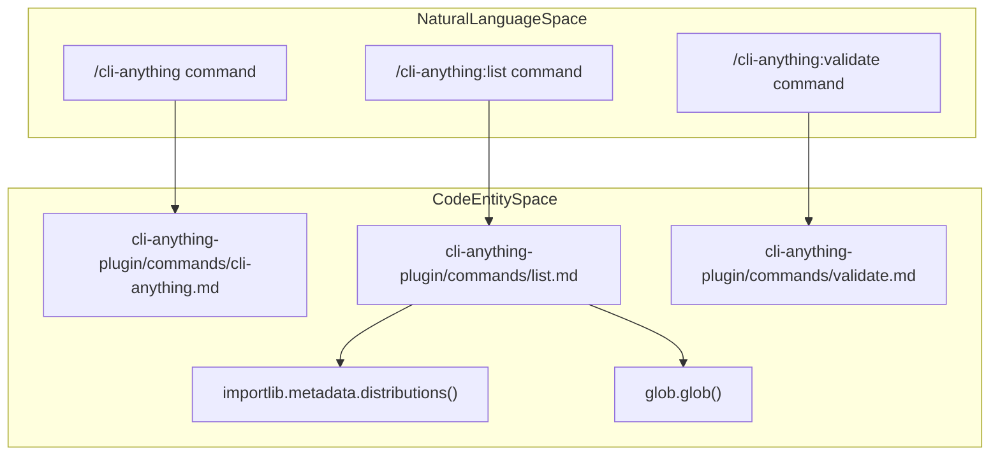
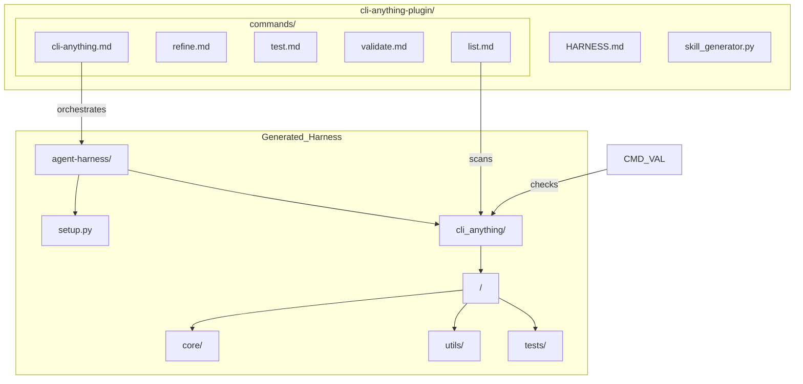
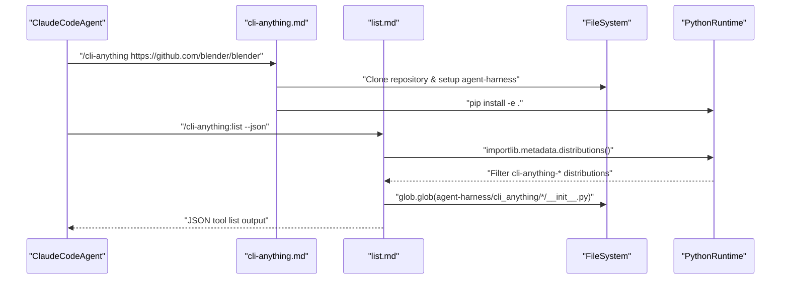

<!-- source: DeepWiki mcp.deepwiki.com · repo HKUDS/CLI-Anything · extra page Claude Code Plugin · fetched 2026-11-09 -->

# Claude Code Plugin

<details>
<summary>Relevant source files</summary>

The following files were used as context for generating this wiki page:

- [cli-anything-plugin/commands/cli-anything.md](cli-anything-plugin/commands/cli-anything.md)
- [cli-anything-plugin/commands/list.md](cli-anything-plugin/commands/list.md)
- [cli-anything-plugin/commands/refine.md](cli-anything-plugin/commands/refine.md)
- [cli-anything-plugin/commands/test.md](cli-anything-plugin/commands/test.md)
- [cli-anything-plugin/commands/validate.md](cli-anything-plugin/commands/validate.md)
- [krita/agent-harness/KRITA.md](krita/agent-harness/KRITA.md)
- [krita/agent-harness/cli_anything/krita/README.md](krita/agent-harness/cli_anything/krita/README.md)
- [krita/agent-harness/cli_anything/krita/__init__.py](krita/agent-harness/cli_anything/krita/__init__.py)
- [krita/agent-harness/cli_anything/krita/__main__.py](krita/agent-harness/cli_anything/krita/__main__.py)

</details>


This document covers the Claude Code plugin for CLI-Anything, which provides AI agents running in Claude Code with the ability to install via the marketplace (`/plugin marketplace add`, `/plugin install`) and execute the 7-phase CLI generation pipeline.

For information about other platform integrations (OpenCode, Qodercli, OpenClaw, Codex), see [Platform Installation](). For details on the 7-phase generation process that the plugin executes, see [The 7-Phase Generation Pipeline]().

---

## Overview

The Claude Code Plugin is the primary integration mechanism for CLI-Anything. It provides a set of slash commands that Claude Code agents can invoke to:

- **Generate** complete CLI harnesses from software codebases (`/cli-anything`) `[cli-anything-plugin/commands/cli-anything.md:1-13]()`
- **Refine** and expand existing harnesses with iterative gap analysis (`/cli-anything:refine`) `[cli-anything-plugin/commands/refine.md:1-12]()`
- **Test** suites and update `TEST.md` documentation (`/cli-anything:test`) `[cli-anything-plugin/commands/test.md:1-13]()`
- **Validate** harnesses against `HARNESS.md` methodology standards (`/cli-anything:validate`) `[cli-anything-plugin/commands/validate.md:1-13]()`
- **List** and discover installed or generated CLI tools (`/cli-anything:list`) `[cli-anything-plugin/commands/list.md:1-9]()`

Sources: `[cli-anything-plugin/commands/cli-anything.md:1-13]()`, `[cli-anything-plugin/commands/list.md:1-9]`, `[cli-anything-plugin/commands/refine.md:1-12]()`

---

## Installation Methods

### Marketplace Installation

The preferred installation method uses Claude Code's plugin marketplace system to add the repository and install the plugin command suite:

```bash
# Add the marketplace registry
/plugin marketplace add HKUDS/CLI-Anything

# Install the plugin
/plugin install cli-anything
```

### Manual Installation

Users can manually clone the repository into the Claude Code plugins directory and reload:

```bash
cd ~/.claude/plugins
git clone https://github.com/HKUDS/CLI-Anything.git cli-anything
```
After cloning, run `/reload-plugins` within the Claude Code session.

Sources: `[cli-anything-plugin/commands/cli-anything.md:29-86]()`

---

## Plugin Architecture and Code Entity Mapping

The following diagram bridges the Natural Language space (slash commands invoked by users or agents) to the Code Entity space (plugin markdown command definitions and python metadata scanners).

Title: "Natural Language to Code Entity Mapping for Claude Code Plugin"



### Directory Structure



Sources: `[cli-anything-plugin/commands/cli-anything.md:87-108]`, `[cli-anything-plugin/commands/list.md:21-115]()`

---

## Command Execution Flow

Title: "Command Execution Flow and Backend Inspection"



Sources: `[cli-anything-plugin/commands/cli-anything.md:29-86]`, `[cli-anything-plugin/commands/list.md:21-115]()`

---

## Plugin Commands Reference

### `/cli-anything:list`
Scans the system for both installed PyPI packages (`cli-anything-*`) via `importlib.metadata` and local generated harnesses via `glob` pattern matching `[cli-anything-plugin/commands/list.md:21-115]()`.

- **Deduplication:** Merges installed and generated records, preferring `installed` status while retaining the local `source` path `[cli-anything-plugin/commands/list.md:117-122]()`.
- **Depth Control:** Supports `--depth <n>` for recursive filesystem scanning `[cli-anything-plugin/commands/list.md:13-14]()`.

### `/cli-anything:validate`
Enforces standards from `HARNESS.md`, verifying PEP 420 namespace compliance, Click command groups, `--json` flag support, and `_resolve_cli` subprocess test harnesses `[cli-anything-plugin/commands/validate.md:27-86]()`.

Sources: `[cli-anything-plugin/commands/list.md:13-122]`, `[cli-anything-plugin/commands/validate.md:27-86]()`

---

## Summary

The Claude Code plugin provides robust marketplace integration (`/plugin marketplace add`, `/plugin install`) and command dispatching (`/cli-anything`, `/cli-anything:list`, `/cli-anything:validate`) to automate the creation of agent-native CLI tools `[cli-anything-plugin/commands/cli-anything.md:1-13]`, `[cli-anything-plugin/commands/list.md:1-9]()`.

Sources: `[cli-anything-plugin/commands/cli-anything.md:1-13]`, `[cli-anything-plugin/commands/list.md:1-9]()`

---

