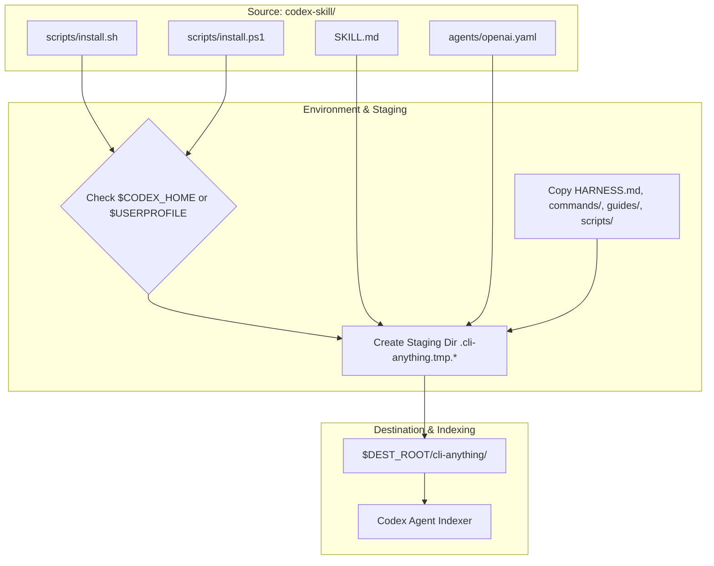
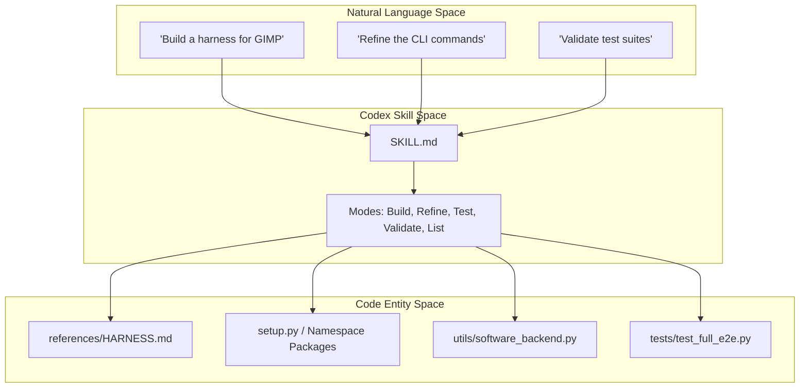

<!-- source: DeepWiki mcp.deepwiki.com · repo HKUDS/CLI-Anything · extra page Codex Skill · fetched 2026-11-09 -->

# Codex Skill

<details>
<summary>Relevant source files</summary>

The following files were used as context for generating this wiki page:

- [.github/workflows/check-codex-skill.yml](.github/workflows/check-codex-skill.yml)
- [codex-skill/SKILL.md](codex-skill/SKILL.md)
- [codex-skill/agents/openai.yaml](codex-skill/agents/openai.yaml)
- [codex-skill/scripts/install.ps1](codex-skill/scripts/install.ps1)
- [codex-skill/scripts/install.sh](codex-skill/scripts/install.sh)
- [codex-skill/tests/test_install.sh](codex-skill/tests/test_install.sh)

</details>


The Codex skill integration enables users of the Codex AI platform to invoke CLI-Anything functionality through natural language commands. Unlike slash-command interfaces used by platforms like Claude Code or OpenCode, the Codex integration uses a skill-based discovery mechanism where the platform indexes a `SKILL.md` file and `agents/openai.yaml` metadata to understand tool capabilities.

**Scope**: This page covers the Codex-specific installation mechanisms via `install.sh` and `install.ps1` scripts, agent metadata configuration in `agents/openai.yaml`, the structure of the vendored skill resources, and the `check-codex-skill` CI validation workflow.

---

## Installation Architecture and Scripts

The Codex skill installation copies the skill source directory to Codex's local discovery path. Cross-platform support is provided via Bash (`install.sh`) and PowerShell (`install.ps1`) scripts, which handle environment detection, staging directories, and path resolution.

### Installation and Staging Flow



**Sources**: [codex-skill/scripts/install.sh:1-62](), [codex-skill/scripts/install.ps1:1-67]()

### Path Resolution and Safety Mechanisms
Both installer scripts prioritize the `CODEX_HOME` environment variable, falling back to a hidden `.codex` directory inside the user's home profile [codex-skill/scripts/install.sh:10](), [codex-skill/scripts/install.ps1:9-15]().

- **Destination Path**: `$CODEX_HOME/skills/cli-anything` (or `$HOME/.codex/skills/cli-anything`) [codex-skill/scripts/install.sh:10-11](), [codex-skill/scripts/install.ps1:17-18]().
- **Safety Check**: Both scripts check whether the destination directory already exists (`-e` in Bash, `Test-Path` in PowerShell). If present, they refuse to overwrite to prevent data loss, exiting with an error message [codex-skill/scripts/install.sh:28-32](), [codex-skill/scripts/install.ps1:31-33]().
- **Atomic Staging**: Installers create a randomized temporary staging directory (`.cli-anything.tmp.XXXXXX`) within the destination root before atomically moving it into place, ensuring partial writes do not corrupt existing states [codex-skill/scripts/install.sh:34-58](), [codex-skill/scripts/install.ps1:35-63]().

**Sources**: [codex-skill/scripts/install.sh:1-62](), [codex-skill/scripts/install.ps1:1-67]()

---

## Agent Metadata Configuration (`agents/openai.yaml`)

The Codex agent platform uses metadata defined in `agents/openai.yaml` to register the display name, description, and default prompt behavior for the skill interface [codex-skill/agents/openai.yaml:1-4]().

```yaml
interface:
  display_name: "CLI-Anything"
  short_description: "Build, refine, test, validate, or list harnesses."
  default_prompt: "Use $cli-anything to build, refine, test, validate, or list harnesses for the user's target software or source repository."
```

This configuration exposes the skill directly to the Codex runtime environment under the `$cli-anything` command trigger.

**Sources**: [codex-skill/agents/openai.yaml:1-4]()

---

## Skill Definition and Natural Language Mapping

The core of the Codex integration is `SKILL.md`, which maps natural language intents to the CLI-Anything technical methodology and operational modes [codex-skill/SKILL.md:1-154]().

### Mapping Natural Language to Code Entities



**Sources**: [codex-skill/SKILL.md:1-154]()

### Vendored Methodology Resources
The installer scripts copy canonical CLI-Anything methodology files into the installed skill's `references/` and `scripts/` directories, allowing self-contained offline execution:
- `references/HARNESS.md`: Complete methodology and quality rules [codex-skill/SKILL.md:31]()
- `references/commands/`: Build, refine, test, validate, and list command specifications [codex-skill/SKILL.md:32-36]()
- `references/guides/`: On-demand implementation guidance (session-locking, preview methodology, auto-save dry-run) [codex-skill/SKILL.md:37]()
- `scripts/repl_skin.py`, `scripts/preview_bundle.py`, `scripts/skill_generator.py`: Utility scripts copied into generated harnesses [codex-skill/SKILL.md:38-40]()

**Sources**: [codex-skill/scripts/install.sh:43-56](), [codex-skill/scripts/install.ps1:40-56](), [codex-skill/SKILL.md:27-55]()

---

## CI/CD Workflow and Testing (`check-codex-skill.yml`)

The repository includes a dedicated GitHub Actions workflow to validate the Codex skill installer scripts and directory structures on pull requests and pushes [-.github/workflows/check-codex-skill.yml:1-32]().

### Workflow Execution (`check-codex-skill.yml`)
The workflow triggers on changes to `codex-skill/**`, `cli-anything-plugin/**`, `docs/PREVIEW_PROTOCOL.md`, or the workflow file itself [-.github/workflows/check-codex-skill.yml:3-17](). It executes the test script `codex-skill/tests/test_install.sh` on an `ubuntu-latest` runner [-.github/workflows/check-codex-skill.yml:23-31]().

**Sources**: [-.github/workflows/check-codex-skill.yml:1-32]()

### Installer Test Suite (`test_install.sh`)
The test script `codex-skill/tests/test_install.sh` performs rigorous integration checks on the installer [codex-skill/tests/test_install.sh:1-92]():
1. **Staging Isolation**: Creates a mock stale staging directory (`.cli-anything.tmp.stale`) and verifies that the installer does not improperly clean or reuse unrelated staging paths [codex-skill/tests/test_install.sh:36-43]().
2. **File Integrity Verification**: Asserts the existence of all mandatory reference documents, command definitions, guide files, and utility scripts in the installed skill directory [codex-skill/tests/test_install.sh:41-59]().
3. **Content Matching**: Uses `cmp` and `diff -qr` to ensure vendored files match canonical sources in `cli-anything-plugin/` [codex-skill/tests/test_install.sh:61-68]().
4. **Python Syntax Compilation**: Runs `python3 -m py_compile` across all copied Python utility scripts (`repl_skin.py`, `preview_bundle.py`, `skill_generator.py`) to catch syntax errors [codex-skill/tests/test_install.sh:70-73]().
5. **Overwrite Prevention**: Tests that running the installer a second time fails when the destination directory already exists [codex-skill/tests/test_install.sh:75-77]().
6. **Detached Install Safeguards**: Simulates a detached skill directory lacking canonical plugin resources and asserts that the installer fails gracefully with an informative error message [codex-skill/tests/test_install.sh:82-90]().

**Sources**: [codex-skill/tests/test_install.sh:1-92]()

---

