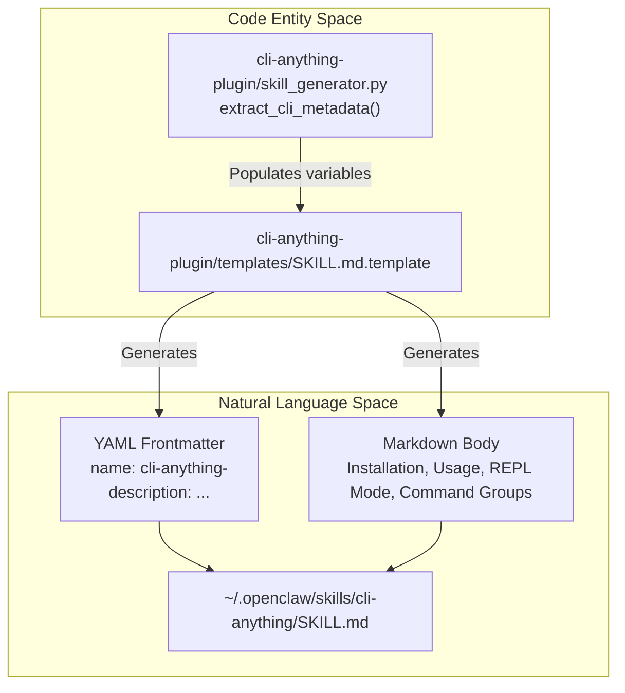
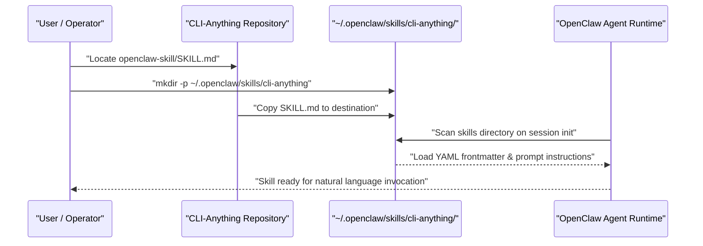
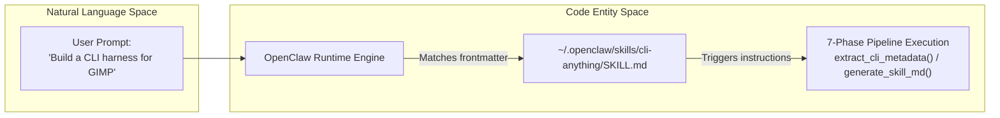

<!-- source: DeepWiki mcp.deepwiki.com · repo HKUDS/CLI-Anything · extra page OpenClaw Skill · fetched 2026-11-09 -->

# OpenClaw Skill

<details>
<summary>Relevant source files</summary>

The following files were used as context for generating this wiki page:

- [.pi-extension/cli-anything/README.md](.pi-extension/cli-anything/README.md)
- [.pi-extension/cli-anything/index.ts](.pi-extension/cli-anything/index.ts)
- [.pi-extension/cli-anything/install.sh](.pi-extension/cli-anything/install.sh)
- [.pi-extension/cli-anything/tests/test_extension.test.ts](.pi-extension/cli-anything/tests/test_extension.test.ts)
- [cli-anything-plugin/skill_generator.py](cli-anything-plugin/skill_generator.py)
- [cli-anything-plugin/templates/SKILL.md.template](cli-anything-plugin/templates/SKILL.md.template)
- [cli-anything-plugin/tests/test_skill_generator.py](cli-anything-plugin/tests/test_skill_generator.py)
- [mubu/agent-harness/skill_generator.py](mubu/agent-harness/skill_generator.py)

</details>


This document describes the OpenClaw platform integration for CLI-Anything, focusing on native skill integration through `SKILL.md` file placement in `~/.openclaw/skills/`. It covers the metadata extraction mechanics, skill file structure, manual/automated installation, and agent invocation workflows.

---

## Overview

The OpenClaw platform integration provides a declarative, agent-discoverable interface for CLI-Anything via OpenClaw's native skill mechanism. By placing a structured `SKILL.md` file (derived from templates like `cli-anything-plugin/templates/SKILL.md.template` [cli-anything-plugin/templates/SKILL.md.template:1-123]()) into `~/.openclaw/skills/`, agents gain immediate access to the 7-phase CLI generation pipeline, command groups, and execution parameters.

**Key Characteristics:**
- **File-based Discovery**: Relies on `SKILL.md` files containing YAML frontmatter (`name`, `description`) parsed by OpenClaw at startup.
- **Template Generation**: Generated automatically or referenced from `cli-anything-plugin/templates/SKILL.md.template` [cli-anything-plugin/templates/SKILL.md.template:1-123]() via `skill_generator.py` [cli-anything-plugin/skill_generator.py:1-189]().
- **Natural Language Triggering**: Invoked via conversational prompts matching the skill identifier (`cli-anything`).

Sources:
- [cli-anything-plugin/templates/SKILL.md.template:1-123]()
- [cli-anything-plugin/skill_generator.py:1-189]()

---

## Skill File Structure and Generation

The underlying skill metadata is structured using YAML frontmatter and Markdown instruction bodies. The file format is governed by `cli-anything-plugin/templates/SKILL.md.template` [cli-anything-plugin/templates/SKILL.md.template:1-6](), where variables such as `{{ skill_name }}` and `{{ skill_description }}` are populated by metadata extractors.



**Metadata Extraction Architecture:**
The helper functions defined in `cli-anything-plugin/skill_generator.py` extract AST nodes and docstrings to build the skill definition [cli-anything-plugin/skill_generator.py:34-114](). Specifically:
- `_canonical_skill_name()` determines the skill identifier [cli-anything-plugin/skill_generator.py:26-32]().
- `extract_commands_from_cli()` parses Click group and command decorators [mubu/agent-harness/skill_generator.py:108-175]().
- `extract_version_from_setup()` parses package versions from `setup.py` [mubu/agent-harness/skill_generator.py:95-105]().

Sources:
- [cli-anything-plugin/templates/SKILL.md.template:1-123]()
- [cli-anything-plugin/skill_generator.py:26-114]()
- [mubu/agent-harness/skill_generator.py:95-175]()

---

## Installation Process

Installing the OpenClaw skill involves copying the validated `SKILL.md` file into the target directory structure expected by OpenClaw: `~/.openclaw/skills/cli-anything/`.



**Installation Steps:**
1. Create the destination directory:
   ```bash
   mkdir -p ~/.openclaw/skills/cli-anything
   ```
2. Copy the skill definition:
   ```bash
   cp openclaw-skill/SKILL.md ~/.openclaw/skills/cli-anything/SKILL.md
   ```

Sources:
- [cli-anything-plugin/templates/SKILL.md.template:1-123]()

---

## Invocation Mechanism and Mapping

OpenClaw resolves skills by matching conversational requests against the `name` and `description` fields declared in the YAML frontmatter [cli-anything-plugin/templates/SKILL.md.template:1-6](). 



When invoked, the agent loads the body of `SKILL.md`, which prescribes operation modes (Build, Refine, Test, Validate), PEP 420 namespace packaging guidelines, and backend integration rules [cli-anything-plugin/templates/SKILL.md.template:12-123]().

Sources:
- [cli-anything-plugin/templates/SKILL.md.template:1-123]()
- [cli-anything-plugin/skill_generator.py:116-189]()

---

## Operation Modes and Execution Guidelines

The skill instructions dictate four core operational modes mapped directly to the CLI-Anything architecture:

1. **Build Mode**: Sets up the harness directory layout under `cli_anything/<software>/`, implementing Click-based command groups, REPL fallback, and `--json` output serialization [cli-anything-plugin/templates/SKILL.md.template:27-53]().
2. **Refine Mode**: Analyzes existing harnesses to expand command coverage and bridge feature parity with target GUI software.
3. **Test Mode**: Generates unit (`test_core.py`) and end-to-end (`test_full_e2e.py`) suites, recording results in `TEST.md`.
4. **Validate Mode**: Ensures adherence to namespace structure and backend invocation correctness.

Sources:
- [cli-anything-plugin/templates/SKILL.md.template:27-81]()

---

## Backend Integration and Packaging Rules

The skill configuration enforces strict architectural standards for generated harnesses:
- **Authentic Backend Integration**: Wraps actual application binaries or APIs (e.g., via `utils/<software>_backend.py`) rather than stubbing behaviors.
- **Namespace Packaging**: Enforces PEP 420 compliance, omitting top-level `__init__.py` in `cli_anything/` and utilizing `find_namespace_packages(include=["cli_anything.*"])` in `setup.py`.

Sources:
- [cli-anything-plugin/templates/SKILL.md.template:82-104]()

---

