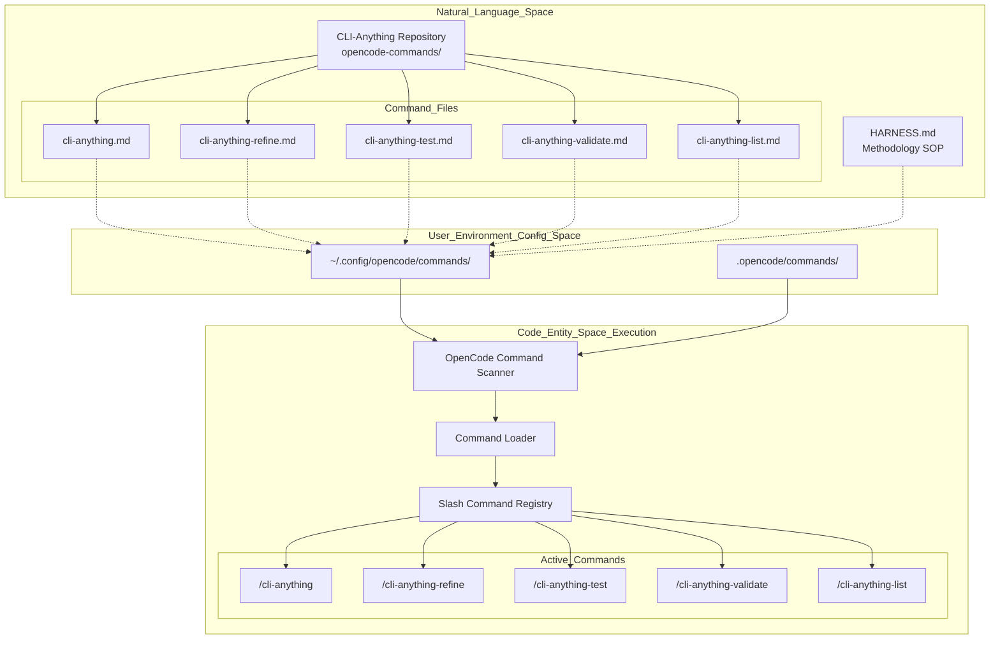
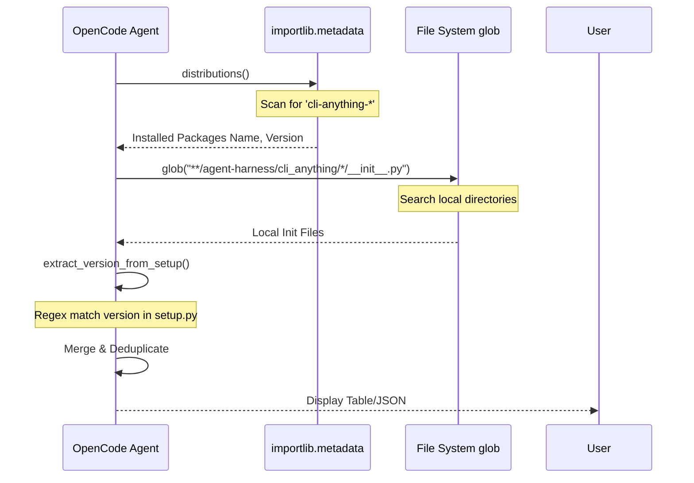

<!-- source: DeepWiki mcp.deepwiki.com · repo HKUDS/CLI-Anything · extra page OpenCode Commands · fetched 2026-11-09 -->

# OpenCode Commands

Relevant source files

The following files were used as context for generating this wiki page:

- [cli-anything-plugin/HARNESS.md](cli-anything-plugin/HARNESS.md)
- [cli-anything-plugin/README.md](cli-anything-plugin/README.md)
- [cli-anything-plugin/guides/filter-translation.md](cli-anything-plugin/guides/filter-translation.md)
- [cli-anything-plugin/guides/mcp-backend.md](cli-anything-plugin/guides/mcp-backend.md)
- [cli-anything-plugin/guides/pypi-publishing.md](cli-anything-plugin/guides/pypi-publishing.md)
- [cli-anything-plugin/guides/session-locking.md](cli-anything-plugin/guides/session-locking.md)
- [cli-anything-plugin/guides/skill-generation.md](cli-anything-plugin/guides/skill-generation.md)
- [cli-anything-plugin/guides/timecode-precision.md](cli-anything-plugin/guides/timecode-precision.md)
- [cli-anything-plugin/repl_skin.py](cli-anything-plugin/repl_skin.py)

This page documents the OpenCode platform integration for CLI-Anything. It covers the installation process, command files, and how OpenCode discovers and executes CLI-Anything functionality through markdown-based command definitions.

For information about other platform integrations, see [Platform Installation](). For details about the generation pipeline that these commands invoke, see [The 7-Phase Generation Pipeline]().

---

## Overview

OpenCode integration uses a **file-based command discovery mechanism** where markdown files in `~/.config/opencode/commands/` define available slash commands. Unlike Claude Code's plugin marketplace system, OpenCode requires manual file copying but provides the same 7-phase generation capabilities once installed.

**Key characteristics:**
- Commands defined as `.md` files in a standard directory.
- Requires `HARNESS.md` co-located with command files as the methodology SOP `[opencode-commands/cli-anything.md:11-13]()`.
- Supports both global (`~/.config/opencode/commands/`) and project-level (`.opencode/commands/`) installation.
- Five slash commands: `/cli-anything`, `/cli-anything-refine`, `/cli-anything-test`, `/cli-anything-validate`, and `/cli-anything-list`.

Sources: [opencode-commands/cli-anything.md:1-13](), [opencode-commands/cli-anything-list.md:1-6]()

---

## Installation Architecture

The following diagram shows how OpenCode discovers and loads CLI-Anything commands from the Natural Language Space (Markdown files) into the Code Entity Space (Agent Execution).

**OpenCode Command Discovery Map**

**Installation Steps:**
1. **Clone Repository**: `git clone https://github.com/HKUDS/CLI-Anything.git`
2. **Copy Command Files**: 
   - Global: `cp CLI-Anything/opencode-commands/*.md ~/.config/opencode/commands/`
3. **Copy HARNESS.md**: 
   - Global: `cp CLI-Anything/cli-anything-plugin/HARNESS.md ~/.config/opencode/commands/`

Sources: [opencode-commands/cli-anything.md:1-13](), [opencode-commands/cli-anything-list.md:1-6]()

---

## Available Commands

| Command | Markdown File | Description |
|---------|---------------|-------------|
| `/cli-anything` | `cli-anything.md` | Build complete CLI harness (7 phases) `[opencode-commands/cli-anything.md:5-7]()` |
| `/cli-anything-refine` | `cli-anything-refine.md` | Refine existing harness with gap analysis `[opencode-commands/cli-anything-refine.md:5-7]()` |
| `/cli-anything-test` | `cli-anything-test.md` | Run test suite and update `TEST.md` `[opencode-commands/cli-anything-test.md:4-6]()` |
| `/cli-anything-validate` | `cli-anything-validate.md` | Validate harness against `HARNESS.md` standards `[opencode-commands/cli-anything-validate.md:4-6]()` |
| `/cli-anything-list` | `cli-anything-list.md` | List installed and generated CLIs `[opencode-commands/cli-anything-list.md:4-6]()` |

Sources: [opencode-commands/cli-anything.md:5-7](), [opencode-commands/cli-anything-refine.md:5-7](), [opencode-commands/cli-anything-test.md:4-6](), [opencode-commands/cli-anything-validate.md:4-6](), [opencode-commands/cli-anything-list.md:4-6]()

---

## Command Implementation Logic

The `/cli-anything-list` command demonstrates the technical logic used by the agent to bridge local file systems and installed Python packages.

**Command Execution Logic: List Discovery**

### Key Functions and Patterns
- **Version Extraction**: Uses `re.search(r'version\s*=\s*["\']([^"\']+)["\']', content)` to parse `setup.py` `[opencode-commands/cli-anything-list.md:60-67]()`.
- **Glob Depth Control**: `build_glob_patterns` generates depth-specific patterns (e.g., `*/*/agent-harness/...`) to limit recursion `[opencode-commands/cli-anything-list.md:69-84]()`.
- **CLI Resolution**: The `/cli-anything-test` and `/cli-anything-validate` commands rely on `_resolve_cli("cli-anything-<software>")` to find the executable without hardcoded paths `[opencode-commands/cli-anything-validate.md:66-67]()`.
- **Installed Discovery**: Uses `importlib.metadata.distributions()` to find packages starting with `cli-anything-` and `shutil.which` to find executables `[opencode-commands/cli-anything-list.md:27-42]()`.

Sources: [opencode-commands/cli-anything-list.md:26-104](), [opencode-commands/cli-anything-validate.md:65-67]()

---

## Validation Standards

The `/cli-anything-validate` command enforces strict adherence to the methodology defined in `HARNESS.md`. It performs checks across several domains:

1. **Directory Structure**: Verifies PEP 420 namespace compliance (no `__init__.py` in `cli_anything/`) `[opencode-commands/cli-anything-validate.md:27-28]()`.
2. **Required Modules**: Ensures presence of `project.py` (state management), `session.py` (undo/redo), and `export.py` `[opencode-commands/cli-anything-validate.md:36-38]()`.
3. **CLI Standards**: Checks for Click framework usage, `--json` support, and `handle_error` decorators `[opencode-commands/cli-anything-validate.md:45-51]()`.
4. **Test Standards**: Verifies `TestCLISubprocess` exists and uses `CLI_ANYTHING_FORCE_INSTALLED` for environment-agnostic testing `[opencode-commands/cli-anything-validate.md:65-68]()`.
5. **Packaging**: Validates `setup.py` uses `find_namespace_packages(include=["cli_anything.*"])` and entry points are correctly mapped `[opencode-commands/cli-anything-validate.md:77-85]()`.

Sources: [opencode-commands/cli-anything-validate.md:26-91]()

---

## Refinement and Iteration

The `/cli-anything-refine` command allows for incremental capability expansion.

### Refinement Workflow
- **Step 1: Inventory**: Reads `<software>_cli.py` and core modules to map existing commands and coverage `[opencode-commands/cli-anything-refine.md:39-44]()`.
- **Step 2: Gap Analysis**: Compares current coverage against the software's public APIs or scripting interfaces, prioritizing high-impact and easy-win functions `[opencode-commands/cli-anything-refine.md:51-58]()`.
- **Step 3: Focused Implementation**: If a `$2` focus area (e.g., "batch processing") is provided, the agent skips broad analysis to target that specific domain `[opencode-commands/cli-anything-refine.md:22-34]()`.
- **Step 4: Regression Testing**: Runs all tests (old + new) to ensure stability after expansion `[opencode-commands/cli-anything-refine.md:72-73]()`.

Sources: [opencode-commands/cli-anything-refine.md:35-78]()

---

## HARNESS.md Dependency

**Critical Requirement**: `HARNESS.md` must be co-located with the command files. All OpenCode commands contain a critical instruction to read `./HARNESS.md` before execution `[opencode-commands/cli-anything.md:11-13]()`.

This file serves as the **Single Source of Truth** for:
- The 7-Phase pipeline execution `[opencode-commands/cli-anything.md:27-79]`.
- Packaging standards (namespace packages) `[opencode-commands/cli-anything-validate.md:77-85]()`.
- Testing requirements (unit vs. E2E) `[opencode-commands/cli-anything-validate.md:61-70]()`.
- Architecture and implementation patterns `[opencode-commands/cli-anything-refine.md:12-14]()`.

Sources: [opencode-commands/cli-anything.md:11-13](), [opencode-commands/cli-anything-validate.md:10-12](), [opencode-commands/cli-anything-refine.md:12-14]()

---

