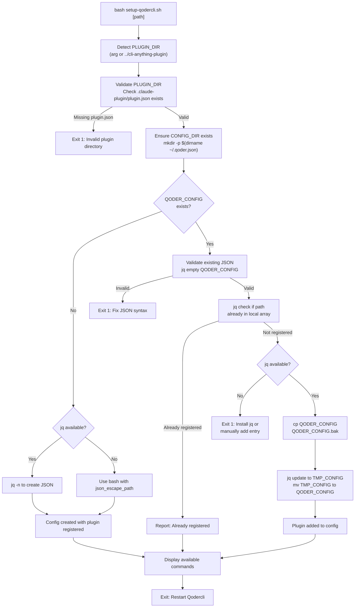
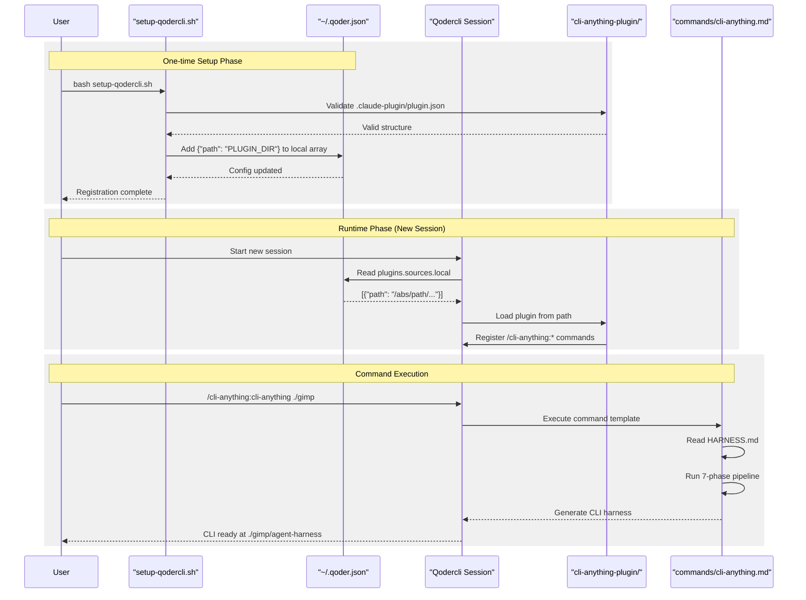

<!-- source: DeepWiki mcp.deepwiki.com · repo HKUDS/CLI-Anything · extra page Qodercli Plugin · fetched 2026-11-09 -->

# Qodercli Plugin

<details>
<summary>Relevant source files</summary>

The following files were used as context for generating this wiki page:

- [qoder-plugin/setup-qodercli.sh](qoder-plugin/setup-qodercli.sh)

</details>


This page documents the Qodercli plugin integration for CLI-Anything, which enables use of CLI-Anything's 7-phase generation pipeline from within Qodercli sessions. This is a community-contributed platform adapter that registers CLI-Anything commands in Qodercli's plugin configuration system.

For information about other platform integrations, see [Platform Installation](). For details on the actual CLI generation commands, see [Plugin Commands Reference]().

---

## Overview

The Qodercli plugin allows users to invoke CLI-Anything's full suite of commands from within Qodercli sessions using the `/cli-anything:` command prefix. Unlike Claude Code (which uses a marketplace) or OpenCode (which uses command files), Qodercli integration works through a JSON configuration file at `~/.qoder.json` that defines local plugin sources.

The integration is implemented as a single shell script `setup-qodercli.sh` that performs one-time registration of the CLI-Anything plugin directory in the Qodercli configuration [qoder-plugin/setup-qodercli.sh:1-7]().

**Key Characteristics:**
- **Community contribution**: Officially merged as a community contribution with dedicated setup scripts [qoder-plugin/setup-qodercli.sh:1-3]().
- **JSON-based registration**: Plugin path is added to `~/.qoder.json` under `plugins.sources.local` [qoder-plugin/setup-qodercli.sh:103-107]().
- **Command prefix format**: All commands use `/cli-anything:<subcommand>` syntax [qoder-plugin/setup-qodercli.sh:150-154]().

**Supported Commands:**
- `/cli-anything:cli-anything` — Full 7-phase CLI generation [qoder-plugin/setup-qodercli.sh:150-150]().
- `/cli-anything:refine` — Iterative harness improvement [qoder-plugin/setup-qodercli.sh:151-151]().
- `/cli-anything:validate` — Standards validation [qoder-plugin/setup-qodercli.sh:153-153]().
- `/cli-anything:test` — Test execution [qoder-plugin/setup-qodercli.sh:152-152]().
- `/cli-anything:list` — CLI discovery [qoder-plugin/setup-qodercli.sh:154-154]().

Sources: [qoder-plugin/setup-qodercli.sh:1-155]()

---

## Configuration Architecture

The Qodercli plugin system uses a JSON configuration file to locate and load plugins from local filesystem paths.

### System Components to Code Entities Mapping

```mermaid
graph TB
    subgraph "User Filesystem"
        PLUGIN_DIR["cli-anything-plugin/<br/>.claude-plugin/plugin.json<br/>commands/*.md<br/>HARNESS.md"]
        QODER_HOME["$QODER_HOME/<br/>or $HOME"]
    end
    
    subgraph "Configuration File [~/.qoder.json]"
        QODER_JSON["QODER_CONFIG"]
        PLUGINS_OBJ["plugins object"]
        SOURCES_OBJ["sources object"]
        LOCAL_ARRAY["local array"]
        PATH_ENTRY["{\"path\": \"PLUGIN_DIR\"}"]
    end
    
    subgraph "Setup Logic [setup-qodercli.sh]"
        SETUP_SCRIPT["setup-qodercli.sh"]
        VALIDATE["Validate plugin.json exists"]
        JQ_CHECK["Check jq availability"]
        UPDATE_CONFIG["Update or create config"]
    end
    
    subgraph "Qodercli Runtime"
        QODER_SESSION["Qodercli Session"]
        LOAD_PLUGINS["Load plugins from<br/>plugins.sources.local"]
        CMD_RESOLVER["Resolve /cli-anything:*<br/>commands"]
    end
    
    SETUP_SCRIPT --> VALIDATE
    VALIDATE --> PLUGIN_DIR
    VALIDATE --> JQ_CHECK
    JQ_CHECK --> UPDATE_CONFIG
    UPDATE_CONFIG --> QODER_JSON
    
    QODER_JSON --> PLUGINS_OBJ
    PLUGINS_OBJ --> SOURCES_OBJ
    SOURCES_OBJ --> LOCAL_ARRAY
    LOCAL_ARRAY --> PATH_ENTRY
    PATH_ENTRY -.references.-> PLUGIN_DIR
    
    QODER_SESSION --> LOAD_PLUGINS
    LOAD_PLUGINS --> QODER_JSON
    LOAD_PLUGINS --> PLUGIN_DIR
    PLUGIN_DIR --> CMD_RESOLVER
```
Sources: [qoder-plugin/setup-qodercli.sh:34-139]()

**Configuration File Structure:**

The `~/.qoder.json` file follows this schema, where `PLUGIN_DIR` is the absolute path to the `cli-anything-plugin` directory [qoder-plugin/setup-qodercli.sh:116-124]():

```json
{
  "plugins": {
    "sources": {
      "local": [
        {"path": "/absolute/path/to/cli-anything-plugin"}
      ]
    }
  }
}
```

The `plugins.sources.local` array can contain multiple plugin entries, allowing Qodercli to discover and load plugins from various directories on the filesystem [qoder-plugin/setup-qodercli.sh:103-107]().

Sources: [qoder-plugin/setup-qodercli.sh:103-139]()

---

## Setup Script Implementation

The `setup-qodercli.sh` script is the sole installation mechanism for Qodercli integration. It performs validation, configuration detection, and atomic updates.

### Script Execution Flow


Sources: [qoder-plugin/setup-qodercli.sh:1-139]()

### Key Implementation Details

**Path Resolution:**
- Accepts optional custom path as first argument [qoder-plugin/setup-qodercli.sh:19-23]().
- Defaults to `../cli-anything-plugin` relative to script location [qoder-plugin/setup-qodercli.sh:25-31]().
- Normalizes to absolute path using `cd "$path" && pwd` [qoder-plugin/setup-qodercli.sh:20-20]().

**Plugin Validation:**
- Checks for existence of `.claude-plugin/plugin.json` [qoder-plugin/setup-qodercli.sh:35-38]().
- Exits with error if plugin structure is invalid.

**Safe JSON Escaping:**
- Provides `json_escape_path()` function for bash fallback [qoder-plugin/setup-qodercli.sh:60-62]().
- Escapes backslashes and double quotes in filesystem paths.
- Only used when `jq` is unavailable [qoder-plugin/setup-qodercli.sh:127-136]().

**Atomic Configuration Updates:**
- Creates backup before modification: `~/.qoder.json.bak` [qoder-plugin/setup-qodercli.sh:99-100]().
- Uses `mktemp` in same directory for atomic `mv` on same filesystem [qoder-plugin/setup-qodercli.sh:102-102]().
- Cleanup handled by `trap cleanup_temp EXIT` [qoder-plugin/setup-qodercli.sh:65-70]().

**JQ-Based Update Logic:**
The script uses `jq` to safely update the configuration without corrupting existing data [qoder-plugin/setup-qodercli.sh:103-108]():

```bash
jq --arg path "${PLUGIN_DIR}" '
    .plugins //= {} |
    .plugins.sources //= {} |
    .plugins.sources.local //= [] |
    .plugins.sources.local += [{"path": $path}]
' "${QODER_CONFIG}" > "${TMP_CONFIG}"
```

This pipeline ensures objects exist before appending the new plugin entry. The `--arg` flag safely passes the path as a jq variable to prevent injection [qoder-plugin/setup-qodercli.sh:103-103]().

Sources: [qoder-plugin/setup-qodercli.sh:1-139]()

---

## Command Registration and Invocation

### Plugin Discovery Mechanism


Sources: [qoder-plugin/setup-qodercli.sh:34-155]()

### Available Commands

| Command | Format | Description |
|---------|--------|-------------|
| **cli-anything** | `/cli-anything:cli-anything <path>` | Execute full 7-phase pipeline on software codebase [qoder-plugin/setup-qodercli.sh:150-150]() |
| **refine** | `/cli-anything:refine <path> [focus]` | Perform gap analysis and expand CLI coverage [qoder-plugin/setup-qodercli.sh:151-151]() |
| **validate** | `/cli-anything:validate <path>` | Validate generated harness against HARNESS.md standards [qoder-plugin/setup-qodercli.sh:153-153]() |
| **test** | `/cli-anything:test <path>` | Run test suite and update TEST.md [qoder-plugin/setup-qodercli.sh:152-152]() |
| **list** | `/cli-anything:list` | Enumerate installed and generated CLIs [qoder-plugin/setup-qodercli.sh:154-154]() |

All commands follow the `plugin_name:command_name` convention used by Qodercli. The plugin name is derived from the configuration directory structure.

Sources: [qoder-plugin/setup-qodercli.sh:148-154]()

---

## Environment and Path Handling

### Configuration Location

The script respects the `QODER_HOME` environment variable for configuration directory location [qoder-plugin/setup-qodercli.sh:41-42]():

```bash
QODER_CONFIG="${QODER_HOME:-$HOME}/.qoder.json"
```

**Fallback Logic:**
1. Use `$QODER_HOME/.qoder.json` if `QODER_HOME` is set.
2. Otherwise use `$HOME/.qoder.json`.

This allows users with custom Qodercli installations to override the default location.

### Path Normalization

The script converts all plugin paths to absolute paths before storing them in the configuration [qoder-plugin/setup-qodercli.sh:19-23]():

```bash
if ! PLUGIN_DIR="$(cd "$1" && pwd)"; then
    echo -e "${YELLOW}Error: Invalid plugin directory: $1${NC}" >&2
    exit 1
fi
```

**Why Absolute Paths:**
- Qodercli sessions may start from different working directories.
- Absolute paths ensure consistent plugin loading regardless of CWD.
- The `cd && pwd` approach resolves symlinks to their target directories [qoder-plugin/setup-qodercli.sh:17-17]().

Sources: [qoder-plugin/setup-qodercli.sh:16-50]()

---

## Error Handling and Validation

### Pre-Flight Checks

The script performs several validation steps before attempting to modify the configuration:

| Check | Code Location | Error Message |
|-------|----------|---------------|
| Plugin directory accessibility | [qoder-plugin/setup-qodercli.sh:19-23]() | "Error: Invalid plugin directory: $1" |
| `plugin.json` exists | [qoder-plugin/setup-qodercli.sh:35-38]() | "Error: plugin.json not found at ..." |
| Config directory writable | [qoder-plugin/setup-qodercli.sh:45-50]() | "Error: Failed to create config directory ..." |
| Existing config is valid JSON | [qoder-plugin/setup-qodercli.sh:87-91]() | "Error: QODER_CONFIG contains invalid JSON." |
| `jq` available for update | [qoder-plugin/setup-qodercli.sh:75-84]() | "jq not found. Please install jq or manually add..." |

### Duplicate Detection

The script checks if the plugin is already registered before adding it [qoder-plugin/setup-qodercli.sh:94-96]():

```bash
if jq -e --arg path "${PLUGIN_DIR}" '.plugins.sources.local[]? | select(.path == $path)' "${QODER_CONFIG}" > /dev/null 2>&1; then
    echo -e "${GREEN}✓ Plugin already registered in ${QODER_CONFIG}${NC}"
```

This prevents the `local` array from being populated with duplicate paths during repeated script runs.

Sources: [qoder-plugin/setup-qodercli.sh:34-111]()

---

## Fallback Modes and Degradation

### JQ Availability Handling

The script provides different behavior based on `jq` availability:

| Operation | With `jq` | Without `jq` |
|-----------|---------|------------|
| **Create new config** | Use `jq -n` for safe generation [qoder-plugin/setup-qodercli.sh:114-124]() | Bash with `json_escape_path()` [qoder-plugin/setup-qodercli.sh:126-137]() |
| **Update existing config** | `jq` pipeline with `--arg` [qoder-plugin/setup-qodercli.sh:103-108]() | Exit with manual instructions [qoder-plugin/setup-qodercli.sh:75-84]() |
| **Validate existing JSON** | `jq empty` [qoder-plugin/setup-qodercli.sh:87-87]() | N/A (file assumed valid) |

### Manual Fallback Instructions

When `jq` is unavailable for update operations, the script provides copy-pasteable JSON to the user [qoder-plugin/setup-qodercli.sh:76-83](). This ensures users can always complete the installation even without `jq`, albeit with manual intervention.

### Temp File Cleanup

The script uses a `trap` to ensure temporary files created during the atomic update process are cleaned up even on failure [qoder-plugin/setup-qodercli.sh:65-70]().

Sources: [qoder-plugin/setup-qodercli.sh:59-139]()

---

## Usage Workflow

### Setup and Generation

```mermaid
flowchart LR
    subgraph "Setup (One-time)"
        CLONE["Clone CLI-Anything repo"] --> RUN_SETUP["bash setup-qodercli.sh"]
        RUN_SETUP --> REGISTERED["Plugin registered in<br/>~/.qoder.json"]
    end
    
    subgraph "Session Start"
        NEW_SESSION["Start new Qodercli session"] --> LOAD["Qodercli loads plugins<br/>from config"]
        LOAD --> AVAILABLE["Commands available:<br/>/cli-anything:*"]
    end
    
    subgraph "CLI Generation"
        CMD_GEN["/cli-anything:cli-anything ./software"] --> PIPELINE["7-phase pipeline runs"]
        PIPELINE --> HARNESS["agent-harness/ created"]
    end
    
    subgraph "CLI Usage"
        INSTALL["pip install -e ./software/agent-harness"] --> USE["cli-anything-software available"]
    end
    
    REGISTERED --> NEW_SESSION
    AVAILABLE --> CMD_GEN
    HARNESS --> INSTALL
```


Sources: [qoder-plugin/setup-qodercli.sh:141-155]()

---

