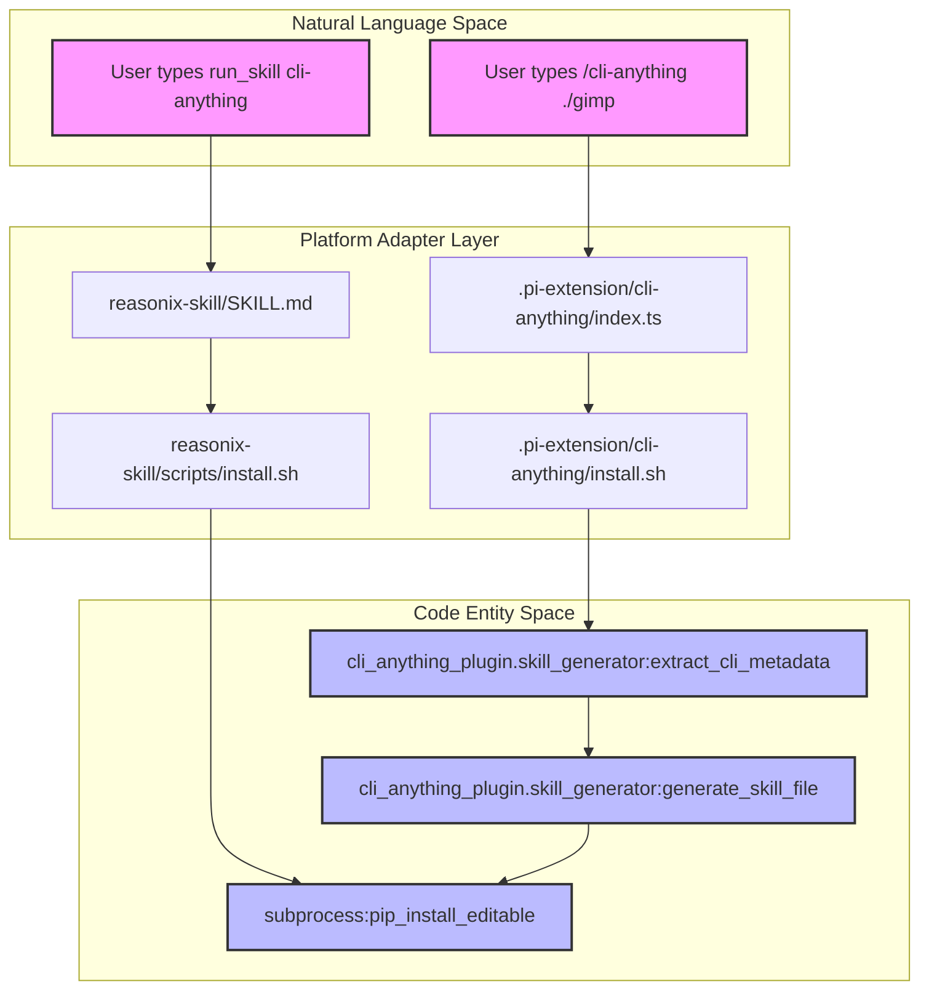
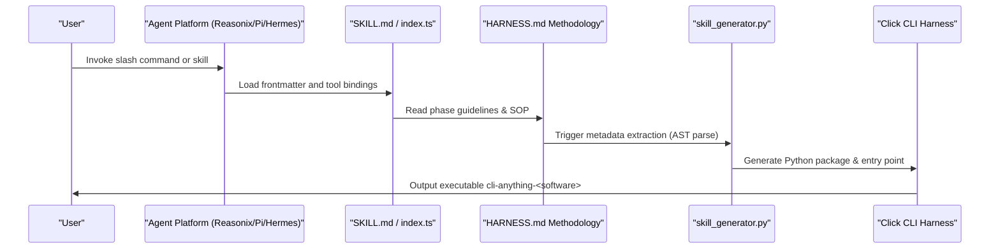

<!-- source: DeepWiki mcp.deepwiki.com · repo HKUDS/CLI-Anything · extra page Reasonix, Hermes, Cursor and Pi Adapters · fetched 2026-11-09 -->

# Reasonix, Hermes, Cursor and Pi Adapters

Relevant source files

The following files were used as context for generating this wiki page:

- [.cursor-plugin/marketplace.json](.cursor-plugin/marketplace.json)
- [.github/workflows/check-cursor-plugin.yml](.github/workflows/check-cursor-plugin.yml)
- [.pi-extension/cli-anything/README.md](.pi-extension/cli-anything/README.md)
- [.pi-extension/cli-anything/index.ts](.pi-extension/cli-anything/index.ts)
- [.pi-extension/cli-anything/install.sh](.pi-extension/cli-anything/install.sh)
- [.pi-extension/cli-anything/tests/test_extension.test.ts](.pi-extension/cli-anything/tests/test_extension.test.ts)
- [cli-anything-plugin/skill_generator.py](cli-anything-plugin/skill_generator.py)
- [cli-anything-plugin/templates/SKILL.md.template](cli-anything-plugin/templates/SKILL.md.template)
- [cli-anything-plugin/tests/test_skill_generator.py](cli-anything-plugin/tests/test_skill_generator.py)
- [cursor-plugin/.cursor-plugin/plugin.json](cursor-plugin/.cursor-plugin/plugin.json)
- [cursor-plugin/README.md](cursor-plugin/README.md)
- [cursor-plugin/commands/cli-anything-list.md](cursor-plugin/commands/cli-anything-list.md)
- [cursor-plugin/commands/cli-anything-refine.md](cursor-plugin/commands/cli-anything-refine.md)
- [cursor-plugin/commands/cli-anything-test.md](cursor-plugin/commands/cli-anything-test.md)
- [cursor-plugin/commands/cli-anything-validate.md](cursor-plugin/commands/cli-anything-validate.md)
- [hermes-skill/SKILL.md](hermes-skill/SKILL.md)
- [hermes-skill/agents/hermes.yaml](hermes-skill/agents/hermes.yaml)
- [hermes-skill/scripts/install.ps1](hermes-skill/scripts/install.ps1)
- [hermes-skill/scripts/install.sh](hermes-skill/scripts/install.sh)
- [mubu/agent-harness/skill_generator.py](mubu/agent-harness/skill_generator.py)
- [reasonix-skill/README.md](reasonix-skill/README.md)
- [reasonix-skill/SKILL.md](reasonix-skill/SKILL.md)
- [reasonix-skill/agents/reasonix.yaml](reasonix-skill/agents/reasonix.yaml)
- [reasonix-skill/scripts/install.ps1](reasonix-skill/scripts/install.ps1)
- [reasonix-skill/scripts/install.sh](reasonix-skill/scripts/install.sh)

This page details the implementation, architecture, and installation mechanisms for the non-Claude/OpenCode platform adapters provided by CLI-Anything: the Reasonix skill, Hermes skill, Cursor plugin, and Pi Coding Agent extension. These adapters bridge diverse agent execution environments to the core `CLI-Anything` methodology and 7-phase generation pipeline without altering the generated Python harness structure.

Sources: [reasonix-skill/README.md:1-116](), [hermes-skill/SKILL.md:1-132](), [.pi-extension/cli-anything/README.md:1-125]()

---

## 1. Reasonix Adapter (`reasonix-skill/`)

The Reasonix adapter adapts the CLI-Anything harness methodology for the DeepSeek-Reasonix coding agent ecosystem [reasonix-skill/README.md:1-3](). It packages the methodology into a global skill configuration supported by automated installation scripts and agent metadata definitions.

### Component Structure
* **`SKILL.md`**: Defines the prompt frontmatter (`runAs: subagent`), tool bindings, step budget guidelines, and 4 operational modes (`Build`, `Refine`, `Test`, `Validate`) [reasonix-skill/SKILL.md:1-154]().
* **`agents/reasonix.yaml`**: Provides agent interface metadata including `display_name`, `short_description`, and `default_prompt` [reasonix-skill/agents/reasonix.yaml:1-4]().
* **`scripts/install.sh` & `install.ps1`**: Cross-platform shell and PowerShell deployment scripts that copy the skill directory into Reasonix's global skill root [reasonix-skill/README.md:7-26]().

### Tool Mappings and Step Budgets
Reasonix maps CLI-Anything workflow tasks to native Reasonix execution primitives [reasonix-skill/README.md:75-86]():
* **Shell Execution**: Bound to `bash` for running `pip install -e .`, `pytest`, and build steps [reasonix-skill/SKILL.md:33]().
* **File Operations**: Bound to `write_file`, `edit_file`, and `multi_edit` for generating Python modules and tests [reasonix-skill/SKILL.md:34-36]().
* **Codebase Analysis**: Utilizes `ls`, `glob`, `grep`, `read_file`, and optional `mcp__codegraph__search` / `mcp__codegraph__context` for symbol architecture graphing [reasonix-skill/SKILL.md:37-41]().

Because a complete CLI-Anything build requires 25–40 tool-call rounds, the skill checks `agent.max_steps` in `reasonix.toml`. The default `max_steps = 0` (unlimited) is strongly recommended; finite values truncate subagent execution prematurely if configured below 64 [reasonix-skill/README.md:27-35]().

Sources: [reasonix-skill/README.md:1-116](), [reasonix-skill/SKILL.md:1-164](), [reasonix-skill/scripts/install.sh:1-22](), [reasonix-skill/scripts/install.ps1:1-24](), [reasonix-skill/agents/reasonix.yaml:1-4]()

---

## 2. Hermes Adapter (`hermes-skill/`)

The Hermes adapter integrates CLI-Anything into the NousResearch Hermes Agent architecture [hermes-skill/SKILL.md:1-37](). 

### Component Structure
* **`SKILL.md`**: YAML frontmatter (`name: cli-anything-hermes`) paired with operational instructions for Hermes [hermes-skill/SKILL.md:1-4]().
* **`agents/hermes.yaml`**: Agent configuration metadata.
* **`scripts/install.sh`**: Copies the skill bundle to `$HERMES_HOME/skills/cli-anything-hermes` (defaulting to `$HOME/.hermes/skills/`) [hermes-skill/scripts/install.sh:1-21]().

### Hermes Tool Bindings
Hermes relies on a distinct set of agent tools during harness generation [hermes-skill/SKILL.md:25-37]():
* **`terminal`**: Executes shell commands and test suites.
* **`execute_code`**: Synthesizes and writes Python modules.
* **`delegate_task`**: Parallelizes codebase analysis and generation subtasks.
* **`patch`**: Applies precise inline edits to generated Click CLI and backend wrapper files.

Sources: [hermes-skill/SKILL.md:1-132](), [hermes-skill/scripts/install.sh:1-21]()

---

## 3. Cursor Plugin Adapter (`cursor-plugin/`)

The Cursor adapter provides native command integrations for the Cursor IDE agent environment via markdown command specifications, rules, a marketplace registry, and continuous integration validation workflows.

### Components and File Layout
* **`commands/`**: Contains specialized markdown prompt files (`cli-anything-test.md`, `cli-anything-validate.md`, `cli-anything-refine.md`, `cli-anything-list.md`) that structure agent behaviors when slash commands are triggered.
* **`.cursor-plugin/plugin.json`**: Metadata defining the plugin identity and version.
* **`.cursor-plugin/marketplace.json`**: Marketplace publication registry entry.
* **`.github/workflows/check-cursor-plugin.yml`**: CI validation workflow ensuring plugin syntax and schema correctness.

Sources: [cursor-plugin/README.md](), [.cursor-plugin/marketplace.json]()

---

## 4. Pi Coding Agent Extension (`.pi-extension/cli-anything`)

The Pi Coding Agent extension embeds CLI-Anything into Pi via TypeScript extension APIs [^1] [.pi-extension/cli-anything/README.md:1-3]().

### Implementation Details
* **`index.ts`**: Registers 5 core slash commands (`/cli-anything`, `/cli-anything:refine`, `/cli-anything:test`, `/cli-anything:validate`, `/cli-anything:list`) using Pi's Extension API [^1] [.pi-extension/cli-anything/README.md:7](). When invoked, it reads the canonical `HARNESS.md` methodology, constructs a prompt message, and injects it into the agent session via `pi.sendUserMessage()` [.pi-extension/cli-anything/README.md:85-92]().
* **`install.sh`**: Handles global installation into `~/.pi/agent/extensions/cli-anything/`, copying the extension script alongside shared plugin utilities [^1] [.pi-extension/cli-anything/README.md:11-24, 79-84]().
* **Path Remapping**: Automatically remaps container paths (`/root/cli-anything/<software>/`) to the local working directory and resolves `cli-anything-plugin/` single-source-of-trade files [^1] [.pi-extension/cli-anything/README.md:93-102]().

Sources: [.pi-extension/cli-anything/README.md:1-125]()

---

## 5. Adapter Architecture and Data Flow

The following diagrams illustrate how user commands in natural language space are translated through platform adapters into code entity executions across the codebase.

### Diagram 1: Natural Language Space to Code Entity Space (Reasonix & Pi Ingestion)

*Sources: [reasonix-skill/SKILL.md:1-164](), [reasonix-skill/scripts/install.sh:1-22](), [.pi-extension/cli-anything/README.md:1-125](), [cli-anything-plugin/skill_generator.py:1-208]()

### Diagram 2: Execution Flow Across Agent Adapters

*Sources: [reasonix-skill/SKILL.md:1-164](), [hermes-skill/SKILL.md:1-132](), [.pi-extension/cli-anything/README.md:1-125](), [cli-anything-plugin/skill_generator.py:1-208]()

---

