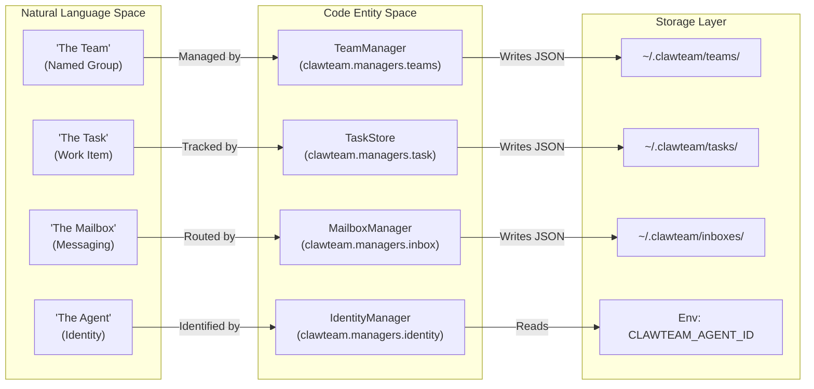
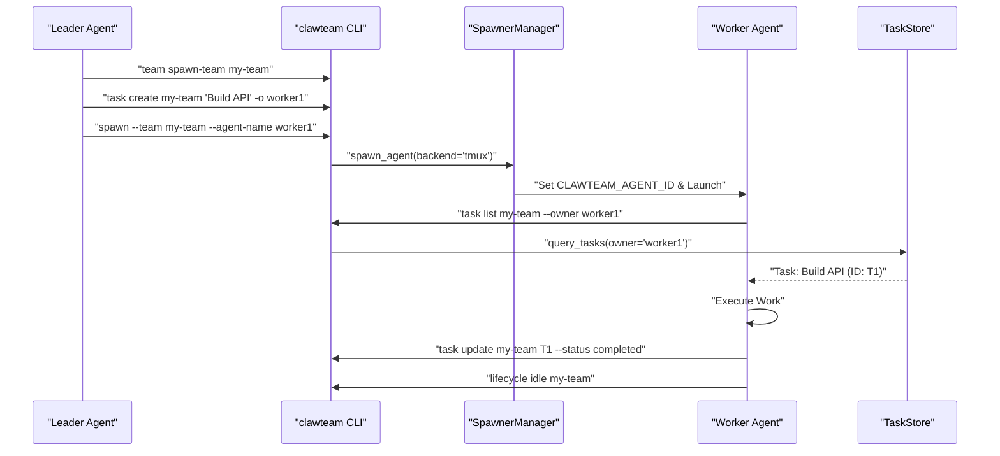

<!-- source: DeepWiki mcp.deepwiki.com · repo HKUDS/ClawTeam · page 1 Overview · fetched 2026-11-09 -->

# Overview

Relevant source files

The following files were used as context for generating this wiki page:

- [README.md](README.md)
- [clawteam/__init__.py](clawteam/__init__.py)
- [docs/skills/clawteam/SKILL.md](docs/skills/clawteam/SKILL.md)
- [docs/skills/clawteam/references/cli-reference.md](docs/skills/clawteam/references/cli-reference.md)
- [pyproject.toml](pyproject.toml)
- [scripts/clawteam_local_install](scripts/clawteam_local_install)
- [scripts/install_clawteam.sh](scripts/install_clawteam.sh)
- [skills/clawteam/SKILL.md](skills/clawteam/SKILL.md)
- [skills/clawteam/references/cli-reference.md](skills/clawteam/references/cli-reference.md)

This page introduces ClawTeam, explaining what it is, the coordination problems it solves, and the high-level system architecture. For detailed information on specific subsystems, see [Core Concepts](#1.1), [Architecture Overview](#1.2), and subsequent chapters covering individual components.

## What is ClawTeam?

ClawTeam is a framework-agnostic CLI tool that enables AI agents to coordinate as a team. It provides file-based team management, inter-agent messaging, shared task tracking with dependency resolution, and terminal-based monitoring dashboards. The system is designed to be operated directly by AI agents themselves through CLI commands, rather than requiring human-written orchestration code.

All coordination happens through the `clawteam` command-line interface. State is persisted to `~/.clawteam/` by default [skills/clawteam/SKILL.md:25](). No external databases or message brokers are required for basic operation, though optional Redis and ZeroMQ transport backends are available for advanced use cases [pyproject.toml:35-40]().

**Sources:** [README.md:1-30](), [skills/clawteam/SKILL.md:19-25](), [pyproject.toml:35-40]()

## Core Problems Solved

ClawTeam addresses fundamental challenges in multi-agent coordination by providing a structured environment where agents can self-organize.

| Problem | Traditional Approach | ClawTeam Solution |
|---------|---------------------|-------------------|
| **Agent Isolation** | Agents work independently, manual context sharing | Shared task board and inbox messaging system [skills/clawteam/SKILL.md:52-58]() |
| **Workspace Conflicts** | Agents modify same files, causing merge conflicts | Git worktrees provide isolated branches per agent [skills/clawteam/SKILL.md:180-189]() |
| **Task Coordination** | Manual dependency tracking and unblocking | Automatic dependency resolution and task unblocking [skills/clawteam/SKILL.md:136-140]() |
| **Observability** | Check individual agent logs separately | Unified dashboard with real-time team status [skills/clawteam/SKILL.md:65-66]() |
| **Identity Management** | Manual environment variable setup | Automatic identity injection via `CLAWTEAM_*` env vars [docs/skills/clawteam/references/cli-reference.md:12-26]() |

**Sources:** [README.md:157-182](), [skills/clawteam/SKILL.md:50-66](), [docs/skills/clawteam/references/cli-reference.md:12-26]()

## High-Level Architecture

ClawTeam's architecture bridges the gap between natural language goals and code-level execution. The system is built around a CLI layer that interfaces with specialized managers for teams, tasks, and messaging.

### System Concept Mapping

The following diagram maps high-level system concepts to their concrete implementations and storage locations in the codebase.

**Sources:** [skills/clawteam/SKILL.md:50-66](), [docs/skills/clawteam/references/cli-reference.md:12-26](), [pyproject.toml:43-44]()

## Agent Coordination Flow

Agents interact with the framework by executing CLI commands. A typical coordination flow involves a leader spawning workers and assigning tasks.

**Sources:** [skills/clawteam/SKILL.md:103-121](), [skills/clawteam/SKILL.md:163-178](), [docs/skills/clawteam/references/cli-reference.md:29-48]()

## Key Subsystems

For more detail on how these components work, refer to the child pages:

### [Core Concepts](#1.1)
Defines the fundamental building blocks of the framework:
- **Agents**: Individual AI processes identified by `CLAWTEAM_AGENT_ID` [docs/skills/clawteam/references/cli-reference.md:18]().
- **Teams**: Logical groupings defined in `~/.clawteam/teams/` [skills/clawteam/SKILL.md:52]().
- **Tasks**: Units of work with statuses (`pending`, `in_progress`, `completed`, `blocked`) [skills/clawteam/SKILL.md:56-57]().
- **Inboxes**: Agent-specific message queues [skills/clawteam/SKILL.md:54]().

### [Architecture Overview](#1.2)
Explains the technical implementation of the coordination layer:
- **CLI Interface**: Built using `typer` [pyproject.toml:22]().
- **Persistence**: File-based storage using JSON [skills/clawteam/SKILL.md:25]().
- **Execution Backends**: Support for `tmux` and `subprocess` spawning [skills/clawteam/SKILL.md:125-131]().
- **Workspace Isolation**: Use of git worktrees to prevent file conflicts [skills/clawteam/SKILL.md:180-189]().

**Sources:** [skills/clawteam/SKILL.md:50-66](), [pyproject.toml:21-28](), [docs/skills/clawteam/references/cli-reference.md:12-26]()

---

