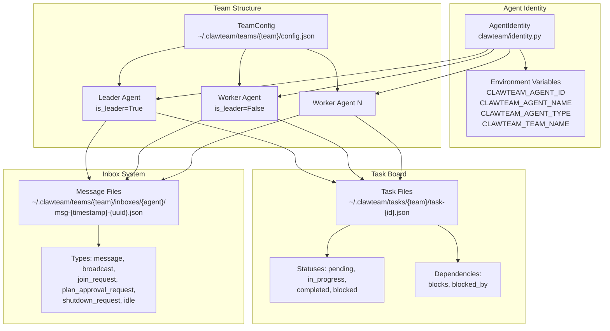
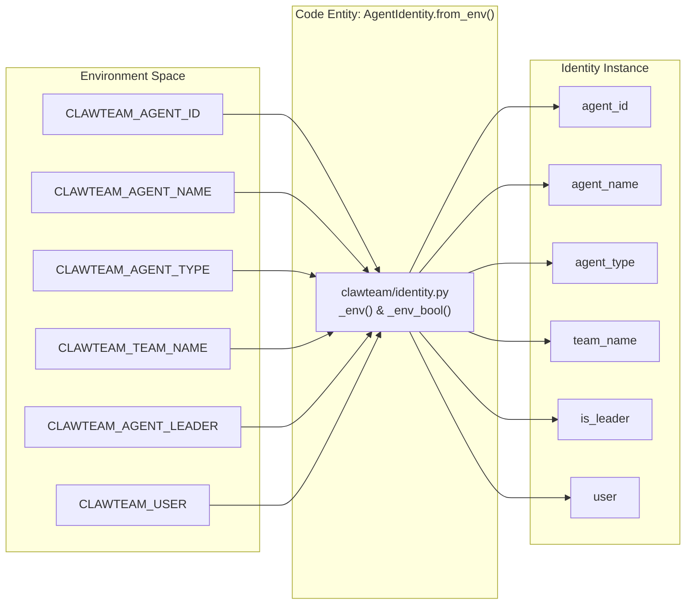
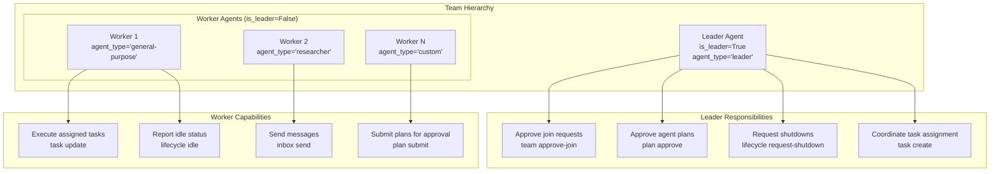
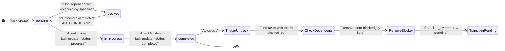
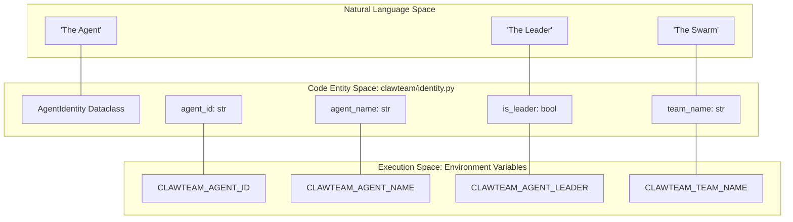

<!-- source: DeepWiki mcp.deepwiki.com · repo HKUDS/ClawTeam · page 1.1 Core Concepts · fetched 2026-11-09 -->

# Core Concepts

Relevant source files

The following files were used as context for generating this wiki page:

- [README.md](README.md)
- [clawteam/identity.py](clawteam/identity.py)
- [docs/skills/clawteam/SKILL.md](docs/skills/clawteam/SKILL.md)
- [docs/skills/clawteam/references/cli-reference.md](docs/skills/clawteam/references/cli-reference.md)
- [scripts/clawteam_local_install](scripts/clawteam_local_install)
- [scripts/install_clawteam.sh](scripts/install_clawteam.sh)
- [skills/clawteam/SKILL.md](skills/clawteam/SKILL.md)
- [skills/clawteam/references/cli-reference.md](skills/clawteam/references/cli-reference.md)

This page defines the fundamental terminology and entities in ClawTeam: agents, teams, tasks, messaging, and identity. Understanding these core concepts is essential for working with the framework.

For implementation details of team management operations, see [Team Management](#3). For task dependency mechanics, see [Task Dependencies](#4.1). For the CLI commands that operate on these entities, see [CLI Command Reference](#10).

---

## Core Entity Model

ClawTeam is built around a small set of interconnected entities that enable multi-agent coordination. The following diagram shows how these entities relate to each other and maps them to their concrete implementations in the codebase.

**Sources:** [clawteam/identity.py:48-85](), [skills/clawteam/SKILL.md:50-66](), [docs/skills/clawteam/references/cli-reference.md:12-26]()

---

## Agent Identity

An **agent** is a process (human or AI) that participates in team coordination. Each agent has an identity defined by environment variables that establish its role and team membership.

### AgentIdentity Class

The `AgentIdentity` dataclass [clawteam/identity.py:48-59]() encapsulates agent identity with the following properties:

| Property | Type | Description | Example |
|----------|------|-------------|---------|
| `agent_id` | `str` | Unique identifier | `"a1b2c3d4e5f6"` |
| `agent_name` | `str` | Human-readable name | `"alice"` |
| `user` | `str` | User owning the agent | `"dev-user"` |
| `agent_type` | `str` | Role/capability type | `"leader"`, `"researcher"`, `"general-purpose"` |
| `team_name` | `str \| None` | Team membership | `"dev-team"` |
| `is_leader` | `bool` | Leader privileges | `True` / `False` |
| `plan_mode_required` | `bool` | Requires plan approval | `True` / `False` |

### Environment Variables

Agent identity is established through environment variables. The system supports dual-prefix variables (`CLAWTEAM_*` and legacy `OH_*` or `CLAUDE_CODE_*`) [clawteam/identity.py:10-36]():

When an agent is spawned via `clawteam spawn`, these environment variables are automatically exported via `to_env()` [clawteam/identity.py:87-103](). Agents can also manually set their identity using `eval $(clawteam identity set ...)`.

**Sources:** [clawteam/identity.py:1-103](), [docs/skills/clawteam/references/cli-reference.md:12-26]()

---

## Teams

A **team** is a named group of agents with one leader and zero or more workers. Teams provide a namespace for tasks, messaging, and coordination.

### Team Structure

Teams are defined by configuration and member lists. Data is stored by default in `~/.clawteam/teams/{team}/` [skills/clawteam/SKILL.md:25]().

### Leader vs Worker Roles

The distinction between leaders and workers is defined by the `is_leader` flag in the identity [clawteam/identity.py:57]():

- **Leaders** (`is_leader=True`) typically:
  - Create the team using `team spawn-team` [docs/skills/clawteam/references/cli-reference.md:31-48]()
  - Approve or reject join requests [docs/skills/clawteam/references/cli-reference.md:82-96]()
  - Assign tasks and manage the shared task board [skills/clawteam/SKILL.md:76-79]()
  - Approve or reject worker plans [docs/skills/clawteam/references/cli-reference.md:268-283]()

- **Workers** (`is_leader=False`) typically:
  - Request to join teams [docs/skills/clawteam/references/cli-reference.md:69-80]()
  - Execute assigned tasks and update status [skills/clawteam/SKILL.md:144-146]()
  - Submit plans for approval if `plan_mode_required` is enabled [docs/skills/clawteam/references/cli-reference.md:260-266]()
  - Report idle status when work is complete [skills/clawteam/SKILL.md:175-176]()

**Sources:** [skills/clawteam/SKILL.md:52](), [clawteam/identity.py:48-85](), [docs/skills/clawteam/references/cli-reference.md:29-105]()

---

## Tasks

A **task** represents a unit of work on a shared team board. Tasks have statuses, owners, and dependency relationships that enable workflow coordination.

### Task Lifecycle

Tasks progress through states defined by the `TaskStatus` enumeration [docs/skills/clawteam/references/cli-reference.md:203]().

### Task Status Values

Tasks progress through four primary statuses [skills/clawteam/SKILL.md:56]():

| Status | Description | Transition |
|--------|-------------|------------|
| `pending` | Not yet started | Initial state or after unblock |
| `in_progress` | Currently being worked on | Agent claims via `task update` |
| `completed` | Done; triggers auto-unblock | Agent marks complete |
| `blocked` | Waiting on dependencies | Set when `--blocked-by` specified |

### Task Dependencies

Tasks support dependency chains using `blocks` and `blocked-by` relationships [skills/clawteam/SKILL.md:57](). When a task is marked `completed`, ClawTeam automatically unblocks dependent tasks by moving them from `blocked` to `pending` if no other blockers remain [docs/skills/clawteam/references/cli-reference.md:212]().

**Sources:** [skills/clawteam/SKILL.md:56-57](), [docs/skills/clawteam/references/cli-reference.md:162-222]()

---

## Inbox and Messaging

The **inbox** is a message queue system that enables inter-agent communication. Each agent has its own inbox directory within the team data structure [skills/clawteam/SKILL.md:54]().

### Message Operations

The inbox system provides several core operations for communication [docs/skills/clawteam/references/cli-reference.md:108-158]():

- **`send`**: Point-to-point message to a specific agent.
- **`broadcast`**: Message sent to all team members except the sender.
- **`receive`**: Destructive read; retrieves and removes messages from the queue.
- **`peek`**: Non-destructive read; views messages without removing them.
- **`watch`**: Real-time monitoring of the inbox for new messages.

### Communication Protocols

Messages are used for various system protocols beyond general chat:
- **Join Requests**: `request-join` initiates a protocol handled by the leader [docs/skills/clawteam/references/cli-reference.md:69-71]().
- **Plan Approval**: Workers submit plans that leaders must approve before execution [docs/skills/clawteam/references/cli-reference.md:258-283]().
- **Lifecycle**: Agents notify the leader of `idle` status or receive `shutdown` requests [skills/clawteam/SKILL.md:175-178]().

**Sources:** [skills/clawteam/SKILL.md:54](), [docs/skills/clawteam/references/cli-reference.md:108-158]()

---

## Identity and Environment Mapping

The mapping between natural language concepts (like "Agent Name") and code entities is primarily handled by the `AgentIdentity` class.

**Sources:** [clawteam/identity.py:48-85](), [docs/skills/clawteam/references/cli-reference.md:12-26]()

---

## Data Storage Layout

All ClawTeam data is stored by default in `~/.clawteam/` [skills/clawteam/SKILL.md:25](). The organization follows a hierarchical structure based on teams and agents.

| Directory/File | Description |
|----------------|-------------|
| `~/.clawteam/teams/{team}/` | Root for team-specific data. |
| `~/.clawteam/teams/{team}/inboxes/{agent}/` | Per-agent message queues. |
| `~/.clawteam/tasks/{team}/` | Task JSON files. |
| `~/.clawteam/worktrees/{team}/{agent}/` | Git worktree for workspace isolation. |
| `~/.clawteam/profiles/` | Reusable runtime and provider configurations. |

**Sources:** [skills/clawteam/SKILL.md:25](), [docs/skills/clawteam/references/cli-reference.md:10](), [scripts/install_clawteam.sh:9-10]()

---

