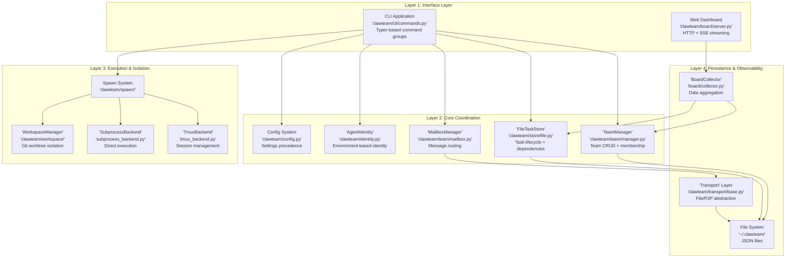
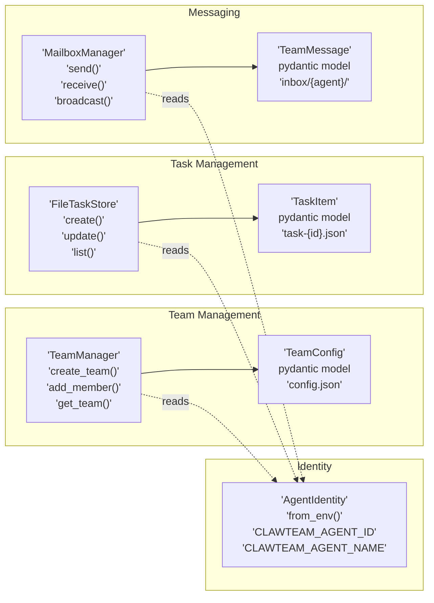
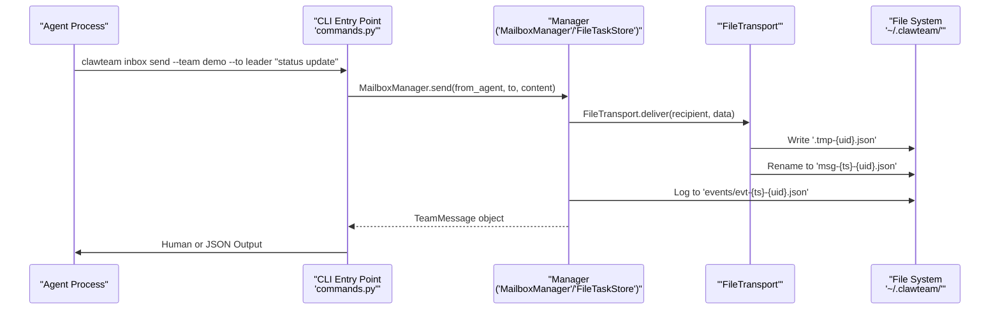
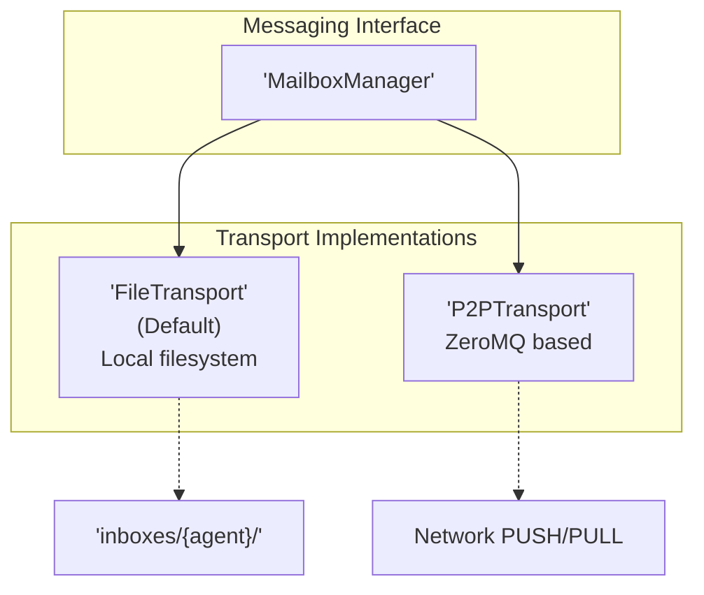

<!-- source: DeepWiki mcp.deepwiki.com · repo HKUDS/ClawTeam · page 1.2 Architecture Overview · fetched 2026-11-09 -->

# Architecture Overview

Relevant source files

The following files were used as context for generating this wiki page:

- [README.md](README.md)
- [clawteam/cli/commands.py](clawteam/cli/commands.py)
- [clawteam/store/file.py](clawteam/store/file.py)
- [clawteam/team/mailbox.py](clawteam/team/mailbox.py)
- [clawteam/team/manager.py](clawteam/team/manager.py)
- [clawteam/transport/file.py](clawteam/transport/file.py)
- [scripts/clawteam_local_install](scripts/clawteam_local_install)
- [scripts/install_clawteam.sh](scripts/install_clawteam.sh)
- [tests/test_cli_commands.py](tests/test_cli_commands.py)
- [tests/test_mailbox.py](tests/test_mailbox.py)

This page describes the high-level architecture of ClawTeam, focusing on the major system components, their responsibilities, and how they interact. For low-level implementation details of specific subsystems, see [Storage Layer](#11.1), [Transport Layer](#11.2), [Board Data Collection](#11.3), and [Spawn Backends](#11.4).

## System Purpose

ClawTeam is a multi-agent coordination framework designed to enable AI agents to self-organize into teams, communicate, manage tasks, and work in isolated environments. The architecture is built around three key principles:

1.  **CLI-first**: All functionality is exposed through CLI commands that agents can execute [clawteam/cli/commands.py:1-26]().
2.  **File-based state**: Primary state lives in `~/.clawteam/` as JSON files with atomic writes [clawteam/team/models.py:19-21](), [clawteam/transport/file.py:102-107]().
3.  **Process isolation**: Agents run as separate processes in isolated git worktrees with tmux or subprocess backends [clawteam/cli/commands.py:1600-1615]().

## Layered Architecture

ClawTeam is organized into four primary architectural layers:

**Sources:** [clawteam/cli/commands.py:22-175](), [clawteam/team/manager.py:50-51](), [clawteam/store/file.py:45-52](), [clawteam/team/mailbox.py:32-39](), [clawteam/transport/file.py:102-107]().

## Core Components

### Interface Layer

| Component | File | Responsibility |
|-----------|------|----------------|
| **CLI Application** | [clawteam/cli/commands.py]() | Typer-based command groups: `team`, `task`, `inbox`, `spawn`, `board`, `workspace`, `config`, etc. |
| **Web Dashboard** | [clawteam/board/server.py]() | HTTP server with SSE endpoints for real-time board updates. |

The CLI is the primary interface. Every command follows the pattern: `clawteam <group> <command> [args] [--options]`. The `--json` flag enables structured output for agent consumption [clawteam/cli/commands.py:50-52]().

**Sources:** [clawteam/cli/commands.py:22-60]().

### Core Coordination Layer

**TeamManager** ([clawteam/team/manager.py]()) manages team lifecycle:
- `create_team()`: Creates `~/.clawteam/teams/{name}/config.json` [clawteam/team/manager.py:78-112]().
- `add_member()`: Appends to `members` array in config [clawteam/team/manager.py:140-167]().
- `discover_teams()`: Scans filesystem for all teams [clawteam/team/manager.py:115-133]().

**FileTaskStore** ([clawteam/store/file.py]()) manages task state with automatic dependency resolution:
- `create()`: Creates `~/.clawteam/tasks/{team}/task-{id}.json` [clawteam/store/file.py:77-121]().
- `update()`: Atomic update with OS-specific advisory locking [clawteam/store/file.py:136-200]().
- Task states: `pending`, `in_progress`, `completed`, `blocked` [clawteam/store/file.py:156-163]().

**MailboxManager** ([clawteam/team/mailbox.py]()) handles inter-agent messaging:
- `send()`: Delivers message to target via `Transport` [clawteam/team/mailbox.py:72-141]().
- `receive()`: Fetches and consumes messages [clawteam/team/mailbox.py:206-216]().
- `broadcast()`: Sends to all team members except sender [clawteam/team/mailbox.py:143-150]().

**AgentIdentity** ([clawteam/identity.py]()) provides environment-based identity by reading `CLAWTEAM_AGENT_ID`, `CLAWTEAM_AGENT_NAME`, and `CLAWTEAM_TEAM_NAME`.

**Sources:** [clawteam/team/manager.py:50-210](), [clawteam/store/file.py:45-200](), [clawteam/team/mailbox.py:32-220]().

### Persistence Layer

ClawTeam uses a hierarchical file-based storage system rooted at `~/.clawteam/` [clawteam/team/models.py:19-21]().

| Directory | Contents | Implementation |
|-----------|----------|----------------|
| `teams/{name}/config.json` | Team configuration and membership | [clawteam/team/manager.py:24-48]() |
| `teams/{name}/inboxes/{agent}/` | Incoming messages (JSON) | [clawteam/transport/file.py:53-61]() |
| `tasks/{team}/task-{id}.json` | Task state and metadata | [clawteam/store/file.py:24-35]() |
| `teams/{name}/events/` | Permanent event log (JSONL) | [clawteam/team/mailbox.py:45-60]() |

All file operations utilize an atomic "write-then-rename" pattern to prevent partial reads during concurrent access [clawteam/transport/file.py:138-152](), [clawteam/team/manager.py:39-48]().

**Sources:** [clawteam/transport/file.py:49-78](), [clawteam/store/file.py:24-43](), [clawteam/team/mailbox.py:45-60]().

## Command Flow Pattern

The interaction between agents and the coordination layer follows a standardized CLI-to-Storage pattern:

**Key aspects:**
1.  **Identity Resolution**: Identity is derived from the environment during command execution [clawteam/team/mailbox.py:24-27]().
2.  **Atomic Delivery**: Messages are written to temporary files and moved to final locations to ensure consistency [clawteam/transport/file.py:145-148]().
3.  **Event Logging**: Every sent message is duplicated into a non-consuming event log for auditability [clawteam/team/mailbox.py:48-59]().

**Sources:** [clawteam/team/mailbox.py:72-141](), [clawteam/transport/file.py:138-152](), [clawteam/cli/commands.py:77-85]().

## Transport Abstraction

The messaging system is decoupled from the physical storage via the `Transport` abstraction [clawteam/transport/base.py]().

The system defaults to `FileTransport` but can be switched to `p2p` via the `CLAWTEAM_TRANSPORT` environment variable [clawteam/team/mailbox.py:15-29]().

**Sources:** [clawteam/team/mailbox.py:15-30](), [clawteam/transport/file.py:102-107]().

---

