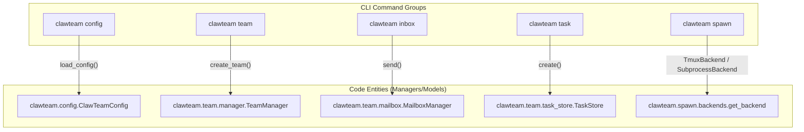
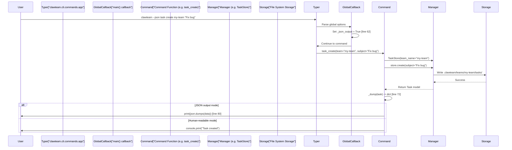

<!-- source: DeepWiki mcp.deepwiki.com · repo HKUDS/ClawTeam · page 10 CLI Command Reference · fetched 2026-11-09 -->

# CLI Command Reference

<details>
<summary>Relevant source files</summary>

The following files were used as context for generating this wiki page:

- [clawteam/cli/commands.py](clawteam/cli/commands.py)
- [docs/skills/clawteam/SKILL.md](docs/skills/clawteam/SKILL.md)
- [docs/skills/clawteam/references/cli-reference.md](docs/skills/clawteam/references/cli-reference.md)
- [skills/clawteam/SKILL.md](skills/clawteam/SKILL.md)
- [skills/clawteam/references/cli-reference.md](skills/clawteam/references/cli-reference.md)
- [tests/test_cli_commands.py](tests/test_cli_commands.py)

</details>


This page provides a comprehensive reference for all ClawTeam CLI commands, including global options, command groups, and execution patterns. It covers the structure and organization of the `clawteam` command-line interface and how commands interact with the underlying system components.

For detailed documentation of specific command groups, see:
- Config commands: [Config Commands](#10.1)
- Team management: [Team Commands](#10.2)
- Messaging: [Inbox Commands](#10.3)
- Task operations: [Task Commands](#10.4)
- Monitoring: [Board Commands](#10.5)
- Spawn, workspace, lifecycle, and other commands: [Other Commands](#10.6)

---

## Global Options

All `clawteam` commands support the following global options, which must be specified **before** the subcommand:

```bash
clawteam [--version] [--json] [--data-dir PATH] [--transport TYPE] <command>
```

| Option | Description | Effect |
|--------|-------------|--------|
| `--version`, `-v` | Show version and exit | Displays ClawTeam version string [clawteam/cli/commands.py:38-41]() |
| `--json` | Output JSON instead of human-readable text | Affects all commands; enables machine-readable output [clawteam/cli/commands.py:50-52]() |
| `--data-dir PATH` | Override data directory | Sets `CLAWTEAM_DATA_DIR` environment variable; default: `~/.clawteam` [clawteam/cli/commands.py:53-55]() |
| `--transport TYPE` | Transport backend selection | Options: `file` (default), `p2p`; sets `CLAWTEAM_TRANSPORT` [clawteam/cli/commands.py:56-59]() |

**Sources:** [clawteam/cli/commands.py:38-70](), [skills/clawteam/references/cli-reference.md:3-10]()

---

## Environment Variables for Agent Identity

ClawTeam agents use environment variables to establish their identity within teams. These variables are automatically set by `clawteam spawn` but can also be set manually for testing or scripting.

| Variable | Purpose | Example |
|----------|---------|---------|
| `CLAWTEAM_AGENT_ID` | Unique agent identifier | `a1b2c3d4e5f6` |
| `CLAWTEAM_AGENT_NAME` | Human-readable agent name | `alice`, `worker1` |
| `CLAWTEAM_AGENT_TYPE` | Agent role type | `leader`, `general-purpose` |
| `CLAWTEAM_TEAM_NAME` | Team the agent belongs to | `dev-team`, `hedge-fund` |
| `CLAWTEAM_DATA_DIR` | Override data directory | `/tmp/clawteam-data` |
| `CLAWTEAM_TRANSPORT` | Transport backend | `file`, `p2p` |

These variables are read by the `AgentIdentity.from_env()` method throughout the codebase to determine the calling agent's context.

**Sources:** [skills/clawteam/references/cli-reference.md:12-24](), [clawteam/cli/commands.py:63-70]()

---

## Command Groups Architecture

The ClawTeam CLI is organized into command groups, each implemented as a separate Typer sub-application [clawteam/cli/commands.py:22-26](). Each command group maps to one or more backend manager classes that handle business logic.

### Natural Language to Code Entity Mapping

The following diagram maps high-level CLI concepts to their corresponding Python classes and methods in the codebase.



**Sources:** [clawteam/cli/commands.py:174-211](), [clawteam/cli/commands.py:228-446](), [clawteam/cli/commands.py:536-580](), [clawteam/cli/commands.py:726-788]()

---

## Command Execution Flow

The following diagram illustrates the data flow from user input through the CLI to backend managers and storage:



**Sources:** [clawteam/cli/commands.py:44-85]()

---

## JSON Output Mode

All ClawTeam commands support `--json` mode for machine-readable output. This enables scripting and programmatic monitoring.

### Activation

The `--json` flag must be specified **before** the subcommand [clawteam/cli/commands.py:50-52]():

```bash
# Correct
clawteam --json team discover

# Incorrect
clawteam team discover --json
```

### Implementation Pattern

Commands use the `_output(data, human_fn)` helper function [clawteam/cli/commands.py:77-85]():

```python
def _output(data: dict | list, human_fn=None):
    """Output data as JSON or human-readable."""
    if _json_output:
        print(json.dumps(data, indent=2, ensure_ascii=False))
    elif human_fn:
        human_fn(data)
```

**Sources:** [clawteam/cli/commands.py:72-85]()

---

## Command Groups Overview

### 1. Config Commands (`clawteam config`)
Manage persistent configuration settings.
- `config show`: Display all settings and sources [clawteam/cli/commands.py:178-200]().
- `config set <key> <value>`: Persistently set a value [clawteam/cli/commands.py:202-211]().
- `config get <key>`: Retrieve a specific setting [clawteam/cli/commands.py:213-221]().

For details, see [Config Commands](#10.1).

### 2. Team Commands (`clawteam team`)
Manage team lifecycle and membership.
- `team spawn-team`: Initialize a new team [clawteam/cli/commands.py:228-265]().
- `team discover`: List available teams [clawteam/cli/commands.py:267-281]().
- `team request-join`: Request to join a team [clawteam/cli/commands.py:326-377]().
- `team approve-join`: Leader approval for new members [clawteam/cli/commands.py:379-417]().

For details, see [Team Commands](#10.2).

### 3. Inbox Commands (`clawteam inbox`)
Inter-agent messaging.
- `inbox send`: Point-to-point message [clawteam/cli/commands.py:536-580]().
- `inbox broadcast`: Message all members [clawteam/cli/commands.py:582-601]().
- `inbox receive`: Consume messages (destructive) [clawteam/cli/commands.py:603-642]().
- `inbox watch`: Real-time monitoring [clawteam/cli/commands.py:679-720]().

For details, see [Inbox Commands](#10.3).

### 4. Task Commands (`clawteam task`)
Manage shared task board.
- `task create`: Create task with priority and dependencies [clawteam/cli/commands.py:726-788]().
- `task update`: Modify status or owner [clawteam/cli/commands.py:808-870]().
- `task list`: Filtered task view [clawteam/cli/commands.py:872-921]().
- `task wait`: Block until tasks are finished [clawteam/cli/commands.py:1112-1172]().

For details, see [Task Commands](#10.4).

### 5. Board Commands (`clawteam board`)
Visualization and monitoring.
- `board show`: Terminal Kanban view [clawteam/cli/commands.py:1736-1752]().
- `board live`: Auto-refreshing dashboard [clawteam/cli/commands.py:1768-1785]().
- `board serve`: Web-based dashboard [clawteam/cli/commands.py:1787-1803]().
- `board attach`: Tmux tiled interface [clawteam/cli/commands.py:1805-1822]().

For details, see [Board Commands](#10.5).

### 6. Other Commands
- `spawn`: Launch agent processes [clawteam/cli/commands.py:1528-1657]().
- `workspace`: Git worktree management [clawteam/cli/commands.py:1828-1973]().
- `plan`: Leader approval workflow [clawteam/cli/commands.py:1277-1357]().
- `lifecycle`: Agent shutdown and idle protocols [clawteam/cli/commands.py:1363-1522]().

For details, see [Other Commands](#10.6).

**Sources:** [clawteam/cli/commands.py:1-2211](), [skills/clawteam/references/cli-reference.md:1-394]()

---

