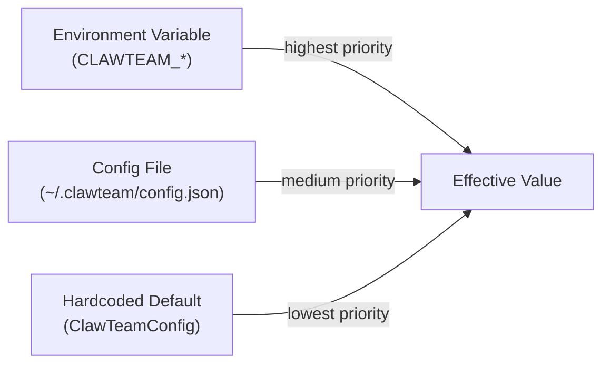
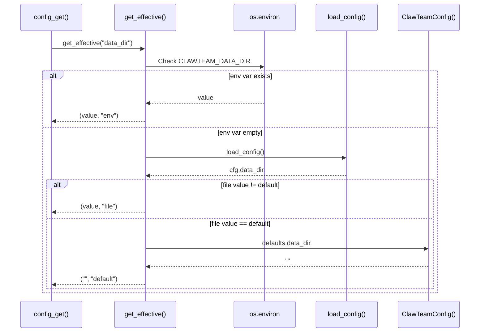
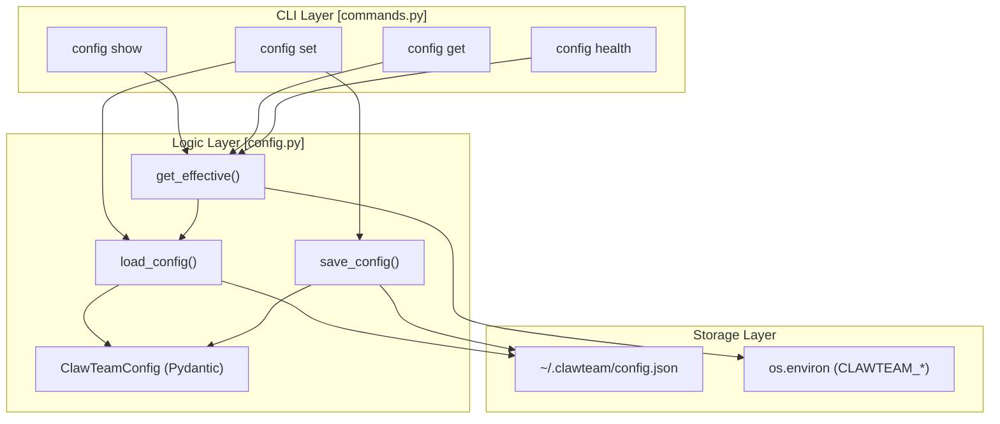

<!-- source: DeepWiki mcp.deepwiki.com · repo HKUDS/ClawTeam · page 10.1 Config Commands · fetched 2026-11-09 -->

# Config Commands

<details>
<summary>Relevant source files</summary>

The following files were used as context for generating this wiki page:

- [clawteam/board/renderer.py](clawteam/board/renderer.py)
- [clawteam/cli/commands.py](clawteam/cli/commands.py)
- [clawteam/config.py](clawteam/config.py)
- [clawteam/timefmt.py](clawteam/timefmt.py)
- [tests/test_cli_commands.py](tests/test_cli_commands.py)
- [tests/test_config.py](tests/test_config.py)
- [tests/test_timefmt.py](tests/test_timefmt.py)

</details>


This page provides a comprehensive reference for ClawTeam's configuration management commands (`clawteam config`). These commands allow you to view, set, and diagnose configuration settings that control ClawTeam's behavior.

**Scope:** This page covers the config subcommands (`show`, `set`, `get`, `health`), the configuration precedence system, and the underlying storage mechanism. For commands that manage other aspects of ClawTeam (teams, tasks, agents, etc.), see other pages in section [10]().

---

## Overview

ClawTeam's configuration system provides persistent settings that control system-wide behavior. Configuration values are stored in a JSON file and can be overridden by environment variables, following a clear precedence hierarchy.

### Storage Location

All configuration is stored in a single file at a fixed location:

- **Config file:** `~/.clawteam/config.json`
- **Format:** JSON (managed via Pydantic model `ClawTeamConfig`) [clawteam/config.py:50-70]()

This location is **never** affected by the `data_dir` setting or `CLAWTEAM_DATA_DIR` environment variable [clawteam/config.py:76-78]().

### Configuration Precedence

Configuration values are resolved using a three-tier precedence system:

**Precedence Hierarchy**


**Precedence order (highest to lowest):**
1. **Environment variable** (e.g., `CLAWTEAM_DATA_DIR`)
2. **Config file** value (set via `config set`)
3. **Default** value (hardcoded in `ClawTeamConfig`)

The `get_effective()` function implements this resolution logic by checking each source in order until a non-empty value is found [clawteam/config.py:98-134]().

**Sources:** [clawteam/config.py:76-134](), [clawteam/cli/commands.py:44-71]()

---

## Configuration Keys

ClawTeam supports the following scalar configuration keys:

| Key | Environment Variable | Default | Description |
|-----|---------------------|---------|-------------|
| `data_dir` | `CLAWTEAM_DATA_DIR` | `""` | Override data directory (default: `~/.clawteam`) |
| `user` | `CLAWTEAM_USER` | `""` | User identity for multi-user scenarios |
| `default_team` | `CLAWTEAM_TEAM_NAME` | `""` | Default team name for commands |
| `transport` | `CLAWTEAM_TRANSPORT` | `""` | Transport backend: `file` or `p2p` |
| `workspace` | `CLAWTEAM_WORKSPACE` | `"auto"` | Git worktree mode: `auto`, `always`, or `never` |
| `default_backend` | `CLAWTEAM_DEFAULT_BACKEND` | `"tmux"` | Default spawn backend: `tmux` or `subprocess` |
| `skip_permissions` | `CLAWTEAM_SKIP_PERMISSIONS` | `true` | Pass `--dangerously-skip-permissions` to agents |
| `timezone` | `CLAWTEAM_TIMEZONE` | `"UTC"` | Display timezone for timestamps |
| `spawn_ready_timeout` | `CLAWTEAM_SPAWN_READY_TIMEOUT`| `30.0` | Max seconds to poll for TUI readiness |

**Sources:** [clawteam/config.py:50-70](), [clawteam/config.py:103-119]()

---

## Command Reference

### `config show`

Display all configuration settings with their effective values and sources.

**Syntax:**
```bash
clawteam config show
clawteam --json config show
```

**Implementation:**
1. Calls `scalar_config_keys()` to get user-facing keys [clawteam/cli/commands.py:183]().
2. Calls `get_effective(k)` for each key to resolve the value and the source (env, file, or default) [clawteam/cli/commands.py:186]().
3. Renders a `rich.table.Table` showing keys, values, and sources [clawteam/cli/commands.py:190-197]().

**Sources:** [clawteam/cli/commands.py:178-199](), [clawteam/config.py:137-144]()

---

### `config set`

Persistently save a configuration value to `~/.clawteam/config.json`.

**Syntax:**
```bash
clawteam config set <key> <value>
```

**Behavior:**
1. Validates that `key` is a valid scalar key [clawteam/cli/commands.py:213-216]().
2. Loads existing config via `load_config()` [clawteam/cli/commands.py:218]().
3. Handles boolean conversion if the Pydantic field annotation is `bool` [clawteam/cli/commands.py:219-222]().
4. Saves atomically via `save_config()`, which uses `atomic_write_text` [clawteam/config.py:93-95]().

**Sources:** [clawteam/cli/commands.py:202-225](), [clawteam/config.py:93-95]()

---

### `config get`

Retrieve the effective value of a single configuration key.

**Syntax:**
```bash
clawteam config get <key>
```

**Implementation:**
Calls `get_effective(key)` which implements the precedence resolution:

**Resolution Logic Sequence**


**Sources:** [clawteam/cli/commands.py:228-242](), [clawteam/config.py:98-134]()

---

### `config health`

Perform health diagnostics on the data directory and configuration.

**Syntax:**
```bash
clawteam config health
```

**Checks performed:**
- **Directory Existence:** Checks if `data_dir` exists [clawteam/cli/commands.py:257]().
- **Writability:** Attempts to write a `.health-check` file [clawteam/cli/commands.py:261]().
- **Latency:** Measures the time taken for the write operation [clawteam/cli/commands.py:262-264]().
- **Mount Status:** Checks if the path is a mount point (e.g., NFS/SMB) via `os.path.ismount()` [clawteam/cli/commands.py:273]().

**Sources:** [clawteam/cli/commands.py:245-312]()

---

## Configuration System Architecture

The following diagram maps CLI commands to the internal `config.py` entities and storage.

**Natural Language to Code Entity Space**


**Key implementation details:**
- **`ClawTeamConfig`**: The central Pydantic model defining all available settings and their default values [clawteam/config.py:50-70]().
- **`atomic_write_text`**: Used by `save_config` to ensure the config file is not corrupted during concurrent writes or crashes [clawteam/config.py:11](), [clawteam/config.py:95]().
- **`format_timestamp`**: Uses the `timezone` config key to render human-friendly times in the CLI [clawteam/timefmt.py:38-48]().

**Sources:** [clawteam/config.py:1-144](), [clawteam/cli/commands.py:170-242](), [clawteam/timefmt.py:24-49]()

---

## Global Config Options

The `clawteam` CLI accepts global flags that override configuration dynamically for a single command execution:

| Flag | Effect |
|------|--------|
| `--json` | Output JSON instead of human-readable text [clawteam/cli/commands.py:50-52]() |
| `--data-dir` | Overrides the `data_dir` setting via `CLAWTEAM_DATA_DIR` [clawteam/cli/commands.py:53-55]() |
| `--transport`| Overrides the `transport` setting via `CLAWTEAM_TRANSPORT` [clawteam/cli/commands.py:56-58]() |

**Sources:** [clawteam/cli/commands.py:44-71]()

---

