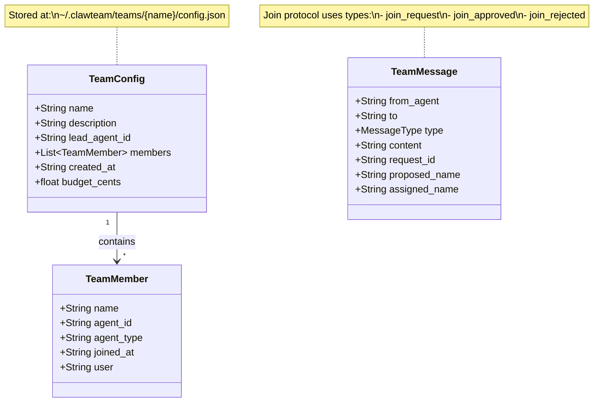
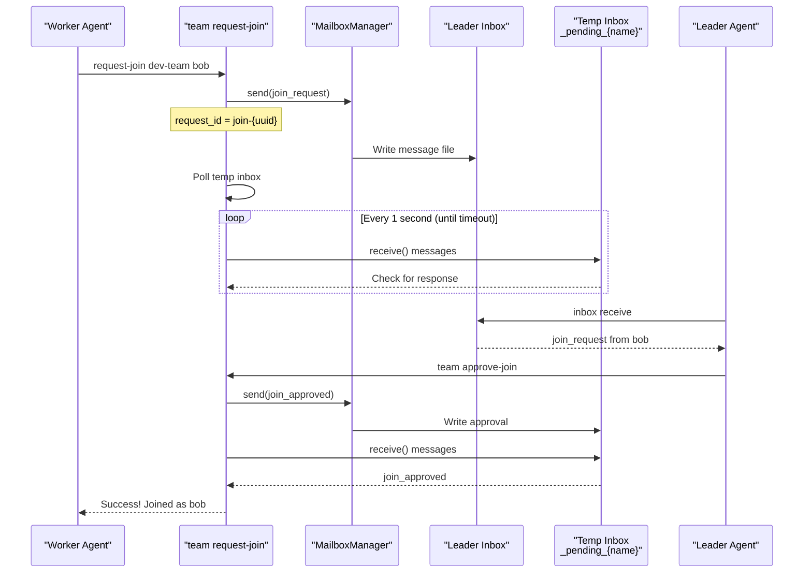

<!-- source: DeepWiki mcp.deepwiki.com · repo HKUDS/ClawTeam · page 10.2 Team Commands · fetched 2026-11-09 -->

# Team Commands

<details>
<summary>Relevant source files</summary>

The following files were used as context for generating this wiki page:

- [clawteam/cli/commands.py](clawteam/cli/commands.py)
- [clawteam/store/file.py](clawteam/store/file.py)
- [clawteam/team/mailbox.py](clawteam/team/mailbox.py)
- [clawteam/team/manager.py](clawteam/team/manager.py)
- [tests/test_cli_commands.py](tests/test_cli_commands.py)

</details>


## Purpose and Scope

This page documents the **team command group** (`clawteam team`) in the ClawTeam CLI, which provides commands for creating teams, managing membership, handling join requests, and team lifecycle operations. These commands operate on the team configuration data stored in `~/.clawteam/teams/{team}/config.json`.

For commands related to agent identity and environment variables, see [Agent Identity](#3.1). For spawning agents into teams, see [Spawning Agents](#3.2). For other CLI command groups, see:
- [Config Commands](#10.1) - Configuration management
- [Inbox Commands](#10.3) - Inter-agent messaging  
- [Task Commands](#10.4) - Task management
- [Board Commands](#10.5) - Monitoring and visualization

---

## Command Group Overview

The `team` command group consists of commands that manage the complete team lifecycle:

| Command | Purpose | Leader Only |
|---------|---------|-------------|
| `spawn-team` | Create a new team with the caller as leader | No |
| `discover` | List all existing teams | No |
| `status` | Show team configuration and member list | No |
| `request-join` | Request to join a team (blocks for approval) | No |
| `approve-join` | Approve a pending join request | Yes |
| `reject-join` | Reject a pending join request | Yes |
| `join-status` | Check the status of a specific join request | No |
| `cleanup` | Delete a team and all its data | Leader |

**Sources:** [clawteam/cli/commands.py:228-560](), [clawteam/team/manager.py:50-220]()

---

## Team Management Architecture

```mermaid
graph TB
    subgraph "CLI Commands (commands.py)"
        SpawnTeam["team_spawn_team()"]
        Discover["team_discover()"]
        Status["team_status()"]
        RequestJoin["team_request_join()"]
        ApproveJoin["team_approve_join()"]
        RejectJoin["team_reject_join()"]
        Cleanup["team_cleanup()"]
    end
    
    subgraph "Core Manager (team/manager.py)"
        TeamManager["TeamManager"]
        CreateTeam["create_team()"]
        GetTeam["get_team()"]
        AddMember["add_member()"]
        DiscoverTeams["discover_teams()"]
        CleanupTeam["cleanup()"]
    end
    
    subgraph "Identity & Messaging"
        AgentIdentity["AgentIdentity.from_env()"]
        MailboxMgr["MailboxManager"]
        SendMsg["send()"]
        ReceiveMsg["receive() / peek()"]
    end
    
    subgraph "Storage Layer"
        ConfigFile["~/.clawteam/teams/{team}/config.json"]
        InboxFiles["~/.clawteam/teams/{team}/inboxes/{agent}/"]
        TasksDir["~/.clawteam/tasks/{team}/"]
    end
    
    SpawnTeam --> AgentIdentity
    SpawnTeam --> CreateTeam
    Discover --> DiscoverTeams
    Status --> GetTeam
    RequestJoin --> AgentIdentity
    RequestJoin --> MailboxMgr
    RequestJoin --> SendMsg
    ApproveJoin --> MailboxMgr
    ApproveJoin --> AddMember
    RejectJoin --> MailboxMgr
    Cleanup --> CleanupTeam
    
    CreateTeam --> ConfigFile
    GetTeam --> ConfigFile
    AddMember --> ConfigFile
    DiscoverTeams --> ConfigFile
    CleanupTeam --> ConfigFile
    CleanupTeam --> InboxFiles
    CleanupTeam --> TasksDir
    
    SendMsg --> InboxFiles
    ReceiveMsg --> InboxFiles
```



**Diagram:** Architecture showing how team CLI commands interact with `TeamManager`, `AgentIdentity`, `MailboxManager`, and the file system storage layer.

**Sources:** [clawteam/cli/commands.py:228-560](), [clawteam/team/manager.py:1-220](), [clawteam/team/mailbox.py:32-141]()

---

## Team Data Model



**Diagram:** Data model showing `TeamConfig` and `TeamMember` classes that are serialized to JSON storage via `TeamManager`, along with message types used in the join protocol.

**Sources:** [clawteam/team/models.py:1-150](), [clawteam/team/manager.py:50-120]()

---

## Command Reference

### `team spawn-team`

Create a new team and register the calling agent as the leader.

**Syntax:**
```bash
clawteam team spawn-team <name> [options]
```

**Arguments:**
- `name` - Team name (required, must be unique)

**Options:**
- `--description, -d` - Team description (default: `""`)
- `--agent-name, -n` - Leader agent name (default: `"leader"`)
- `--agent-type` - Leader agent type (default: `"leader"`)

**Implementation:** [clawteam/cli/commands.py:232-273]()

The command:
1. Retrieves agent identity from environment via `AgentIdentity.from_env()` [clawteam/cli/commands.py:243]().
2. Calls `TeamManager.create_team()` with leader information [clawteam/cli/commands.py:248]().
3. Creates team directory at `~/.clawteam/teams/{name}/` [clawteam/team/manager.py:107]().
4. Writes initial `config.json` with leader as first member [clawteam/team/manager.py:104]().
5. Creates leader's inbox directory [clawteam/team/manager.py:108]().

**Sources:** [clawteam/cli/commands.py:232-273](), [clawteam/team/manager.py:78-113]()

---

### `team discover`

List all existing teams by scanning the team directories.

**Syntax:**
```bash
clawteam team discover
```

**Implementation:** [clawteam/cli/commands.py:275-294]()

The command:
1. Calls `TeamManager.discover_teams()` [clawteam/cli/commands.py:278]().
2. Scans `~/.clawteam/teams/` for subdirectories [clawteam/team/manager.py:120]().
3. Reads each `config.json` to extract team metadata [clawteam/team/manager.py:123]().
4. Returns list with name, description, lead agent ID, and member count [clawteam/team/manager.py:127-132]().

**Sources:** [clawteam/cli/commands.py:275-294](), [clawteam/team/manager.py:115-133]()

---

### `team status`

Show detailed team configuration including all members with their metadata.

**Syntax:**
```bash
clawteam team status <team>
```

**Implementation:** [clawteam/cli/commands.py:513-559]()

The command:
1. Calls `TeamManager.get_team()` to load config [clawteam/cli/commands.py:516]().
2. Returns team metadata and full member list [clawteam/cli/commands.py:521]().
3. Displays table with member names, IDs, types, users, and join timestamps [clawteam/cli/commands.py:539-552]().

**Sources:** [clawteam/cli/commands.py:513-559](), [clawteam/team/manager.py:136-138]()

---

### `team request-join`

Request to join a team. This is a **blocking command** that waits for the leader to approve or reject the request unless `--no-wait` is used.

**Syntax:**
```bash
clawteam team request-join <team> <proposed-name> [options]
```

**Options:**
- `--capabilities, -c` - Agent capabilities description (default: `""`)
- `--timeout, -t` - Timeout in seconds (default: `60`)
- `--no-wait` - Send request and exit immediately [clawteam/cli/commands.py:309]().

**Join Protocol Flow:**



**Sources:** [clawteam/cli/commands.py:297-368](), [clawteam/team/mailbox.py:72-141]()

---

### `team approve-join`

Approve a pending join request. **Leader-only command.**

**Syntax:**
```bash
clawteam team approve-join <team> <request-id> [options]
```

**Options:**
- `--assigned-name` - Override proposed name (optional) [clawteam/cli/commands.py:378]().

**Implementation:** [clawteam/cli/commands.py:371-423]()

The command:
1. Retrieves pending join requests from leader's inbox via `mailbox.peek()` [clawteam/cli/commands.py:388]().
2. Finds the request matching `request_id` [clawteam/cli/commands.py:393]().
3. Generates new `agent_id` for the joining agent [clawteam/cli/commands.py:401]().
4. Calls `TeamManager.add_member()` to add agent to team config [clawteam/cli/commands.py:402]().
5. Sends `join_approved` message to temporary inbox `_pending_{proposed_name}` [clawteam/cli/commands.py:410]().

**Sources:** [clawteam/cli/commands.py:371-423](), [clawteam/team/manager.py:140-167]()

---

### `team reject-join`

Reject a pending join request. **Leader-only command.**

**Syntax:**
```bash
clawteam team reject-join <team> <request-id> [options]
```

**Options:**
- `--reason, -r` - Rejection reason (optional) [clawteam/cli/commands.py:431]().

**Implementation:** [clawteam/cli/commands.py:426-463]()

The command:
1. Retrieves pending requests from leader's inbox [clawteam/cli/commands.py:440]().
2. Finds the `proposed_name` from the matching request [clawteam/cli/commands.py:445]().
3. Sends `join_rejected` message to temporary inbox with optional reason [clawteam/cli/commands.py:452]().

**Sources:** [clawteam/cli/commands.py:426-463](), [clawteam/team/models.py:100-120]()

---

### `team cleanup`

Delete a team and all associated data including config, inboxes, tasks, and plans.

**Syntax:**
```bash
clawteam team cleanup <team> [options]
```

**Options:**
- `--force, -f` - Skip confirmation prompt [clawteam/cli/commands.py:471]().

**Implementation:** [clawteam/cli/commands.py:466-481]()

The command:
1. Prompts for confirmation unless `--force` is specified [clawteam/cli/commands.py:475]().
2. Calls `TeamManager.cleanup()` which recursively deletes:
   - Team config and inboxes [clawteam/team/manager.py:204]().
   - Tasks directory [clawteam/team/manager.py:205]().
   - Costs and sessions directories [clawteam/team/manager.py:206-207]().
   - Git worktrees via `workspace.cleanup_team()` [clawteam/team/manager.py:199]().

**Sources:** [clawteam/cli/commands.py:466-481](), [clawteam/team/manager.py:192-220]()

---

### `team join-status`

Check the status of a specific join request. Useful for non-blocking join flows or debugging.

**Syntax:**
```bash
clawteam team join-status <team> <request-id> [options]
```

**Options:**
- `--proposed-name` - The name used in the original request [clawteam/cli/commands.py:569]().

**Implementation:** [clawteam/cli/commands.py:562-609]()

The command:
1. Peeks into the temporary inbox `_pending_{proposed_name}` [clawteam/cli/commands.py:581]().
2. Looks for `join_approved` or `join_rejected` messages matching the `request_id` [clawteam/cli/commands.py:586]().
3. Returns the status (Approved, Rejected, or Pending) [clawteam/cli/commands.py:590-607]().

**Sources:** [clawteam/cli/commands.py:562-609](), [tests/test_cli_commands.py:172-206]()

---

## Error Handling

| Error | Cause | Solution |
|-------|-------|----------|
| `Team '{name}' already exists` | Attempted to create duplicate team | Use `team discover` to find existing teams |
| `No join request found with id '{id}'` | Approving a non-existent request | Verify ID with `inbox peek` on leader |
| `Timeout waiting for response` | Leader didn't respond to join request | Increase `--timeout` or check leader is running |
| `Invalid identifier` | Team/Agent name contains illegal characters | Use alphanumeric characters, underscores, or hyphens |

**Sources:** [clawteam/team/manager.py:89-90](), [tests/test_cli_commands.py:37-56](), [clawteam/paths.py:19-21]()

---

