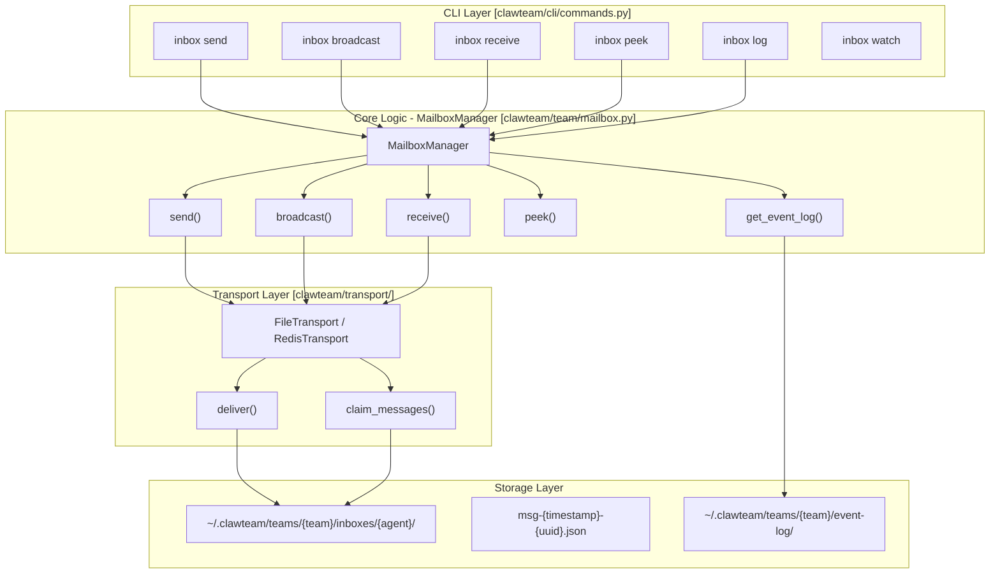
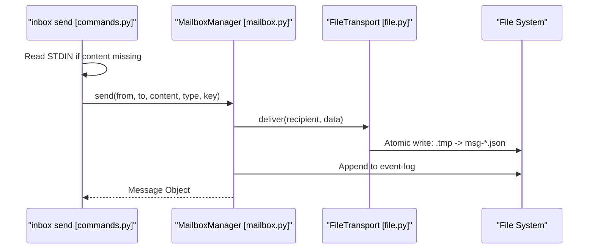
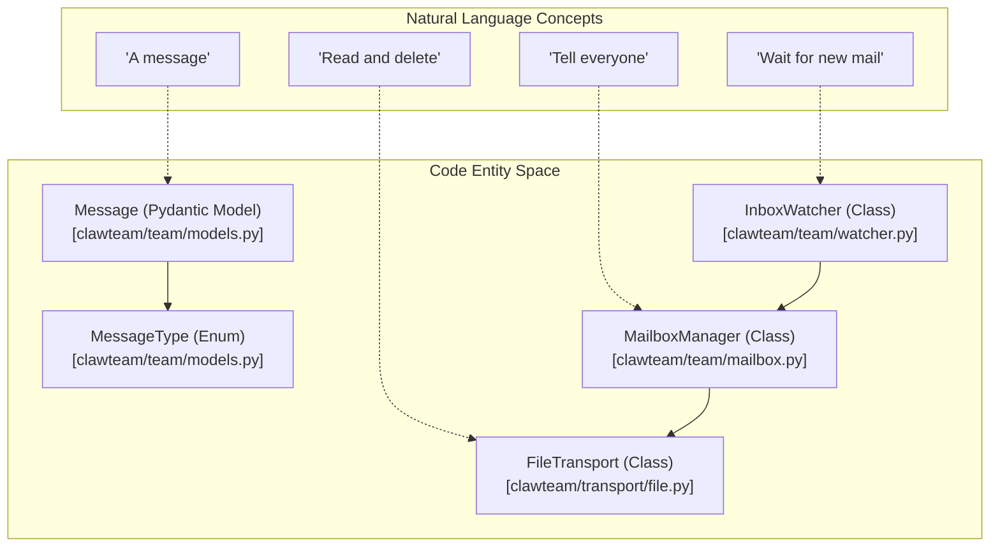

<!-- source: DeepWiki mcp.deepwiki.com · repo HKUDS/ClawTeam · page 10.3 Inbox Commands · fetched 2026-11-09 -->

# Inbox Commands

<details>
<summary>Relevant source files</summary>

The following files were used as context for generating this wiki page:

- [clawteam/cli/commands.py](clawteam/cli/commands.py)
- [clawteam/transport/file.py](clawteam/transport/file.py)
- [tests/test_cli_commands.py](tests/test_cli_commands.py)
- [tests/test_mailbox.py](tests/test_mailbox.py)

</details>


The inbox command group (`clawteam inbox`) provides inter-agent messaging capabilities for ClawTeam teams. These commands enable agents to send point-to-point messages, broadcast to all team members, receive and consume messages, peek at pending messages without consuming them, view message history, and watch for new messages in real-time.

**Sources:** [clawteam/cli/commands.py:533-720](), [tests/test_mailbox.py:41-132]()

---

## Command Overview

The inbox command group consists of six commands for different messaging operations:

| Command | Purpose | Destructive | Use Case |
|---------|---------|-------------|----------|
| `inbox send` | Send point-to-point message | No | Direct agent-to-agent communication |
| `inbox broadcast` | Send to all team members | No | Team-wide announcements |
| `inbox receive` | Consume messages from inbox | Yes | Process pending messages |
| `inbox peek` | View messages without consuming | No | Check inbox without side effects |
| `inbox log` | View all sent messages (event log) | No | Audit trail and debugging |
| `inbox watch` | Real-time message monitoring | No | Continuous inbox monitoring |

**Sources:** [clawteam/cli/commands.py:533-720](), [clawteam/team/mailbox.py:11-21]()

---

## Message Architecture



**Diagram: Inbox Command Architecture**

The inbox system uses a transport abstraction. By default, `FileTransport` handles message persistence using atomic writes and file locks to prevent partial reads or race conditions [clawteam/transport/file.py:102-152]().

**Sources:** [clawteam/cli/commands.py:533-720](), [clawteam/team/mailbox.py:11-230](), [clawteam/transport/file.py:102-152]()

---

## Command: inbox send

Send a point-to-point message from one agent to another.

### Syntax

```bash
clawteam inbox send <team> <to> [content] [options]
```

### Arguments and Options

| Parameter | Type | Description |
|-----------|------|-------------|
| `team` | Argument | Team name |
| `to` | Argument | Recipient agent name |
| `content` | Argument | Message content (string). If missing, reads from STDIN [tests/test_cli_commands.py:111-137](). |
| `--key, -k` | Option | Optional routing key for message filtering |
| `--type` | Option | Message type (default: `"message"`) |
| `--from, -f` | Option | Override sender name (default: from `CLAWTEAM_AGENT_NAME` env var) |

### Behavior

1. Resolves sender identity from `--from` option or environment variables [clawteam/cli/commands.py:540-545]().
2. If `content` is not provided, the command reads from standard input [clawteam/cli/commands.py:551-554]().
3. Calls `MailboxManager.send()` which utilizes the configured transport to deliver the payload [clawteam/team/mailbox.py:50-120]().
4. Logs the message to the team event log [clawteam/team/mailbox.py:100-110]().

### Implementation



**Diagram: inbox send Implementation Flow**

**Sources:** [clawteam/cli/commands.py:540-566](), [clawteam/team/mailbox.py:50-120](), [clawteam/transport/file.py:138-152]()

---

## Command: inbox broadcast

Broadcast a message to all team members except the sender.

### Behavior

1. Retrieves all members of the team via `TeamManager.list_members` [clawteam/team/mailbox.py:122-125]().
2. Filters out the sender from the recipient list [clawteam/team/mailbox.py:130-135]().
3. Iteratively calls `send()` for every other member [clawteam/team/mailbox.py:140-145]().

**Sources:** [clawteam/cli/commands.py:568-591](), [clawteam/team/mailbox.py:122-150]()

---

## Command: inbox receive

Receive and consume messages from an agent's inbox. This is a **destructive** operation — messages are removed from the active inbox after being read.

### Behavior

1. Resolves the target agent (defaults to `CLAWTEAM_AGENT_NAME`) [clawteam/cli/commands.py:598-600]().
2. Calls `MailboxManager.receive()`, which uses `Transport.claim_messages()` to safely acquire files [clawteam/transport/file.py:153-190]().
3. In `FileTransport`, messages are renamed from `.json` to `.consumed` and locked using `fcntl` (Unix) or `msvcrt` (Windows) during processing [clawteam/transport/file.py:158-173]().
4. Once successfully read and returned to the CLI, the `.consumed` files are deleted [clawteam/transport/file.py:120-123]().

**Sources:** [clawteam/cli/commands.py:593-621](), [clawteam/team/mailbox.py:160-185](), [clawteam/transport/file.py:153-190]()

---

## Command: inbox peek

View messages in an agent's inbox without consuming them. This is a **non-destructive** operation.

### Implementation

1. Uses `MailboxManager.peek()` which calls `Transport.fetch(consume=False)` [clawteam/team/mailbox.py:187-200]().
2. The transport layer reads the file contents without renaming them or applying exclusive locks that would lead to deletion [clawteam/transport/file.py:227-235]().

**Sources:** [clawteam/cli/commands.py:624-649](), [clawteam/team/mailbox.py:187-200](), [clawteam/transport/file.py:227-235]()

---

## Command: inbox log

View the complete message history (event log) for a team.

### Behavior

1. Reads from the `event-log` directory, which contains a copy of every message sent in the team [clawteam/team/mailbox.py:202-210]().
2. Unlike the `inboxes/` directory, the `event-log/` is an append-only record and is not affected by `receive` operations [clawteam/team/mailbox.py:100-110]().

**Sources:** [clawteam/cli/commands.py:652-682](), [clawteam/team/mailbox.py:202-230]()

---

## Command: inbox watch

Watch an agent's inbox for new messages in real-time.

### Execution via --exec

When the `--exec` option is used, the command spawns a subprocess for every received message [clawteam/cli/commands.py:700-715](). It populates the environment of the subprocess with message metadata:

*   `CLAWTEAM_MSG_FROM`: Sender name
*   `CLAWTEAM_MSG_TO`: Recipient name
*   `CLAWTEAM_MSG_TYPE`: Type of message
*   `CLAWTEAM_MSG_CONTENT`: The message body
*   `CLAWTEAM_MSG_JSON`: Full JSON representation

**Sources:** [clawteam/cli/commands.py:685-719](), [clawteam/team/watcher.py:1-120]()

---

## Data Flow: Natural Language to Code Entity Space

The following diagram maps high-level "Inbox" concepts to the specific classes and files that implement them.



**Sources:** [clawteam/team/models.py:80-150](), [clawteam/team/mailbox.py:11-30](), [clawteam/transport/file.py:102-110](), [clawteam/team/watcher.py:15-25]()

---

