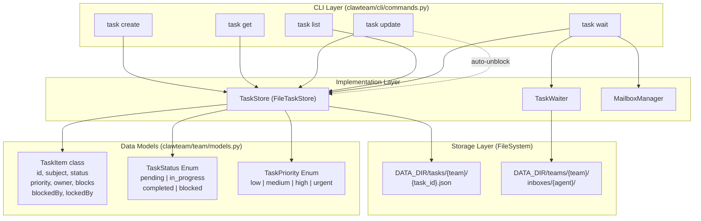
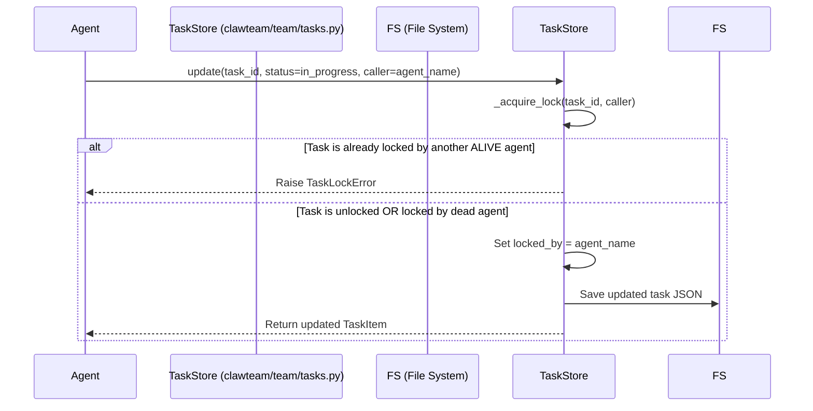

<!-- source: DeepWiki mcp.deepwiki.com · repo HKUDS/ClawTeam · page 10.4 Task Commands · fetched 2026-11-09 -->

# Task Commands

<details>
<summary>Relevant source files</summary>

The following files were used as context for generating this wiki page:

- [clawteam/cli/commands.py](clawteam/cli/commands.py)
- [clawteam/team/models.py](clawteam/team/models.py)
- [clawteam/team/tasks.py](clawteam/team/tasks.py)
- [tests/test_cli_commands.py](tests/test_cli_commands.py)
- [tests/test_task_store_locking.py](tests/test_task_store_locking.py)
- [tests/test_tasks.py](tests/test_tasks.py)

</details>


This page documents the CLI commands for task management in ClawTeam. Task commands enable agents to create, query, update, and coordinate work through a shared task board. Tasks support dependencies, status transitions, ownership, and automatic unblocking when dependencies are satisfied.

For information about task dependencies and the auto-unblock mechanism, see [Task Dependencies](#4.1). For task coordination using the wait command, see [Task Waiting and Coordination](#4.2).

---

## Overview

The `clawteam task` command group provides core commands for task lifecycle management:

| Command | Purpose | Primary Use Case |
|---------|---------|------------------|
| `task create` | Create a new task with optional dependencies and priority | Leader defines work breakdown |
| `task get` | Retrieve a single task by ID | Agent inspects task details |
| `task update` | Update task status, owner, priority, or metadata | Agent marks progress or completion |
| `task list` | List tasks with optional filters and sorting | Agent queries assigned work |
| `task wait` | Block until all tasks complete | Leader waits for team completion |

All task commands support `--json` output for programmatic use and write to the file-based task store. The storage location defaults to `~/.clawteam/tasks/{team}/` but respects `CLAWTEAM_DATA_DIR` [clawteam/team/models.py:15-23]().

**Sources:** [clawteam/cli/commands.py:723-1172](), [clawteam/team/models.py:124-143]()

---

## Command Architecture

The following diagram maps CLI commands to their underlying implementation components and storage entities:



**Sources:** [clawteam/cli/commands.py:726-1172](), [clawteam/team/tasks.py:1-15](), [clawteam/team/models.py:36-48]()

---

## `task create`

Create a new task with optional owner assignment, priority, and dependency constraints.

### Syntax

```bash
clawteam task create <team> <subject> [options]
```

### Arguments

| Argument | Type | Description |
|----------|------|-------------|
| `<team>` | string | Team name |
| `<subject>` | string | Task subject/title |

### Options

| Option | Type | Default | Description |
|--------|------|---------|-------------|
| `--description, -d` | string | `""` | Detailed task description |
| `--owner, -o` | string | `""` | Owner agent name |
| `--priority, -p` | string | `medium` | `low`, `medium`, `high`, `urgent` |
| `--blocks` | string | `None` | Comma-separated task IDs this blocks |
| `--blocked-by` | string | `None` | Comma-separated task IDs blocking this |
| `--metadata, -m` | string | `None` | KEY=VALUE metadata items |

### Behavior

1. Generates a unique task ID using `uuid.uuid4().hex[:8]` [clawteam/team/models.py:129]().
2. Determines initial status:
   - If `blocked_by` is provided → status = `blocked` [tests/test_tasks.py:31-35]().
   - Otherwise → status = `pending` [clawteam/team/models.py:132]().
3. Persists to disk via `TaskStore.create()` [tests/test_tasks.py:17-46]().

### Examples

```bash
# Create urgent task with metadata
clawteam task create dev-team "Fix production bug" --priority urgent -m "service=auth"

# Task with dependencies (starts blocked)
clawteam task create dev-team "Integration tests" --blocked-by task-abc123,task-def456
```

**Sources:** [clawteam/cli/commands.py:730-761](), [clawteam/team/models.py:124-143]()

---

## `task get`

Retrieve a single task by ID, displaying all fields including lock status, priority, and dependencies.

### Syntax

```bash
clawteam task get <team> <task-id>
```

### Output Fields

Human-readable output displays the `TaskItem` fields including:
- **Priority**: Color-coded based on severity [tests/test_cli_commands.py:208-221]().
- **Status**: pending, in_progress, completed, blocked.
- **Lock Info**: `lockedBy` and `lockedAt` if claimed [clawteam/team/models.py:135-136]().

**Sources:** [clawteam/cli/commands.py:763-795](), [clawteam/team/models.py:124-143]()

---

## `task update`

Update task fields. Enforces task locking to prevent concurrent modification conflicts.

### Syntax

```bash
clawteam task update <team> <task-id> [options]
```

### Options

| Option | Type | Description |
|--------|------|---------|
| `--status, -s` | string | `pending`, `in_progress`, `completed`, `blocked` |
| `--priority, -p` | string | `low`, `medium`, `high`, `urgent` |
| `--owner, -o` | string | New owner agent name |
| `--add-blocks` | string | Add downstream dependencies |
| `--add-blocked-by` | string | Add upstream dependencies (may set status to `blocked`) |
| `--force, -f` | boolean | Force override task lock |

### Task Locking Mechanism

ClawTeam uses file-based locking to ensure only one agent can claim a task at a time.



**Locking Rules:**
- Transitioning to `in_progress` requires an `_acquire_lock` call [tests/test_tasks.py:60-66]().
- If a task is locked by an agent that is no longer alive, the lock is considered stale and can be reclaimed [tests/test_task_store_locking.py:41-75]().
- Completing a task (`status=completed`) automatically clears the lock [tests/test_tasks.py:127-134]().

### Auto-Unblock on Completion

When a task is updated to `completed`, `TaskStore` automatically checks for dependent tasks. If a task's `blocked_by` list becomes empty, its status is changed to `pending` [tests/test_tasks.py:189-210]().

**Sources:** [clawteam/team/tasks.py:1-15](), [clawteam/team/models.py:36-48](), [tests/test_task_store_locking.py:1-75]()

---

## `task list`

List all tasks for a team with optional filtering and sorting.

### Syntax

```bash
clawteam task list <team> [options]
```

### Filtering and Sorting

| Option | Description |
|--------|-------------|
| `--status, -s` | Filter by `pending`, `in_progress`, etc. |
| `--owner, -o` | Filter by owner name |
| `--priority, -p` | Filter by `urgent`, `high`, etc. |
| `--sort-priority` | Sort by priority level (Urgent > High > Medium > Low) [tests/test_tasks.py:174-187]() |

**Sources:** [clawteam/cli/commands.py:845-886](), [tests/test_tasks.py:142-187]()

---

## `task wait`

Block until all tasks in a team reach `completed` status. This is the primary coordination command for leaders.

### Syntax

```bash
clawteam task wait <team> [options]
```

### Polling and Dead Agent Recovery

The `task wait` command uses `TaskWaiter` to poll the task store. It also monitors the agent's inbox for messages during the wait [clawteam/cli/commands.py:1030-1163]().

If an agent holding an `in_progress` task stops responding, the waiter can detect this and reset the task to `pending` to allow other agents to claim it.

**Sources:** [clawteam/cli/commands.py:1030-1163](), [clawteam/team/waiter.py:1-250]()

---

## Task Data Model

The `TaskItem` class defines the structure of the task data [clawteam/team/models.py:124-143]().

| Field | Type | Description |
|-------|------|-------------|
| `id` | `str` | 8-character hex ID |
| `subject` | `str` | Short title |
| `status` | `TaskStatus` | Enum: pending, in_progress, completed, blocked |
| `priority` | `TaskPriority`| Enum: low, medium, high, urgent |
| `owner` | `str` | Name of the assigned agent |
| `locked_by` | `str` | Name of the agent currently holding the lock |
| `blocks` | `list[str]` | Downstream task IDs |
| `blocked_by` | `list[str]` | Upstream task IDs |
| `metadata` | `dict` | Arbitrary key-value pairs |

**Sources:** [clawteam/team/models.py:124-143](), [clawteam/team/models.py:36-48]()

---

