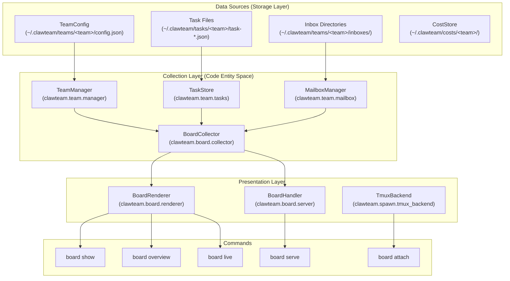
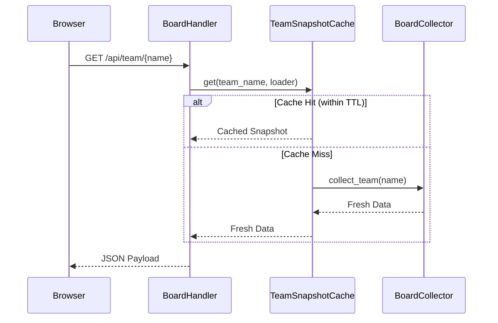
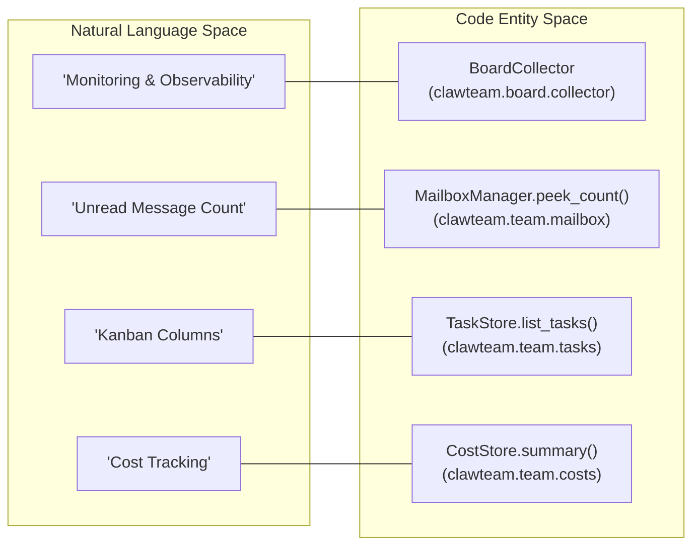

<!-- source: DeepWiki mcp.deepwiki.com · repo HKUDS/ClawTeam · page 10.5 Board Commands · fetched 2026-11-09 -->

# Board Commands

Relevant source files

The following files were used as context for generating this wiki page:

- [clawteam/board/collector.py](clawteam/board/collector.py)
- [clawteam/board/server.py](clawteam/board/server.py)
- [clawteam/board/static/index.html](clawteam/board/static/index.html)
- [clawteam/cli/commands.py](clawteam/cli/commands.py)
- [tests/test_board.py](tests/test_board.py)
- [tests/test_cli_commands.py](tests/test_cli_commands.py)

Board commands provide multi-modal monitoring and observability for ClawTeam teams. These commands aggregate data from team configuration, tasks, inboxes, and costs, then present it through terminal displays, web dashboards, or live tmux views. Board commands are read-only and do not modify team state.

---

## Command Overview

ClawTeam provides five board commands under the `clawteam board` namespace:

| Command | Purpose | Output Mode |
|---------|---------|-------------|
| `board show` | Static Kanban board snapshot | Terminal (Rich) |
| `board overview` | Multi-team summary table | Terminal (Rich) |
| `board live` | Auto-refreshing Kanban board | Terminal (Rich, live) |
| `board serve` | Web dashboard with SSE updates | HTTP server + browser |
| `board attach` | Live tmux terminal multiplexing | Tmux tiled layout |

All commands support the `--json` global flag for machine-readable output.

**Sources:**
- [clawteam/cli/commands.py:22-59]()
- [clawteam/cli/commands.py:1727-1822]()

---

## Architecture Overview

The board system uses a tiered architecture to move data from persistent storage to various visualization interfaces.

**Sources:**
- [clawteam/board/collector.py:12-14]()
- [clawteam/board/server.py:120-126]()
- [clawteam/cli/commands.py:1734-1822]()

---

## board show

Displays a static Kanban board snapshot for a single team, including member status, task distribution, and costs.

### Implementation Details
The command invokes `BoardCollector.collect_team(team_name)` [clawteam/board/collector.py:63-71](). This method:
1.  **Members:** Iterates through `config.members`, calculating `inboxCount` using `MailboxManager.peek_count()` [clawteam/board/collector.py:78-92]().
2.  **Tasks:** Fetches all tasks via `TaskStore.list_tasks()` and groups them by their `status` value (pending, in_progress, completed, blocked) [clawteam/board/collector.py:95-104]().
3.  **Messages:** Retrieves the persistent event log (up to 200 messages) and maps sender/receiver IDs to human-readable labels [clawteam/board/collector.py:119-141]().
4.  **Costs:** Aggregates token usage and financial data from `CostStore` [clawteam/board/collector.py:144-157]().
5.  **Conflicts:** Detects file overlaps in agent workspaces via `detect_overlaps` [clawteam/board/collector.py:160-174]().

**Sources:**
- [clawteam/cli/commands.py:1734-1749]()
- [clawteam/board/collector.py:63-193]()

---

## board overview

Displays a summary table of all discovered teams.

### Implementation Details
The `BoardCollector.collect_overview()` method iterates through all teams found by `TeamManager.discover_teams()`. For each team, it calls `collect_team_summary(team_name)` [clawteam/board/collector.py:36-61](). This is a lightweight operation that only counts files and basic metadata without loading full message histories or detailed task payloads.

**Sources:**
- [clawteam/cli/commands.py:1752-1761]()
- [clawteam/board/collector.py:36-61]()

---

## board live

Provides an auto-refreshing terminal view. It repeatedly clears the console and re-renders the output of `BoardCollector.collect_team()` [clawteam/cli/commands.py:1764-1787]().

| Option | Description | Default |
|--------|-------------|---------|
| `--interval, -i` | Refresh interval in seconds | `2.0` |

**Sources:**
- [clawteam/cli/commands.py:1764-1787]()

---

## board serve

Launches a lightweight HTTP server to host the Web UI dashboard.

### Web Server Architecture
The server is implemented using `ThreadingHTTPServer` and a custom `BoardHandler` [clawteam/board/server.py:12-120](). It utilizes a `TeamSnapshotCache` with a configurable TTL to prevent redundant data collection under high request loads [clawteam/board/server.py:97-117]().

### Real-time Updates (SSE)
The server supports Server-Sent Events (SSE) via the `/api/events/{team}` endpoint [clawteam/board/server.py:141-146](). It streams updates to the browser whenever the underlying team data changes or the refresh interval is reached.

### Proxy Functionality
To support external content (like GitHub READMEs) in the dashboard without CORS issues, the server includes a restricted proxy `_fetch_proxy_content` that only allows connections to specific hosts like `github.com` and `api.github.com` [clawteam/board/server.py:19-23, 73-93]().

**Sources:**
- [clawteam/board/server.py:12-165]()
- [clawteam/board/server.py:19-23]()
- [clawteam/board/server.py:97-117]()

---

## board attach

Connects to a running team's tmux session and creates a tiled view of all agent windows.

### Implementation
1.  **Session Discovery:** Identifies the tmux session named `clawteam-<team_name>`.
2.  **Window Linking:** Uses `tmux link-window` to pull agent-specific windows into a single "board" window.
3.  **Layout:** Applies `select-layout tiled` to arrange all agent panes symmetrically.

**Sources:**
- [clawteam/cli/commands.py:1806-1822]()
- [clawteam/spawn/tmux_backend.py:1-200]()

---

## Data Model Association

This diagram maps high-level monitoring concepts to the specific code entities that manage them.

**Sources:**
- [clawteam/board/collector.py:42-53]()
- [clawteam/board/collector.py:95-104]()
- [clawteam/board/collector.py:146-155]()

---

