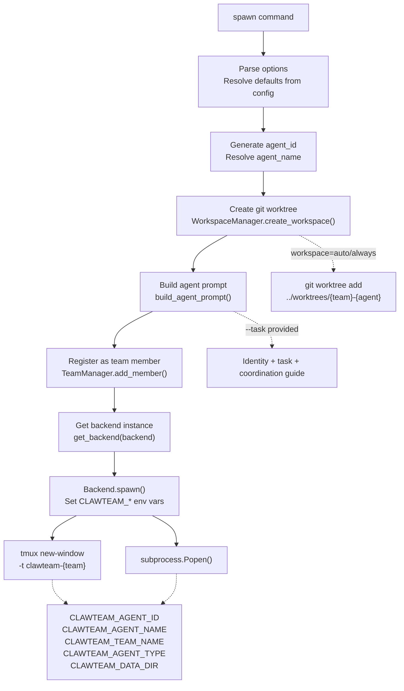

<!-- source: DeepWiki mcp.deepwiki.com · repo HKUDS/ClawTeam · page 10.6 Other Commands · fetched 2026-11-09 -->

# Other Commands

<details>
<summary>Relevant source files</summary>

The following files were used as context for generating this wiki page:

- [clawteam/cli/commands.py](clawteam/cli/commands.py)
- [clawteam/spawn/sessions.py](clawteam/spawn/sessions.py)
- [clawteam/team/costs.py](clawteam/team/costs.py)
- [clawteam/team/plan.py](clawteam/team/plan.py)
- [tests/test_cli_commands.py](tests/test_cli_commands.py)
- [tests/test_plan_storage.py](tests/test_plan_storage.py)

</details>


This page documents CLI commands not covered in previous sections: agent spawning, identity management, workspace isolation, plan approval, lifecycle management, cost tracking, session persistence, and template-based team launching.

For team creation and membership management, see [Team Commands](#10.2). For messaging, see [Inbox Commands](#10.3). For task management, see [Task Commands](#10.4). For monitoring dashboards, see [Board Commands](#10.5).

---

## Spawn Command

The `spawn` command creates new agent processes with environment variables for team identity and optional git worktree isolation.

### Basic Syntax

```bash
clawteam spawn [backend] [command...] [options]
```

**Backends:**
- `tmux` — Creates isolated tmux windows (default) [clawteam/spawn/tmux.py:12-20]()
- `subprocess` — Direct process execution [clawteam/spawn/subprocess.py:10-15]()

**Default Behavior:**
- Backend: `tmux` (from config `default_backend`) [clawteam/cli/commands.py:1545-1550]()
- Command: `claude` [clawteam/cli/commands.py:1537-1540]()
- Workspace: Auto-creates git worktree if in a repo [clawteam/cli/commands.py:1571-1575]()
- Skip permissions: `true` (auto-approves claude tool usage) [clawteam/cli/commands.py:1535-1540]()

### Key Options

| Option | Description | Default |
|--------|-------------|---------|
| `--team, -t` | Team name | `"default"` |
| `--agent-name, -n` | Agent name | Auto-generated `agent-{uuid}` |
| `--agent-type` | Agent type | `"general-purpose"` |
| `--task` | Initial task prompt | `None` |
| `--workspace/--no-workspace, -w` | Force workspace mode | Auto (from config) |
| `--repo` | Git repository path | Current directory |
| `--skip-permissions` | Skip claude tool approvals | From config (default: true) |
| `--resume, -r` | Resume previous session | `false` |

**Sources:** [clawteam/cli/commands.py:1530-1569]()

### Spawn Workflow Diagram



**Sources:** [clawteam/cli/commands.py:1528-1657](), [clawteam/spawn/factory.py:10-25](), [clawteam/workspace/manager.py:45-80]()

### Environment Variables Injected by Spawn

When spawning an agent, the following environment variables are set in the agent's process:

| Variable | Source | Example |
|----------|--------|---------|
| `CLAWTEAM_AGENT_ID` | Generated UUID | `a1b2c3d4e5f6` |
| `CLAWTEAM_AGENT_NAME` | `--agent-name` option | `alice` |
| `CLAWTEAM_TEAM_NAME` | `--team` option | `dev-team` |
| `CLAWTEAM_AGENT_TYPE` | `--agent-type` option | `general-purpose` |
| `CLAWTEAM_DATA_DIR` | Config or `--data-dir` | `~/.clawteam` |

**Sources:** [clawteam/cli/commands.py:1642-1657](), [clawteam/spawn/base.py:20-35]()

---

## Identity Commands

The `identity` command group manages agent identity context from environment variables.

### identity show

Display current agent identity from `CLAWTEAM_*` environment variables.

```bash
clawteam identity show
```

Reads from `AgentIdentity.from_env()` which parses the environment for identity metadata. [clawteam/identity.py:45-75]()

**Sources:** [clawteam/cli/commands.py:1667-1693]()

### identity set

Generate shell export commands to manually set identity environment variables.

```bash
clawteam identity set --agent-name alice --team dev-team
```

**Sources:** [clawteam/cli/commands.py:1695-1724]()

---

## Workspace Commands

The `workspace` command group manages git worktree isolation for agents.

### workspace list

List all active worktree workspaces for a team.

```bash
clawteam workspace list <team> [--repo PATH]
```

Calls `WorkspaceManager.list_workspaces(team)` which scans git worktrees for branches matching `clawteam/{team}/*`. [clawteam/workspace/manager.py:120-145]()

**Sources:** [clawteam/cli/commands.py:1832-1865]()

### workspace checkpoint

Create an auto-commit checkpoint for an agent's workspace.

```bash
clawteam workspace checkpoint <team> <agent> [--message TEXT]
```

**Sources:** [clawteam/cli/commands.py:1867-1893]()

### workspace merge

Merge an agent's workspace branch back to the base branch.

```bash
clawteam workspace merge <team> <agent> [--target BRANCH] [--no-cleanup]
```

**Sources:** [clawteam/cli/commands.py:1895-1923]()

---

## Plan Commands

The `plan` command group implements the plan approval workflow.

### plan submit

Submit a plan for leader approval.

```bash
clawteam plan submit <team> <agent> <plan-content-or-file> [--summary TEXT]
```

**Workflow:**
1. Save plan to `~/.clawteam/plans/{team}/{agent}-{plan_id}.md`. [clawteam/team/plan.py:118-121]()
2. Send `MessageType.plan_approval_request` to leader. [clawteam/team/plan.py:123-130]()

**Sources:** [clawteam/cli/commands.py:1281-1311](), [clawteam/team/plan.py:109-131]()

### plan approve / reject

Approve or reject a submitted plan, sending feedback back to the agent.

```bash
clawteam plan approve <team> <plan-id> <agent> [--feedback TEXT]
clawteam plan reject <team> <plan-id> <agent> [--feedback TEXT]
```

**Sources:** [clawteam/cli/commands.py:1313-1357](), [clawteam/team/plan.py:133-161]()

---

## Lifecycle Commands

The `lifecycle` command group implements graceful agent shutdown and idle notifications.

### lifecycle request-shutdown

Request an agent to shut down via a `MessageType.shutdown_request`. [clawteam/team/lifecycle.py:35-45]()

```bash
clawteam lifecycle request-shutdown <team> <from-agent> <to-agent> [--reason TEXT]
```

**Sources:** [clawteam/cli/commands.py:1367-1386]()

### lifecycle on-exit

Handle agent process exit. This is called automatically by spawn backends as a post-exit hook. It resets `in_progress` tasks to `pending` so they can be picked up by other agents. [clawteam/cli/commands.py:1490-1510]()

**Sources:** [clawteam/cli/commands.py:1469-1522]()

---

## Cost Commands

The `cost` command group tracks token usage and manages budgets.

### cost report

Report token usage for an agent.

```bash
clawteam cost report <team> --input-tokens 1500 --output-tokens 800 --cost-cents 2.5
```

Creates a `CostEvent` saved to `~/.clawteam/costs/{team}/`. [clawteam/team/costs.py:21-34]()

**Sources:** [clawteam/cli/commands.py:896-940](), [clawteam/team/costs.py:203-215]()

### cost show

Display aggregated cost summary for a team.

```bash
clawteam cost show <team>
```

Calculates totals using `_sync_summary_cache(team_name)`. [clawteam/team/costs.py:163-200]()

**Sources:** [clawteam/cli/commands.py:942-1001]()

---

## Session Commands

The `session` command group manages agent session persistence.

### session save

Save agent session state (including `session_id` and `last_task_id`) to `~/.clawteam/sessions/{team}/{agent}.json`. [clawteam/spawn/sessions.py:65-72]()

```bash
clawteam session save <team> --session-id claude-session-123 --agent alice
```

**Sources:** [clawteam/cli/commands.py:1182-1202](), [clawteam/spawn/sessions.py:39-72]()

---

## Template & Launch Commands

### template list / show

List available team templates and show their definitions (agents, tasks, configurations).

**Sources:** [clawteam/cli/commands.py:1983-2047](), [clawteam/templates/models.py:15-60]()

### launch

Instantiate a complete multi-agent team from a template.

```bash
clawteam launch hedge-fund --goal "Analyze TSLA stock"
```

**Workflow:**
1. Load template TOML. [clawteam/templates/__init__.py:60-75]()
2. Create team and add members. [clawteam/cli/commands.py:2100-2120]()
3. Create pre-defined tasks. [clawteam/cli/commands.py:2130-2145]()
4. Spawn all agents (leader first, then workers). [clawteam/cli/commands.py:2170-2190]()

**Sources:** [clawteam/cli/commands.py:2053-2211](), [clawteam/templates/__init__.py:110-150]()

---

