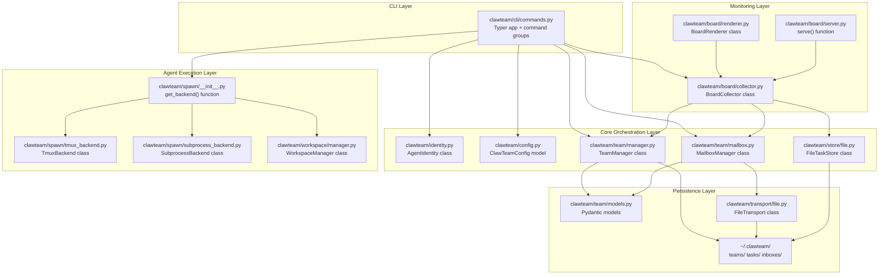
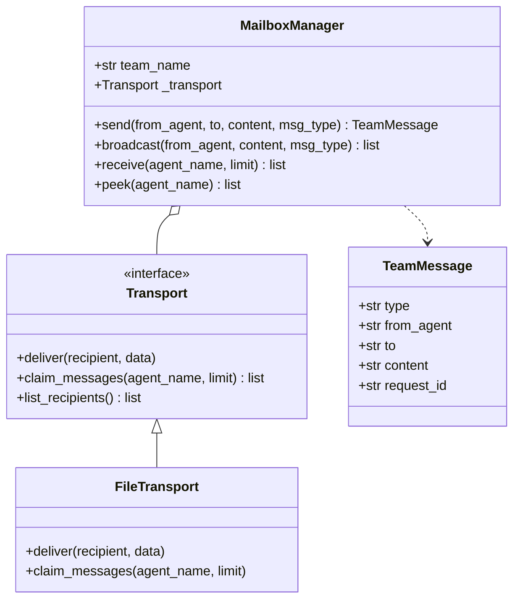
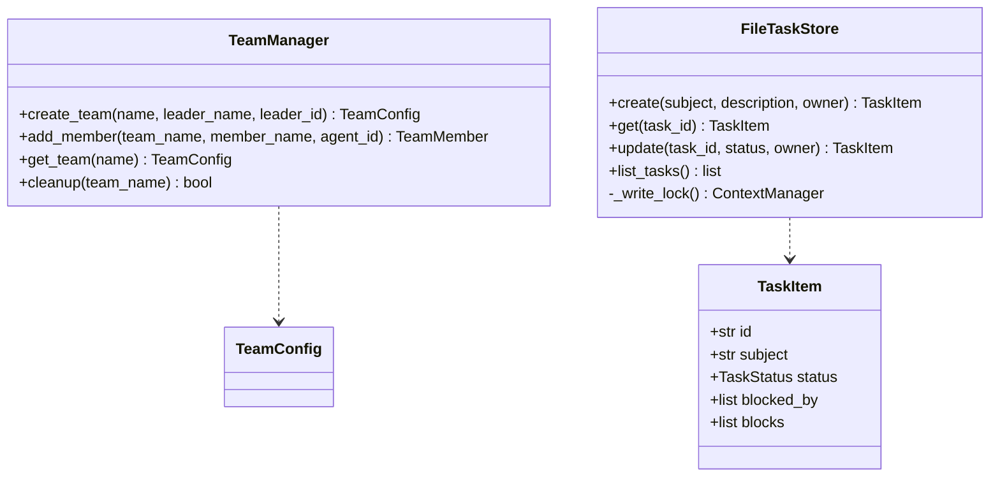

<!-- source: DeepWiki mcp.deepwiki.com · repo HKUDS/ClawTeam · page 11 Architecture Deep Dive · fetched 2026-11-09 -->

# Architecture Deep Dive

Relevant source files

The following files were used as context for generating this wiki page:

- [clawteam/cli/commands.py](clawteam/cli/commands.py)
- [clawteam/store/file.py](clawteam/store/file.py)
- [clawteam/team/mailbox.py](clawteam/team/mailbox.py)
- [clawteam/team/manager.py](clawteam/team/manager.py)
- [clawteam/transport/file.py](clawteam/transport/file.py)
- [tests/test_cli_commands.py](tests/test_cli_commands.py)
- [tests/test_mailbox.py](tests/test_mailbox.py)

This page provides detailed technical documentation of ClawTeam's internal architecture, design decisions, and implementation patterns. It explains how the major subsystems interact, maps high-level concepts to concrete code entities, and documents architectural trade-offs.

For high-level system overview, see [Architecture Overview](#1.2). For specific subsystem details, see [Storage Layer](#11.1), [Transport Layer](#11.2), [Board Data Collection](#11.3), [Spawn Backends](#11.4), [MCP Server](#11.5), and [Plugin System](#11.6).

---

## Architectural Philosophy

ClawTeam's architecture is built on three core principles:

1. **Agent-First Design**: The CLI is designed for both human and AI agent use. Every command returns structured JSON output via the `--json` flag [clawteam/cli/commands.py:79-80]() and provides human-readable output by default [clawteam/cli/commands.py:81-82]().

2. **Zero-Infrastructure Deployment**: The system runs on a local filesystem with no database, message queue, or server required by default. This enables single-command installation and cross-machine operation via shared filesystems.

3. **Pluggable Backends**: Core abstractions like transport [clawteam/transport/base.py:20-22]() and spawn backends [clawteam/spawn/base.py:12-14]() use interface-based design to support extensions (e.g., P2P or Redis transport) without breaking existing code.

**Sources**: [clawteam/cli/commands.py:1-85](), [clawteam/transport/base.py:1-30](), [clawteam/spawn/base.py:1-20]()

---

## System Layers and Component Mapping

The following diagram maps ClawTeam's architectural layers to their concrete implementations in the codebase.

**Sources**: [clawteam/cli/commands.py:22-26](), [clawteam/team/manager.py:50-52](), [clawteam/team/mailbox.py:32-34](), [clawteam/transport/file.py:102-107]()

---

## Core Component Class Structure

### Messaging and Transport

The `MailboxManager` implements a message queue that delegates actual I/O to a pluggable `Transport`.

Key implementation details:
- **Transport Resolution**: The transport is resolved via `CLAWTEAM_TRANSPORT` environment variable or config file [clawteam/team/mailbox.py:19-22]().
- **Atomic Delivery**: `FileTransport.deliver` uses a temporary file and `os.replace` to ensure atomic message delivery [clawteam/transport/file.py:143-148]().
- **Locking**: `FileTransport` uses advisory file locking (`flock` or `msvcrt.locking`) to prevent multiple agents from consuming the same message [clawteam/transport/file.py:35-46]().

**Sources**: [clawteam/team/mailbox.py:32-44](), [clawteam/transport/base.py:20-22](), [clawteam/transport/file.py:102-151]()

---

### Team and Task Management

The `TeamManager` handles team lifecycle, while `FileTaskStore` manages task state with advisory locking.

Implementation patterns:
- **Configuration Persistence**: Team configurations are stored as JSON files [clawteam/team/manager.py:24-25]().
- **Task Serialization**: Each task is stored in its own JSON file [clawteam/store/file.py:33-34]().
- **Concurrency Control**: `FileTaskStore` uses a central `.tasks.lock` file to serialize writes [clawteam/store/file.py:37-38](), [clawteam/store/file.py:55-76]().

**Sources**: [clawteam/team/manager.py:50-112](), [clawteam/store/file.py:45-52](), [clawteam/team/models.py:146-160]()

---

## Subsystem Overviews

### Storage Layer
ClawTeam uses a directory-based storage architecture rooted at `~/.clawteam/`. It organizes data into `teams/`, `tasks/`, `costs/`, and `sessions/`. For details, see [Storage Layer](#11.1).

### Transport Layer
The transport layer abstracts inter-agent communication. While `FileTransport` is the default, the system supports P2P and Redis options. For details, see [Transport Layer](#11.2).

### Board Data Collection
The `BoardCollector` aggregates team membership, task status, message counts, and cost data to provide a unified view for monitoring. For details, see [Board Data Collection](#11.3).

### Spawn Backends
The spawn system isolates agent processes. The `TmuxBackend` provides terminal persistence and tiled views, while the `SubprocessBackend` offers a lightweight alternative. For details, see [Spawn Backends](#11.4).

### MCP Server
ClawTeam integrates with the Model Context Protocol (MCP) to expose its coordination capabilities to external AI clients. For details, see [MCP Server](#11.5).

### Plugin System
The plugin architecture allows extending agent behavior, such as the `RalphLoopPlugin` which monitors task completion and re-spawns agents as needed. For details, see [Plugin System](#11.6).

**Sources**: [clawteam/team/mailbox.py:1-30](), [clawteam/store/file.py:1-30](), [clawteam/board/collector.py:1-40]()

---

