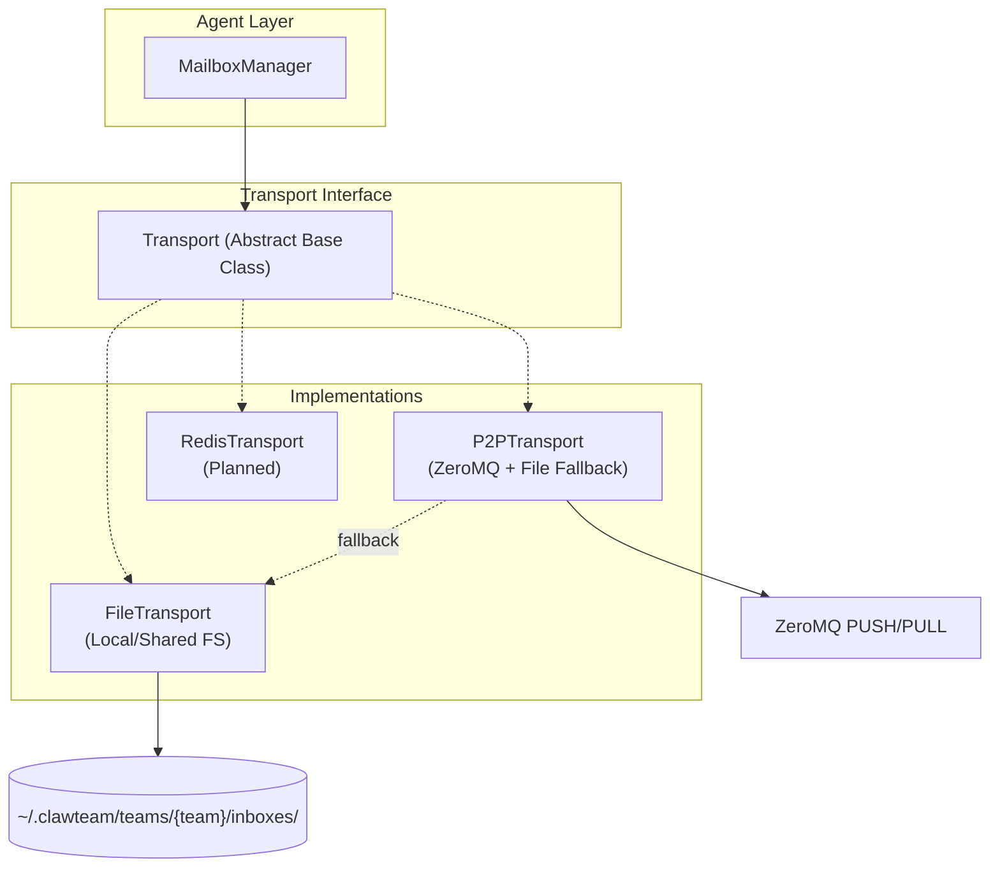
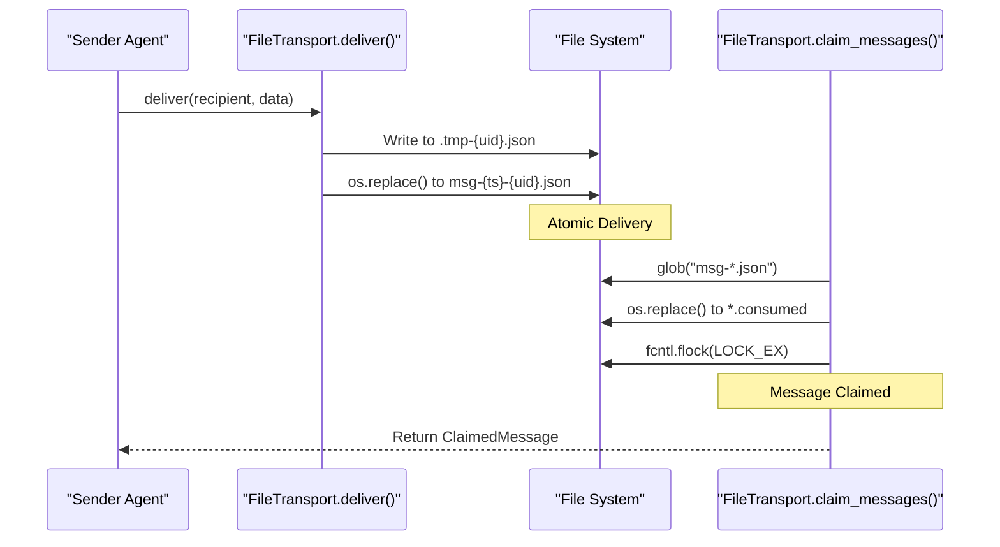

<!-- source: DeepWiki mcp.deepwiki.com · repo HKUDS/ClawTeam · page 11.2 Transport Layer · fetched 2026-11-09 -->

# Transport Layer

Relevant source files

The following files were used as context for generating this wiki page:

- [clawteam/team/snapshot.py](clawteam/team/snapshot.py)
- [clawteam/transport/__init__.py](clawteam/transport/__init__.py)
- [clawteam/transport/base.py](clawteam/transport/base.py)
- [clawteam/transport/file.py](clawteam/transport/file.py)
- [clawteam/transport/p2p.py](clawteam/transport/p2p.py)
- [tests/test_mailbox.py](tests/test_mailbox.py)
- [tests/test_snapshots.py](tests/test_snapshots.py)

## Purpose and Scope

The Transport Layer is responsible for all inter-agent communication in ClawTeam. It provides an abstraction that enables messages to be sent and received between agents regardless of whether they run on the same machine, use shared filesystems, or communicate over a network. This layer manages the delivery of raw message bytes and handles the complexities of concurrency, locking, and persistence.

For information about how messages are structured and used by agents, see [Agent Communication](#5). For storage of team configuration and task data, see [Storage Layer](#11.1).

---

## Overview

The Transport Layer decouples messaging semantics from the underlying communication mechanism using a pluggable architecture. The core interface is defined by the `Transport` abstract base class.

### Transport Abstraction Design

**Sources:** [clawteam/transport/base.py:8-10](), [clawteam/transport/__init__.py:7-23](), [clawteam/transport/file.py:102-107]()

---

## Transport Selection and Registry

Transports are managed via a central registry and instantiated through a factory function.

### Registry Mechanism
The `_TRANSPORT_REGISTRY` dictionary stores mapping from transport names to their respective classes [clawteam/transport/__init__.py:7-12]().

### Factory Function: `get_transport`
The `get_transport` function resolves the appropriate backend [clawteam/transport/__init__.py:15-23]():
1. Checks the registry for custom/plugin-provided transports.
2. Specifically handles `p2p` by importing `P2PTransport`.
3. Defaults to `FileTransport` if no specific match is found.

---

## File Transport (Default)

`FileTransport` is the primary implementation, storing messages as JSON files within the team's data directory.

### Architecture and Data Flow

**Sources:** [clawteam/transport/file.py:102-107](), [clawteam/transport/file.py:138-151](), [clawteam/transport/file.py:153-190]()

### Atomic Operations and Locking
To prevent partial reads and race conditions, `FileTransport` employs several safety mechanisms:
- **Atomic Writes:** Messages are first written to a temporary file and then moved to the final destination using `os.replace` [clawteam/transport/file.py:143-148]().
- **Message Claiming:** When an agent fetches messages, the transport renames the file to `.consumed` to prevent other processes from picking it up [clawteam/transport/file.py:158-164]().
- **Advisory Locking:** It uses `fcntl.flock` (Unix) or `msvcrt.locking` (Windows) to ensure exclusive access to a message file during processing [clawteam/transport/file.py:35-46](), [clawteam/transport/file.py:171-173]().

### Dead Letter Queue (Quarantine)
If a message cannot be processed correctly, it is moved to a `dead_letters` directory [clawteam/transport/file.py:64-72](). A metadata file (`.meta.json`) is created alongside the message to store the error details and quarantine timestamp [clawteam/transport/file.py:211-224]().

**Sources:** [clawteam/transport/file.py:125-136](), [clawteam/transport/file.py:192-210]()

---

## P2P Transport (ZeroMQ)

`P2PTransport` provides a low-latency direct messaging path using ZeroMQ `PUSH/PULL` sockets, while maintaining a `FileTransport` fallback for offline agents.

### Peer Discovery and Heartbeats
Agents register their network location (host/port) in the `peers/` directory [clawteam/transport/p2p.py:22-25]().
- **Registration:** Agents write a `{agent_name}.json` file containing their PID, host, and port [clawteam/transport/p2p.py:129-134]().
- **Heartbeat:** A background thread periodically updates the lease metadata in the peer file [clawteam/transport/p2p.py:111-127]().
- **Liveness Check:** When sending, the transport checks if the peer's lease is fresh or if the local PID is still alive [clawteam/transport/p2p.py:146-182]().

### Delivery Logic
1. **Direct Path:** If a peer is discovered and active, the transport attempts to send via a ZeroMQ `PUSH` socket.
2. **Fallback Path:** If the peer is unreachable or the lease has expired, the transport delegates delivery to the `_file_fallback` (an instance of `FileTransport`) [clawteam/transport/p2p.py:45]().

**Sources:** [clawteam/transport/p2p.py:29-35](), [clawteam/transport/p2p.py:146-182]()

---

## Team Snapshots and Transport State

The `SnapshotManager` captures the state of the transport layer by bundling pending inbox messages into the snapshot bundle.

### Snapshot Capture Flow
- **Inbox Scanning:** The manager iterates through all agent directories in the `inboxes/` root [clawteam/team/snapshot.py:148-155]().
- **Consumed Recovery:** It attempts to read both standard `.json` messages and `.consumed` files that are not currently locked by an active process [clawteam/team/snapshot.py:64-101]().
- **Lock Sensitivity:** It uses a non-blocking lock probe (`LOCK_NB`) to skip messages that are currently being processed by an agent [clawteam/team/snapshot.py:84-94]().

**Sources:** [clawteam/team/snapshot.py:123-183](), [clawteam/team/snapshot.py:64-101]()

---

## Technical Comparison

| Feature | File Transport | P2P Transport |
| :--- | :--- | :--- |
| **Primary Mechanism** | Filesystem (`os.replace`) | ZeroMQ (`PUSH/PULL`) |
| **Latency** | Medium (I/O bound) | Low (Network bound) |
| **Persistence** | Immediate (on disk) | Memory (Direct) / Disk (Fallback) |
| **Locking** | Advisory (`flock`/`msvcrt`) | Peer-file based lease |
| **Use Case** | Local/NFS shared environments | Distributed low-latency agents |

**Sources:** [clawteam/transport/file.py:102-107](), [clawteam/transport/p2p.py:29-35]()

---

